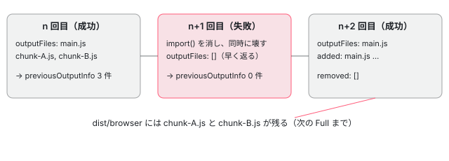

[目次](../README.md) › [application builder の読み残し：options の正規化・結果の形・BundlerContext・キャッシュ・小さなプラグインを行で埋める](README.md) › 第 2 回 / 全 6 回

# ビルドの結果の形：ExecutionResult から Full・Incremental・ComponentUpdate の Result へ

> tools/esbuild/bundler-execution-result.ts の ExecutionResult、bundler-files.ts の BuildOutputFile と createOutputFile、builders/application/results.ts の ResultKind と Result の型、build-action.ts の未読の行（出力ファイルの差分から Incremental を作る所と、書き出し）。

angular/angular-cli · 読了 約 12 分 · 中核 · [サイトで読む（デモが動きます）](https://angular-deep-dive-cyan.vercel.app/chapter/abl-results)

---

executeBuild は 1 回のビルドの結果を `ExecutionResult` に溜めて返し、runEsBuildBuildAction はそれを `Result`（Full・Incremental・ComponentUpdate・Failure の 4 種類）に組み替えて yield します。ng build はそれをディスクに書き、ng serve はメモリの表に入れます。この章では、その途中の**型と組み替えの行**を読みます。出力ファイルの 1 つ 1 つを表す `BuildOutputFile` がハッシュをいつ計算するか、前回の結果のどの値が次の回の「足した・変えた・消した」を決めるか、です。

読む対象は ../angular-cli（44129f66a3）の `builders/application/results.ts`（全部）・`tools/esbuild/bundler-files.ts`（全部）・`tools/esbuild/bundler-execution-result.ts`（全部）と、`builders/application/build-action.ts` の残りの行です。watch の全体の流れ（watcher、再ビルドのループ、監視するファイルの入れ替え）は[再ビルドの章](../cli/10-cli-cache-watch.md)、テンプレートの変更が ComponentUpdate になる条件と dev-server の側は[HMR の章](../cli/11-cli-hmr.md)、ng build が最後に書く所は[ng build の段取りの章](../cli/02-build.md)の 7・8 節にあります。

1. [1. normalizeOptions](01-abl-options.md)
2. **2. ビルドの結果の形**（この章）
3. [3. BundlerContext と後処理の残り](03-abl-context-post.md)
4. [4. ディスクに残るキャッシュ](04-abl-cache.md)
5. [5. 小さなプラグインと検査](05-abl-plugins.md)
6. [6. spec と issue](06-abl-tests-issues.md)

> [!NOTE]
> **ポイント**
>
> 記録はこのサイトの依存の @angular/build 22.2.7 で取りました。本文が読む 44129f66a3 の後に入り、22.2.7 にも入っている直しが 3 つあり、そのつど書きます。ハッシュのキャッシュを消す行（88b43b929f、2 節）、アセットを宛先で数える形（ef4372583a、5 節）、名前を変えて置き換えたアセットを写す行（254041d9d2、5 節）です。

## 1. ResultKind と Result の 4 つの形

📄 `angular-cli/packages/angular/build/src/builders/application/results.ts` L9–45 （▶ の行: 11–15, 18, 24, 29, 34, 39–43）

```ts
 9 │ import { BuildOutputFileType } from '../../tools/esbuild/bundler-files';
10 │ 
11 ▶ export enum ResultKind {
12 ▶   Failure,
13 ▶   Full,
14 ▶   Incremental,
15 ▶   ComponentUpdate,
16 │ }
17 │ 
18 ▶ export type Result = FailureResult | FullResult | IncrementalResult | ComponentUpdateResult;
19 │ 
20 │ export interface BaseResult {
21 │   kind: ResultKind;
22 │   warnings?: ResultMessage[];
23 │   duration?: number;
24 ▶   detail?: Record<string, unknown>;
25 │ }
26 │ 
27 │ export interface FailureResult extends BaseResult {
28 │   kind: ResultKind.Failure;
29 ▶   errors: ResultMessage[];
30 │ }
31 │ 
32 │ export interface FullResult extends BaseResult {
33 │   kind: ResultKind.Full;
34 ▶   files: ResultFile[];
35 │ }
36 │ 
37 │ export interface IncrementalResult extends BaseResult {
38 │   kind: ResultKind.Incremental;
39 ▶   background?: boolean;
40 ▶   added: string[];
41 ▶   removed: { path: string; type: BuildOutputFileType }[];
42 ▶   modified: string[];
43 ▶   files: ResultFile[];
44 │ }
45 │ 
```

📄 `angular-cli/packages/angular/build/src/builders/application/results.ts` L46–78 （▶ の行: 46, 49, 55–56, 60–62, 73, 75–76）

```ts
46 ▶ export type ResultFile = DiskFile | MemoryFile;
47 │ 
48 │ export interface BaseResultFile {
49 ▶   origin: 'memory' | 'disk';
50 │   path: string;
51 │   type: BuildOutputFileType;
52 │ }
53 │ 
54 │ export interface DiskFile extends BaseResultFile {
55 ▶   origin: 'disk';
56 ▶   inputPath: string;
57 │ }
58 │ 
59 │ export interface MemoryFile extends BaseResultFile {
60 ▶   origin: 'memory';
61 ▶   hash: string;
62 ▶   contents: Uint8Array;
63 │ }
64 │ 
65 │ export interface ResultMessage {
66 │   text: string;
67 │   location?: { file: string; line: number; column: number } | null;
68 │   notes?: { text: string }[];
69 │ }
70 │ 
71 │ export interface ComponentUpdateResult extends BaseResult {
72 │   kind: ResultKind.ComponentUpdate;
73 ▶   updates: {
74 │     id: string;
75 ▶     type: 'style' | 'template';
76 ▶     content: string;
77 │   }[];
78 │ }
```

11〜16 行目の enum は数の enum で、Failure が 0、Full が 1、Incremental が 2、ComponentUpdate が 3 です。18 行目の `Result` は 4 つの interface の合併で、`kind` で見分けます。Full（32〜35 行目）は全部のファイル、Incremental（37〜44 行目）は変わったファイルだけと、足した・消した・変えたパスの一覧を持ちます。41 行目の `removed` だけが `type` を持つのは、消す側がどのフォルダ（browser か server か）から消すかを決めるためです（6 節）。39 行目の `background` は「ブラウザに知らせずに、サーバー側の表だけ入れ替えればよい」の印で、e59946ca32（2025-01-16）で足されました。

ファイルは 46 行目のとおり 2 種類です。`MemoryFile`（59〜63 行目）は中身のバイト列とハッシュを持ち、`DiskFile`（54〜57 行目）は元のファイルのパス（`inputPath`）だけを持ちます。アセット（public/ のファイル）は読み込まずに、写す元のパスとして渡ります。`files` が配列になったのは 701bde4818（2026-08-26）からで、それまでは「パス → ファイル」の Record でした。SSR と service worker を一緒に使うと、browser と server に同じ名前の CSS ができ、Record では片方が消えていたためです。73〜77 行目の ComponentUpdate の `type` は `'style'` も許しますが、../angular-cli の中で作られるのは build-action.ts の emitOutputResults（HMR の章が読んだ行）の `'template'` だけで、dev-server も `'template'` しか扱いません。

## 2. BuildOutputFile：中身・テキスト・ハッシュを遅れて作る

📄 `angular-cli/packages/angular/build/src/tools/esbuild/bundler-files.ts` L9–34 （▶ の行: 12, 17–18, 21–26, 29–32）

```ts
 9 │ import type { OutputFile } from 'esbuild';
10 │ import { calculateHash } from '../../utils/hash';
11 │ 
12 ▶ export interface InitialFileRecord {
13 │   entrypoint: boolean;
14 │   name?: string;
15 │   type: 'script' | 'style';
16 │   external?: boolean;
17 ▶   serverFile: boolean;
18 ▶   depth: number;
19 │ }
20 │ 
21 ▶ export enum BuildOutputFileType {
22 ▶   Browser,
23 ▶   Media,
24 ▶   ServerApplication,
25 ▶   ServerRoot,
26 ▶   Root,
27 │ }
28 │ 
29 ▶ export interface BuildOutputFile extends OutputFile {
30 ▶   type: BuildOutputFileType;
31 ▶   readonly size: number;
32 ▶   clone: () => BuildOutputFile;
33 │ }
34 │ 
```

21〜27 行目の `BuildOutputFileType` が、ファイルを書くフォルダを決めます。Browser と Media は browser/、ServerApplication と ServerRoot は server/、Root は出力の根です（[ng build の段取りの章](../cli/02-build.md)の 8 節の generateFullPath）。どのファイルがどの種類になるかは[次の章](03-abl-context-post.md)の BundlerContext が決めます。29 行目の `BuildOutputFile` は esbuild の `OutputFile`（path・contents・text・hash）に type と `clone` を足した形です。12〜19 行目の `InitialFileRecord` は初期ファイルの記録で、使い方は[遅延チャンクの章](../cli/07-cli-code-splitting.md)の 3 節です。

📄 `angular-cli/packages/angular/build/src/tools/esbuild/bundler-files.ts` L35–73 （▶ の行: 40–43, 49, 53–55, 58, 66, 71）

```ts
35 │ export function createOutputFile(
36 │   path: string,
37 │   data: string | Uint8Array,
38 │   type: BuildOutputFileType,
39 │ ): BuildOutputFile {
40 ▶   if (typeof data === 'string') {
41 ▶     let cachedContents: Uint8Array | null = null;
42 ▶     let cachedText: string | null = data;
43 ▶     let cachedHash: string | null = null;
44 │ 
45 │     return {
46 │       path,
47 │       type,
48 │       get contents(): Uint8Array {
49 ▶         cachedContents ??= new TextEncoder().encode(data);
50 │ 
51 │         return cachedContents;
52 │       },
53 ▶       set contents(value: Uint8Array) {
54 ▶         cachedContents = value;
55 ▶         cachedText = null;
56 │       },
57 │       get text(): string {
58 ▶         cachedText ??= new TextDecoder('utf-8').decode(this.contents);
59 │ 
60 │         return cachedText;
61 │       },
62 │       get size(): number {
63 │         return this.contents.byteLength;
64 │       },
65 │       get hash(): string {
66 ▶         cachedHash ??= calculateHash(cachedText ?? this.contents);
67 │ 
68 │         return cachedHash;
69 │       },
70 │       clone(): BuildOutputFile {
71 ▶         return createOutputFile(this.path, cachedText ?? this.contents, this.type);
72 │       },
73 │     };
```

📄 `angular-cli/packages/angular/build/src/tools/esbuild/bundler-files.ts` L74–107 （▶ の行: 75, 83–85, 98, 103）

```ts
 74 │   } else {
 75 ▶     let cachedContents = data;
 76 │     let cachedText: string | null = null;
 77 │     let cachedHash: string | null = null;
 78 │ 
 79 │     return {
 80 │       get contents(): Uint8Array {
 81 │         return cachedContents;
 82 │       },
 83 ▶       set contents(value: Uint8Array) {
 84 ▶         cachedContents = value;
 85 ▶         cachedText = null;
 86 │       },
 87 │       path,
 88 │       type,
 89 │       get size(): number {
 90 │         return this.contents.byteLength;
 91 │       },
 92 │       get text(): string {
 93 │         cachedText ??= new TextDecoder('utf-8').decode(this.contents);
 94 │ 
 95 │         return cachedText;
 96 │       },
 97 │       get hash(): string {
 98 ▶         cachedHash ??= calculateHash(this.contents);
 99 │ 
100 │         return cachedHash;
101 │       },
102 │       clone(): BuildOutputFile {
103 ▶         return createOutputFile(this.path, this.contents, this.type);
104 │       },
105 │     };
106 │   }
107 │ }
```

1. **40〜43 行目：文字列で作ったら、バイト列はまだ作らない**

   `index.html` や統計の JSON のように文字列で作るファイルは、49 行目で初めて `contents` を読んだときに TextEncoder でバイト列にします。ハッシュは 66 行目、文字列が残っていれば文字列のまま計算します（calculateHash は xxHash の 64 ビット）。
2. **53〜56 行目・83〜86 行目：中身を差し替えると、テキストのキャッシュを捨てる**

   後処理（debug ID・source map の ignoreList・SSR のマニフェスト）は `file.contents = …` で中身を差し替えます。そのとき 55・85 行目で cachedText を null にします。
3. **ハッシュのキャッシュは、44129f66a3 では捨てない**

   53〜56 行目と 83〜86 行目は `cachedHash` を null にしません。一度ハッシュを読んだ後に中身を差し替えると、古いハッシュが残ります。88b43b929f（2026-10-30）が 3 つの setter に `cachedHash = null` を足し、22.2.7 にも入っています。

📄 `angular-cli/packages/angular/build/src/tools/esbuild/bundler-files.ts` L109–136 （▶ の行: 109–110, 117–119, 121, 133）

```ts
109 ▶ export function convertOutputFile(file: OutputFile, type: BuildOutputFileType): BuildOutputFile {
110 ▶   let { contents: cachedContents } = file;
111 │   let cachedText: string | null = null;
112 │ 
113 │   return {
114 │     get contents(): Uint8Array {
115 │       return cachedContents;
116 │     },
117 ▶     set contents(value: Uint8Array) {
118 ▶       cachedContents = value;
119 ▶       cachedText = null;
120 │     },
121 ▶     hash: file.hash,
122 │     path: file.path,
123 │     type,
124 │     get size(): number {
125 │       return this.contents.byteLength;
126 │     },
127 │     get text(): string {
128 │       cachedText ??= new TextDecoder('utf-8').decode(this.contents);
129 │ 
130 │       return cachedText;
131 │     },
132 │     clone(): BuildOutputFile {
133 ▶       return convertOutputFile(this, this.type);
134 │     },
135 │   };
136 │ }
```

esbuild の出力は `convertOutputFile` で包みます。121 行目、ハッシュは esbuild が計算した `file.hash` を**そのまま固定の値として**持ちます。117〜120 行目で中身を差し替えても、ハッシュは変わりません。esbuild の出力の多くは JavaScript と source map で、[次の章](03-abl-context-post.md)の injectDebugIds が中身を書き換えます。44129f66a3 では、書き換えた後もハッシュは esbuild の値のままで、5 節の「変わったか」の比較と、HTML の integrity（SRI）を作る側が古いハッシュを読みえます。88b43b929f はここも `get hash()` に変え、差し替えたら計算し直す形にしました。

> **🧪 DEMO — 中身を差し替えた後のハッシュ（2 つの版）**
>
> 44129f66a3 の bundler-files.ts を esbuild で JS にしたものと、22.2.7 の配布物の bundler-files.js に、同じ操作をしました。esbuild の出力に見立てたオブジェクト（hash は `esbuild-hash`）を convertOutputFile で包み、ハッシュを読み、中身を差し替えて、もう一度読みます。
>
> ▶ [このデモはサイトで動かせます](https://angular-deep-dive-cyan.vercel.app/chapter/abl-results)

44129f66a3 の版では、convertOutputFile も createOutputFile も、中身を差し替えた後に hash が変わりませんでした。22.2.7 では両方とも変わります。これを固める spec は 88b43b929f が足した `tests/options/subresource-integrity_spec.ts` の it（ビルドを通して integrity が中身と合うかを見る形）で、bundler-files.ts の unit の spec はありません。

## 3. ExecutionResult：1 回のビルドの入れ物

📄 `angular-cli/packages/angular/build/src/tools/esbuild/bundler-execution-result.ts` L9–45 （▶ の行: 22–23, 27–32, 34–35, 38–41）

```ts
 9 │ import type { Message, PartialMessage } from 'esbuild';
10 │ import { normalize } from 'node:path';
11 │ import type { ChangedFiles } from '../../tools/esbuild/watcher';
12 │ import type { ComponentStylesheetBundler } from './angular/component-stylesheets';
13 │ import type { SourceFileCache } from './angular/source-file-cache';
14 │ import type { BundlerContext } from './bundler-context';
15 │ import { type BuildOutputFile, BuildOutputFileType, createOutputFile } from './bundler-files';
16 │ 
17 │ export interface BuildOutputAsset {
18 │   source: string;
19 │   destination: string;
20 │ }
21 │ 
22 ▶ export interface RebuildState {
23 ▶   rebuildContexts: {
24 │     typescriptContexts: BundlerContext[];
25 │     otherContexts: BundlerContext[];
26 │   };
27 ▶   componentStyleBundler: ComponentStylesheetBundler;
28 ▶   codeBundleCache?: SourceFileCache;
29 ▶   fileChanges: ChangedFiles;
30 ▶   previousOutputInfo: ReadonlyMap<
31 ▶     string,
32 ▶     { hash: string; type: BuildOutputFileType; path: string }
33 │   >;
34 ▶   previousAssetsInfo: ReadonlyMap<string, string>;
35 ▶   templateUpdates?: Map<string, string>;
36 │ }
37 │ 
38 ▶ export interface ExternalResultMetadata {
39 ▶   implicitBrowser: string[];
40 ▶   implicitServer: string[];
41 ▶   explicit: string[];
42 │ }
43 │ 
44 │ export type PrerenderedRoutesRecord = Record<string, { headers?: Record<string, string> }>;
45 │ 
```

📄 `angular-cli/packages/angular/build/src/tools/esbuild/bundler-execution-result.ts` L46–70 （▶ の行: 50–53, 56–59, 62, 66–68）

```ts
46 │ /**
47 │  * Represents the result of a single builder execute call.
48 │  */
49 │ export class ExecutionResult {
50 ▶   outputFiles: BuildOutputFile[] = [];
51 ▶   assetFiles: BuildOutputAsset[] = [];
52 ▶   errors: (Message | PartialMessage)[] = [];
53 ▶   prerenderedRoutes: PrerenderedRoutesRecord = {};
54 │   warnings: (Message | PartialMessage)[] = [];
55 │   logs: string[] = [];
56 ▶   externalMetadata?: ExternalResultMetadata;
57 ▶   extraWatchFiles: string[] = [];
58 ▶   htmlIndexPath?: string;
59 ▶   htmlBaseHref?: string;
60 │ 
61 │   constructor(
62 ▶     private rebuildContexts: {
63 │       typescriptContexts: BundlerContext[];
64 │       otherContexts: BundlerContext[];
65 │     },
66 ▶     private componentStyleBundler: ComponentStylesheetBundler,
67 ▶     private codeBundleCache?: SourceFileCache,
68 ▶     readonly templateUpdates?: Map<string, string>,
69 │   ) {}
70 │ 
```

`ExecutionResult` は executeBuild が 1 回ごとに作り、出力（50 行目）・アセット（51 行目）・エラーと警告・prerender したルート・dev-server 向けの外部依存の情報（56 行目）を溜めます。62〜68 行目のコンストラクタは、esbuild の context の組・コンポーネントのスタイルの bundler・TypeScript のキャッシュ・テンプレートの更新を **private で**受け取ります。外からは読めず、次の回に渡すのは 22〜36 行目の `RebuildState` を通してだけです。RebuildState の 30〜34 行目、`previousOutputInfo` と `previousAssetsInfo` が、5 節の「前回と比べる」の材料です。

📄 `angular-cli/packages/angular/build/src/tools/esbuild/bundler-execution-result.ts` L71–96 （▶ の行: 71–72, 75–76, 83–85）

```ts
71 ▶   addOutputFile(path: string, content: string | Uint8Array, type: BuildOutputFileType): void {
72 ▶     this.outputFiles.push(createOutputFile(path, content, type));
73 │   }
74 │ 
75 ▶   addAssets(assets: BuildOutputAsset[]): void {
76 ▶     this.assetFiles.push(...assets);
77 │   }
78 │ 
79 │   addLog(value: string): void {
80 │     this.logs.push(value);
81 │   }
82 │ 
83 ▶   addError(error: PartialMessage | string): void {
84 ▶     if (typeof error === 'string') {
85 ▶       this.errors.push({ text: error, location: null });
86 │     } else {
87 │       this.errors.push(error);
88 │     }
89 │   }
90 │ 
91 │   addErrors(errors: (PartialMessage | string)[]): void {
92 │     for (const error of errors) {
93 │       this.addError(error);
94 │     }
95 │   }
96 │ 
```

📄 `angular-cli/packages/angular/build/src/tools/esbuild/bundler-execution-result.ts` L97–122 （▶ の行: 98, 102–103, 106, 110–111）

```ts
 97 │   addPrerenderedRoutes(routes: PrerenderedRoutesRecord): void {
 98 ▶     Object.assign(this.prerenderedRoutes, routes);
 99 │ 
100 │     // Sort the prerendered routes.
101 │     const sortedObj: PrerenderedRoutesRecord = {};
102 ▶     for (const key of Object.keys(this.prerenderedRoutes).sort()) {
103 ▶       sortedObj[key] = this.prerenderedRoutes[key];
104 │     }
105 │ 
106 ▶     this.prerenderedRoutes = sortedObj;
107 │   }
108 │ 
109 │   addWarning(error: PartialMessage | string): void {
110 ▶     if (typeof error === 'string') {
111 ▶       this.warnings.push({ text: error, location: null });
112 │     } else {
113 │       this.warnings.push(error);
114 │     }
115 │   }
116 │ 
117 │   addWarnings(errors: (PartialMessage | string)[]): void {
118 │     for (const error of errors) {
119 │       this.addWarning(error);
120 │     }
121 │   }
122 │ 
```

72 行目の addOutputFile は 2 節の createOutputFile を呼ぶだけです（統計の JSON や 3rdpartylicenses.txt など、esbuild を通らない出力の入口）。84・85 行目と 110・111 行目、文字列で渡したエラーと警告は `{ text, location: null }` の形にそろえ、esbuild の Message と同じ表示の関数（logMessages）に渡せるようにします。98〜106 行目の addPrerenderedRoutes は、足すたびにキーを並べ直します。prerendered-routes.json の順が、ルートを描き終えた順で揺れないためです。

📄 `angular-cli/packages/angular/build/src/tools/esbuild/bundler-execution-result.ts` L123–153 （▶ の行: 130, 135, 138, 144）

```ts
123 │   /**
124 │    * Add external JavaScript import metadata to the result. This is currently used
125 │    * by the development server to optimize the prebundling process.
126 │    * @param implicitBrowser External dependencies for the browser bundles due to the external packages option.
127 │    * @param implicitServer External dependencies for the server bundles due to the external packages option.
128 │    * @param explicit External dependencies due to explicit project configuration.
129 │    */
130 ▶   setExternalMetadata(
131 │     implicitBrowser: string[],
132 │     implicitServer: string[],
133 │     explicit: string[],
134 │   ): void {
135 ▶     this.externalMetadata = { implicitBrowser, implicitServer, explicit };
136 │   }
137 │ 
138 ▶   get output() {
139 │     return {
140 │       success: this.errors.length === 0,
141 │     };
142 │   }
143 │ 
144 ▶   get outputWithFiles() {
145 │     return {
146 │       success: this.errors.length === 0,
147 │       outputFiles: this.outputFiles,
148 │       assetFiles: this.assetFiles,
149 │       errors: this.errors,
150 │       externalMetadata: this.externalMetadata,
151 │     };
152 │   }
153 │ 
```

130〜136 行目の setExternalMetadata は、[次の章](03-abl-context-post.md)の 4 節で読む execute-build.ts の外部依存の段だけが呼びます。138 行目の `output` と 144 行目の `outputWithFiles` は、../angular-cli を grep しても読む所がありません（webpack 時代の builder と同じ形の名残で、新しい本家にも残っています）。

📄 `angular-cli/packages/angular/build/src/tools/esbuild/bundler-execution-result.ts` L154–184 （▶ の行: 159–160, 163, 165–166, 170, 176–177, 179–180）

```ts
154 │   get watchFiles(): Readonly<string[]> {
155 │     const { typescriptContexts, otherContexts } = this.rebuildContexts;
156 │ 
157 │     return [
158 │       // Bundler contexts internally normalize file dependencies.
159 ▶       ...typescriptContexts.flatMap((context) => [...context.watchFiles]),
160 ▶       ...otherContexts.flatMap((context) => [...context.watchFiles]),
161 │       // These files originate from TS/NG and can have POSIX path separators even on Windows.
162 │       // To ensure path comparisons are valid, all these paths must be normalized.
163 ▶       ...(this.codeBundleCache?.referencedFiles?.map(normalize) ?? []),
164 │       // The assets source files.
165 ▶       ...this.assetFiles.map(({ source }) => source),
166 ▶       ...this.extraWatchFiles,
167 │     ];
168 │   }
169 │ 
170 ▶   createRebuildState(fileChanges: ChangedFiles): RebuildState {
171 │     return {
172 │       rebuildContexts: this.rebuildContexts,
173 │       codeBundleCache: this.codeBundleCache,
174 │       componentStyleBundler: this.componentStyleBundler,
175 │       fileChanges,
176 ▶       previousOutputInfo: new Map(
177 ▶         this.outputFiles.map(({ path, hash, type }) => [`${type}:${path}`, { hash, type, path }]),
178 │       ),
179 ▶       previousAssetsInfo: new Map(
180 ▶         this.assetFiles.map(({ source, destination }) => [source, destination]),
181 │       ),
182 │       templateUpdates: this.templateUpdates,
183 │     };
184 │   }
```

1. **154〜168 行目：次に監視するファイル**

   esbuild の context が読んだファイル（159・160 行目）、TypeScript が読んだファイル（163 行目、Windows でも比べられるように normalize）、アセットの元のファイル（165 行目）、それ以外に足したファイル（166 行目）です。監視の入れ替えは[再ビルドの章](../cli/10-cli-cache-watch.md)の 3 節です。
2. **176〜178 行目：前回の出力を「type:path → ハッシュ」の表にする**

   キーに type を入れたのは 701bde4818 で、browser と server の同じ名前を分けるためです。**同じ type と path のファイルが 2 つあれば、後のほうが表に残ります**（5 節）。
3. **179〜181 行目：前回のアセットを「元 → 宛先」の表にする**

   1 つの元を 2 か所に写すと、表には後の宛先しか残りません（5 節）。

📄 `angular-cli/packages/angular/build/src/tools/esbuild/bundler-execution-result.ts` L185–217 （▶ の行: 186, 191–193, 203, 209–211, 214）

```ts
185 │ 
186 ▶   findChangedFiles(
187 │     previousOutputHashes: ReadonlyMap<string, { hash: string; type: BuildOutputFileType }>,
188 │   ): Set<string> {
189 │     const changed = new Set<string>();
190 │     for (const file of this.outputFiles) {
191 ▶       const previousHash = previousOutputHashes.get(`${file.type}:${file.path}`)?.hash;
192 ▶       if (previousHash === undefined || previousHash !== file.hash) {
193 ▶         changed.add(file.path);
194 │       }
195 │     }
196 │ 
197 │     return changed;
198 │   }
199 │ 
200 │   #disposal?: Promise<void>;
201 │ 
202 │   dispose(): Promise<void> {
203 ▶     return (this.#disposal ??= this.#dispose());
204 │   }
205 │ 
206 │   async #dispose(): Promise<void> {
207 │     try {
208 │       await Promise.allSettled([
209 ▶         ...this.rebuildContexts.typescriptContexts.map((context) => context.dispose()),
210 ▶         ...this.rebuildContexts.otherContexts.map((context) => context.dispose()),
211 ▶         this.componentStyleBundler.dispose(),
212 │       ]);
213 │     } finally {
214 ▶       this.codeBundleCache?.clear();
215 │     }
216 │   }
217 │ }
```

186〜198 行目の findChangedFiles は、ログの表で「変わったファイル」に印を付けるため（execute-build.ts の終わり近くの logBuildStats の引数）だけに使います。Result を作る 5 節の比べ方とは別の関数です。203 行目の `??=` で、dispose は何回呼んでも 1 回しか走りません。watch でないときは executeBuild がバンドルの直後に投げっぱなしで dispose し（f4a0f846e7、2026-07-31、ng build の段取りの章の 2 節）、build-action も後で呼ぶので、この 2 回を 1 回にするための形です。

## 4. runEsBuildBuildAction：前回の結果が次の回を決める

📄 `angular-cli/packages/angular/build/src/builders/application/build-action.ts` L38–72 （▶ の行: 39, 41, 43, 45, 47–49, 53–54, 70, 72）

```ts
38 │ // Watch workspace for package manager changes
39 ▶ const packageWatchFiles = [
40 │   // manifest can affect module resolution
41 ▶   'package.json',
42 │   // npm lock file
43 ▶   'package-lock.json',
44 │   // pnpm lock file
45 ▶   'pnpm-lock.yaml',
46 │   // yarn lock file including Yarn PnP manifest files (https://yarnpkg.com/advanced/pnp-spec/)
47 ▶   'yarn.lock',
48 ▶   '.pnp.cjs',
49 ▶   '.pnp.data.json',
50 │ ];
51 │ 
52 │ // eslint-disable-next-line max-lines-per-function
53 ▶ export async function* runEsBuildBuildAction(
54 ▶   action: (rebuildState?: RebuildState) => Promise<ExecutionResult>,
55 │   options: {
56 │     workspaceRoot: string;
57 │     projectRoot: string;
58 │     outputOptions: NormalizedOutputOptions;
59 │     logger: BuilderContext['logger'];
60 │     cacheOptions: NormalizedCachedOptions;
61 │     watch?: boolean;
62 │     verbose?: boolean;
63 │     progress?: boolean;
64 │     poll?: number;
65 │     signal?: AbortSignal;
66 │     preserveSymlinks?: boolean;
67 │     clearScreen?: boolean;
68 │     colors?: boolean;
69 │     jsonLogs?: boolean;
70 ▶     incrementalResults?: boolean;
71 │   },
72 ▶ ): AsyncIterable<Result> {
```

📄 `angular-cli/packages/angular/build/src/builders/application/build-action.ts` L73–93 （▶ の行: 87, 90, 92）

```ts
73 │   const {
74 │     watch,
75 │     poll,
76 │     clearScreen,
77 │     logger,
78 │     cacheOptions,
79 │     outputOptions,
80 │     verbose,
81 │     projectRoot,
82 │     workspaceRoot,
83 │     progress,
84 │     preserveSymlinks,
85 │     colors,
86 │     jsonLogs,
87 ▶     incrementalResults,
88 │   } = options;
89 │ 
90 ▶   await initializeHash();
91 │ 
92 ▶   const withProgress: typeof withSpinner = progress ? withSpinner : withNoProgress;
93 │ 
```

53〜72 行目、runEsBuildBuildAction は `action`（rebuildState を受け取って ExecutionResult を返す関数。中身は executeBuild）と options を受け取り、`AsyncIterable<Result>` を返す async generator です。90 行目の `initializeHash()` は、2 節の calculateHash が使う xxHash の WebAssembly を最初に 1 回読み込みます（cda8830710、2026-08-06）。これより前に hash を読むと assert で落ちるので、ビルドの最初に置いてあります。39〜50 行目の packageWatchFiles は、次の 146〜164 行目で使います。

📄 `angular-cli/packages/angular/build/src/builders/application/build-action.ts` L108–117 （▶ の行: 109–110, 113–115）

```ts
108 │ 
109 ▶   let watcher: import('../../tools/esbuild/watcher').BuildWatcher | undefined;
110 ▶   let watchLoopStarted = false;
111 │   try {
112 │     // Setup watcher if watch mode enabled
113 ▶     if (watch) {
114 ▶       if (progress) {
115 ▶         logger.info('Watch mode enabled. Watching for file changes...');
116 │       }
117 │ 
```

📄 `angular-cli/packages/angular/build/src/builders/application/build-action.ts` L146–164 （▶ の行: 148–149, 153, 155–158, 162）

```ts
146 │ 
147 │       // Watch the entire project root if 'NG_BUILD_WATCH_ROOT' environment variable is set
148 ▶       if (shouldWatchRoot) {
149 ▶         if (!preserveSymlinks) {
150 │           // Ignore all node modules directories to avoid excessive file watchers.
151 │           // Package changes are handled below by watching manifest and lock files.
152 │           // NOTE: this is not enable when preserveSymlinks is true as this would break `npm link` usages.
153 ▶           ignored.push('**/node_modules/**');
154 │ 
155 ▶           watcher.add(
156 ▶             packageWatchFiles
157 ▶               .map((file) => path.join(workspaceRoot, file))
158 ▶               .filter((file) => existsSync(file)),
159 │           );
160 │         }
161 │ 
162 ▶         watcher.add(projectRoot);
163 │       }
164 │ 
```

148 行目の `shouldWatchRoot` は環境変数 NG\_BUILD\_WATCH\_ROOT です。これが立つと、ビルドが読んだファイルだけでなく project の root 全体を監視し（162 行目）、node\_modules を外す代わりに、package.json とロックファイルのうち、あるものだけを足します（155〜159 行目）。149 行目、preserveSymlinks のときは node\_modules を外しません（npm link したパッケージの中を監視するため）。

📄 `angular-cli/packages/angular/build/src/builders/application/build-action.ts` L184–195 （▶ の行: 187–188, 194）

```ts
184 │ 
185 │     watchLoopStarted = true;
186 │   } finally {
187 ▶     if (!watchLoopStarted && result) {
188 ▶       await result.dispose();
189 │     }
190 │   }
191 │ 
192 │   // Used to force a full result on next rebuild if there were initial errors.
193 │   // This ensures at least one full result is emitted.
194 ▶   let hasInitialErrors = result.errors.length > 0;
195 │ 
```

194 行目の `hasInitialErrors` は、1 回目のビルドが失敗したときに、2 回目を Full にするための印です（b24089ef86、2025-02-04）。ループの中では `incrementalResults && !hasInitialErrors ? rebuildState : undefined`（再ビルドの章が読んだ行）として効き、rebuildState を渡さなければ 5 節の emitOutputResults は Full を作ります。この印が見るのは**1 回目**のエラーだけです。途中の回が失敗したときに何が起きるかは、下の 5 節とデモで見ます。

## 5. emitOutputResults：足した・変えた・消した

📄 `angular-cli/packages/angular/build/src/builders/application/build-action.ts` L258–280 （▶ の行: 260, 262, 266, 275, 278–279）

```ts
258 │   } finally {
259 │     // Stop the watcher and cleanup incremental rebuild state
260 ▶     await Promise.allSettled([watcher.close(), result.dispose()]);
261 │ 
262 ▶     shutdownSassWorkerPool();
263 │   }
264 │ }
265 │ 
266 ▶ function* emitOutputResults(
267 │   {
268 │     outputFiles,
269 │     assetFiles,
270 │     errors,
271 │     warnings,
272 │     externalMetadata,
273 │     htmlIndexPath,
274 │     htmlBaseHref,
275 ▶     templateUpdates,
276 │   }: ExecutionResult,
277 │   outputOptions: NormalizedApplicationBuildOptions['outputOptions'],
278 ▶   changes?: ChangedFiles,
279 ▶   rebuildState?: RebuildState,
280 │ ): Iterable<Result> {
```

260 行目、ループを抜けると watcher を閉じ、最後の結果を dispose します。266〜280 行目の emitOutputResults は、ExecutionResult から 8 つの値を取り出し、`changes` と `rebuildState` があるときだけ Incremental を作る generator です。エラーなら Failure を、rebuildState が無ければ Full を作る行と、テンプレートの更新の行は[ng build の段取りの章](../cli/02-build.md)と[HMR の章](../cli/11-cli-hmr.md)が読みました。残りの 2 か所を読みます。

📄 `angular-cli/packages/angular/build/src/builders/application/build-action.ts` L323–342 （▶ の行: 325, 333, 336–339, 341）

```ts
323 │     modified: [],
324 │     files: [],
325 ▶     detail: {
326 │       externalMetadata,
327 │       htmlIndexPath,
328 │       htmlBaseHref,
329 │       outputOptions,
330 │     },
331 │   };
332 │ 
333 ▶   let hasCssUpdates = false;
334 │ 
335 │   // Initially assume all previous output files have been removed
336 ▶   const removedOutputFiles = new Map(previousOutputInfo);
337 ▶   for (const file of outputFiles) {
338 ▶     const key = `${file.type}:${file.path}`;
339 ▶     removedOutputFiles.delete(key);
340 │ 
341 ▶     const previousHash = previousOutputInfo.get(key)?.hash;
342 │     let needFile = false;
```

1. **336 行目：前回の出力を、全部「消えた」とみなして始める**

   3 節の previousOutputInfo を写し、339 行目で今回もあるファイルを消していきます。最後まで残ったものが `removed` になります。
2. **341 行目：type:path で前回のハッシュを引く**

   無ければ added、違えば modified、同じなら Result に入れません（この引用のすぐ下の行、HMR の章が読んだ所）。比べるのは 2 節の `file.hash` です。

📄 `angular-cli/packages/angular/build/src/builders/application/build-action.ts` L367–392 （▶ の行: 369, 371, 373–374, 376–377, 386–389）

```ts
367 │ 
368 │   // Initially assume all previous assets files have been removed
369 ▶   const removedAssetFiles = new Map(previousAssetsInfo);
370 │   for (const { source, destination } of assetFiles) {
371 ▶     removedAssetFiles.delete(source);
372 │ 
373 ▶     if (!previousAssetsInfo.has(source)) {
374 ▶       incrementalResult.added.push(destination);
375 │       incrementalResult.background = false;
376 ▶     } else if (changes.modified.has(source)) {
377 ▶       incrementalResult.modified.push(destination);
378 │       incrementalResult.background = false;
379 │     } else {
380 │       continue;
381 │     }
382 │ 
383 │     hasCssUpdates ||= destination.endsWith('.css');
384 │ 
385 │     incrementalResult.files.push({
386 ▶       path: destination,
387 ▶       type: BuildOutputFileType.Browser,
388 ▶       inputPath: source,
389 ▶       origin: 'disk',
390 │     });
391 │   }
392 │ 
```

アセットはハッシュを持たないので、373 行目で「前回の表に元のファイルがあるか」、376 行目で「watcher がその元のファイルを modified と言ったか」で決めます。Result の DiskFile（386〜389 行目）には宛先と元のパスだけが入ります。44129f66a3 では、369・371 行目の表は「元 → 宛先」なので、1 つの元を 2 か所に写すアセット（`assets` に同じ input を 2 回書く、localize でロケールごとに写す）は、元を消すと最後の宛先しか `removed` に入りませんでした。ef4372583a（2026-10-28）が表を「宛先の集合」に変え、254041d9d2（2026-10-29）が、名前を変えて置き換えた（エディタの安全な保存）ときに watcher が added と言う元も modified として写すようにしました。どちらも 22.2.7 に入っていて、デモの「public/asset.txt を消す」では 2 つの宛先がどちらも removed に入っています。



*途中の回が失敗すると、次の回の「前回」が空になる。消えたはずのチャンクは removed に入らず、ディスクに残る*

失敗した回の ExecutionResult は、出力を持たずに返ります（executeBuild はバンドルのエラーで早く返る。ng build の段取りの章の 2 節）。ループがその結果から作る rebuildState の previousOutputInfo は空で、次に成功した回は全部のファイルを added にし、何も removed にしません。公開の `buildApplication`（ng build --watch の入口）を watch で動かした記録では、「import() を消し、同時に counter.ts を壊す」→「直す」の後も `dist/browser` に 2 つのチャンクが残りました（下の 8 節の 2 つめの表）。エラーをはさまずに import() を消した回は、2 つとも消えています。dev-server では、メモリの表に古いチャンクが残るだけで、ページが読まないので害は小さいですが、ng build --watch の出力フォルダには残り続けます。

もう 1 つ、同じ type と path のファイルが outputFiles に 2 つあると、3 節の表には後の 1 つのハッシュだけが残ります。341 行目は 2 つをそれぞれその 1 つのハッシュと比べるので、中身の違う 2 つのうち前の 1 つが、毎回 modified として Result に入ります。NG\_HMR\_CSTYLES=1（コンポーネントのスタイルを別ファイルで配る形）の記録では、コンポーネントの CSS が 2 つずつ出力され、CSS を書き換えた**後の**すべての回で、1 回目のビルドの中身の CSS とその source map（ハッシュ yDv/Argd と XFEm2+KV）が modified として送られ、新しい中身の CSS は送られませんでした。dev-server は届いた順に表を上書きするので、ページを読み直すと古いスタイルに戻ります。これは開いている issue #34248（「NG\_HMR\_CSTYLES=1 で、直前の変更に関係ないコンポーネントのスタイルが 1 回目の中身に戻る」）の症状と同じです。2 つになる理由は[次の章](03-abl-context-post.md)の 5 節で読みます。

## 6. buildApplication：Result をディスクに書く

📄 `angular-cli/packages/angular/build/src/builders/application/index.ts` L223–256 （▶ の行: 225–227, 238, 241–242, 244, 254）

```ts
223 │         } else {
224 │           // Copy file contents
225 ▶           await fs.cp(file.inputPath, fullFilePath, {
226 ▶             mode: fs.constants.COPYFILE_FICLONE,
227 ▶             preserveTimestamps: true,
228 │           });
229 │         }
230 │       });
231 │     } catch (error) {
232 │       context.logger.error(error instanceof Error ? error.message : String(error));
233 │       yield { success: false };
234 │       continue;
235 │     }
236 │ 
237 │     // Delete any removed files if incremental
238 ▶     if (result.kind === ResultKind.Incremental && result.removed?.length) {
239 │       try {
240 │         await Promise.all(
241 ▶           result.removed.map((file) => {
242 ▶             const fullFilePath = generateFullPath(file.path, file.type, outputOptions);
243 │ 
244 ▶             return fs.rm(fullFilePath, { force: true, maxRetries: 3 });
245 │           }),
246 │         );
247 │       } catch (error) {
248 │         context.logger.error(error instanceof Error ? error.message : String(error));
249 │         yield { success: false };
250 │         continue;
251 │       }
252 │     }
253 │ 
254 ▶     yield { success: true };
255 │   }
256 │ }
```

ng build（と --watch）の入口の `buildApplication` は、Result の files を書いた後（ここまでは[ng build の段取りの章](../cli/02-build.md)の 8 節）、225〜228 行目で DiskFile を `fs.cp` で写します。`COPYFILE_FICLONE` は、ファイルシステムが対応していれば中身を写さずに参照だけを作る指定で、`preserveTimestamps` で元の時刻を保ちます。238〜246 行目、Incremental の removed は 1 つずつ `fs.rm(…, { force: true, maxRetries: 3 })` で消します。force なので、もう無いファイルでも失敗しません。5 節の失敗をはさんだ回では、ここに来る removed が空なので、何も消えません。

## 7. dev-server の側で：コンポーネントのスタイルを見分ける正規表現

📄 `angular-cli/packages/angular/build/src/builders/dev-server/vite/utils.ts` L92–105 （▶ の行: 94–95, 99–100）

```ts
 92 │ 
 93 │   // Record any external component styles
 94 ▶   if (filePath.endsWith('.css') && /^\/[a-f0-9]{64}\.css$/.test(filePath)) {
 95 ▶     const componentStyle = componentStyles.get(filePath);
 96 │     if (componentStyle) {
 97 │       componentStyle.rawContent = file.contents;
 98 │     } else {
 99 ▶       componentStyles.set(filePath, {
100 ▶         rawContent: file.contents,
101 │       });
102 │     }
103 │   }
104 │ }
105 │ 
```

dev-server は Result のファイルを 1 つずつ updateResultRecord に渡し（前半は[dev-server の章](../boot/03-boot-dev-server.md)の 4 節）、94 行目で「64 桁の 16 進数 + .css」のパスだけを、コンポーネントのスタイル（`componentStyles`）として覚えます。覚えたスタイルは、ブラウザが `?ngcomp=<コンポーネントの ID>` を付けて取りに来たとき、view encapsulation の属性を足した CSS に書き換えて返す材料になります。ところが、この名前を作る tools/angular/angular-host.ts の createAngularCompilerHost（外部のスタイルの ID を作る行）は、cda8830710（2026-08-06）から sha256（64 桁）ではなく xxHash の calculateHash（16 桁）を使っています。記録の CSS の名前も `994eac42053ed9b3.css`（16 桁）でした。

> [!WARNING]
> **ハマりどころ**
>
> 22.2.7 の `NG_HMR_CSTYLES=1 ng serve` で、`button { color: red; }` を持つコンポーネントの CSS を `?ngcomp=ng-c123-c0&e=0` を付けて取ると、返った中身は付けないときと同じ `button { color: red; }` で、ETag も同じ `W/"100-…"` でした（`[_ngcontent-…]` の属性が付かず、ETag に ID も入らない）。94 行目が 16 桁の名前に当たらないので componentStyles が空のままで、encapsulation の書き換えが行われていません。既定（NG\_HMR\_CSTYLES なし）の ng serve はスタイルを JS に埋めるので、この行を通りません。新しい本家でも同じ正規表現です。

## 8. デモ：watch の 1 回ごとに yield された Result

> **🧪 DEMO — buildApplicationInternal（watch）の Result**
>
> カウンターのアプリ（CSS ファイルを 1 つ足したもの）を、@angular/build 22.2.7 の `buildApplicationInternal` に `watch: true`・`incrementalResults: true`・`templateUpdates: true`・`sourceMap: true` で渡し、ファイルを 1 つずつ変えて、yield された Result を記録しました。ms は変更を書いてから Result が届くまでです（watcher の待ちを含む）。`main.js` の行には、前回の main.js と違う行の先頭を並べています。
>
> ▶ [このデモはサイトで動かせます](https://angular-deep-dive-cyan.vercel.app/chapter/abl-results)

既定に近い設定の記録で、見どころは 4 つです。「テンプレートだけ変える」は Incremental（background: true）と ComponentUpdate の 2 つが続けて届きます（HMR の章の 5 節）。「public/asset.txt を書き換える」では、アプリのコードは何も変えていないのに main.js が modified になり、違う行は最後の `//# debugId=…` だけでした。理由は[次の章](03-abl-context-post.md)の 6 節です。「counter.ts を壊す」の Failure の次の「直す」は、main.js も index.html も added で、removed は空です（5 節）。NG\_HMR\_CSTYLES=1 に当たる設定に切り替えると、CSS が 2 つずつ並び、上の数が 0 でなくなります。

| 公開の buildApplication（watch）での変更 | 成功 | そのときの dist/browser |
| --- | --- | --- |
| lazy.ts を import() して 1 回目 | success | chunk-CAA5OR2T.js、chunk-F2KQRQKD.js、index.html、main.js |
| （比べる）import() を消す | success | index.html、main.js |
| import() を戻す | success | chunk-CAA5OR2T.js、chunk-F2KQRQKD.js、index.html、main.js |
| import() を消し、同時に counter.ts を壊す | failure | chunk-CAA5OR2T.js、chunk-F2KQRQKD.js、index.html、main.js |
| counter.ts を直す | success | chunk-CAA5OR2T.js、chunk-F2KQRQKD.js、index.html、main.js |

## 9. ここまでの呼び出し

- `buildApplication(options, context)` — builders/application/index.ts 160 — *incrementalResults: true にして呼ぶ*
  - `runEsBuildBuildAction(action, options)` — build-action.ts 53
    - `initializeHash()` — 90
    - `action()` → `executeBuild` → `new ExecutionResult(…)` — 98 → execute-build.ts 140
    - `emitOutputResults(result, outputOptions)` — 172 — *Full*
    - `for await (const changes of watcher)` — 199
      - `result.createRebuildState(changes)` — 218 → bundler-execution-result.ts 170 — *前回の出力の表*
      - `action(rebuildState)` — 219
      - `emitOutputResults(result, outputOptions, changes, rebuildState)` — 246 — *Incremental（ComponentUpdate）*
  - `emitFilesToDisk(result.files, …)` / `fs.cp` / `fs.rm` — index.ts 202〜246

## 10. 記録の取り方

小さなアプリは `<work>/abl-demo/a/` の下に、スクリプトが毎回作り直します（カウンターのアプリに counter.css と public/asset.txt を足し、assets に public を 2 回、2 つめは `output: 'static'` で書いたもの）。node\_modules はこのサイトのものを symlink で借り、キャッシュは切っています。`@angular/build/private` の `buildApplicationInternal` を、BuilderContext の代わりのオブジェクト（workspaceRoot・target・logger・signal・getProjectMetadata）で呼び、Node のプロセスの cwd をワークスペースにしてから、ファイルを書き換えては Result が 1.5 秒止まるまで待ちます。ディスクの記録は、公開の `buildApplication`（ディスクに書く）を同じように動かし、各回の後に `dist/browser` を一覧にしました。

📄 `記録のスクリプト（rec-results.mjs）`

```
// 本物の buildApplicationInternal（@angular/build 22.2.7 の @angular/build/private）を watch で動かし、
// 1 回の変更ごとに yield された Result を記録する。
// 使い方: node rec-results.mjs <サイトのディレクトリ> <出力 JSON>
import { createRequire } from 'node:module';
import { mkdirSync, readFileSync, rmSync, writeFileSync, existsSync } from 'node:fs';
import path from 'node:path';

const [site, out] = process.argv.slice(2);
const here = path.dirname(new URL(import.meta.url).pathname);
const app = path.join(here, 'app-watch');
const require = createRequire(path.join(site, 'package.json'));
const { buildApplicationInternal, ResultKind } = require('@angular/build/private');
const buildPkg = require('@angular/build/package.json');

// ---- 小さなワークスペースを作り直す ----
rmSync(app, { recursive: true, force: true });
mkdirSync(path.join(app, 'src/app'), { recursive: true });
mkdirSync(path.join(app, 'public'), { recursive: true });
const counter = path.join(here, 'app');
for (const f of ['angular.json', 'package.json', 'tsconfig.json', 'tsconfig.app.json', 'src/index.html', 'src/main.ts']) {
  writeFileSync(path.join(app, f), readFileSync(path.join(counter, f)));
}
const angularJson = JSON.parse(readFileSync(path.join(app, 'angular.json'), 'utf8'));
angularJson.cli = { ...angularJson.cli, cache: { enabled: false } };
writeFileSync(path.join(app, 'angular.json'), JSON.stringify(angularJson, null, 2));
const { symlinkSync } = await import('node:fs');
symlinkSync(path.join(site, 'node_modules'), path.join(app, 'node_modules'));

const COUNTER_TS = (step, tpl) => `import { Component, signal } from '@angular/core';

@Component({
  selector: 'app-counter',
  template: \`${tpl}\`,
  styleUrl: './counter.css',
})
export class Counter {
  count = signal(0);
  inc() {
    this.count.update((c) => c + ${step});
  }
}
`;
const files = {
  counter: path.join(app, 'src/app/counter.ts'),
  css: path.join(app, 'src/app/counter.css'),
  main: path.join(app, 'src/main.ts'),
  lazy: path.join(app, 'src/app/lazy.ts'),
  asset: path.join(app, 'public/asset.txt'),
};
writeFileSync(files.counter, COUNTER_TS(1, '<button (click)="inc()">{{ count() }}</button>'));
writeFileSync(files.css, 'button { color: red; }\n');
writeFileSync(files.asset, 'hello\n');
const MAIN = readFileSync(files.main, 'utf8');
if (process.env.CHDIR === '1') {
  process.chdir(app);
}
const cwdLabel = process.cwd() === app ? 'workspaceRoot' : 'workspaceRoot の親';

// ---- BuilderContext の代わり（architect が渡す値のうち、この経路が読むものだけ）----
const logs = [];
const logger = {
  warn: (m) => logs.push(['warn', String(m)]),
  info: (m) => logs.push(['info', String(m)]),
  error: (m) => logs.push(['error', String(m)]),
  debug: () => {},
  log: () => {},
};
const controller = new AbortController();
const context = {
  workspaceRoot: app,
  target: { project: 'demo', target: 'build' },
  logger,
  signal: controller.signal,
  addTeardown: () => {},
  getProjectMetadata: async () => angularJson.projects.demo,
};

const options = {
  browser: 'src/main.ts',
  tsConfig: 'tsconfig.app.json',
  outputPath: 'dist',
  watch: true,
  progress: false,
  incrementalResults: true,
  templateUpdates: true,
  externalRuntimeStyles: process.env.EXT !== '0',
  optimization: false,
  sourceMap: true,
  outputHashing: 'none',
  assets: [
    { glob: '**/*', input: 'public' },
    { glob: '**/*', input: 'public', output: 'static' },
  ],
};

const hide = (s) => String(s).replaceAll(app, '<app>').replaceAll(site, '~/angular-research/angular-deep-dive');
const typeName = ['Browser', 'Media', 'ServerApplication', 'ServerRoot', 'Root'];
const summarize = (r) => {
  const base = { kind: ResultKind[r.kind] };
  if (r.kind === ResultKind.Failure) {
    return { ...base, errors: r.errors.map((e) => hide(e.text).split('\n')[0]) };
  }
  if (r.kind === ResultKind.ComponentUpdate) {
    return {
      ...base,
      updates: r.updates.map((u) => ({ type: u.type, id: hide(decodeURIComponent(u.id)), length: u.content.length, head: u.content.slice(0, 120) })),
    };
  }
  const fileRows = r.files.map((f) => ({
    path: f.path,
    type: typeName[f.type],
    origin: f.origin,
    size: f.origin === 'memory' ? f.contents.byteLength : undefined,
    hash: f.origin === 'memory' ? f.hash.slice(0, 8) : undefined,
    diff: f.origin === 'memory' && f.path === 'main.js' ? diffMain(Buffer.from(f.contents).toString('utf8')) : undefined,
    inputPath: f.origin === 'disk' ? hide(f.inputPath) : undefined,
  }));
  return {
    ...base,
    background: r.background,
    added: r.added,
    modified: r.modified,
    removed: r.removed?.map((x) => `${typeName[x.type]}:${x.path}`),
    files: fileRows,
  };
};

let prevMain;
function diffMain(text) {
  const prev = prevMain;
  prevMain = text;
  if (prev === undefined || prev === text) return prev === undefined ? undefined : 'same';
  const a = prev.split('\n');
  const b = text.split('\n');
  const out = [];
  for (let i = 0; i < Math.max(a.length, b.length) && out.length < 4; i++) {
    if (a[i] !== b[i]) out.push(`${i + 1}: ${(a[i] ?? '').trim().slice(0, 70)} → ${(b[i] ?? '').trim().slice(0, 70)}`);
  }
  return out;
}
const results = [];
let t0 = performance.now();
const run = (async () => {
  for await (const r of buildApplicationInternal(options, context)) {
    results.push({ ms: Math.round(performance.now() - t0), ...summarize(r) });
  }
})();

const waitQuiet = async (min = 1, quietMs = 1500, maxMs = 30000) => {
  const start = performance.now();
  let last = results.length;
  let lastChange = performance.now();
  while (performance.now() - start < maxMs) {
    await new Promise((r) => setTimeout(r, 100));
    if (results.length !== last) {
      last = results.length;
      lastChange = performance.now();
    }
    if (results.length >= min && performance.now() - lastChange > quietMs) break;
  }
};

const steps = [
  { id: 'initial', label: '1 回目のビルド', change: null },
  {
    id: 'ts',
    label: 'counter.ts のクラスを変える（+1 → +2）',
    change: () => writeFileSync(files.counter, COUNTER_TS(2, '<button (click)="inc()">{{ count() }}</button>')),
  },
  {
    id: 'template',
    label: 'テンプレートだけ変える',
    change: () => writeFileSync(files.counter, COUNTER_TS(2, '<button (click)="inc()">count: {{ count() }}</button>')),
  },
  {
    id: 'css',
    label: 'counter.css だけ変える',
    change: () => writeFileSync(files.css, 'button { color: blue; }\n'),
  },
  {
    id: 'addLazy',
    label: 'lazy.ts を足して import() する',
    change: () => {
      writeFileSync(files.lazy, "export const lazy = 'lazy';\n");
      writeFileSync(files.main, MAIN + "\nimport('./app/lazy').then((m) => console.log(m.lazy));\n");
    },
  },
  {
    id: 'removeLazy',
    label: 'import() を消す',
    change: () => writeFileSync(files.main, MAIN),
  },
  {
    id: 'assetEdit',
    label: 'public/asset.txt を書き換える',
    change: () => writeFileSync(files.asset, 'hello again\n'),
  },
  {
    id: 'assetDelete',
    label: 'public/asset.txt を消す（2 か所にコピーされている）',
    change: () => rmSync(files.asset),
  },
  {
    id: 'error',
    label: 'counter.ts を壊す',
    change: () => writeFileSync(files.counter, COUNTER_TS(2, '<button (click)="inc()">count: {{ count() }}</button>') + '\nconst x: number = ;\n'),
  },
  {
    id: 'fix',
    label: '直す',
    change: () => writeFileSync(files.counter, COUNTER_TS(3, '<button (click)="inc()">count: {{ count() }}</button>')),
  },
];

const record = [];
for (const step of steps) {
  const before = results.length;
  t0 = performance.now();
  if (step.change) {
    step.change();
  }
  await waitQuiet(before + 1);
  const got = results.slice(before);
  const dist = path.join(app, 'dist/browser');
  record.push({
    id: step.id,
    label: step.label,
    results: got,
    disk: existsSync(dist) ? listFiles(dist) : [],
  });
  console.log(step.id, got.map((g) => g.kind + (g.files ? `(${g.files.length})` : '')).join(' '));
}

controller.abort();
await Promise.race([run, new Promise((r) => setTimeout(r, 3000))]);

function listFiles(dir, prefix = '') {
  // dist はこのスクリプトでは書かない（buildApplicationInternal はディスクに書かない）ので、確かめのために一覧だけ取る
  const { readdirSync, statSync } = require('node:fs');
  return readdirSync(dir).flatMap((f) => {
    const p = path.join(dir, f);
    return statSync(p).isDirectory() ? listFiles(p, prefix + f + '/') : [prefix + f];
  });
}

writeFileSync(
  out,
  JSON.stringify({ cwd: cwdLabel, buildVersion: buildPkg.version, node: process.version, options, steps: record, logs: logs.map(([l, m]) => [l, hide(m)]) }, null, 1),
);
process.chdir(here);
rmSync(app, { recursive: true, force: true });
process.exit(0);

```

📄 `ディスクの記録（rec-stale.mjs）`

```
// 公開の buildApplication（@angular/build 22.2.7）を watch で動かし、ディスクの dist/browser の中身を手順ごとに記録する。
// 「エラーの回をはさむと、消えたはずの出力が残るか」を見る。
// 使い方: node rec-stale.mjs <サイトのディレクトリ> <出力 JSON>
import { createRequire } from 'node:module';
import { mkdirSync, readFileSync, readdirSync, rmSync, statSync, symlinkSync, writeFileSync } from 'node:fs';
import path from 'node:path';

const [site, out] = process.argv.slice(2);
const here = path.dirname(new URL(import.meta.url).pathname);
const app = path.join(here, 'app-stale');
const require = createRequire(path.join(site, 'package.json'));
const { buildApplication } = require('@angular/build');
const buildPkg = require('@angular/build/package.json');

rmSync(app, { recursive: true, force: true });
mkdirSync(path.join(app, 'src/app'), { recursive: true });
const counter = path.join(here, 'app');
for (const f of ['angular.json', 'package.json', 'tsconfig.json', 'tsconfig.app.json', 'src/index.html', 'src/main.ts', 'src/app/counter.ts']) {
  writeFileSync(path.join(app, f), readFileSync(path.join(counter, f)));
}
symlinkSync(path.join(site, 'node_modules'), path.join(app, 'node_modules'));
const angularJson = JSON.parse(readFileSync(path.join(app, 'angular.json'), 'utf8'));
angularJson.cli = { ...angularJson.cli, cache: { enabled: false } };
process.chdir(app);

const MAIN = readFileSync(path.join(app, 'src/main.ts'), 'utf8');
const COUNTER = readFileSync(path.join(app, 'src/app/counter.ts'), 'utf8');
const w = (f, s) => writeFileSync(path.join(app, f), s);

const controller = new AbortController();
const logs = [];
const logger = { warn: (m) => logs.push(m), info: () => {}, error: (m) => logs.push(m), debug: () => {}, log: () => {} };
const context = {
  workspaceRoot: app,
  target: { project: 'demo', target: 'build' },
  logger,
  signal: controller.signal,
  addTeardown: () => {},
  getProjectMetadata: async () => angularJson.projects.demo,
};
const options = { browser: 'src/main.ts', tsConfig: 'tsconfig.app.json', outputPath: 'dist', watch: true, progress: false, optimization: false, sourceMap: false, outputHashing: 'none' };

const outputs = [];
const run = (async () => {
  for await (const o of buildApplication(options, context)) outputs.push(o.success);
})();
const list = (dir, p = '') =>
  readdirSync(dir).flatMap((f) => (statSync(path.join(dir, f)).isDirectory() ? list(path.join(dir, f), p + f + '/') : [p + f])).sort();
const waitNext = async (n) => {
  const start = Date.now();
  while (outputs.length < n && Date.now() - start < 30000) await new Promise((r) => setTimeout(r, 100));
  await new Promise((r) => setTimeout(r, 800));
};

const steps = [
  { id: 'lazy', label: 'lazy.ts を import() して 1 回目', before: () => { w('src/app/lazy.ts', "export const lazy = 'lazy';\n"); w('src/main.ts', MAIN + "\nimport('./app/lazy').then((m) => console.log(m.lazy));\n"); } , initial: true },
  { id: 'cleanRemove', label: '（比べる）import() を消す', change: () => w('src/main.ts', MAIN) },
  { id: 'reAdd', label: 'import() を戻す', change: () => w('src/main.ts', MAIN + "\nimport('./app/lazy').then((m) => console.log(m.lazy));\n") },
  { id: 'breakAndRemove', label: 'import() を消し、同時に counter.ts を壊す', change: () => { w('src/main.ts', MAIN); w('src/app/counter.ts', COUNTER + '\nconst x: number = ;\n'); } },
  { id: 'fix', label: 'counter.ts を直す', change: () => w('src/app/counter.ts', COUNTER) },
];
steps[0].before();
const record = [];
for (const s of steps) {
  const n = outputs.length;
  if (s.change) s.change();
  await waitNext(n + 1);
  record.push({ id: s.id, label: s.label, success: outputs.at(-1), dist: list(path.join(app, 'dist/browser')) });
  console.log(s.id, outputs.at(-1), record.at(-1).dist.join(' '));
}
controller.abort();
await Promise.race([run, new Promise((r) => setTimeout(r, 3000))]);
process.chdir(here);
writeFileSync(out, JSON.stringify({ buildVersion: buildPkg.version, steps: record }, null, 1));
rmSync(app, { recursive: true, force: true });
process.exit(0);

```

## テストと直し方

| spec | describe / it と行 | この章のどこ |
| --- | --- | --- |
| tests/behavior/rebuild-errors\_spec.ts | Behavior: "Rebuild Error Detection"（25 行目、it 4 件） | 5 節。失敗から直ることを見るが、失敗の間に消えた出力の it はありません |
| tests/behavior/rebuild-assets\_spec.ts | Behavior: "Rebuilds when input asset changes"（13 行目、it 2 件） | 5 節のアセット。2 か所に写すアセットの it は ef4372583a が足しました（新しい本家） |
| tests/behavior/rebuild-component\_styles\_spec.ts ほか rebuild-\* | rebuild の振る舞い | NG\_HMR\_CSTYLES の形（externalRuntimeStyles）で 2 回以上直す it はありません |
| （無い） | results.ts・bundler-files.ts・bundler-execution-result.ts・build-action.ts の unit の spec | Result の形は、application\_integration\_tests の harness がディスクの結果から確かめるだけです |

../angular-cli で、rebuild-errors と rebuild-assets を含む 6 つの describe に絞って `//packages/angular/build:application_integration_tests` を走らせると、25 の shard で合わせて 32 件が通りました（走らせ方は[前の章](01-abl-options.md)のテストの節）。

練習用の作業木（44129f66a3）で、5 節の「失敗をはさむと消えない」を固めてみました。tests/behavior に `rebuild-stale-output_spec.ts` を作り、「lazy.ts を import() したビルド → import() を消すと同時に main.ts を壊す → 直す」の 3 つの回で、最後に `harness.hasFileMatch('dist/browser', /^chunk-.*\.js$/)` が偽であることを見る it を 1 つ書くと、`Expected true to be false.` で落ちました（3 回走り直しても同じ）。build-action.ts で、最後に成功した ExecutionResult を覚えておき、前の回が失敗していたら rebuildState の previousOutputInfo と previousAssetsInfo をその結果から作り直す（13 行の足し算、ループの createRebuildState の直後）と、この it と Rebuild Error Detection・Rebuilds when input asset changes の 7 件が通りました。さらに Rebuild で始まる全部の behavior と sourceMap・subresourceIntegrity の describe（合わせて 52 件）、unit の `//packages/angular/build:test` の全部も通りました。

5 節の「同じ path が 2 つ」の側を直すなら、出力が 2 つになる所（次の章の 5 節）を直すのが筋で、emitOutputResults の 341 行目を変えるのは症状を隠すだけです。固める it は rebuild-component\_styles\_spec.ts に、externalRuntimeStyles を立てて「CSS を変える → TS を変える」の後に dev-server へ渡る CSS が新しい中身であることを見る形になります。

## 聞かれそうな質問

**Q. Incremental の modified に入るかどうかは、何で決まりますか？**

出力ファイルは、前回の結果から作った「type:path → hash」の表（bundler-execution-result.ts 176〜178 行目）と今回の `file.hash` を比べて決まります（build-action.ts 341 行目）。アセットは中身を比べず、watcher が元のファイルを modified と言ったかで決まります（376 行目）。

**Q. テンプレートを変えたのに ComponentUpdate ではなく Incremental も届くのはなぜですか？**

template の更新があっても、まず Incremental（background: true）でサーバー側の表を入れ替え、その後に ComponentUpdate を出すからです（デモの「テンプレートだけ変える」）。background の判定とその先は HMR の章の 5 節です。

**Q. アセットを変えただけなのに main.js が modified になるのはなぜですか？**

記録では、違う行は最後の `//# debugId=…` だけでした。esbuild の context が前回の結果を返すと、その出力に injectDebugIds がもう一度走り、ID が変わります。詳しくは次の章の 6 節です。

**Q. ng build --watch でエラーを直した後、消したはずのチャンクが dist に残るのはなぜですか？**

失敗した回の ExecutionResult は出力を持たず、そこから作った previousOutputInfo が空なので、次の回は何も removed にしないからです（5 節の図）。エラーと同時に消したファイルだけが残ります。次の Full（ビルドのやり直し）で消えます。

**Q. ComponentUpdate の type の 'style' は使われますか？**

../angular-cli の中では作られません（results.ts 75 行目の型にあるだけ）。コンポーネントのスタイルの差し替えは、Incremental の CSS ファイルとして届き、dev-server がスタイルの更新として送ります。

## 読み終えて

- Result は Failure・Full・Incremental・ComponentUpdate の 4 つで、files はメモリの中身（MemoryFile）か写す元のパス（DiskFile）を持つ配列である。
- BuildOutputFile は中身・テキスト・ハッシュを遅れて作る。44129f66a3 では中身を差し替えてもハッシュが変わらず、88b43b929f（22.2.7 に入っている）で直った。
- 次の回の added・modified・removed は、前回の ExecutionResult から作る「type:path → hash」の表で決まる。途中で失敗すると表が空になり、消えた出力が残る。
- 同じ type と path の出力が 2 つあると、表には後のハッシュだけが残り、前の 1 つが毎回 modified として送られる（NG\_HMR\_CSTYLES の #34248）。
- dev-server がコンポーネントのスタイルを見分ける 64 桁の正規表現は、16 桁になった今の名前に当たらない。

---

← 前: [normalizeOptions：angular.json の options がビルドの設定になるまで](01-abl-options.md)  
次: [BundlerContext と後処理の残り：esbuild の文脈・束ね方の設定・debug ID](03-abl-context-post.md) →
