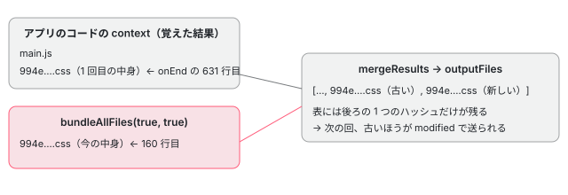

[目次](../README.md) › [application builder の読み残し：options の正規化・結果の形・BundlerContext・キャッシュ・小さなプラグインを行で埋める](README.md) › 第 3 回 / 全 6 回

# BundlerContext と後処理の残り：esbuild の文脈・束ね方の設定・debug ID

> tools/esbuild/bundler-context.ts の未読の行（BundleContextResult、bundleAll、増分の context と dispose、出力の種類分け）、setup-bundling.ts・execute-build.ts・execute-post-bundle.ts の残り、inject-debug-ids.ts。

angular/angular-cli · 読了 約 13 分 · 発展 · [サイトで読む（デモが動きます）](https://angular-deep-dive-cyan.vercel.app/chapter/abl-context-post)

---

application builder は esbuild を直接呼ばず、`BundlerContext` という包みを通します。1 つの BundlerContext が 1 つの esbuild のビルド（ブラウザのコード、サーバーのコード、polyfills、グローバルのスクリプトなど）を受け持ち、結果を覚え、変わったファイルで捨て、出力を種類に分けます。この章では、BundlerContext のまだ読んでいない行（結果の型、bundleAll と mergeResults、失敗の扱い、監視するファイル、出力の種類分け、invalidate の前半、dispose）と、それを並べる setup-bundling.ts・execute-build.ts の残り、そして後処理の頭で走る injectDebugIds を読みます。

読む対象は ../angular-cli（44129f66a3）の `tools/esbuild/bundler-context.ts`・`builders/application/setup-bundling.ts`・`execute-build.ts`・`execute-post-bundle.ts` の残りと、`inject-debug-ids.ts`（全部）・`utils/debug-id.ts` です。bundle() の頭と #performBundle の esbuild を呼ぶ行・初期ファイルを決める行は[application builder の章](../boot/04-boot-application-build.md)の 6 節、invalidate の後半は[再ビルドの章](../cli/10-cli-cache-watch.md)の 4 節、execute-build と execute-post-bundle の段の並びは[ng build の段取りの章](../cli/02-build.md)にあります。

1. [1. normalizeOptions](01-abl-options.md)
2. [2. ビルドの結果の形](02-abl-results.md)
3. **3. BundlerContext と後処理の残り**（この章）
4. [4. ディスクに残るキャッシュ](04-abl-cache.md)
5. [5. 小さなプラグインと検査](05-abl-plugins.md)
6. [6. spec と issue](06-abl-tests-issues.md)

> [!NOTE]
> **ポイント**
>
> 記録はこのサイトの依存の @angular/build 22.2.7（esbuild 0.28.2）の配布物で取りました。bundler-context.ts には、44129f66a3 の後に 2 つの直しが入っています。31c045639e（2026-09-11、22.2.7 に入っている）は、ビルドの途中で invalidate されたら結果を覚えない「epoch」の印と、4 節の 289〜291 行目の `await` の直しです。9534f6287e（2026-10-27、22.2.7 には入っていない）は、6 節の「分け合う読み込みキャッシュ」で余分に結果を捨てる行の直しです。

## 1. 結果の型と、options の工場

📄 `angular-cli/packages/angular/build/src/tools/esbuild/bundler-context.ts` L30–63 （▶ の行: 30–31, 33, 36–40, 43, 48–50, 54, 61–63）

```ts
30 ▶ export type BundleContextResult =
31 ▶   | { errors: Message[]; warnings: Message[] }
32 │   | {
33 ▶       errors: undefined;
34 │       warnings: Message[];
35 │       metafile: Metafile;
36 ▶       platform: 'browser' | 'server';
37 ▶       outputFiles: BuildOutputFile[];
38 ▶       initialFiles: Map<string, InitialFileRecord>;
39 ▶       externalImports: Set<string>;
40 ▶       externalConfiguration?: string[];
41 │     };
42 │ 
43 ▶ export type BundleMergedContextResult =
44 │   | { errors: Message[]; warnings: Message[] }
45 │   | {
46 │       errors: undefined;
47 │       warnings: Message[];
48 ▶       metafiles: {
49 ▶         browser: Metafile;
50 ▶         server: Metafile;
51 │       };
52 │       outputFiles: BuildOutputFile[];
53 │       initialFiles: Map<string, InitialFileRecord>;
54 ▶       externalImports: {
55 │         server: Set<string>;
56 │         browser: Set<string>;
57 │       };
58 │       externalConfiguration?: string[];
59 │     };
60 │ 
61 ▶ export type BundlerOptionsFactory<T extends BuildOptions = BuildOptions> = (
62 ▶   loadCache: LoadResultCache | undefined,
63 ▶ ) => T;
```

30〜41 行目の `BundleContextResult` は、失敗（errors と warnings だけ）と成功の合併で、**errors が undefined かどうか**で見分けます。成功の形は esbuild の結果に、36 行目の `platform`・38 行目の初期ファイル・39 行目の外部 import・40 行目の external の設定を足したものです。43〜59 行目の `BundleMergedContextResult` は、いくつもの context の結果を 1 つにした形で、metafile と外部 import を browser と server に分けて持ちます（3 節）。61〜63 行目の `BundlerOptionsFactory` は「読み込みキャッシュを受け取って esbuild の options を返す関数」で、2 節の結果を覚えるかどうかがこの形かで変わります。

## 2. コンストラクタ：incremental・useContext・結果を覚える条件

📄 `angular-cli/packages/angular/build/src/tools/esbuild/bundler-context.ts` L70–105 （▶ の行: 71, 75, 77–79, 81–83, 87–91, 95, 97, 101–102）

```ts
 70 │ function isEsBuildFailure(value: unknown): value is BuildFailure {
 71 ▶   return !!value && typeof value === 'object' && 'errors' in value && 'warnings' in value;
 72 │ }
 73 │ 
 74 │ export class BundlerContext {
 75 ▶   #esbuildContext?: BuildContext<{ metafile: true; write: false }>;
 76 │   #esbuildOptions?: BuildOptions & { metafile: true; write: false };
 77 ▶   #esbuildResult?: BundleContextResult;
 78 ▶   #activeBundlePromise?: Promise<BundleContextResult>;
 79 ▶   #disposed = false;
 80 │   #optionsFactory: BundlerOptionsFactory<BuildOptions & { metafile: true; write: false }>;
 81 ▶   #shouldCacheResult: boolean;
 82 ▶   #loadCache?: LoadResultCache;
 83 ▶   readonly watchFiles = new Set<string>();
 84 │ 
 85 │   constructor(
 86 │     private workspaceRoot: string,
 87 ▶     private incremental: boolean,
 88 ▶     options: BuildOptions | BundlerOptionsFactory,
 89 ▶     private useContext = incremental,
 90 ▶     private initialFilter?: (initial: Readonly<InitialFileRecord>) => boolean,
 91 ▶     sharedLoadCache?: LoadResultCache,
 92 │   ) {
 93 │     this.#loadCache = sharedLoadCache;
 94 │     // To cache the results an option factory is needed to capture the full set of dependencies
 95 ▶     this.#shouldCacheResult = incremental && typeof options === 'function';
 96 │     this.#optionsFactory = (...args) => {
 97 ▶       const baseOptions = typeof options === 'function' ? options(...args) : options;
 98 │ 
 99 │       return {
100 │         ...baseOptions,
101 ▶         metafile: true,
102 ▶         write: false,
103 │       };
104 │     };
105 │   }
```

1. **87・89 行目：incremental と useContext**

   incremental は「watch で、次の回のために覚える」の印で、setup-bundling.ts は `watch` を渡します（7 節）。useContext は「esbuild の `context()` を作って rebuild() で組み直す」の印で、既定は incremental と同じです。コンポーネントのスタイルは useContext: false で作り、incremental でも毎回 `build()` します。
2. **95 行目：結果を覚えるのは、incremental で options が関数のときだけ**

   コメントのとおり、options を関数で受け取らないと、その options が何に頼っているかを捕まえられないからです。デモの「options をオブジェクトで渡した incremental の context」は、2 回の bundle() で 2 回 esbuild が走り、別の結果を返しました。
3. **96〜104 行目：`metafile: true` と `write: false` を必ず足す**

   metafile は 4 節の監視するファイルと初期ファイルの材料、write: false は出力をディスクに書かずにメモリの `outputFiles` で受け取る指定です。書くのは[前の章](02-abl-results.md)の 6 節の buildApplication です。
4. **78・79・91 行目：途中の約束・捨てた印・分け合うキャッシュ**

   78 行目の `#activeBundlePromise` と 79 行目の `#disposed` は 7786de1a1f（2026-06-05、同時に走るスタイルのビルドで esbuild の context が漏れる直し）で、91 行目の `sharedLoadCache` は e463c6ed9b（2026-08-24）で足されました。

71 行目の isEsBuildFailure は、esbuild が投げた例外を「errors と warnings を持つオブジェクト」で見分けます（4 節で使う）。

## 3. bundleAll と mergeResults

📄 `angular-cli/packages/angular/build/src/tools/esbuild/bundler-context.ts` L107–121 （▶ の行: 111–114, 117）

```ts
107 │   static bundleAll(
108 │     contexts: Iterable<BundlerContext>,
109 │     changedFiles?: Iterable<string> | ReadonlySet<string>,
110 │   ): Promise<BundleContextResult[]> {
111 ▶     return Promise.all(
112 ▶       [...contexts].map((context) => {
113 ▶         if (changedFiles) {
114 ▶           context.invalidate(changedFiles);
115 │         }
116 │ 
117 ▶         return context.bundle();
118 │       }),
119 │     );
120 │   }
121 │ 
```

bundleAll は、変わったファイルがあれば先に invalidate（6 節）を呼び、全部の context の bundle() を `Promise.all` で**同時に**走らせます。esbuild のビルドはそれぞれ別のスレッドで進むので、ブラウザとサーバーのコードは並んで束ねられます。ただし TypeScript の context は、executeBuild の 2 回目以降は bundleAll ではなく 1 つずつ bundle(force) します（再ビルドの章の 4 節）。

📄 `angular-cli/packages/angular/build/src/tools/esbuild/bundler-context.ts` L122–160 （▶ の行: 134–138, 141, 145–147, 150–151, 153–154, 156–157）

```ts
122 │   static mergeResults(results: BundleContextResult[]): BundleMergedContextResult {
123 │     let errors: Message[] | undefined;
124 │     const warnings: Message[] = [];
125 │     const browserMetafile: Metafile = { inputs: {}, outputs: {} };
126 │     const serverMetafile: Metafile = { inputs: {}, outputs: {} };
127 │     const initialFiles = new Map<string, InitialFileRecord>();
128 │     const externalImportsBrowser = new Set<string>();
129 │     const externalImportsServer = new Set<string>();
130 │ 
131 │     const outputFiles = [];
132 │     let externalConfiguration;
133 │     for (const result of results) {
134 ▶       warnings.push(...result.warnings);
135 ▶       if (result.errors) {
136 ▶         errors ??= [];
137 ▶         errors.push(...result.errors);
138 ▶         continue;
139 │       }
140 │ 
141 ▶       const platformIsBrowser = result.platform === 'browser';
142 │ 
143 │       // Combine metafiles used for the bundle budgets and console output
144 │       if (result.metafile) {
145 ▶         const metafile = platformIsBrowser ? browserMetafile : serverMetafile;
146 ▶         Object.assign(metafile.inputs, result.metafile.inputs);
147 ▶         Object.assign(metafile.outputs, result.metafile.outputs);
148 │       }
149 │ 
150 ▶       const externalImports = platformIsBrowser ? externalImportsBrowser : externalImportsServer;
151 ▶       result.externalImports?.forEach((value) => externalImports.add(value));
152 │ 
153 ▶       result.initialFiles.forEach((value, key) => initialFiles.set(key, value));
154 ▶       outputFiles.push(...result.outputFiles);
155 │ 
156 ▶       if (result.externalConfiguration) {
157 ▶         externalConfiguration ??= new Set<string>();
158 │         for (const value of result.externalConfiguration) {
159 │           externalConfiguration.add(value);
160 │         }
```

📄 `angular-cli/packages/angular/build/src/tools/esbuild/bundler-context.ts` L161–183 （▶ の行: 164–165, 181）

```ts
161 │       }
162 │     }
163 │ 
164 ▶     if (errors !== undefined) {
165 ▶       return { errors, warnings };
166 │     }
167 │ 
168 │     return {
169 │       errors,
170 │       warnings,
171 │       initialFiles,
172 │       outputFiles,
173 │       externalImports: {
174 │         browser: externalImportsBrowser,
175 │         server: externalImportsServer,
176 │       },
177 │       metafiles: {
178 │         browser: browserMetafile,
179 │         server: serverMetafile,
180 │       },
181 ▶       externalConfiguration: externalConfiguration ? [...externalConfiguration] : undefined,
182 │     };
183 │   }
```

mergeResults は、警告は全部集め（134 行目）、1 つでも失敗があれば 164 行目で errors と warnings だけを返します。成功した結果も捨てるので、1 つの context の失敗で、その回の出力は空になります（前の章の 5 節の「失敗をはさむ」の出発点）。145〜147 行目、metafile は platform ごとの 1 つに `Object.assign` でまとめます。154 行目、outputFiles は**各 context の結果のオブジェクトをそのまま**並べます。写さないので、後処理が中身を差し替えると、覚えている結果の側も変わります（10 節）。

## 4. #performBundle の残り：失敗・監視するファイル・サーバーの印

📄 `angular-cli/packages/angular/build/src/tools/esbuild/bundler-context.ts` L259–270 （▶ の行: 261–263, 265, 267）

```ts
259 │     } catch (failure) {
260 │       // Build failures will throw an exception which contains errors/warnings
261 ▶       if (isEsBuildFailure(failure)) {
262 ▶         this.#addErrorsToWatch(failure);
263 ▶         this.#addLoadCacheFilesToWatch();
264 │ 
265 ▶         return failure;
266 │       } else {
267 ▶         throw failure;
268 │       }
269 │     }
270 │ 
```

📄 `angular-cli/packages/angular/build/src/tools/esbuild/bundler-context.ts` L271–303 （▶ の行: 274, 276–277, 280–282, 285, 288–292, 296）

```ts
271 │     // Update files that should be watched.
272 │     // While this should technically not be linked to incremental mode, incremental is only
273 │     // currently enabled with watch mode where watch files are needed.
274 ▶     if (this.incremental) {
275 │       // Add input files except virtual angular files which do not exist on disk
276 ▶       for (const input of Object.keys(result.metafile.inputs)) {
277 ▶         const isInternal = isInternalAngularFile(input) || isInternalBundlerFile(input);
278 │ 
279 │         // Input file paths are always relative to the workspace root unless already absolute
280 ▶         const normalizedAbsoluteInput = isAbsolute(input)
281 ▶           ? normalize(input)
282 ▶           : join(this.workspaceRoot, input);
283 │ 
284 │         if (!isInternal) {
285 ▶           this.watchFiles.add(normalizedAbsoluteInput);
286 │         }
287 │ 
288 ▶         if (this.#loadCache) {
289 ▶           const cachedLoad = await (this.#loadCache.get(input) ??
290 ▶             this.#loadCache.get(input.replace(';', ':')) ??
291 ▶             this.#loadCache.get('file:' + normalizedAbsoluteInput));
292 ▶           if (cachedLoad?.watchFiles) {
293 │             for (const file of cachedLoad.watchFiles) {
294 │               if (!isInternalAngularFile(file)) {
295 │                 this.watchFiles.add(
296 ▶                   isAbsolute(file) ? normalize(file) : join(this.workspaceRoot, file),
297 │                 );
298 │               }
299 │             }
300 │           }
301 │         }
302 │       }
303 │     }
```

1. **261〜265 行目：esbuild の例外は、結果として返す**

   esbuild は失敗すると例外を投げます。それを結果の形（errors と warnings）に戻し、エラーの場所のファイルを監視に足します（6 節の 2 つの関数）。直したときに再ビルドが起きるようにするためです。
2. **276〜286 行目：metafile の inputs を監視する**

   esbuild が読んだファイルは metafile の `inputs` に workspaceRoot からの相対パスで並びます。277 行目で `angular:` の仮想ファイルと `<runtime>` のような esbuild の内部のファイルを外し、絶対パスにして足します。
3. **288〜300 行目：読み込みキャッシュが覚えている依存も監視する**

   Sass の `@use` 先のように、esbuild の inputs に出ないファイルは、読み込みキャッシュの結果の `watchFiles` から足します。キーは 3 通り（そのまま、`;` を `:` に、`file:` を頭に）試します。

289〜291 行目は `await (a ?? b ?? c)` の形です。`get` は持続キャッシュ（次の章）では Promise を返すので、`a` が「中身が undefined の Promise」でも `??` は次を試さず、2 つめと 3 つめのキーは使われませんでした。31c045639e が `(await a) ?? (await b) ?? (await c)` に直し、22.2.7 に入っています。

📄 `angular-cli/packages/angular/build/src/tools/esbuild/bundler-context.ts` L304–323 （▶ の行: 306–308, 310, 316–318）

```ts
304 │ 
305 │     // Return if the build encountered any errors
306 ▶     if (result.errors.length) {
307 ▶       this.#addErrorsToWatch(result);
308 ▶       this.#addLoadCacheFilesToWatch();
309 │ 
310 ▶       return {
311 │         errors: result.errors,
312 │         warnings: result.warnings,
313 │       };
314 │     }
315 │ 
316 ▶     const {
317 ▶       'ng-platform-server': isPlatformServer = false,
318 ▶       'ng-ssr-entry-bundle': isSsrEntryBundle = false,
319 │     } = result.metafile as Metafile & {
320 │       'ng-platform-server'?: boolean;
321 │       'ng-ssr-entry-bundle'?: boolean;
322 │     };
323 │ 
```

📄 `angular-cli/packages/angular/build/src/tools/esbuild/bundler-context.ts` L325–331 （▶ の行: 328, 331）

```ts
325 │     const initialFiles = new Map<string, InitialFileRecord>();
326 │     for (const outputFile of result.outputFiles) {
327 │       // Entries in the metafile are relative to the `absWorkingDir` option which is set to the workspaceRoot
328 ▶       const relativeFilePath = relative(this.workspaceRoot, outputFile.path);
329 │       const entryPoint = result.metafile.outputs[relativeFilePath]?.entryPoint;
330 │ 
331 ▶       outputFile.path = relativeFilePath;
```

306 行目、例外にならないエラー（esbuild はプラグインのエラーを結果に入れて返すことがある）も同じように扱います。316〜322 行目の `ng-platform-server` と `ng-ssr-entry-bundle` は esbuild の metafile には無いキーで、サーバー用のプラグインが onEnd で書き込みます（[小さなプラグインの章](05-abl-plugins.md)）。5 節の出力の種類分けがこれを読みます。331 行目は esbuild の出力の `path` を、絶対パスから workspaceRoot からの相対パスに**書き換えます**。オブジェクトを写さずに書き換えるので、同じオブジェクトがもう一度ここを通ると、相対パスをさらに `relative()` にかけることになります（9 節）。

## 5. 外部 import と、出力の種類分け

📄 `angular-cli/packages/angular/build/src/tools/esbuild/bundler-context.ts` L395–411 （▶ の行: 397–398, 400–403, 408）

```ts
395 │     // Collect all external package names
396 │     const externalImports = new Set<string>();
397 ▶     for (const { imports } of Object.values(result.metafile.outputs)) {
398 ▶       for (const { external, kind, path } of imports) {
399 │         if (
400 ▶           !external ||
401 ▶           SERVER_GENERATED_EXTERNALS.has(path) ||
402 ▶           isInternalAngularFile(path) ||
403 ▶           (kind !== 'import-statement' && kind !== 'dynamic-import' && kind !== 'require-call')
404 │         ) {
405 │           continue;
406 │         }
407 │ 
408 ▶         externalImports.add(path);
409 │       }
410 │     }
411 │ 
```

📄 `angular-cli/packages/angular/build/src/tools/esbuild/bundler-context.ts` L412–451 （▶ の行: 417–422, 424, 427, 430–433, 436–437）

```ts
412 │     assert(this.#esbuildOptions, 'esbuild options cannot be undefined.');
413 │ 
414 │     const outputFiles = result.outputFiles.map((file) => {
415 │       let fileType: BuildOutputFileType;
416 │       // All files that are not JS, CSS, WASM, or sourcemaps for them are considered media
417 ▶       if (!/\.([cm]?js|css|wasm)(\.map)?$/i.test(file.path)) {
418 ▶         fileType = BuildOutputFileType.Media;
419 ▶       } else if (isPlatformServer) {
420 ▶         fileType = isSsrEntryBundle
421 ▶           ? BuildOutputFileType.ServerRoot
422 ▶           : BuildOutputFileType.ServerApplication;
423 │       } else {
424 ▶         fileType = BuildOutputFileType.Browser;
425 │       }
426 │ 
427 ▶       return convertOutputFile(file, fileType);
428 │     });
429 │ 
430 ▶     let externalConfiguration = this.#esbuildOptions.external;
431 ▶     if (isPlatformServer && externalConfiguration) {
432 ▶       externalConfiguration = externalConfiguration.filter(
433 ▶         (dep) => !SERVER_GENERATED_EXTERNALS.has(dep),
434 │       );
435 │ 
436 ▶       if (!externalConfiguration.length) {
437 ▶         externalConfiguration = undefined;
438 │       }
439 │     }
440 │ 
441 │     // Return the successful build results
442 │     return {
443 │       ...result,
444 │       outputFiles,
445 │       initialFiles,
446 │       externalImports,
447 │       platform: isPlatformServer ? 'server' : 'browser',
448 │       externalConfiguration,
449 │       errors: undefined,
450 │     };
451 │   }
```

397〜410 行目は、出力のすべての import のうち、external で、サーバーのビルドが自分で作るファイル（`./polyfills.server.mjs` と 2 つのマニフェスト）でなく、`angular:` でなく、静的 import・動的 import・require のどれかであるものだけを集めます。dev-server はこれを Vite の事前バンドルの対象にします（10 節）。417 行目、JS・CSS・wasm とそれらの source map でないものは全部 Media です。それ以外は、4 節の印があれば 420〜422 行目で ServerRoot（server.ts の束）か ServerApplication、無ければ Browser です。427 行目で[前の章](02-abl-results.md)の 2 節の convertOutputFile に包みます。430〜439 行目、サーバーのビルドの external の設定から自分で作るファイルを外し、空なら undefined にします。

## 6. invalidate の前半：パスをそろえ、読み込みキャッシュに聞く

📄 `angular-cli/packages/angular/build/src/tools/esbuild/bundler-context.ts` L478–505 （▶ の行: 486–487, 491–492, 495–496, 503–504）

```ts
478 │   /**
479 │    * Invalidate a stored bundler result based on the previous watch files
480 │    * and a list of changed files.
481 │    * The context must be created with incremental mode enabled for results
482 │    * to be stored.
483 │    * @returns True, if the result was invalidated; False, otherwise.
484 │    */
485 │   invalidate(files: Iterable<string> | ReadonlySet<string>): boolean {
486 ▶     if (!this.incremental) {
487 ▶       return false;
488 │     }
489 │ 
490 │     let candidateFiles: ReadonlySet<string>;
491 ▶     if (files instanceof Set) {
492 ▶       let isCandidateReady = true;
493 │       for (const file of files) {
494 │         if (
495 ▶           file !== normalize(file) ||
496 ▶           (!isAbsolute(file) && !files.has(normalize(join(this.workspaceRoot, file))))
497 │         ) {
498 │           isCandidateReady = false;
499 │           break;
500 │         }
501 │       }
502 │ 
503 ▶       if (isCandidateReady) {
504 ▶         candidateFiles = files;
505 │       } else {
```

📄 `angular-cli/packages/angular/build/src/tools/esbuild/bundler-context.ts` L506–527 （▶ の行: 508, 510–511, 517, 519, 521–522）

```ts
506 │         const normalizedFiles = new Set<string>();
507 │         for (const file of files) {
508 ▶           const normalized = normalize(file);
509 │           normalizedFiles.add(normalized);
510 ▶           if (!isAbsolute(normalized)) {
511 ▶             normalizedFiles.add(normalize(join(this.workspaceRoot, normalized)));
512 │           }
513 │         }
514 │         candidateFiles = normalizedFiles;
515 │       }
516 │     } else {
517 ▶       const normalizedFiles = new Set<string>();
518 │       for (const file of files) {
519 ▶         const normalized = normalize(file);
520 │         normalizedFiles.add(normalized);
521 ▶         if (!isAbsolute(normalized)) {
522 ▶           normalizedFiles.add(normalize(join(this.workspaceRoot, normalized)));
523 │         }
524 │       }
525 │       candidateFiles = normalizedFiles;
526 │     }
527 │ 
```

486 行目、incremental でなければ何もしません（デモの「incremental でない context」は false を返し、watchFiles も 0 個でした）。491〜504 行目は、渡された Set が「全部 normalize 済みで、相対パスなら絶対パスの形も入っている」ならそのまま使い、写す手間を省く近道です（0589edd9cd、2026-08-25）。そうでなければ 506〜526 行目で、相対パスには workspaceRoot を足した形も入れます。デモの「相対パスで invalidate(\[src/b.ts\])」が true になるのはこのためです。

📄 `angular-cli/packages/angular/build/src/tools/esbuild/bundler-context.ts` L528–534 （▶ の行: 529–531）

```ts
528 │     let invalid = false;
529 ▶     for (const file of candidateFiles) {
530 ▶       if (this.#loadCache?.invalidate(file)) {
531 ▶         invalid = true;
532 │       }
533 │     }
534 │ 
```

530 行目、変わったファイルを読み込みキャッシュが覚えていれば、そのキャッシュを捨て、**この context の結果も捨てます**。続く watchFiles との比べ方は再ビルドの章の 4 節です。0589edd9cd からは、コンポーネントのスタイルの context がすべて 1 つの読み込みキャッシュを分け合います。すると、ある CSS を変えたとき、その CSS を読んでいない context でも 530 行目が true になり、全部のスタイルを束ね直します。デモの「one.txt だけ書き換えて」では、one.txt を読んでいない y の context も invalidate が true を返し、esbuild がもう一度走りました（y の watchFiles に one.txt はありません）。9534f6287e（新しい本家）は、530 行目の戻り値を見ずにキャッシュだけを捨て、結果を捨てるのは watchFiles と重なるときだけにしました。22.2.7 は 44129f66a3 と同じ動きです。

📄 `angular-cli/packages/angular/build/src/tools/esbuild/bundler-context.ts` L452–477 （▶ の行: 455–457, 459–460, 469–470, 472）

```ts
452 │ 
453 │   #addErrorsToWatch(result: BuildFailure | BuildResult): void {
454 │     for (const error of result.errors) {
455 ▶       let file = error.location?.file;
456 ▶       if (file && !isInternalAngularFile(file)) {
457 ▶         this.watchFiles.add(isAbsolute(file) ? normalize(file) : join(this.workspaceRoot, file));
458 │       }
459 ▶       for (const note of error.notes) {
460 ▶         file = note.location?.file;
461 │         if (file && !isInternalAngularFile(file)) {
462 │           this.watchFiles.add(isAbsolute(file) ? normalize(file) : join(this.workspaceRoot, file));
463 │         }
464 │       }
465 │     }
466 │   }
467 │ 
468 │   #addLoadCacheFilesToWatch(): void {
469 ▶     if (this.incremental && this.#loadCache) {
470 ▶       for (const file of this.#loadCache.watchFiles) {
471 │         if (!isInternalAngularFile(file)) {
472 ▶           this.watchFiles.add(isAbsolute(file) ? normalize(file) : join(this.workspaceRoot, file));
473 │         }
474 │       }
475 │     }
476 │   }
477 │ 
```

453〜466 行目はエラーとその notes の場所を、468〜476 行目は読み込みキャッシュの**すべての** watchFiles を監視に足します。キャッシュを分け合うと、失敗した 1 つの context が、ほかの context が読んだファイルまで監視します。新しい本家では、この context が引いたキーの分だけを足す形に変わりました（9534f6287e）。

📄 `angular-cli/packages/angular/build/src/tools/esbuild/bundler-context.ts` L559–595 （▶ の行: 566, 568–572, 574, 580, 585, 590）

```ts
559 │ 
560 │   /**
561 │    * Disposes incremental build resources present in the context.
562 │    *
563 │    * @returns A promise that resolves when disposal is complete.
564 │    */
565 │   async dispose(): Promise<void> {
566 ▶     this.#disposed = true;
567 │     try {
568 ▶       this.#esbuildOptions = undefined;
569 ▶       this.#esbuildResult = undefined;
570 ▶       this.#activeBundlePromise = undefined;
571 ▶       this.#loadCache = undefined;
572 ▶       await this.#esbuildContext?.dispose();
573 │     } finally {
574 ▶       this.#esbuildContext = undefined;
575 │     }
576 │   }
577 │ }
578 │ 
579 │ function isInternalAngularFile(file: string) {
580 ▶   return file.startsWith('angular:');
581 │ }
582 │ 
583 │ function isInternalBundlerFile(file: string) {
584 │   // Bundler virtual files such as "<define:???>" or "<runtime>"
585 ▶   if (file[0] === '<' && file.at(-1) === '>') {
586 │     return true;
587 │   }
588 │ 
589 │   // Any (disabled): path is a virtual esbuild entry that doesn't exist on disk
590 ▶   if (file.includes('(disabled):')) {
591 │     return true;
592 │   }
593 │ 
594 │   return false;
595 │ }
```

dispose は 566 行目で印を立て、覚えている options・結果・途中の約束・キャッシュを捨て、esbuild の context を閉じます。印は、context の作成を待つ間に dispose されたときに、できた context をすぐ閉じるため（#performBundle の頭、application builder の章）に使います。579〜595 行目の 2 つの関数が、4 節の 277 行目の「監視しないファイル」を決めます。`(disabled):` は、package.json の `browser` フィールドで false にしたモジュールの仮の名前です。

## 7. setup-bundling：どの context を作るか

📄 `angular-cli/packages/angular/build/src/builders/application/setup-bundling.ts` L26–56 （▶ の行: 34, 36–40, 42–43, 52）

```ts
26 │ /**
27 │  * Generates one or more BundlerContext instances based on the builder provided
28 │  * configuration.
29 │  * @param options The normalized application builder options to use.
30 │  * @param browsers An string array of browserslist browsers to support.
31 │  * @param codeBundleCache An instance of the TypeScript source file cache.
32 │  * @returns An array of BundlerContext objects.
33 │  */
34 ▶ export function setupBundlerContexts(
35 │   options: NormalizedApplicationBuildOptions,
36 ▶   target: string[],
37 ▶   codeBundleCache: SourceFileCache,
38 ▶   stylesheetBundler: ComponentStylesheetBundler,
39 ▶   angularCompilationContext: AngularCompilationContext,
40 ▶   templateUpdates: Map<string, string> | undefined,
41 │ ): {
42 ▶   typescriptContexts: BundlerContext[];
43 ▶   otherContexts: BundlerContext[];
44 │ } {
45 │   const {
46 │     outputMode,
47 │     serverEntryPoint,
48 │     appShellOptions,
49 │     prerenderOptions,
50 │     ssrOptions,
51 │     workspaceRoot,
52 ▶     watch = false,
53 │   } = options;
54 │   const typescriptContexts = [];
55 │   const otherContexts = [];
56 │ 
```

📄 `angular-cli/packages/angular/build/src/builders/application/setup-bundling.ts` L115–146 （▶ の行: 117–119, 122, 129–130, 133, 135, 141, 143）

```ts
115 │ 
116 │   // Global Scripts
117 ▶   if (options.globalScripts.length > 0) {
118 ▶     for (const initial of [true, false]) {
119 ▶       const bundleOptions = createGlobalScriptsBundleOptions(options, target, initial);
120 │       if (bundleOptions) {
121 │         otherContexts.push(
122 ▶           new BundlerContext(workspaceRoot, watch, bundleOptions, true, () => initial),
123 │         );
124 │       }
125 │     }
126 │   }
127 │ 
128 │   // Skip server build when none of the features are enabled.
129 ▶   if (serverEntryPoint && (outputMode || prerenderOptions || appShellOptions || ssrOptions)) {
130 ▶     const nodeTargets = [...target, ...getSupportedNodeTargets()];
131 │ 
132 │     typescriptContexts.push(
133 ▶       new BundlerContext(
134 │         workspaceRoot,
135 ▶         watch,
136 │         createServerMainCodeBundleOptions(
137 │           options,
138 │           nodeTargets,
139 │           codeBundleCache,
140 │           stylesheetBundler,
141 ▶           angularCompilationContext.createSecondaryContext(),
142 │         ),
143 ▶         true,
144 │       ),
145 │     );
146 │ 
```

📄 `angular-cli/packages/angular/build/src/builders/application/setup-bundling.ts` L147–180 （▶ の行: 147, 149, 153, 158, 166–167, 170, 172–174）

```ts
147 ▶     if (outputMode && ssrOptions?.entry) {
148 │       // New behavior introduced: 'server.ts' is now bundled separately from 'main.server.ts'.
149 ▶       typescriptContexts.push(
150 │         new BundlerContext(
151 │           workspaceRoot,
152 │           watch,
153 ▶           createSsrEntryCodeBundleOptions(
154 │             options,
155 │             nodeTargets,
156 │             codeBundleCache,
157 │             stylesheetBundler,
158 ▶             angularCompilationContext.createSecondaryContext(),
159 │           ),
160 │           true,
161 │         ),
162 │       );
163 │     }
164 │ 
165 │     // Server polyfills code
166 ▶     const serverPolyfillBundleOptions = createServerPolyfillBundleOptions(
167 ▶       options,
168 │       nodeTargets,
169 │       codeBundleCache.loadResultCache,
170 ▶     );
171 │ 
172 ▶     if (serverPolyfillBundleOptions) {
173 ▶       otherContexts.push(
174 ▶         new BundlerContext(workspaceRoot, watch, serverPolyfillBundleOptions, true),
175 │       );
176 │     }
177 │   }
178 │ 
179 │   return { typescriptContexts, otherContexts };
180 │ }
```

setupBundlerContexts は、TypeScript を通す context（`typescriptContexts`）と通さない context（`otherContexts`）を分けて返します。この引用の間にある、ブラウザのコードと polyfills・グローバルのスタイルの行は application builder の章と[グローバルスタイルの章](../bmap/02-bmap-styles-bundle.md)が読みました。

| context | 行 | 組 | 作る条件 |
| --- | --- | --- | --- |
| グローバルのスクリプト（index.html に差す束と差さない束） | 117〜126 | other | scripts があるとき、initial の true と false で 2 つ。122 行目の 5 つめの引数 `() => initial` が初期ファイルの選別 |
| サーバーのコード（main.server.ts） | 129〜145 | typescript | server があり、outputMode・prerender・appShell・ssr のどれかがあるとき。141 行目で、ブラウザのコンパイルを待つ 2 つめの compilation の文脈を作る |
| server.ts の束 | 147〜163 | typescript | outputMode と ssr.entry の両方があるとき（148 行目のコメントのとおり、main.server.ts と別に束ねる） |
| サーバーの polyfills | 166〜176 | other | サーバーのビルドがあり、polyfills の options が作れたとき |

130 行目、サーバーのターゲットはブラウザのターゲットに Node のターゲットを足したものです。143・160・174 行目の 4 つめの引数 `true` は useContext で、incremental（watch）でなくても esbuild の context を作ります。

📄 `angular-cli/packages/angular/build/src/builders/application/setup-bundling.ts` L181–195 （▶ の行: 182–185）

```ts
181 │ 
182 ▶ export function createComponentStyleBundler(
183 ▶   options: NormalizedApplicationBuildOptions,
184 ▶   target: string[],
185 ▶ ): ComponentStylesheetBundler {
186 │   const {
187 │     workspaceRoot,
188 │     optimizationOptions,
189 │     sourcemapOptions,
190 │     outputNames,
191 │     externalDependencies,
192 │     preserveSymlinks,
193 │     stylePreprocessorOptions,
194 │     inlineStyleLanguage,
195 │     cacheOptions,
```

コンポーネントのスタイルの bundler の作り方（この引用の続き）は[コンポーネントのスタイルの章](../cli/04-cli-component-styles.md)です。

## 8. executeBuild の残り（1）：外部のスタイルを束ね直す行

📄 `angular-cli/packages/angular/build/src/builders/application/execute-build.ts` L76–85 （▶ の行: 78–84）

```ts
76 │ 
77 │   // Reuse rebuild state or create new bundle contexts for code and global stylesheets
78 ▶   let bundlerContexts;
79 ▶   let componentStyleBundler;
80 ▶   let codeBundleCache;
81 ▶   let bundlingIndividualResults: BundleContextResult[];
82 ▶   let templateUpdates: Map<string, string> | undefined;
83 ▶   let angularCompilationContext: AngularCompilationContext | undefined;
84 ▶   let executionResult: ExecutionResult | undefined;
85 │   try {
```

📄 `angular-cli/packages/angular/build/src/builders/application/execute-build.ts` L153–171 （▶ の行: 155–157, 159–160, 163, 165, 168–169）

```ts
153 │ 
154 │     // Update any external component styles if enabled and rebuilding.
155 ▶     // TODO: Only attempt rebundling of invalidated styles once incremental build results are supported.
156 ▶     if (rebuildState && options.externalRuntimeStyles) {
157 ▶       componentStyleBundler.invalidate(rebuildState.fileChanges.all);
158 │ 
159 ▶       const componentResults = await componentStyleBundler.bundleAllFiles(true, true);
160 ▶       bundlingIndividualResults.push(...componentResults);
161 │     }
162 │ 
163 ▶     let bundlingResult = BundlerContext.mergeResults(bundlingIndividualResults);
164 │ 
165 ▶     executionResult.addWarnings(bundlingResult.warnings);
166 │ 
167 │     // Add used external component style referenced files to be watched
168 ▶     if (options.externalRuntimeStyles) {
169 ▶       executionResult.extraWatchFiles.push(...componentStyleBundler.collectReferencedFiles());
170 │     }
171 │ 
```

executeBuild の変数（78〜84 行目）は、1 回目は作り、2 回目以降は前の章の RebuildState から受け取るものです（再ビルドの章の 4 節）。156〜161 行目は externalRuntimeStyles（NG\_HMR\_CSTYLES=1）のときだけ走り、コンポーネントのスタイルを**全部**束ね直して（155 行目の TODO のとおり、変わったものだけではない）、その結果を 160 行目で bundlingIndividualResults に足します。159 行目の 2 つめの引数 `true` は direct で、出力のパスを workspaceRoot と結ばない指定です。

📄 `angular-cli/packages/angular/build/src/tools/esbuild/angular/compiler-plugin.ts` L686–713 （▶ の行: 696, 702–710）

```ts
686 │ async function bundleExternalStylesheet(
687 │   stylesheetBundler: ComponentStylesheetBundler,
688 │   stylesheetFile: string,
689 │   externalId: string | boolean,
690 │   result: OnStartResult,
691 │   additionalResults: Map<
692 │     string,
693 │     { outputFiles?: OutputFile[]; metafile?: Metafile; errors?: PartialMessage[] }
694 │   >,
695 │ ) {
696 ▶   const styleResult = await stylesheetBundler.bundleFile(stylesheetFile, externalId);
697 │ 
698 │   (result.warnings ??= []).push(...styleResult.warnings);
699 │   if (styleResult.errors) {
700 │     (result.errors ??= []).push(...styleResult.errors);
701 │   } else {
702 ▶     const { outputFiles, metafile } = styleResult;
703 ▶     // Clear inputs to prevent triggering a rebuild of the application code for component
704 ▶     // stylesheet file only changes when the dev server enables the internal-only external
705 ▶     // stylesheet option. This does not affect builds since only the dev server can enable
706 ▶     // the internal option.
707 ▶     metafile.inputs = {};
708 ▶     additionalResults.set(stylesheetFile, {
709 ▶       outputFiles,
710 ▶       metafile,
711 │     });
712 │   }
713 │ }
```

📄 `angular-cli/packages/angular/build/src/tools/esbuild/angular/compiler-plugin.ts` L622–642 （▶ の行: 628, 630–631, 639–640）

```ts
622 │       build.onEnd(async (result) => {
623 │         // Ensure other compilations are unblocked if the main compilation throws during start
624 │         if (angularCompilationContext.isPrimary()) {
625 │           angularCompilationContext.markAsReady(hasCompilationErrors);
626 │         }
627 │ 
628 ▶         for (const { outputFiles, metafile } of additionalResults.values()) {
629 │           // Add any additional output files to the main output files
630 ▶           if (outputFiles?.length) {
631 ▶             result.outputFiles?.push(...outputFiles);
632 │           }
633 │ 
634 │           // Combine additional metafiles with main metafile
635 │           if (result.metafile && metafile) {
636 │             // Append the existing object, by appending to it we prevent unnecessary new objections creations with spread
637 │             // mitigating significant performance overhead for large apps.
638 │             // See: https://bugs.chromium.org/p/v8/issues/detail?id=11536
639 ▶             Object.assign(result.metafile.inputs, metafile.inputs);
640 ▶             Object.assign(result.metafile.outputs, metafile.outputs);
641 │           }
642 │         }
```

一方、アプリのコードを束ねる Angular のコンパイラのプラグインも、外部のスタイルを 1 回目に束ね（696 行目）、707 行目で metafile の inputs を空にして、708 行目で additionalResults という Map に覚えます。そして毎回の onEnd で、628〜632 行目が**覚えた出力のオブジェクトを**esbuild の outputFiles に足します。707 行目の inputs を空にするのは、CSS だけを変えたときにアプリのコードの context を束ね直さないためです（コメント）。そのため CSS を変えても、アプリのコードの context は前の結果を返し、その中には 1 回目の中身の CSS が残ります。



*NG\_HMR\_CSTYLES=1 では、同じパスの CSS が 2 つ outputFiles に並ぶ。アプリのコードの context が覚えている古い CSS と、160 行目で束ね直した新しい CSS*

mergeResults は 2 つを両方並べ、[前の章](02-abl-results.md)の 5 節のとおり、表には後ろ（新しい）のハッシュが残り、次の回に前（古い）が modified として送られます。開いている issue #34248 の症状（関係ないコンポーネントのスタイルが 1 回目の中身に戻る）は、この 2 つの行の組み合わせで説明できます。

## 9. 331 行目の書き換えと、プロセスの cwd

628〜632 行目が毎回足す出力は、同じオブジェクトです。1 回目に 4 節の 331 行目を通ると、その path は workspaceRoot からの相対パスに書き換わります。アプリのコードの context が束ね直すたびに、同じオブジェクトが 328 行目の `relative(this.workspaceRoot, outputFile.path)` にもう一度かかります。Node の `path.relative` は、相対パスを**プロセスの cwd** から解決します。cwd が workspaceRoot なら `relative(ws, 'x.css')` は `'x.css'` のままですが、cwd が違うと、束ね直すたびに `../` が 1 つずつ増えます。

> **🧪 DEMO — 外部のスタイルの出力のパス（cwd の違い）**
>
> 前の章のデモと同じ watch の記録（externalRuntimeStyles: true）を、Node の cwd を変えて 2 回取りました。各回の Result の files に入った CSS のパスです。
>
> ▶ [このデモはサイトで動かせます](https://angular-deep-dive-cyan.vercel.app/chapter/abl-context-post)

cwd が親のとき、「lazy.ts を足して import() する」で `../994eac42053ed9b3.css`、「import() を消す」で `../../994eac42053ed9b3.css` になりました。CSS 自体を変えた回は 696 行目で束ね直した新しいオブジェクトになるので、元に戻ります。ng は workspace の中のどのフォルダからでも動き、cwd を workspaceRoot に移しません（angular/cli の init.ts の `process.chdir` は、Windows のドライブ文字を大文字にそろえるだけ）。NG\_HMR\_CSTYLES=1 の ng serve をサブフォルダから起動すると、この形になります。

## 10. executeBuild の残り（2）：外部依存の振り分けと、失敗したときの片付け

📄 `angular-cli/packages/angular/build/src/builders/application/execute-build.ts` L240–271 （▶ の行: 241, 249–250, 256–257, 260, 264–265）

```ts
240 │     // Analyze external imports if external options are enabled
241 ▶     if (options.externalPackages || bundlingResult.externalConfiguration) {
242 │       const {
243 │         externalConfiguration = [],
244 │         externalImports: { browser = [], server = [] },
245 │       } = bundlingResult;
246 │       // Similar to esbuild, --external:@foo/bar automatically implies --external:@foo/bar/*,
247 │       // which matches import paths like @foo/bar/baz.
248 │       // This means all paths within the @foo/bar package are also marked as external.
249 ▶       const exclusionsPrefixes = externalConfiguration.map((exclusion) => exclusion + '/');
250 ▶       const exclusions = new Set(externalConfiguration);
251 │       const explicitExternal = new Set<string>();
252 │ 
253 │       const isExplicitExternal = (dep: string): boolean => {
254 │         // Locale-data imports are injected by the builder itself (see i18n-locale-plugin) and must stay resolvable
255 │         // even when the containing package is externalized by the user.
256 ▶         if (dep.startsWith(`${LOCALE_DATA_BASE_MODULE}/`)) {
257 ▶           return false;
258 │         }
259 │ 
260 ▶         if (exclusions.has(dep)) {
261 │           return true;
262 │         }
263 │ 
264 ▶         for (const prefix of exclusionsPrefixes) {
265 ▶           if (dep.startsWith(prefix)) {
266 │             return true;
267 │           }
268 │         }
269 │ 
270 │         return false;
271 │       };
```

📄 `angular-cli/packages/angular/build/src/builders/application/execute-build.ts` L272–293 （▶ の行: 274–276, 278, 283–285, 287, 291）

```ts
272 │ 
273 │       const implicitBrowser: string[] = [];
274 ▶       for (const dep of browser) {
275 ▶         if (isExplicitExternal(dep)) {
276 ▶           explicitExternal.add(dep);
277 │         } else {
278 ▶           implicitBrowser.push(dep);
279 │         }
280 │       }
281 │ 
282 │       const implicitServer: string[] = [];
283 ▶       for (const dep of server) {
284 ▶         if (isExplicitExternal(dep)) {
285 ▶           explicitExternal.add(dep);
286 │         } else {
287 ▶           implicitServer.push(dep);
288 │         }
289 │       }
290 │ 
291 ▶       executionResult.setExternalMetadata(implicitBrowser, implicitServer, [...explicitExternal]);
292 │     }
293 │ 
```

241 行目、externalPackages（dev-server の事前バンドル）か external の設定があるときだけ、5 節の外部 import を「設定で外したもの（explicit）」と「externalPackages で外れたもの（implicit）」に分けます。249 行目で `@foo/bar` を `@foo/bar/` の前置きにもして、`@foo/bar/baz` も explicit に数えます（[第 1 回](01-abl-options.md)の 9 節の normalizeExternals が `/*` を取っておく理由）。256 行目、i18n のロケールデータの import は、パッケージを外していても explicit にしません。291 行目の setExternalMetadata は前の章の 3 節で、dev-server は implicit を Vite に事前バンドルさせ、explicit はそのまま外に残します。

📄 `angular-cli/packages/angular/build/src/builders/application/execute-build.ts` L427–434 （▶ の行: 429–430, 432）

```ts
427 │ 
428 │     return executionResult;
429 ▶   } catch (error) {
430 ▶     await Promise.allSettled([angularCompilationContext?.dispose(), executionResult?.dispose()]);
431 │ 
432 ▶     throw error;
433 │   }
434 │ }
```

executeBuild の中で例外が出たら、430 行目で Angular のコンパイルの文脈と ExecutionResult（中の BundlerContext と esbuild の context）を両方閉じてから投げ直します。`allSettled` なので、片方の dispose が失敗しても、もう片方は閉じます。

## 11. 後処理の頭：injectDebugIds

📄 `angular-cli/packages/angular/build/src/builders/application/execute-post-bundle.ts` L37–60 （▶ の行: 47–53, 55, 57–59）

```ts
37 │ /**
38 │  * Run additional builds steps including SSG, AppShell, Index HTML file and Service worker generation.
39 │  * @param browserMetafile An esbuild metafile object.
40 │  * @param options The normalized application builder options used to create the build.
41 │  * @param outputFiles The output files of an executed build.
42 │  * @param assetFiles The assets of an executed build.
43 │  * @param initialFiles A map containing initial file information for the executed build.
44 │  * @param locale A language locale to insert in the index.html.
45 │  */
46 │ // eslint-disable-next-line max-lines-per-function
47 ▶ export async function executePostBundleSteps(
48 ▶   browserMetafile: Metafile,
49 ▶   options: NormalizedApplicationBuildOptions,
50 ▶   outputFiles: BuildOutputFile[],
51 ▶   assetFiles: BuildOutputAsset[],
52 ▶   initialFiles: Map<string, InitialFileRecord>,
53 ▶   locale: string | undefined,
54 │ ): Promise<{
55 ▶   errors: string[];
56 │   warnings: string[];
57 ▶   additionalOutputFiles: BuildOutputFile[];
58 ▶   additionalAssets: BuildOutputAsset[];
59 ▶   prerenderedRoutes: PrerenderedRoutesRecord;
60 │ }> {
```

📄 `angular-cli/packages/angular/build/src/builders/application/execute-post-bundle.ts` L61–89 （▶ の行: 61–62, 68, 73, 80, 83–84, 87–88）

```ts
61 ▶   const additionalAssets: BuildOutputAsset[] = [];
62 ▶   const additionalOutputFiles: BuildOutputFile[] = [];
63 │   const allErrors: string[] = [];
64 │   const allWarnings: string[] = [];
65 │   const prerenderedRoutes: PrerenderedRoutesRecord = {};
66 │ 
67 │   const {
68 ▶     baseHref = '/',
69 │     serviceWorker,
70 │     ssrOptions,
71 │     indexHtmlOptions,
72 │     optimizationOptions,
73 ▶     sourcemapOptions,
74 │     outputMode,
75 │     serverEntryPoint,
76 │     prerenderOptions,
77 │     appShellOptions,
78 │     publicPath,
79 │     workspaceRoot,
80 ▶     partialSSRBuild,
81 │   } = options;
82 │ 
83 ▶   // Embed ECMA-426 Debug IDs into JS/source-map pairs before any consumer reads the bytes (in
84 ▶   // particular `generateIndexHtml` below, which computes SRI hashes from the on-disk content).
85 │   // Doing this here also covers the i18n path, where this function is invoked once per locale
86 │   // with locale-specific output files. Files without a source map sibling are skipped.
87 ▶   if (sourcemapOptions.scripts) {
88 ▶     injectDebugIds(outputFiles);
89 │   }
```

executePostBundleSteps は、index.html・prerender・service worker を作る段の入口で（中身は ng build の段取りの章と[プリレンダーの章](../platform/06-ssr-prerender.md)）、足した出力とアセットを 57・58 行目の形で返します。i18n のときはロケールの数だけ呼ばれます。87・88 行目、source map（scripts）を出すときは、最初に injectDebugIds を呼びます。index.html の integrity（SRI）を計算する前に、JS の中身を確定させるためです（83〜86 行目のコメント）。

📄 `angular-cli/packages/angular/build/src/builders/application/inject-debug-ids.ts` L17–52 （▶ の行: 29–31, 37, 41, 46–50）

```ts
17 │ /**
18 │  * Embeds an ECMA-426 Debug ID into every browser JavaScript output that has a
19 │  * matching source map sibling.
20 │  *
21 │  * The Debug ID is derived deterministically (UUIDv5) from the source map bytes
22 │  * so rebuilds of the same source produce the same ID. The JS file gets a
23 │  * `//# debugId=<uuid>` comment placed above any existing
24 │  * `//# sourceMappingURL=` line and the source map JSON gets a top-level
25 │  * `"debugId"` field. Together they make build artifacts self-identifying as
26 │  * proposed by https://github.com/tc39/ecma426/blob/main/proposals/debug-id.md.
27 │  */
28 │ export function injectDebugIds(outputFiles: BuildOutputFile[]): void {
29 ▶   const filesByPath = new Map<string, BuildOutputFile>();
30 ▶   for (const file of outputFiles) {
31 ▶     filesByPath.set(file.path, file);
32 │   }
33 │ 
34 │   const encoder = new TextEncoder();
35 │ 
36 │   for (const file of outputFiles) {
37 ▶     if (file.type !== BuildOutputFileType.Browser || !file.path.endsWith('.js')) {
38 │       continue;
39 │     }
40 │ 
41 ▶     const map = filesByPath.get(`${file.path}.map`);
42 │     if (!map) {
43 │       continue;
44 │     }
45 │ 
46 ▶     const mapText = map.text;
47 ▶     const mapTextForHash = stripDebugIdFromSourceMap(mapText);
48 ▶     const id = generateDebugId(mapTextForHash);
49 ▶     file.contents = encoder.encode(injectDebugIdIntoJs(file.text, id));
50 ▶     map.contents = encoder.encode(injectDebugIdIntoSourceMap(mapText, id));
51 │   }
52 │ }
```

1. **37・41 行目：browser の .js で、隣に .js.map があるものだけ**

   サーバーの出力と、source map の無い JS は飛ばします。記録では `media/logo.png` と 2 つの .map が飛ばされ、2 つの JS が対象になりました。
2. **47・48 行目：source map の中身から ID を作る**

   generateDebugId は名前空間の UUID と中身から SHA-1 で UUIDv5 を作ります。同じ中身なら同じ ID になる、とコメント（21・22 行目）にあります。47 行目で、既にある `debugId` の欄を消した中身から作ります（62b11e316e、2026-07-15）。
3. **49・50 行目：JS と source map の両方を書き換える**

   JS には `//# debugId=<ID>` の行を、source map には `"debugId"` の欄を入れます。どちらも `file.contents = …` の差し替えです（前の章の 2 節）。

📄 `angular-cli/packages/angular/build/src/utils/debug-id.ts` L43–70 （▶ の行: 44, 47, 60–61, 64–65, 69）

```ts
43 │ /** Pattern matching an existing `//# debugId=<uuid>` comment at the end of the file. */
44 ▶ const DEBUG_ID_COMMENT = /(\n\/\/# debugId=[^\r\n]*)(\n\/\/# sourceMappingURL=[^\r\n]*)?(\s*)$/;
45 │ 
46 │ /** Pattern matching the `//# sourceMappingURL=` comment, used to position the debug-id line. */
47 ▶ const SOURCE_MAPPING_URL_COMMENT = /\n\/\/# sourceMappingURL=[^\r\n]*\s*$/;
48 │ 
49 │ /**
50 │  * Inserts (or replaces) a `//# debugId=<id>` comment in the given JavaScript text.
51 │  *
52 │  * Per ECMA-426, the comment must appear within the last 5 lines and SHOULD be
53 │  * placed immediately above any `//# sourceMappingURL=` comment so that existing
54 │  * tools that only consult the final line still find the source-map URL.
55 │  */
56 │ export function injectDebugIdIntoJs(text: string, id: string): string {
57 │   const comment = `//# debugId=${id}`;
58 │ 
59 │   // Replace any existing debugId comment to keep the operation idempotent.
60 ▶   if (DEBUG_ID_COMMENT.test(text)) {
61 ▶     return text.replace(DEBUG_ID_COMMENT, (_, p1, p2, p3) => `\n${comment}${p2 || ''}${p3 || ''}`);
62 │   }
63 │ 
64 ▶   if (SOURCE_MAPPING_URL_COMMENT.test(text)) {
65 ▶     return text.replace(SOURCE_MAPPING_URL_COMMENT, (match) => `\n${comment}${match}`);
66 │   }
67 │ 
68 │   // No source map reference; append at the very end on its own line.
69 ▶   return text.endsWith('\n') ? `${text}${comment}\n` : `${text}\n${comment}\n`;
70 │ }
```

📄 `angular-cli/packages/angular/build/src/utils/debug-id.ts` L72–106 （▶ の行: 82, 88, 92, 95, 97, 105）

```ts
 72 │ /**
 73 │  * Sets the top-level `debugId` field on a JSON source map.
 74 │  *
 75 │  * Per ECMA-426, source maps embed the same Debug ID under a `debugId` key so
 76 │  * that consumers can pair a generated file with its source map without relying
 77 │  * on URL/path conventions.
 78 │  */
 79 │ export function injectDebugIdIntoSourceMap(json: string, id: string): string {
 80 │   let parsed: Record<string, unknown>;
 81 │   try {
 82 ▶     parsed = JSON.parse(json) as Record<string, unknown>;
 83 │   } catch {
 84 │     // Source map is malformed; do not corrupt it further.
 85 │     return json;
 86 │   }
 87 │ 
 88 ▶   if (parsed['debugId'] === id) {
 89 │     return json;
 90 │   }
 91 │ 
 92 ▶   parsed['debugId'] = id;
 93 │ 
 94 │   // Preserve existing pretty-print indentation when the source map is formatted.
 95 ▶   const indent = json.match(/^[^{]*{\r?\n([ \t]+)/)?.[1];
 96 │ 
 97 ▶   return JSON.stringify(parsed, null, indent);
 98 │ }
 99 │ 
100 │ /**
101 │  * Strips any existing `debugId` field from the source map JSON string to restore
102 │  * the original JSON contents for deterministic/idempotent hashing.
103 │  */
104 │ export function stripDebugIdFromSourceMap(json: string): string {
105 ▶   return json.replace(/,\s*"debugId"\s*:\s*"[^"]*"|\s*"debugId"\s*:\s*"[^"]*"\s*,?/g, '');
106 │ }
```

JS の側は、既に ID の行があれば置き換え（60・61 行目）、無ければ sourceMappingURL の行の上に入れます（64・65 行目）。source map の側は、97 行目で **JSON を読み直して書き出します**。95 行目は字下げの幅だけを元の形から拾います。esbuild の source map は `"sources": ["src/b.ts", "src/a.ts"]` のように配列を 1 行に書きますが、`JSON.stringify(…, null, ' ')` は配列の要素を 1 行ずつに開きます。105 行目の strip は `debugId` の欄を消すだけなので、2 回目に 47 行目が作る「ID を消した中身」は 1 回目の中身と違い、**ID が変わります**。

> **🧪 DEMO — injectDebugIds を 1 回・2 回通した main.js の末尾**
>
> BundlerContext の出力を写したものに、22.2.7 の injectDebugIds を 2 回続けて通しました。
>
> ▶ [このデモはサイトで動かせます](https://angular-deep-dive-cyan.vercel.app/chapter/abl-context-post)

2 回通すことは、watch では毎回起きます。3 節のとおり、esbuild の context が前の結果を返すと、mergeResults は**前の回に injectDebugIds が書き換えたオブジェクト**をそのまま並べ、87 行目がもう一度 injectDebugIds に渡します。前の章のデモの「public/asset.txt を書き換える」で main.js が modified になり、違う行が `//# debugId=…` だけだったのはこのためです（3 回目からは字下げが同じになり、ID は変わらなくなります）。

> [!WARNING]
> **ハマりどころ**
>
> 22.2.7 の ng serve（development の設定。ng new が作る設定と同じく sourceMap: true）で、カウンターのアプリに styles.css を足して確かめました。最初に styles.css を書き換えると `Page reload sent to client(s).`、counter.ts を書き換えて（これはページの読み直しが正しい）、もう一度 styles.css を書き換えても `Page reload sent to client(s).`、続けてもう一度書き換えて初めて `Stylesheet update sent to client(s).` になりました。main.js が modified に入ると、dev-server は CSS だけの更新と見なさず、ページ全体を読み直します。グローバルのスタイルを書き換えたとき、JS を変えた直後の 1 回はスタイルの差し替えではなく読み直しになり、画面の状態が消えます。

## 12. デモ：本物の BundlerContext を小さな入口に当てる

> **🧪 DEMO — bundle()・invalidate() と出力の種類**
>
> `<ws>/src/a.ts`（b.ts・logo.png・external の `@demo/ext` を import し、lazy.ts を import() する）などを、22.2.7 の BundlerContext に当てました。esbuild の回数は、options に足した onEnd だけのプラグインで数えています。
>
> ▶ [このデモはサイトで動かせます](https://angular-deep-dive-cyan.vercel.app/chapter/abl-context-post)

1 回目の bundle() は esbuild を 1 回走らせ、2 回目は同じオブジェクトを 0 ms で返しました（覚えた結果、application builder の章の bundle() の頭）。読んでいない unrelated.ts で invalidate すると false で、結果は残ります。b.ts を書き換えて invalidate すると true で、esbuild の context の rebuild() が走り、main.js の hash は変わり、遅延チャンクの hash は同じでした。出力の種類は、ブラウザでは logo.png が Media、残りが Browser、サーバー用のプラグインを足すと ServerApplication、ssrEntryBundle の印なら ServerRoot です。サーバーの context でも logo.png は Media のままでした（417 行目は印より先に見る）。

## 13. ここまでの呼び出し

- `executeBuild(options, context, rebuildState?)` — execute-build.ts 47
  - `setupBundlerContexts(…)` — setup-bundling.ts 34 — *1 回目だけ*
    - `new BundlerContext(workspaceRoot, watch, factory, useContext, initialFilter)` — bundler-context.ts 85
  - `BundlerContext.bundleAll(contexts, changedFiles?)` — 107
    - `context.invalidate(files)` — 485 — *530 行目で読み込みキャッシュに聞く*
    - `context.bundle()` → `#performBundle()` — 195 → 221
      - 監視するファイル・サーバーの印・`outputFile.path = relative(…)` — 271〜331
      - `convertOutputFile(file, fileType)` — 427
  - `componentStyleBundler.bundleAllFiles(true, true)` — execute-build.ts 159 — *NG\_HMR\_CSTYLES のときだけ*
  - `BundlerContext.mergeResults(results)` — 163 → bundler-context.ts 122
  - `executionResult.setExternalMetadata(…)` — 291
  - `executePostBundleSteps(…)` — execute-post-bundle.ts 47
    - `injectDebugIds(outputFiles)` — 88 → inject-debug-ids.ts 28

## 14. 記録の取り方

小さな入口は `<scratchpad>/abl-demo/a/ctx-ws` にスクリプトが作って最後に消します。サイトの node\_modules の @angular/build の dist から `bundler-context.js`・`bundler-files.js`・`load-result-cache.js`・`inject-debug-ids.js` と、サーバーの印を付けるプラグインを絶対パスで require し、`utils/hash.js` の initializeHash を先に呼んでいます。9 節の cwd の記録は前の章の rec-results.mjs を、cwd を変えて 2 回走らせたもの、11 節の ng serve の確かめは、カウンターのアプリに styles.css を足して `ng serve` のログを読んだものです。

📄 `記録のスクリプト（rec-context.mjs）`

```
// 本物の BundlerContext と injectDebugIds（@angular/build 22.2.7 の dist）を、小さな入口に当てて記録する。
// 使い方: node rec-context.mjs <サイトのディレクトリ> <angular-cli のディレクトリ（読むだけ）> <出力 JSON>
import { createRequire } from 'node:module';
import { mkdirSync, readFileSync, rmSync, writeFileSync } from 'node:fs';
import path from 'node:path';

const [site, cliRepo, out] = process.argv.slice(2);
const here = path.dirname(new URL(import.meta.url).pathname);
const ws = path.join(here, 'ctx-ws');
const require = createRequire(path.join(site, 'package.json'));
const dist = path.join(site, 'node_modules/@angular/build/src');
const { BundlerContext } = require(path.join(dist, 'tools/esbuild/bundler-context.js'));
const { BuildOutputFileType, convertOutputFile, createOutputFile } = require(path.join(dist, 'tools/esbuild/bundler-files.js'));
const { MemoryLoadResultCache, createCachedLoad } = require(path.join(dist, 'tools/esbuild/load-result-cache.js'));
const { createServerBundleMetadata } = require(path.join(dist, 'tools/esbuild/server-bundle-metadata-plugin.js'));
const { injectDebugIds } = require(path.join(dist, 'builders/application/inject-debug-ids.js'));
const hash = require(path.join(dist, 'utils/hash.js'));
const esbuild = require('esbuild');
const buildPkg = require('@angular/build/package.json');
await hash.initializeHash();

rmSync(ws, { recursive: true, force: true });
mkdirSync(path.join(ws, 'src'), { recursive: true });
const w = (f, s) => writeFileSync(path.join(ws, f), s);
w('src/a.ts', "import { b } from './b';\nimport logo from './logo.png';\nimport { ext } from '@demo/ext';\nconsole.log(b, logo, ext);\nimport('./lazy').then((m) => console.log(m.lazy));\n");
w('src/b.ts', "export const b = 'b1';\n");
w('src/lazy.ts', "export const lazy = 'lazy';\n");
w('src/unrelated.ts', "export const u = 1;\n");
w('src/logo.png', 'PNG-not-really');
w('src/one.txt', 'one\n');
w('src/two.txt', 'two\n');
w('src/x.ts', "import one from './one.txt';\nconsole.log(one);\n");
w('src/y.ts', "import two from './two.txt';\nconsole.log(two);\n");

const hide = (s) => String(s).replaceAll(ws, '<ws>');
const typeName = (t) => BuildOutputFileType[t];
const ms = (t0) => Math.round((performance.now() - t0) * 10) / 10;
let esbuildRuns = 0;
const countPlugin = { name: 'count', setup(b) { b.onEnd(() => { esbuildRuns++; }); } };

const browserOptions = (extra = {}) => ({
  absWorkingDir: ws,
  bundle: true,
  format: 'esm',
  splitting: true,
  sourcemap: true,
  outdir: ws,
  entryPoints: { main: 'src/a.ts' },
  entryNames: '[name]',
  chunkNames: 'chunk-[hash]',
  assetNames: 'media/[name]',
  loader: { '.png': 'file' },
  external: ['@demo/ext'],
  platform: 'browser',
  logLevel: 'silent',
  plugins: [countPlugin],
  ...extra,
});

const describe = (r) => {
  if (r.errors) return { errors: r.errors.map((e) => e.text) };
  return {
    platform: r.platform,
    outputFiles: r.outputFiles.map((f) => ({ path: f.path, type: typeName(f.type), size: f.contents.byteLength })),
    initialFiles: [...r.initialFiles].map(([k, v]) => ({ path: k, ...v })),
    externalImports: [...r.externalImports],
    externalConfiguration: r.externalConfiguration ?? null,
  };
};

const steps = [];
const step = async (id, label, fn) => {
  const runsBefore = esbuildRuns;
  const t0 = performance.now();
  const extra = await fn();
  steps.push({ id, label, ms: ms(t0), esbuildRuns: esbuildRuns - runsBefore, ...extra });
};

// ---- 1. incremental + factory：結果を覚える ----
const inc = new BundlerContext(ws, true, () => browserOptions());
let r1, r2, r3;
await step('inc1', 'incremental（watch）の context で 1 回目の bundle()', async () => {
  r1 = await inc.bundle();
  return { result: describe(r1), watchFiles: [...inc.watchFiles].map(hide).sort() };
});
await step('inc2', 'そのまま 2 回目の bundle()', async () => {
  r2 = await inc.bundle();
  return { sameObject: r1 === r2 };
});
await step('incUnrelated', 'invalidate([unrelated.ts]) → bundle()', async () => {
  const invalid = inc.invalidate([path.join(ws, 'src/unrelated.ts')]);
  const r = await inc.bundle();
  return { invalid, sameObject: r === r1 };
});
await step('incChanged', 'b.ts を書き換え、invalidate([b.ts]) → bundle()', async () => {
  w('src/b.ts', "export const b = 'b2';\n");
  const invalid = inc.invalidate(new Set([path.join(ws, 'src/b.ts')]));
  r3 = await inc.bundle();
  const mainBefore = r1.outputFiles.find((f) => f.path === 'main.js');
  const mainAfter = r3.outputFiles.find((f) => f.path === 'main.js');
  return {
    invalid,
    sameObject: r3 === r1,
    mainHashChanged: mainBefore.hash !== mainAfter.hash,
    lazyHashSame:
      r1.outputFiles.find((f) => f.path.startsWith('chunk-') && f.path.endsWith('.js'))?.hash ===
      r3.outputFiles.find((f) => f.path.startsWith('chunk-') && f.path.endsWith('.js'))?.hash,
  };
});
await step('incRelative', '相対パスで invalidate([src/b.ts])', async () => {
  const invalid = inc.invalidate(['src/b.ts']);
  await inc.bundle();
  return { invalid };
});

// ---- 2. incremental だが options がオブジェクト：結果を覚えない ----
const incObj = new BundlerContext(ws, true, browserOptions());
await step('objTwice', 'options をオブジェクトで渡した incremental の context で bundle() を 2 回', async () => {
  const a = await incObj.bundle();
  const b = await incObj.bundle();
  return { sameObject: a === b };
});

// ---- 3. incremental でない：毎回 build() ----
const once = new BundlerContext(ws, false, () => browserOptions());
await step('onceTwice', 'incremental でない context で bundle() を 2 回', async () => {
  const a = await once.bundle();
  const b = await once.bundle();
  return { sameObject: a === b, invalid: once.invalidate([path.join(ws, 'src/b.ts')]), watchFiles: once.watchFiles.size };
});

// ---- 4. サーバー用の印 ----
const server = new BundlerContext(ws, false, () =>
  browserOptions({ platform: 'node', entryPoints: { 'main.server': 'src/a.ts' }, outExtension: { '.js': '.mjs' }, plugins: [countPlugin, createServerBundleMetadata()] }),
);
const ssrEntry = new BundlerContext(ws, false, () =>
  browserOptions({ platform: 'node', entryPoints: { server: 'src/b.ts' }, splitting: false, outExtension: { '.js': '.mjs' }, plugins: [countPlugin, createServerBundleMetadata({ ssrEntryBundle: true })] }),
);
await step('server', 'createServerBundleMetadata() を足した context', async () => ({ result: describe(await server.bundle()) }));
await step('ssrEntry', 'createServerBundleMetadata({ ssrEntryBundle: true }) を足した context', async () => ({ result: describe(await ssrEntry.bundle()) }));

// ---- 5. 読み込みキャッシュを 2 つの context で分け合う ----
const shared = new MemoryLoadResultCache();
const txtPlugin = (cache) => ({
  name: 'txt',
  setup(b) {
    b.onLoad({ filter: /\.txt$/ }, createCachedLoad(cache, async (args) => ({ contents: readFileSync(args.path, 'utf8'), loader: 'text' })));
  },
});
const ctxX = new BundlerContext(ws, true, (cache) => browserOptions({ entryPoints: { x: 'src/x.ts' }, external: [], plugins: [countPlugin, txtPlugin(cache)] }), true, undefined, shared);
const ctxY = new BundlerContext(ws, true, (cache) => browserOptions({ entryPoints: { y: 'src/y.ts' }, external: [], plugins: [countPlugin, txtPlugin(cache)] }), true, undefined, shared);
await step('sharedFirst', 'x.ts（one.txt）と y.ts（two.txt）の 2 つの context を bundleAll', async () => {
  await BundlerContext.bundleAll([ctxX, ctxY]);
  return { xWatch: [...ctxX.watchFiles].map(hide).sort(), yWatch: [...ctxY.watchFiles].map(hide).sort() };
});
await step('sharedChange', 'one.txt だけ書き換えて bundleAll([x, y], [one.txt])', async () => {
  w('src/one.txt', 'one changed\n');
  const changed = [path.join(ws, 'src/one.txt')];
  const ix = ctxX.invalidate(changed);
  const iy = ctxY.invalidate(changed);
  await BundlerContext.bundleAll([ctxX, ctxY]);
  return { invalidX: ix, invalidY: iy, yHasOneTxt: ctxY.watchFiles.has(changed[0]) };
});

// ---- 6. injectDebugIds の前後 ----
const files = r3.outputFiles.map((f) => f.clone());
const main = files.find((f) => f.path === 'main.js');
const map = files.find((f) => f.path === 'main.js.map');
const before = { jsTail: main.text.trimEnd().split('\n').slice(-2), mapHead: map.text.slice(0, 90), jsHash: main.hash, mapHash: map.hash, jsSize: main.size };
injectDebugIds(files);
const after = {
  jsTail: main.text.trimEnd().split('\n').slice(-3),
  mapHead: map.text.slice(0, 90),
  mapDebugId: JSON.parse(map.text).debugId,
  jsHash: main.hash,
  mapHash: map.hash,
  jsSize: main.size,
};
injectDebugIds(files);
const again = { jsTail: main.text.trimEnd().split('\n').slice(-3), sameAsAfter: main.hash === after.jsHash };
const skipped = files.filter((f) => !(f.path.endsWith('.js') && files.some((m) => m.path === f.path + '.map'))).map((f) => `${f.path}（${typeName(f.type)}）`);

// ---- 7. 44129f66a3 の bundler-files.ts の hash（../angular-cli を読んで変換するだけ）----
const oldSrc = readFileSync(path.join(cliRepo, 'packages/angular/build/src/tools/esbuild/bundler-files.ts'), 'utf8');
const { code } = esbuild.transformSync(oldSrc.replace("from '../../utils/hash'", `from ${JSON.stringify(path.join(dist, 'utils/hash.js'))}`), { loader: 'ts', format: 'cjs' });
const oldModule = { exports: {} };
new Function('module', 'exports', 'require', code)(oldModule, oldModule.exports, require);
const esbuildFile = { path: 'main.js', contents: new TextEncoder().encode('console.log(1);\n'), hash: 'esbuild-hash', get text() { return 'console.log(1);\n'; } };
const hashCheck = {};
for (const [label, mod] of [['44129f66a3', oldModule.exports], [buildPkg.version, { convertOutputFile, createOutputFile }]]) {
  const f = mod.convertOutputFile(esbuildFile, BuildOutputFileType.Browser);
  const h1 = f.hash;
  f.contents = new TextEncoder().encode('console.log(1);\n//# debugId=x\n');
  const h2 = f.hash;
  const s = mod.createOutputFile('a.js', 'one', BuildOutputFileType.Browser);
  const s1 = s.hash;
  s.contents = new TextEncoder().encode('two');
  hashCheck[label] = { convertBefore: h1, convertAfter: h2, convertChanged: h1 !== h2, createChanged: s1 !== s.hash };
}

await Promise.all([inc, incObj, once, server, ssrEntry, ctxX, ctxY].map((c) => c.dispose()));
writeFileSync(
  out,
  JSON.stringify({ buildVersion: buildPkg.version, esbuild: esbuild.version, node: process.version, steps, debugIds: { before, after, again, skipped }, hashCheck }, null, 1),
);
rmSync(ws, { recursive: true, force: true });
console.log('ok', steps.map((s) => `${s.id}:${s.ms}ms/${s.esbuildRuns}`).join(' '));

```

## テストと直し方

| spec | describe / it と行 | この章のどこ |
| --- | --- | --- |
| tools/esbuild/bundler-context\_spec.ts | describe BundlerContext（12 行目）の invalidate（13 行目、it 9 件） | 6 節。70 行目の it「should invalidate shared load cache when files change」は、530 行目で true になることを**期待**しています。分け合う相手の context の it はありません |
| utils/debug-id\_spec.ts | describe debug-id（18 行目、it 16 件） | 11 節。2 回通す it（57 行目）は同じ ID を 2 回渡すだけで、esbuild の形の source map を通す it はありません |
| （無い） | inject-debug-ids.ts・setup-bundling.ts・execute-build.ts・execute-post-bundle.ts の unit の spec | 振る舞いは application\_integration\_tests の sourcemap\_spec・subresource-integrity\_spec などが通して見ます |

../angular-cli で `//packages/angular/build:test` を BundlerContext・getLocaleBaseHref・debug-id に絞ると、32 件が通りました（第 1 回のテストの節）。練習用の作業木（44129f66a3）で、11 節を固めてみました。`builders/application/inject-debug-ids_spec.ts` を作り、esbuild の形の source map（`"sources": ["src/main.ts"]` を 1 行に書いたもの）と JS の 2 つに injectDebugIds を 2 回通して、JS が同じであることを見る it を書くと、`//# debugId=75eb3331-…` と `//# debugId=fa2a5dfa-…` が違って落ちました。inject-debug-ids.ts の 47・48 行目を「source map を JSON.parse して `debugId` を消し、`JSON.stringify` した文字列から ID を作る（読めなければ今の strip に戻る）」に変えると、この it と debug-id の 16 件が通り、unit の全部と、sourceMap・subresourceIntegrity・Rebuild の describe（合わせて 52 件）も通りました。ID の値そのものは変わるので、出力の ID を固定の値で比べる spec があれば書き直しが要りますが、../angular-cli にはありませんでした。

6 節を固めるなら bundler-context\_spec.ts に「2 つの context が 1 つの MemoryLoadResultCache を分け合い、片方だけが読むファイルを変えたら、もう片方の invalidate は false」を足す形で、新しい本家の 9534f6287e がこの形の it を足しています。8・9 節（NG\_HMR\_CSTYLES の 2 つの CSS と cwd）を直すなら、compiler-plugin.ts の 631 行目で足す出力を毎回 clone するか、bundler-context.ts の 331 行目で path を書き換えずに新しいオブジェクトを作る形と、execute-build.ts の 156〜161 行目で束ね直した CSS と同じパスの古いものを外す形が考えられます。固める it は rebuild-component\_styles\_spec.ts に、externalRuntimeStyles を立てて 2 回以上直す形です。

## 聞かれそうな質問

**Q. BundlerContext が前の結果を返すのは、どんなときですか？**

incremental（watch）で、options を関数で渡し（95 行目）、invalidate が true を返していないときです。デモでは 2 回目の bundle() が esbuild を走らせずに同じオブジェクトを 0 ms で返しました。options をオブジェクトで渡すと、incremental でも毎回走ります。

**Q. 出力が Browser か Media かは、何で決まりますか？**

拡張子です。417 行目の `/\.([cm]?js|css|wasm)(\.map)?$/i` に当たらなければ、ブラウザでもサーバーでも Media です。当たれば、metafile のサーバーの印（316〜322 行目）で ServerRoot・ServerApplication・Browser に分かれます。

**Q. CSS を 1 つ変えると、ほかのコンポーネントのスタイルも束ね直されるのはなぜですか？**

コンポーネントのスタイルの context は 1 つの読み込みキャッシュを分け合い、530 行目は「キャッシュがそのファイルを覚えていた」だけで結果を捨てるからです。デモでは、one.txt を読まない y の context も true を返しました。新しい本家の 9534f6287e で、watchFiles と重なるときだけに直っています。

**Q. debug ID は、同じソースなら毎回同じですか？**

1 回だけ通すビルド（ng build）なら同じです。watch で前の結果のオブジェクトにもう一度通すと、97 行目が source map を書き直した形から ID を作るので、2 回目に変わります（11 節のデモ）。そのせいで、JS を変えていない回にも main.js が modified になり、ng serve でスタイルの差し替えが読み直しになる回があります。

**Q. executeBuild の途中で例外が出たら、esbuild の context は残りますか？**

残りません。430 行目で Angular のコンパイルの文脈と ExecutionResult を allSettled で閉じてから投げ直し、ExecutionResult の dispose（前の章の 3 節）が全部の BundlerContext の dispose を呼びます。

## 読み終えて

- BundlerContext は 1 つの esbuild のビルドを包み、incremental で options が関数のときだけ結果を覚える。useContext は esbuild の context() を使うかの別の印である。
- mergeResults は各 context の出力のオブジェクトを写さずに並べ、1 つでも失敗があればその回の出力を空にする。331 行目は出力の path をその場で書き換える。
- 出力の種類は拡張子とサーバーのプラグインの印で決まり、外部 import は dev-server のために explicit と implicit に分けられる。
- 読み込みキャッシュを分け合うと、530 行目が読んでいない context の結果まで捨てる（22.2.7 まで）。
- injectDebugIds は source map を書き直すので、watch で同じ出力に 2 回通ると ID が変わり、main.js が modified になってスタイルの差し替えが読み直しになる。

---

← 前: [ビルドの結果の形：ExecutionResult から Full・Incremental・ComponentUpdate の Result へ](02-abl-results.md)  
次: [ディスクに残るキャッシュ：Cache・NamespacedCacheStore・SQLite と LMDB・読み込み結果のキャッシュ](04-abl-cache.md) →
