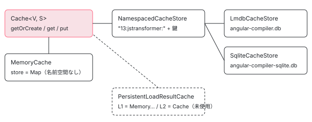

[目次](../README.md) › [application builder の読み残し：options の正規化・結果の形・BundlerContext・キャッシュ・小さなプラグインを行で埋める](README.md) › 第 4 回 / 全 6 回

# ディスクに残るキャッシュ：Cache・NamespacedCacheStore・SQLite と LMDB・読み込み結果のキャッシュ

> tools/esbuild/cache.ts の Cache.getOrCreate・MemoryCache・createPersistentCacheStore、sqlite-cache-store.ts と lmdb-cache-store.ts、load-result-cache.ts の残りと、まだどこからも使われていない persistent-load-result-cache.ts。本物の store を Node で動かし、カウンターの ng build が .angular/cache に残すものを録る。

angular/angular-cli · 読了 約 12 分 · 発展 · [サイトで読む（デモが動きます）](https://angular-deep-dive-cyan.vercel.app/chapter/abl-cache)

---

ng build を 2 回続けて打つと、2 回目は少し速くなります。そのとき .angular/cache の下にあるデータベースのファイルに、何が・どんな鍵で・どんな形で書かれ、いつ消えるのでしょうか。この章では、ビルドのキャッシュの土台になっている `Cache` と `CacheStore` の型、同じ鍵の同時の問い合わせを 1 回にまとめる `getOrCreate`、ディスクに書く 2 つの store（SQLite と LMDB）、esbuild の読み込み結果を覚える `MemoryLoadResultCache` と、まだどこからも使われていない 2 段のキャッシュ `PersistentLoadResultCache` を、行を追って読みます。

読む対象は ../angular-cli（44129f66a3）の `packages/angular/build/src/tools/esbuild/` の `cache.ts`・`sqlite-cache-store.ts`・`lmdb-cache-store.ts`・`load-result-cache.ts`・`persistent-load-result-cache.ts` と、これらを呼ぶ数か所です。保存から再ビルドまでの流れ、.angular/cache の置き場所の決め方、LMDB と SQLite の選び方、名前空間の鍵の作り方、SQLite の掃除の前半、`createCachedLoad` と `invalidate` は [再ビルドとキャッシュ](../cli/10-cli-cache-watch.md)で読み終えているので、ここでは繰り返しません。

1. [1. normalizeOptions](01-abl-options.md)
2. [2. ビルドの結果の形](02-abl-results.md)
3. [3. BundlerContext と後処理の残り](03-abl-context-post.md)
4. **4. ディスクに残るキャッシュ**（この章）
5. [5. 小さなプラグインと検査](05-abl-plugins.md)
6. [6. spec と issue](06-abl-tests-issues.md)

> [!NOTE]
> **ポイント**
>
> 本文は 44129f66a3（2026-09-09）の行番号で読みます。このサイトの依存の @angular/build 22.2.7（v22.2.7 のタグ、72f44d79cb）と新しい本家の main では、コミット「relocate non-esbuild utilities out of tools/esbuild」（eb1edeb514、2026-09-21）で `cache.ts`・`sqlite-cache-store.ts`・`lmdb-cache-store.ts` が `src/utils/cache/` に移りました。git diff で比べると、変わったのは import のパスの 2 行だけです。`persistent-load-result-cache.ts` は、並列の小道具（3 節の `mapConcurrent`）を `utils/concurrency` に出した差だけです。この章の記録は 22.2.7 の dist を動かしています。

## 0. 全体の形



*Cache は「どこに置くか」を CacheStore に任せる。ディスクの store は 1 つのファイルを名前空間で分け合う*

## 1. CacheStore と PersistentCacheStore

📄 `angular-cli/packages/angular/build/src/tools/esbuild/cache.ts` L17–52 （▶ の行: 19–20, 22, 27, 33, 41, 49–51）

```ts
17 │ /**
18 │  * A backing data store for one or more Cache instances.
19 ▶  * The interface is intentionally designed to support using a JavaScript
20 ▶  * Map instance as a potential cache store.
21 │  */
22 ▶ export interface CacheStore<V> {
23 │   /**
24 │    * Returns the specified value from the cache store or `undefined` if not found.
25 │    * @param key The key to retrieve from the store.
26 │    */
27 ▶   get(key: string): V | undefined | Promise<V | undefined>;
28 │ 
29 │   /**
30 │    * Returns whether the provided key is present in the cache store.
31 │    * @param key The key to check from the store.
32 │    */
33 ▶   has(key: string): boolean | Promise<boolean>;
34 │ 
35 │   /**
36 │    * Adds a new value to the cache store if the key is not present.
37 │    * Updates the value for the key if already present.
38 │    * @param key The key to associate with the value in the cache store.
39 │    * @param value The value to add to the cache store.
40 │    */
41 ▶   set(key: string, value: V): this | Promise<this>;
42 │ }
43 │ 
44 │ /**
45 │  * A persistent backing data store that supports namespace partitioning
46 │  * and manual lifecycle close operations.
47 │  */
48 │ // eslint-disable-next-line @typescript-eslint/no-explicit-any
49 ▶ export interface PersistentCacheStore<V = any> extends CacheStore<V> {
50 ▶   createCache<T = V>(namespace: string): Cache<T>;
51 ▶   close(): void | Promise<void>;
52 │ }
```

19〜20 行目のコメントのとおり、`CacheStore` は JavaScript の `Map` をそのまま入れられる形に作ってあります。27・33・41 行目の `get`・`has`・`set` は、戻り値が「値」でも「Promise」でもよい、という型です。`Map` は同期で返し、ディスクの store は Promise で返します。

49〜51 行目の `PersistentCacheStore` は、それに 2 つ足したものです。`createCache(namespace)` で 1 つのファイルを用途ごとに切り分けた `Cache` を作り、`close()` で閉じます。名前空間の鍵の作り方（このすぐ下の `NamespacedCacheStore`）は[再ビルドとキャッシュ](../cli/10-cli-cache-watch.md)の 6 節で読みました。

## 2. Cache.getOrCreate：同じ鍵を 1 回だけ作る

📄 `angular-cli/packages/angular/build/src/tools/esbuild/cache.ts` L87–117 （▶ の行: 92, 94, 96, 98, 100, 105–106）

```ts
 87 │ /**
 88 │  * A cache object that allows accessing and storing key/value pairs in
 89 │  * an underlying CacheStore. This class is the primary method for consumers
 90 │  * to use a cache.
 91 │  */
 92 ▶ export class Cache<V, S extends CacheStore<V> = CacheStore<V>> {
 93 │   // In-flight creator promises to deduplicate concurrent requests for the same key.
 94 ▶   readonly #requests = new Map<string, Promise<V>>();
 95 │   // Track how many writes occurred for a key to detect mutations during await gaps.
 96 ▶   readonly #writeCounts = new Map<string, number>();
 97 │   // Count the number of active, pending getOrCreate operations per key to avoid memory leaks.
 98 ▶   readonly #pendingGets = new Map<string, number>();
 99 │ 
100 ▶   constructor(protected readonly store: S) {}
101 │ 
102 │   #incrementWrite(key: string) {
103 │     // Only track write counts if there is a pending getOrCreate operation active for the key.
104 │     // This ensures that write counts are not leaked when no concurrent gets are running.
105 ▶     if (this.#pendingGets.has(key)) {
106 ▶       this.#writeCounts.set(key, (this.#writeCounts.get(key) || 0) + 1);
107 │     }
108 │   }
109 │ 
110 │   /**
111 │    * Gets the value associated with a provided key if available.
112 │    * Otherwise, creates a value using the factory creator function, puts the value
113 │    * in the cache, and returns the new value.
114 │    * @param key A key associated with the value.
115 │    * @param creator A factory function for the value if no value is present.
116 │    * @returns A value associated with the provided key.
117 │    */
```

92 行目、`Cache` は値の型 `V` と store の型 `S` を受け取ります。中身は 3 つの `Map` です。94 行目の `#requests` は「いま作っている途中の Promise」、96 行目の `#writeCounts` は「待っている間に書き込みが何回あったか」、98 行目の `#pendingGets` は「いま getOrCreate の途中にいる呼び出しの数」。105〜106 行目、書き込みの回数は、getOrCreate の途中の呼び出しがいる鍵についてだけ数えます。数え続けると、鍵の数だけ Map が膨らむからです（コミット「prevent memory leaks in parallel compilation and caches」e4111ae818 で入った形です）。

📄 `angular-cli/packages/angular/build/src/tools/esbuild/cache.ts` L118–151 （▶ の行: 120–122, 126–127, 130, 133, 137–139, 141–142, 147–149）

```ts
118 │   async getOrCreate(key: string, creator: () => V | Promise<V>): Promise<V> {
119 │     // 1. If another call is already running the creator for this key, share its promise.
120 ▶     let activeRequest = this.#requests.get(key);
121 ▶     if (activeRequest !== undefined) {
122 ▶       return activeRequest;
123 │     }
124 │ 
125 │     // Increment pending gets count to enable write-tracking for this key.
126 ▶     const currentPending = this.#pendingGets.get(key) || 0;
127 ▶     this.#pendingGets.set(key, currentPending + 1);
128 │ 
129 │     try {
130 ▶       const startWriteCount = this.#writeCounts.get(key) || 0;
131 │ 
132 │       // 2. Query the backing store. Since store.get can be async, we yield to the event loop.
133 ▶       const value = await this.store.get(key);
134 │ 
135 │       // If a write (e.g. put) occurred during the store.get await gap, we must abort
136 │       // the current execution and restart to ensure we return the newly written value.
137 ▶       if ((this.#writeCounts.get(key) || 0) !== startWriteCount) {
138 ▶         return this.getOrCreate(key, creator);
139 ▶       }
140 │ 
141 ▶       if (value !== undefined) {
142 ▶         return value;
143 │       }
144 │ 
145 │       // 3. Recheck active request after the await gap in case another concurrent call
146 │       // initiated a creator during the store.get wait.
147 ▶       activeRequest = this.#requests.get(key);
148 ▶       if (activeRequest !== undefined) {
149 ▶         return activeRequest;
150 │       }
151 │ 
```

📄 `angular-cli/packages/angular/build/src/tools/esbuild/cache.ts` L152–187 （▶ の行: 153, 157–160, 163, 167–168, 174, 176, 179–182, 184）

```ts
152 │       // 4. Run the creator to produce the new value, and store its promise in #requests.
153 ▶       activeRequest = Promise.resolve(creator()).then(
154 │         async (newValue) => {
155 │           // Ensure this request is still the active one before writing back to the store
156 │           // (prevents overwriting newer data if put() was called before resolution).
157 ▶           if (this.#requests.get(key) === activeRequest) {
158 ▶             this.#incrementWrite(key);
159 ▶             await this.store.set(key, newValue);
160 ▶             this.#requests.delete(key);
161 │           }
162 │ 
163 ▶           return newValue;
164 │         },
165 │         (error) => {
166 │           // Clean up the active request if the creator fails.
167 ▶           if (this.#requests.get(key) === activeRequest) {
168 ▶             this.#requests.delete(key);
169 │           }
170 │           throw error;
171 │         },
172 │       );
173 │ 
174 ▶       this.#requests.set(key, activeRequest);
175 │ 
176 ▶       return activeRequest;
177 │     } finally {
178 │       // Clean up write counts and pending gets once all concurrent gets for this key finish.
179 ▶       const current = this.#pendingGets.get(key) || 0;
180 ▶       if (current <= 1) {
181 ▶         this.#pendingGets.delete(key);
182 ▶         this.#writeCounts.delete(key);
183 │       } else {
184 ▶         this.#pendingGets.set(key, current - 1);
185 │       }
186 │     }
187 │   }
```

1. **作っている途中なら、その Promise を返す**

   120〜122 行目。同じ鍵で 2 つ目・3 つ目の呼び出しが来ても、creator（値を作る関数）は呼ばれません。
2. **途中にいる数を 1 つ増やし、書き込みの回数を覚える**

   126〜127 行目と 130 行目。
3. **store に聞く**

   133 行目。ディスクの store なら await で待ちます。この待ちの間に `put` が来ると、137〜138 行目で書き込みの回数が変わったことに気づき、最初からやり直します。古い値を返さないためです。
4. **あれば返す。無ければもう 1 度途中の Promise を確かめる**

   141〜142 行目で値を返します。147〜149 行目、待っている間に別の呼び出しが creator を始めていれば、それに相乗りします。
5. **creator を呼び、Promise を登録する**

   153 行目で creator を呼び、174 行目で `#requests` に入れます。解決したら 157 行目で「まだ自分が登録されたままか」を確かめ、そうなら 158〜160 行目で store に書いて登録を外します。163 行目、呼んだ人には creator の値を返します。
6. **失敗したら登録を外して投げ直す**

   167〜168 行目。外さないと、次の呼び出しが失敗した Promise に相乗りし続けます。
7. **最後の 1 人が後片付け**

   179〜182 行目、途中にいる数が 1 以下なら、その鍵の数と書き込みの回数を消します。残っていれば 184 行目で 1 減らすだけです。

📄 `angular-cli/packages/angular/build/src/tools/esbuild/cache.ts` L194–229 （▶ の行: 194–195, 206–209, 215–218, 224）

```ts
194 ▶   async get(key: string): Promise<V | undefined> {
195 ▶     const value = await this.store.get(key);
196 │ 
197 │     return value;
198 │   }
199 │ 
200 │   /**
201 │    * Puts a value in the cache and associates it with the provided key.
202 │    * If the key is already present, the value is updated instead.
203 │    * @param key A key associated with the value.
204 │    * @param value A value to put in the cache.
205 │    */
206 ▶   async put(key: string, value: V): Promise<void> {
207 ▶     this.#requests.delete(key);
208 ▶     this.#incrementWrite(key);
209 ▶     await this.store.set(key, value);
210 │   }
211 │ 
212 │   /**
213 │    * Clears internal state for a specific key (requests, write counts, and pending gets).
214 │    */
215 ▶   protected deleteInternal(key: string): void {
216 ▶     this.#requests.delete(key);
217 ▶     this.#writeCounts.delete(key);
218 ▶     this.#pendingGets.delete(key);
219 │   }
220 │ 
221 │   /**
222 │    * Clears the base class internal state (requests, write counts, and pending gets).
223 │    */
224 ▶   protected clearInternal(): void {
225 │     this.#requests.clear();
226 │     this.#writeCounts.clear();
227 │     this.#pendingGets.clear();
228 │   }
229 │ }
```

194〜195 行目の `get` は、store にそのまま聞くだけで、相乗りはしません。206〜209 行目の `put` は、207 行目で途中の Promise の登録を外し、208 行目で書き込みを数え、209 行目で store に書きます。だから creator の途中で `put` が来ると、5 のステップの 157 行目が偽になり、creator の値は store に書かれません。呼んだ人には creator の値が返り、store には `put` の値が残ります（デモの「getOrCreate を同時に 3 回」の下の段）。215〜218 行目と 224 行目の 2 つの protected のメソッドは、次の MemoryCache の `delete` と `clear` が使います。

## 3. MemoryCache と、それを使う所

📄 `angular-cli/packages/angular/build/src/tools/esbuild/cache.ts` L234–273 （▶ の行: 234, 236, 244–245, 247, 253–255, 262, 270）

```ts
234 ▶ export class MemoryCache<V> extends Cache<V, Map<string, V>> {
235 │   constructor() {
236 ▶     super(new Map());
237 │   }
238 │ 
239 │   /**
240 │    * Removes the specified key from the cache instance.
241 │    * @param key The key to remove.
242 │    * @returns True if an element in the Map existed and has been removed, or false if the element does not exist.
243 │    */
244 ▶   delete(key: string): boolean {
245 ▶     this.deleteInternal(key);
246 │ 
247 ▶     return this.store.delete(key);
248 │   }
249 │ 
250 │   /**
251 │    * Removes all entries from the cache instance.
252 │    */
253 ▶   clear() {
254 ▶     this.clearInternal();
255 ▶     this.store.clear();
256 │   }
257 │ 
258 │   /**
259 │    * Provides all the values currently present in the cache instance.
260 │    * @returns An iterable of all values in the cache.
261 │    */
262 ▶   values() {
263 │     return this.store.values();
264 │   }
265 │ 
266 │   /**
267 │    * Provides all the keys/values currently present in the cache instance.
268 │    * @returns An iterable of all key/value pairs in the cache.
269 │    */
270 ▶   entries() {
271 │     return this.store.entries();
272 │   }
273 │ }
```

234〜236 行目、`MemoryCache` は store に `new Map()` を渡しただけの `Cache` です。名前空間の包みは通さないので、`entries()`（270 行目）で見える鍵は渡したままの文字列です。244〜247 行目の `delete` と 253〜255 行目の `clear` は、先に 2 節の途中の状態（`deleteInternal`・`clearInternal`）を消してから Map を触ります。

📄 `angular-cli/packages/angular/build/src/tools/esbuild/stylesheets/sass-language.ts` L107–115 （▶ の行: 107, 110, 112–113）

```ts
107 ▶   // Caching follows Sass behavior where a given package url will always resolve to the same value
108 │   // regardless of its importer's path. Relative paths are qualified with the containing URL.
109 │   // A null value indicates that the cached resolution attempt failed to find a location and
110 ▶   // later stage resolution should be attempted. This avoids potentially expensive repeat
111 │   // failing resolution attempts.
112 ▶   resolutionCache ??= new MemoryCache<URL | null>();
113 ▶   packageRootCache ??= new MemoryCache<string | null>();
114 │   const currentResolutionCache = resolutionCache;
115 │   const currentPackageRootCache = packageRootCache;
```

📄 `angular-cli/packages/angular/build/src/tools/esbuild/angular/component-stylesheets.ts` L26–35 （▶ の行: 31–34）

```ts
26 │ /**
27 │  * Bundles component stylesheets. A stylesheet can be either an inline stylesheet that
28 │  * is contained within the Component's metadata definition or an external file referenced
29 │  * from the Component's metadata definition.
30 │  */
31 ▶ export class ComponentStylesheetBundler {
32 ▶   readonly #fileContexts = new MemoryCache<BundlerContext>();
33 ▶   readonly #inlineContexts = new MemoryCache<BundlerContext>();
34 ▶   readonly #loadCache = new MemoryLoadResultCache();
35 │ 
```

MemoryCache を使う所は 2 つです。sass-language.ts の 112〜113 行目は、Sass のパッケージの URL の解決結果を覚えます。107〜110 行目のコメントのとおり「見つからなかった」も `null` で覚え、失敗する解決を何度も繰り返さないようにします。component-stylesheets.ts の 32〜33 行目は、コンポーネントのスタイルごとの esbuild の文脈（`BundlerContext`）を覚えます。ここでは `getOrCreate` の相乗りのおかげで、同じスタイルファイルを同時に 2 つのコンポーネントが読んでも文脈は 1 つだけ作られます（使い方は[コンポーネントのスタイル](../cli/04-cli-component-styles.md)の章）。34 行目は次の 7 節の `MemoryLoadResultCache` です。

## 4. createPersistentCacheStore の上半分と、i18n の store

📄 `angular-cli/packages/angular/build/src/tools/esbuild/cache.ts` L275–298 （▶ の行: 283, 286, 288, 290, 294–296）

```ts
275 │ /**
276 │  * Creates and returns a persistent cache store.
277 │  * Attempts to use the native LMDB store first, and falls back to the built-in SQLite store
278 │  * if LMDB fails to initialize.
279 │  *
280 │  * @param baseCachePath The base path of the cache file/directory without suffix/extension.
281 │  * @returns A promise resolving to a PersistentCacheStore instance.
282 │  */
283 ▶ export async function createPersistentCacheStore(
284 │   baseCachePath: string,
285 │ ): Promise<PersistentCacheStore> {
286 ▶   if (persistentCacheStoreSetting === 'sqlite') {
287 │     try {
288 ▶       const { SqliteCacheStore } = await import('./sqlite-cache-store');
289 │ 
290 ▶       return new SqliteCacheStore(baseCachePath + '-sqlite.db');
291 │     } catch (err) {
292 │       assertIsError(err);
293 │ 
294 ▶       throw new Error(
295 ▶         'Unable to initialize JavaScript cache storage.\n' + `SQLite error: ${err.message}`,
296 ▶         { cause: err },
297 │       );
298 │     }
```

286 行目、環境変数 `NG_BUILD_CACHE_STORE=sqlite` のときは LMDB を試さず、288 行目で SQLite の store を動的に import し、290 行目でファイル名に `-sqlite.db` を足します。ここで失敗すると、294〜296 行目で「Unable to initialize JavaScript cache storage.」に SQLite のエラーを添えて投げます。既定の分岐（LMDB → だめなら SQLite）と `lmdb` を指定したときの分岐は、この引用のすぐ下にあり、[再ビルドとキャッシュ](../cli/10-cli-cache-watch.md)で読みました。

📄 `angular-cli/packages/angular/build/src/tools/esbuild/i18n-inliner.ts` L674–704 （▶ の行: 675, 681, 687–689, 692–695, 698–700）

```ts
674 │   private async initCache(): Promise<void> {
675 ▶     if (this.#cacheStore || this.#cacheInitFailed) {
676 │       return;
677 │     }
678 │ 
679 │     const { persistentCachePath } = this.options;
680 │     // Webcontainers currently do not support this persistent cache store.
681 ▶     if (!persistentCachePath || process.versions.webcontainer) {
682 │       return;
683 │     }
684 │ 
685 │     // Initialize a persistent cache for i18n transformations.
686 │     try {
687 ▶       const [, cacheStore] = await Promise.all([
688 ▶         initializeHash(),
689 ▶         createPersistentCacheStore(join(persistentCachePath, 'angular-i18n')),
690 │       ]);
691 │       this.#cacheStore = cacheStore;
692 ▶       this.#transformedFileCache = cacheStore.createCache('transforms');
693 ▶       this.#translationCache = cacheStore.createCache('translations');
694 ▶     } catch {
695 ▶       this.#cacheInitFailed = true;
696 │ 
697 │       // eslint-disable-next-line no-console
698 ▶       console.warn(
699 ▶         'Unable to initialize JavaScript cache storage.\n' +
700 ▶           'This will not affect the build output content but may result in slower builds.',
701 │       );
702 │     }
703 │   }
704 │ }
```

createPersistentCacheStore を呼ぶ所は 2 つです。1 つは Angular のコンパイラのプラグインで、`angular-compiler` という名前の store を開き、`jstransformer` の名前空間を切り出します（cli-cache-watch で読みました）。もう 1 つが i18n の inliner（翻訳を差し込む処理）のこの関数です。689 行目で `angular-i18n` という名前の store を開き、692〜693 行目で `transforms` と `translations` の 2 つの名前空間を切り出します。681 行目、ブラウザの中で Node を動かす WebContainer では作りません。開けなくても 694〜700 行目で警告を 1 回出すだけで、ビルドは続きます。688 行目の `initializeHash()` は、鍵のハッシュに使う xxhash の WebAssembly を読み込む関数です（8 節）。

## 5. SqliteCacheStore

LMDB のネイティブのバイナリが入らない環境で使う store です。Node 組み込みの `node:sqlite` の上に作ってあります。

📄 `angular-cli/packages/angular/build/src/tools/esbuild/sqlite-cache-store.ts` L9–35 （▶ の行: 11, 13–14, 17, 25, 30–34）

```ts
 9 │ import { mkdirSync, rmSync } from 'node:fs';
10 │ import { dirname } from 'node:path';
11 ▶ import { DatabaseSync, StatementSync } from 'node:sqlite';
12 │ import { promisify } from 'node:util';
13 ▶ import { deserialize, serialize } from 'node:v8';
14 ▶ import { deflateRaw, inflateRawSync } from 'node:zlib';
15 │ import { Cache, NamespacedCacheStore, PersistentCacheStore } from './cache';
16 │ 
17 ▶ const deflateRawAsync = promisify(deflateRaw);
18 │ 
19 │ /**
20 │  * Minimum payload size (in bytes) required to attempt compression.
21 │  * Smaller payloads generally do not achieve meaningful compression ratios, while larger payloads
22 │  * (such as transformed JavaScript modules from node_modules) achieve 70-80% size reduction
23 │  * and drastically reduce SQLite overflow pages.
24 │  */
25 ▶ const COMPRESSION_THRESHOLD = 32 * 1024; // 32 KB
26 │ 
27 │ /**
28 │  * Storage format discriminator values for cache table entries.
29 │  */
30 ▶ const enum CacheFormat {
31 ▶   V8 = 0,
32 ▶   V8Compressed = 1,
33 ▶   RawBinary = 2,
34 ▶   RawBinaryCompressed = 3,
35 │ }
```

11 行目、`DatabaseSync` は同期の API です。13 行目、値は JSON ではなく V8 の `serialize`（構造化クローンの形）でバイト列にします。25 行目、32KB 以上の値だけ圧縮します。30〜34 行目の 4 つの数が、行ごとに「どう書いたか」を覚える `format` の列の値です。

📄 `angular-cli/packages/angular/build/src/tools/esbuild/sqlite-cache-store.ts` L60–88 （▶ の行: 63–66, 75–76, 81–83, 85–86）

```ts
60 │ /**
61 │  * A persistent cache store backed by SQLite.
62 │  *
63 ▶  * Values are persisted with the V8 structured clone serialization API instead of JSON. Cached
64 ▶  * values include binary data such as the `Uint8Array` output of the JavaScript transformer and
65 ▶  * the `contents` of an esbuild load result. A JSON round-trip converts those into plain objects
66 ▶  * (`{"0":105,"1":109,...}`), which breaks consumers on any build that reads them back from disk.
67 │  */
68 │ export class SqliteCacheStore implements PersistentCacheStore<unknown> {
69 │   #db: DatabaseSync | undefined;
70 │   #disabled = false;
71 │   #getStmt: StatementSync | undefined;
72 │   #hasStmt: StatementSync | undefined;
73 │   #setStmt: StatementSync | undefined;
74 │   #updateAccessedStmt: StatementSync | undefined;
75 ▶   readonly #pendingAccessedKeys = new Set<string>();
76 ▶   #flushTimeout: NodeJS.Timeout | undefined;
77 │   readonly #busyTimeoutMs: number;
78 │ 
79 │   constructor(
80 │     readonly cachePath: string,
81 ▶     private readonly maxPayloadSize = 1024 * 1024 * 1024,
82 ▶     private readonly ttlDays = 14,
83 ▶     busyTimeoutMs = 5000,
84 │   ) {
85 ▶     this.#busyTimeoutMs =
86 ▶       Number.isSafeInteger(busyTimeoutMs) && busyTimeoutMs >= 0 ? busyTimeoutMs : 5000;
87 │   }
88 │ 
```

63〜66 行目のコメントが、JSON をやめた理由です。JavaScript の変換結果は `Uint8Array` で、JSON を通すと `{"0":105,"1":109,...}` のただのオブジェクトに化けます。コミット「preserve binary values in the SQLite cache store」（135662d9a1、2026-08-27）のメッセージによると、この化け方は 1 回目のビルドでは出ません。1 回目はメモリの層から値を返し、ディスクから読み戻す 2 回目以降に esbuild が「contents must be a string or a Uint8Array」で落ちていました。

81〜82 行目、上限は 1GiB・14 日。83 行目と 85〜86 行目、ロックを待つ時間は既定 5 秒で、負の数や小数を渡されたら 5000 に戻します。75〜76 行目の 2 つは、少し下の `#queueAccessUpdate` が「最後に使った時刻」の書き込みをまとめるための入れ物です。

📄 `angular-cli/packages/angular/build/src/tools/esbuild/sqlite-cache-store.ts` L89–127 （▶ の行: 92–93, 97–101, 106–109, 111, 113, 117–118, 121, 126）

```ts
 89 │   #openDatabase(): DatabaseSync {
 90 │     let db: DatabaseSync | undefined;
 91 │     try {
 92 ▶       if (this.cachePath === ':memory:') {
 93 ▶         db = new DatabaseSync(this.cachePath);
 94 │       } else {
 95 │         // Optimistically attempt to open the database file first to avoid directory creation
 96 │         // syscalls on warm builds where the parent directory already exists.
 97 ▶         try {
 98 ▶           db = new DatabaseSync(this.cachePath);
 99 ▶         } catch {
100 ▶           mkdirSync(dirname(this.cachePath), { recursive: true });
101 ▶           db = new DatabaseSync(this.cachePath);
102 │         }
103 │       }
104 │ 
105 │       // Optimize SQLite for cache usage
106 ▶       db.exec(`PRAGMA busy_timeout = ${this.#busyTimeoutMs};`);
107 ▶       db.exec('PRAGMA auto_vacuum = FULL;');
108 ▶       db.exec('PRAGMA journal_mode = WAL;');
109 ▶       db.exec('PRAGMA synchronous = NORMAL;');
110 │       db.exec('PRAGMA temp_store = MEMORY;');
111 ▶       db.exec('PRAGMA mmap_size = 268435456;');
112 │       db.exec(
113 ▶         'CREATE TABLE IF NOT EXISTS cache (' +
114 │           'key TEXT PRIMARY KEY, ' +
115 │           'value BLOB, ' +
116 │           'format INTEGER NOT NULL DEFAULT 0, ' +
117 ▶           'last_accessed INTEGER NOT NULL' +
118 ▶           ') WITHOUT ROWID;',
119 │       );
120 │       try {
121 ▶         db.exec('ALTER TABLE cache ADD COLUMN format INTEGER NOT NULL DEFAULT 0;');
122 │       } catch {
123 │         // Ignore error if format column already exists
124 │       }
125 │       db.exec(
126 ▶         'CREATE INDEX IF NOT EXISTS idx_cache_accessed ON cache (last_accessed DESC, key DESC);',
127 │       );
```

📄 `angular-cli/packages/angular/build/src/tools/esbuild/sqlite-cache-store.ts` L128–153 （▶ の行: 129–132, 134–135, 143, 151）

```ts
128 │ 
129 ▶       this.#getStmt = db.prepare('SELECT value, format FROM cache WHERE key = ?');
130 ▶       this.#hasStmt = db.prepare('SELECT 1 FROM cache WHERE key = ?');
131 ▶       this.#setStmt = db.prepare(
132 ▶         'INSERT OR REPLACE INTO cache (key, value, format, last_accessed) VALUES (?, ?, ?, unixepoch())',
133 │       );
134 ▶       this.#updateAccessedStmt = db.prepare(
135 ▶         'UPDATE cache SET last_accessed = unixepoch() WHERE key = ?',
136 │       );
137 │ 
138 │       this.#db = db;
139 │ 
140 │       return db;
141 │     } catch (error) {
142 │       try {
143 ▶         db?.close();
144 │       } catch {
145 │         // Ignore close error on corrupted handle
146 │       }
147 │       this.#getStmt = undefined;
148 │       this.#hasStmt = undefined;
149 │       this.#setStmt = undefined;
150 │       this.#updateAccessedStmt = undefined;
151 ▶       throw error;
152 │     }
153 │   }
```

1. **まず開いてみる。だめなら親のフォルダを作って開き直す**

   97〜101 行目。2 回目以降のビルドではフォルダがあるので、フォルダを作るシステムコールを省けます（54d712f579）。92〜93 行目の `:memory:` は spec が使うメモリの DB です。
2. **PRAGMA を 6 つ**

   106 行目でロック待ちの時間、107 行目で消した行の領域を自動で詰める、108 行目で WAL（書き込みを別ファイルの記録に溜める方式。読みと書きが互いを待たない）、109 行目で書き込みのたびのディスク同期を緩め、111 行目で 256MB まで mmap。
3. **表と索引**

   113〜118 行目、表は `key・value・format・last_accessed` の 4 列で、主キーの順に並べる `WITHOUT ROWID`。121 行目、format の列が無い古い DB には列を足します（あれば失敗するので握りつぶす）。126 行目の索引は 5 節の掃除のためのものです。
4. **文を 4 つ用意する**

   129〜135 行目。131〜132 行目の書き込みは `INSERT OR REPLACE` で、`last_accessed` に SQLite の `unixepoch()`（秒）を入れます。
5. **途中で失敗したら閉じて投げる**

   143 行目で閉じ、151 行目で投げます。受け取るのは次の `#ensureDb` です。

📄 `angular-cli/packages/angular/build/src/tools/esbuild/sqlite-cache-store.ts` L155–191 （▶ の行: 156–157, 165–168, 171, 173–176, 178, 184, 186）

```ts
155 │   #ensureDb(): DatabaseSync | undefined {
156 ▶     if (this.#disabled) {
157 ▶       return undefined;
158 │     }
159 │ 
160 │     if (!this.#db) {
161 │       try {
162 │         return this.#openDatabase();
163 │       } catch (error) {
164 │         // If the database is locked by another active process,
165 ▶         // do not attempt to delete the database files as that could corrupt the active process's database.
166 ▶         const isBusy =
167 ▶           isSqliteError(error) &&
168 ▶           (error.errcode === SqliteResultCode.Busy || error.errcode === SqliteResultCode.Locked);
169 │ 
170 │         // Attempt to recover from database corruption by deleting the corrupted files and recreating
171 ▶         if (!isBusy && this.cachePath !== ':memory:') {
172 │           try {
173 ▶             rmSync(this.cachePath, { force: true });
174 ▶             rmSync(this.cachePath + '-wal', { force: true });
175 ▶             rmSync(this.cachePath + '-shm', { force: true });
176 ▶             rmSync(this.cachePath + '-journal', { force: true });
177 │ 
178 ▶             return this.#openDatabase();
179 │           } catch {
180 │             // If recovery fails (e.g. read-only filesystem or permission denied), disable caching
181 │           }
182 │         }
183 │ 
184 ▶         this.#disabled = true;
185 │ 
186 ▶         return undefined;
187 │       }
188 │     }
189 │ 
190 │     return this.#db;
191 │   }
```

開けなかったとき、166〜168 行目で「ほかのプロセスがロックしている（SQLITE\_BUSY・SQLITE\_LOCKED）」かを見ます。そうでなければ壊れたとみなし、173〜176 行目で DB と `-wal`・`-shm`・`-journal` を消して 178 行目で開き直します。ロック中に消さないのは、165 行目のコメントのとおり、相手のプロセスの DB を壊さないためです。それでもだめなら 184 行目で自分を無効にし、以後の get は 156〜157 行目からすぐ「無い」を返します。キャッシュが使えなくてもビルドは落ちません（fe2f180fd0）。

📄 `angular-cli/packages/angular/build/src/tools/esbuild/sqlite-cache-store.ts` L193–229 （▶ の行: 194, 196–198, 214–216, 218, 222, 227）

```ts
193 │   #queueAccessUpdate(key: string): void {
194 ▶     this.#pendingAccessedKeys.add(key);
195 │ 
196 ▶     if (!this.#flushTimeout) {
197 ▶       this.#flushTimeout = setTimeout(() => this.#flushAccessUpdates(), 1000);
198 ▶       this.#flushTimeout.unref?.();
199 │     }
200 │   }
201 │ 
202 │   #flushAccessUpdates(): void {
203 │     if (this.#flushTimeout) {
204 │       clearTimeout(this.#flushTimeout);
205 │       this.#flushTimeout = undefined;
206 │     }
207 │ 
208 │     if (this.#pendingAccessedKeys.size === 0) {
209 │       return;
210 │     }
211 │ 
212 │     try {
213 │       if (this.#db && this.#updateAccessedStmt) {
214 ▶         this.#db.exec('BEGIN IMMEDIATE TRANSACTION;');
215 ▶         for (const key of this.#pendingAccessedKeys) {
216 ▶           this.#updateAccessedStmt.run(key);
217 │         }
218 ▶         this.#db.exec('COMMIT;');
219 │       }
220 │     } catch {
221 │       try {
222 ▶         this.#db?.exec('ROLLBACK;');
223 │       } catch {
224 │         // Ignore rollback errors if transaction was not active
225 │       }
226 │     } finally {
227 ▶       this.#pendingAccessedKeys.clear();
228 │     }
229 │   }
```

読むたびに `last_accessed` を書くと、読みが書き込みのトランザクションになり、並列のワーカーが互いを待ちます。そこで 194 行目で鍵を Set に溜め、197 行目で 1 秒後にまとめて書きます。198 行目の `unref` は「このタイマーのためにプロセスを生かし続けない」という Node の指定です。214〜218 行目、溜めた鍵を 1 つのトランザクションで更新します。コミット d11a663e77（2026-09-08）のメッセージは、それまで 100 回読むごとに `BEGIN IMMEDIATE` を打っていて、並列のビルドで busy の待ちが起きていた、と書いています。

📄 `angular-cli/packages/angular/build/src/tools/esbuild/sqlite-cache-store.ts` L237–274 （▶ の行: 239, 242, 244, 247–250, 258–260, 262, 264–265, 269–270）

```ts
237 │     try {
238 │       // SQLite column types are dynamic, so the stored value is only known at runtime.
239 ▶       const row = this.#getStmt?.get(key) as { value: unknown; format: CacheFormat } | undefined;
240 │ 
241 │       if (row) {
242 ▶         this.#queueAccessUpdate(key);
243 │ 
244 ▶         if (row.value instanceof Uint8Array) {
245 │           try {
246 │             switch (row.format) {
247 ▶               case CacheFormat.RawBinary:
248 ▶                 return row.value;
249 ▶               case CacheFormat.RawBinaryCompressed: {
250 ▶                 const decompressed = inflateRawSync(row.value);
251 │ 
252 │                 return new Uint8Array(
253 │                   decompressed.buffer,
254 │                   decompressed.byteOffset,
255 │                   decompressed.byteLength,
256 │                 );
257 │               }
258 ▶               case CacheFormat.V8Compressed:
259 ▶                 return deserialize(inflateRawSync(row.value));
260 ▶               case CacheFormat.V8:
261 │               default:
262 ▶                 return deserialize(row.value);
263 │             }
264 ▶           } catch {
265 ▶             // Treat corrupt or unparseable cached payloads as a cache miss.
266 │           }
267 │         }
268 │       }
269 ▶     } catch {
270 ▶       // Treat query errors (e.g. disk read failures) as a cache miss.
271 │     }
272 │ 
273 │     return undefined;
274 │   }
```

📄 `angular-cli/packages/angular/build/src/tools/esbuild/sqlite-cache-store.ts` L288–319 （▶ の行: 294, 296–298, 301–303, 305, 309–311, 317–318）

```ts
288 │   async set(key: string, value: unknown): Promise<this> {
289 │     if (!this.#ensureDb()) {
290 │       return this;
291 │     }
292 │ 
293 │     try {
294 ▶       this.#pendingAccessedKeys.delete(key);
295 │ 
296 ▶       const isBinary = value instanceof Uint8Array;
297 ▶       const data = isBinary ? value : serialize(value);
298 ▶       let format = isBinary ? CacheFormat.RawBinary : CacheFormat.V8;
299 │       let payload: Uint8Array = data;
300 │ 
301 ▶       if (data.byteLength >= COMPRESSION_THRESHOLD) {
302 ▶         const compressed = await deflateRawAsync(data, { level: 1 });
303 ▶         if (compressed.byteLength < data.byteLength) {
304 │           payload = compressed;
305 ▶           format = isBinary ? CacheFormat.RawBinaryCompressed : CacheFormat.V8Compressed;
306 │         }
307 │       }
308 │ 
309 ▶       this.#setStmt?.run(key, payload, format);
310 ▶     } catch {
311 ▶       // Writing to cache is non-fatal and should not fail the build.
312 │     }
313 │ 
314 │     return this;
315 │   }
316 │ 
317 ▶   createCache<V = unknown>(namespace: string): Cache<V> {
318 ▶     return new Cache<V>(new NamespacedCacheStore<V>(this, namespace));
319 │   }
```

書く側から見ます。296〜298 行目、`Uint8Array` ならそのまま（RawBinary）、それ以外は `serialize`（V8）。301〜305 行目、32KB 以上なら圧縮率より速さを取るレベル 1 の raw DEFLATE をかけ、**小さくなったときだけ**圧縮した形にします。309 行目で書き、310〜311 行目で失敗は捨てます。294 行目、書いた鍵は「最後に使った時刻」の待ち行列から外します（書き込みの INSERT が、その場で時刻を入れるからです）。

読む側は 239 行目で行を取り、242 行目で時刻の更新を予約し、247〜262 行目で format ごとに戻します。264〜265 行目と 269〜270 行目、壊れた値も、読み込みの失敗も「無い」（キャッシュの外れ）として扱います。317〜318 行目の `createCache` は、自分を 1 節の `NamespacedCacheStore` で包んだ `Cache` を返します。

📄 `angular-cli/packages/angular/build/src/tools/esbuild/sqlite-cache-store.ts` L357–384 （▶ の行: 357, 359, 363, 365–366, 368, 374, 378, 382）

```ts
357 ▶         } catch (error) {
358 │           try {
359 ▶             this.#db.exec('ROLLBACK;');
360 │           } catch {
361 │             // Ignore rollback errors if transaction was not active
362 │           }
363 ▶           throw error;
364 │         }
365 ▶       } catch {
366 ▶         // Pruning errors should not block build success
367 │       } finally {
368 ▶         this.#getStmt = undefined;
369 │         this.#hasStmt = undefined;
370 │         this.#setStmt = undefined;
371 │         this.#updateAccessedStmt = undefined;
372 │ 
373 │         try {
374 ▶           this.#db.close();
375 │         } catch {
376 │           // Failure to close should not block build success
377 │         }
378 ▶         this.#db = undefined;
379 │       }
380 │     }
381 │ 
382 ▶     this.#disabled = false;
383 │   }
384 │ }
```

掃除（14 日より古い行と、1GiB を超えた分）の本体は cli-cache-watch で読みました。その続きがこの引用です。掃除の途中で失敗したら 359 行目でロールバックし、363 行目で投げ直したものを 365〜366 行目で捨てます。368〜378 行目、どの道を通っても文と DB を閉じ、382 行目で無効の印も外します。次に開くときは 5 のステップの最初からやり直せます。

## 6. LmdbCacheStore の残り

📄 `angular-cli/packages/angular/build/src/tools/esbuild/lmdb-cache-store.ts` L9–18 （▶ の行: 9, 12–14, 16–17）

```ts
 9 ▶ import { RootDatabase, open } from 'lmdb';
10 │ import { Cache, NamespacedCacheStore, PersistentCacheStore } from './cache';
11 │ 
12 ▶ export class LmdbCacheStore implements PersistentCacheStore<unknown> {
13 ▶   readonly #cacheFileUrl;
14 ▶   #db: RootDatabase | undefined;
15 │ 
16 ▶   constructor(readonly cachePath: string) {
17 ▶     this.#cacheFileUrl = cachePath;
18 │   }
```

📄 `angular-cli/packages/angular/build/src/tools/esbuild/lmdb-cache-store.ts` L48–59 （▶ の行: 48–49, 52–56）

```ts
48 ▶   createCache<V = unknown>(namespace: string): Cache<V> {
49 ▶     return new Cache<V>(new NamespacedCacheStore<V>(this, namespace));
50 │   }
51 │ 
52 ▶   async close() {
53 ▶     try {
54 ▶       await this.#db?.close();
55 ▶     } catch {
56 ▶       // Failure to close should not be fatal
57 │     }
58 │   }
59 │ }
```

9 行目で npm の `lmdb`（ネイティブのバイナリを持つ、メモリに写して読むキーと値の DB）を import します。`lmdb` は @angular/build の optionalDependencies なので、入っていなければこの import が失敗し、4 節の既定の分岐が SQLite に切り替えます。48〜49 行目の `createCache` は SQLite と同じ形。52〜56 行目の `close` は、閉じる失敗を捨てるだけで、SQLite のような掃除はしません。LMDB には古い行を消す仕組みがこのファイルにありません。

## 7. MemoryLoadResultCache の残り

📄 `angular-cli/packages/angular/build/src/tools/esbuild/load-result-cache.ts` L9–18 （▶ の行: 12–16）

```ts
 9 │ import type { OnLoadResult, PluginBuild } from 'esbuild';
10 │ import { normalize } from 'node:path';
11 │ 
12 ▶ export interface LoadResultCache {
13 ▶   get(path: string): OnLoadResult | Promise<OnLoadResult | undefined> | undefined;
14 ▶   put(path: string, result: OnLoadResult): Promise<void>;
15 ▶   invalidate(path: string): boolean;
16 ▶   readonly watchFiles: ReadonlyArray<string>;
17 │ }
18 │ 
```

`LoadResultCache` は esbuild の onLoad の結果（`OnLoadResult`）を覚える入れ物の型です。13 行目の `get` は同期でも Promise でもよく、15 行目の `invalidate` は「このファイルが変わった」を受け取り、16 行目の `watchFiles` は監視すべきファイルの一覧です。実装は 2 つ。メモリだけの `MemoryLoadResultCache` と、8 節の `PersistentLoadResultCache` です。

📄 `angular-cli/packages/angular/build/src/tools/esbuild/load-result-cache.ts` L50–72 （▶ の行: 52–54, 61, 63–66, 71）

```ts
50 │ 
51 │ export class MemoryLoadResultCache implements LoadResultCache {
52 ▶   #loadResults = new Map<string, OnLoadResult>();
53 ▶   #fileDependencies = new Map<string, Set<string>>();
54 ▶   #watchFilesPerKey = new Map<string, ReadonlyArray<string>>();
55 │ 
56 │   get(path: string): OnLoadResult | undefined {
57 │     return this.#loadResults.get(path);
58 │   }
59 │ 
60 │   async put(path: string, result: OnLoadResult): Promise<void> {
61 ▶     const previousWatchFiles = this.#watchFilesPerKey.get(path);
62 │ 
63 ▶     if (result.errors && result.errors.length > 0) {
64 ▶       if (previousWatchFiles) {
65 ▶         result.watchFiles = Array.from(
66 ▶           new Set([...(result.watchFiles ?? []), ...previousWatchFiles]),
67 │         );
68 │       }
69 │     }
70 │ 
71 ▶     const currentNormalizedWatchFiles = new Set(result.watchFiles?.map(normalize) ?? []);
72 │ 
```

📄 `angular-cli/packages/angular/build/src/tools/esbuild/load-result-cache.ts` L73–94 （▶ の行: 74–75, 77–78, 80, 82, 89–90, 92）

```ts
73 │     // Clean up any previous file dependencies that are no longer referenced
74 ▶     if (previousWatchFiles) {
75 ▶       for (const watchFile of previousWatchFiles) {
76 │         const normalizedWatchFile = normalize(watchFile);
77 ▶         if (!currentNormalizedWatchFiles.has(normalizedWatchFile)) {
78 ▶           const affected = this.#fileDependencies.get(normalizedWatchFile);
79 │           if (affected) {
80 ▶             affected.delete(path);
81 │             if (affected.size === 0) {
82 ▶               this.#fileDependencies.delete(normalizedWatchFile);
83 │             }
84 │           }
85 │         }
86 │       }
87 │     }
88 │ 
89 ▶     if (result.watchFiles && result.watchFiles.length > 0) {
90 ▶       this.#watchFilesPerKey.set(path, [...result.watchFiles]);
91 │     } else {
92 ▶       this.#watchFilesPerKey.delete(path);
93 │     }
94 │ 
```

52 行目の結果の表、53 行目の「ファイル → それに依存する鍵」の逆引き表（使い方は cli-cache-watch の 5 節）、54 行目の「鍵 → 前回の watchFiles」の 3 つを持ちます。

1. **エラーの結果には前回の watchFiles を足す**

   63〜66 行目。PostCSS の設定ファイルなどを読んだスタイルがエラーになると、結果の watchFiles が空になり、そのファイルを直しても再ビルドされない、という不具合がありました（bcadbbef20、#33666）。前回の一覧と合わせることで監視が続きます。
2. **もう読まなくなったファイルの逆引きを消す**

   74〜86 行目。前回の一覧にあって今回に無いファイルについて、80 行目で逆引きから自分の鍵を外し、82 行目で空になった Set ごと消します。消さないと、import をやめたファイルを保存しても再ビルドが走り、逆引き表も増え続けます（e4111ae818）。
3. **今回の一覧を覚える**

   89〜92 行目。この続き（逆引きを足す行）は cli-cache-watch で読みました。

📄 `angular-cli/packages/angular/build/src/tools/esbuild/load-result-cache.ts` L122–134 （▶ の行: 123–126, 129–132）

```ts
122 │ 
123 ▶   get watchFiles(): string[] {
124 ▶     // this.#loadResults.keys() is not included here because the keys
125 ▶     // are namespaced request paths and not disk-based file paths.
126 ▶     return [...this.#fileDependencies.keys()];
127 │   }
128 │ 
129 ▶   clear(): void {
130 ▶     this.#loadResults.clear();
131 ▶     this.#fileDependencies.clear();
132 ▶     this.#watchFilesPerKey.clear();
133 │   }
134 │ }
```

123〜126 行目、監視の一覧は逆引き表の鍵だけです。結果の表の鍵は `file:/…` や `angular:styles/…` のような「名前空間:パス」なので、ディスクのパスではありません（124〜125 行目のコメント）。129〜132 行目の `clear` は 3 つを全部消します。

## 8. PersistentLoadResultCache：2 段の読み込み結果のキャッシュ

📄 `angular-cli/packages/angular/build/src/tools/esbuild/persistent-load-result-cache.ts` L9–36 （▶ の行: 11–12, 15–18, 20–21, 35–36）

```ts
 9 │ /**
10 │  * @fileoverview
11 ▶  * Implements a generic, two-tier (L1 memory + L2 persistent disk store) caching system for
12 ▶  * esbuild plugin `OnLoadResult` outcomes across the `@angular/build` compiler pipeline.
13 │  *
14 │  * Supported Module Types:
15 ▶  * 1. **Disk File Modules** (`file:` namespace): Standard disk-based source files (TS, JS, CSS, Sass, Less).
16 ▶  *    Cache keys are computed using the root `globalConfigHash`, file path, and file content. Validity is
17 ▶  *    verified via fast-path metadata (`mtimeMs` + `size`) with fallback to content hashing (`sha256`).
18 ▶  * 2. **Custom Plugin Namespace Modules** (e.g. `angular:script/global`, `sass:`): Modules loaded through
19 │  *    custom esbuild namespaces that resolve to disk source files.
20 ▶  * 3. **Virtual Modules & Remote Resources** (e.g. `angular:styles/component`, `css-inline-fonts`): Synthetic
21 ▶  *    in-memory modules or remote asset declarations whose compiled outcomes depend on parent source file
22 │  *    dependencies (`watchFiles`) or global configuration options (`globalConfigHash`).
23 │  *
24 │  * Key Exported Types:
25 │  * - {@link PersistentLoadResultCache}: Primary two-tier cache manager implementing `LoadResultCache`.
26 │  * - {@link CachedLoadResultEntry}: Serialized structure persisted to disk for cached esbuild `OnLoadResult` items.
27 │  * - {@link CachedDependencyMetadata}: Per-dependency file metadata (`hash`, `mtimeMs`, `size`) used for cache validation and healing.
28 │  */
29 │ 
30 │ import type { Loader, OnLoadResult, PartialMessage } from 'esbuild';
31 │ import { readFile, stat } from 'node:fs/promises';
32 │ import { isAbsolute } from 'node:path';
33 │ import { fileURLToPath } from 'node:url';
34 │ import { calculateHash, createContentHash } from '../../utils/hash';
35 ▶ import type { Cache as PersistentCacheStore } from './cache';
36 ▶ import { LoadResultCache, MemoryLoadResultCache } from './load-result-cache';
```

11〜12 行目、L1（メモリ）と L2（ディスク）の 2 段で onLoad の結果を覚える、と書いてあります。35 行目、L2 に渡すのは `PersistentCacheStore` の名前で import した `Cache`、つまり store から `createCache(namespace)` で切り出したものです。36 行目、L1 は 7 節の `MemoryLoadResultCache` です。

> [!WARNING]
> **ハマりどころ**
>
> 16〜17 行目のコメントは「鍵は globalConfigHash・パス・**ファイルの中身**から作り、中身の比較は **sha256**」と書いていますが、下の 76〜83 行目の鍵の関数は中身を入れていません。git show で見ると、コミット d11a663e77 が `calculateCacheKey` から `content` の引数を外したとき（鍵を作る前にファイルを読まないため）、このコメントは直されませんでした。ハッシュも cda8830710 で xxhash の 64 ビットに変わっています（下の hash.ts の 37・41 行目）。新しい本家の main でも、この 2 行は同じ文のままです。

📄 `angular-cli/packages/angular/build/src/utils/hash.ts` L36–48 （▶ の行: 37, 40–41, 44, 47）

```ts
36 │ /**
37 ▶  * Calculates a fast 64-bit non-cryptographic hash of the provided content.
38 │  * Suitable for cache keys, ETags, and change detection.
39 │  */
40 ▶ export function calculateHash(data: string | Uint8Array): string {
41 ▶   const instance = getXxhash();
42 │ 
43 │   if (typeof data === 'string') {
44 ▶     return instance.h64ToString(data);
45 │   }
46 │ 
47 ▶   return instance.h64Raw(data).toString(16).padStart(16, '0');
48 │ }
```

📄 `angular-cli/packages/angular/build/src/tools/esbuild/persistent-load-result-cache.ts` L47–83 （▶ の行: 50, 52, 55, 58, 61, 64, 67, 70, 76, 78–80, 82）

```ts
47 │ /**
48 │  * Serialized representation of any esbuild load result stored in persistent cache.
49 │  */
50 ▶ export interface CachedLoadResultEntry {
51 │   /** Compiled output string or binary data */
52 ▶   contents: string | Uint8Array;
53 │ 
54 │   /** esbuild loader type */
55 ▶   loader?: Loader;
56 │ 
57 │   /** Absolute paths of all imported/watched dependency files */
58 ▶   watchFiles: string[];
59 │ 
60 │   /** Absolute paths of all watched directories */
61 ▶   watchDirs?: string[];
62 │ 
63 │   /** Map of watchFile absolute paths to dependency metadata */
64 ▶   watchFilesMetadata: Record<string, CachedDependencyMetadata>;
65 │ 
66 │   /** Warnings emitted during load processing */
67 ▶   warnings?: PartialMessage[];
68 │ 
69 │   /** Errors emitted during load processing */
70 ▶   errors?: PartialMessage[];
71 │ }
72 │ 
73 │ /**
74 │  * Calculates a unique cache key from the global configuration hash and path.
75 │  */
76 ▶ function calculateCacheKey(globalConfigHash: string, path: string): string {
77 │   const hasher = createContentHash();
78 ▶   hasher.update(globalConfigHash);
79 ▶   hasher.update('\0');
80 ▶   hasher.update(path);
81 │ 
82 ▶   return hasher.digest();
83 │ }
```

50〜71 行目がディスクに書く形です。esbuild の `OnLoadResult` から `contents`・`loader`・`watchFiles`・`watchDirs`・`warnings`・`errors` を写し、64 行目の `watchFilesMetadata`（依存ファイルごとのハッシュ・更新時刻・大きさ）を足します。**`OnLoadResult` の `resolveDir`（読み込んだコードの中の相対 import をどこから解決するか）と `pluginData`（次のプラグインに渡す任意のデータ）は、この形にありません。** 76〜83 行目、鍵は `globalConfigHash`・区切りの `\0`・パスの 3 つのハッシュです。中身が変わったかどうかは鍵ではなく、次の検証で見ます。

📄 `angular-cli/packages/angular/build/src/tools/esbuild/persistent-load-result-cache.ts` L85–112 （▶ の行: 90–91, 93, 97, 103–106, 111）

```ts
 85 │ /**
 86 │  * Normalizes a namespaced cache key into a valid disk file path if one exists.
 87 │  * Handles 'file:' URIs, OS platform differences, and custom plugin namespaces.
 88 │  */
 89 │ export function extractDiskFilePath(path: string): string | undefined {
 90 ▶   if (path.startsWith('file:')) {
 91 ▶     const urlStr = path.startsWith('file://') ? path : 'file://' + path.slice(5);
 92 │     try {
 93 ▶       return fileURLToPath(urlStr);
 94 │     } catch {
 95 │       const candidate = path.slice(5);
 96 │ 
 97 ▶       return isAbsolute(candidate) ? candidate : undefined;
 98 │     }
 99 │   }
100 │ 
101 │   // Handle custom namespace prefix (e.g. "sass:/path/to/file")
102 │   // Ensure colonIndex > 1 to avoid treating Windows drive letters (e.g. "C:/") as namespace prefixes.
103 ▶   const colonIndex = path.indexOf(':');
104 ▶   if (colonIndex > 1) {
105 ▶     const candidatePath = path.slice(colonIndex + 1);
106 ▶     if (isAbsolute(candidatePath)) {
107 │       return candidatePath;
108 │     }
109 │   }
110 │ 
111 ▶   return isAbsolute(path) ? path : undefined;
112 │ }
```

鍵の「名前空間:パス」から、ディスクのファイルのパスを取り出す関数です。90〜97 行目は `file:`。103〜106 行目は `sass:/a/b.scss` のような独自の名前空間で、コロンの位置が 1 より後のときだけ名前空間とみなします。104 行目の `colonIndex > 1` は、Windows の `C:/` のドライブ文字（コロンが 1 文字目の後ろ）を名前空間と取り違えないためです。どれでもなければ 111 行目、絶対パスならそのまま、そうでなければ `undefined`（ディスクに無い仮想のモジュール）。

📄 `angular-cli/packages/angular/build/src/tools/esbuild/persistent-load-result-cache.ts` L114–138 （▶ の行: 115, 128–131, 135）

```ts
114 │ /** Maximum number of concurrent file system read/stat operations to prevent OS file descriptor exhaustion. */
115 ▶ const MAX_CONCURRENT_READS = 16;
116 │ 
117 │ /**
118 │  * Maps an array asynchronously with a sliding worker pool to maintain full concurrency saturation.
119 │  */
120 │ async function mapConcurrent<T, R>(
121 │   items: T[],
122 │   limit: number,
123 │   fn: (item: T) => Promise<R>,
124 │ ): Promise<R[]> {
125 │   const results: R[] = new Array(items.length);
126 │   let index = 0;
127 │ 
128 ▶   const workers = Array.from({ length: Math.min(limit, items.length) }, async () => {
129 ▶     while (index < items.length) {
130 ▶       const i = index++;
131 ▶       results[i] = await fn(items[i]);
132 │     }
133 │   });
134 │ 
135 ▶   await Promise.all(workers);
136 │ 
137 │   return results;
138 │ }
```

115 行目、同時に開くファイルは 16 まで。128〜131 行目、16 個の「働き手」が共有の `index` を 1 つずつ進めながら処理します。1 つ終わればすぐ次を取るので、遅いファイルが 1 つあっても残りの 15 は止まりません。

📄 `angular-cli/packages/angular/build/src/tools/esbuild/persistent-load-result-cache.ts` L140–175 （▶ の行: 151–152, 155, 158, 160, 162–163, 167–168, 172–174）

```ts
140 │ /**
141 │  * Validates that all imported watch files exist on disk and their contents match.
142 │  * Performs a fast-path metadata check (mtime + size) first, falling back to content hashing.
143 │  * Heals/updates the cached metadata on disk if the content hash was valid but the metadata changed.
144 │  */
145 │ async function validateAndHealCacheEntry(
146 │   watchFilesMetadata: Record<string, CachedDependencyMetadata> | undefined,
147 │   store: PersistentCacheStore<CachedLoadResultEntry>,
148 │   cacheKey: string,
149 │   cached: CachedLoadResultEntry,
150 │ ): Promise<boolean> {
151 ▶   if (!watchFilesMetadata) {
152 ▶     return false;
153 │   }
154 │ 
155 ▶   const watchFiles = Object.keys(watchFilesMetadata);
156 │   let healed = false;
157 │ 
158 ▶   const isValidResults = await mapConcurrent(watchFiles, MAX_CONCURRENT_READS, async (filePath) => {
159 │     try {
160 ▶       const stats = await stat(filePath);
161 │       const expected = watchFilesMetadata[filePath];
162 ▶       if (!expected) {
163 ▶         return false;
164 │       }
165 │ 
166 │       // 1. Fast Path: size and mtime match
167 ▶       if (stats.size === expected.size && stats.mtimeMs === expected.mtimeMs) {
168 ▶         return true;
169 │       }
170 │ 
171 │       // 2. Slow Path: content hash fallback
172 ▶       const currentContent = await readFile(filePath);
173 ▶       const currentHash = calculateHash(currentContent);
174 ▶       if (currentHash === expected.hash) {
175 │         // Heal cache entry with new metadata
```

📄 `angular-cli/packages/angular/build/src/tools/esbuild/persistent-load-result-cache.ts` L176–205 （▶ の行: 176–179, 181, 186–188, 192–193, 196, 198, 204）

```ts
176 ▶         watchFilesMetadata[filePath] = {
177 ▶           ...expected,
178 ▶           mtimeMs: stats.mtimeMs,
179 ▶           size: stats.size,
180 │         };
181 ▶         healed = true;
182 │ 
183 │         return true;
184 │       }
185 │ 
186 ▶       return false;
187 ▶     } catch {
188 ▶       return false;
189 │     }
190 │   });
191 │ 
192 ▶   if (isValidResults.some((isValid) => !isValid)) {
193 ▶     return false;
194 │   }
195 │ 
196 ▶   if (healed) {
197 │     try {
198 ▶       await store.put(cacheKey, cached);
199 │     } catch {
200 │       // Ignore errors writing healed entries
201 │     }
202 │   }
203 │ 
204 ▶   return true;
205 │ }
```

1. **依存ごとに stat**

   160 行目。ファイルが消えていれば 187〜188 行目で「だめ」。
2. **大きさと更新時刻が同じなら OK**

   167〜168 行目。中身は読みません。
3. **違えば中身を読んでハッシュを比べる**

   172〜174 行目。同じなら 176〜181 行目で新しい時刻と大きさに書き換え（heal、治す）、OK。違えば 186 行目で「だめ」。
4. **1 つでもだめなら外れ**

   192〜193 行目。
5. **治したなら書き戻す**

   196〜198 行目。次からは 2 の速い道で済みます。git checkout で時刻だけ変わったときなどです。

151〜152 行目、`watchFilesMetadata` が無い（壊れた）行は外れです。一方、依存が 0 個のとき `{}` は真なので通り、155 行目の一覧が空のまま 204 行目で当たりになります。依存の無い仮想のモジュールは globalConfigHash だけで当たる、という作りです。

📄 `angular-cli/packages/angular/build/src/tools/esbuild/persistent-load-result-cache.ts` L207–236 （▶ の行: 217, 219, 221–222, 224–225, 230–231）

```ts
207 │ /**
208 │  * Computes metadata (content hashes, mtime, size) for an array of watch file paths.
209 │  * Processes files with a sliding worker pool of 16 concurrent operations.
210 │  */
211 │ async function computeMetadataForWatchFiles(
212 │   watchFiles: string[],
213 │   knownContents?: Map<string, string | Uint8Array>,
214 │ ): Promise<Record<string, CachedDependencyMetadata>> {
215 │   const watchFilesMetadata: Record<string, CachedDependencyMetadata> = {};
216 │ 
217 ▶   await mapConcurrent(watchFiles, MAX_CONCURRENT_READS, async (filePath) => {
218 │     try {
219 ▶       const knownContent = knownContents?.get(filePath);
220 │       const [content, stats] = await Promise.all([
221 ▶         knownContent !== undefined ? knownContent : readFile(filePath),
222 ▶         stat(filePath),
223 │       ]);
224 ▶       const hash = calculateHash(content);
225 ▶       watchFilesMetadata[filePath] = {
226 │         hash,
227 │         mtimeMs: stats.mtimeMs,
228 │         size: stats.size,
229 │       };
230 ▶     } catch {
231 ▶       // Ignore unreadable files
232 │     }
233 │   });
234 │ 
235 │   return watchFilesMetadata;
236 │ }
```

書くときの検証の材料を作る関数です。219〜222 行目、すでに読んだ中身があればそれを使い、無ければ読みます。224 行目でハッシュ、225 行目で記録。**230〜231 行目、読めないファイルは黙って飛ばします**。すると、その依存は `watchFilesMetadata` に入らず、後の検証（155 行目の一覧）にも出てきません。デモの「読み込み結果の L2」の最後の 2 行がこの動きです。

📄 `angular-cli/packages/angular/build/src/tools/esbuild/persistent-load-result-cache.ts` L238–265 （▶ の行: 239, 242–243, 253–255, 258, 263–264）

```ts
238 │ export class PersistentLoadResultCache implements LoadResultCache {
239 ▶   private readonly memoryCache = new MemoryLoadResultCache();
240 │ 
241 │   constructor(
242 ▶     private readonly persistentStore?: PersistentCacheStore<CachedLoadResultEntry>,
243 ▶     private readonly globalConfigHash: string = '',
244 │   ) {}
245 │ 
246 │   /**
247 │    * Retrieves a load result from cache.
248 │    * Checks L1 memory cache first for immediate watch-mode speed, falling back to L2 persistent disk
249 │    * store on L1 cache miss. L2 persistent cache entries are validated against dependency metadata.
250 │    */
251 │   async get(path: string): Promise<OnLoadResult | undefined> {
252 │     // 1. Check L1 Memory Cache
253 ▶     const memoryResult = this.memoryCache.get(path);
254 ▶     if (memoryResult) {
255 ▶       return memoryResult;
256 │     }
257 │ 
258 ▶     if (!this.persistentStore) {
259 │       return undefined;
260 │     }
261 │ 
262 │     // 2. Check L2 Persistent Disk Cache
263 ▶     const cacheKey = calculateCacheKey(this.globalConfigHash, path);
264 ▶     const cached = await this.persistentStore.get(cacheKey);
265 │ 
```

📄 `angular-cli/packages/angular/build/src/tools/esbuild/persistent-load-result-cache.ts` L266–291 （▶ の行: 268, 275–282, 285, 290）

```ts
266 │     if (
267 │       cached &&
268 ▶       (await validateAndHealCacheEntry(
269 │         cached.watchFilesMetadata,
270 │         this.persistentStore,
271 │         cacheKey,
272 │         cached,
273 │       ))
274 │     ) {
275 ▶       const result: OnLoadResult = {
276 ▶         contents: cached.contents,
277 ▶         loader: cached.loader,
278 ▶         watchFiles: cached.watchFiles,
279 ▶         watchDirs: cached.watchDirs,
280 ▶         warnings: cached.warnings,
281 ▶         errors: cached.errors,
282 ▶       };
283 │ 
284 │       // Populate L1 Memory Cache for subsequent lookups
285 ▶       await this.memoryCache.put(path, result);
286 │ 
287 │       return result;
288 │     }
289 │ 
290 ▶     return undefined;
291 │   }
```

253〜255 行目で L1 を見て、あれば返します。無ければ 263〜264 行目で鍵を作って L2 に聞き、268 行目で検証し、275〜281 行目で `OnLoadResult` を組み立て直し、285 行目で L1 に入れます。組み立て直す 6 つの項目は 50〜71 行目の形と同じで、`resolveDir` と `pluginData` は戻りません。

📄 `angular-cli/packages/angular/build/src/tools/esbuild/persistent-load-result-cache.ts` L296–334 （▶ の行: 297, 300, 302–303, 305, 308, 312, 316, 319–320, 322, 324, 332）

```ts
296 │   async put(path: string, result: OnLoadResult): Promise<void> {
297 ▶     await this.memoryCache.put(path, result);
298 │ 
299 │     // Persist to L2 store if persistentStore is configured and contents exist (including empty strings/buffers)
300 ▶     if (this.persistentStore && result.contents !== undefined) {
301 │       let content: string | Uint8Array = '';
302 ▶       const filePath = extractDiskFilePath(path);
303 ▶       if (filePath) {
304 │         try {
305 ▶           content = await readFile(filePath);
306 │         } catch {
307 │           // Skip L2 persistent store if target disk file cannot be read
308 ▶           return;
309 │         }
310 │       }
311 │ 
312 ▶       const cacheKey = calculateCacheKey(this.globalConfigHash, path);
313 │ 
314 │       // Reuse the target file's pre-read content buffer to avoid redundant disk reads (readFile)
315 │       // during dependency watch file metadata computation.
316 ▶       const knownContents = filePath
317 │         ? new Map<string, string | Uint8Array>([[filePath, content]])
318 │         : undefined;
319 ▶       const allWatchFiles = Array.from(
320 ▶         new Set(filePath ? [filePath, ...(result.watchFiles ?? [])] : result.watchFiles),
321 │       );
322 ▶       const watchFilesMetadata = await computeMetadataForWatchFiles(allWatchFiles, knownContents);
323 │ 
324 ▶       await this.persistentStore.put(cacheKey, {
325 │         contents: result.contents,
326 │         loader: result.loader,
327 │         watchFiles: result.watchFiles ?? [],
328 │         watchDirs: result.watchDirs,
329 │         watchFilesMetadata,
330 │         warnings: result.warnings,
331 │         errors: result.errors,
332 ▶       });
333 │     }
334 │   }
```

297 行目でまず L1 に入れます。300 行目、L2 があり、`contents` が `undefined` でなければ（空文字も書く）L2 にも書きます。302〜308 行目、ディスクのファイルなら読み、読めなければ L2 には書きません。319〜320 行目、検証の材料には読んだ本人のファイルも入れます。だから本人のファイルが変わっても、鍵は同じまま検証で外れます。

📄 `angular-cli/packages/angular/build/src/tools/esbuild/persistent-load-result-cache.ts` L336–350 （▶ の行: 339–341, 343–344, 347–348）

```ts
336 │   /**
337 │    * Invalidates cached entries affected by a modified dependency file during watch mode.
338 │    *
339 ▶    * Note: Invalidation of L1 memory cache is sufficient for active watch mode.
340 ▶    * Cross-process/cold start stale entries in L2 persistent store are automatically handled
341 ▶    * during `get()` via dependency metadata verification (`validateAndHealCacheEntry`).
342 │    */
343 ▶   invalidate(path: string): boolean {
344 ▶     return this.memoryCache.invalidate(path);
345 │   }
346 │ 
347 ▶   get watchFiles(): ReadonlyArray<string> {
348 ▶     return this.memoryCache.watchFiles;
349 │   }
350 │ }
```

watch 中の無効化は L1 だけです（343〜344 行目）。L2 の古い行は消さず、次に別のプロセスが読むときに検証で外れます（339〜341 行目のコメント）。

> [!NOTE]
> **さらに深く**
>
> このクラスは、44129f66a3 でも 22.2.7 でも新しい本家の main でも、**spec の外からは 1 度も new されていません**（`git grep -n PersistentLoadResultCache` で出るのはこのファイルと spec だけ）。入れたコミット「implement generic persistent load result cache infrastructure for build pipeline」（d520dcad5d、2026-07-24）のメッセージにも「ビルドの各所への組み込みは今後の変更で行う」とあります。いま ng build がディスクに残す onLoad の結果はありません。ディスクに書かれるのは、JavaScript の変換結果（`jstransformer`）と i18n の 2 つの名前空間だけです（デモの最後の表）。

> **🧪 DEMO — 本物の store とキャッシュを Node で動かした記録（@angular/build 22.2.7・Node v24.22.1）**
>
> ボタンで表を切り替えます。値は下の 2 つのスクリプトが書き出した JSON そのままです。
>
> Map の上に `NamespacedCacheStore` を 4 つ作り、それぞれに 1 つ書いたあとの Map の鍵です。2 番目と 3 番目の行は、長さの接頭辞が無ければどちらも `a:b:c` になり、ぶつかっていました（44129f66a3 のコミットのメッセージの例）。
>
> ▶ [このデモはサイトで動かせます](https://angular-deep-dive-cyan.vercel.app/chapter/abl-cache)

## 9. どう録ったか

2 つのスクリプトを scratchpad に置き、Node v24.22.1 で動かしました。1 つめはサイトの node\_modules の @angular/build の dist（`src/utils/cache/cache.js` などの .js）を絶対パスで require し、package.json の exports（外から読める入口の制限）を通らずにクラスを取り出しています。`PersistentLoadResultCache` の鍵のハッシュには xxhash の初期化が要るので、先に `utils/hash.js` の `initializeHash()` を await します。2 つめは、カウンターのアプリをコピーして node\_modules をサイトのものの symlink にし、`NG_BUILD_CACHE_STORE` を変えながら ng.js の build を 2 回呼び、LMDB は `lmdb` の `open` で読み取り専用に開いて全部の鍵を数えました。出力のパスは `<work>` と `<app>` に置き換えてあります。

📄 `記録のスクリプト（record-cache.mjs）`

```
// 本物の @angular/build 22.2.7 の dist を読み込み、キャッシュの動きを記録する。
// 使い方: node record-cache.mjs <site-node_modules> <work-dir> > cache-record.json
import { createRequire } from 'node:module';
import { mkdirSync, rmSync, writeFileSync, utimesSync, statSync } from 'node:fs';
import { join } from 'node:path';
import { DatabaseSync } from 'node:sqlite';

const [nm, work] = process.argv.slice(2);
const require = createRequire(join(nm, 'x.js'));
const B = join(nm, '@angular/build/src');
const { Cache, MemoryCache, NamespacedCacheStore, createPersistentCacheStore } = require(
  join(B, 'utils/cache/cache.js'),
);
const { SqliteCacheStore } = require(join(B, 'utils/cache/sqlite-cache-store.js'));
const { initializeHash } = require(join(B, 'utils/hash.js'));
await initializeHash();
const { PersistentLoadResultCache } = require(
  join(B, 'tools/esbuild/persistent-load-result-cache.js'),
);

rmSync(work, { recursive: true, force: true });
mkdirSync(work, { recursive: true });
const hide = (s) => (typeof s === 'string' ? s.split(work).join('<work>') : s);
const out = { node: process.version, build: require(join(nm, '@angular/build/package.json')).version };

// 1. NamespacedCacheStore: Map に入る生の鍵
{
  const map = new Map();
  const cases = [
    ['jstransformer', 'abc123'],
    ['a:b', 'c'],
    ['a', 'b:c'],
    ['', 'k'],
  ];
  for (const [ns, key] of cases) {
    new NamespacedCacheStore(map, ns).set(key, `${ns}|${key}`);
  }
  out.namespaced = [...map.keys()].map((raw, i) => ({ ns: cases[i][0], key: cases[i][1], raw }));
}

// 2. Cache.getOrCreate: 同じ鍵を同時に 3 回
{
  const steps = [];
  let calls = 0;
  const cache = new MemoryCache();
  const creator = async () => {
    calls++;
    steps.push(`creator 呼び出し #${calls}`);
    await new Promise((r) => setTimeout(r, 20));
    return `value#${calls}`;
  };
  const results = await Promise.all([1, 2, 3].map(() => cache.getOrCreate('k', creator)));
  steps.push(`3 つの戻り値: ${results.join(', ')}`);
  const again = await cache.getOrCreate('k', creator);
  steps.push(`4 回目（解決後）: ${again}・creator は ${calls} 回`);

  // put が creator の途中に入ると、creator の値はストアに書かれない
  const c2 = new MemoryCache();
  let release;
  const p = c2.getOrCreate('x', () => new Promise((r) => (release = r)));
  await new Promise((r) => setTimeout(r, 0));
  await c2.put('x', 'put した値');
  release('creator の値');
  const returned = await p;
  const stored = await c2.get('x');
  out.getOrCreate = {
    steps,
    calls,
    putDuring: { returned, stored },
  };
}

// 3. SqliteCacheStore: 何がどの format で書かれるか
{
  const dbPath = join(work, 'sqlite', 'angular-compiler-sqlite.db');
  const store = new SqliteCacheStore(dbPath);
  const js = store.createCache('jstransformer');
  const big = 'console.log("x");\n'.repeat(4000); // 約 72KB
  const bigBin = new TextEncoder().encode(big);
  const rand = new Uint8Array(40 * 1024);
  for (let i = 0; i < rand.length; i++) rand[i] = (i * 2654435761) >>> 24;
  await js.put('small-bytes', new TextEncoder().encode('export const a = 1;'));
  await js.put('big-bytes', bigBin);
  await js.put('random-40k', rand);
  await store.createCache('i18n').put('obj', { code: 'x', map: undefined, n: 1 });
  await store.createCache('i18n').put('big-obj', { code: big });
  const readBack = {
    smallBytes: (await js.get('small-bytes')).constructor.name,
    bigBytesLength: (await js.get('big-bytes')).byteLength,
    obj: JSON.stringify(await store.createCache('i18n').get('obj')),
    has: store.has('13:jstransformer:big-bytes'),
    hasPlain: store.has('big-bytes'),
  };
  // 古い行を 1 つ足して close の掃除を見る
  store.close();
  const raw = new DatabaseSync(dbPath);
  raw
    .prepare("INSERT INTO cache (key, value, format, last_accessed) VALUES (?, ?, 0, unixepoch('now', '-20 days'))")
    .run('4:old:stale', new Uint8Array([1]));
  const before = raw.prepare('SELECT key, format, length(value) AS bytes FROM cache ORDER BY key').all();
  const schema = raw.prepare("SELECT name, sql FROM sqlite_master WHERE type IN ('table','index') ORDER BY name").all();
  const pragmas = {
    journal_mode: raw.prepare('PRAGMA journal_mode').get().journal_mode,
    auto_vacuum: raw.prepare('PRAGMA auto_vacuum').get().auto_vacuum,
  };
  raw.close();
  const store2 = new SqliteCacheStore(dbPath);
  store2.has('x'); // 開く
  store2.close();
  const raw2 = new DatabaseSync(dbPath);
  const after = raw2.prepare('SELECT key FROM cache ORDER BY key').all().map((r) => r.key);
  raw2.close();
  out.sqlite = {
    rows: before.map((r) => ({ ...r })),
    readBack,
    schema: schema.map((s) => ({ name: s.name, sql: s.sql })),
    pragmas,
    afterClose: after,
  };
}

// 4. PersistentLoadResultCache: プロセスをまたいだ L2 の当たり・外れ
{
  const src = join(work, 'plr');
  mkdirSync(src, { recursive: true });
  const a = join(src, 'a.ts');
  const dep = join(src, 'dep.scss');
  writeFileSync(a, 'export const a = 1;\n');
  writeFileSync(dep, '$c: red;\n');
  const dbPath = join(work, 'plr.db');
  const open = () => {
    const store = new SqliteCacheStore(dbPath);
    return { store, cache: new PersistentLoadResultCache(store.createCache('load'), 'cfg-1') };
  };
  const log = [];
  let { store, cache } = open();
  await cache.put(`file:${a}`, {
    contents: 'compiled a',
    loader: 'js',
    watchFiles: [dep],
    resolveDir: src,
    pluginData: { wasmContents: new Uint8Array([0, 97, 115, 109]) },
  });
  const memHit = await cache.get(`file:${a}`);
  log.push({
    step: '同じインスタンスで get（L1）',
    hit: !!memHit,
    resolveDir: hide(memHit?.resolveDir) ?? null,
    pluginData: memHit?.pluginData ? Object.keys(memHit.pluginData).join(',') : null,
  });
  store.close();

  const getFresh = async (label, cfg = 'cfg-1') => {
    const s = new SqliteCacheStore(dbPath);
    const c = new PersistentLoadResultCache(s.createCache('load'), cfg);
    const r = await c.get(`file:${a}`);
    log.push({
      step: label,
      hit: !!r,
      contents: r?.contents ?? null,
      watchFiles: r?.watchFiles?.map(hide) ?? null,
      resolveDir: r ? (r.resolveDir === undefined ? 'undefined' : hide(r.resolveDir)) : null,
      pluginData: r ? (r.pluginData === undefined ? 'undefined' : 'あり') : null,
    });
    s.close();
  };
  await getFresh('新しいプロセスで get（L2）');
  await getFresh('globalConfigHash を変えて get', 'cfg-2');
  const t = statSync(dep).mtime;
  utimesSync(dep, t, new Date(t.getTime() + 5000));
  await getFresh('dep.scss の mtime だけ変えて get（中身は同じ）');
  writeFileSync(dep, '$c: blue;\n');
  await getFresh('dep.scss の中身を変えて get');
  // 置いた時点で無かった依存ファイル
  {
    const b = join(src, 'b.ts');
    const missing = join(src, '_missing.scss');
    writeFileSync(b, 'export const b = 1;\n');
    let s = new SqliteCacheStore(dbPath);
    let c = new PersistentLoadResultCache(s.createCache('load'), 'cfg-1');
    await c.put(`file:${b}`, { contents: 'compiled b', loader: 'js', watchFiles: [missing] });
    s.close();
    const raw = new DatabaseSync(dbPath);
    const rows = raw.prepare("SELECT length(value) AS bytes FROM cache WHERE key LIKE '4:load:%'").all();
    raw.close();
    const check = async (label) => {
      const s2 = new SqliteCacheStore(dbPath);
      const c2 = new PersistentLoadResultCache(s2.createCache('load'), 'cfg-1');
      const r = await c2.get(`file:${b}`);
      log.push({ step: label, hit: !!r, contents: r?.contents ?? null, watchFiles: r?.watchFiles?.map(hide) ?? null, resolveDir: null, pluginData: null });
      s2.close();
    };
    await check('b.ts：置いたとき無かった _missing.scss を依存に持つ結果を get');
    writeFileSync(missing, '$x: 1;\n');
    await check('_missing.scss を作ってから get');
    out.persistentRows = rows.length;
  }
  out.persistent = log;
}

// 5. 既定の store の選ばれ方（NG_BUILD_CACHE_STORE は読み込み時に読まれる）
{
  const s = await createPersistentCacheStore(join(work, 'choice', 'angular-compiler'));
  out.defaultStore = s.constructor.name;
  await s.close();
}

console.log(JSON.stringify(out, null, 2));

```

📄 `記録のスクリプト（record-ngcache.mjs）`

```
// カウンターのアプリを 2 回 ng build し、.angular/cache の中身を記録する。
// 使い方: node record-ngcache.mjs <counter-dir> <store: lmdb|sqlite> > ngcache-<store>.json
import { execFileSync } from 'node:child_process';
import { readdirSync, rmSync, statSync } from 'node:fs';
import { createRequire } from 'node:module';
import { join, relative } from 'node:path';
import { DatabaseSync } from 'node:sqlite';

const [app, storeKind] = process.argv.slice(2);
const cacheRoot = join(app, '.angular', 'cache');
rmSync(join(app, '.angular'), { recursive: true, force: true });
rmSync(join(app, 'dist'), { recursive: true, force: true });

const list = () => {
  const files = [];
  const walk = (d) => {
    for (const e of readdirSync(d, { withFileTypes: true })) {
      const p = join(d, e.name);
      if (e.isDirectory()) walk(p);
      else files.push({ path: relative(cacheRoot, p), bytes: statSync(p).size });
    }
  };
  try {
    walk(cacheRoot);
  } catch {}
  return files.sort((a, b) => a.path.localeCompare(b.path));
};

const runs = [];
for (const n of [1, 2]) {
  const t = Date.now();
  const log = execFileSync(
    process.execPath,
    [join(app, 'node_modules/@angular/cli/bin/ng.js'), 'build'],
    {
      cwd: app,
      env: { ...process.env, NG_CLI_ANALYTICS: 'false', NG_BUILD_CACHE_STORE: storeKind, CI: '' },
      encoding: 'utf-8',
      stdio: ['ignore', 'pipe', 'pipe'],
    },
  );
  const ms = Date.now() - t;
  const time = /Application bundle generation complete\. \[([\d.]+) seconds\]/.exec(log)?.[1];
  runs.push({ n, wallMs: ms, reported: time ? Number(time) : null, files: list() });
}

// DB の中身：名前空間ごとの件数と大きさ
const namespaces = {};
const add = (key, bytes, format) => {
  const m = /^(\d+):/.exec(key);
  const ns = m ? key.slice(m[0].length, m[0].length + Number(m[1])) : '(なし)';
  namespaces[ns] ??= { count: 0, bytes: 0, sampleKey: key, formats: {} };
  namespaces[ns].count++;
  namespaces[ns].bytes += bytes;
  if (format !== undefined) namespaces[ns].formats[format] = (namespaces[ns].formats[format] ?? 0) + 1;
};
const dbFile = runs[1].files.find((f) => /angular-compiler(-sqlite)?\.db$/.test(f.path));
if (dbFile && storeKind === 'sqlite') {
  const db = new DatabaseSync(join(cacheRoot, dbFile.path), { readOnly: true });
  for (const r of db.prepare('SELECT key, length(value) AS bytes, format FROM cache').all()) {
    add(r.key, r.bytes, r.format);
  }
  db.close();
} else if (dbFile) {
  const require = createRequire(join(app, 'node_modules', 'x.js'));
  const { open } = require('lmdb');
  const db = open({ path: join(cacheRoot, dbFile.path), compression: true, readOnly: true });
  for (const { key, value } of db.getRange()) {
    const v = value;
    const bytes = v?.byteLength ?? (typeof v === 'string' ? v.length : JSON.stringify(v ?? null).length);
    add(String(key), bytes);
  }
  await db.close();
}
for (const v of Object.values(namespaces)) {
  // ハッシュの鍵を短くする
  v.sampleKey = v.sampleKey.length > 60 ? v.sampleKey.slice(0, 60) + '…' : v.sampleKey;
}

console.log(
  JSON.stringify(
    { store: storeKind, runs, db: dbFile?.path ?? null, namespaces },
    null,
    2,
  ).split(app).join('<app>'),
);

```

## ここまでの呼び出し

- `createCompilerPlugin → createPersistentCacheStore(…/angular-compiler)` — compiler-plugin.ts — *cli-cache-watch*
  - `import('./lmdb-cache-store') / import('./sqlite-cache-store')` — cache.ts L286-298・L316-336
  - `store.createCache('jstransformer') → new Cache(new NamespacedCacheStore(store, ns))` — sqlite-cache-store.ts L317-318・lmdb-cache-store.ts L48-49
    - `Cache.getOrCreate(hash, creator)` — cache.ts L118-187 — *相乗り・書き込みの数え直し*
      - `NamespacedCacheStore.get / set` — cache.ts L69-84 — *"13:jstransformer:" + 鍵*
        - `SqliteCacheStore.get → #ensureDb → #openDatabase` — sqlite-cache-store.ts L232-274・L155-191・L89-153
        - `SqliteCacheStore.set` — sqlite-cache-store.ts L288-315 — *V8 / RawBinary・32KB 以上は圧縮*
- `store.close()` — sqlite-cache-store.ts L321-383 — *時刻の書き込み・14 日・1GiB の掃除*
- `I18nInliner.initCache → createPersistentCacheStore(…/angular-i18n)` — i18n-inliner.ts L674-703 — *transforms・translations*

## テストと直し方

| spec（tools/esbuild/） | describe / it と行 | この章のどこ |
| --- | --- | --- |
| cache\_spec.ts | describe MemoryCache（11 行目、8 件）。同時の呼び出しで creator が 1 回（34 行目）、失敗で登録が消える（77 行目）、put が途中の Promise を外す（109 行目） | 2・3 節。139 行目の「store.get の待ちの間に put」で最初からやり直す枝は、Map の store が同期で返すので通りません |
| cache\_spec.ts | describe NamespacedCacheStore（173 行目、5 件）。&lt;length&gt;:&lt;namespace&gt;:&lt;key&gt;（198 行目）、コロンを含む名前空間（207 行目） | 1 節とデモの最初の表 |
| sqlite-cache-store\_spec.ts | describe SqliteCacheStore（13 行目、31 件）。バイナリ（39・48・61 行目）、壊れた値（76 行目）、壊れた DB・B-tree・journal から戻る（96・106・142 行目）、書けない場所（125 行目）、ロック中は消さない（158 行目）、close で時刻を書く（199 行目）、32KB の圧縮（227・256・283・340 行目）、format の列の無い古い DB（368 行目）、TTL と 1GiB（453・481・509 行目）、索引（523 行目）、親フォルダ（542 行目）、NG\_BUILD\_CACHE\_STORE（567 行目の describe、2 件） | 4・5 節 |
| load-result-cache\_spec.ts | describe MemoryLoadResultCache（11 行目、5 件）。エラーで前回の watchFiles を残す（58 行目）、使わなくなった依存を消す（86 行目） | 7 節 |
| persistent-load-result-cache\_spec.ts | describe extractDiskFilePath（21 行目、3 件）、describe PersistentLoadResultCache（38 行目、10 件）。L2 の当たり（74 行目）、空のファイル（93 行目）、watchDirs（112 行目）、仮想のモジュール（149 行目）、依存が変わると外れ（168 行目）、heal（187 行目）、壊れた行（225 行目） | 8 節。L2 はただの Map の偽物（53〜61 行目）で、SQLite を通した往復はありません |

LMDB の store の spec はありません（`lmdb-cache-store_spec.ts` は無い）。`resolveDir`・`pluginData` が L2 から戻るかを見る it と、put のときに無かった依存の it もありません。

走らせたのは ../angular-cli で `pnpm bazel test //packages/angular/build:test --nocache_test_results --test_output=all "--test_arg=--filter=^(MemoryCache|NamespacedCacheStore|MemoryLoadResultCache|extractDiskFilePath|PersistentLoadResultCache|SqliteCacheStore) "` です。target は packages/angular/build/BUILD.bazel の `jasmine_test(name = "test", shard_count = 4)` で、`src/**/*_spec.ts`（builders の tests を除く）を 4 つの shard に分けます。結果は 4 つの shard の「Ran 15・16・15・16 specs」で合計 62 件、0 failures、PASSED でした。上の表の件数の合計（13 + 31 + 5 + 13）と同じです。

直すとしたら、ファイルと関数は次のとおりです。

- 16〜17 行目のコメント：`persistent-load-result-cache.ts` の冒頭。鍵は globalConfigHash とパスだけで、中身の比較は xxhash、と 76〜83 行目と hash.ts に合わせます。spec は要りません。
- resolveDir と pluginData：`CachedLoadResultEntry`（50〜71 行目）に `resolveDir` を足し、`put`（324〜332 行目）と `get`（275〜282 行目）で写します。`pluginData` は任意のオブジェクトなので、V8 の形にできる値かを決める必要があります。このクラスに組み込まれる予定の onLoad のうち、wasm のプラグインは `resolveDir` と `pluginData` の両方に頼っています（[次の章](05-abl-plugins.md)の wasm の節）。it は persistent-load-result-cache\_spec.ts の 112 行目の watchDirs の it と同じ形で、`resolveDir` を入れて冷えたインスタンスから読みます。
- put のときに無かった依存：`computeMetadataForWatchFiles` の 230〜231 行目で、読めなかったファイルを「無い」という印つきで記録し、`validateAndHealCacheEntry` の 160 行目でその印のファイルが現れたら外れにします。it は 168 行目の「依存が変わると外れ」の隣に、存在しない依存を渡して put → ファイルを作る → 冷えたインスタンスで get の順に書きます。

## 聞かれそうな質問

**Q. ディスクのキャッシュの鍵は何ですか？ファイル名ですか？**

JavaScript の変換結果（jstransformer）の鍵は、ファイルの中身と変換の設定から作ったハッシュで、ファイル名は入りません（[oxc の変換](../cli/05-cli-javascript-transformer.md)の章の 3 節）。そこに 1 節の `NamespacedCacheStore` が `13:jstransformer:` を前に付けます（デモの最後の表の鍵の例）。中身のハッシュが鍵なので、ファイルを変えると別の行になり、古い行は SQLite なら 14 日使われなければ close で消えます（5 節）。LMDB の store には消す処理がありません（6 節 52〜56 行目）。

**Q. SQLite の store で、値を JSON にしないのはなぜですか？**

変換結果が `Uint8Array` だからです。JSON を通すと `{"0":105,…}` のオブジェクトになり、2 回目のビルドから esbuild が落ちていました（5 節 63〜66 行目、135662d9a1）。いまは 296〜298 行目で `Uint8Array` はそのまま、それ以外は V8 の `serialize` で書き、format の列（30〜34 行目）で戻し方を覚えます。

**Q. ng serve を 2 つ同時に動かしたら、キャッシュの DB は壊れませんか？**

SQLite の store は WAL（108 行目）で、ロックを最大 5 秒待ちます（106 行目）。開けなかったとき、相手がロックしているなら DB を消さず（166〜171 行目）、自分を無効にしてキャッシュなしで続けます（184 行目）。ロックでない失敗なら壊れたとみなして消して作り直します（173〜178 行目）。どちらでもビルドは落ちません。

**Q. getOrCreate で、作っている途中に put したらどちらが残りますか？**

store には put の値が残り、getOrCreate を呼んだ人には creator の値が返ります。put が 207 行目で途中の Promise の登録を外すので、creator が終わったとき 157 行目の確かめが偽になり、store に書かないからです（デモの「getOrCreate を同時に 3 回」、cache\_spec.ts の 109 行目の it）。

**Q. .angular/cache を消さずに git checkout したら、古い結果を使ってしまいませんか？**

いまディスクに残るのは中身のハッシュを鍵にした変換結果なので、中身が変われば別の鍵になり、古い結果は使われません。まだ使われていない `PersistentLoadResultCache` は鍵がパスなので、8 節の検証（167〜168 行目の時刻と大きさ、172〜174 行目のハッシュ）で古い行を外します。時刻だけ変わって中身が同じなら、176〜181 行目で治して当たりにします。

## 読み終えて

- `Cache` は store に置き場所を任せ、`getOrCreate` は同じ鍵の同時の問い合わせを 1 つの Promise にまとめる。待ちの間の put は書き込みの数で見つけてやり直す。
- ディスクの store は 1 つのファイルを `NamespacedCacheStore` で分け合う。いま使う名前空間は jstransformer と、i18n の transforms・translations。
- SQLite の store は WAL・V8 の形・32KB 以上の圧縮・時刻の書き込みのまとめ・壊れた DB の作り直し・close での掃除を持つ。LMDB の store は開いて読み書きするだけ。
- `MemoryLoadResultCache` はエラーでも前回の監視を残し、読まなくなったファイルの逆引きを消す。
- `PersistentLoadResultCache` は鍵がパスで、時刻と大きさ → ハッシュの順で検証する 2 段のキャッシュ。まだどこからも使われておらず、resolveDir と pluginData を持ち越さない。

---

← 前: [BundlerContext と後処理の残り：esbuild の文脈・束ね方の設定・debug ID](03-abl-context-post.md)  
次: [小さなプラグインと検査：外部パッケージ・仮想モジュール・wasm・CommonJS・ライセンス](05-abl-plugins.md) →
