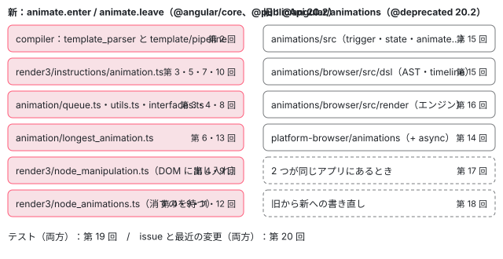
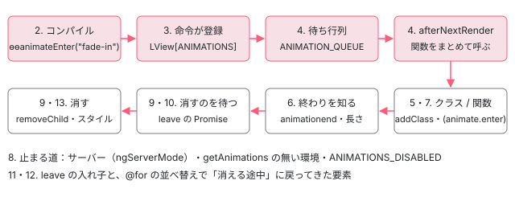

[目次](../README.md) › [アニメーションの内側](README.md) › 第 1 回 / 全 20 回

# アニメーションの全体像：core の animate.enter / leave と @angular/animations

> 2 つの仕組みがどのパッケージのどのファイルにあるかの地図。@angular/animations の @deprecated 20.2（v23 で削除予定）と、それを巡る issue。新しい仕組みの spec（acceptance/animation\_spec.ts）が Node では isNode で中身を飛ばし、ブラウザ版の acceptance\_web でだけ走ること、その走らせ方と件数の読み方。旧エンジンの spec の置き場。

angular/angular · 読了 約 12 分 · 基礎 · [サイトで読む（デモが動きます）](https://angular-deep-dive-cyan.vercel.app/chapter/animations-overview)

---

Angular には要素の出入りに動きを付ける仕組みが 2 つあります。v20.2 から `@angular/core` に入った `animate.enter` / `animate.leave` と、昔からある `@angular/animations`（`trigger()` や `[@fade]` で書くもの）です。この章では、2 つがどのパッケージのどのファイルにあり、このシリーズのどの回で読むのかを地図にします。あわせて、旧パッケージに付いた `@deprecated` の実物の行と、アニメーションの spec が**Node では中身を飛ばし、ブラウザ版でだけ走る**ことを確かめます。

読む対象は `packages/core/src/animation/`、`packages/core/src/render3/instructions/animation.ts`、`packages/animations/src/animation_metadata.ts`、それと spec の置き場（`packages/core/test/acceptance/animation_spec.ts` ほか）です。

1. **1. 全体像**（この章）
2. [2. テンプレートから命令へ](02-animations-compile.md)
3. [3. 命令がすること](03-animations-instructions.md)
4. [4. 待ち行列](04-animations-queue.md)
5. [5. enter のクラス](05-animations-enter-classes.md)
6. [6. いちばん長いアニメーション](06-animations-longest.md)
7. [7. 関数で動かす](07-animations-functions.md)
8. [8. 動かないとき](08-animations-disabled.md)
9. [9. 消すのを遅らせる](09-animations-leave-removal.md)
10. [10. leave のクラス](10-animations-leave-classes.md)
11. [11. 入れ子の leave](11-animations-leave-nested.md)
12. [12. 並べ替えと出し直し](12-animations-leave-reorder.md)
13. [13. スタイルの後片付け](13-animations-styles-teardown.md)
14. [14. 旧パッケージの入口](14-animations-legacy-setup.md)
15. [15. 旧 DSL とキーフレーム](15-animations-legacy-dsl.md)
16. [16. TransitionAnimationEngine](16-animations-legacy-engine.md)
17. [17. 2 つが同居するとき](17-animations-legacy-compat.md)
18. [18. 移行](18-animations-migration.md)
19. [19. テスト](19-animations-testing.md)
20. [20. issue と変更を読む](20-animations-issues.md)

## 1. 2 つの仕組みはどこにあるか

まずファイルの置き場です。新しい仕組みは `@angular/core` の中にあり、別のパッケージを入れなくても動きます。旧い仕組みは 3 つのパッケージ（の入口）にまたがっています。



*新旧 2 つの仕組みのファイルと、このシリーズで読む回*

| パッケージ / ディレクトリ | 中身 | 読む回 |
| --- | --- | --- |
| `packages/core/src/animation/` | `interfaces.ts`（97 行）・`queue.ts`（119 行）・`utils.ts`（421 行）・`longest_animation.ts`（171 行） | 3・4・6・8・13 |
| `packages/core/src/render3/instructions/animation.ts` | 4 つの命令 `ɵɵanimateEnter`・`ɵɵanimateEnterListener`・`ɵɵanimateLeave`・`ɵɵanimateLeaveListener` とその実行部（526 行） | 3・5・7・10 |
| `packages/core/src/render3/node_animations.ts` | DOM から外すときに leave を集めて待つ（266 行） | 4・9・11・12 |
| `packages/compiler/src/…` | `binding_parser.ts`・`ingest.ts`・`binding_specialization.ts`・`convert_animations.ts`・`reify.ts` | 2 |
| `packages/animations/src/` | DSL の関数（`animation_metadata.ts`）と `AnimationBuilder` | 15 |
| `packages/animations/browser/src/` | `dsl/`（AST・タイムライン）と `render/`（`TransitionAnimationEngine`・レンダラー） | 15・16 |
| `packages/platform-browser/animations/src/`・`async/src/` | `provideAnimations()`・`provideAnimationsAsync()` と、レンダラーを包む入口 | 14 |

行数は `wc -l` で数えた ../angular（v22.2.0-next.7）の値です。新しい仕組みはこの 6 ファイルで約 1600 行に収まります。

## 2. 新しい仕組みの道のり

`@if (show()) { <p animate.enter="fade-in" animate.leave="fade-out"> }` と書いたとき、テンプレートから DOM に動きが付き、最後に要素が消えるまでを、回の順に並べるとこうなります。



*animate.enter / animate.leave がテンプレートから DOM まで通る道（数字はこのシリーズの回）*

- 👤 `<p animate.enter="fade-in">` — あなたのテンプレート
  - `ɵɵanimateEnter("fade-in")` — コンパイラが要素の命令の直後に出す（第 2 回）
    - `addAnimationToLView(...)` — LView の ANIMATIONS に「あとで走らせる関数」を積む（第 3 回）
    - `queueEnterAnimations(...)` — ANIMATION\_QUEUE の Set に入れる（第 4 回）
  - `afterNextRender(() => …)` — 変更検知が終わったあとで Set の関数を全部呼ぶ（第 4 回）
    - `runEnterAnimation(...)` — クラスを付け、animationend で外す（第 5・6 回）

この地図で大事なのは、**命令が呼ばれた時点では何も動かない**ことです。命令は関数を登録して待ち行列に入れるだけで、実際にクラスが付くのは `afterNextRender` の中です（[第 3 回](03-animations-instructions.md)・[第 4 回](04-animations-queue.md)）。下のデモで、本物がいつクラスを付け、いつ外すかを見ておきます。

> **🧪 デモ：本物の animate.enter / animate.leave と classList**
>
> このページはブラウザで動く本物の Angular（@angular/core 22.1.6）です。ボタンを押すと `show` が切り替わり、`@if` の中の要素が `animate.enter="aov-in"` / `animate.leave="aov-out"`（どちらも 0.6 秒）で出入りします。押した瞬間から 1.5 秒のあいだ、毎フレーム要素の `className` を読み、変わったフレームだけを記録します。`animationstart` / `animationend` は要素に付けたイベントで記録します。OS の設定で動きを減らしていても、このデモは動きます。
>
> ▶ [このデモはサイトで動かせます](https://angular-deep-dive-cyan.vercel.app/chapter/animations-overview)

1. **click の直後は、まだ要素が無い（または、まだ消えていない）**

   `show.set(true)` は signal を書き換えて変更検知を予約するだけです（[zoneless-signal-path](../zoneless/07-zoneless-signal-path.md)）。同じ関数の中で読むと、要素はまだ DOM にありません。
2. **次に記録されるフレームで、要素はもう `aov-in` を持っている**

   要素が DOM に入るのも、クラスが付くのも、同じ変更検知（`ApplicationRef.tick()`）の中です。クラスは描画の後の `afterNextRender` で付きますが、ブラウザが画面を描く前なので、`class="aov-box"` だけの状態はフレームの境目では見えません。
3. **`animationend` のあと、クラスが外れる**

   `animationName` が `_ngcontent-…_aov-in` のように前置きつきなのは、コンポーネントのスタイルの閉じ込め（Emulated）が `@keyframes` の名前も書き換えるからです（[compiler-shadow-css](../compiler/18-compiler-shadow-css.md)）。enter はクラスを外して終わりです。外す仕組みは [第 5 回](05-animations-enter-classes.md)で読みます。
4. **leave では `aov-out` が付き、`animationend` のあとで要素が DOM から消える**

   `show.set(false)` のあとも要素はすぐには消えません。`node_manipulation.ts` が removeChild を待たせているからです（[第 9 回](09-animations-leave-removal.md)）。

## 3. 旧パッケージは @deprecated 20.2

旧い `@angular/animations` の公開 API には、v20.2 から非推奨の印が付いています。DSL の型と関数を定義している `animation_metadata.ts` の最初の型がこれです。

📄 `angular/packages/animations/src/animation_metadata.ts` L20–29 （▶ の行: 25, 27）

```ts
20 │ 
21 │ /**
22 │  * Represents animation-step timing parameters for an animation step.
23 │  * @see {@link animate}
24 │  *
25 ▶  * @publicApi
26 │  *
27 ▶  * @deprecated 20.2 Use `animate.enter` or `animate.leave` instead. Intent to remove in v23
28 │  */
29 │ export declare type AnimateTimings = {
```

27 行目、「20.2 から非推奨。`animate.enter` か `animate.leave` を使う。v23 で削除する予定（Intent to remove）」。25 行目の `@publicApi` はそのままなので、今も公開 API ではあり、使えば動きます。同じ 1 行が、このファイルに 33 回出てきます。

📄 `ターミナル（../angular で実行）`

```
$ grep -c '@deprecated 20.2 Use `animate.enter` or `animate.leave` instead. Intent to remove in v23' \
    packages/animations/src/animation_metadata.ts
33
```

`trigger`・`state`・`transition`・`style`・`animate`・`query`・`stagger` など、DSL のほぼすべてに付いています。「Intent to remove」は予定です。最新の main（74961c66242）でも `packages/animations/src/animation_metadata.ts` は残っていて、同じ印のままです。

> [!NOTE]
> **ポイント**
>
> issue のラベルも 2 つに分かれています。`area: animations` は旧パッケージ、`core: animations` は新しい仕組みです。2026-10-28 に開かれた #71703（`area: animations`）は「親子の要素を順番に出し入れする（`query` + `stagger` + `animateChild`）同等の手段ができるまで、v23 でも `@angular/animations` を残してほしい」という要望です。本文には、CSS / Web Animations での書き直しを試して「fade-out が起きずにすぐ消えた」という記録が並んでいます。何が書き直せて何が書き直せないかは [第 18 回](18-animations-migration.md)、issue の読み方は [第 20 回](20-animations-issues.md)で扱います。

## テストと直し方

このシリーズの各回の終わりに、その仕組みを確かめている spec と、走らせ方を書きます。最初に全体の地図を作っておきます。結論から言うと、**アニメーションの spec は新旧どちらも、ほぼすべてが Node では中身を飛ばします**。

📄 `ターミナル（../angular で実行）`

```
$ grep -n "if (isNode)" packages/core/test/acceptance/animation_spec.ts \
    packages/core/test/animation/longest_animation_spec.ts \
    packages/core/test/legacy_animation/*.ts \
    packages/animations/browser/test/render/transition_animation_engine_spec.ts \
    packages/platform-browser/animations/test/animation_renderer_spec.ts \
    packages/platform-browser/animations/async/test/animation_renderer_spec.ts
packages/core/test/animation/longest_animation_spec.ts:15:  if (isNode) {
packages/core/test/acceptance/animation_spec.ts:50:  if (isNode) {
packages/core/test/legacy_animation/legacy_animation_integration_spec.ts:55:  if (isNode) return;
packages/core/test/legacy_animation/legacy_animation_router_integration_spec.ts:33:  if (isNode) return;
packages/core/test/legacy_animation/legacy_animations_with_web_animations_integration_spec.ts:37:  if (isNode) return;
packages/core/test/legacy_animation/legacy_animation_query_integration_spec.ts:48:  if (isNode) return;
packages/animations/browser/test/render/transition_animation_engine_spec.ts:40:  if (isNode) return;
packages/platform-browser/animations/async/test/animation_renderer_spec.ts:54:  if (isNode) {
packages/platform-browser/animations/async/test/animation_renderer_spec.ts:259:      if (isNode) return;
packages/platform-browser/animations/test/animation_renderer_spec.ts:45:  if (isNode) return;
packages/platform-browser/animations/test/animation_renderer_spec.ts:160:      if (isNode) return;
```

どのファイルも、いちばん外の `describe` の最初で `if (isNode)` を見て、Node なら中身を登録せずに戻ります。新しい仕組みの `acceptance/animation_spec.ts` は 50 行目で、Node のときだけ `it('should pass')` を 1 本登録して戻ります。Node 版のテストは `isNode = true` にしたうえで、サーバー用の軽い DOM（domino）の `document` で動きます（[contrib-reading-specs](../contrib/06-contrib-reading-specs.md) で読んだ `tools/testing/node_tests.init.mts`）。そこには CSS アニメーションを実際に動かす仕組みがありません。

### 新しい仕組みの spec

📄 `ターミナル（../angular で実行）`

```
$ grep -n "^\s*describe(" packages/core/test/acceptance/animation_spec.ts
49:describe('Animation', () => {
76:  describe('animate.leave', () => {
929:    describe('legacy animations compatibility', () => {
995:  describe('animate.enter', () => {
2310:  describe('animation queue timing', () => {
2530:  describe('animation element duplication', () => {
2760:  describe('infinite animations', () => {
$ grep -cE "^\s+it\(" packages/core/test/acceptance/animation_spec.ts
52
```

| describe（行） | 何を確かめるか | 主に読む回 |
| --- | --- | --- |
| `animate.leave`（76） | leave のクラス・関数・削除を待つこと | 9・10・11・12 |
| `legacy animations compatibility`（929） | 旧パッケージと同居したとき | 17 |
| `animate.enter`（995） | enter のクラス・関数・host バインディング・@for | 2・3・5・7 |
| `animation queue timing`（2310） | 待ち行列が走る前にインジェクタが壊れたとき など | 3・4・9 |
| `animation element duplication`（2530） | 並べ替えで要素が 2 つにならないこと | 12 |
| `infinite animations`（2760） | 終わらないアニメーション | 6 |

数え方: `grep -cE "^\s+it\("` は、行頭の空白のあとに `it(` がある行を数えます。52 本のうち 1 本は Node 用の `should pass`（51 行目）なので、ブラウザで走る本物は 51 本です。ほかに `packages/core/test/animation/longest_animation_spec.ts`（[第 6 回](06-animations-longest.md)）もあります。

### ブラウザ版で走らせる

spec が本当に走るのは、`ng_web_test_suite` で作ったブラウザ版のターゲットです（Bazel の定義は [contrib-bazel](../contrib/04-contrib-bazel.md) で読みました）。rules\_browsers の `wtr_test` が、名前に `_chromium` と `_firefox` を付けた 2 本のテストを作り、web-test-runner + jasmine で headless の Chromium（と Firefox）の中で spec を動かします。

📄 `ターミナル（../angular で実行）`

```
cd ~/angular-research/angular
pnpm bazel test //packages/core/test/acceptance:acceptance_web_chromium \
  --nocache_test_results --test_output=all
```

📄 `出力（抜粋。2026-11-01 に自分で実行）`

```
Chromium: |██████████████████████████████| 1/1 test files | 2743 passed, 0 failed, 3 skipped

Finished running tests in 6.3s, all tests passed! 🎉
INFO: Elapsed time: 7.486s, Critical Path: 6.87s
//packages/core/test/acceptance:acceptance_web_chromium                  PASSED in 6.8s
```

2743 本が通りました。`animation_spec.ts` だけでなく、`acceptance/` の全 spec を含む数です。同じ日にシリーズの準備で走らせたほかのターゲットの結果も並べておきます（件数は Chromium）。

| ターゲット | 中の spec | 結果（2026-11-01） |
| --- | --- | --- |
| `//packages/core/test/acceptance:acceptance_web_chromium` | `acceptance/animation_spec.ts` ほか acceptance 全部 | 2743 passed, 0 failed, 3 skipped（自分で実行、6.8s） |
| `//packages/core/test:test_web_chromium` | `animation/longest_animation_spec.ts`・`legacy_animation/*` ほか | 1591 passed, 4 skipped |
| `//packages/animations/browser/test:test_web_chromium` | `transition_animation_engine_spec.ts` ほか | 124 passed |
| `//packages/animations/test:test_web_chromium` | DSL の関数 | 14 passed |
| `//packages/platform-browser/animations/test:test_web_chromium` | 旧レンダラー | 21 passed, 1 skipped |
| `//packages/platform-browser/animations/async/test:test_web_chromium` | 非同期で読み込む旧レンダラー | 15 passed, 1 skipped |

### 落とし穴：Node 版は「0 本でも PASSED」

同じ spec を Node 版のターゲットで、いつもの `--test_arg=--filter=` を付けて走らせるとこうなります。

📄 `ターミナル（../angular で実行）`

```
cd ~/angular-research/angular
pnpm bazel test //packages/core/test/acceptance:acceptance --test_output=all \
  --test_arg=--filter="^Animation "
```

📄 `出力（抜粋。2026-11-01 に自分で実行）`

```
Started
.

Ran 1 of 2693 specs
1 spec, 0 failures
Finished in 0.058 seconds
INFO: Elapsed time: 2.061s, Critical Path: 1.39s
//packages/core/test/acceptance:acceptance                               PASSED in 1.3s
```

走ったのは `Animation should pass` の 1 本だけで、`PASSED` です。旧エンジンの `//packages/animations/browser/test:test` に `--filter="TransitionAnimationEngine"` を付けると `Ran 0 of 17 specs` で、やはり `PASSED` になります。**アニメーションを直して Node 版だけ走らせても、何も確かめていません**。

1. **ブラウザ版には filter が無い**

   web-test-runner の設定（rules\_browsers の `wtr/wtr.config.mjs`）で jasmine に渡しているのは乱数の seed だけで、spec を名前で絞る設定はありません。ブラウザ版ではいつもターゲットの全 spec が走ります。acceptance なら 2743 本で、7 秒ほどです。
2. **1 本だけ見たいとき**

   自分の作業コピーで、見たい `it` を `fit`（`describe` なら `fdescribe`）に書き換えると、jasmine はそれだけを走らせます。私たちは ../angular を変更しない方針なので、これは**試していません**。リポジトリの `tslint.json` は `fit` と `fdescribe` を「Don't keep jasmine focus methods.」として禁止しているので、残したままコミットしないようにします。
3. **直すとしたら、どこに足すか**

   新しい仕組みの振る舞いは `acceptance/animation_spec.ts` の該当する describe に、長さの計算は `animation/longest_animation_spec.ts` に足します。コンパイラ側（名前の見分け方など）は Node で走る `packages/compiler/test` にあります（[第 2 回](02-animations-compile.md)）。このシリーズでは本家に PR を出すことは勧めません。手元で spec を走らせ、issue を読むときの手がかりにするところまでにします。

## 聞かれそうな質問

**Q. @angular/animations はもう使えないのですか？**

使えます。`animation_metadata.ts` 25 行目の `@publicApi` は残っていて、27 行目は「20.2 から非推奨、v23 で削除する予定」という予告です。旧パッケージの spec もブラウザ版で通っています（表の 124・14・21・15 本）。ただし新しく書くなら `animate.enter` / `animate.leave` で、v23 での扱いは #71703 のような議論が続いています。

**Q. なぜアニメーションのテストは Node で走らないのですか？**

spec 自身が `if (isNode)` で中身を飛ばしているからです（`animation_spec.ts` 50 行目ほか、上の grep の 11 か所）。Node 版は domino の `document` で動き、CSS アニメーションを実際に動かせません。新しい仕組みは `getAnimations` の無い環境では命令が何もしない作りでもあります（[第 3 回](03-animations-instructions.md)で読む早い return、中身は [第 8 回](08-animations-disabled.md)）。確かめるときは `_web_chromium` のターゲットを使います。

**Q. 2 つの仕組みを同じアプリで同時に使えますか？**

使えます。`animation_spec.ts` には 929 行目に `describe('legacy animations compatibility')` があり、旧パッケージを入れた状態で `animate.leave` が動くことを確かめています。ただし要素を DOM から外す役が旧エンジンのレンダラーに渡るので、どちらが先に消すかの順番に注意が要ります。それを 1 本の流れで追うのが [第 17 回](17-animations-legacy-compat.md)です。

**Q. 新しい仕組みを使うのに provide するものはありますか？**

ありません。命令は `@angular/core` にあり、待ち行列（`ANIMATION_QUEUE`）も `InjectionToken` の factory でルートに自動で作られます（[第 4 回](04-animations-queue.md)）。このサイトも `provideAnimations()` を入れていませんが、上のデモは動きます。

## 読み終えて

- 新しい仕組みは `@angular/core` の約 1600 行（`core/src/animation/` の 4 ファイルと `render3/` の 2 ファイル）とコンパイラの数ファイル。旧い仕組みは `@angular/animations`・`animations/browser`・`platform-browser/animations`
- 旧パッケージの DSL には `@deprecated 20.2 … Intent to remove in v23` が 33 か所。今も `@publicApi` で動く
- 命令は関数を登録して待ち行列に積むだけで、クラスが付くのは `afterNextRender` の中
- アニメーションの spec は Node では `if (isNode)` で飛ばされ、Node 版は 0〜1 本でも PASSED。確かめるのはブラウザ版（`_web_chromium`）で、filter は無い

---

← 前: [testing の issue と変更を読む：どこから関わるか](../testing/20-testing-issues.md)  
次: [テンプレートから命令へ：animate.enter が ɵɵanimateEnter になるまで](02-animations-compile.md) →
