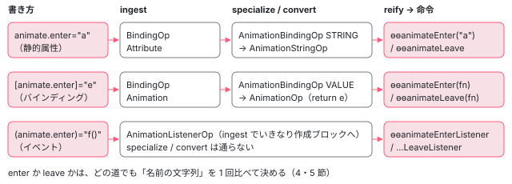

[目次](../README.md) › [アニメーションの内側](README.md) › 第 2 回 / 全 20 回

# テンプレートから命令へ：animate.enter が ɵɵanimateEnter になるまで

> animate.enter="cls"・\[animate.enter\]・(animate.leave)="fn($event)" を BindingParser と template pipeline（ingest・binding\_specialization・convert\_animations・reify）がどう見分けて ɵɵanimateEnter / ɵɵanimateEnterListener / ɵɵanimateLeave / ɵɵanimateLeaveListener を出すか。名前を確かめていないので animate.entr が leave になる issue と、それを直す PR。

angular/angular · 読了 約 13 分 · 中核 · [サイトで読む（デモが動きます）](https://angular-deep-dive-cyan.vercel.app/chapter/animations-compile)

---

`animate.enter` と `animate.leave` には、静的な属性・`[ ]` のバインディング・`( )` のイベントの 3 通りの書き方があります。名前が 2 つなので全部で 6 通りです。この章では、テンプレートコンパイラがその 6 通りをどの行で見分け、どの中間表現（IR の op）を通って `ɵɵanimateEnter` / `ɵɵanimateEnterListener` / `ɵɵanimateLeave` / `ɵɵanimateLeaveListener` の 4 つの命令になるかを追います。最後に、名前を確かめていないせいで `animate.entr` が leave になる issue を読みます。

読む対象は `packages/compiler/src/template_parser/binding_parser.ts`、`template/pipeline/src/ingest.ts`、`phases/binding_specialization.ts`・`phases/convert_animations.ts`・`phases/reify.ts`、`src/instruction.ts`、`render3/r3_identifiers.ts` です。テンプレートパイプライン全体の流れは [compiler-ingest](../compiler/10-compiler-ingest.md) と [compiler-reify-emit](../compiler/16-compiler-reify-emit.md) で読みました。

1. [1. 全体像](01-animations-overview.md)
2. **2. テンプレートから命令へ**（この章）
3. [3. 命令がすること](03-animations-instructions.md)
4. [4. 待ち行列](04-animations-queue.md)
5. [5. enter のクラス](05-animations-enter-classes.md)
6. [6. いちばん長いアニメーション](06-animations-longest.md)
7. [7. 関数で動かす](07-animations-functions.md)
8. [8. 動かないとき](08-animations-disabled.md)
9. [9. 消すのを遅らせる](09-animations-leave-removal.md)
10. [10. leave のクラス](10-animations-leave-classes.md)
11. [11. 入れ子の leave](11-animations-leave-nested.md)
12. [12. 並べ替えと出し直し](12-animations-leave-reorder.md)
13. [13. スタイルの後片付け](13-animations-styles-teardown.md)
14. [14. 旧パッケージの入口](14-animations-legacy-setup.md)
15. [15. 旧 DSL とキーフレーム](15-animations-legacy-dsl.md)
16. [16. TransitionAnimationEngine](16-animations-legacy-engine.md)
17. [17. 2 つが同居するとき](17-animations-legacy-compat.md)
18. [18. 移行](18-animations-migration.md)
19. [19. テスト](19-animations-testing.md)
20. [20. issue と変更を読む](20-animations-issues.md)

## 1. 先に結論：3 本の道



*3 通りの書き方が通る op と、出てくる命令*

## 2. パーサー：\[animate.enter\] と (animate.enter) に印を付ける

テンプレートの文字列を構文木（R3 AST）にする段階で、`BindingParser` は `[animate.` で始まるプロパティを特別扱いします。その分かれ道（`parsePropertyBinding` の中）は [compiler-binding-parser](../compiler/06-compiler-binding-parser.md) で引いた範囲にあるので、行き先だけを見ます。

📄 `angular/packages/compiler/src/template_parser/binding_parser.ts` L473–486 （▶ の行: 482, 484）

```ts
473 │   private _parseAnimation(
474 │     name: string,
475 │     ast: ASTWithSource,
476 │     sourceSpan: ParseSourceSpan,
477 │     keySpan: ParseSourceSpan,
478 │     valueSpan: ParseSourceSpan | undefined,
479 │     targetMatchableAttrs: string[][],
480 │     targetProps: ParsedProperty[],
481 │   ) {
482 ▶     targetMatchableAttrs.push([name, ast.source!]);
483 │     targetProps.push(
484 ▶       new ParsedProperty(name, ast, ParsedPropertyType.ANIMATION, sourceSpan, keySpan, valueSpan),
485 │     );
486 │   }
```

482 行目でディレクティブの照合用に名前と式の文字列を残し、484 行目で `ParsedPropertyType.ANIMATION` という種類を付けた `ParsedProperty` を作ります。することはこれだけです。名前（`name`）は `animate.enter` のまま渡り、ここでは enter か leave かを見ていません。この種類は、要素のプロパティにするときに `BindingType.Animation` に変わります（同じく [compiler-binding-parser](../compiler/06-compiler-binding-parser.md) の `createBoundElementProperty`）。イベントの `(animate.enter)` も、名前が `animate.` で始まれば `ParsedEventType.Animation` になります。

静的な属性 `animate.enter="a"` はバインディングではないので、パーサーは何もしません。構文木では普通の `TextAttribute` のままです。この 3 つの見え方は、テストの節で見る spec がそのまま確かめています（`BoundAttribute` の 6 が `BindingType.Animation`、`BoundEvent` の 3 が `ParsedEventType.Animation`）。

## 3. ingest：属性は BindingOp、イベントは AnimationListenerOp

構文木を IR の op の並びにする `ingest` では、静的属性もまず「属性のバインディング」として取り込まれます。

📄 `angular/packages/compiler/src/template/pipeline/src/ingest.ts` L1546–1580 （▶ の行: 1546, 1566–1567, 1569–1571）

```ts
1546 ▶   for (const attr of element.attributes) {
1547 │     // Attribute literal bindings, such as `attr.foo="bar"`.
1548 │     const [ns, elementName] = splitNsName(element.name);
1549 │     let namespace = ns;
1550 │     if (!ns) {
1551 │       switch (op.namespace) {
1552 │         case ir.Namespace.SVG:
1553 │           namespace = SVG_NAMESPACE;
1554 │           break;
1555 │         case ir.Namespace.Math:
1556 │           namespace = MATH_ML_NAMESPACE;
1557 │           break;
1558 │       }
1559 │     }
1560 │ 
1561 │     const securityContext = domSchema.securityContext(
1562 │       namespace ? `:${namespace}:${elementName}` : elementName,
1563 │       attr.name,
1564 │       true,
1565 │     );
1566 ▶     bindings.push(
1567 ▶       ir.createBindingOp(
1568 │         op.xref,
1569 ▶         ir.BindingKind.Attribute,
1570 ▶         attr.name,
1571 ▶         convertAstWithInterpolation(unit.job, attr.value, attr.i18n),
1572 │         null,
1573 │         securityContext,
1574 │         true,
1575 │         false,
1576 │         null,
1577 │         asMessage(attr.i18n),
1578 │         attr.sourceSpan,
1579 │       ),
1580 │     );
```

1546 行目で要素の静的属性を 1 つずつ見て、1567〜1570 行目で `BindingKind.Attribute`・名前 `attr.name` の `BindingOp` を作ります。`animate.enter="fade-in"` も `class="x"` も、この時点では区別されません。`[animate.enter]` は次の `element.inputs` のループで、`BindingType.Animation` → `BindingKind.Animation` の対応表（[compiler-binding-parser](../compiler/06-compiler-binding-parser.md) で引いた `BINDING_KINDS`）を通って `BindingOp` になります。

📄 `angular/packages/compiler/src/template/pipeline/src/ingest.ts` L1615–1644 （▶ の行: 1631–1633, 1639）

```ts
1615 │   for (const output of element.outputs) {
1616 │     if (output.type === e.ParsedEventType.LegacyAnimation && output.phase === null) {
1617 │       throw Error('Animation listener should have a phase');
1618 │     }
1619 │ 
1620 │     if (output.type === e.ParsedEventType.TwoWay) {
1621 │       unit.create.push(
1622 │         ir.createTwoWayListenerOp(
1623 │           op.xref,
1624 │           op.handle,
1625 │           output.name,
1626 │           op.tag,
1627 │           makeTwoWayListenerHandlerOps(unit, output.handler, output.handlerSpan),
1628 │           output.sourceSpan,
1629 │         ),
1630 │       );
1631 ▶     } else if (output.type === e.ParsedEventType.Animation) {
1632 ▶       unit.create.push(
1633 ▶         ir.createAnimationListenerOp(
1634 │           op.xref,
1635 │           op.handle,
1636 │           output.name,
1637 │           op.tag,
1638 │           makeListenerHandlerOps(unit, output.handler, output.handlerSpan),
1639 ▶           output.name.endsWith('enter') ? ir.AnimationKind.ENTER : ir.AnimationKind.LEAVE,
1640 │           output.target,
1641 │           false,
1642 │           output.sourceSpan,
1643 │         ),
1644 │       );
```

イベントのほうは、ここで最後の形が決まります。1631 行目で `ParsedEventType.Animation` を見分け、1632〜1633 行目で `AnimationListenerOp` を**作成ブロック（`unit.create`）に直接**積みます。1639 行目が enter と leave の分かれ目です。`output.name.endsWith('enter')` が真なら `ENTER`、それ以外は全部 `LEAVE` です。

📄 `angular/packages/compiler/src/template/pipeline/src/ingest.ts` L247–260 （▶ の行: 249–250, 256）

```ts
247 │ function ingestHostEvent(job: HostBindingCompilationJob, event: e.ParsedEvent) {
248 │   let eventBinding: ir.CreateOp;
249 ▶   if (event.type === e.ParsedEventType.Animation) {
250 ▶     eventBinding = ir.createAnimationListenerOp(
251 │       job.root.xref,
252 │       new ir.SlotHandle(),
253 │       event.name,
254 │       null,
255 │       makeListenerHandlerOps(job.root, event.handler, event.handlerSpan),
256 ▶       event.name.endsWith('enter') ? ir.AnimationKind.ENTER : ir.AnimationKind.LEAVE,
257 │       event.targetOrPhase,
258 │       true,
259 │       event.sourceSpan,
260 │     );
```

コンポーネントの `host: { '(animate.enter)': '…' }` は別の関数 `ingestHostEvent` を通りますが、256 行目は同じ `endsWith('enter')` です。

## 4. 2 つの enum

📄 `angular/packages/compiler/src/template/pipeline/ir/src/enums.ts` L695–709 （▶ の行: 698–700, 706–708）

```ts
695 │ /**
696 │  * Kinds of animations
697 │  */
698 ▶ export const enum AnimationKind {
699 ▶   ENTER = 'enter',
700 ▶   LEAVE = 'leave',
701 │ }
702 │ 
703 │ /**
704 │  * Kinds of animations
705 │  */
706 ▶ export const enum AnimationBindingKind {
707 ▶   STRING,
708 ▶   VALUE,
709 │ }
```

698〜701 行目の `AnimationKind` は「enter か leave か」。706〜709 行目の `AnimationBindingKind` は「値が文字列そのもの（`STRING`）か、式（`VALUE`）か」です。(2 つの doc コメントがどちらも「Kinds of animations」なのは原文のままです。)

## 5. binding\_specialization：名前で 2 つに振り分ける

`BindingOp` を、その種類に合った専用の op に置き換えるフェーズです。静的属性の場合から見ます。

📄 `angular/packages/compiler/src/template/pipeline/src/phases/binding_specialization.ts` L46–64 （▶ の行: 46, 51–52, 54, 57, 61, 64）

```ts
46 ▶         case ir.BindingKind.Attribute:
47 │           if (op.name === 'ngNonBindable') {
48 │             ir.OpList.remove<ir.UpdateOp>(op);
49 │             const target = lookupElement(elements, op.target);
50 │             target.nonBindable = true;
51 ▶           } else if (op.name.startsWith('animate.')) {
52 ▶             ir.OpList.replace<ir.UpdateOp>(
53 │               op,
54 ▶               ir.createAnimationBindingOp(
55 │                 op.name,
56 │                 op.target,
57 ▶                 op.name === 'animate.enter' ? ir.AnimationKind.ENTER : ir.AnimationKind.LEAVE,
58 │                 op.expression,
59 │                 op.securityContext,
60 │                 op.sourceSpan,
61 ▶                 ir.AnimationBindingKind.STRING,
62 │               ),
63 │             );
64 ▶           } else {
```

1. **51 行目：名前が `animate.` で始まる属性だけを拾う**

   3 節で `class="x"` と同じ扱いだった属性は、ここで初めて分かれます。それ以外の属性は 64 行目からの `else` で普通の `AttributeOp` になります。
2. **57 行目：`=== 'animate.enter'` なら ENTER、そうでなければ LEAVE**

   51 行目は `startsWith('animate.')`、57 行目は完全一致の比較です。**その間に「enter でも leave でもない名前」を弾く行がありません**。8 節の issue はここから生まれます。
3. **61 行目：`AnimationBindingKind.STRING`**

   属性の値（`"fade-in slide"`）は文字列のまま渡ります。

📄 `angular/packages/compiler/src/template/pipeline/src/phases/binding_specialization.ts` L83–96 （▶ の行: 83, 89, 93）

```ts
83 ▶         case ir.BindingKind.Animation:
84 │           ir.OpList.replace<ir.UpdateOp>(
85 │             op,
86 │             ir.createAnimationBindingOp(
87 │               op.name,
88 │               op.target,
89 ▶               op.name === 'animate.enter' ? ir.AnimationKind.ENTER : ir.AnimationKind.LEAVE,
90 │               op.expression,
91 │               op.securityContext,
92 │               op.sourceSpan,
93 ▶               ir.AnimationBindingKind.VALUE,
94 │             ),
95 │           );
96 │           break;
```

`[animate.enter]`（`BindingKind.Animation`）は 83 行目の `case` に来ます。89 行目は 57 行目と同じ比べ方で、違いは 93 行目の `VALUE` だけです。

## 6. convert\_animations：作成ブロックの、要素の直後へ動かす

ここまでの `AnimationBindingOp` は、バインディングとして**更新ブロック**の並びにいます。それを命令の形の op に変えて、置き場所を移すのが `convertAnimations` です。

📄 `angular/packages/compiler/src/template/pipeline/src/phases/convert_animations.ts` L27–51 （▶ の行: 29, 34, 36, 40–43, 45, 47）

```ts
27 │ export function convertAnimations(job: CompilationJob): void {
28 │   const elements = new Map<ir.XrefId, ir.ElementOrContainerOps>();
29 ▶   for (const unit of job.units) {
30 │     for (const op of unit.create) {
31 │       if (!ir.isElementOrContainerOp(op)) {
32 │         continue;
33 │       }
34 ▶       elements.set(op.xref, op);
35 │     }
36 ▶   }
37 │ 
38 │   for (const unit of job.units) {
39 │     for (const op of unit.ops()) {
40 ▶       if (op.kind === ir.OpKind.AnimationBinding) {
41 ▶         const createAnimationOp = getAnimationOp(op);
42 ▶         if (job.kind === CompilationJobKind.Host) {
43 ▶           unit.create.push(createAnimationOp);
44 │         } else {
45 ▶           ir.OpList.insertAfter<ir.CreateOp>(createAnimationOp, lookupElement(elements, op.target));
46 │         }
47 ▶         ir.OpList.remove<ir.UpdateOp>(op);
48 │       }
49 │     }
50 │   }
51 │ }
```

1. **40〜41 行目：`AnimationBindingOp` を見つけたら、作成ブロック用の op に変える**

   中身は次の `getAnimationOp` です。
2. **45 行目：その要素の op（`elementStart`）の直後に差し込む**

   29〜36 行目で作った「xref → 要素の op」の表から、バインディングの対象の要素を引き、`OpList.insertAfter` で直後に入れます。同じ要素に enter と leave があると、どちらも「要素の直後」に入るので、**あとから入れたほうが前に来ます**。デモの「enter と leave を両方」で、`ɵɵanimateLeave` が `ɵɵanimateEnter` より先に出ているのはこのためです。
3. **42〜43 行目：host のジョブでは作成ブロックの末尾へ**

   host バインディングには対象の要素の op がありません（命令はコンポーネントのタグそのものに効く）。だから末尾に `push` します。
4. **47 行目：更新ブロックからは消す**

   アニメーションの命令は**作成ブロック（`rf & 1`）にしか出ません**。変更検知のたびに呼ばれる更新の命令はありません。

📄 `angular/packages/compiler/src/template/pipeline/src/phases/convert_animations.ts` L53–75 （▶ の行: 54, 56, 59, 63, 65–66, 69–70, 73）

```ts
53 │ function getAnimationOp(op: ir.AnimationBindingOp): ir.AnimationOp | ir.AnimationStringOp {
54 ▶   if (op.animationBindingKind === ir.AnimationBindingKind.STRING) {
55 │     // this is a simple string case
56 ▶     return ir.createAnimationStringOp(
57 │       op.name,
58 │       op.target,
59 ▶       op.name === 'animate.enter' ? ir.AnimationKind.ENTER : ir.AnimationKind.LEAVE,
60 │       op.expression,
61 │       op.securityContext,
62 │       op.sourceSpan,
63 ▶     );
64 │   } else {
65 ▶     const expression = op.expression as ir.Expression;
66 ▶     return ir.createAnimationOp(
67 │       op.name,
68 │       op.target,
69 ▶       op.name === 'animate.enter' ? ir.AnimationKind.ENTER : ir.AnimationKind.LEAVE,
70 ▶       [ir.createStatementOp(new o.ReturnStatement(expression, expression.sourceSpan))],
71 │       op.securityContext,
72 │       op.sourceSpan,
73 ▶     );
74 │   }
75 │ }
```

54〜63 行目、`STRING` なら `AnimationStringOp`。値はそのままです。65〜73 行目、`VALUE` なら `AnimationOp` で、70 行目で式を `return` する文を 1 つ持たせます。これが出力の `function …_animateenter_cb() { return ctx.cls(); }` になります。式をその場で評価せずに関数に包むので、値は命令が呼ばれたときではなく、**アニメーションを走らせるときに**読まれます（[第 7 回](07-animations-functions.md)）。59 行目・69 行目にも、5 節と同じ `=== 'animate.enter'` の比較がもう一度あります。

> [!WARNING]
> **ハマりどころ**
>
> 65 行目は `op.expression as ir.Expression` と型を言い切っています。ところが `animate.enter="fade-{{dir}}"` のように**属性に補間を書く**と、パーサーはそれを `BindingType.Animation` の補間として扱い、式は `Interpolation` のまま `VALUE` の道に入ります。このサイトのコンパイラ（22.1.6）で実際にコンパイルすると、70 行目で作った文を後のフェーズ（`saveAndRestoreView`）が辿るところで `error TS500: Error: Unhandled expression kind: Interpolation` が出て止まりました（デモの最後の項目）。../angular の `dist/bin` にあるビルド済みのコンパイラでも同じでした。2026-11-01 に `gh search issues` で探した範囲では、この issue は見つかっていません。`[animate.enter]="'fade-' + dir"` と書けば通ります。

## 7. reify：op を命令の呼び出しにする

フェーズの順番は `emit.ts` の表にあり（[compiler-reify-emit](../compiler/16-compiler-reify-emit.md)）、`specializeBindings` の 2 つ後（間に `specializeControlProperties`）に `convertAnimations` が並んでいます。最後の `reify` で、op が出力の JavaScript の式に置き換わります。

📄 `angular/packages/compiler/src/template/pipeline/src/phases/reify.ts` L285–315 （▶ の行: 285, 288, 291–292, 296, 300, 303, 308, 313）

```ts
285 ▶       case ir.OpKind.AnimationString:
286 │         ir.OpList.replace(
287 │           op,
288 ▶           ng.animationString(op.animationKind, op.expression, op.sanitizer, op.sourceSpan),
289 │         );
290 │         break;
291 ▶       case ir.OpKind.Animation:
292 ▶         const animationCallbackFn = reifyListenerHandler(
293 │           unit,
294 │           op.handlerFnName!,
295 │           op.handlerOps,
296 ▶           /* consumesDollarEvent */ false,
297 │         );
298 │         ir.OpList.replace(
299 │           op,
300 ▶           ng.animation(op.animationKind, animationCallbackFn, op.sanitizer, op.sourceSpan),
301 │         );
302 │         break;
303 ▶       case ir.OpKind.AnimationListener:
304 │         const animationListenerFn = reifyListenerHandler(
305 │           unit,
306 │           op.handlerFnName!,
307 │           op.handlerOps,
308 ▶           op.consumesDollarEvent,
309 │         );
310 │ 
311 │         ir.OpList.replace(
312 │           op,
313 ▶           ng.animationListener(op.animationKind, animationListenerFn, null, op.sourceSpan),
314 │         );
315 │         break;
```

285〜289 行目、`AnimationString` は `ng.animationString`。291〜301 行目、`Animation` は 6 節の `return` 文を `reifyListenerHandler` で関数にし（296 行目、`$event` は使わない）、`ng.animation` に渡します。303〜314 行目、`AnimationListener` は 308 行目で「ハンドラが `$event` を使うか」を渡して関数にし、`ng.animationListener` に渡します。

📄 `angular/packages/compiler/src/template/pipeline/src/instruction.ts` L893–929 （▶ の行: 903–906, 916–917, 924–927）

```ts
893 │ export function animation(
894 │   animationKind: ir.AnimationKind,
895 │   handlerFn: o.Expression,
896 │   sanitizer: o.Expression | null,
897 │   sourceSpan: ParseSourceSpan,
898 │ ): ir.CreateOp {
899 │   const args = [handlerFn];
900 │   if (sanitizer !== null) {
901 │     args.push(sanitizer);
902 │   }
903 ▶   const identifier =
904 ▶     animationKind === ir.AnimationKind.ENTER
905 ▶       ? Identifiers.animationEnter
906 ▶       : Identifiers.animationLeave;
907 │   return call(identifier, args, sourceSpan);
908 │ }
909 │ 
910 │ export function animationString(
911 │   animationKind: ir.AnimationKind,
912 │   expression: o.Expression | ir.Interpolation,
913 │   sanitizer: o.Expression | null,
914 │   sourceSpan: ParseSourceSpan,
915 │ ): ir.CreateOp {
916 ▶   const value =
917 ▶     expression instanceof ir.Interpolation
918 │       ? interpolationToExpression(expression, sourceSpan)
919 │       : expression;
920 │   const args = [value];
921 │   if (sanitizer !== null) {
922 │     args.push(sanitizer);
923 │   }
924 ▶   const identifier =
925 ▶     animationKind === ir.AnimationKind.ENTER
926 ▶       ? Identifiers.animationEnter
927 ▶       : Identifiers.animationLeave;
928 │   return call(identifier, args, sourceSpan);
929 │ }
```

📄 `angular/packages/compiler/src/template/pipeline/src/instruction.ts` L931–947 （▶ の行: 941–944）

```ts
931 │ export function animationListener(
932 │   animationKind: ir.AnimationKind,
933 │   handlerFn: o.Expression,
934 │   eventTargetResolver: o.ExternalReference | null,
935 │   sourceSpan: ParseSourceSpan,
936 │ ): ir.CreateOp {
937 │   const args = [handlerFn];
938 │   if (eventTargetResolver !== null) {
939 │     args.push(o.importExpr(eventTargetResolver));
940 │   }
941 ▶   const identifier =
942 ▶     animationKind === ir.AnimationKind.ENTER
943 ▶       ? Identifiers.animationEnterListener
944 ▶       : Identifiers.animationLeaveListener;
945 │ 
946 │   return call(identifier, args, sourceSpan);
947 │ }
```

📄 `angular/packages/compiler/src/render3/r3_identifiers.ts` L266–275 （▶ の行: 266–267, 270–271, 274–275）

```ts
266 ▶   static animationEnterListener: o.ExternalReference = {
267 ▶     name: 'ɵɵanimateEnterListener',
268 │     moduleName: CORE,
269 │   };
270 ▶   static animationLeaveListener: o.ExternalReference = {
271 ▶     name: 'ɵɵanimateLeaveListener',
272 │     moduleName: CORE,
273 │   };
274 ▶   static animationEnter: o.ExternalReference = {name: 'ɵɵanimateEnter', moduleName: CORE};
275 ▶   static animationLeave: o.ExternalReference = {name: 'ɵɵanimateLeave', moduleName: CORE};
```

3 つの関数の最後で、`animationKind === ENTER` を見て識別子を選びます（903〜906・924〜927・941〜944 行目）。識別子の実体は `r3_identifiers.ts` の 266〜275 行目で、`@angular/core` の 4 つの命令の名前です。916〜919 行目で `STRING` の道だけは `Interpolation` を式に直していますが、6 節の注意のとおり `VALUE` の道にはその処理がありません。

### 命令が要素の命令のすぐ後ろにある理由

6 節の 45 行目で「要素の直後」に置いたのには、実行時の理由があります。`ɵɵanimateEnter` は自分の対象を `getCurrentTNode()` で取ります（[第 3 回](03-animations-instructions.md)）。「今の TNode」は直前に作った要素なので、命令は要素の命令（`ɵɵdomElementStart`）の直後、子の命令より前で呼ばれる必要があります。命令の並び方そのものは [ivy-create-instructions](../ivy/09-ivy-create-instructions.md) で読みました。続けて並んだ同じ命令は、`chaining` のフェーズが `ɵɵanimateEnter(…)(…)` の形につなぎます（表は [compiler-consts-pure](../compiler/14-compiler-consts-pure.md)）。命令が自分自身を返すのはこのためです。

> **🧪 デモ：書き方 → 通る op → 出てくる命令**
>
> 出力は、scratchpad に小さなコンポーネントを書いて、このサイトの `@angular/compiler-cli` 22.1.6 の ngc（`compilationMode: full`）でコンパイルした結果から、テンプレート関数の行を写したものです。ページの上でコンパイラを動かしているわけではありません。
>
> 文字列がそのまま引数になる。空白で区切った 2 つのクラスは実行時に分ける（第 7 回の getClassListFromValue）。
>
> ▶ [このデモはサイトで動かせます](https://angular-deep-dive-cyan.vercel.app/chapter/animations-compile)

## 8. animate.entr が leave になる（#71393）

2026-10-16 に開かれた #71393（`area: compiler`、open）は、5 節で見た「弾く行が無い」ことをそのまま報告しています。`<p animate.entr="fade-in">` と書くと、エラーも警告も出ずに `ɵɵanimateLeave("fade-in")` になり（デモの「綴り間違い」）、出るときは動かず、消えるときに fade-in が付いて 1 秒残る、というものです。

1. **静的属性：binding\_specialization 51・57 行目**

   `startsWith('animate.')` で拾い、`=== 'animate.enter'` でなければ LEAVE。
2. **バインディング：binding\_specialization 89 行目、convert\_animations 59・69 行目**

   同じ比べ方。`[animate.entr]` も leave になります。
3. **イベント：ingest 1639 行目・256 行目**

   こちらは `endsWith('enter')` なので、`(animate.xenter)` は enter、`(animate.entr)` は leave になります。比べ方が場所によって違うこと自体も、名前を 1 か所で確かめていない印です。

これを直す PR #71394（open、2026-10-16）を `gh pr view 71394 -R angular/angular` で読むと、`animate.enter` と `animate.leave` 以外の `animate.` の名前に 「Unsupported animation binding "animate.entr". The supported animation bindings are "animate.enter" and "animate.leave".」というエラーを出す変更です。確かめる場所は、プロパティとイベントは `BindingParser`、静的属性と補間した属性は `r3_template_transform.ts`、host の静的属性は `verifyHostBindings`、`@HostBinding` / `@HostListener` は ngtsc の `extractHostBindings` と、名前が入ってくる入口すべてに置いています。`[(animate.enter)]` の双方向バインディングもエラーにします（今はプロパティのバインディングと、生成された `…Change` イベントの leave のリスナーにコンパイルされる、と説明されています）。PR 本文は「Breaking change: No」としつつ、今コンパイルできているコードが落ちるようになることも書いています。

> [!NOTE]
> **ポイント**
>
> このシリーズでは PR を出すことは勧めません。この PR は「名前を 1 か所で確かめる」ための入口が何か所あるかを教えてくれる、読む教材として使います。変更されたファイルは 7 つ（`binding_parser.ts` +46 行、`r3_template_transform.ts` +7 行、`view/compiler.ts` +5 行、`compiler.ts` +4 / −1 行、ngtsc の `shared.ts` +14 行、spec が 2 つ）です。

## テストと直し方

コンパイラの spec は Node で走るので、アニメーションでも `--test_arg=--filter=` が効きます。パーサーの見え方を確かめているのは `r3_template_transform_spec.ts` の `describe('animation bindings')` です。

📄 `ターミナル（../angular で実行）`

```
$ grep -n "animation bindings\|should support animate" \
    packages/compiler/test/render3/r3_template_transform_spec.ts
460:  describe('animation bindings', () => {
461:    it('should support animate.enter', () => {
478:    it('should support animate.leave', () => {
3029:      it('should not allow animation bindings inside directives', () => {
$ sed -n 467,475p packages/compiler/test/render3/r3_template_transform_spec.ts
      expectFromHtml(`<div [animate.enter]="['foo', 'bar']"></div>`).toEqual([
        ['Element', 'div'],
        ['BoundAttribute', 6, 'animate.enter', '["foo", "bar"]'],
      ]);

      expectFromHtml(`<div (animate.enter)="animateFn($event)"></div>`).toEqual([
        ['Element', 'div'],
        ['BoundEvent', 3, 'animate.enter', null, 'animateFn($event)'],
      ]);
```

460 行目の describe に it が 2 本（461・478 行目）。`BoundAttribute` の 2 つ目の値 6 が `BindingType.Animation`、`BoundEvent` の 3 が `ParsedEventType.Animation` です。478 行目の it の最後では、`(animateXYZ)`（ドットが無い）がふつうのイベント（0）になることも確かめています。

📄 `ターミナル（../angular で実行）`

```
cd ~/angular-research/angular
# まちがい: packages/compiler/test の外側のターゲット
pnpm bazel test //packages/compiler/test:test --test_output=all \
  --test_arg=--filter="R3 template transform animation bindings"
# 正しい: render3/ には自分の BUILD.bazel がある
pnpm bazel test //packages/compiler/test/render3:test --test_output=all \
  --test_arg=--filter="R3 template transform animation bindings"
```

📄 `出力（抜粋。2026-11-01 に自分で実行）`

```
# //packages/compiler/test:test
Ran 0 of 403 specs
0 specs, 0 failures
//packages/compiler/test:test                                            PASSED in 1.1s

# //packages/compiler/test/render3:test
Ran 2 of 499 specs
2 specs, 0 failures
INFO: Elapsed time: 4.260s, Critical Path: 1.47s
//packages/compiler/test/render3:test                                    PASSED in 1.0s
```

1. **落とし穴：ターゲットを間違えても PASSED**

   最初に `//packages/compiler/test:test` で走らせたら `Ran 0 of 403 specs` で PASSED でした。`packages/compiler/test/render3/` には自分の `BUILD.bazel` があり、spec はそちらのターゲットに入っているからです。`//packages/compiler/test/render3:test` にすると 499 本中の 2 本が走りました。[第 1 回](01-animations-overview.md)の「0 本でも PASSED」と同じ形なので、**Ran の数を必ず見ます**。
2. **出力の命令を確かめる spec（compliance）**

   出てくる命令の形は、compliance テストの「入力 .ts と期待する .js」の組で確かめています。走らせてはいませんが、置き場はここです。

📄 `ターミナル（../angular で実行）`

```
$ cd packages/compiler-cli/test/compliance/test_cases/r3_view_compiler/animations
$ ls *.ts | grep -v golden
animate_enter_with_binding.ts
animate_enter_with_event_host_bindings.ts
animate_enter_with_event_listener.ts
animate_enter_with_string.ts
animate_enter_with_string_host_bindings.ts
animate_enter_with_structural_directive.ts
animate_leave_with_binding.ts
animate_leave_with_event_host_bindings.ts
animate_leave_with_event_listener.ts
animate_leave_with_string.ts
animate_leave_with_string_host_bindings.ts
animate_prefix_with_event_listener.ts
```

`TEST_CASES.json` に 12 件あり、最後の `animate_prefix_with_event_listener.ts` は `(animateABC)` が `ɵɵdomListener` になる（アニメーションにならない）ことを確かめています。綴り間違いや補間の場合を確かめる spec はありません。

1. **直すとしたら**

   名前の確かめ方なら、静的属性は `r3_template_transform.ts`（構文木を作るところ）、バインディングとイベントは `binding_parser.ts`。PR #71394 の置き場所がそのまま答えです。補間の問題なら `convert_animations.ts` の 65 行目の型の言い切りか、補間をアニメーションとして受けない入口のどちらかです。足す spec は、構文木の見え方なら `r3_template_transform_spec.ts`、出力の命令なら compliance、エラーの文言なら `packages/compiler-cli/test/ngtsc/ngtsc_spec.ts` です（PR #71394 も 2 つ目と 3 つ目に足しています）。

## 聞かれそうな質問

**Q. animate.enter="a" と \[animate.enter\]="a" は何が違いますか？**

前者は静的属性で、binding\_specialization 61 行目で `STRING` になり、命令には文字列 `"a"` がそのまま渡ります。後者は式で、93 行目で `VALUE` になり、convert\_animations 70 行目で `return a` する関数に包まれて渡ります（`a` はコンポーネントのプロパティ）。どちらも作成ブロックにしか出ないので、`[animate.enter]` でも「値が変わったら走り直す」わけではありません。式は、アニメーションを走らせるときに 1 回読まれます。

**Q. (animate.enter)="fn($event)" の $event は何ですか？**

reify 308 行目で `$event` を受け取るハンドラ関数になり、実行時に `AnimationCallbackEvent`（`target` と `animationComplete` を持つオブジェクト）が渡されます。DOM の `AnimationEvent` ではありません。中身と、leave で `animationComplete()` を呼ぶ理由は [第 7 回](07-animations-functions.md)です。

**Q. host バインディングでも書けますか？**

書けます。イベントは ingest 256 行目、静的属性とバインディングは同じ binding\_specialization を通り、convert\_animations 42〜43 行目で host のジョブだけ作成ブロックの末尾に積まれます。出力は `hostBindings` 関数の `rf & 1` に出ます（デモの「host バインディング」）。acceptance には「should be host bindable」系の spec があります（第 5・7 回）。

**Q. animate.enter と animate.leave を両方書くと、命令の順番はどうなりますか？**

convert\_animations 45 行目がどちらも「要素の直後」に差し込むので、属性の順とは逆に、あとの `ɵɵanimateLeave` が先に出ます。実行時はそれぞれ LView の別の Map（enter / leave）に積まれるだけなので、この順番は動きに影響しません（[第 3 回](03-animations-instructions.md)）。

## 読み終えて

- 静的属性は ingest では普通の属性と同じ `BindingOp`。binding\_specialization 51 行目で初めて `animate.` として拾われ、`STRING` になる
- `[animate.enter]` は `VALUE` になり、式を `return` する関数に包まれて渡る。イベントは ingest でいきなり `AnimationListenerOp`
- convert\_animations が op を更新ブロックから作成ブロックの「要素の直後」へ移す。アニメーションの命令は `rf & 1` にしか出ない
- enter / leave は名前の比較（`=== 'animate.enter'` か `endsWith('enter')`）だけで決まり、それ以外の名前を弾く行が無い（#71393、PR #71394）
- コンパイラの spec は Node で filter が効くが、ターゲットを間違えると 0 本で PASSED。`Ran` の数を見る

---

← 前: [アニメーションの全体像：core の animate.enter / leave と @angular/animations](01-animations-overview.md)  
次: [命令がすること：LView の ANIMATIONS に「あとで走らせる関数」を登録する](03-animations-instructions.md) →
