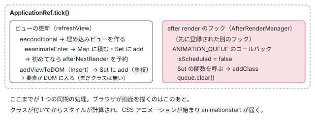

[目次](../README.md) › [アニメーションの内側](README.md) › 第 4 回 / 全 20 回

# アニメーションの待ち行列：ANIMATION\_QUEUE と afterNextRender

> ルートの環境インジェクタに 1 つだけ作られる ANIMATION\_QUEUE（Set と isScheduled）、scheduleAnimationQueue が afterNextRender で 1 回だけ流す仕組み、Set で同じ関数を 2 回走らせない理由。node\_manipulation.ts が要素を DOM に入れる直前（Create = コンテンツ投影、Insert = @if / @for）に maybeQueueEnterAnimation で enter の関数を積み直す行と、命令のところと合わせて 2 か所で積む理由。

angular/angular · 読了 約 12 分 · 中核 · [サイトで読む（デモが動きます）](https://angular-deep-dive-cyan.vercel.app/chapter/animations-queue)

---

[第 3 回](03-animations-instructions.md)で、命令は「あとで走らせる関数」を LView に積み、enter の関数を待ち行列に入れるだけだと分かりました。この章ではその待ち行列 `ANIMATION_QUEUE` を読みます。どこに 1 つだけ作られ、いつ・何回流れ、同じ関数を 2 回走らせないために何をしているか。そして、要素を DOM に入れる `node_manipulation.ts` が、入れる直前にもう一度 enter の関数を積む理由です。

読む対象は `packages/core/src/animation/queue.ts`（全 119 行）、`packages/core/src/render3/node_animations.ts` の `maybeQueueEnterAnimation`、`packages/core/src/render3/node_manipulation.ts` の `applyToElementOrContainer` の前半です。

1. [1. 全体像](01-animations-overview.md)
2. [2. テンプレートから命令へ](02-animations-compile.md)
3. [3. 命令がすること](03-animations-instructions.md)
4. **4. 待ち行列**（この章）
5. [5. enter のクラス](05-animations-enter-classes.md)
6. [6. いちばん長いアニメーション](06-animations-longest.md)
7. [7. 関数で動かす](07-animations-functions.md)
8. [8. 動かないとき](08-animations-disabled.md)
9. [9. 消すのを遅らせる](09-animations-leave-removal.md)
10. [10. leave のクラス](10-animations-leave-classes.md)
11. [11. 入れ子の leave](11-animations-leave-nested.md)
12. [12. 並べ替えと出し直し](12-animations-leave-reorder.md)
13. [13. スタイルの後片付け](13-animations-styles-teardown.md)
14. [14. 旧パッケージの入口](14-animations-legacy-setup.md)
15. [15. 旧 DSL とキーフレーム](15-animations-legacy-dsl.md)
16. [16. TransitionAnimationEngine](16-animations-legacy-engine.md)
17. [17. 2 つが同居するとき](17-animations-legacy-compat.md)
18. [18. 移行](18-animations-migration.md)
19. [19. テスト](19-animations-testing.md)
20. [20. issue と変更を読む](20-animations-issues.md)

## 1. ANIMATION\_QUEUE：ルートに 1 つの Set

📄 `angular/packages/core/src/animation/queue.ts` L13–38 （▶ の行: 14–17, 23, 26–29, 34）

```ts
13 │ export interface AnimationQueue {
14 ▶   queue: Set<VoidFunction>;
15 ▶   isScheduled: boolean;
16 ▶   scheduler: typeof initializeAnimationQueueScheduler | null;
17 ▶   injector: EnvironmentInjector;
18 │ }
19 │ 
20 │ /**
21 │  * A [DI token](api/core/InjectionToken) for the queue of all animations.
22 │  */
23 ▶ export const ANIMATION_QUEUE = new InjectionToken<AnimationQueue>(
24 │   typeof ngDevMode !== 'undefined' && ngDevMode ? 'AnimationQueue' : '',
25 │   {
26 ▶     factory: () => {
27 ▶       const injector = inject(EnvironmentInjector);
28 ▶       const queue = new Set<VoidFunction>();
29 ▶       injector.onDestroy(() => queue.clear());
30 │       return {
31 │         queue,
32 │         isScheduled: false,
33 │         scheduler: null,
34 ▶         injector, // should be the root injector
35 │       };
36 │     },
37 │   },
38 │ );
```

1. **13〜18 行目：中身は 4 つ**

   14 行目の `queue` は引数なしの関数の `Set`。15 行目の `isScheduled` は「もう流す予約をしたか」。16 行目の `scheduler` は予約をする関数（最初は `null`）。17 行目の `injector` は予約に使うインジェクタです。
2. **23・26 行目：`providedIn` の無い `InjectionToken` の factory**

   `providedIn` を書かない `InjectionToken` は `'root'` として扱われます（[di-injection-token](../di/06-di-injection-token.md)）。だから誰も provide しなくても、最初に `get(ANIMATION_QUEUE)` されたときにルートの環境インジェクタで 1 回だけ factory が呼ばれ、以後は同じオブジェクトが返ります。
3. **27・34 行目：そのインジェクタ自身を覚える**

   factory の中の `inject(EnvironmentInjector)` は、factory を走らせているインジェクタ、つまりルートの環境インジェクタです。34 行目のコメントも「should be the root injector」です。予約はコンポーネントのインジェクタではなく、いつもこのインジェクタで行います（2 節の 100 行目）。
4. **29 行目：インジェクタが壊れたら Set を空にする**

   アプリを `destroy()` したあと、待っていた関数が残らないようにしています。

## 2. addToAnimationQueue と scheduleAnimationQueue

📄 `angular/packages/core/src/animation/queue.ts` L40–62 （▶ の行: 45–46, 48, 52, 55, 61）

```ts
40 │ export function addToAnimationQueue(
41 │   injector: Injector,
42 │   animationFns: VoidFunction | VoidFunction[],
43 │   animationData?: AnimationLViewData,
44 │ ) {
45 ▶   const animationQueue = injector.get(ANIMATION_QUEUE);
46 ▶   if (Array.isArray(animationFns)) {
47 │     for (const animateFn of animationFns) {
48 ▶       animationQueue.queue.add(animateFn);
49 │       // If a node is detached, we need to keep track of the queued animation functions
50 │       // so we can later remove them from the global animation queue if the view
51 │       // is re-attached before the animation queue runs.
52 ▶       animationData?.detachedLeaveAnimationFns?.push(animateFn);
53 │     }
54 │   } else {
55 ▶     animationQueue.queue.add(animationFns);
56 │     // If a node is detached, we need to keep track of the queued animation functions
57 │     // so we can later remove them from the global animation queue if the view
58 │     // is re-attached before the animation queue runs.
59 │     animationData?.detachedLeaveAnimationFns?.push(animationFns);
60 │   }
61 ▶   animationQueue.scheduler && animationQueue.scheduler(injector);
62 │ }
```

45 行目で（どのインジェクタから呼んでも）ルートの待ち行列を引き、48・55 行目で `Set.add` します。**同じ関数を何度 add しても 1 つ**です。52・59 行目の `detachedLeaveAnimationFns` は、外したビューの leave の関数を控えておくためのもので、`@for` の並べ替えで使います（[第 12 回](12-animations-leave-reorder.md)）。61 行目、`scheduler` が入っていれば呼びます。

📄 `angular/packages/core/src/animation/queue.ts` L88–104 （▶ の行: 91–92, 94–96, 98, 100, 102）

```ts
 88 │ export function scheduleAnimationQueue(injector: Injector) {
 89 │   const animationQueue = injector.get(ANIMATION_QUEUE);
 90 │   // We only want to schedule the animation queue if it hasn't already been scheduled.
 91 ▶   if (!animationQueue.isScheduled) {
 92 ▶     afterNextRender(
 93 │       () => {
 94 ▶         animationQueue.isScheduled = false;
 95 ▶         for (let animateFn of animationQueue.queue) {
 96 ▶           animateFn();
 97 │         }
 98 ▶         animationQueue.queue.clear();
 99 │       },
100 ▶       {injector: animationQueue.injector},
101 │     );
102 ▶     animationQueue.isScheduled = true;
103 │   }
104 │ }
```

1. **91・102 行目：予約は 1 回だけ**

   `isScheduled` が `false` のときだけ `afterNextRender` を呼び、すぐ 102 行目で `true` にします。1 回の変更検知で 100 個の要素に `animate.enter` があっても、予約は 1 つです。
2. **100 行目：予約はルートの環境インジェクタで**

   `afterNextRender` にコンポーネントのインジェクタを渡すと、その予約はビューに結び付いて、ビューが壊れると消えます。ここで渡すのは 1 節の `animationQueue.injector` です。環境インジェクタにはビューが無いので、予約はビューを待たずにすぐ `AfterRenderManager` に入ります（[cd-after-render](../cd/08-cd-after-render.md) で読んだ `register` の、ビューが無いほうの枝）。leave の関数はビューを外したり壊したりするときに積まれます（[第 9 回](09-animations-leave-removal.md)）。そのビューのインジェクタで予約していたら、予約もビューと一緒に消えてしまいます。
3. **94 行目：流し始めたら、まず予約済みの印を下ろす**

   関数を呼ぶ前に `false` に戻すので、呼んでいる途中で `addToAnimationQueue` が来ると、61 行目 → 91 行目を通って `afterNextRender` がもう一度予約されます。
4. **95〜98 行目：Set の関数を入れた順に全部呼び、空にする**

   ここで初めて `runEnterAnimation` などが走ります（[第 5 回](05-animations-enter-classes.md)）。呼び終わったら 98 行目で `clear()`。LView の `ANIMATIONS` の Map は消えないので、同じ関数はまた積めます（3 節のコンテンツ投影）。

📄 `angular/packages/core/src/animation/queue.ts` L106–119 （▶ の行: 107–109, 112, 116–117）

```ts
106 │ export function initializeAnimationQueueScheduler(injector: Injector) {
107 ▶   const animationQueue = injector.get(ANIMATION_QUEUE);
108 ▶   animationQueue.scheduler = scheduleAnimationQueue;
109 ▶   animationQueue.scheduler(injector);
110 │ }
111 │ 
112 ▶ export function queueEnterAnimations(
113 │   injector: Injector,
114 │   enterAnimations: Map<number, EnterNodeAnimations>,
115 │ ) {
116 ▶   for (const [_, nodeAnimations] of enterAnimations) {
117 ▶     addToAnimationQueue(injector, nodeAnimations.animateFns);
118 │   }
119 │ }
```

108 行目、`scheduler` に `scheduleAnimationQueue` を入れ、109 行目ですぐ 1 回呼びます。第 3 回の `ɵɵanimateEnter` / `ɵɵanimateLeave` が呼ぶのはこの関数なので、**最初の animate の命令が走るまで `scheduler` は `null`** です。112〜119 行目の `queueEnterAnimations` は、渡された LView の enter の Map を回し、要素ごとの `animateFns` を全部 `addToAnimationQueue` に渡します。

## 3. DOM に入れる直前に、もう一度積む

enter の関数を待ち行列に入れる場所は 2 つあります。1 つは第 3 回の `ɵɵanimateEnter` の終わりの `queueEnterAnimations`、もう 1 つがここです。

📄 `angular/packages/core/src/render3/node_manipulation.ts` L120–155 （▶ の行: 125, 144–148, 150, 152–155）

```ts
120 │   injector: Injector,
121 │   parent: RElement | null,
122 │   lNodeToHandle: RNode | LContainer | LView,
123 │   tNode: TNode,
124 │   beforeNode?: RNode | null,
125 ▶   parentLView?: LView,
126 │ ) {
127 │   // If this slot was allocated for a text node dynamically created by i18n, the text node itself
128 │   // won't be created until i18nApply() in the update block, so this node should be skipped.
129 │   // For more info, see "ICU expressions should work inside an ngTemplateOutlet inside an ngFor"
130 │   // in `i18n_spec.ts`.
131 │   if (lNodeToHandle != null) {
132 │     let lContainer: LContainer | undefined;
133 │     let isComponent = false;
134 │     // We are expecting an RNode, but in the case of a component or LContainer the `RNode` is
135 │     // wrapped in an array which needs to be unwrapped. We need to know if it is a component and if
136 │     // it has LContainer so that we can process all of those cases appropriately.
137 │     if (isLContainer(lNodeToHandle)) {
138 │       lContainer = lNodeToHandle;
139 │     } else if (isLView(lNodeToHandle)) {
140 │       isComponent = true;
141 │       ngDevMode && assertDefined(lNodeToHandle[HOST], 'HOST must be defined for a component LView');
142 │       lNodeToHandle = lNodeToHandle[HOST]!;
143 │     }
144 ▶     const rNode: RNode = unwrapRNode(lNodeToHandle);
145 ▶     if (action === WalkTNodeTreeAction.Create && parent !== null) {
146 ▶       maybeQueueEnterAnimation(parentLView, parent, tNode, injector);
147 ▶       if (beforeNode == null) {
148 ▶         nativeAppendChild(renderer, parent, rNode);
149 │       } else {
150 ▶         nativeInsertBefore(renderer, parent, rNode, beforeNode || null, true);
151 │       }
152 ▶     } else if (action === WalkTNodeTreeAction.Insert && parent !== null) {
153 ▶       maybeQueueEnterAnimation(parentLView, parent, tNode, injector);
154 ▶       nativeInsertBefore(renderer, parent, rNode, beforeNode || null, true);
155 ▶       cancelLeavingNodes(tNode, rNode as HTMLElement, parentLView);
```

1. **145〜151 行目：`Create` のとき**

   146 行目で `maybeQueueEnterAnimation` を呼んでから、148 行目の `nativeAppendChild`（または 150 行目の `nativeInsertBefore`）で DOM に入れます。`Create` で `applyToElementOrContainer` まで来るのは、`<ng-content>` に投影する要素です（`ɵɵprojection` → `applyProjection`。[projection](../template/02-projection.md)）。
2. **152〜155 行目：`Insert` のとき**

   153 行目で同じように呼んでから、154 行目で入れます。`@if` や `@for` がビューを LContainer に足すと、`addViewToDOM` がこの `Insert` で走ります（[ivy-lcontainer](../ivy/11-ivy-lcontainer.md)）。155 行目の `cancelLeavingNodes` は、消える途中の要素が戻ってきたときの後片付けです（[第 12 回](12-animations-leave-reorder.md)）。
3. **125 行目：`parentLView` は、その要素を持っている LView**

   `applyNodes` は歩いている LView をそのまま渡すので、`@if` の中の要素なら、その埋め込みビューの LView です。

📄 `angular/packages/core/src/render3/node_animations.ts` L27–37 （▶ の行: 33–35）

```ts
27 │ export function maybeQueueEnterAnimation(
28 │   parentLView: LView | undefined,
29 │   parent: RElement | null,
30 │   tNode: TNode,
31 │   injector: Injector,
32 │ ): void {
33 ▶   const enterAnimations = parentLView?.[ANIMATIONS]?.enter;
34 ▶   if (parent !== null && enterAnimations && enterAnimations.has(tNode.index)) {
35 ▶     queueEnterAnimations(injector, enterAnimations);
36 │   }
37 │ }
```

33 行目で、その LView の `ANIMATIONS.enter` を取ります。34 行目、入れる先の親要素があり、**今入れようとしている要素の index が Map にあれば**、35 行目で Map の関数を**全部**待ち行列に入れます。第 3 回の `ɵɵanimateEnter` と同じく「その要素の分だけ」ではありません。何度入れても Set が重複を消します。

### なぜ 2 か所で積むのか

第 3 回で読んだ `ɵɵanimateEnter` のコメントは「制御フローの外の要素は命令のところで、中の要素は `node_manipulation.ts` で積まれ、Set で重複が消える」でした。読み合わせると、こうなります。

| 場合 | 命令（第 3 回の queueEnterAnimations） | DOM に入れるとき（146・153 行目） | 結果 |
| --- | --- | --- | --- |
| @if の外の要素（コンポーネントのテンプレートに直に書いた） | 積む | 通らない（作成ブロックの中で親へ直接 append される。[ivy-create-instructions](../ivy/09-ivy-create-instructions.md)） | 1 回 |
| @if の中の要素（初めて出す） | 積む（埋め込みビューの作成ブロックが先に走る） | 積む（Insert） | Set で 1 回 |
| コンテンツ投影の要素（出し直し） | 呼ばれない（ビューは作り直されない） | 積む（Create） | 出すたびに 1 回 |

表の 2 段目の順番は、`@if` の `ɵɵconditional` が `createAndRenderEmbeddedLView`（作成ブロックを走らせる）のあとで `addLViewToLContainer`（DOM に入れる）を呼ぶ順です。3 段目は、146 行目を足したコミット dd7c4cd9d14（fix(core): Fixes animations in conjunction with content projection #63776）の説明そのものです。「投影する要素は壊して作り直されないので、一度きりのアニメーションは最初の 1 回しか動かなかった。LView に残した関数を、出し直すたびに待ち行列から走らせる」。同じコミットで、待ち行列を流す場所も「`refreshView` でテンプレートを走らせた直後」から `afterRender` に移しています（「which is safer」）。



*1 回の変更検知の中で、enter の関数が積まれてから走るまで*

## 4. afterNextRender の中で流れる意味

`afterNextRender` のコールバックは、`ApplicationRef.tick()` がすべてのビューを更新し終えたあとに呼ばれます（[cd-after-render](../cd/08-cd-after-render.md)）。待ち行列がそこで流れるので、関数が走るときには

- 要素はもう DOM に入っている（3 節の 148・154 行目は、ビューの更新の中で済んでいる）
- 同じ変更検知で付くほかの属性やクラスのバインディングも、もう反映されている
- まだブラウザは画面を描いていない（tick は 1 つの同期の処理）

という状態です。だからクラスを付けたあと `getAnimations()` や `getComputedStyle` で長さを読む（[第 6 回](06-animations-longest.md)）のが意味を持ち、「クラスの無い状態」が一瞬画面に出ることもありません。

> **🧪 デモ：ボタン → afterNextRender → フレーム → animationstart**
>
> 本物の `@if` と `animate.enter="aq-in"` / `animate.leave="aq-out"`（0.5 秒）です。押した時刻を 0 として、次のときの要素の `className` を記録します。「自分の afterNextRender」は、押したときに `EnvironmentInjector` を渡して登録したものです（ビューに属さないので、押した時点で `AfterRenderManager` に入り、`ANIMATION_QUEUE` の予約より先に並びます）。「その直後の microtask」は、その中から `queueMicrotask` したもので、同じ描画の after render のフックが全部終わったあとに走ります。OS の設定で動きを減らしていても、このデモは動きます。
>
> ▶ [このデモはサイトで動かせます](https://angular-deep-dive-cyan.vercel.app/chapter/animations-queue)

1. **「自分の afterNextRender」の時点：要素はあるが、`aq-in` はまだ無い**

   ビューの更新は終わって要素は DOM にあります。`AfterRenderManager` はフックを登録された順に呼ぶので（[cd-after-render](../cd/08-cd-after-render.md)）、先に並んだ自分のフックが、待ち行列のコールバックより先に走ります。
2. **「その直後の microtask」：`aq-in` が付いている**

   同じ描画のフックの中で、待ち行列のコールバック（95〜97 行目）が `runEnterAnimation` を呼び、クラスを付けたあとです。
3. **requestAnimationFrame と animationstart**

   どのフレームのコールバックでも、要素はもうクラスを持っています。`animationstart` は、ブラウザがスタイルを計算して CSS アニメーションを始めたあとに届きます。筆者の Chrome で 1 回押したときは、enter が「自分の afterNextRender」22.6ms → microtask 24.2ms → rAF 1 回目 25.1ms → `animationstart` 33.8ms → rAF 2 回目 34.6ms → `animationend` 508.3ms の順でした（数字は押すたびに変わります）。
4. **leave では**

   「click の直後」はまだ要素があり、「自分の afterNextRender」でもクラスは `aq-box` のまま、microtask で `aq-out` が付きます。leave の関数は、ビューを外す `node_manipulation.ts` の Detach が待ち行列に入れたものです（[第 9 回](09-animations-leave-removal.md)）。

- 👤 `show.set(true)` — ボタンのハンドラ
  - `ApplicationRef.tick()` — zoneless のスケジューラが呼ぶ（[zoneless-tick](../zoneless/05-zoneless-tick.md)）
    - `ɵɵconditional → createAndRenderEmbeddedLView` — 作成ブロック
      - `ɵɵanimateEnter → queueEnterAnimations → addToAnimationQueue` — queue.ts 116・117 → 48
        - `scheduleAnimationQueue → afterNextRender(…, {injector: root})` — queue.ts 92・100
    - `addLViewToLContainer → addViewToDOM → applyToElementOrContainer(Insert)` — node\_manipulation.ts 152
      - `maybeQueueEnterAnimation → queueEnterAnimations` — node\_animations.ts 35（Set で重複）
      - `nativeInsertBefore` — 154：要素が DOM に入る
    - `AfterRenderManager.execute()` — after render のフック
      - `for (animateFn of queue) animateFn()` — queue.ts 95・96
        - `runEnterAnimation → addClass('aq-in')` — 第 5 回

## テストと直し方

📄 `ターミナル（../angular で実行）`

```
$ grep -n "only once on entry\|animation queue timing\|via local detectChanges\|afterNextRender only runs" \
    packages/core/test/acceptance/animation_spec.ts
1065:    it('should call animation function only once on entry when animation is specified with control flow', fakeAsync(() => {
2310:  describe('animation queue timing', () => {
2457:      // Trigger leave animation via local detectChanges (queues animation
2458:      // without flushing the queue - afterNextRender only runs during tick)
$ sed -n 1084,1093p packages/core/test/acceptance/animation_spec.ts
      const fixture = TestBed.createComponent(TestComponent);
      const cmp = fixture.componentInstance;
      fixture.detectChanges();
      tickAnimationFrames(1);
      expect(cmp.count()).toBe(0);

      cmp.show.update((s) => !s);
      fixture.detectChanges();
      tickAnimationFrames(1);
      expect(cmp.count()).toBe(1);
```

1. **1065 行目：制御フローの中で 1 回だけ**

   `@if(show())` の中の `(animate.enter)` の関数が、出したあと `count` が 1 になる（2 にならない）ことを確かめています。命令（第 3 回）と、この章の 153 行目の両方で積まれても、Set で 1 回になることの spec です。
2. **2310 行目：`describe('animation queue timing')`**

   待ち行列が「あとで」流れるせいで起きることを集めた describe です。2457〜2458 行目のコメントは「`detectChanges` だけでは待ち行列は流れない。`afterNextRender` は tick の中でしか走らない」と書いています。テストのときにいつ流れるかは [第 19 回](19-animations-testing.md)で読みます。

📄 `ターミナル（../angular で実行）`

```
$ grep -rn ANIMATION_QUEUE packages/core/test --include='*.ts'
packages/core/test/acceptance/view_container_ref_spec.ts:14:import {ANIMATION_QUEUE} from '../../src/animation/queue';
packages/core/test/acceptance/view_container_ref_spec.ts:1538:          {provide: ANIMATION_QUEUE, useValue: TestBed.inject(ANIMATION_QUEUE)},
```

`ANIMATION_QUEUE` を名前で使っている spec はこれだけです。`view_container_ref_spec.ts` の 1538 行目は、`create(null)`（親なし）で作った別の NgModule の注入器に、TestBed の待ち行列を `useValue` で渡しています。この行は dd7c4cd9d14 で足されました。すぐ上のコメントは「view engine が…」という古い説明のままで、`ANIMATION_QUEUE` を足した理由は書かれていません。

走らせるのはブラウザ版の `//packages/core/test/acceptance:acceptance_web_chromium`（2026-11-01 に自分で走らせて 2743 passed, 0 failed, 3 skipped、PASSED in 6.8s）。`queue.ts` だけを単体で確かめる spec はありません。

1. **直すとしたら**

   「流れない」「2 回流れる」「流れる時点で何かが壊れている」は、どれも `queue.ts` の `scheduleAnimationQueue`（91〜102 行目）と、積む 2 か所（第 3 回の `ɵɵanimateEnter`、この章の 146・153 行目）が入口です。spec は `describe('animation queue timing')` か、enter なら `describe('animate.enter')` に足します。最新の main では 259d1b0de08（refactor(core): make the animate.enter and animate.leave runtime tree-shakable）で、`maybeQueueEnterAnimation` が「animate の命令が一度でも走るまで何もしない」入口に変わり、本体は `enableAnimationRuntimeSupport()` で後から差し込む形になっています。読むときはそちらの形も確かめます。

## 聞かれそうな質問

**Q. なぜ afterNextRender なのですか？命令の中ですぐクラスを付けると何が困りますか？**

命令が走る時点では、`@if` の中の要素はまだ DOM に入っていません（作成ブロックが先、153・154 行目の Insert が後）。同じ変更検知で付くほかのバインディングもまだです。その状態でクラスを付けて長さを読んでも正しく測れません。待ち行列は、ビューの更新が全部終わってから 95〜97 行目でまとめて呼ぶので、要素が揃った状態で、画面を描く前にクラスを付けられます。dd7c4cd9d14 のコミットも、`refreshView` の直後から `afterRender` へ移したのを「safer」と書いています。

**Q. 待ち行列はアプリに 1 つですか？**

ルートの環境インジェクタに 1 つです。23・26 行目の `InjectionToken` は `providedIn` を書かないので `'root'` 扱いになり、45・89・107 行目の `injector.get(ANIMATION_QUEUE)` は、どのビューから呼んでもルートの同じオブジェクトに届きます。`bootstrapApplication` のアプリ用の注入器は、`platform-browser/src/browser.ts` のプロバイダが `INJECTOR_SCOPE` を `'root'` にするので、アプリを 2 つ起動すれば待ち行列も 2 つです。

**Q. 同じ要素の enter が 2 回走ることはありますか？**

1 回の流れの中では走りません。積む場所は 2 つありますが、同じクロージャを `Set.add` するので 1 つになります（48 行目）。ただし流れたあと（98 行目で `clear()`）に同じ要素を DOM に入れ直すと、LView の Map に残っている関数がまた積まれて、もう一度走ります。コンテンツ投影ではそれが狙いです。

**Q. テストではいつ流れますか？**

`afterNextRender` が走るとき、つまり `ApplicationRef.tick()` の中です。acceptance の spec の 2457〜2458 行目のコメントは、`changeDetectorRef.detectChanges()` だけでは流れないと書いています。`fixture.detectChanges()` と `tickAnimationFrames` の組み合わせで何が起きるかは [第 19 回](19-animations-testing.md)です。

## 読み終えて

- `ANIMATION_QUEUE` は `providedIn` 無しの `InjectionToken` の factory で、ルートの環境インジェクタに 1 つだけできる。中身は関数の `Set` と `isScheduled`
- `scheduleAnimationQueue` は `isScheduled` で予約を 1 回にまとめ、ルートのインジェクタで `afterNextRender` する。流すときは Set の関数を全部呼んで `clear()`
- enter の関数は、命令のところと、`node_manipulation.ts` の Create / Insert の直前の 2 か所で積まれ、Set が重複を消す
- Create（投影）・Insert（@if / @for）で積み直すのは、作り直されない要素でも出すたびに動かすため（dd7c4cd9d14）
- after render で流れるので、要素が DOM に揃い、画面を描く前にクラスが付く

---

← 前: [命令がすること：LView の ANIMATIONS に「あとで走らせる関数」を登録する](03-animations-instructions.md)  
次: [animate.enter のクラス：付けて、終わったら外す](05-animations-enter-classes.md) →
