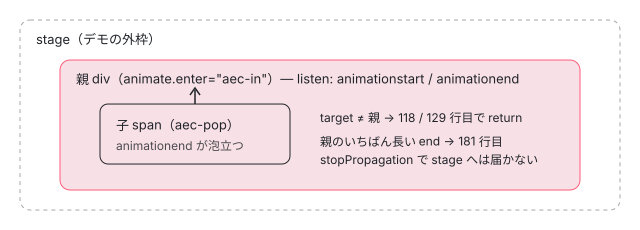

[目次](../README.md) › [アニメーションの内側](README.md) › 第 5 回 / 全 20 回

# animate.enter のクラス：付けて、終わったら外す

> runEnterAnimation がクラスを addClass し、animationstart / transitionstart を受けてから animationend / transitionend を聞く 2 段の仕組み、子の要素から泡立ってきたイベントを target で弾く行、次のフレームでアニメーションが無いと分かったらすぐクラスを外す requestAnimationFrame、enterClassMap に後片付けの関数を持つ理由。

angular/angular · 読了 約 13 分 · 中核 · [サイトで読む（デモが動きます）](https://angular-deep-dive-cyan.vercel.app/chapter/animations-enter-classes)

---

`animate.enter="fade-in"` と書いた要素は、DOM に入った直後に `fade-in` クラスが付き、アニメーションが終わると外れます。この章では、その「付けて、終わったら外す」を担う `runEnterAnimation` を 1 行ずつ追います。**start のイベントを受けてから end のイベントを聞く 2 段の仕組み**、子の要素から泡立ってきたイベントを弾く行、アニメーションが無いと分かったら次のフレームですぐ外す `requestAnimationFrame`、後片付けの関数を `enterClassMap` に持つ理由が分かります。

読む対象は `packages/core/src/render3/instructions/animation.ts`（`runEnterAnimation` と `enterAnimationEnd`）と `packages/core/src/animation/utils.ts`（`trackEnterClasses`・`cleanupEnterClassData`・`getEventTarget`）です。

1. [1. 全体像](01-animations-overview.md)
2. [2. テンプレートから命令へ](02-animations-compile.md)
3. [3. 命令がすること](03-animations-instructions.md)
4. [4. 待ち行列](04-animations-queue.md)
5. **5. enter のクラス**（この章）
6. [6. いちばん長いアニメーション](06-animations-longest.md)
7. [7. 関数で動かす](07-animations-functions.md)
8. [8. 動かないとき](08-animations-disabled.md)
9. [9. 消すのを遅らせる](09-animations-leave-removal.md)
10. [10. leave のクラス](10-animations-leave-classes.md)
11. [11. 入れ子の leave](11-animations-leave-nested.md)
12. [12. 並べ替えと出し直し](12-animations-leave-reorder.md)
13. [13. スタイルの後片付け](13-animations-styles-teardown.md)
14. [14. 旧パッケージの入口](14-animations-legacy-setup.md)
15. [15. 旧 DSL とキーフレーム](15-animations-legacy-dsl.md)
16. [16. TransitionAnimationEngine](16-animations-legacy-engine.md)
17. [17. 2 つが同居するとき](17-animations-legacy-compat.md)
18. [18. 移行](18-animations-migration.md)
19. [19. テスト](19-animations-testing.md)
20. [20. issue と変更を読む](20-animations-issues.md)

前提として、テンプレートの `animate.enter` は `ɵɵanimateEnter` 命令になり（[第 2 回](02-animations-compile.md)）、命令は「あとで `runEnterAnimation(lView, tNode, value, ngZone)` を呼ぶ関数」を LView に登録して待ち行列に入れ（[第 3 回](03-animations-instructions.md)）、待ち行列は `afterNextRender` でそれを呼びます（[第 4 回](04-animations-queue.md)）。つまり `runEnterAnimation` が呼ばれるのは、**要素が DOM に入ったあとの描画の後**です。ここから先が本章です。

## 1. 準備：クラスの一覧と start のリスナー

📄 `angular/packages/core/src/render3/instructions/animation.ts` L94–124 （▶ の行: 100, 104, 108–110, 116, 118, 120–122）

```ts
 94 │ export function runEnterAnimation(
 95 │   lView: LView,
 96 │   tNode: TNode,
 97 │   value: string | AnimationClassBindingFn,
 98 │   ngZone: NgZone,
 99 │ ): void {
100 ▶   const nativeElement = getNativeByTNode(tNode, lView) as HTMLElement;
101 │ 
102 │   ngDevMode && assertElementNodes(nativeElement, 'animate.enter');
103 │ 
104 ▶   const renderer = lView[RENDERER];
105 │ 
106 │   // Retrieve the actual class list from the value. This will resolve any resolver functions from
107 │   // bindings.
108 ▶   const activeClasses = getClassListFromValue(value);
109 ▶   const cleanupFns: VoidFunction[] = [];
110 ▶   let hasCompleted = false;
111 │ 
112 │   // In the case where multiple animations are happening on the element, we need
113 │   // to get the longest animation to ensure we don't complete animations early.
114 │   // This also allows us to setup cancellation of animations in progress if the
115 │   // gets removed early.
116 ▶   const handleEnterAnimationStart = (event: AnimationEvent | TransitionEvent) => {
117 │     // this early exit case is to prevent issues with bubbling events that are from child element animations
118 ▶     if (getEventTarget(event) !== nativeElement) return;
119 │ 
120 ▶     const eventName = event instanceof AnimationEvent ? 'animationend' : 'transitionend';
121 ▶     ngZone.runOutsideAngular(() => {
122 ▶       renderer.listen(nativeElement, eventName, handleEnterAnimationEnd);
123 │     });
124 │   };
```

1. **100 行目 本物の要素を取る**

   `getNativeByTNode` で、この TNode（テンプレート上の 1 つの要素の設計図。[ivy-tnode](../ivy/04-ivy-tnode.md)）に対応する DOM 要素を LView から取ります。104 行目の `renderer` は、クラスの付け外しとリスナーの登録に使う `Renderer`（ふつうは `DomRenderer`）です。
2. **108 行目 付けるクラスの一覧を作る**

   `getClassListFromValue(value)` が、`"a b"` のような文字列や関数から `['a', 'b']` を作ります。関数のときはここで初めて呼ばれます。中身は[第 7 回](07-animations-functions.md)で読みます。
3. **109〜110 行目 後片付けの箱と「終わった」フラグ**

   `cleanupFns` には「リスナーを外す関数」を入れていきます。`hasCompleted` は、いちばん長いアニメーションが終わったら true になり、3 節の requestAnimationFrame の処理を止めます。
4. **116〜124 行目 start を受けたら、end を聞き始める**

   `handleEnterAnimationStart` は `animationstart` / `transitionstart` を受ける関数です。118 行目で、イベントの発生元（`getEventTarget`。5 節）がこの要素でなければ何もしません。120 行目で、来たのが `AnimationEvent`（CSS の `@keyframes` アニメーション）なら `animationend`、そうでなければ（`TransitionEvent`）`transitionend` を選び、121〜123 行目でその end イベントのリスナーを `runOutsideAngular` の中で登録します。

> [!TIP]
> **新卒エンジニアへ**
>
> `ngZone.runOutsideAngular` は、zone.js を使うアプリで「このリスナーが呼ばれても変更検知を起こさない」ための包みです（[zone-ngzone-fork](../zone/09-zone-ngzone-fork.md)）。このサイトのような zoneless のアプリでは `NgZone` は `NoopNgZone` で、渡した関数をそのまま呼ぶだけです。

## 2. end のリスナーと、クラスを付ける行

📄 `angular/packages/core/src/render3/instructions/animation.ts` L126–148 （▶ の行: 127, 129, 131–132, 134, 138, 140–141, 144, 147）

```ts
126 │   // When the longest animation ends, we can remove all the classes
127 ▶   const handleEnterAnimationEnd = (event: AnimationEvent | TransitionEvent) => {
128 │     // this early exit case is to prevent issues with bubbling events that are from child element animations
129 ▶     if (getEventTarget(event) !== nativeElement) return;
130 │ 
131 ▶     if (isLongestAnimation(event, nativeElement)) {
132 ▶       hasCompleted = true;
133 │     }
134 ▶     enterAnimationEnd(event, nativeElement, renderer);
135 │   };
136 │ 
137 │   // We only need to add these event listeners if there are actual classes to apply
138 ▶   if (activeClasses && activeClasses.length > 0) {
139 │     ngZone.runOutsideAngular(() => {
140 ▶       cleanupFns.push(renderer.listen(nativeElement, 'animationstart', handleEnterAnimationStart));
141 ▶       cleanupFns.push(renderer.listen(nativeElement, 'transitionstart', handleEnterAnimationStart));
142 │     });
143 │ 
144 ▶     trackEnterClasses(nativeElement, activeClasses, cleanupFns);
145 │ 
146 │     for (const klass of activeClasses) {
147 ▶       renderer.addClass(nativeElement, klass);
148 │     }
```

1. **127〜135 行目 end を受ける関数**

   129 行目でも発生元を確かめます。131〜133 行目で、終わったのが**いちばん長いアニメーション**（`isLongestAnimation`。[第 6 回](06-animations-longest.md)）なら `hasCompleted = true`。そして 134 行目で `enterAnimationEnd`（4 節）に渡します。クラスを外すのは enterAnimationEnd の仕事です。
2. **138 行目 クラスが 1 つも無ければ何もしない**

   `animate.enter=""` や、関数が `null` を返したときは、リスナーも付けずに終わります。
3. **140〜141 行目 start のリスナーを 2 つ登録する**

   `animationstart` と `transitionstart` の両方です。`renderer.listen` は「外す関数」を返すので、それを `cleanupFns` に積みます。この時点ではまだ end を聞いていません。end のリスナーは 1 節の 122 行目で、**何かが実際に始まってから**足されます。
4. **144 行目 enterClassMap に記録する**

   どの要素にどのクラスを付けたか、外すときに呼ぶ関数は何か、を `trackEnterClasses` で覚えます（6 節）。
5. **146〜148 行目 クラスを付ける**

   `renderer.addClass` で 1 つずつ付けます。ここで CSS の `.fade-in { animation: ... }` が当たり、ブラウザがアニメーションを始めます。始まると `animationstart` が来て、1 節の 120〜123 行目が end のリスナーを足します。

## 3. 次のフレームで、アニメーションが無ければすぐ外す

📄 `angular/packages/core/src/render3/instructions/animation.ts` L150–166 （▶ の行: 150–152, 154–157, 159, 161）

```ts
150 ▶     // In the case that the classes added have no animations, we need to remove
151 ▶     // the classes right away. This could happen because someone is intentionally
152 ▶     // preventing an animation via selector specificity.
153 │     ngZone.runOutsideAngular(() => {
154 ▶       requestAnimationFrame(() => {
155 ▶         if (hasCompleted) return;
156 ▶         determineLongestAnimation(nativeElement, longestAnimations, areAnimationSupported);
157 ▶         if (!longestAnimations.has(nativeElement)) {
158 │           for (const klass of activeClasses) {
159 ▶             renderer.removeClass(nativeElement, klass);
160 │           }
161 ▶           cleanupEnterClassData(nativeElement);
162 │         }
163 │       });
164 │     });
165 │   }
166 │ }
```

150〜152 行目のコメントのとおり、付けたクラスが**アニメーションを何も持っていない**こともあります（セレクタの詳細度でわざと打ち消している場合など）。そのときは start も end も来ないので、何もしなければクラスが付いたままになります。それを防ぐのがこの requestAnimationFrame です。

1. **154 行目 次のフレームまで待つ**

   クラスを付けた直後は、まだスタイルの計算が済んでいないことがあります。1 フレーム待ってから調べます。
2. **155 行目 もう終わっていたら何もしない**

   とても短いアニメーションが 1 フレームの間に終わっていれば、2 節の 132 行目で `hasCompleted` が true になっています。
3. **156 行目 いちばん長いアニメーションを調べる**

   `determineLongestAnimation` が `element.getAnimations()`（無ければ `getComputedStyle`）から長さを測り、見つかれば `longestAnimations`（WeakMap）に入れます。中身は[第 6 回](06-animations-longest.md)です。
4. **157〜161 行目 見つからなければ、その場で外す**

   `longestAnimations` にこの要素が無い ＝ 長さが 0 より大きいアニメーションが無い、ということなので、159 行目でクラスを外し、161 行目で後片付けをします。これで「アニメーションの無いクラスは、付いてから約 1 フレームで外れる」ことになります。7 節のデモで確かめられます。

## 4. enterAnimationEnd：いちばん長いものが終わったら外す

📄 `angular/packages/core/src/render3/instructions/animation.ts` L168–187 （▶ の行: 173, 175–176, 181–183, 185）

```ts
168 │ function enterAnimationEnd(
169 │   event: AnimationEvent | TransitionEvent,
170 │   nativeElement: HTMLElement,
171 │   renderer: Renderer,
172 │ ) {
173 ▶   const elementData = enterClassMap.get(nativeElement);
174 │   // this event.target check is to prevent issues with bubbling events that are from child element animations
175 ▶   if (getEventTarget(event) !== nativeElement || !elementData) return;
176 ▶   if (isLongestAnimation(event, nativeElement)) {
177 │     // Now that we've found the longest animation, there's no need
178 │     // to keep bubbling up this event as it's not going to apply to
179 │     // other elements further up. We don't want it to inadvertently
180 │     // affect any other animations on the page.
181 ▶     event.stopPropagation();
182 ▶     for (const klass of elementData.classList) {
183 ▶       renderer.removeClass(nativeElement, klass);
184 │     }
185 ▶     cleanupEnterClassData(nativeElement);
186 │   }
187 │ }
```

1. **173 行目 記録を引く**

   `enterClassMap.get(nativeElement)` で、2 節の 144 行目で覚えたクラスの一覧と後片付けの関数を取ります。
2. **175 行目 発生元が違うか、記録が無ければ何もしない**

   記録が無いのは、もう後片付けが済んだあとです。122 行目で足した end のリスナーは `cleanupFns` に積まれていない（戻り値を捨てている）ので、片付けのあとも要素に残ります。そのあとで別のアニメーションの end が来ても、この行で止まります。
3. **176 行目 いちばん長いアニメーションか**

   短い方のアニメーションの end で外してしまうと、長い方が途中で止まります（クラスが外れれば、そのクラスの `animation` も当たらなくなるからです）。だから「いちばん長いもの」の end だけを待ちます。
4. **181 行目 泡立ちを止める**

   `animationend` / `transitionend` は泡立つ（親の要素へ伝わっていく）イベントです。177〜180 行目のコメントのとおり、この要素の終わりを親の要素の enter が「自分の終わり」と取り違えないよう、ここで `stopPropagation()` します。デモで、このイベントだけ親へ届かないことが見えます。
5. **182〜185 行目 クラスを外して後片付け**

   外すのは 108 行目の `activeClasses` ではなく `elementData.classList` です。同じ要素に複数の場所から `animate.enter` が付いたとき、全部をまとめて外すためです（6 節）。

## 5. 子の要素から来たイベントを弾く：getEventTarget

📄 `angular/packages/core/src/animation/utils.ts` L314–319 （▶ の行: 316–318）

```ts
314 │ /** Gets the target of an event while accounting for Shadow DOM. */
315 │ export function getEventTarget<T extends EventTarget>(event: Event): T | null {
316 ▶   // If an event is bound outside the Shadow DOM, the `event.target` will
317 ▶   // point to the shadow root so we have to use `composedPath` instead.
318 ▶   return (event.composedPath ? event.composedPath()[0] : event.target) as T | null;
319 │ }
```

318 行目は、`event.composedPath()` があればその先頭、無ければ `event.target` を返します。316〜317 行目のコメントのとおり、Shadow DOM の外で受けたイベントの `target` はシャドウルートのホストに付け替えられてしまうので、本当の発生元を `composedPath()[0]` で取ります。

なぜ発生元を確かめるのか。親の要素に `animate.enter` があり、子の要素にも CSS アニメーションがあると、子の `animationstart` / `animationend` も泡立って親のリスナーに届きます。118・129・175 行目の 3 か所で `getEventTarget(event) !== nativeElement` を見て、子のイベントで親のクラスを外さないようにしています。



*親に animate.enter、子に CSS アニメーションがあるとき。子のイベントは泡立って親に届くが、118 / 129 行目で弾かれる。親のいちばん長い end は 181 行目で泡立ちが止まる*

## 6. enterClassMap と後片付け

📄 `angular/packages/core/src/animation/utils.ts` L67–89 （▶ の行: 68–70, 78, 81, 84, 87）

```ts
67 │ /**
68 ▶  * trackEnterClasses is necessary in the case of composition where animate.enter
69 ▶  * is used on the same element in multiple places, like on the element and in a
70 ▶  * host binding. When removing classes, we need the entire list of animation classes
71 │  * added to properly remove them when the longest animation fires.
72 │  */
73 │ export function trackEnterClasses(
74 │   el: HTMLElement,
75 │   classList: string[],
76 │   cleanupFns: VoidFunction[],
77 │ ) {
78 ▶   const elementData = enterClassMap.get(el);
79 │   if (elementData) {
80 │     for (const klass of classList) {
81 ▶       elementData.classList.push(klass);
82 │     }
83 │     for (const fn of cleanupFns) {
84 ▶       elementData.cleanupFns.push(fn);
85 │     }
86 │   } else {
87 ▶     enterClassMap.set(el, {classList, cleanupFns});
88 │   }
89 │ }
```

68〜71 行目のコメントが理由を書いています。同じ要素に `animate.enter` が**複数の場所から**付くことがあります。たとえばテンプレートの `<my-cmp animate.enter="a">` と、`MyCmp` 自身の `host: {'animate.enter': 'b'}` です。このとき `runEnterAnimation` は同じ要素に 2 回呼ばれます。78 行目で既に記録があれば、81 行目でクラスを、84 行目で後片付けの関数を**足し込み**、無ければ 87 行目で新しく作ります。こうしておけば、どちらの呼び出しの end が来ても、4 節の 182 行目で `a` と `b` の両方を外せます。

📄 `angular/packages/core/src/animation/utils.ts` L91–113 （▶ の行: 97–98, 100, 102, 109, 113）

```ts
 91 │ /**
 92 │  * Helper function to cleanup enterClassMap data safely
 93 │  */
 94 │ export function cleanupEnterClassData(element: HTMLElement): void {
 95 │   const elementData = enterClassMap.get(element);
 96 │   if (elementData) {
 97 ▶     for (const fn of elementData.cleanupFns) {
 98 ▶       fn();
 99 │     }
100 ▶     enterClassMap.delete(element);
101 │   }
102 ▶   longestAnimations.delete(element);
103 │ }
104 │ 
105 │ export const noOpAnimationComplete = () => {};
106 │ 
107 │ // Tracks the list of classes added to a DOM node from `animate.enter` calls to ensure
108 │ // we remove all of the classes in the case of animation composition via host bindings.
109 ▶ export const enterClassMap = new WeakMap<
110 │   HTMLElement,
111 │   {classList: string[]; cleanupFns: VoidFunction[]}
112 │ >();
113 ▶ export const longestAnimations = new WeakMap<HTMLElement, LongestAnimation>();
```

1. **97〜99 行目 リスナーを外す**

   `cleanupFns` には 140〜141 行目の start のリスナーを外す関数が入っています。それを全部呼びます。
2. **100・102 行目 記録を消す**

   `enterClassMap` と `longestAnimations` からこの要素を消します。これで 175 行目の `!elementData` が true になり、あとから来る end は無視されます。
3. **109・113 行目 どちらも WeakMap**

   キーが DOM 要素の `WeakMap` なので、要素が捨てられれば記録もガベージコレクションで消えます。片付けが走らなかった要素の記録が残り続けることはありません。

> [!NOTE]
> **ポイント**
>
> enter の途中で同じ要素の leave が始まったときは、`cancelAnimationsIfRunning` が `enterClassMap` を見て enter のクラスを外し、`cleanupEnterClassData` を呼びます。leave 側の話なので[第 10 回](10-animations-leave-classes.md)で読みます。

## 7. デモ：本物の animate.enter で、親と子のイベントを並べる

> **🧪 DEMO — このページの Angular（22.1.6）で animate.enter を動かす**
>
> これは再現ではなく本物です。親の `div` に `[animate.enter]="enterClass()"`、子の `span` には常に CSS アニメーション `aec-pop` が付いています。「出す」を押すと、外枠（stage）に MutationObserver と、`animationstart` / `animationend` / `animationcancel` のリスナーを capture（捕獲）と bubble（泡立ち）の 2 段で張り、3 秒間だけ記録します。OS の設定で動きを減らしていても、このデモは動きます（[第 8 回](08-animations-disabled.md)）。
>
> ▶ [このデモはサイトで動かせます](https://angular-deep-dive-cyan.vercel.app/chapter/animations-enter-classes)

見るところは 4 つです（どれも 2026-11-01 にヘッドレスの Chrome でこのページを開き、ボタンを押して記録したログで確かめました。時刻は数 ms〜十数 ms ずれます）。

- **aec-in・子 900ms**：親の `aec-in` は、親の `animationend`（約 500ms）の時刻に外れます。子の `animationend`（約 900ms）はそのあとに来て、stage まで泡立ちます。親自身の `animationend` は「stage には泡立ってこなかった」と出ます。181 行目の `stopPropagation()` です。
- **aec-in・子 300ms**：子の `animationend` が先に来ても、親のクラスは外れません。129 行目の発生元の確かめで弾かれているからです。
- **途中で取り消す**：「出す」の直後（0.5 秒以内）に押すと、`animationcancel` が記録され、`animationend` は来ません。1 秒後に読んだ class に `aec-in` が残っています。enter は end しか聞いていないからです（「聞かれそうな質問」の 3 問目）。
- **aec-none**：クラスが付いてから 1 フレーム程度で外れます。3 節の 157〜161 行目です。子のアニメーションは動いていますが、`determineLongestAnimation` が見るのは親の `el.getAnimations()` だけなので、子の分は数えません。

`animationName` に出る名前は、CSS に書いた `aec-slide` そのものではなく、コンポーネントごとのスコープ名が前に付いた名前（手元では `_ngcontent-ng-c1224845670_aec-slide`。数字はビルドごとに変わる）になります。このコンポーネントのスタイルは Emulated（既定）のカプセル化で、コンパイラが `@keyframes` の名前もコンポーネントごとに付け替えるからです（[compiler-shadow-css](../compiler/18-compiler-shadow-css.md)）。

## 8. 呼び出しの連なり

- 👤 `<div animate.enter="aec-in">` — あなたのテンプレート
  - `ɵɵanimateEnter("aec-in")` — animation.ts — *LView に登録して待ち行列へ（第 3 回）*
  - `afterNextRender → 待ち行列の関数` — queue.ts — *第 4 回*
    - `runEnterAnimation(lView, tNode, value, ngZone)` — animation.ts L94
      - `getClassListFromValue(value)` — animation.ts L108
      - `renderer.listen(el, 'animationstart' / 'transitionstart')` — animation.ts L140-141
      - `trackEnterClasses → renderer.addClass` — animation.ts L144-148
      - `requestAnimationFrame → determineLongestAnimation` — animation.ts L154-156 — *無ければ L159 で外す*
    - `（animationstart）handleEnterAnimationStart` — animation.ts L116 — *L122 で end を聞く*
    - `（animationend）handleEnterAnimationEnd` — animation.ts L127
      - `enterAnimationEnd` — animation.ts L168 — *いちばん長いなら stopPropagation・removeClass*
        - `cleanupEnterClassData` — utils.ts L94

## テストと直し方

📄 `angular/packages/core/test/acceptance/animation_spec.ts` L1146–1174 （▶ の行: 1151, 1158, 1165, 1168, 1170–1171, 1173）

```ts
1146 │     it('should remove classes when animation is done', fakeAsync(() => {
1147 │       @Component({
1148 │         changeDetection: ChangeDetectionStrategy.Eager,
1149 │         selector: 'test-cmp',
1150 │         styles: styles,
1151 ▶         template: '<div>@if (show()) {<p animate.enter="slide-in" #el>I should slide in</p>}</div>',
1152 │         encapsulation: ViewEncapsulation.None,
1153 │       })
1154 │       class TestComponent {
1155 │         show = signal(false);
1156 │         @ViewChild('el', {read: ElementRef}) el!: ElementRef<HTMLParagraphElement>;
1157 │       }
1158 ▶       TestBed.configureTestingModule({animationsEnabled: true});
1159 │ 
1160 │       const fixture = TestBed.createComponent(TestComponent);
1161 │       const cmp = fixture.componentInstance;
1162 │       fixture.detectChanges();
1163 │       cmp.show.set(true);
1164 │       fixture.detectChanges();
1165 ▶       tickAnimationFrames(1);
1166 │       const paragraph = fixture.debugElement.query(By.css('p'));
1167 │ 
1168 ▶       paragraph.nativeElement.dispatchEvent(new AnimationEvent('animationstart'));
1169 │       expect(cmp.show()).toBeTruthy();
1170 ▶       paragraph.nativeElement.dispatchEvent(
1171 ▶         new AnimationEvent('animationend', {animationName: 'slide-in'}),
1172 │       );
1173 ▶       expect(cmp.el.nativeElement.outerHTML).not.toContain('class="slide-in"');
1174 │     }));
```

`describe('animate.enter')`（animation\_spec.ts:995）の `it('should remove classes when animation is done')`（:1146）です。1158 行目で `animationsEnabled: true`（テストでは既定で止まっている。[第 8 回](08-animations-disabled.md)）、1165 行目で 1 フレーム進めて待ち行列と 154 行目の requestAnimationFrame を動かし、1168 行目で `animationstart`、1170〜1171 行目で `animationend` を**手で投げ**、1173 行目でクラスが外れたことを見ます。2 段の仕組み（start → end）をそのままなぞっています。

この章の仕組みに当たる、同じ describe の it は次のとおりです（行番号は ../angular の 8576f161ae4）。

- `it('should apply classes on entry when animation is specified')`（:1096）— 146〜148 行目でクラスが付く。
- `it('should remove right away when no classes have animations')`（:1407）— 3 節の requestAnimationFrame。
- `it('should compose class list when host binding and regular binding')`（:1541）と `it('should compose class list when host binding a string and regular class strings')`（:1585）— 6 節の `trackEnterClasses` の足し込み。
- `it('should ignore infinite animations during animate.enter and remove classes immediately')`（:2806）— 無限のアニメーションは「長さが無い」扱い（[第 6 回](06-animations-longest.md)）。

📄 `ターミナル`

```
cd ~/angular-research/angular
pnpm bazel test //packages/core/test/acceptance:acceptance_web_chromium --nocache_test_results --test_output=all

# describe('animate.enter') の直下の it を数える（:995〜:2309）
awk 'NR>=995 && NR<=2309 && /^    it\(/' packages/core/test/acceptance/animation_spec.ts | wc -l
```

📄 `出力（抜粋。2026-11-01 に実行）`

```
Chromium: |██████████████████████████████| 1/1 test files | 2743 passed, 0 failed, 3 skipped
Finished running tests in 6.3s, all tests passed!
INFO: Elapsed time: 7.556s, Critical Path: 6.87s
//packages/core/test/acceptance:acceptance_web_chromium                  PASSED in 6.8s

      27
```

1. **ブラウザ版でしか走らない**

   animation\_spec.ts は :50〜:53 で `if (isNode) { it('should pass', ...); return; }` です。Node 版の `:acceptance` では 1 本も走りません。ブラウザ版の `:acceptance_web_chromium` は web-test-runner で動き、`--test_arg=--filter=` に当たるものが無いので、acceptance の全 spec（2743 本）が毎回走ります。
2. **本数の数え方**

   絞れないので、目当ての it が何本あるかは grep で数えます。`describe('animate.enter')` の直下（:995〜:2309）の it は 27 本でした。手元で 1 本だけ見たいときは、自分の作業コピーで `it` を `fit`（`describe` を `fdescribe`）に変えると jasmine がそれだけを走らせます。私たちは ../angular を変えない約束なので、これは**試していません**。
3. **直すとしたら**

   クラスの付け外しは `runEnterAnimation` と `enterAnimationEnd`（animation.ts 94・168 行目）、記録は `trackEnterClasses` / `cleanupEnterClassData`（utils.ts 73・94 行目）です。振る舞いを確かめる spec は acceptance/animation\_spec.ts の `describe('animate.enter')` に足すのが入口です。イベントは 1168〜1171 行目のように手で投げられます。
4. **issue を読むときの手がかり**

   enter のクラスが残る報告なら、(1) 154 行目のフレームで長さが見つかったか、(2) その長さの end が本当に来たか、を分けて見ます。enter には leave のような時間切れの保険（[第 10 回](10-animations-leave-classes.md)）がありません。94〜166 行目に `setTimeout` は無く、聞いているのは `animationend` と `transitionend` だけです。過去の enter の報告は `core: animations` のラベルで探せます（[第 20 回](20-animations-issues.md)）。

## 聞かれそうな質問

**Q. なぜ start を待ってから end を聞くのですか？最初から end を聞けばよいのでは？**

コードから読めることは 2 つです。1 つ目は、120 行目で**実際に始まったものの種類**（`AnimationEvent` か `TransitionEvent` か）を見て、聞く end を `animationend` か `transitionend` に決めていること。2 つ目は、何も始まらなければ end のリスナーは要らず、その場合は 157〜161 行目の requestAnimationFrame がクラスを外すこと。「終わり」を判断する本体は 131 行目と 176 行目の `isLongestAnimation` で、どちらの end でも、いちばん長いものかどうかを確かめてから外します。

**Q. transition と animation が両方あるときはどうなりますか？**

140〜141 行目で `animationstart` と `transitionstart` の両方を聞いているので、両方が始まれば 122 行目で `animationend` と `transitionend` の両方のリスナーが付きます。クラスを外すのは、156 行目で記録した「いちばん長いもの」の end が来たときだけです（176 行目）。短い方の end は 176 行目で false になり、何もしません。どれが「いちばん長い」かの計算は[第 6 回](06-animations-longest.md)です。

**Q. enter のクラスが付いたまま残るのはどんなときですか？**

156 行目で長さが記録されたのに、そのアニメーションの `animationend` / `transitionend` が来ないときです。enter の仕組みには時間切れで外す処理がなく（94〜166 行目に `setTimeout` が無い）、`animationcancel` / `transitioncancel` も聞いていません。たとえば途中で要素に `animation: none` を当てたり `display: none` にしたりしてアニメーションが取り消されると、end が来ずにクラスが残ります。逆に、アニメーションをまったく持たないクラスは 3 節の requestAnimationFrame で外れるので残りません。

**Q. 子の要素のアニメーションが終わると、親の enter のクラスが外れてしまいませんか？**

外れません。子の `animationend` は泡立って親のリスナーに届きますが、129 行目と 175 行目で `getEventTarget(event)`（318 行目。`composedPath()[0]`）が親でないので何もしません。デモで「子 300ms」を選ぶと、子の end が先に来ても親のクラスが残ることが見えます。

**Q. 同じ要素に host バインディングとテンプレートの両方から animate.enter を付けると？**

`runEnterAnimation` が 2 回呼ばれ、`trackEnterClasses` の 78〜85 行目で 2 回目のクラスと後片付けの関数が 1 回目の記録に足し込まれます。終わったときは 182 行目で `elementData.classList`（両方のクラス）を外します。spec は `it('should compose class list when host binding and regular binding')`（animation\_spec.ts:1541）です。

## 読み終えて

- `runEnterAnimation` は start のリスナーを付け（L140-141）、クラスを付け（L147）、start が来てから end を聞く（L120-123）。
- 次のフレームで `determineLongestAnimation` が長さを見つけられなければ、その場でクラスを外す（L154-161）。
- 外すのは「いちばん長いもの」の end のときだけ。そのとき泡立ちを止める（L176-185）。
- 子の要素から泡立ってきたイベントは `getEventTarget`（`composedPath()[0]`）で弾く（L118・L129・L175）。
- `enterClassMap` は、複数の場所から付いたクラスと後片付けの関数をまとめる WeakMap（utils.ts L73-89・L109）。

---

← 前: [アニメーションの待ち行列：ANIMATION\_QUEUE と afterNextRender](04-animations-queue.md)  
次: [いちばん長いアニメーション：getAnimations と getComputedStyle](06-animations-longest.md) →
