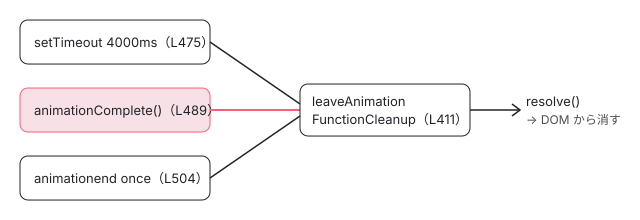

[目次](../README.md) › [アニメーションの内側](README.md) › 第 7 回 / 全 20 回

# 関数で動かす：(animate.enter) と (animate.leave) と animationComplete

> イベントの形で書いた (animate.enter)="fn($event)" が AnimationCallbackEvent（target と animationComplete）を受け取る仕組み、enter では animationComplete が何もしない理由、leave では呼ぶまで要素が消えず、呼び忘れたときに MAX\_ANIMATION\_TIMEOUT（既定 4000 ms）で消える行。クラス名を関数や signal で渡す AnimationClassBindingFn と getClassListFromValue。

angular/angular · 読了 約 12 分 · 中核 · [サイトで読む（デモが動きます）](https://angular-deep-dive-cyan.vercel.app/chapter/animations-functions)

---

クラス名ではなく関数でアニメーションを書きたいときは、イベントの形で `(animate.enter)="fn($event)"` / `(animate.leave)="fn($event)"` と書きます。この章では、その関数が受け取る `AnimationCallbackEvent`（`target` と `animationComplete`）が誰に作られ、**enter では `animationComplete` が何もしない**のに、**leave では呼ぶまで要素が消えない**のはなぜか、呼び忘れたときに `MAX_ANIMATION_TIMEOUT`（既定 4000 ms）で消える行を読みます。クラス名を関数や signal で渡す形（`[animate.enter]="..."`）と `getClassListFromValue` も扱います。

読む対象は `packages/core/src/render3/instructions/animation.ts`（`ɵɵanimateEnterListener`・`runEnterAnimationFunction`・`ɵɵanimateLeaveListener`・`runLeaveAnimationFunction`）、`packages/core/src/animation/interfaces.ts`、`packages/core/src/animation/utils.ts` です。

1. [1. 全体像](01-animations-overview.md)
2. [2. テンプレートから命令へ](02-animations-compile.md)
3. [3. 命令がすること](03-animations-instructions.md)
4. [4. 待ち行列](04-animations-queue.md)
5. [5. enter のクラス](05-animations-enter-classes.md)
6. [6. いちばん長いアニメーション](06-animations-longest.md)
7. **7. 関数で動かす**（この章）
8. [8. 動かないとき](08-animations-disabled.md)
9. [9. 消すのを遅らせる](09-animations-leave-removal.md)
10. [10. leave のクラス](10-animations-leave-classes.md)
11. [11. 入れ子の leave](11-animations-leave-nested.md)
12. [12. 並べ替えと出し直し](12-animations-leave-reorder.md)
13. [13. スタイルの後片付け](13-animations-styles-teardown.md)
14. [14. 旧パッケージの入口](14-animations-legacy-setup.md)
15. [15. 旧 DSL とキーフレーム](15-animations-legacy-dsl.md)
16. [16. TransitionAnimationEngine](16-animations-legacy-engine.md)
17. [17. 2 つが同居するとき](17-animations-legacy-compat.md)
18. [18. 移行](18-animations-migration.md)
19. [19. テスト](19-animations-testing.md)
20. [20. issue と変更を読む](20-animations-issues.md)

コンパイラは `(animate.leave)="fadeFn($event)"` を、ふつうのイベントのリスナーと同じ形の関数にして `ɵɵanimateLeaveListener(function ..._listener($event) { return ctx.fadeFn($event); })` を作ります（[第 2 回](02-animations-compile.md)）。この章で `value` と呼ぶのは、この**コンパイラが作った包みの関数**です。

## 1. 型：AnimationCallbackEvent・MAX\_ANIMATION\_TIMEOUT・AnimationFunction

📄 `angular/packages/core/src/animation/interfaces.ts` L20–59 （▶ の行: 26, 28, 31–35, 40, 43, 46, 56）

```ts
20 │ /**
21 │  * The event type for when `animate.enter` and `animate.leave` are used with function
22 │  * callbacks.
23 │  *
24 │  * @see [Animating your applications with animate.enter and animate.leave](guide/animations)
25 │  *
26 ▶  * @publicApi 20.2
27 │  */
28 ▶ export type AnimationCallbackEvent = {target: Element; animationComplete: VoidFunction};
29 │ 
30 │ /**
31 ▶  * A [DI token](api/core/InjectionToken) that configures the maximum animation timeout
32 ▶  * before element removal. The default value mirrors from Chrome's cross document
33 ▶  * navigation view transition timeout. It's intended to prevent people from accidentally
34 ▶  * forgetting to call the removal function in their callback. Also serves as a delay
35 ▶  * for when stylesheets are pruned.
36 │  *
37 │  * @publicApi 20.2
38 │  * @see [Animating your applications with animate.enter and animate.leave](guide/animations)
39 │  */
40 ▶ export const MAX_ANIMATION_TIMEOUT = new InjectionToken<number>(
41 │   typeof ngDevMode !== 'undefined' && ngDevMode ? 'MaxAnimationTimeout' : '',
42 │   {
43 ▶     factory: () => MAX_ANIMATION_TIMEOUT_DEFAULT,
44 │   },
45 │ );
46 ▶ const MAX_ANIMATION_TIMEOUT_DEFAULT = 4000;
47 │ 
48 │ /**
49 │  * The function type for `animate.enter` and `animate.leave` when they are used with
50 │  * function callbacks.
51 │  *
52 │  * @publicApi 20.2
53 │  *
54 │  * @see [Animating your applications with animate.enter and animate.leave](guide/animations)
55 │  */
56 ▶ export type AnimationFunction = (event: AnimationCallbackEvent) => void;
57 │ 
58 │ export type RunEnterAnimationFn = VoidFunction;
59 │ export type RunLeaveAnimationFn = () => {promise: Promise<void>; resolve: VoidFunction};
```

- 28 行目 `AnimationCallbackEvent` は `{target: Element; animationComplete: VoidFunction}` だけです。`@publicApi 20.2`（26 行目）。
- 40〜46 行目 `MAX_ANIMATION_TIMEOUT` は `InjectionToken<number>` で、43 行目の factory が 46 行目の `4000` を返します。公開 API なので、アプリ（環境インジェクタ）の providers で別の値にできます。
- 31〜35 行目のコメントは、4000 が Chrome のページをまたぐ View Transition の時間切れに合わせた値で、**コールバックの中で消す関数を呼び忘れる事故を防ぐため**だと書いています。「スタイルシートを刈り込むときの遅れにも使う」ともありますが、../angular を grep すると `MAX_ANIMATION_TIMEOUT` を inject しているのは animation.ts の `ɵɵanimateLeaveListener`（3 節の 433 行目）だけでした。
- 56 行目 `AnimationFunction` は `(event: AnimationCallbackEvent) => void`。戻り値は使われません。

## 2. (animate.enter)：関数を 1 回呼ぶだけ

📄 `angular/packages/core/src/render3/instructions/animation.ts` L211–237 （▶ の行: 213–214, 217, 224, 232–233, 236）

```ts
211 │   const tNode = getCurrentTNode()!;
212 │ 
213 ▶   addAnimationToLView(getLViewEnterAnimations(lView), tNode, () =>
214 ▶     runEnterAnimationFunction(lView, tNode, value),
215 │   );
216 │ 
217 ▶   initializeAnimationQueueScheduler(lView[INJECTOR]);
218 │ 
219 │   // We have to queue here due to the animation instruction being invoked after the element
220 │   // instruction. The DOM node has to exist before we can queue an animation. Any node that
221 │   // is not inside of control flow needs to get queued here. For nodes inside of control
222 │   // flow, those are queued in node_manipulation.ts and are deduped by a Set in the animation
223 │   // queue.
224 ▶   queueEnterAnimations(lView[INJECTOR], getLViewEnterAnimations(lView));
225 │ 
226 │   return ɵɵanimateEnterListener;
227 │ }
228 │ 
229 │ /**
230 │  * runs enter animations when a custom function is provided
231 │  */
232 ▶ function runEnterAnimationFunction(lView: LView, tNode: TNode, value: AnimationFunction): void {
233 ▶   const nativeElement = getNativeByTNode(tNode, lView) as HTMLElement;
234 │   ngDevMode && assertElementNodes(nativeElement, 'animate.enter');
235 │ 
236 ▶   value.call(lView[CONTEXT], {target: nativeElement, animationComplete: noOpAnimationComplete});
237 │ }
```

`ɵɵanimateEnterListener` の冒頭（サーバーやアニメーションが無効なときの早い return）は[第 8 回](08-animations-disabled.md)で読みます。そのあとが上の範囲です。

1. **213〜215 行目 あとで呼ぶ関数を LView に登録**

   クラスの `ɵɵanimateEnter` と同じ形で、ただし登録するのは `runEnterAnimationFunction(lView, tNode, value)` です（登録の仕組みは[第 3 回](03-animations-instructions.md)）。クラス版と違い `NgZone` は取りません。リスナーを登録しないからです。
2. **217・224 行目 待ち行列に入れる**

   217 行目で待ち行列のスケジューラを用意し、224 行目で入れます。実際に呼ばれるのは次の描画の後の `afterNextRender` です（[第 4 回](04-animations-queue.md)）。
3. **232〜237 行目 呼ぶだけ**

   233 行目で要素を取り、236 行目で `value.call(lView[CONTEXT], {target: nativeElement, animationComplete: noOpAnimationComplete})`。`noOpAnimationComplete` は utils.ts の `() => {}` です。**enter の `animationComplete` は何もしません。** enter では要素はもう DOM に入っていて、「終わるまで待って何かする」相手がいないからです。クラス版のような start / end のリスナーも、いちばん長いアニメーションの計算もありません。動かすのも終わらせるのも、渡した関数の仕事です。

> [!TIP]
> **新卒エンジニアへ**
>
> 236 行目の `this`（`lView[CONTEXT]`）は、その要素があるビューの「文脈」です。コンポーネントのテンプレートの直下ならコンポーネントのインスタンス、`@if` の中なら埋め込みビューの文脈オブジェクトです。ただし `value` はコンパイラの包みの関数で、中では `this` ではなく `ctx`（`@if` の中なら `ɵɵrestoreView` と `ɵɵnextContext()` で取り直した親の文脈）から `ctx.fn($event)` と呼びます（compiler-cli の ngtsc\_spec.ts:227 の期待値）。だから、あなたのメソッドの中の `this` は、いつもどおりコンポーネントです。デモのログでも確かめられます。

## 3. (animate.leave) の登録：ɵɵanimateLeaveListener

📄 `angular/packages/core/src/render3/instructions/animation.ts` L429–442 （▶ の行: 429–433, 435–436, 439）

```ts
429 ▶   // Capture NgZone and MAX_ANIMATION_TIMEOUT eagerly while the injector is
430 ▶   // still valid. The animation function runs later from the queue, at which
431 ▶   // point the lView injector may have been destroyed.
432 ▶   const ngZone = lView[INJECTOR]!.get(NgZone);
433 ▶   const maxAnimationTimeout = lView[INJECTOR]!.get(MAX_ANIMATION_TIMEOUT);
434 │ 
435 ▶   addAnimationToLView(getLViewLeaveAnimations(lView), tNode, () =>
436 ▶     runLeaveAnimationFunction(lView, tNode, value, ngZone, maxAnimationTimeout),
437 │   );
438 │ 
439 ▶   initializeAnimationQueueScheduler(lView[INJECTOR]);
440 │ 
441 │   return ɵɵanimateLeaveListener; // For chaining
442 │ }
```

1. **429〜433 行目 インジェクタから先に取っておく**

   `NgZone` と `MAX_ANIMATION_TIMEOUT` を、命令が走るこの時点で取ります。429〜431 行目のコメントのとおり、関数が実際に走るのは要素を外すときの待ち行列の中で、そのころには LView のインジェクタが壊れていることがあるからです。433 行目の値が、5 節の時間切れの長さになります。`lView[INJECTOR]` は要素のノードインジェクタではなく、ビューを作ったときに渡されたインジェクタ（渡されなければ親のビューのもの）なので、コンポーネントの `providers` に置いた値はそのテンプレートに届きません（[第 8 回](08-animations-disabled.md)の 2 節）。
2. **435〜437 行目 leave の関数を登録**

   登録するのは `runLeaveAnimationFunction(lView, tNode, value, ngZone, maxAnimationTimeout)`。enter と違い、ここでは待ち行列に入れません。入れるのは要素を DOM から外すときです（[第 9 回](09-animations-leave-removal.md)）。

> [!NOTE]
> **ポイント**
>
> 最新の main（74961c66242）では、433 行目と 435 行目の間に `enableAnimationRuntimeSupport()` と `enableViewDetachAnimationsSupport()` の呼び出しが入っています（259d1b0de08、アニメーションの実行時を tree-shakable にする変更。../angular には入っていない）。animate の命令を使ったときだけ、待ち行列や leave を待つ仕組みがバンドルに入るようにするものです。

## 4. runLeaveAnimationFunction：Promise と resolvers

📄 `angular/packages/core/src/render3/instructions/animation.ts` L444–465 （▶ の行: 453–455, 459, 461, 463–464）

```ts
444 │ /**
445 │  * runs leave animations when a custom function is provided
446 │  */
447 │ function runLeaveAnimationFunction(
448 │   lView: LView,
449 │   tNode: TNode,
450 │   value: AnimationFunction,
451 │   ngZone: NgZone,
452 │   maxAnimationTimeout: number,
453 ▶ ): {promise: Promise<void>; resolve: VoidFunction} {
454 ▶   const {promise, resolve} = promiseWithResolvers<void>();
455 ▶   const nativeElement = getNativeByTNode(tNode, lView) as Element;
456 │ 
457 │   ngDevMode && assertElementNodes(nativeElement, 'animate.leave');
458 │ 
459 ▶   const cleanupFns: VoidFunction[] = [];
460 │   const renderer = lView[RENDERER];
461 ▶   const animationsDisabled = areAnimationsDisabled(lView);
462 │ 
463 ▶   (getLViewLeaveAnimations(lView).get(tNode.index)!.resolvers ??= []).push(resolve);
464 ▶   const resolvers = getLViewLeaveAnimations(lView).get(tNode.index)?.resolvers;
465 │ 
```

1. **453〜454 行目 Promise を作って返す**

   戻り値は `{promise, resolve}`。要素を外す側（`executeLeaveAnimations`、[第 9 回](09-animations-leave-removal.md)）がこの Promise を待ち、resolve されたら要素を DOM から消します。つまり「**resolve を呼ぶこと ＝ 消してよいという合図**」です。
2. **463〜464 行目 resolve を resolvers に積む**

   この TNode の leave の記録の `resolvers` 配列に `resolve` を足し、その配列を `resolvers` として持ちます。片付けの関数（6 節）は、この配列の関数を全部呼びます。
3. **461 行目 無効かどうか**

   `ANIMATIONS_DISABLED` を読みます。true のときの分岐（呼ばずにすぐ片付ける）は[第 8 回](08-animations-disabled.md)で読みます。ここからは false のときです。

## 5. 時間切れ・animationComplete・animationend の 3 つの出口

📄 `angular/packages/core/src/render3/instructions/animation.ts` L474–499 （▶ の行: 475, 477, 484, 487–490, 497）

```ts
474 │   } else {
475 ▶     const timeoutId = setTimeout(
476 │       () =>
477 ▶         leaveAnimationFunctionCleanup(
478 │           lView,
479 │           tNode,
480 │           nativeElement as HTMLElement,
481 │           resolvers,
482 │           cleanupFns,
483 │         ),
484 ▶       maxAnimationTimeout,
485 │     );
486 │ 
487 ▶     const event: AnimationCallbackEvent = {
488 ▶       target: nativeElement,
489 ▶       animationComplete: () => {
490 ▶         leaveAnimationFunctionCleanup(
491 │           lView,
492 │           tNode,
493 │           nativeElement as HTMLElement,
494 │           resolvers,
495 │           cleanupFns,
496 │         );
497 ▶         clearTimeout(timeoutId);
498 │       },
499 │     };
```

📄 `angular/packages/core/src/render3/instructions/animation.ts` L500–526 （▶ の行: 500, 502, 504, 506, 508, 515, 517, 521, 524–525）

```ts
500 ▶     trackLeavingNodes(tNode, nativeElement as HTMLElement);
501 │ 
502 ▶     ngZone.runOutsideAngular(() => {
503 │       cleanupFns.push(
504 ▶         renderer.listen(
505 │           nativeElement,
506 ▶           'animationend',
507 │           () => {
508 ▶             leaveAnimationFunctionCleanup(
509 │               lView,
510 │               tNode,
511 │               nativeElement as HTMLElement,
512 │               resolvers,
513 │               cleanupFns,
514 │             );
515 ▶             clearTimeout(timeoutId);
516 │           },
517 ▶           {once: true},
518 │         ),
519 │       );
520 │     });
521 ▶     value.call(lView[CONTEXT], event);
522 │   }
523 │ 
524 ▶   // Ensure cleanup if the LView is destroyed before the animation runs.
525 ▶   return {promise, resolve};
526 │ }
```

1. **475〜485 行目 出口 1：時間切れ**

   `setTimeout(片付け, maxAnimationTimeout)`。何もしなくても既定で 4000 ms 後に片付け（＝ resolve ＝ 消す）が走ります。
2. **487〜499 行目 出口 2：animationComplete**

   渡す `event` の `animationComplete` は、片付け（490 行目）をしてから時間切れのタイマーを止める（497 行目）関数です。あなたの関数がアニメーションの終わりでこれを呼べば、その時点で消えます。
3. **500 行目 消えかけの要素として覚える**

   `trackLeavingNodes` は、消えかけの間に同じ場所へ新しい要素が入ったときに古い方を消すための記録です（[第 12 回](12-animations-leave-reorder.md)）。
4. **502〜520 行目 出口 3：animationend（1 回だけ）**

   要素に `animationend` のリスナーを `{once: true}`（517 行目）で付け、来たら片付けてタイマーを止めます。あなたの関数が CSS の `@keyframes` を持つクラスを足しただけでも、そのアニメーションの終わりで消えます。クラス版（[第 10 回](10-animations-leave-classes.md)）と違い、発生元の確かめも「いちばん長いか」の確かめもありません。最初に要素へ届いた `animationend` 1 回で片付けます（リスナーは要素に付いているので、子の要素から泡立ってきたものも数えます）。また `transitionend` は聞いていないので、transition で動かすなら `animationComplete` を呼ぶ必要があります。
5. **521 行目 あなたの関数を呼ぶ**

   リスナーとタイマーを用意してから、最後に `value.call(lView[CONTEXT], event)`。`this` の扱いは 2 節の囲みと同じです。

## 6. 片付け：leaveAnimationFunctionCleanup

📄 `angular/packages/core/src/animation/utils.ts` L411–421 （▶ の行: 418–420）

```ts
411 │ export function leaveAnimationFunctionCleanup(
412 │   lView: LView,
413 │   tNode: TNode,
414 │   nativeElement: HTMLElement,
415 │   resolvers: VoidFunction[] | undefined,
416 │   cleanupFns: VoidFunction[],
417 │ ) {
418 ▶   clearLeavingNodes(tNode, nativeElement as HTMLElement);
419 ▶   cleanupAfterLeaveAnimations(resolvers, cleanupFns);
420 ▶   clearLViewNodeAnimationResolvers(lView, tNode);
421 │ }
```

418 行目で消えかけの記録から外し、419 行目の `cleanupAfterLeaveAnimations` で resolvers（4 節の resolve）と cleanupFns（502〜520 行目の animationend のリスナーを外す関数）を全部呼び、420 行目でこの TNode の resolvers を空にします（2 つの関数の中身は[第 10 回](10-animations-leave-classes.md)）。3 つの出口のどれから来ても同じ関数です。2 回目以降に呼ばれても、resolve 済みの Promise の resolve は何もしないので、消すのは 1 回です。



*(animate.leave) の 3 つの出口。どれか 1 つが最初に leaveAnimationFunctionCleanup を呼ぶと resolve され、要素が DOM から消える*

## 7. クラス名を関数や signal で渡す：getClassListFromValue

📄 `angular/packages/core/src/animation/utils.ts` L269–282 （▶ の行: 272–279）

```ts
269 │ /**
270 │  * Gets the list of classes from a passed in value
271 │  */
272 ▶ export function getClassListFromValue(value: string | AnimationClassBindingFn): string[] | null {
273 ▶   const classes = typeof value === 'function' ? value() : value;
274 ▶   let classList: string[] | null = Array.isArray(classes) ? classes : null;
275 ▶   if (typeof classes === 'string') {
276 ▶     classList = classes
277 ▶       .trim()
278 ▶       .split(/\s+/)
279 ▶       .filter((k) => k);
280 │   }
281 │   return classList;
282 │ }
```

クラス版の `animate.enter="a b"` は文字列のまま、`[animate.enter]="expr"` はコンパイラが `function () { return ctx.expr; }` の形に包んで命令に渡します（[第 2 回](02-animations-compile.md)）。その型が `AnimationClassBindingFn`（`() => string | string[] | undefined | null`、interfaces.ts）です。包みの関数が呼ばれるのは、[第 5 回](05-animations-enter-classes.md)で読んだ `runEnterAnimation` の中の `getClassListFromValue(value)` の行、つまり**待ち行列が動いたとき**です。

1. **273 行目**

   関数なら 1 回呼び、そうでなければそのまま使います。
2. **274 行目**

   配列ならそのまま使います（`[animate.enter]="['a', 'b']"`）。
3. **275〜280 行目**

   文字列なら前後の空白を取り、空白で区切って空の要素を捨てます。`" a b "` は `['a', 'b']`。
4. **それ以外**

   273 行目で呼んだ結果がまた関数だったときなどは、274 行目も 275 行目も当たらず `null` になり、アニメーションは何もしません。

最後の場合が問題でした。`[animate.enter]="mySignal"` や `[animate.enter]="myFn"` のように、signal や関数**そのもの**を渡すと、包みの関数を 1 回呼んだ結果が signal（＝関数）になり、黙って何も起きません。最新の main の 9a06a739076（2026-09-17、`fix(core): support function and signal bindings in animate.enter and animate.leave`、`Fixes #70764`）は、273 行目のあとに `while (typeof classes === 'function') { classes = classes(); }` を足して、関数でなくなるまで呼び続けるようにしました。型も `AnimationClassValue`（関数を入れ子にできる型）に変わっています。../angular（8576f161ae4）にも、このサイトの `@angular/core` 22.1.6 にも入っていません（22.1.6 の `getClassListFromValue` は上の 272〜282 行目と同じでした）。下のデモ 2 で確かめられます。

## 8. デモ

> **🧪 DEMO 1 — 本物の (animate.leave) と element.animate()**
>
> 要素には `(animate.enter)="onEnter($event)"` と `(animate.leave)="onLeave($event)"` を付けています。「隠す」を押すと `@if` が false になり、leave の関数が呼ばれます。外枠に MutationObserver を張り、要素が DOM から消えた時刻を記録します（時刻は「隠す」を押したときが 0ms で、それより前の「出す」と enter の行は負の時刻で出ます）。OS の設定で動きを減らしていても、このデモは動きます。
>
> ▶ [このデモはサイトで動かせます](https://angular-deep-dive-cyan.vercel.app/chapter/animations-functions)

2026-11-01 にヘッドレスの Chrome でこのページを開き、3 通りを選んで記録したログで確かめた結果です。

- **呼ぶ**：約 600ms で `element.animate()` が終わり、その場で要素が消えます（出口 2）。
- **呼ばない**：600ms で見た目は消えますが、要素は DOM に残り、**約 4000ms** で消えます（出口 1、475〜485 行目）。`element.animate()`（Web Animations API）は CSS の `animationend` イベントを出さないので、出口 3 も使われません。ログに `animationend` が出ないことで分かります。
- **CSS クラス**：`animationComplete` を呼ばなくても、`afn-out` の `animationend`（約 600ms）で消えます（出口 3、502〜520 行目）。

> **🧪 DEMO 2 — \[animate.enter\] に関数そのものを渡す（このサイトの 22.1.6）**
>
> 左は `[animate.enter]="sigClass()"`（呼んだ結果の文字列）、右は `[animate.enter]="clsFn"`（`clsFn = () => 'afn-sig-in'` という関数そのもの）。どちらも行き着く値は `'afn-sig-in'` です。「出す」を押すと、それぞれにクラスが付いたかを MutationObserver で 1 秒間見ます。
>
> ▶ [このデモはサイトで動かせます](https://angular-deep-dive-cyan.vercel.app/chapter/animations-functions)

22.1.6 では、左にだけクラスが付き、右には付きません（ヘッドレスの Chrome で確かめた）。右の包みの関数は `ctx.clsFn`（関数）を返し、273 行目で 1 回呼んだ結果が関数のままなので、274〜280 行目のどれにも当たらず `null` になるからです。ここに signal そのもの（`[animate.enter]="sigClass"`）を書いても同じで、こちらはビルドで拡張診断 NG8109（`sigClass is a function and should be invoked`）の警告が出ます。ふつうの関数には警告が出ないので、右の書き方はビルドも通り、実行時に黙って何も起きません（このページは警告を出さないよう関数で見せています）。9a06a739076 の while ループがあれば、右の値も 2 回目の呼び出しで文字列になります。main ではその形を `it('should support function expressions, function references, and signals in [animate.enter] and [animate.leave]')` が確かめています（このサイトの版では確かめられません）。

## 9. 呼び出しの連なり（(animate.leave)）

- 👤 `<div (animate.leave)="onLeave($event)">` — あなたのテンプレート
  - `ɵɵanimateLeaveListener(包みの関数)` — animation.ts L411 — *NgZone と MAX\_ANIMATION\_TIMEOUT を取って登録（L432-437）*
  - `（@if が false → 要素を外す → 待ち行列）` — node\_manipulation.ts / node\_animations.ts — *第 9 回*
    - `runLeaveAnimationFunction(...)` — animation.ts L447 — *resolve を resolvers に（L463）*
      - `setTimeout(cleanup, 4000)` — L475
      - `renderer.listen(el, 'animationend', cleanup, {once: true})` — L504
      - 👤 `value.call(lView[CONTEXT], {target, animationComplete})` — L521 — *→ ctx.onLeave($event)*
    - `leaveAnimationFunctionCleanup` — utils.ts L411 — *3 つの出口のどれか*
      - `cleanupAfterLeaveAnimations → resolve()` — utils.ts L419 — *→ 要素を DOM から消す（第 9 回）*

## テストと直し方

📄 `angular/packages/core/test/acceptance/animation_spec.ts` L486–527 （▶ の行: 492, 497, 499–500, 514, 521, 523, 526）

```ts
486 │     it('should be host bindable with events', fakeAsync(() => {
487 │       const fadeCalled = jasmine.createSpy('fadeCalled');
488 │       @Component({
489 │         changeDetection: ChangeDetectionStrategy.Eager,
490 │         selector: 'fade-cmp',
491 │         styles: styles,
492 ▶         host: {'(animate.leave)': 'fadeIn($event)'},
493 │         template: '<p>I should fade</p>',
494 │         encapsulation: ViewEncapsulation.None,
495 │       })
496 │       class FadeComponent {
497 ▶         fadeIn(event: AnimationCallbackEvent) {
498 │           fadeCalled();
499 ▶           event.target.classList.add('fade');
500 ▶           event.animationComplete();
501 │         }
502 │       }
503 │ 
504 │       @Component({
505 │         changeDetection: ChangeDetectionStrategy.Eager,
506 │         selector: 'test-cmp',
507 │         imports: [FadeComponent],
508 │         template: '@if (show()) { <fade-cmp /> }',
509 │         encapsulation: ViewEncapsulation.None,
510 │       })
511 │       class TestComponent {
512 │         show = signal(true);
513 │       }
514 ▶       TestBed.configureTestingModule({animationsEnabled: true});
515 │ 
516 │       const fixture = TestBed.createComponent(TestComponent);
517 │       const cmp = fixture.componentInstance;
518 │       fixture.detectChanges();
519 │ 
520 │       expect(fixture.nativeElement.outerHTML).not.toContain('class="fade"');
521 ▶       cmp.show.set(false);
522 │       fixture.detectChanges();
523 ▶       tickAnimationFrames(1);
524 │       expect(cmp.show()).toBeFalsy();
525 │       fixture.detectChanges();
526 ▶       expect(fadeCalled).toHaveBeenCalled();
527 │     }));
```

`describe('animate.leave')` の `it('should be host bindable with events')`（animation\_spec.ts:486）です。492 行目で host に `(animate.leave)` を付け、499 行目でクラスを足して 500 行目ですぐ `animationComplete()` を呼びます。521〜523 行目で `@if` を false にして 1 フレーム進め、526 行目で関数が呼ばれたことを見ています。

この章の仕組みに当たる it は次のとおりです。

- `it('should support function syntax')`（:372、leave）と（:1176、enter）— 関数でクラスを足す。
- `it('should call animation function on entry when animation is specified with no control flow')`（:1041）と `it('should call animation function only once on entry when animation is specified with control flow')`（:1065）— enter の関数が 1 回だけ呼ばれる。
- `it('should remove element from DOM with (animate.leave) after list reordering')`（:529）— 並べ替えのあとも消える（#67728 を直した dfa149dc68c で足された。[第 12 回](12-animations-leave-reorder.md)）。

📄 `ターミナル`

```
cd ~/angular-research/angular
pnpm bazel test //packages/core/test/acceptance:acceptance_web_chromium --nocache_test_results --test_output=all

# (animate.enter) / (animate.leave) が出てくる行を数える
grep -n "(animate\.\(enter\|leave\))" packages/core/test/acceptance/animation_spec.ts | wc -l
# MAX_ANIMATION_TIMEOUT を使う spec を探す
grep -rn "MAX_ANIMATION_TIMEOUT" packages/core/test/ | wc -l
```

📄 `出力（抜粋。2026-11-01 に実行）`

```
Chromium: |██████████████████████████████| 1/1 test files | 2743 passed, 0 failed, 3 skipped
Finished running tests in 6.3s, all tests passed!
//packages/core/test/acceptance:acceptance_web_chromium                  PASSED in 6.8s

      11
       0
```

1. **走らせ方**

   animation\_spec.ts はブラウザ版の `:acceptance_web_chromium` でだけ走ります（Node 版は `isNode` で 1 本の `should pass` だけ）。spec を絞る指定は無く、2743 passed, 0 failed, 3 skipped、PASSED in 6.8s でした。
2. **テストが無いところ**

   `MAX_ANIMATION_TIMEOUT` を使う spec は packages/core/test の中に 0 件でした。「呼び忘れると 4000 ms で消える」と「providers で変えられる」を確かめる it はありません。確かめる spec を書くなら、acceptance/animation\_spec.ts の `describe('animate.leave')` の中で、`fakeAsync` と `tick(4000)` を使う形が入口になります（同じ describe の it は `fakeAsync` と `tickAnimationFrames` を使っている）。
3. **直すとしたら**

   関数版の enter は `runEnterAnimationFunction`（L232）、leave は `runLeaveAnimationFunction`（L447）と `leaveAnimationFunctionCleanup`（utils.ts L411）、クラス名の取り出しは `getClassListFromValue`（utils.ts L272）です。9a06a739076 は utils.ts と interfaces.ts を直し、acceptance/animation\_spec.ts に it を 2 本足していました（`git -C ../angular-main show --stat 9a06a739076`）。直し方と spec の足し方の手本として読めます。
4. **issue を読むときの手がかり**

   「(animate.leave) で要素が 4 秒残る」は出口 2 も 3 も通らなかった、「すぐ消えてアニメーションが見えない」は子や別のアニメーションの `animationend` が出口 3 を先に通った、のどちらかで多くが説明できます。過去の報告の一覧は[第 20 回](20-animations-issues.md)です。

## 聞かれそうな質問

**Q. (animate.leave) で animationComplete を呼び忘れるとどうなりますか？**

要素の CSS アニメーションの `animationend` が来ればそこで（502〜520 行目）、来なければ `MAX_ANIMATION_TIMEOUT`（既定 4000 ms、interfaces.ts 46 行目）後の setTimeout で（475〜485 行目）消えます。`element.animate()` は `animationend` を出さないので、デモ 1 の「呼ばない」のように約 4 秒残ります。その間、要素は DOM にあり、クリックなども受けます。

**Q. 関数の中の this は何ですか？**

236 行目と 521 行目は `value.call(lView[CONTEXT], event)` なので、包みの関数の `this` はその要素があるビューの文脈です。ただし包みの関数は `this` を使わず `ctx.fn($event)` と呼ぶので、あなたのメソッドの `this` はコンポーネントのインスタンスです（デモ 1 のログで `true`）。

**Q. Web Animations API（element.animate）を使ってよいですか？**

使えます。`event.target.animate(...)` の `finished` を待って `animationComplete()` を呼ぶのが確実です。`element.animate()` は `animationend` を出さないので、呼ばないと出口 3 が使えず、時間切れの 4 秒まで残ります。transition で動かすときも、`transitionend` は聞いていないので同じです。

**Q. (animate.enter) の animationComplete は呼ぶ必要がありますか？**

ありません。236 行目で渡しているのは `noOpAnimationComplete`（何もしない関数）です。enter の要素はもう DOM にあり、待っている相手がいません。leave と同じ書き方にそろえたいなら呼んでも害はありません。

**Q. 4000 ms を短くできますか？**

できます。`MAX_ANIMATION_TIMEOUT` は `@publicApi` の `InjectionToken` で、433 行目で `lView[INJECTOR]` から読むので、`{provide: MAX_ANIMATION_TIMEOUT, useValue: 1000}` を providers に置けば変わります。置く場所に気をつけてください。433 行目が読むのは `lView[INJECTOR]` なので、効くのは `bootstrapApplication` / ルートの providers のような環境インジェクタか、`createComponent` に渡したインジェクタで、コンポーネントの `providers` では効きません（[第 8 回](08-animations-disabled.md)の 2 節と 7 節のデモ）。このサイトでは確かめていませんが、同じ `lView[INJECTOR]` から読む `ANIMATIONS_DISABLED` で確かめた振る舞いと同じ道です。また読むのは関数版の leave（`ɵɵanimateLeaveListener`）だけで、クラス版の leave の保険の時間（いちばん長いアニメーション + 50 ms。[第 10 回](10-animations-leave-classes.md)）には効きません。

## 読み終えて

- `(animate.enter)` は待ち行列から関数を 1 回呼ぶだけ。`animationComplete` は何もしない（L236）。
- `(animate.leave)` は Promise の resolve を resolvers に積み（L463）、resolve されたときに要素が消える。
- 出口は 3 つ：`animationComplete()`（L489）、要素の最初の `animationend`（L504-517）、`MAX_ANIMATION_TIMEOUT` の setTimeout（L475-485、既定 4000 ms）。
- クラス名の関数は待ち行列が動いたときに 1 回だけ呼ばれる（utils.ts L273）。signal そのものを渡すと 22.1.6 では何も起きない。main の 9a06a739076 で直った。

---

← 前: [いちばん長いアニメーション：getAnimations と getComputedStyle](06-animations-longest.md)  
次: [アニメーションが動かないとき：ANIMATIONS\_DISABLED・SSR・getAnimations](08-animations-disabled.md) →
