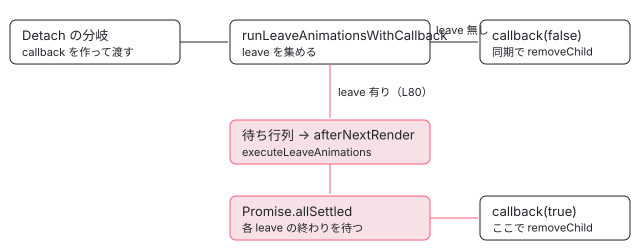

[目次](../README.md) › [アニメーションの内側](README.md) › 第 9 回 / 全 20 回

# 要素を消すのを遅らせる：runLeaveAnimationsWithCallback

> ビューを外すとき node\_manipulation.ts の Detach と Destroy が、すぐ removeChild せずに runLeaveAnimationsWithCallback へ「消す関数」を渡す行。leave アニメーションが無ければその場で消し、あれば待ち行列に executeLeaveAnimations を積み、すべての Promise が終わってから消す流れ。インジェクタが壊れたあとの逃げ道と、enter を取り消す行。

angular/angular · 読了 約 14 分 · 中核 · [サイトで読む（デモが動きます）](https://angular-deep-dive-cyan.vercel.app/chapter/animations-leave-removal)

---

`@if` が `false` になると、ふつうは中の要素がその場で `removeChild` されます。`animate.leave` を付けた要素だけは、アニメーションが終わるまで DOM に残ります。この章では「消すのを遅らせる」仕組みを、**ビューを外す関数が「消す関数」をそのまま渡してしまう**ところから、その関数が最後に呼ばれるところまで、行番号を指して 1 ステップずつ追います。

読む対象は `packages/core/src/render3/node_manipulation.ts`（`applyToElementOrContainer` の Detach と Destroy）と `packages/core/src/render3/node_animations.ts`（`runLeaveAnimationsWithCallback` と `executeLeaveAnimations`）です。

1. [1. 全体像](01-animations-overview.md)
2. [2. テンプレートから命令へ](02-animations-compile.md)
3. [3. 命令がすること](03-animations-instructions.md)
4. [4. 待ち行列](04-animations-queue.md)
5. [5. enter のクラス](05-animations-enter-classes.md)
6. [6. いちばん長いアニメーション](06-animations-longest.md)
7. [7. 関数で動かす](07-animations-functions.md)
8. [8. 動かないとき](08-animations-disabled.md)
9. **9. 消すのを遅らせる**（この章）
10. [10. leave のクラス](10-animations-leave-classes.md)
11. [11. 入れ子の leave](11-animations-leave-nested.md)
12. [12. 並べ替えと出し直し](12-animations-leave-reorder.md)
13. [13. スタイルの後片付け](13-animations-styles-teardown.md)
14. [14. 旧パッケージの入口](14-animations-legacy-setup.md)
15. [15. 旧 DSL とキーフレーム](15-animations-legacy-dsl.md)
16. [16. TransitionAnimationEngine](16-animations-legacy-engine.md)
17. [17. 2 つが同居するとき](17-animations-legacy-compat.md)
18. [18. 移行](18-animations-migration.md)
19. [19. テスト](19-animations-testing.md)
20. [20. issue と変更を読む](20-animations-issues.md)

## 1. @if が false になってから、要素に届くまで

`@if` が `false` になったときの道のりは、ビューの側の話としては [LContainer の章](../ivy/11-ivy-lcontainer.md)と[破棄の章](../ivy/17-ivy-destroy.md)で読みました。この章で必要なのは、その道のりの**最後の 1 段**だけです。並べるとこうなります。

- 👤 `show.set(false)` — あなたのコンポーネント
  - `ɵɵconditional()` — render3/instructions/control\_flow.ts — *前のビューの index を外す*
    - `removeLViewFromLContainer()` — render3/view/container.ts — *detachView のあと destroyLView*
      - `detachView()` → `removeViewFromDOM()` → `detachViewFromDOM()` — container.ts / node\_manipulation.ts
        - `applyView(…, WalkTNodeTreeAction.Detach)` → `applyNodes()` — node\_manipulation.ts — *ビューの根の TNode を 1 つずつ*
          - `applyToElementOrContainer()` の Detach の分岐 — node\_manipulation.ts L156 — *この章はここから*

`applyNodes` は、外すビューの**根の TNode**（ビューのいちばん外側の要素）ごとに `applyToElementOrContainer` を呼びます。そのとき `parentLView` として渡されるのは、外しているビュー自身です（`@if` なら、その中身の埋め込みビュー）。`animate.leave` の命令が登録した関数は、この `parentLView[ANIMATIONS].leave` に入っています（[第 3 回](03-animations-instructions.md)）。

## 2. Detach の分岐：消す関数を渡すだけ

📄 `angular/packages/core/src/render3/node_manipulation.ts` L156–181 （▶ の行: 157–158, 160–161, 165–166, 168, 173, 176, 178–179）

```ts
156 │     } else if (action === WalkTNodeTreeAction.Detach) {
157 ▶       if (parentLView?.[ANIMATIONS]?.leave?.has(tNode.index)) {
158 ▶         trackLeavingNodes(tNode, rNode as HTMLElement, parentLView);
159 │       }
160 ▶       reusedNodes.delete(rNode as HTMLElement);
161 ▶       runLeaveAnimationsWithCallback(
162 │         parentLView,
163 │         tNode,
164 │         injector,
165 ▶         (nodeHasLeaveAnimations: boolean) => {
166 ▶           if (reusedNodes.has(rNode as HTMLElement)) {
167 │             reusedNodes.delete(rNode as HTMLElement);
168 ▶             return;
169 │           }
170 │           // the nodeHasLeaveAnimations indicates to the renderer that the element needs to
171 │           // be removed synchronously and sets the requireSynchronousElementRemoval flag in
172 │           // the renderer.
173 ▶           nativeRemoveNode(renderer, rNode, isComponent, nodeHasLeaveAnimations);
174 │         },
175 │       );
176 ▶     } else if (action === WalkTNodeTreeAction.Destroy) {
177 │       reusedNodes.delete(rNode as HTMLElement);
178 ▶       runLeaveAnimationsWithCallback(parentLView, tNode, injector, () => {
179 ▶         renderer.destroyNode!(rNode);
180 │       });
181 │     }
```
*applyToElementOrContainer の Detach と Destroy（node\_manipulation.ts）*

1. **157〜159 行目：この要素自身に leave があれば「消える途中」として覚える**

   `tNode.index`（テンプレートの中での要素の番号）が leave の Map にあれば、`trackLeavingNodes` で記録します。これは「消える途中の要素をもう一度出したとき」のための記録で、[第 12 回](12-animations-leave-reorder.md)で読みます。160 行目の `reusedNodes.delete` も同じ回の話です。
2. **161〜175 行目：`removeChild` をせず、消す関数を渡す**

   ここに `removeChild` の呼び出しは直接ありません。165〜174 行目の矢印関数（以下「callback」）が、**あとで呼ばれたら消す**関数です。それを 161 行目の `runLeaveAnimationsWithCallback` に渡して、Detach の分岐は終わります。いつ消すかは、受け取った側が決めます。
3. **166〜169 行目：呼ばれたときに「もう再利用された」なら消さない**

   待っているあいだに同じ DOM 要素が別の場所へ入れ直されていたら（並べ替え）、消してはいけません。この判定も第 12 回です。
4. **173 行目：`nativeRemoveNode(renderer, rNode, isComponent, nodeHasLeaveAnimations)`**

   callback は真偽値を 1 つ受け取り、4 つ目の引数としてレンダラーへそのまま渡します。170〜172 行目のコメントの通り、これは「この要素は同期で消してよい」という合図です。ブラウザの既定の `DomRenderer` はこの引数を見ずに消すだけで、見ているのは旧 `@angular/animations` のレンダラーです （`animations/browser/src/render/renderer.ts` の `removeChild` は、これが `true` なら旧エンジンを通さずにすぐ消す）。2 つが同居するときの話は[第 17 回](17-animations-legacy-compat.md)で読みます。
5. **176〜181 行目：Destroy の分岐も同じ形**

   違いは 179 行目で、消す代わりに `renderer.destroyNode` を呼ぶことと、真偽値を受け取らないことです。この分岐を通るのは、`destroyLView` が `renderer.destroyNode` を持つレンダラーのときだけ Destroy で歩くからです（[破棄の章](../ivy/17-ivy-destroy.md)）。ブラウザの既定の `DomRenderer` は `destroyNode = null` なので、`@if` の要素は Detach の分岐だけを通ります。

## 3. runLeaveAnimationsWithCallback：消すか、待ち行列に積むか

📄 `angular/packages/core/src/render3/node_animations.ts` L39–64 （▶ の行: 49–50, 52, 55, 58–59, 63）

```ts
39 │ export function runLeaveAnimationsWithCallback(
40 │   lView: LView | undefined,
41 │   tNode: TNode,
42 │   injector: Injector,
43 │   callback: Function,
44 │ ) {
45 │   // It's possible that the AppRef has been destroyed, which would also destroy
46 │   // the injector tree. If this happens, we will get an error when we try to
47 │   // get the injector, so we catch it here and avoid the error and return
48 │   // safely.
49 ▶   try {
50 ▶     injector.get(INJECTOR);
51 │   } catch {
52 ▶     return callback(false);
53 │   }
54 │ 
55 ▶   const animations = lView?.[ANIMATIONS];
56 │ 
57 │   // regarding the TNode index to see if it is the same element.
58 ▶   if (animations?.enter?.has(tNode.index)) {
59 ▶     removeAnimationsFromQueue(injector, animations.enter.get(tNode.index)!.animateFns);
60 │   }
61 │ 
62 │   // get all nodes in the current view that are descendants of tNode and have leave animations
63 ▶   const nodesWithExitAnimations = aggregateDescendantAnimations(lView, tNode, animations);
64 │ 
```
*前半: 逃げ道、enter の取り消し、子孫の leave 集め（node\_animations.ts）*

1. **49〜53 行目：インジェクタが壊れていたら、すぐ消す**

   45〜48 行目のコメントの通り、`ApplicationRef` が壊されるとインジェクタの木も壊れ、`get` がエラーを投げます。50 行目は値を使わず「`get` できるか」だけを試し、投げたら 52 行目で `callback(false)`、つまり**アニメーションなしでその場で消して**帰ります。アプリを閉じる途中で leave を待っても見る人はいないので、これで困りません。
2. **58〜60 行目：同じ要素の enter がまだ待ち行列にあれば抜く**

   出した直後に消すと、`animate.enter` の関数がまだ待ち行列（[第 4 回](04-animations-queue.md)）に残っています。57 行目のコメントの通り、`tNode.index` で同じ要素かを見て、59 行目の `removeAnimationsFromQueue` で抜きます。これをしないと、消える要素に enter のクラスが付いてしまいます。すでに動き始めた enter を止めるのは別の場所で、[第 10 回](10-animations-leave-classes.md)の `cancelAnimationsIfRunning` です。
3. **63 行目：外す要素とその子孫のうち、leave を持つものを集める**

   `aggregateDescendantAnimations` は、外す要素自身と、**同じビューの中の子孫**で leave を持つものを Map にして返します。中身は[第 11 回](11-animations-leave-nested.md)で読みます。ここでは「外す要素自身に leave があれば、少なくとも 1 件入る」と覚えておけば足ります（114〜116 行目）。

📄 `angular/packages/core/src/render3/node_animations.ts` L65–92 （▶ の行: 65, 69, 73–74, 78, 80, 83, 88, 90）

```ts
65 ▶   if (nodesWithExitAnimations.size === 0) {
66 │     let hasNestedAnimations = false;
67 │     if (lView) {
68 │       const nestedPromises: Promise<unknown>[] = [];
69 ▶       collectNestedViewAnimations(lView, tNode, nestedPromises);
70 │       hasNestedAnimations = nestedPromises.length > 0;
71 │     }
72 │ 
73 ▶     if (!hasNestedAnimations) {
74 ▶       return callback(false);
75 │     }
76 │   }
77 │ 
78 ▶   if (lView) allLeavingAnimations.add(lView[ID]);
79 │ 
80 ▶   addToAnimationQueue(
81 │     injector,
82 │     () =>
83 ▶       executeLeaveAnimations(
84 │         lView,
85 │         tNode,
86 │         animations || undefined,
87 │         nodesWithExitAnimations,
88 ▶         callback,
89 │       ),
90 ▶     animations || undefined,
91 │   );
92 │ }
```
*後半: 何も無ければ callback(false)、あれば待ち行列へ*

1. **65〜76 行目：leave が 1 つも無ければ、その場で消す**

   同じビューの中に何も無ければ、69 行目で入れ子のビュー（`@if` の中の `@if` など）も調べます。それでも無ければ 74 行目の `callback(false)`。Detach の callback（2 節）がすぐ呼ばれ、`nativeRemoveNode` で消えます。**leave の無い要素は、ここで同期のまま消えます。**69 行目の調べ方には注意点があり、第 11 回で読みます。
2. **78 行目：このビューを「leave の途中」の集合に入れる**

   `allLeavingAnimations` はビューの `ID` の集合です。これに入っているあいだは、コンポーネントのスタイル（`<style>`）を外す処理が待ちます（[第 13 回](13-animations-styles-teardown.md)）。この行は issue #64326（leave の途中でスタイルが先に消える）を直したコミット e2281023780 で足されました（当時は node\_manipulation.ts の中）。
3. **80〜91 行目：`executeLeaveAnimations` を待ち行列に積む**

   ここではアニメーションを始めません。83 行目の `executeLeaveAnimations` を包んだ関数を `addToAnimationQueue` に渡すだけです。待ち行列は `afterNextRender` で流れるので（第 4 回）、**変更検知が終わって DOM の更新が済んでから**始まります。88 行目で callback も一緒に持っていきます。90 行目の 3 つ目の引数は、`@for` の並べ替えで「積んだ関数を取り消す」ための記録先です（第 12 回）。

> [!NOTE]
> **ポイント**
>
> ここまでのあいだに `ngOnDestroy` は呼ばれていません。でもこのあと、1 節の trace の `removeLViewFromLContainer` が `detachView` から戻ると、すぐ `destroyLView` を呼びます（[破棄の章](../ivy/17-ivy-destroy.md)）。つまり**ビューは同期で壊れ（`ngOnDestroy` も走る）、DOM 要素だけが leave の終わりまで残ります**。下のデモで順番を確かめられます。

## 4. executeLeaveAnimations：関数を呼んで、Promise をまとめて待つ

📄 `angular/packages/core/src/render3/node_animations.ts` L144–172 （▶ の行: 154, 156, 158, 160–163, 165, 171）

```ts
144 │ function executeLeaveAnimations(
145 │   lView: LView | undefined,
146 │   tNode: TNode,
147 │   animations: AnimationLViewData | undefined,
148 │   nodesWithExitAnimations: Map<number, LeaveNodeAnimations>,
149 │   callback: Function,
150 │ ) {
151 │   // it's possible that in the time between when the leave animation was
152 │   // and the time it was executed, the data structure changed. So we need
153 │   // to be safe here.
154 ▶   const runningAnimations: Promise<unknown>[] = [];
155 │ 
156 ▶   if (animations && animations.leave) {
157 │     for (const [index] of nodesWithExitAnimations) {
158 ▶       if (!animations.leave.has(index)) continue;
159 │ 
160 ▶       const currentAnimationData = animations.leave.get(index)!;
161 ▶       for (const animationFn of currentAnimationData.animateFns) {
162 ▶         const {promise} = animationFn() as ReturnType<RunLeaveAnimationFn>;
163 ▶         runningAnimations.push(promise);
164 │       }
165 ▶       animations.detachedLeaveAnimationFns = undefined;
166 │     }
167 │   }
168 │ 
169 │   // Also add nested view animations
170 │   if (lView) {
171 ▶     collectNestedViewAnimations(lView, tNode, runningAnimations);
172 │   }
```
*待ち行列から呼ばれる側（node\_animations.ts）*

1. **156〜158 行目：積んだときから変わっていないかを確かめ直す**

   151〜153 行目のコメントの通り、積んでから流れるまでのあいだに Map が変わっていることがあります。158 行目で、まだ leave の Map にある要素だけを扱います。
2. **161〜164 行目：登録された leave の関数を呼び、Promise を集める**

   `animateFns` は `animate.leave` の命令が登録した関数の配列です（同じ要素に複数あってもよい）。162 行目で呼ぶと `{promise, resolve}` が返ります。クラスを付ける版（`runLeaveAnimations`）は[第 10 回](10-animations-leave-classes.md)、関数を渡す版は[第 7 回](07-animations-functions.md)です。どちらも「アニメーションが終わったら resolve される Promise」を返します。
3. **165 行目：取り消し用の記録を捨てる**

   もう関数を呼んだので、待ち行列から抜く必要はありません（第 12 回）。
4. **170〜172 行目：入れ子のビューの leave も同じ配列に足す**

   `collectNestedViewAnimations` は第 11 回です。

📄 `angular/packages/core/src/render3/node_animations.ts` L173–193 （▶ の行: 174, 177, 179, 181–182, 184, 186, 189–191）

```ts
173 │ 
174 ▶   if (runningAnimations.length > 0) {
175 │     const currentAnimations = animations || lView?.[ANIMATIONS];
176 │     if (currentAnimations) {
177 ▶       const prevRunning = currentAnimations.running;
178 │       if (prevRunning) {
179 ▶         runningAnimations.push(prevRunning);
180 │       }
181 ▶       currentAnimations.running = Promise.allSettled(runningAnimations);
182 ▶       runAfterLeaveAnimations(lView!, currentAnimations.running, callback);
183 │     } else {
184 ▶       Promise.allSettled(runningAnimations).then(() => {
185 │         if (lView) allLeavingAnimations.delete(lView[ID]);
186 ▶         callback(true);
187 │       });
188 │     }
189 ▶   } else {
190 ▶     if (lView) allLeavingAnimations.delete(lView[ID]);
191 ▶     callback(false);
192 │   }
193 │ }
```
*すべて終わってから callback(true)*

1. **181 行目：`Promise.allSettled` でまとめる**

   `all` ではなく `allSettled` なので、どれかが reject されても、**全部が終わるまで**待ちます。177〜180 行目で、同じビューで前に始まった leave の Promise（`running`）があれば、それも待つ対象に足します。
2. **182 行目：`runAfterLeaveAnimations` に callback を渡す**

   まとめた Promise が終わると、その関数が `running` と `allLeavingAnimations` を片付けてから `callback(true)` を呼びます（第 11 回で引用）。ここで初めて 2 節の callback が動き、173 行目の `nativeRemoveNode` で要素が DOM から外れます。
3. **184〜187 行目・189〜192 行目：残りの 2 つの道**

   ビューに `ANIMATIONS` が無いときは 184 行目でその場で `allSettled` を待って `callback(true)`。流れるころには leave が無くなっていたとき（189 行目）は、集合から外して `callback(false)`、つまりすぐ消します。



*leave の有る要素と無い要素で、DOM から外れるまでの道が分かれる*

## 5. デモ：いつ DOM から外れるか

> **🧪 DEMO — 本物の animate.leave（Angular 22.1.6）**
>
> 下の 2 つの箱は、同じ `@if (show())` の中にある本物の要素です。上の箱だけに `animate.leave="lr-out"`（0.6 秒の `@keyframes`）と、`ngOnDestroy` でログを書く子コンポーネントがあります。「消す」を押すと、そのときだけ `MutationObserver` と `animationstart` / `animationend` のリスナーを付けて、起きた順に時刻（押してからのミリ秒）を並べます。リスナーは capture で付けています。bubbling で付けると、終わりの `animationend` は届きません（第 10 回の 345 行目の `stopPropagation`）。OS の設定で動きを減らしていても、このデモは動きます。
>
> ヘッドレスの Chromium（bazel のテストが使う chrome-headless-shell）でこのページを動かしたときの記録は次の通りでした。+15 ms 子コンポーネントの `ngOnDestroy`、+16 ms「leave なしの箱」が外れた、+33 ms `animationstart`（leave ありの箱）、+632 ms `animationend`、+633 ms「leave ありの箱」が外れた。+15 ms までの間は、zoneless のスケジューラが変更検知を始めるまでの待ちです（[setTimeout と rAF の競走](../zoneless/04-zoneless-raf-race.md)）。「leave なしの箱」は実際には 3 節の 74 行目で `ngOnDestroy` より**前**に外れていますが、`MutationObserver` の記録は microtask で届くので、ログでは後ろに並びます。「leave ありの箱」は、4 節の 182 行目から 2 節の 173 行目へ戻ってきた callback で、`animationend` の直後に外れています。
>
> ▶ [このデモはサイトで動かせます](https://angular-deep-dive-cyan.vercel.app/chapter/animations-leave-removal)

## ここまでの呼び出し

- 👤 `show.set(false)` — あなたのコンポーネント
  - `applyToElementOrContainer(Detach)` — node\_manipulation.ts L156 — *callback を作る（L165-174）*
    - `runLeaveAnimationsWithCallback()` — node\_animations.ts L39
      - `injector.get(INJECTOR)` が投げたら `callback(false)` — L49-53
      - `removeAnimationsFromQueue(enter)` — L58-60
      - `aggregateDescendantAnimations()` — L63 — *0 件で入れ子にも無ければ callback(false)（L74）*
      - `allLeavingAnimations.add(lView[ID])` → `addToAnimationQueue(executeLeaveAnimations)` — L78-91
  - `destroyLView()` — node\_manipulation.ts — *ngOnDestroy。DOM 要素はまだある*
  - `afterNextRender` → 待ち行列が流れる — animation/queue.ts
    - `executeLeaveAnimations()` — node\_animations.ts L144 — *animateFns を呼ぶ（L161-164）*
      - `Promise.allSettled(runningAnimations)` — L181
      - `runAfterLeaveAnimations()` → `callback(true)` — L182
  - `nativeRemoveNode(renderer, rNode, isComponent, true)` — node\_manipulation.ts L173 — *ここで初めて DOM から外れる*

## テストと直し方

この章の仕組みを確かめている spec は `packages/core/test/acceptance/animation_spec.ts` の `describe('animate.leave')`（76 行目）です。いちばん基本の 1 本がこれです。

📄 `angular/packages/core/test/acceptance/animation_spec.ts` L91–130 （▶ の行: 98, 109, 117, 119, 122, 124–125, 128）

```ts
 91 │     it('should delay element removal when an animation is specified', fakeAsync(() => {
 92 │       const logSpy = jasmine.createSpy('logSpy');
 93 │       @Component({
 94 │         changeDetection: ChangeDetectionStrategy.Eager,
 95 │         selector: 'test-cmp',
 96 │         styles: styles,
 97 │         template:
 98 ▶           '<div>@if (show()) {<p animate.leave="fade" (animationend)="logMe($event)">I should fade</p>}</div>',
 99 │         encapsulation: ViewEncapsulation.None,
100 │       })
101 │       class TestComponent {
102 │         show = signal(true);
103 │ 
104 │         logMe(event: AnimationEvent) {
105 │           logSpy();
106 │         }
107 │       }
108 │ 
109 ▶       TestBed.configureTestingModule({animationsEnabled: true});
110 │ 
111 │       const fixture = TestBed.createComponent(TestComponent);
112 │       const cmp = fixture.componentInstance;
113 │       fixture.detectChanges();
114 │       const paragragh = fixture.debugElement.query(By.css('p'));
115 │ 
116 │       expect(fixture.nativeElement.outerHTML).not.toContain('class="fade"');
117 ▶       cmp.show.set(false);
118 │       fixture.detectChanges();
119 ▶       tickAnimationFrames(1);
120 │       expect(cmp.show()).toBeFalsy();
121 │       fixture.detectChanges();
122 ▶       expect(fixture.nativeElement.outerHTML).toContain('class="fade"');
123 │       fixture.detectChanges();
124 ▶       paragragh.nativeElement.dispatchEvent(
125 ▶         new AnimationEvent('animationend', {animationName: 'fade-out'}),
126 │       );
127 │       tick();
128 ▶       expect(fixture.nativeElement.outerHTML).not.toContain('class="fade"');
129 │       expect(logSpy).toHaveBeenCalled();
130 │     }));
```
*it('should delay element removal when an animation is specified')*

117 行目で `false` にし、119 行目の `tickAnimationFrames(1)` で待ち行列（`afterNextRender`）を流すと、122 行目で `class="fade"` が付いて**まだ DOM にある**ことを確かめます。124〜126 行目で `animationend` を手で投げ、127 行目の `tick()` で Promise を流すと、128 行目で消えています。109 行目の `animationsEnabled: true` が無いと、テストでは leave が動きません（[第 8 回](08-animations-disabled.md)）。

49〜53 行目の近くでは、`describe('animation queue timing')`（2310 行目）の `it('should not throw INJECTOR_ALREADY_DESTROYED when lView injector is destroyed before animation queue runs')` が、leave を積んだ**あと**でインジェクタを壊し、待ち行列を流してもエラーにならないことを確かめています。積む時点ではインジェクタは生きているので 49〜53 行目は通り抜け、守られているのは「流れるときに `lView[INJECTOR]` を引かない」こと （`ɵɵanimateLeave` が `NgZone` を先に取っておく行、[第 3 回](03-animations-instructions.md)）です。この describe は[第 19 回](19-animations-testing.md)で読みます。

📄 `ターミナル（../angular で実行）`

```
cd ~/angular-research/angular
# ブラウザ版（中身が走る）
pnpm bazel test //packages/core/test/acceptance:acceptance_web_chromium --nocache_test_results
# Node 版（animation_spec.ts は 50〜53 行目で 1 本だけ）
pnpm bazel test //packages/core/test/acceptance:acceptance --nocache_test_results \
  --test_arg=--filter="animate.leave|animation element duplication"
```

📄 `出力（抜粋。2026-11-01 に実行。ログは scratchpad/anim-logs/c-*.log）`

```
# acceptance_web_chromium
Chromium: |██████████████████████████████| 1/1 test files | 2743 passed, 0 failed, 3 skipped
Finished running tests in 6.3s, all tests passed! 🎉
INFO: Elapsed time: 7.432s, Critical Path: 6.82s
//packages/core/test/acceptance:acceptance_web_chromium                  PASSED in 6.8s

# acceptance（Node、--filter 付き）
Ran 0 of 2693 specs
0 specs, 0 failures
INFO: Elapsed time: 3.792s, Critical Path: 1.52s
//packages/core/test/acceptance:acceptance                               PASSED in 1.3s
```

1. **ブラウザ版だけが本物**

   `animation_spec.ts` は 50〜53 行目で、Node のときは `it('should pass')` を 1 本だけ足して `return` します。だから Node 版の `:acceptance` に `--test_arg=--filter="animate.leave|animation element duplication"` を付けると `Ran 0 of 2693 specs` なのに **PASSED** です。本物はブラウザ版の `:acceptance_web_chromium` で、2743 本が通りました（6.3 秒）。web-test-runner には絞り込みの引数が無いので、いつも全部が走ります。
2. **本数の数え方**

   `describe('animate.leave')` は 76〜993 行目で、その中の `it` は 17 本です（929 行目からの入れ子の describe の 1 本を含む）。数えるコマンドは `awk 'NR>=76 && NR<=994 && /^ *it\(/' packages/core/test/acceptance/animation_spec.ts | wc -l`。1 本だけ見たいときは、自分の作業コピーで `it` を `fit` に変えると jasmine はそれだけを走らせます（このサイトでは ../angular を変えないので、試していません）。
3. **直すとしたら**

   「消すかどうか」「いつ消すか」は `node_animations.ts` の `runLeaveAnimationsWithCallback` と `executeLeaveAnimations`、「何を消すか」は `node_manipulation.ts` の `applyToElementOrContainer` の callback です。spec は `acceptance/animation_spec.ts` の `describe('animate.leave')` に足します。
4. **最新の main との違い**

   最新の main（v22.3.0-next.3）では 2 か所が変わっています。97f8b6af935（#71254）で 50 行目が `injector.get(ANIMATION_QUEUE)` に変わりました。コミットのメッセージは「`ApplicationRef` を壊す途中でアニメーションのある埋め込みビューを壊すと、注入のエラーが出る」で、`INJECTOR` が取れても待ち行列が取れない場合があったことになります。259d1b0de08 では `runLeaveAnimationsWithCallback` が「`animate.*` の命令が 1 度でも動くまでは `callback(false)` を呼ぶだけ」の入口になり、中身は `runLeaveAnimationsWithCallbackImpl` に移りました（アニメーションを使わないアプリから外せるようにするため）。どちらも ../angular（8576f161ae4）とこのサイトの 22.1.6 には入っていません。issue の読み方は[第 20 回](20-animations-issues.md)です。

## 聞かれそうな質問

**Q. ビューの破棄（ngOnDestroy）と DOM から消えるのは、どちらが先ですか？**

leave がある要素なら **`ngOnDestroy` が先**です。Detach の分岐は callback を渡すだけで（node\_manipulation.ts 161 行目）、`runLeaveAnimationsWithCallback` は 80 行目で待ち行列に積んで戻ります。そのあと同期で `destroyLView` が走り、`ngOnDestroy` が呼ばれます。DOM から外れるのは、`afterNextRender` のあと leave の Promise が全部終わって `callback(true)` が呼ばれたとき（182 行目 → 173 行目）です。leave の無い要素は 74 行目の `callback(false)` でその場で外れるので、`ngOnDestroy` より先に DOM から消えます。

**Q. leave の途中で、親のコンポーネントごと消えたらどうなりますか？**

待っている callback は `rNode`（DOM 要素）とレンダラーを閉じ込めているので、親が壊れても leave が終われば 173 行目で外します。親の要素が先に DOM から外れれば、子の要素も木ごと画面から消えます。そのとき終わりのイベントが来なくても、[第 10 回](10-animations-leave-classes.md)の fallback のタイマー（長さ + 50 ms）が resolve するので、Promise が待ちっぱなしにはなりません。親が外れるのを子の leave が待つかどうかは、子がどのビューにいるかで決まります（[第 11 回](11-animations-leave-nested.md)）。アプリごと壊れてインジェクタが使えないときは、49〜53 行目で待たずに消します。

**Q. ルーターで画面を移ったときも leave は走りますか？**

ルートのコンポーネントの**テンプレートの中**の leave は待ちません。issue #67552（\[Canonical\] ルートの移動で animate.leave が走らないようにしたい）は、v21.2 で入った入れ子の leave（ea2016a6dce）が、画面を移るたびに子のアニメーションを全部待たせたことへの声でした。999c14eaab9 で一度戻され、df659b8d0cf で「同じコンポーネントのテンプレートの中だけ」に絞って入れ直されています（BREAKING CHANGE、#67633）。絞っている行は[第 11 回](11-animations-leave-nested.md)の 204〜205 行目です。`integration/animations/e2e/src/animations.e2e-spec.ts` の `it('should immediately remove routed component without waiting for its inner component leave animations')`（95 行目）が、800 ms の子の leave があっても 100 ms 後には消えていることを本物のブラウザで確かめています。ルートのコンポーネントのホスト要素そのものに leave を付けた場合は、このページでは確かめていません。

**Q. Destroy の分岐はいつ通りますか？**

`destroyLView` は、レンダラーに `destroyNode` があるときだけ Destroy で歩きます（[破棄の章](../ivy/17-ivy-destroy.md)）。ブラウザの既定の `DomRenderer` は `destroyNode = null` なので、ふだんは通りません。旧 `@angular/animations` のレンダラーは `destroyNode` を持つので、その場合は 178 行目も通ります。

## 読み終えて

- Detach の分岐は `removeChild` をせず、「消す callback」を `runLeaveAnimationsWithCallback` に渡すだけ（node\_manipulation.ts 161〜175 行目）。
- leave が 1 つも無ければ `callback(false)` で同期のまま消す（74 行目）。あれば `executeLeaveAnimations` を待ち行列に積む（80 行目）。
- 流れたら各 leave の関数を呼び、`Promise.allSettled` で全部を待ってから `callback(true)`（181〜182 行目）。
- ビューは同期で壊れ、`ngOnDestroy` も先に走る。DOM 要素だけが leave の終わりまで残る。
- インジェクタが壊れていたら待たずに消す（49〜53 行目）。出したばかりの要素の enter は待ち行列から抜く（58〜60 行目）。

---

← 前: [アニメーションが動かないとき：ANIMATIONS\_DISABLED・SSR・getAnimations](08-animations-disabled.md)  
次: [animate.leave のクラス：付けて、終わりを待って、消す](10-animations-leave-classes.md) →
