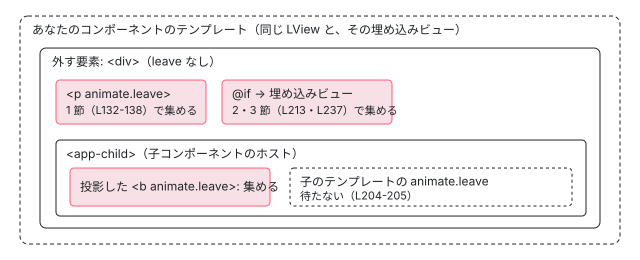

[目次](../README.md) › [アニメーションの内側](README.md) › 第 11 回 / 全 20 回

# 入れ子の leave：子孫と埋め込みビューのアニメーションを集めて待つ

> 外す要素の子孫で leave を持つものを、同じ LView の leave の Map から親をたどって探す aggregateDescendantAnimations、埋め込みビューへ降りて集める collectNestedViewAnimations と collectAllViewLeaveAnimations（子コンポーネントのビューには降りない）、すべてを待ってから消す runAfterLeaveAnimations。入れ子の leave が入って、戻されて、コンポーネントの境目で絞って入れ直された経緯（#67552・#67633）と、集めるだけのつもりで関数を呼んでしまう判定。

angular/angular · 読了 約 14 分 · 発展 · [サイトで読む（デモが動きます）](https://angular-deep-dive-cyan.vercel.app/chapter/animations-leave-nested)

---

`@if` で外すのは、ビューのいちばん外側の要素です。`animate.leave` がその**中**の要素に付いているとき、外側の要素は中の leave が終わるまで待つのか。この章では、待つ相手を集める 3 つの関数 `aggregateDescendantAnimations`・`collectNestedViewAnimations`・`collectAllViewLeaveAnimations` と、待ち終わって片付ける `runAfterLeaveAnimations` を読み、**どこまで降りて、どこで止まるか**を行番号で確かめます。

読む対象は `packages/core/src/render3/node_animations.ts` の 94〜266 行目です。

1. [1. 全体像](01-animations-overview.md)
2. [2. テンプレートから命令へ](02-animations-compile.md)
3. [3. 命令がすること](03-animations-instructions.md)
4. [4. 待ち行列](04-animations-queue.md)
5. [5. enter のクラス](05-animations-enter-classes.md)
6. [6. いちばん長いアニメーション](06-animations-longest.md)
7. [7. 関数で動かす](07-animations-functions.md)
8. [8. 動かないとき](08-animations-disabled.md)
9. [9. 消すのを遅らせる](09-animations-leave-removal.md)
10. [10. leave のクラス](10-animations-leave-classes.md)
11. **11. 入れ子の leave**（この章）
12. [12. 並べ替えと出し直し](12-animations-leave-reorder.md)
13. [13. スタイルの後片付け](13-animations-styles-teardown.md)
14. [14. 旧パッケージの入口](14-animations-legacy-setup.md)
15. [15. 旧 DSL とキーフレーム](15-animations-legacy-dsl.md)
16. [16. TransitionAnimationEngine](16-animations-legacy-engine.md)
17. [17. 2 つが同居するとき](17-animations-legacy-compat.md)
18. [18. 移行](18-animations-migration.md)
19. [19. テスト](19-animations-testing.md)
20. [20. issue と変更を読む](20-animations-issues.md)

> [!NOTE]
> **ポイント**
>
> この振る舞いは一度入って、戻されて、絞って入れ直されたものです。v21.2 で入った入れ子の leave（ea2016a6dce、issue #66476 を閉じたコミット）は、ルートの移動のたびに子のアニメーションを全部待たせたため（issue #67552）、999c14eaab9 で戻されました。その後 df659b8d0cf で「同じコンポーネントのテンプレートの中だけ」に絞って入れ直されました（issue #67633、BREAKING CHANGE「Leave animations are no longer limited to the element being removed.」）。issue #68796（子孫の animate.leave が無視される、2026-05-19）は、担当者のコメントによると「v21 では戻したが v22 で入れ直す。それまでドキュメントが先に進んでいる」というもので、#67526（親が先に消えるのに子の leave が走る）はドキュメントの直し（8c177213337）で閉じています。この章のソース（v22.2.0-next.7）は入れ直したあとの形です。

## 1. 同じビューの子孫を、leave の Map から逆向きに探す

[第 9 回](09-animations-leave-removal.md)の `runLeaveAnimationsWithCallback` は、63 行目でまずこの関数を呼びました。

📄 `angular/packages/core/src/render3/node_animations.ts` L94–117 （▶ の行: 94–95, 99–101, 104–105, 111–112, 114–115）

```ts
 94 ▶ // Identifies all elements that are descendants of `tNode` *within the same component view*
 95 ▶ // (LView) and have active leave animations. Since `tNode` is being removed, its descendants
 96 │ // will also be removed. We must execute their leave animations and wait for them to finish
 97 │ // before physically removing `tNode` from the DOM.
 98 │ //
 99 ▶ // Instead of performing a potentially expensive downward traversal of the
100 ▶ // entire `tNode` subtree to find animated descendants, we iterate over the `leaveAnimations`
101 ▶ // map. This map contains all pending leave animations in the current LView and is typically
102 │ // very small.
103 │ //
104 ▶ // Note: Animations across LView boundaries (e.g., in embedded views)
105 ▶ // are collected separately via `collectNestedViewAnimations`.
106 │ function aggregateDescendantAnimations(
107 │   lView: LView | undefined,
108 │   tNode: TNode,
109 │   animations: AnimationLViewData | null | undefined,
110 │ ): Map<number, LeaveNodeAnimations> {
111 ▶   const nodesWithExitAnimations = new Map<number, LeaveNodeAnimations>();
112 ▶   const leaveAnimations = animations?.leave;
113 │ 
114 ▶   if (leaveAnimations && leaveAnimations.has(tNode.index)) {
115 ▶     nodesWithExitAnimations.set(tNode.index, leaveAnimations.get(tNode.index)!);
116 │   }
117 │ 
```
*aggregateDescendantAnimations の説明と冒頭（node\_animations.ts）*

1. **94〜97 行目：何を探すか**

   外す `tNode` の子孫のうち、**同じコンポーネントのビュー（LView）の中**で leave を持つものです。外す要素が消えれば子孫も一緒に消えるので、その leave を走らせて終わりを待ってから外す、と書いています。
2. **99〜102 行目：下へ辿らない理由**

   子孫を探すなら `tNode` から下へ木を歩くのが素直ですが、それは大きな木だと高くつきます。代わりに、このビューの leave の Map（`animations.leave`）を 1 件ずつ見ます。Map に入っているのは `animate.leave` を書いた要素だけなので、ふつうはとても小さい、というのが 101〜102 行目です。
3. **104〜105 行目：ビューの境目を越えるものは別**

   埋め込みビュー（`@if` の中の `@if` など）に入っている leave は、この関数では見ません。3 節の `collectNestedViewAnimations` が集めます。
4. **114〜116 行目：外す要素自身の leave を先に入れる**

   外す要素に `animate.leave` があれば、ここで 1 件目になります。

📄 `angular/packages/core/src/render3/node_animations.ts` L118–142 （▶ の行: 119–120, 124–125, 132–134, 137, 141）

```ts
118 │   if (lView && leaveAnimations) {
119 ▶     for (const [index, animationData] of leaveAnimations) {
120 ▶       if (nodesWithExitAnimations.has(index)) continue;
121 │ 
122 │       // Get the tNode for the animation. This node might be a descendant of the tNode we are removing.
123 │       // If so, we need to run its leave animation as well.
124 ▶       const nestedTNode = lView[TVIEW].data[index] as TNode;
125 ▶       let parent = nestedTNode.parent;
126 │ 
127 │       // Traverse upward to check if `tNode` is an ancestor of `nestedTNode`
128 │       // For each animation in the map, we retrieve its corresponding TNode (`nestedTNode`) and
129 │       // traverse UP the tree using parent pointers. If we encounter `tNode` during this upward
130 │       // traversal, we know the animated element is a descendant, and we add its animation data
131 │       // to `nodesWithExitAnimations`.
132 ▶       while (parent) {
133 ▶         if (parent === tNode) {
134 ▶           nodesWithExitAnimations.set(index, animationData);
135 │           break;
136 │         }
137 ▶         parent = parent.parent;
138 │       }
139 │     }
140 │   }
141 ▶   return nodesWithExitAnimations;
142 │ }
```
*Map の 1 件ごとに、親をたどって tNode に当たるかを見る*

1. **124 行目：Map のキー（要素の番号）から TNode を引く**

   leave の Map のキーは `tNode.index` です（[第 3 回](03-animations-instructions.md)）。`lView[TVIEW].data[index]` には、その番号の TNode が入っています（[TView の章](../ivy/05-ivy-tview.md)）。
2. **132〜138 行目：親をたどって上へ**

   `nestedTNode.parent` を 1 つずつ上へたどり、途中で外す `tNode` に出会えば子孫なので、134 行目で Map に足します。TNode の `parent` は同じテンプレートの中でしかつながっていないので、ビューの根まで来ると `null` で止まります。
3. **141 行目：集めた Map を返す**

   第 9 回の 65 行目は、これが 0 件かどうかで分かれていました。0 件でなければ待ち行列に積み、流れたとき `executeLeaveAnimations`（第 9 回の 157〜166 行目）が、この Map の要素の leave の関数を呼びます。

> [!TIP]
> **新卒エンジニアへ**
>
> 子コンポーネントに**投影した**要素（`<app-child><b animate.leave="x">…</b></app-child>` の `b`）は、書いたのが親のテンプレートなので、TNode も leave の Map も親のビューにあります。`b` の TNode の `parent` は `app-child` のホストの TNode なので、132〜138 行目で外す要素にたどり着けば集められます。下のデモの A-4 がこの場合です。

## 2. 埋め込みビューへ降りる：collectNestedViewAnimations

📄 `angular/packages/core/src/render3/node_animations.ts` L195–224 （▶ の行: 196, 204–205, 207–210, 212–213, 219, 221–222）

```ts
195 │ /**
196 ▶  * Collects leave animations from nested views (containers only, NOT child components)
197 │  * starting from the given TNode's children.
198 │  */
199 │ function collectNestedViewAnimations(
200 │   lView: LView,
201 │   tNode: TNode,
202 │   collectedPromises: Promise<unknown>[],
203 │ ) {
204 ▶   // We explicitly DO NOT check for isComponentHost(tNode) and traverse into it here.
205 ▶   // This scopes the nested leave animations to the current component template only.
206 │ 
207 ▶   if (tNode.type & TNodeType.AnyContainer) {
208 ▶     const lContainer = lView[tNode.index];
209 ▶     if (isLContainer(lContainer)) {
210 ▶       for (let i = CONTAINER_HEADER_OFFSET; i < lContainer.length; i++) {
211 │         const subView = lContainer[i] as LView;
212 ▶         if (subView[TVIEW].type === TViewType.Embedded) {
213 ▶           collectAllViewLeaveAnimations(subView, collectedPromises);
214 │         }
215 │       }
216 │     }
217 │   }
218 │ 
219 ▶   let child = tNode.child;
220 │   while (child) {
221 ▶     collectNestedViewAnimations(lView, child, collectedPromises);
222 ▶     child = child.next;
223 │   }
224 │ }
```
*containers only, NOT child components*

1. **207〜217 行目：コンテナなら、中のビューを見る**

   `TNodeType.AnyContainer` は `@if` / `@for` / `ng-template` の位置（コンテナ）と `ng-container` です。208 行目の `lView[tNode.index]` が `LContainer`（[LContainer の章](../ivy/11-ivy-lcontainer.md)）なら、210 行目で中のビューを 1 つずつ見て、212 行目で**埋め込みビュー（`TViewType.Embedded`）だけ**を 213 行目の `collectAllViewLeaveAnimations` に渡します。
2. **204〜205 行目：コンポーネントのビューには入らない**

   `isComponentHost(tNode)` を見てコンポーネントの中へ降りることを、**わざと**していません。集める範囲を「いまのコンポーネントのテンプレート」に限るためです。子コンポーネントのテンプレートに書いた `animate.leave` は待ちません（デモの A-3 の中）。これが issue #67552 への答えで、ルートの移動で子のアニメーションを待たなくなった理由です。
3. **219〜223 行目：子の TNode へ、同じことを繰り返す**

   `tNode.child` から `next` で兄弟をたどり、それぞれに 207 行目からを繰り返します。こちらは「同じテンプレートの TNode の木」を下へ歩くので、1 節が避けた下向きの探索ですが、見るのはコンテナだけです。

## 3. 埋め込みビューの leave を全部呼ぶ：collectAllViewLeaveAnimations

📄 `angular/packages/core/src/render3/node_animations.ts` L226–248 （▶ の行: 232–235, 237–238, 243, 245）

```ts
226 │ /**
227 │  * Recursively collects all leave animations from a view and its children.
228 │  * This is meant to only be called on embedded views stemming from the same
229 │  * component template.
230 │  */
231 │ function collectAllViewLeaveAnimations(view: LView, collectedPromises: Promise<unknown>[]) {
232 ▶   const animations = view[ANIMATIONS];
233 ▶   if (animations && animations.leave) {
234 ▶     for (const animationData of animations.leave.values()) {
235 ▶       for (const animationFn of animationData.animateFns) {
236 │         // We interpret the animation function to get the promise
237 ▶         const {promise} = animationFn() as ReturnType<RunLeaveAnimationFn>;
238 ▶         collectedPromises.push(promise);
239 │       }
240 │     }
241 │   }
242 │ 
243 ▶   let child = view[TVIEW].firstChild;
244 │   while (child) {
245 ▶     collectNestedViewAnimations(view, child, collectedPromises);
246 │     child = child.next;
247 │   }
248 │ }
```
*中のビューは丸ごと消えるので、子孫かどうかを調べずに全部*

1. **234〜240 行目：Map の全部の関数を呼んで Promise を集める**

   中の埋め込みビューは、外す要素と一緒に丸ごと消えます。だから 1 節のように子孫かどうかを調べず、Map の全部の leave の関数を呼びます。237 行目で**関数を呼んでいる**ことに注意してください。呼ぶと [第 10 回](10-animations-leave-classes.md)の `runLeaveAnimations` が動き、クラスが付いてアニメーションが始まります。
2. **243〜247 行目：さらに中のコンテナへ**

   そのビューの根の TNode から、2 節の関数へ戻ります。入れ子が何段でも、コンテナと埋め込みビューを交互にたどって降ります。

> [!WARNING]
> **ハマりどころ**
>
> 第 9 回の 65〜76 行目は、同じビューの子孫に leave が 0 件のとき、69 行目で `collectNestedViewAnimations(lView, tNode, nestedPromises)` を呼び、`nestedPromises.length > 0` かどうかだけを使います。でも 237 行目のとおり、集めるときに関数を**呼んで**しまうので、入れ子のビューの leave は、**変更検知の途中で（待ち行列を通らずに）1 回目が始まり**、待ち行列が流れたとき `executeLeaveAnimations` の 171 行目でもう 1 回呼ばれます。最新の main の 7e678e0ed72 では、この判定が「関数を呼ばずに Map の有無だけを見る」`hasNestedViewAnimations` に置き換わっています。下のデモの B で、1 回目がいつ始まるかを見られます。

## 4. 待ち終わったら：runAfterLeaveAnimations

📄 `angular/packages/core/src/render3/node_animations.ts` L250–266 （▶ の行: 255, 260–262, 264）

```ts
250 │ function runAfterLeaveAnimations(
251 │   lView: LView,
252 │   runningAnimations: Promise<unknown>,
253 │   callback: Function,
254 │ ) {
255 ▶   runningAnimations.then(() => {
256 │     // We only want to clear the running flag and the allLeavingAnimations set if
257 │     // the current running animation is the same as the one we just waited for.
258 │     // If it's different, it means another animation started while we were waiting,
259 │     // and that other animation is now responsible for clearing the flag.
260 ▶     if (lView[ANIMATIONS]?.running === runningAnimations) {
261 ▶       lView[ANIMATIONS]!.running = undefined;
262 ▶       allLeavingAnimations.delete(lView[ID]);
263 │     }
264 ▶     callback(true);
265 │   });
266 │ }
```
*running が自分のときだけ片付ける*

第 9 回の 181〜182 行目で、集めた Promise をまとめた `Promise.allSettled` を `running` に入れてから、ここへ渡しました。255 行目で終わりを待ち、260 行目で `running` が**まだ自分のとき**だけ、261〜262 行目で `running` と `allLeavingAnimations` を片付けます。256〜259 行目のコメントの通り、待っているあいだに同じビューで別の leave が始まっていれば、そちらの `running` が新しいので、片付けはそちらに任せます（第 9 回の 177〜180 行目で、新しいほうは古い Promise も待つ対象に入れている）。どちらの場合も、264 行目の `callback(true)` は必ず呼ばれ、外す要素が DOM から外れます。



*外側の div を外すとき、どの leave が待たれるか*

## 5. デモ：親を消したとき、誰を待つか

> **🧪 DEMO — 本物の animate.leave（Angular 22.1.6）**
>
> A と B は、それぞれ外側に leave の無い `div` を持つ `@if` です。A の中には、A-1 同じテンプレートの子孫（0.5 秒）、A-2 入れ子の `@if` の中（0.9 秒）、A-3 子コンポーネント（そのテンプレートに 0.9 秒の leave）、A-4 子コンポーネントへ投影した要素（0.7 秒）があります。B の中には、入れ子の `@if` の中の B-1（0.6 秒）だけがあります。消すボタンは `show.set(false)` のあと `ChangeDetectorRef.detectChanges()` で変更検知を同期で走らせ、その直後に各要素の leave のクラスを読みます （`detectChanges` は `afterNextRender` を流さないので、ここでクラスが付いていれば待ち行列を通っていない）。OS の設定で動きを減らしていても、このデモは動きます。
>
> ヘッドレスの Chromium（chrome-headless-shell）で動かした記録です。**A を消す**: `detectChanges` の直後はどの要素にも leave のクラスが無く（同じビューに A-1 があるので第 9 回の 65 行目の分岐に入らない）、+30 ms に A-1・A-4・A-2 の `animationstart`、+530 ms A-1、+730 ms A-4、+930 ms A-2 の `animationend`、そして +930 ms に外側の div が外れました。A-3 の中（子コンポーネントのテンプレート）の span には `animationstart` が来ず、待たれていません。外側の div は、いちばん長い A-2 に合わせて外れています。**B を消す**: `detectChanges` の直後（+0 ms）に B-1 にはもう `ln-mid2` が付いていました。待ち行列（`afterNextRender`）を通る前に、第 9 回の 69 行目 → 237 行目で関数が呼ばれた跡です。+33 ms `animationstart`、+616 ms `animationend` と同時に外側の div が外れました。
>
> ▶ [このデモはサイトで動かせます](https://angular-deep-dive-cyan.vercel.app/chapter/animations-leave-nested)

## ここまでの呼び出し

- `runLeaveAnimationsWithCallback(lView, tNode, …)` — node\_animations.ts L39 — *第 9 回*
  - `aggregateDescendantAnimations()` — L106 — *同じ LView の leave の Map を上向きに照合*
  - `collectNestedViewAnimations(lView, tNode, nestedPromises)` — L69 — *0 件のときだけ。関数を呼んでしまう*
  - `addToAnimationQueue(executeLeaveAnimations)` — L80
- `executeLeaveAnimations()` — L144 — *afterNextRender のあと*
  - Map の要素の `animateFns` を呼ぶ — L161-164
  - `collectNestedViewAnimations()` — L171 → L199
    - `collectAllViewLeaveAnimations(subView)` — L213 → L231 — *Embedded だけ。コンポーネントのビューには入らない*
      - `animationFn()` — L237
  - `Promise.allSettled` → `runAfterLeaveAnimations()` — L181-182 → L250
    - `callback(true)` — L264 — *外す要素が DOM から外れる*

## テストと直し方

acceptance の `animation_spec.ts` で「コンポーネントの境目で止まる」ことを見ているのは、`describe('animation queue timing')` の `it('should not wait for child component leave animations when host is inside an ng-container')`（2476 行目、df659b8d0cf で追加）です。`ng-container`（2 節の 207 行目の `AnyContainer` に当たる）の中の `@if` にある子コンポーネントの、5 秒の leave を待たないことを確かめます。この describe は[第 19 回](19-animations-testing.md)で読むので、ここでは同じコミットが足した **本物のブラウザの e2e** を読みます。

📄 `angular/integration/animations/src/app/nested.component.ts` L17–31 （▶ の行: 22–24, 27–28）

```ts
17 │ @Component({
18 │   selector: 'app-nested',
19 │   imports: [NestedChildComponent],
20 │   template: `
21 │     <h2>Nested Animations</h2>
22 ▶     @if (show()) {
23 ▶       <div class="nested-parent">
24 ▶         <app-nested-child></app-nested-child>
25 │       </div>
26 │     }
27 ▶     <ng-container>
28 ▶       <app-nested-child></app-nested-child>
29 │     </ng-container>
30 │     <button id="toggle-nested" (click)="show.set(!show())">Toggle</button>
31 │   `,
```
*integration/animations の NestedComponent（子の app-nested-child のテンプレートに 800 ms の animate.leave）*

📄 `angular/integration/animations/e2e/src/animations.e2e-spec.ts` L95–116 （▶ の行: 97, 101, 104, 109, 111, 113）

```ts
 95 │   it('should immediately remove routed component without waiting for its inner component leave animations', async () => {
 96 │     // Navigate to the nested route
 97 ▶     await page.click('#nested-link');
 98 │     await page.waitForSelector('.nested-parent');
 99 │ 
100 │     let childEls = await page.$$('.child-target');
101 ▶     expect(childEls.length).toBe(2);
102 │ 
103 │     // Trigger a route navigation back to home
104 ▶     await page.click('#home-link');
105 │ 
106 │     // Given the child animation is 800ms long, if we don't wait for it across component boundaries,
107 │     // the previous component should be destroyed almost immediately.
108 │     // Wait just a short amount (100ms) and verify the nested component and its children are completely gone.
109 ▶     await new Promise((res) => setTimeout(res, 100));
110 │ 
111 ▶     childEls = await page.$$('.child-target');
112 │     expect(childEls.length).toBe(
113 ▶       0,
114 │       'Nested child component should have been removed immediately during routing',
115 │     );
116 │   });
```
*ルートを移ったら、子のコンポーネントの leave を待たずに消える*

97 行目で `NestedComponent` のルートへ移り、101 行目で `.child-target`（子コンポーネントのテンプレートの、800 ms の leave を持つ要素）が 2 つあることを見ます。104 行目でホームへ戻り、109 行目で 100 ms だけ待って、111〜115 行目で 0 個になっていることを確かめます。子の leave は子コンポーネントのテンプレートの中なので、2 節の 204〜205 行目で降りず、待たれません。この e2e は `integration/` の puppeteer のテストで、bazel のブラウザ版の acceptance とは別に走ります（このページでは走らせていません）。

1. **走らせ方と結果**

   2476 行目の it はブラウザ版の `//packages/core/test/acceptance:acceptance_web_chromium` で走ります。2026-11-01 に `--nocache_test_results` で走らせ、2743 passed, 0 failed, 3 skipped（6.3 秒）でした。`describe('animation queue timing')`（2310〜2528 行目）の it は 3 本です（`awk 'NR>=2310 && NR<=2529 && /^ *it\(/' packages/core/test/acceptance/animation_spec.ts | wc -l`）。
2. **無い it**

   acceptance の `animation_spec.ts` を `nested`・`descendant` で grep しても、「同じテンプレートの子孫（1 節）や入れ子の `@if`（2・3 節）の leave を待つ」ことを確かめる it は見つかりません。df659b8d0cf が足した e2e（上の 95 行目の it）が見ているのも「待たない」側だけです。ea2016a6dce のときにあった `acceptance/nested_animation_spec.ts`（366 行）は、999c14eaab9 で消えたまま戻っていません。3 節の注意の「2 回呼ばれる」ことも、確かめている it はありません。
3. **直すとしたら**

   集める範囲は `node_animations.ts` の `aggregateDescendantAnimations` と `collectNestedViewAnimations`、呼び方は `runLeaveAnimationsWithCallback` の 65〜76 行目です。最新の main ではその 65〜76 行目が 7e678e0ed72 で直っているので、まずそのコミットの diff と、足された spec（`animation_spec.ts` に 189 行）を読むのが入口です。spec を足すなら `acceptance/animation_spec.ts` の `describe('animate.leave')` です。

## 聞かれそうな質問

**Q. 親と子のどちらの leave が先に始まりますか？**

外す要素とその子孫（同じビュー）の leave は、1 つの `executeLeaveAnimations` の中で、161〜164 行目（Map の要素）→ 171 行目（入れ子のビュー）の順に、同じフレームのうちに呼ばれます。つまり「親が終わってから子」のような順番はなく、ほぼ同時に始まります。例外は第 9 回の 69 行目を通る場合で、そのときは入れ子のビューの leave が変更検知の途中で先に始まります（3 節の注意）。

**Q. 子のアニメーションのほうが長いとどうなりますか？**

外す要素は、集めた Promise を全部まとめた `Promise.allSettled`（第 9 回の 181 行目）が終わるまで残ります。だから**いちばん長いものに合わせて**外れます。短い leave の要素は自分のアニメーションが終わっても、外側の要素ごと DOM に残ったままです（`forwards` を付けないと、終わった時点で元の見た目に戻って見えます）。

**Q. ng-content で投影された子はどうなりますか？**

投影した要素は、書いた側（親）のテンプレートの TNode なので、親のビューの leave の Map に入ります。外す要素の子孫としてたどれれば、1 節の 132〜138 行目で集められて待たれます。一方、子コンポーネントが自分のテンプレートに書いた leave は、204〜205 行目で降りないので待たれません。投影の受け手（`<ng-content>` の側）ではなく、**書いた場所**で決まります。

**Q. 動的に作ったコンポーネント（ViewContainerRef.createComponent）の中は？**

コンテナの中にあっても、212 行目で `TViewType.Embedded` のビューだけを見るので、`createComponent` で入れたコンポーネントのビューには降りません。

## 読み終えて

- 同じビューの子孫は、leave の Map の各要素から `parent` を上へたどって見つける（132〜138 行目）。下へは歩かない。
- 入れ子の埋め込みビュー（`@if` / `@for` の中）は、コンテナから降りて Map の全部の関数を呼ぶ（207〜217・234〜240 行目）。
- 子コンポーネントのテンプレートには降りない（204〜205 行目）。投影した要素は書いた側のビューなので待たれる。
- すべてを `allSettled` で待ち、`running` が自分のときだけ片付けて `callback(true)`（255〜264 行目）。
- 子孫が 0 件のときの判定（第 9 回の 69 行目）は関数を呼んでしまう。最新の main は 7e678e0ed72 で呼ばない判定に変えた。

---

← 前: [animate.leave のクラス：付けて、終わりを待って、消す](10-animations-leave-classes.md)  
次: [並べ替えと出し直し：leave の途中で戻ってきた要素](12-animations-leave-reorder.md) →
