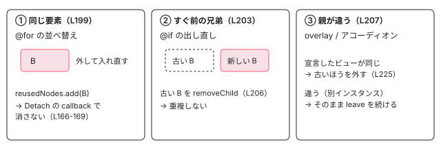

[目次](../README.md) › [アニメーションの内側](README.md) › 第 12 回 / 全 20 回

# 並べ替えと出し直し：leave の途中で戻ってきた要素

> @for の並べ替えでビューを外してすぐ入れ直すとき、leavingNodes・cancelLeavingNodes・reusedNodes が「消える途中の要素」を取り消したり重複を消したりする仕組み、control\_flow.ts の clearDetachAnimationList と detachedLeaveAnimationFns で待ち行列から関数を抜く行。acceptance の「animation element duplication」の spec。

angular/angular · 読了 約 14 分 · 発展 · [サイトで読む（デモが動きます）](https://angular-deep-dive-cyan.vercel.app/chapter/animations-leave-reorder)

---

leave の途中の要素は、DOM に残っています。そこへ同じ要素がもう一度来たら、どうなるか。`@if` をすばやく切り替える、`@for` で消してすぐ戻す、並べ替える。どれも「消える途中の要素」と「入ってくる要素」が同時に DOM にあり得ます。この章では、重複を消したり leave を取り消したりする `leavingNodes`・`cancelLeavingNodes`・`reusedNodes` と、`@for` が待ち行列から関数を抜く `clearDetachAnimationList` を、行番号で 1 つずつ読みます。

読む対象は `packages/core/src/animation/utils.ts` の 115〜251 行目と、`packages/core/src/render3/instructions/control_flow.ts` の `LiveCollectionLContainerImpl` と 603〜637 行目です。

1. [1. 全体像](01-animations-overview.md)
2. [2. テンプレートから命令へ](02-animations-compile.md)
3. [3. 命令がすること](03-animations-instructions.md)
4. [4. 待ち行列](04-animations-queue.md)
5. [5. enter のクラス](05-animations-enter-classes.md)
6. [6. いちばん長いアニメーション](06-animations-longest.md)
7. [7. 関数で動かす](07-animations-functions.md)
8. [8. 動かないとき](08-animations-disabled.md)
9. [9. 消すのを遅らせる](09-animations-leave-removal.md)
10. [10. leave のクラス](10-animations-leave-classes.md)
11. [11. 入れ子の leave](11-animations-leave-nested.md)
12. **12. 並べ替えと出し直し**（この章）
13. [13. スタイルの後片付け](13-animations-styles-teardown.md)
14. [14. 旧パッケージの入口](14-animations-legacy-setup.md)
15. [15. 旧 DSL とキーフレーム](15-animations-legacy-dsl.md)
16. [16. TransitionAnimationEngine](16-animations-legacy-engine.md)
17. [17. 2 つが同居するとき](17-animations-legacy-compat.md)
18. [18. 移行](18-animations-migration.md)
19. [19. テスト](19-animations-testing.md)
20. [20. issue と変更を読む](20-animations-issues.md)

## 1. 3 つの入れ物

📄 `angular/packages/core/src/animation/utils.ts` L115–150 （▶ の行: 121–122, 127, 133, 142, 144, 149）

```ts
115 │ /**
116 │  * A node that is currently animating away, tracked alongside the view that
117 │  * declares its template. The declaration view lets us tell apart two distinct
118 │  * instances of the same template (which share a `TNode`) from the same logical
119 │  * view being re-rendered.
120 │  */
121 ▶ interface LeavingNode {
122 ▶   el: HTMLElement;
123 │   // The view that declares the template the leaving element belongs to. For two
124 │   // separate component instances of the same template this differs; for the same
125 │   // logical view re-rendered (e.g. a dynamic component repeatedly created from the
126 │   // same `ViewContainerRef`) it is identical. `null` when no owning view is known.
127 ▶   declarationView: LView | null;
128 │ }
129 │ 
130 │ // Tracks nodes that are animating away for the duration of the animation. This is
131 │ // used to prevent duplicate nodes from showing up when nodes have been toggled quickly
132 │ // from an `@if` or `@for`.
133 ▶ export const leavingNodes = new WeakMap<TNode, LeavingNode[]>();
134 │ 
135 │ /**
136 │  * Resolves the view that declares the template a node belongs to. We use the
137 │  * declaration view (rather than the rendered `LView` itself, which is a fresh
138 │  * object on every re-render) so that the same logical insertion point compares
139 │  * equal across re-renders, while distinct instances of a shared template compare
140 │  * unequal.
141 │  */
142 ▶ function getDeclarationView(lView: LView | undefined): LView | null {
143 │   if (!lView) return null;
144 ▶   return lView[DECLARATION_VIEW] ?? lView;
145 │ }
146 │ 
147 │ // Tracks nodes that have scheduled leave animations but were re-inserted into the DOM
148 │ // before the animation completed, thus rescuing them from being physically removed.
149 ▶ export const reusedNodes = new WeakSet<HTMLElement>();
150 │ 
```
*leavingNodes・getDeclarationView・reusedNodes（utils.ts）*

1. **133 行目：`leavingNodes` は TNode ごとの「消える途中の要素」の一覧**

   キーが `TNode` なのが要点です。`@for` の 1 項目ぶんのテンプレートは TNode を 1 組しか持たず、項目がいくつあっても**全部のビューが同じ TNode を共有**します （[TNode の章](../ivy/04-ivy-tnode.md)）。だから「同じ TNode の要素がいま消えかけている」は「同じテンプレートの、別の（または同じ）インスタンスが消えかけている」という意味です。130〜132 行目のコメントの通り、`@if` や `@for` をすばやく切り替えたときの重複を防ぐためのものです。
2. **121〜128 行目・142〜145 行目：要素と一緒に「宣言したビュー」を覚える**

   `declarationView` は、そのテンプレートを**書いた**側のビュー（`lView[DECLARATION_VIEW]`）です。同じコンポーネントの 2 つのインスタンス（アコーディオンの 2 枚のパネルなど）は TNode を共有しても宣言したビューが違い、同じ場所で作り直されたビューは宣言したビューが同じです。この区別は 3 節の 218〜221 行目で使います。6b5616b2c77（issue #69291）で足されました。
3. **149 行目：`reusedNodes` は「leave を予約したが、入れ直されたので消してはいけない要素」**

   147〜148 行目のコメントの通りです。[第 9 回](09-animations-leave-removal.md)の Detach の callback（node\_manipulation.ts 166〜169 行目）が、これに入っている要素を消さずに帰ります。

## 2. 記録するところ、消すところ

📄 `angular/packages/core/src/animation/utils.ts` L231–251 （▶ の行: 242–243, 245–246, 249）

```ts
231 │ /**
232 │  * Tracks the nodes list of nodes that are leaving the DOM so we can cancel any leave animations
233 │  * and remove the node before adding a new entering instance of the DOM node. This prevents
234 │  * duplicates from showing up on screen mid-animation.
235 │  */
236 │ export function trackLeavingNodes(tNode: TNode, el: HTMLElement, lView?: LView): void {
237 │   // We need to track this tNode's element just to be sure we don't add
238 │   // a new RNode for this TNode while this one is still animating away.
239 │   // once the animation is complete, we remove this reference.
240 │   // The declaration view is recorded so `cancelLeavingNodes` can tell apart two
241 │   // separate instances of the same template from the same view re-rendered.
242 ▶   const declarationView = getDeclarationView(lView);
243 ▶   const nodes = leavingNodes.get(tNode);
244 │   if (nodes) {
245 ▶     if (!nodes.some((node) => node.el === el)) {
246 ▶       nodes.push({el, declarationView});
247 │     }
248 │   } else {
249 ▶     leavingNodes.set(tNode, [{el, declarationView}]);
250 │   }
251 │ }
```
*trackLeavingNodes（utils.ts）*

呼ぶのは 3 か所です。第 9 回の Detach の分岐（node\_manipulation.ts 157〜159 行目、要素自身に leave があるときだけ、`parentLView` 付き）と、[第 10 回](10-animations-leave-classes.md)の `animateLeaveClassRunner`（animation.ts 366 行目）、[第 7 回](07-animations-functions.md)の関数版（animation.ts 500 行目）で、後の 2 つは `lView` を渡しません。245 行目で同じ要素を 2 回入れないので、先に呼ばれる Detach の分岐の記録（宣言したビュー付き）が残ります。Detach の分岐を通らずにクラスの leave だけが走る要素（第 11 回の入れ子の要素）は、`declarationView` が `null` で記録されます。

📄 `angular/packages/core/src/animation/utils.ts` L151–163 （▶ の行: 155, 157–158, 160–161）

```ts
151 │ /**
152 │  * This actually removes the leaving HTML Element in the TNode
153 │  */
154 │ export function clearLeavingNodes(tNode: TNode, el: HTMLElement): void {
155 ▶   const nodes = leavingNodes.get(tNode);
156 │   if (nodes && nodes.length > 0) {
157 ▶     const ix = nodes.findIndex((node) => node.el === el);
158 ▶     if (ix > -1) nodes.splice(ix, 1);
159 │   }
160 ▶   if (nodes?.length === 0) {
161 ▶     leavingNodes.delete(tNode);
162 │   }
163 │ }
```
*clearLeavingNodes（utils.ts）*

leave が終わったとき（animation.ts 347・385 行目）に一覧から外し、空になれば 161 行目で TNode ごと消します。154 行目の上のコメントは「This actually removes the leaving HTML Element」ですが、DOM から外すのではなく**一覧から外す**だけです。

## 3. cancelLeavingNodes：入ってくる要素から、消える途中の要素を見る

呼ぶのは node\_manipulation.ts の Insert の分岐（155 行目、[第 4 回](04-animations-queue.md)で読んだ 152〜155 行目）だけです。`@if` が true に戻ったときも、`@for` に項目が増えたり動いたりしたときも、ビューは `addViewToDOM` → `applyView(Insert)` で入るので、ここを通ります。呼ばれるのは `nativeInsertBefore` で**入れたあと**なので、新しい要素の `parentNode` と `previousSibling` が分かっています。

📄 `angular/packages/core/src/animation/utils.ts` L165–206 （▶ の行: 181–182, 184–186, 188, 193–194, 199–206）

```ts
165 │ /**
166 │  * In the case that we have an existing node that's animating away in a
167 │  * different DOM parent (e.g. a CDK overlay menu that renders each instance
168 │  * in its own overlay pane), we need to end the animation for the former
169 │  * node and remove it right away to prevent duplicate nodes showing up.
170 │  *
171 │  * Leaving elements in the same parent are left alone — their leave
172 │  * animation will complete naturally and remove them from the DOM.
173 │  *
174 │  * @param tNode The `TNode` of the entering element.
175 │  * @param newElement The element being inserted.
176 │  * @param newLView The view the entering element is being rendered into. Used to
177 │  *   tell apart two separate instances of the same template (which share a
178 │  *   `TNode`) from the same logical view being re-rendered into a new DOM parent.
179 │  */
180 │ export function cancelLeavingNodes(tNode: TNode, newElement: HTMLElement, newLView?: LView): void {
181 ▶   const nodes = leavingNodes.get(tNode);
182 ▶   if (!nodes || nodes.length === 0) return;
183 │ 
184 ▶   const newParent = newElement.parentNode;
185 ▶   const prevSibling = newElement.previousSibling;
186 ▶   const newDeclarationView = getDeclarationView(newLView);
187 │ 
188 ▶   for (let i = nodes.length - 1; i >= 0; i--) {
189 │     const {el: leavingEl, declarationView: leavingDeclarationView} = nodes[i];
190 │     const leavingParent = leavingEl.parentNode;
191 │     // Cancel if the leaving element is:
192 │     // - The direct previousSibling of the new element. This is reliable
193 ▶     //   because Angular inserts new elements at the same position (before
194 ▶     //   the container anchor) where the leaving element was, making them
195 │     //   always adjacent. Covers @if toggling and same-VCR toggling.
196 │     // - The leaving element IS the new element. This happens when a node is moved
197 │     //   (e.g., drag-and-drop reordering). We must cancel its pending leave animation
198 │     //   and ensure it's not physically removed from the DOM by marking it as reused.
199 ▶     if (leavingEl === newElement) {
200 ▶       nodes.splice(i, 1);
201 ▶       reusedNodes.add(leavingEl);
202 ▶       leavingEl.dispatchEvent(new CustomEvent('animationend', {detail: {cancel: true}}));
203 ▶     } else if (prevSibling && leavingEl === prevSibling) {
204 ▶       nodes.splice(i, 1);
205 ▶       leavingEl.dispatchEvent(new CustomEvent('animationend', {detail: {cancel: true}}));
206 ▶       leavingEl.parentNode?.removeChild(leavingEl);
```
*cancelLeavingNodes の前半: 同じ要素か、すぐ前の兄弟か*

1. **199〜202 行目：消える途中の要素そのものが入ってきた（並べ替え）**

   `@for` の並べ替えでは、ビューを外して（Detach）別の位置に入れ直します（Insert）。DOM 要素は**同じもの**です。200 行目で一覧から外し、201 行目で `reusedNodes` に入れて「Detach の callback が来ても消さない」印を付け、202 行目で `detail: {cancel: true}` の `animationend` を投げて leave を止めにいきます。196〜198 行目のコメントがドラッグ＆ドロップの並べ替えを例に挙げている通り、この分岐は issue #67257（ドラッグ＆ドロップで項目が消える）を直した 0b59cba85da で入りました。
2. **203〜206 行目：消える途中の要素が、新しい要素のすぐ前にある（出し直し）**

   192〜195 行目のコメントの通り、Angular は新しい要素を、消える要素がいた位置（コンテナのアンカーの前）に入れるので、2 つは隣り合います。`@if` の切り替えや、`@for` で消してすぐ同じ位置に戻した場合です。新しい要素は**別の DOM 要素**で、古いほうは 206 行目で**その場で DOM から外されます**。これで「同じものが 2 つ見える」瞬間が無くなります。この重複は issue #63020 で報告されて 6a1184600ce で最初に直され、いまの「入れたあとで `previousSibling` を見る」形は、テンプレートの実行中（新しい要素がまだ DOM に無いとき）に探していて見つけられなかった問題を直した 0806ee38269 からです。

📄 `angular/packages/core/src/animation/utils.ts` L207–229 （▶ の行: 207, 218–223, 225）

```ts
207 ▶     } else if (leavingParent && newParent && leavingParent !== newParent) {
208 │       // The leaving element is in a different DOM parent than the entering one.
209 │       // This is ambiguous: it can be the same logical view re-rendered into a new
210 │       // container (e.g. a dynamic component re-created in a fresh CDK overlay
211 │       // pane), which must be de-duplicated by removing it immediately; or it can
212 │       // be a *distinct* instance of the same template (accordions, exclusive-
213 │       // expansion menus, master/detail nav) that merely shares this `TNode` and
214 │       // is legitimately leaving in its own parent. Only force-remove when the
215 │       // entering element belongs to the SAME declaration view as the leaving one
216 │       // — i.e. a true re-render of the same logical view. Distinct instances are
217 │       // left alone so their `animate.leave` runs to completion.
218 ▶       const sameLogicalView =
219 ▶         newDeclarationView === null ||
220 ▶         leavingDeclarationView === null ||
221 ▶         newDeclarationView === leavingDeclarationView;
222 ▶       if (sameLogicalView) {
223 ▶         nodes.splice(i, 1);
224 │         leavingEl.dispatchEvent(new CustomEvent('animationend', {detail: {cancel: true}}));
225 ▶         leavingEl.parentNode?.removeChild(leavingEl);
226 │       }
227 │     }
228 │   }
229 │ }
```
*cancelLeavingNodes の後半: 親が違うときは、宣言したビューで決める*

207 行目は、消える要素と入る要素の DOM の親が違う場合です。208〜217 行目のコメントの通り、これは 2 通りあり得ます。同じ論理的なビューが別の入れ物に作り直された（CDK の overlay のパネルを作り直すなど）なら、古いほうはすぐ外すべきです。同じテンプレートの**別のインスタンス**（排他的なアコーディオンで A を閉じて B を開く）なら、A の leave は最後まで走らせるべきです。218〜221 行目で宣言したビューが同じとき（どちらかが分からないときも）だけ外します。この区別が無かったころは、B を開くと A の leave が飛ばされていました（issue #69291、6b5616b2c77）。



*cancelLeavingNodes の 3 つの場合*

## 4. @for の並べ替え：積んだ leave を待ち行列から抜く

並べ替えでは、Detach の分岐が**いつも通り**`runLeaveAnimationsWithCallback` を呼び、leave を待ち行列に積みます（第 9 回の 80〜91 行目）。すぐ入れ直すなら、それを流してはいけません。その仕組みが `@for` の `LiveCollectionLContainerImpl` にあります（リストの差分の取り方は [@for と track の章](../template/01-for-track.md)）。

📄 `angular/packages/core/src/render3/instructions/control_flow.ts` L442–457 （▶ の行: 445, 451, 455–456）

```ts
442 │   override attach(index: number, lView: LView<RepeaterContext<unknown>>): void {
443 │     const dehydratedView = lView[HYDRATION] as DehydratedContainerView;
444 │     this.needsIndexUpdate ||= index !== this.length;
445 ▶     addLViewToLContainer(
446 │       this.lContainer,
447 │       lView,
448 │       index,
449 │       shouldAddViewToDom(this.templateTNode, dehydratedView),
450 │     );
451 ▶     clearDetachAnimationList(this.lContainer, index);
452 │   }
453 │   override detach(index: number): LView<RepeaterContext<unknown>> {
454 │     this.needsIndexUpdate ||= index !== this.length - 1;
455 ▶     maybeInitDetachAnimationList(this.lContainer, index);
456 ▶     return detachExistingView<RepeaterContext<unknown>>(this.lContainer, index);
457 │   }
```
*attach と detach（control\_flow.ts）*

📄 `angular/packages/core/src/render3/instructions/control_flow.ts` L603–637 （▶ の行: 607, 611, 614–615, 618–620, 630, 634–635）

```ts
603 │ function clearDetachAnimationList(lContainer: LContainer, index: number): void {
604 │   if (lContainer.length <= CONTAINER_HEADER_OFFSET) return;
605 │ 
606 │   const indexInContainer = CONTAINER_HEADER_OFFSET + index;
607 ▶   const viewToDetach = lContainer[indexInContainer] as LView;
608 │   const animations = viewToDetach
609 │     ? (viewToDetach[ANIMATIONS] as AnimationLViewData | undefined)
610 │     : undefined;
611 ▶   if (
612 │     viewToDetach &&
613 │     animations &&
614 ▶     animations.detachedLeaveAnimationFns &&
615 ▶     animations.detachedLeaveAnimationFns.length > 0
616 │   ) {
617 │     const injector = viewToDetach[INJECTOR];
618 ▶     removeFromAnimationQueue(injector, animations);
619 ▶     allLeavingAnimations.delete(viewToDetach[ID]);
620 ▶     animations.detachedLeaveAnimationFns = undefined;
621 │   }
622 │ }
623 │ 
624 │ // Initialize the detach leave animation list for a view about to be detached, but only
625 │ // if it has leave animations.
626 │ function maybeInitDetachAnimationList(lContainer: LContainer, index: number): void {
627 │   if (lContainer.length <= CONTAINER_HEADER_OFFSET) return;
628 │ 
629 │   const indexInContainer = CONTAINER_HEADER_OFFSET + index;
630 ▶   const viewToDetach = lContainer[indexInContainer];
631 │   const animations = viewToDetach
632 │     ? (viewToDetach[ANIMATIONS] as AnimationLViewData | undefined)
633 │     : undefined;
634 ▶   if (animations && animations.leave && animations.leave.size > 0) {
635 ▶     animations.detachedLeaveAnimationFns = [];
636 │   }
637 │ }
```
*clearDetachAnimationList と maybeInitDetachAnimationList（control\_flow.ts）*

1. **455 行目 → 626〜637 行目：外す前に、記録用の空の配列を置く**

   外すビューに leave が 1 つでもあれば（634 行目）、635 行目で `detachedLeaveAnimationFns = []` にします。そのあと 456 行目でビューを外すと、Detach の分岐 → `runLeaveAnimationsWithCallback` → `addToAnimationQueue` と進み、待ち行列に足した関数が**この配列にも**記録されます（`animation/queue.ts` 52・59 行目の `animationData?.detachedLeaveAnimationFns?.push(...)`）。
2. **同じ要素が入れ直される（3 節の ①）**

   並べ替えでは、外したビューを別の位置で `attach` します。445 行目の `addLViewToLContainer` が Insert で DOM に入れ、`cancelLeavingNodes` が同じ要素を見つけて `reusedNodes` に入れます。
3. **451 行目 → 603〜622 行目：入れ直したビューに記録があれば、待ち行列から抜く**

   618 行目の `removeFromAnimationQueue`（`queue.ts` 78〜86 行目）が、記録した関数を待ち行列の `Set` から `delete` します。619 行目で「leave の途中」の集合からも外し（スタイルの後片付けが待たなくてよい、[第 13 回](13-animations-styles-teardown.md)）、620 行目で記録を捨てます。待ち行列は `afterNextRender` まで流れないので、**同じ変更検知の中**で外して入れ直せば、leave は 1 度も始まりません（373d2638340、issue #64818・#64730）。
4. **抜いたので、Detach の callback は呼ばれない**

   callback は抜いた関数の中にあるので、呼ばれません。すると 201 行目で入れた `reusedNodes` の印が残ったままになります。この印が残ると、あとで本当に消すときの callback が「再利用された」と思って消さずに帰ってしまいます。issue #67728（並べ替えたあとの項目が DOM から消えない、21.2 から）がこれで、dfa149dc68c が node\_manipulation.ts の Detach と Destroy の分岐の先頭（160・177 行目）に `reusedNodes.delete` を足して直しました。

> [!NOTE]
> **さらに深く**
>
> **最新の main との違い：入れ子のビューの leave。** 634 行目は、外すビュー**自身**の `animations.leave` しか見ません。`@for` の項目の中に `@if` があり、leave がその中の要素にあると、項目のビューの leave の Map は空なので記録用の配列が作られず、[第 11 回](11-animations-leave-nested.md)の入れ子の集め方で積まれた leave は抜けません。7e678e0ed72 のメッセージは、このとき leave が enter と同時に走り、入れ直した DOM 要素が外され、次の更新で DOM の例外が出ていた、と書いています（このページでは再現していません）。最新の main の 7e678e0ed72（issue #70764 の一部）は、`initViewDetachAnimations` / `clearViewDetachAnimations` で入れ子の埋め込みビューまで記録と取り消しを広げ、動かした要素では enter を積み直さないようにし、`animateLeaveClassRunner` が `detail.cancel` のイベントでも片付けるようにしました。6b5616b2c77（../angular に入っている）が直したのは「別インスタンスが TNode を共有する」ときの 3 節 ③ の誤判定で、7e678e0ed72（入っていない）が直したのは「1 つのビューの中の入れ子」の取り消し漏れです。どちらも「TNode やビューの粒度が、実際の要素の粒度と違う」ことから起きています。

## 5. デモ：消してすぐ戻す、並べ替える

> **🧪 DEMO — 本物の @for と animate.leave（Angular 22.1.6）**
>
> `@for (item of items(); track item.id)` の `<li animate.enter="lo-in" animate.leave="lo-out">` です（enter 0.3 秒、leave 0.8 秒）。各ボタンは変更を入れたあと `ChangeDetectorRef.detectChanges()` で同期に DOM を更新し、その直後・60 ms 後・1100 ms 後に、`li` の数と、DOM 要素ごとの通し番号（同じ番号なら同じ DOM 要素）、`lo-in` / `lo-out` のクラスを記録します。OS の設定で動きを減らしていても、このデモは動きます。
>
> （「リストを出す」を押すと A・B・C が出ます）
>
> ヘッドレスの Chromium（chrome-headless-shell）で動かした記録です。**B を消す**: 60 ms 後に `#2 B(lo-out)`、1100 ms 後に 2 個。**B を戻す**: 新しい DOM 要素 `#4 B` が入り、60 ms 後に `lo-in`。**B を消して 150 ms 後に戻す**: 60 ms 後に `#4 B(lo-out)`、150 ms 後に戻した直後は `[ #1 A / #5 B / #3 C ]` の 3 個で、消えかけの #4 はもう無く、新しい #5 だけでした（3 節の ②）。どの時点でも 4 個にはなりませんでした。**並べ替え**: 直後に `[ #5 B / #3 C / #1 A ]`。DOM 要素は同じもの（番号が変わらない）で、`lo-out` はどこにも付きません（4 節）。ただし 60 ms 後に、動かした `#1 A` にだけ `lo-in` が付きました。Insert の分岐の `maybeQueueEnterAnimation`（node\_manipulation.ts 153 行目）が、入れ直した要素の enter をもう一度積むからです。最新の main の 7e678e0ed72 の 3 つ目の項目「動かした要素では enter を積まない」が、この振る舞いを変えています。
>
> ▶ [このデモはサイトで動かせます](https://angular-deep-dive-cyan.vercel.app/chapter/animations-leave-reorder)

## ここまでの呼び出し

- 👤 `items.set([B, C, A])` — あなたのコンポーネント — *並べ替え*
  - `LiveCollectionLContainerImpl.detach(i)` — control\_flow.ts L453
    - `maybeInitDetachAnimationList()` — L626 — *detachedLeaveAnimationFns = \[\]*
    - `detachView()` → `applyToElementOrContainer(Detach)` — node\_manipulation.ts L156 — *trackLeavingNodes・reusedNodes.delete*
      - `runLeaveAnimationsWithCallback()` → `addToAnimationQueue()` — queue.ts L40 — *配列にも記録（L52・L59）*
  - `LiveCollectionLContainerImpl.attach(j, view)` — control\_flow.ts L442
    - `addLViewToLContainer()` → `applyToElementOrContainer(Insert)` — node\_manipulation.ts L152
      - `cancelLeavingNodes()` — utils.ts L180 — *同じ要素 → reusedNodes.add（L199-202）*
    - `clearDetachAnimationList()` → `removeFromAnimationQueue()` — control\_flow.ts L603・queue.ts L78 — *leave は始まらない*

## テストと直し方

この章の spec は 3 か所に分かれています。並べ替え・出し直しの it の多くは、名前に反して `describe('animate.enter')`（995〜2309 行目）の中にあります。

| describe（行） | it（行） | 守っている行・issue |
| --- | --- | --- |
| animate.leave（76） | should remove element from DOM with (animate.leave) after list reordering（529） | node\_manipulation.ts 160 行目、#67728（dfa149dc68c） |
| animate.enter（995） | should reset leave animation and not duplicate node when toggled quickly（1623） | cancelLeavingNodes の ②、#63020（6a1184600ce） |
| animate.enter（995） | should reset leave animation and not duplicate node when toggled programmatically very quickly（1754） | Insert での cancelLeavingNodes、#64581（81bd6719063） |
| animate.enter（995） | should run leave and enter animations for \`@for\` loops when adding / removing simultaneously（1877・1964） | #64336（0ed6c939604） |
| animate.enter（995） | should not remove elements when swapping or moving nodes（2192） | clearDetachAnimationList、#64818・#64730（373d2638340） |
| animation element duplication（2530） | should not duplicate elements when using dynamic components in overlay-like containers（2531） | cancelLeavingNodes の ③（宣言したビューが同じ） |
| animation element duplication（2530） | should run animate.leave for a sibling instance when another instance of the same template enters（2651） | cancelLeavingNodes の ③（別インスタンス）、#69291（6b5616b2c77） |

📄 `angular/packages/core/test/acceptance/animation_spec.ts` L2197–2232 （▶ の行: 2199–2200, 2210, 2212, 2221, 2228–2231）

```ts
2197 │         template: `
2198 │           <div>
2199 ▶             @for (item of items; track item.id) {
2200 ▶               <p (animate.leave)="animate($event)" #el>{{ item.id }}</p>
2201 │             }
2202 │           </div>
2203 │         `,
2204 │         encapsulation: ViewEncapsulation.None,
2205 │       })
2206 │       class TestComponent {
2207 │         items = [{id: 1}, {id: 2}, {id: 3}];
2208 │         private cd = inject(ChangeDetectorRef);
2209 │ 
2210 ▶         animate(event: AnimationCallbackEvent) {
2211 │           animateSpy();
2212 ▶           event.animationComplete();
2213 │         }
2214 │ 
2215 │         shuffle() {
2216 │           this.items = this.shuffleArray(this.items);
2217 │           this.cd.markForCheck();
2218 │         }
2219 │ 
2220 │         shuffleArray<T>(array: readonly T[]): T[] {
2221 ▶           return [array[1], array[2], array[0]];
2222 │         }
2223 │       }
2224 │       TestBed.configureTestingModule({animationsEnabled: true});
2225 │ 
2226 │       const fixture = TestBed.createComponent(TestComponent);
2227 │       const cmp = fixture.componentInstance;
2228 ▶       cmp.shuffle();
2229 ▶       fixture.detectChanges();
2230 ▶       expect(animateSpy).not.toHaveBeenCalled();
2231 ▶       expect(fixture.debugElement.queryAll(By.css('p')).length).toBe(3);
2232 │     }));
```
*it('should not remove elements when swapping or moving nodes')*

2228 行目の `shuffle()` で 3 つを回し（2221 行目）、2229 行目の 1 回の `detectChanges` の中で外して入れ直します。2230 行目で `(animate.leave)` の関数が**1 度も呼ばれていない**こと（待ち行列から抜けた）、2231 行目で 3 つとも残っていることを確かめます。

📄 `angular/packages/core/test/acceptance/animation_spec.ts` L563–581 （▶ の行: 569–570, 574, 576–577, 580）

```ts
563 │       TestBed.configureTestingModule({animationsEnabled: true});
564 │       const fixture = TestBed.createComponent(TestComponent);
565 │       await fixture.whenStable();
566 │ 
567 │       expect(fixture.nativeElement.textContent).toContain('item');
568 │ 
569 ▶       fixture.componentInstance.shuffle();
570 ▶       await fixture.whenStable();
571 │ 
572 │       const elementsBeforeRemove = fixture.debugElement.queryAll(By.css('leak-cmp'));
573 │       // Element is in reused nodes before remove
574 ▶       expect(reusedNodes.has(elementsBeforeRemove[0].nativeElement)).toBe(true);
575 │ 
576 ▶       fixture.componentInstance.remove();
577 ▶       await fixture.whenStable();
578 │ 
579 │       const elements = fixture.nativeElement.querySelectorAll('leak-cmp');
580 ▶       expect(elements.length).toBe(1);
581 │     });
```
*it('should remove element from DOM with (animate.leave) after list reordering') の後半*

569〜570 行目で並べ替えたあと、574 行目で `reusedNodes` に印が残っていることを**わざと**確かめ（抜いたので callback が呼ばれない、4 節）、576〜577 行目で本当に消したとき、580 行目で 1 つだけになっている（印が残っていても node\_manipulation.ts 160 行目で消してから進む）ことを確かめます。

📄 `angular/packages/core/test/acceptance/animation_spec.ts` L2731–2757 （▶ の行: 2736–2738, 2746, 2750, 2754）

```ts
2731 │       const leavingPanelA = panelByText('Panel A')!;
2732 │ 
2733 │       // Open B (and close A) in the same change-detection tick. A and B are two
2734 │       // separate instances of the same component, so their panels share a `TNode`
2735 │       // but live in different DOM parents (their respective hosts).
2736 ▶       cmp.a.open.set(false);
2737 ▶       cmp.b.open.set(true);
2738 ▶       fixture.detectChanges();
2739 │       tickAnimationFrames(1);
2740 │ 
2741 │       // B's panel should have entered.
2742 │       expect(panelByText('Panel B')).toBeTruthy();
2743 │ 
2744 │       // A's panel must NOT have been removed synchronously — its leave animation
2745 │       // should still be running, so the element stays connected to the DOM.
2746 ▶       expect(leavingPanelA.isConnected).toBe(true);
2747 │       expect(panelByText('Panel A')).toBeTruthy();
2748 │ 
2749 │       // Once A's leave animation completes, it is removed as usual.
2750 ▶       leavingPanelA.dispatchEvent(new AnimationEvent('animationend', {animationName: 'shrink'}));
2751 │       tickAnimationFrames(1);
2752 │       fixture.detectChanges();
2753 │ 
2754 ▶       expect(leavingPanelA.isConnected).toBe(false);
2755 │       expect(panelByText('Panel A')).toBeUndefined();
2756 │       expect(panelByText('Panel B')).toBeTruthy();
2757 │     }));
```
*it('should run animate.leave for a sibling instance when another instance of the same template enters') の後半*

2736〜2738 行目で、同じコンポーネントの別インスタンス A を閉じ B を開くのを 1 回の変更検知でします。B の要素の Insert で 3 節の ③ に入りますが、宣言したビューが違うので A は外されず、2746 行目で A がまだ DOM にあること、2750 行目で A の `animationend` を投げたあと 2754 行目で外れたことを確かめます。

1. **走らせ方と結果**

   どれもブラウザ版の `//packages/core/test/acceptance:acceptance_web_chromium` で走ります。2026-11-01 に `--nocache_test_results` で走らせ、2743 passed, 0 failed, 3 skipped（6.3 秒）でした。`describe('animation element duplication')`（2530〜2758 行目）の it は 2 本、`describe('animate.enter')` は 27 本です。Node 版で `--test_arg=--filter="animate.leave|animation element duplication"` を付けると `Ran 0 of 2693 specs` で PASSED になります（50〜53 行目で中身が登録されない）。
2. **無い it**

   `@for` の項目の中の `@if` に leave がある並べ替え（4 節の注意）を確かめる it は、../angular の `animation_spec.ts` にはありません。最新の main では 7e678e0ed72 が足しています。また、3 節 ② で古い要素が**すぐ** DOM から外れること（同じ瞬間に 2 つ見えないこと）は、1623 行目の it が最後に 1 つになっていることだけを見ていて、途中の瞬間は見ていません。
3. **直すとしたら**

   重複の判定は `utils.ts` の `cancelLeavingNodes`、記録は `trackLeavingNodes`、「消さない」判定は node\_manipulation.ts の Detach の callback、`@for` の取り消しは `control_flow.ts` の `clearDetachAnimationList` / `maybeInitDetachAnimationList` と `queue.ts` の `removeFromAnimationQueue` です。spec は `acceptance/animation_spec.ts` の `describe('animation element duplication')` か、並べ替えなら既存の it が並んでいる `describe('animate.enter')` の後ろに足すのが、このファイルの今の並びです。

## 聞かれそうな質問

**Q. 消える途中の要素をもう一度出すと、同じ DOM 要素が使われますか？**

`@if` の出し直しや、`@for` で消して（ビューが壊れて）から同じ track の項目を戻した場合は、**新しい DOM 要素**です。古い要素は 203〜206 行目で即座に外されます。同じ DOM 要素が使われるのは、`@for` の並べ替えのように**ビューが壊されずに外して入れ直される**場合だけで、そのときは 199〜202 行目で `reusedNodes` に入って消されずに済みます。

**Q. 並べ替えで leave が走らないのはなぜですか？**

Detach の分岐は並べ替えでも leave を待ち行列に積みますが、455 行目 → 635 行目で用意した配列に記録され、入れ直した直後の 451 行目 → 618 行目で待ち行列から抜かれるからです。待ち行列は `afterNextRender` まで流れないので、同じ変更検知の中で抜けば 1 度も始まりません。spec の 2230 行目がこれを確かめています。ただし ../angular と 22.1.6 では、leave が項目の中の `@if` の中にあると抜けません（4 節の注意）。

**Q. track を変えるとどうなりますか？**

`@for` は track の値でビューを対応させるので、track が違えば「動いた」ではなく「古いのを消して、新しいのを作った」になります（[@for と track の章](../template/01-for-track.md)）。消すときも `detach`（455 行目）を通るので記録用の配列は作られますが、そのビューは `attach` されずに壊されるので、積んだ leave は抜かれずに流れます。新しい要素は Insert で 3 節の判定に入り、すぐ前の兄弟が消えかけの要素なら ② で即座に外されます。

**Q. アコーディオンで、開いたパネルの隣の閉じるパネルの leave が飛ばされます。**

2 つのパネルが同じコンポーネントの別インスタンスなら、TNode を共有していて、DOM の親が違います。207 行目の場合で、6b5616b2c77 より前は無条件に古いほうを外していました。いまは 218〜221 行目で宣言したビューが違えば外さないので、leave は最後まで走ります（spec は 2651 行目）。../angular もこのサイトの 22.1.6 もこの形です。

## 読み終えて

- `leavingNodes` は TNode ごとの「消える途中の要素」。同じテンプレートのインスタンスは TNode を共有するので、宣言したビューも一緒に覚える。
- 入れたあとの `cancelLeavingNodes` が、同じ要素なら `reusedNodes` で救い、すぐ前の兄弟なら即座に外し、親が違えば宣言したビューで決める。
- `@for` の並べ替えは、積んだ leave を `detachedLeaveAnimationFns` に記録し、入れ直した直後に待ち行列から抜く（control\_flow.ts 451・455・618 行目）。
- 抜くと callback が来ないので `reusedNodes` の印が残る。次の Detach の先頭で消す（node\_manipulation.ts 160 行目、#67728）。
- 入れ子のビューの leave の取り消しは、../angular にはまだ無い。最新の main の 7e678e0ed72 で入った。

---

← 前: [入れ子の leave：子孫と埋め込みビューのアニメーションを集めて待つ](11-animations-leave-nested.md)  
次: [スタイルの後片付け：leave の間はコンポーネントの CSS を消さない](13-animations-styles-teardown.md) →
