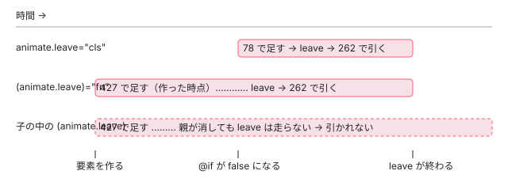

[目次](../README.md) › [アニメーションの内側](README.md) › 第 13 回 / 全 20 回

# スタイルの後片付け：leave の間はコンポーネントの CSS を消さない

> コンポーネントが壊されるとき NoneEncapsulationDomRenderer.destroy がスタイルを外す行と、allLeavingAnimations（leave 中の LView の ID の Set）が空でない間は外さない理由、命令・node\_animations.ts・control\_flow.ts が ID を足し引きする 7 か所。(animate.leave) は要素を作った時点で足すため、スタイルのタグが残り続ける開いている issue #66244 と、どこを直せばよいかの入口。

angular/angular · 読了 約 12 分 · 発展 · [サイトで読む（デモが動きます）](https://angular-deep-dive-cyan.vercel.app/chapter/animations-styles-teardown)

---

コンポーネントの `styles` は、そのコンポーネントが最初に作られたときに `document.head` の `<style>` として入り、最後の 1 つが壊されたときに外されます。ところが `animate.leave` が動いている間は、Angular はこの「外す」をわざと飛ばします。消えていく要素の CSS を先に外すと、見た目が崩れたまま消えていくからです。この章では、スタイルを外す行と飛ばす条件（`allLeavingAnimations` という Set が空かどうか）、Set に ID を足す行と引く行を全部並べ、引かれない道筋があるとスタイルのタグが残り続けることを、開いている issue とページの上の本物で確かめます。

読む対象は `packages/platform-browser/src/dom/dom_renderer.ts` の `NoneEncapsulationDomRenderer`、`shared_styles_host.ts` の `SharedStylesHost`、`packages/core/src/animation/longest_animation.ts` の `allLeavingAnimations` です。

1. [1. 全体像](01-animations-overview.md)
2. [2. テンプレートから命令へ](02-animations-compile.md)
3. [3. 命令がすること](03-animations-instructions.md)
4. [4. 待ち行列](04-animations-queue.md)
5. [5. enter のクラス](05-animations-enter-classes.md)
6. [6. いちばん長いアニメーション](06-animations-longest.md)
7. [7. 関数で動かす](07-animations-functions.md)
8. [8. 動かないとき](08-animations-disabled.md)
9. [9. 消すのを遅らせる](09-animations-leave-removal.md)
10. [10. leave のクラス](10-animations-leave-classes.md)
11. [11. 入れ子の leave](11-animations-leave-nested.md)
12. [12. 並べ替えと出し直し](12-animations-leave-reorder.md)
13. **13. スタイルの後片付け**（この章）
14. [14. 旧パッケージの入口](14-animations-legacy-setup.md)
15. [15. 旧 DSL とキーフレーム](15-animations-legacy-dsl.md)
16. [16. TransitionAnimationEngine](16-animations-legacy-engine.md)
17. [17. 2 つが同居するとき](17-animations-legacy-compat.md)
18. [18. 移行](18-animations-migration.md)
19. [19. テスト](19-animations-testing.md)
20. [20. issue と変更を読む](20-animations-issues.md)

## 1. スタイルは「コンポーネントの型ごとに 1 つのレンダラー」が持つ

コンポーネントのビューが作られるたびに、core は `RendererFactory2.createRenderer(host, type)` を呼びます。ブラウザでの実体は `DomRendererFactory2` で、レンダラーを型の ID ごとに 1 つだけ作って使い回します。

📄 `angular/packages/platform-browser/src/dom/dom_renderer.ts` L220–257 （▶ の行: 221–222, 224, 229, 246–247）

```ts
220 │   private getOrCreateRenderer(element: any, type: RendererType2): Renderer2 {
221 ▶     const rendererByCompId = this.rendererByCompId;
222 ▶     let renderer = rendererByCompId.get(type.id);
223 │ 
224 ▶     if (!renderer) {
225 │       const doc = this.doc;
226 │       const ngZone = this.ngZone;
227 │       const eventManager = this.eventManager;
228 │       const sharedStylesHost = this.sharedStylesHost;
229 ▶       const removeStylesOnCompDestroy = this.removeStylesOnCompDestroy;
230 │       const tracingService = this.tracingService;
231 │ 
232 │       switch (type.encapsulation) {
233 │         case ViewEncapsulation.Emulated:
234 │           renderer = new EmulatedEncapsulationDomRenderer2(
235 │             eventManager,
236 │             sharedStylesHost,
237 │             type,
238 │             this.appId,
239 │             removeStylesOnCompDestroy,
240 │             doc,
241 │             ngZone,
242 │             tracingService,
243 │             this.cssVarNamespace,
244 │           );
245 │           break;
246 ▶         case ViewEncapsulation.ShadowDom:
247 ▶           return new ShadowDomRenderer(
248 │             eventManager,
249 │             element,
250 │             type,
251 │             doc,
252 │             ngZone,
253 │             this.nonce,
254 │             tracingService,
255 │             this.cssVarNamespace,
256 │             sharedStylesHost,
257 │           );
```

📄 `angular/packages/platform-browser/src/dom/dom_renderer.ts` L270–288 （▶ の行: 271, 275, 284, 287）

```ts
270 │         default:
271 ▶           renderer = new NoneEncapsulationDomRenderer(
272 │             eventManager,
273 │             sharedStylesHost,
274 │             type,
275 ▶             removeStylesOnCompDestroy,
276 │             doc,
277 │             ngZone,
278 │             tracingService,
279 │             this.cssVarNamespace,
280 │           );
281 │           break;
282 │       }
283 │ 
284 ▶       rendererByCompId.set(type.id, renderer);
285 │     }
286 │ 
287 ▶     return renderer;
288 │   }
```

222 行目で `rendererByCompId` から型の ID（`type.id`）で探し、無ければ作って 284 行目で覚えます。229 行目と 275 行目で、あとで出てくる `removeStylesOnCompDestroy`（スタイルを外すかどうかの設定）がレンダラーに渡ります。`ViewEncapsulation.Emulated`（既定）で作られる `EmulatedEncapsulationDomRenderer2` は `NoneEncapsulationDomRenderer` を継承しているので、この章の `destroy` は既定のコンポーネントにそのまま効きます。作ったレンダラーに対して、`createRenderer` はインスタンスが作られるたびに `applyStyles()`（Emulated は `applyToHost` の中で同じこと）を呼びます。その中身とセレクタの書き換えは [compiler-shadow-css](../compiler/18-compiler-shadow-css.md) で読みました。

### SharedStylesHost は「使っている数」を数える

📄 `angular/packages/platform-browser/src/dom/shared_styles_host.ts` L139–157 （▶ の行: 141, 151, 153）

```ts
139 │   addStyles(styles: string[], urls?: string[]): void {
140 │     for (const value of styles) {
141 ▶       this.addUsage(value, this.inline, createStyleElement);
142 │     }
143 │ 
144 │     urls?.forEach((value) => this.addUsage(value, this.external, createLinkElement));
145 │   }
146 │ 
147 │   /**
148 │    * Removes embedded styles from the DOM that were added as HTML `style` elements.
149 │    * @param styles An array of style content strings.
150 │    */
151 ▶   removeStyles(styles: string[], urls?: string[]): void {
152 │     for (const value of styles) {
153 ▶       this.removeUsage(value, this.inline);
154 │     }
155 │ 
156 │     urls?.forEach((value) => this.removeUsage(value, this.external));
157 │   }
```

📄 `angular/packages/platform-browser/src/dom/shared_styles_host.ts` L184–200 （▶ の行: 189, 194–197）

```ts
184 │   protected removeUsage<T extends HTMLElement>(
185 │     value: string,
186 │     usages: Map<string, UsageRecord<T>>,
187 │   ): void {
188 │     // Attempt to get any current usage of the value
189 ▶     const record = usages.get(value);
190 │ 
191 │     // If there is a record, reduce the usage count and if no longer used,
192 │     // remove from DOM and delete usage record.
193 │     if (record) {
194 ▶       record.usage--;
195 ▶       if (record.usage <= 0) {
196 ▶         removeElements(record.elements);
197 ▶         usages.delete(value);
198 │       }
199 │     }
200 │   }
```

141 行目、`addStyles` は CSS の文字列ごとに `addUsage` を呼びます。初めての文字列なら `<style>` を作り、2 回目からは数（`usage`）を 1 足すだけです（`addUsage` の中身は [cli-component-styles](../cli/04-cli-component-styles.md)）。153 行目の `removeStyles` → 194 行目で数を 1 引き、195〜197 行目で **0 以下になったときだけ**タグを DOM から外して記録を消します。つまり同じコンポーネントが 3 つ出ていれば、3 回 `removeStyles` が呼ばれて初めてタグが消えます。逆に言えば、**`removeStyles` が 1 回でも呼ばれずに終わると、その分の数が永久に残り、タグはもう二度と消えません**。これが 4 節の話の土台です。

## 2. destroy がスタイルを外す行と、飛ばす行

コンポーネントのビューが壊されるとき、[ivy-destroy](../ivy/17-ivy-destroy.md) で読んだ `cleanUpView` が、コンポーネントのビュー（`TViewType.Component`）に限って `lView[RENDERER].destroy()` を呼びます。そのレンダラーが上の `NoneEncapsulationDomRenderer` です。

📄 `angular/packages/platform-browser/src/dom/dom_renderer.ts` L678–688 （▶ の行: 679–681, 683–684）

```ts
678 │ 
679 ▶   override destroy(): void {
680 ▶     if (!this.removeStylesOnCompDestroy) {
681 ▶       return;
682 │     }
683 ▶     if (allLeavingAnimations.size === 0) {
684 ▶       this.sharedStylesHost.removeStyles(this.styles, this.styleUrls);
685 │     }
686 │   }
687 │ }
688 │ 
```

1. **680〜681 行目：設定で外さないなら何もしない**

   `removeStylesOnCompDestroy` が `false` なら、ここで帰ります。タグは `addUsage` で増えるだけになり、一度入れたスタイルはアプリが終わるまで残ります。
2. **683 行目：leave 中のビューが 1 つでもあれば外さない**

   `allLeavingAnimations.size === 0` のときだけ次に進みます。この Set は **アプリ全体で 1 つ**で（3 節）、壊されようとしているこのコンポーネントと関係があるかどうかは見ていません。
3. **684 行目：使っている数を 1 引く**

   1 節の `removeStyles` です。数が 0 になればタグが消えます。683 行目で飛ばされた場合、**後でもう一度呼び直す仕組みはこのクラスに無い**ので、引くはずだった 1 は引かれないまま残ります。

### 設定のトークン

📄 `angular/packages/platform-browser/src/dom/dom_renderer.ts` L56–74 （▶ の行: 60, 67, 69, 72）

```ts
56 │ 
57 │ /**
58 │  * The default value for the `REMOVE_STYLES_ON_COMPONENT_DESTROY` DI token.
59 │  */
60 ▶ const REMOVE_STYLES_ON_COMPONENT_DESTROY_DEFAULT = true;
61 │ 
62 │ /**
63 │  * A DI token that indicates whether styles
64 │  * of destroyed components should be removed from DOM.
65 │  *
66 │  * By default, the value is set to `true`.
67 ▶  * @publicApi
68 │  */
69 ▶ export const REMOVE_STYLES_ON_COMPONENT_DESTROY = new InjectionToken<boolean>(
70 │   typeof ngDevMode !== 'undefined' && ngDevMode ? 'RemoveStylesOnCompDestroy' : '',
71 │   {
72 ▶     factory: () => REMOVE_STYLES_ON_COMPONENT_DESTROY_DEFAULT,
73 │   },
74 │ );
```

60 行目と 72 行目で、既定は `true`（外す）です。67 行目のとおり公開 API で、`@angular/platform-browser` から `REMOVE_STYLES_ON_COMPONENT_DESTROY` として import して `{ provide: REMOVE_STYLES_ON_COMPONENT_DESTROY, useValue: false }` で切れます。1 節の 229 行目のとおり、値は `DomRendererFactory2` のコンストラクタで 1 回読まれ、各レンダラーにコピーされます。

## 3. allLeavingAnimations に足す行・引く行を全部並べる

📄 `angular/packages/core/src/animation/longest_animation.ts` L170–171 （▶ の行: 170–171）

```ts
170 ▶ /** Tracks the IDs of LViews with leaving animations. */
171 ▶ export const allLeavingAnimations = new Set<number>();
```

171 行目、モジュールの一番上に置かれた `Set<number>` です。中身は LView の ID（`lView[ID]`。ID はビューを作るたびに振られる番号）で、170 行目のコメントどおり「leave アニメーションのある LView の ID」を入れる約束です。`core_private_export.ts` から `ɵallLeavingAnimations` として出ていて、`@angular/platform-browser` の `dom_renderer.ts` はそれを import して 683 行目で読んでいます。足し引きしている場所は、`core/src` を grep すると 7 か所です。

📄 `ターミナル（../angular、8576f161ae4）`

```
$ cd ~/angular-research/angular/packages/core/src
$ grep -rn "allLeavingAnimations\.\(add\|delete\)" .
render3/node_animations.ts:78:  if (lView) allLeavingAnimations.add(lView[ID]);
render3/node_animations.ts:185:        if (lView) allLeavingAnimations.delete(lView[ID]);
render3/node_animations.ts:190:    if (lView) allLeavingAnimations.delete(lView[ID]);
render3/node_animations.ts:262:      allLeavingAnimations.delete(lView[ID]);
render3/instructions/control_flow.ts:619:    allLeavingAnimations.delete(viewToDetach[ID]);
render3/instructions/animation.ts:292:  allLeavingAnimations.add(lView[ID]);
render3/instructions/animation.ts:427:  allLeavingAnimations.add(lView[ID]);
```

| 場所 | 足す / 引く | いつ | 条件 | どの章 |
| --- | --- | --- | --- | --- |
| `animation.ts:427`（`ɵɵanimateLeaveListener`） | 足す | **要素を作るとき**。`(animate.leave)` の命令はテンプレート関数の作成ブロック（`rf & 1`）に出る | サーバーでなく、ブラウザがアニメーションに対応しているとき。leave が始まるかどうかとは無関係 | [7](07-animations-functions.md)・[2](02-animations-compile.md) |
| `animation.ts:292`（`runLeaveAnimations`） | 足す | `animate.leave="クラス"` の leave を待ち行列から実行したとき | leave が実際に始まるとき | [10](10-animations-leave-classes.md) |
| `node_animations.ts:78`（`runLeaveAnimationsWithCallback`） | 足す | ビューを外す（Detach）・壊す（Destroy）とき、**その場で同期に** | 外す要素とその子孫に leave が登録されている（または入れ子のビューに leave がある）とき | [9](09-animations-leave-removal.md) |
| `node_animations.ts:262`（`runAfterLeaveAnimations`） | 引く | 走らせた leave の Promise が全部終わったあと | 終わったのが、そのビューで一番新しい `running` と同じとき | [11](11-animations-leave-nested.md) |
| `node_animations.ts:185`（`executeLeaveAnimations`） | 引く | 同上（ビューに `ANIMATIONS` の記録が無いとき） | Promise が全部 settle したあと | [9](09-animations-leave-removal.md) |
| `node_animations.ts:190`（`executeLeaveAnimations`） | 引く | 待ち行列から実行したら、走らせる leave が 1 つも無かったとき | 78 行目で足したあとに状況が変わった場合 | [9](09-animations-leave-removal.md) |
| `control_flow.ts:619`（`clearDetachAnimationList`） | 引く | `@for` の並べ替えで、外したビューをまた入れ直したとき | そのビューに外すときの leave（`detachedLeaveAnimationFns`）が積まれていたとき | [12](12-animations-leave-reorder.md) |

引く 4 か所はどれも「**走らせた leave が終わったとき**」か「**取り消したとき**」です。一方、足す 3 か所のうち `animation.ts:427` だけは leave が始まる前、要素を作った瞬間に足します。そして「leave が走らないまま要素が消える」道筋（4 節）には、引く行が 1 つもありません。なお最新の main（74961c66242）では、`control_flow.ts` の引く行はコミット 7e678e0ed72（入れ子の leave の取り消し）で `node_animations.ts` の `clearViewDetachAnimationsImpl` に移っています。



*足す・引くの時間の流れ。(animate.leave) は作った時点で Set に入る*

## 4. 引かれない道筋：スタイルのタグが残り続ける

2 節と 3 節を合わせると、スタイルが外れないのは次の 3 つの場合です。どれも下のデモで本物を動かして確かめました。

1. **leave 中に壊れたコンポーネント自身のスタイル（意図どおり、ただし後で外されない）**

   `@if` が false になると、ivy-destroy で読んだ `removeLViewFromLContainer` が「外す（Detach）」と「壊す（`destroyLView`）」を同じ呼び出しの中で続けて行います。外すときに `node_animations.ts:78` で ID が入るので、直後の `destroy` では 683 行目が false になり、子コンポーネントのスタイルは残ります。leave の間に見た目が崩れないのはこのおかげです。ただし leave が終わって 262 行目で ID が引かれても、`removeStyles` をもう一度呼ぶ人はいません。1 節の数が 1 残り、**そのタグは二度と外れなくなります**。
2. **どこかに `(animate.leave)` がある間は、関係ないコンポーネントのスタイルも外れない（#66244）**

   `animation.ts:427` は要素を作った時点で足します。その要素が画面にある限り Set は空にならず、683 行目は**アプリのどのコンポーネントを壊しても** false です。壊されたコンポーネントの数は引かれないまま残るので、あとで Set が空に戻っても、そのタグは外れません。
3. **子コンポーネントの中の `(animate.leave)` は、親に消されると ID が永久に残る**

   親の `@if` が子のホスト要素を外すとき、`runLeaveAnimationsWithCallback` が集めるのは**親のテンプレートの中**の leave だけです（コンポーネントの境界は越えない。[第 11 回](11-animations-leave-nested.md)）。子のテンプレートの中の `(animate.leave)` は走らず、427 行目で入った子の LView の ID を引く行も通りません。こうなると Set は**ページを読み直すまで空にならず**、以後アプリ全体で 683 行目が false になります。

### 開いている issue #66244

2025-12-24 に開かれた **#66244**「Angular never removes style tags on destroy if any component has (animate.leave) hook」（ラベル `area: core`・`core: animations`、2026-11-01 時点で open）は、上の 2 つ目と 3 つ目にあたります。報告者は「`(animate.leave)` を外すと、コンポーネントを壊したときに背景色が戻る」再現を StackBlitz で示し、「leave が全部終わったあとにスタイルのタグを外してほしい」と書いています。コメントは 3 件です（`gh issue view 66244 -R angular/angular --comments` で読めます）。

- 2026-01-05、外部の人が「#66255 を直したコミットで解決済み」と書いています。そのコミットは ../angular では **80b0fbba1f9**（fix(core): avoid leaking view data in animations）で、`git show 80b0fbba1f9` を見ると、Set の中身を `LView` から `lView[ID]` に変えただけです（ビューをメモリに握り続けないため）。427 行目の「作った時点で足す」も、683 行目の判定も変わっていません。このコミットを含む ../angular の 22.2.0-next.7 の行も、このサイトの 22.1.6 の行（`node_modules/@angular/core/fesm2022/_debug_node-chunk.mjs` の `ɵɵanimateLeaveListener`）も同じ形で、下のデモでも残ります。
- 2026-01-06、Angular チームの thePunderWoman が「子の要素が CSS で消えていく途中で親のコンポーネントが壊されることがあり、いつ外しても安全かを知るのが難しい」と答えています。
- 2026-01-07、報告者が「いくつかの場合は仕様として文書にすればよい。そもそもスタイルを外すこと自体がコンポーネントの外に影響しうるし、困る人は設定で切れる」と返しています。

> [!NOTE]
> **さらに深く**
>
> **直すとしたらどこか（入口だけ）。** 判定しているのは `dom_renderer.ts` 683 行目、Set の意味を決めているのは足す 3 か所と引く 4 か所です。考えられる入口は少なくとも 3 つあります。(1) `animation.ts:427` で足す時期（作った時点か、292 行目のように leave が始まる時点か）、(2) 683 行目で飛ばした `removeStyles` を、Set が空になったときに呼び直す仕組み（旧パッケージは 5 節のように 1 つずつ待っている）、(3) 引かれずに壊れたビューの ID を、ビューを壊すときに Set から消すこと。どれが正しいかは issue でも決まっていません。thePunderWoman のコメントのとおり、子が消えていく途中で親を壊す場合（[第 11 回](11-animations-leave-nested.md)）を壊さないことが条件になります。issue の流れは [第 20 回](20-animations-issues.md)で読みます。

## 5. 旧パッケージは「レンダラーごとに」待っていた

📄 `angular/packages/animations/browser/src/render/renderer.ts` L43–54 （▶ の行: 44–49）

```ts
43 │   destroy(): void {
44 ▶     this.engine.destroy(this.namespaceId, this.delegate);
45 ▶     this.engine.afterFlushAnimationsDone(() => {
46 ▶       // Call the renderer destroy method after the animations has finished as otherwise
47 ▶       // styles will be removed too early which will cause an unstyled animation.
48 ▶       queueMicrotask(() => {
49 ▶         this.delegate.destroy();
50 │       });
51 │     });
52 │ 
53 │     this._onDestroy?.();
54 │   }
```

`@angular/animations` の `BaseAnimationRenderer`（[第 14 回](14-animations-legacy-setup.md)）は `DomRendererFactory2` のレンダラーを包んでいます。44 行目でエンジンに「この名前空間を壊す」と伝え、45 行目で**エンジンの flush で始まったアニメーションが全部終わるのを待ってから**、48〜49 行目の microtask で包んでいるレンダラーの `destroy`（2 節の 679 行目）を呼びます。46〜47 行目のコメントは、この章と同じ「早く外すと、スタイルの無いアニメーションになる」です。「待ってから必ず呼ぶ」ので、数が引かれないまま残ることはありません。新しい仕組みは待たずに「飛ばす」ので、その差が 4 節の 1 つ目になります。

## 6. Shadow DOM のとき

📄 `angular/packages/platform-browser/src/dom/dom_renderer.ts` L587–600 （▶ の行: 591, 598–599）

```ts
587 │     styles = shimStylesContent(component.id, styles).map((s) =>
588 │       s.replace(/%NS%/g, cssVarNamespace),
589 │     );
590 │ 
591 ▶     for (const style of styles) {
592 │       const styleEl = document.createElement('style');
593 │ 
594 │       if (nonce) {
595 │         styleEl.setAttribute('nonce', nonce);
596 │       }
597 │ 
598 ▶       styleEl.textContent = style;
599 ▶       this.shadowRoot.appendChild(styleEl);
600 │     }
```

📄 `angular/packages/platform-browser/src/dom/dom_renderer.ts` L640–662 （▶ の行: 640–642, 647, 655）

```ts
640 ▶   override destroy() {
641 ▶     if (this.sharedStylesHost) {
642 ▶       this.sharedStylesHost.removeHost(this.shadowRoot);
643 │     }
644 │   }
645 │ }
646 │ 
647 ▶ class NoneEncapsulationDomRenderer extends DefaultDomRenderer2 {
648 │   private readonly styles: string[];
649 │   private readonly styleUrls?: string[];
650 │ 
651 │   constructor(
652 │     eventManager: EventManager,
653 │     private readonly sharedStylesHost: SharedStylesHost,
654 │     component: RendererType2,
655 ▶     private removeStylesOnCompDestroy: boolean,
656 │     doc: Document,
657 │     ngZone: NgZone,
658 │     tracingService: TracingService<TracingSnapshot> | null,
659 │     cssVarNamespace: string,
660 │     compId?: string,
661 │   ) {
662 │     super(eventManager, doc, ngZone, tracingService, cssVarNamespace);
```

1 節の 246〜247 行目のとおり、`ViewEncapsulation.ShadowDom` のレンダラーは**要素ごとに new され**、`rendererByCompId` にも入りません。スタイルは 591〜599 行目で、そのコンポーネントの shadow root の中に直接 `<style>` として足されます（`document.head` には入らない）。640〜644 行目の `destroy` は、shadow root を `SharedStylesHost` の「スタイルを配る先」から外すだけで、`allLeavingAnimations` も `removeStylesOnCompDestroy` も見ません。スタイルはホスト要素と一緒に消えるので、leave 中にホスト要素が残っていればスタイルも残ります。655 行目の `removeStylesOnCompDestroy` を受け取るのは 647 行目からの `NoneEncapsulationDomRenderer`（と、それを継承する Emulated）だけです。

## 7. ページの上で確かめる

> **🧪 DEMO — 子コンポーネントのスタイルのタグが head に残るか**
>
> 下の 4 つは、このページのテンプレートに書いた本物の `@if` と `animate.leave` / `(animate.leave)` です（このサイトの `@angular/core` 22.1.6）。A〜D はそれぞれ自分の `styles` を持つ別々のコンポーネントで、styles の中に目印のクラス名（`ast-a-marker` など）が入っています。ボタンを押すと 50ms 後（と、消したときは 1000ms 後）に、`document.head` の `<style>` のうち目印を含むものの数と、`ɵallLeavingAnimations`（`@angular/core` が内部用に export している本物の Set）の大きさを読んで、下の表に 1 行足します。OS の設定で動きを減らしていても、このデモは動きます。
>
> ▶ [このデモはサイトで動かせます](https://angular-deep-dive-cyan.vercel.app/chapter/animations-styles-teardown)

### デモの結果（自動で押したときの記録）

上のボタンを headless の Chrome から順に押した記録です（2026-11-01、このサイトの開発ビルド、@angular/core 22.1.6）。数字は目印を含む `<style>` の数、右端は `ɵallLeavingAnimations.size` です。手で押すと 50ms 後と 1000ms 後の 2 行が出ます。シリーズを 1 ページで読むページでは、ほかの章のデモの `(animate.leave)` が同じ Set に入るので、数が変わることがあります。

| した操作 | A | B | C | D | Set |
| --- | --- | --- | --- | --- | --- |
| A を出す → 消す | 1 → 0 | 0 | 0 | 0 | 0 のまま |
| B を出す → 消す（50ms 後） | 0 | 1 | 0 | 0 | 1 |
| B を消して 1000ms 後 | 0 | 1（残る） | 0 | 0 | 0 |
| C を出しておく | 0 | 1 | 1 | 0 | 1（出しただけで 1） |
| C を出したまま A を出す → 消す | 1（残る） | 1 | 1 | 0 | 1 |
| C を消して 1000ms 後 | 1 | 1 | 1（残る） | 0 | 0 |
| もう一度 A を出す → 消す（Set は 0） | 1（それでも残る） | 1 | 1 | 0 | 0 |
| D を出す → 消して 1000ms 後 | 1 | 1 | 1 | 1（残る） | 1（0 に戻らない） |
| 「後始末」で D の ID を消す | 1 | 1 | 1 | 1 | 0 |

- **A だけ**なら、消した直後にタグが 0 になりました。2 節の 684 行目 → 1 節の 195〜197 行目です。
- **B** は消した 50ms 後に Set が 1（`node_animations.ts:78`）、1000ms 後には 0（262 行目）に戻りましたが、B のタグは残りました。4 節の 1 つ目です。
- **C** は**出しただけで** Set が 1 になりました（`animation.ts:427`）。その間に A を出して消すと、A のタグが残りました。#66244 そのものです。
- そのあと Set が 0 に戻ってから A をもう一度出して消しても、A のタグは消えませんでした。前に引かれなかった 1 が残っているので、数が 2 → 1 になるだけだからです（1 節の 194〜195 行目）。
- **D** を消したあと、Set は 1 のまま 0 に戻りませんでした。4 節の 3 つ目です。このページの「後始末」ボタンと、ページを離れるときの処理は、D を作ったときに増えた ID だけを Set から消します（この章のコンポーネントの `cleanupLeakedIds`。Angular の内部の Set を直接触っているので、デモの後始末以外には使わないでください）。

## テストと直し方

スタイルを外す仕組みそのものを確かめている spec は `packages/platform-browser/test/dom/dom_renderer_spec.ts` です。ファイルの先頭の `describe('DefaultDomRendererV2')` は `if (isNode)` のとき空の `it` 1 本で帰るので、ブラウザ版のターゲットでしか中身は走りません。

📄 `angular/packages/platform-browser/test/dom/dom_renderer_spec.ts` L288–313 （▶ の行: 288, 296, 303, 311）

```ts
288 ▶   describe('should cleanup styles of destroyed components by default', () => {
289 │     it('works for components without encapsulation emulated', async () => {
290 │       const fixture = TestBed.createComponent(SomeAppForCleanUp);
291 │       const compInstance = fixture.componentInstance;
292 │       compInstance.showEmulatedComponents = true;
293 │       fixture.changeDetectorRef.markForCheck();
294 │       await fixture.whenStable();
295 │       // verify style is in DOM
296 ▶       expect(await styleCount(fixture, '.emulated')).toBe(1);
297 │ 
298 │       // Remove a single instance of the component.
299 │       compInstance.componentOneInstanceHidden = true;
300 │       fixture.changeDetectorRef.markForCheck();
301 │       await fixture.whenStable();
302 │       // Verify style is still in DOM
303 ▶       expect(await styleCount(fixture, '.emulated')).toBe(1);
304 │ 
305 │       // Hide all instances of the component
306 │       compInstance.componentTwoInstanceHidden = true;
307 │       fixture.changeDetectorRef.markForCheck();
308 │       await fixture.whenStable();
309 │ 
310 │       // Verify style is not in DOM
311 ▶       expect(await styleCount(fixture, '.emulated')).toBe(0);
312 │     });
313 │ 
```

📄 `angular/packages/platform-browser/test/dom/dom_renderer_spec.ts` L314–339 （▶ の行: 314, 322, 329, 337）

```ts
314 ▶     it('works for components without encapsulation none', async () => {
315 │       const fixture = TestBed.createComponent(SomeAppForCleanUp);
316 │       const compInstance = fixture.componentInstance;
317 │       compInstance.showEmulatedComponents = false;
318 │ 
319 │       fixture.changeDetectorRef.markForCheck();
320 │       await fixture.whenStable();
321 │       // verify style is in DOM
322 ▶       expect(await styleCount(fixture, '.none')).toBe(1);
323 │ 
324 │       // Remove a single instance of the component.
325 │       compInstance.componentOneInstanceHidden = true;
326 │       fixture.changeDetectorRef.markForCheck();
327 │       await fixture.whenStable();
328 │       // Verify style is still in DOM
329 ▶       expect(await styleCount(fixture, '.none')).toBe(1);
330 │ 
331 │       // Hide all instances of the component
332 │       compInstance.componentTwoInstanceHidden = true;
333 │       fixture.changeDetectorRef.markForCheck();
334 │       await fixture.whenStable();
335 │ 
336 │       // Verify style is not in DOM
337 ▶       expect(await styleCount(fixture, '.emulated')).toBe(0);
338 │     });
339 │   });
```

288 行目の `describe` に `it` が 2 本、220 行目の「`false` なら外さない」`describe` にも 2 本です。296 → 303 → 311 行目で「2 つ出ていれば 1 つ消しても残り、全部消すと 0」を見ています（1 節の数え方）。

📄 `ターミナル（../angular で実行）`

```
cd ~/angular-research/angular
pnpm bazel test //packages/platform-browser/test:test_web_chromium \
  --test_output=all --nocache_test_results

# 絞り込みの引数は無いので、describe / it の数は grep で数える
grep -nE "^\s*(describe|it)\(" packages/platform-browser/test/dom/dom_renderer_spec.ts | grep -i clean
```

📄 `出力（抜粋。2026-11-01 に実行）`

```
Chromium: |██████████████████████████████| 1/1 test files | 253 passed, 0 failed, 5 skipped
Finished running tests in 1.6s, all tests passed!
INFO: Elapsed time: 5.220s, Critical Path: 4.53s
//packages/platform-browser/test:test_web_chromium                       PASSED in 2.5s

220:  describe('should not cleanup styles of destroyed components when `REMOVE_STYLES_ON_COMPONENT_DESTROY` is `false`', () => {
288:  describe('should cleanup styles of destroyed components by default', () => {
```

1. **走った数**

   `//packages/platform-browser/test:test_web_chromium` は 253 passed・5 skipped で PASSED in 2.5s でした。ターゲットの全 spec が走るので、この 4 本だけを選ぶ引数はありません。手元で 4 本だけを見たいときは、自分の作業コピーで `describe` を `fdescribe` に変えると jasmine はそれだけを走らせます（このシリーズでは ../angular を変えないので、試していません）。
2. **読んでいて気づくこと**

   337 行目は `encapsulation: None` の it なのに `'.emulated'` を数えています。322 行目の `'.none'` と揃っていないので、None のスタイルが外れなくてもこの行は通ります（329 行目までは `'.none'`）。また、`allLeavingAnimations` と 683 行目の組み合わせを確かめる spec はありません。`grep -rn allLeavingAnimations packages/core/test packages/platform-browser/test` で出てくるのは `core/test/bundling/*/bundle.golden_symbols.json`（バンドルに入るシンボルの一覧）だけでした。Detach のときに Set へ足す行（いまの `node_animations.ts:78` にあたる行）を足したコミット e2281023780（fix(core): Prevents early style pruning with leave animations、#64335）も、`node_manipulation.ts` に 2 行足しただけで、テストは足していません。
3. **直すとしたら**

   判定は `platform-browser/src/dom/dom_renderer.ts` の `NoneEncapsulationDomRenderer.destroy`、Set の足し引きは `core/src/render3/instructions/animation.ts`・`node_animations.ts`・`instructions/control_flow.ts` です（3 節の表）。`animate.leave` を書いたコンポーネントを出し入れして `document.head` を数えるテストは、テンプレートを使うので `core/test/acceptance/animation_spec.ts`（`//packages/core/test/acceptance:acceptance_web_chromium`、全体で 2743 本）に足すのが近く、レンダラー単体の振る舞いなら上の `dom_renderer_spec.ts` です。この章のデモの A〜D の 4 つの並びは、そのまま「残ってはいけない / 残ってよい」を分けるテストの下書きになります。

## 聞かれそうな質問

**Q. なぜ leave の間はスタイルを消さないのですか？**

leave のアニメーションは、消えていく要素にクラス（`animate.leave="..."`）を付けて CSS で動かします。そのクラスや要素の見た目はコンポーネントの `styles` に書かれているので、壊した瞬間にタグを外すと、残りの時間は「スタイルの無い要素」が消えていくことになります。core はビューを外す時点で Set に ID を入れ（`node_animations.ts:78`）、`dom_renderer.ts` 683 行目でそれを見て外すのを飛ばします。78 行目にあたる行は、この「早すぎる」を直すためにコミット e2281023780（#64335）で足されました。

**Q. REMOVE\_STYLES\_ON\_COMPONENT\_DESTROY を false にするとどうなりますか？**

680〜681 行目で `destroy` が何もしなくなり、`allLeavingAnimations` の状態に関係なく、一度入れたスタイルはずっと `document.head` に残ります。数（`usage`）は増えるだけなので、タグが重複して増えることはありません（2 回目からは 1 節の `addUsage` が数を足すだけ）。#66244 で困っているのは「外れてほしいのに外れない」なので、この設定は回避策にはなりません。報告者のコメントは「外れて困る人はこの設定で切れる」という逆向きの話です。

**Q. Shadow DOM のコンポーネントでも同じことが起きますか？**

起きません。`ShadowDomRenderer` は 591〜599 行目で shadow root の中にスタイルを置き、640〜644 行目の `destroy` は Set を見ません。スタイルはホスト要素の shadow root と一緒に消えるので、leave でホスト要素が残っている間はスタイルも残り、要素が消えればスタイルも消えます。

**Q. issue のコメントに「もう直っている」とありますが？**

そのコミット（../angular の 80b0fbba1f9）は、Set に入れるものを LView から番号（`lView[ID]`）に変えたものです。ビューを握り続けるメモリリーク（#66255）は直りますが、427 行目で作った時点に足すことも、683 行目で全体の大きさを見ることも変わっていません。このコミットを含むこのサイトの 22.1.6 で、7 節のデモは A のタグが残りました。

**Q. Set が 0 に戻ったのに、A のタグが残ったのはなぜですか？**

タグを外すかどうかは Set ではなく `SharedStylesHost` の数（195 行目の `usage <= 0`）で決まるからです。C を出していた間に A を 1 回壊したとき、683 行目で `removeStyles` が飛ばされ、引くはずの 1 が残りました。そのあと A を作ると数は 2、壊すと 1 で、0 にはなりません。

## 読み終えて

- コンポーネントのスタイルは `SharedStylesHost` が CSS の文字列ごとに「使っている数」を数え、0 になったときだけタグを外す（`shared_styles_host.ts` 194〜197 行目）。
- `NoneEncapsulationDomRenderer.destroy`（Emulated も同じ）は、`allLeavingAnimations` が空でなければ数を引かずに帰る（`dom_renderer.ts` 683 行目）。飛ばした分を後で引く仕組みは無い。
- Set はアプリ全体で 1 つ。足すのは 3 か所、引くのは 4 か所で、`(animate.leave)` は要素を作った時点で足す（`animation.ts:427`）。子の中の `(animate.leave)` を親が消すと、ID は永久に残る。
- これが開いている #66244。直す入口は 683 行目の判定と Set の足し引きで、どれが正しいかは決まっていない。旧パッケージは `BaseAnimationRenderer.destroy` でレンダラーごとに待ってから必ず外していた。
- この判定を確かめる spec は無い。足すなら `core/test/acceptance/animation_spec.ts` か `platform-browser/test/dom/dom_renderer_spec.ts`、どちらもブラウザ版のターゲットでしか走らない。

---

← 前: [並べ替えと出し直し：leave の途中で戻ってきた要素](12-animations-leave-reorder.md)  
次: [旧 @angular/animations の入口：provideAnimations と AnimationRenderer](14-animations-legacy-setup.md) →
