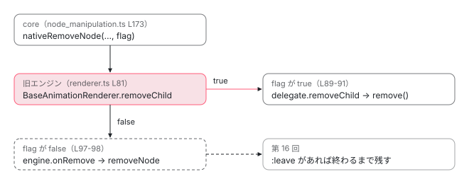

[目次](../README.md) › [アニメーションの内側](README.md) › 第 17 回 / 全 20 回

# 2 つが同居するとき：旧エンジンのレンダラーと animate.leave

> @angular/animations を入れたアプリで animate.leave を使うと、要素を消す役が旧エンジンのレンダラーに渡る。BaseAnimationRenderer.removeChild の requireSynchronousElementRemoval と、その TODO、acceptance の「legacy animations compatibility」の spec、同居で要素が残った issue。2 つのどちらが先に消すかを 1 本の流れで追う。

angular/angular · 読了 約 12 分 · 発展 · [サイトで読む（デモが動きます）](https://angular-deep-dive-cyan.vercel.app/chapter/animations-legacy-compat)

---

`@angular/animations`（旧エンジン）を入れたアプリでは、コンポーネントのレンダラーが旧エンジンのものに差し替わります。そこで `animate.leave` を使うと、「leave のアニメーションを待ってから消す」core と「消すタイミングを自分で決める」旧エンジンの 2 人が、同じ `removeChild` の上で出会います。この章では、core が `removeChild` の 4 つ目の引数 `requireSynchronousElementRemoval` で「もう待った。すぐ消して」と伝え、`BaseAnimationRenderer.removeChild` がそれを見て旧エンジンを素通りする行を読みます。そのフラグが途中で落ちて要素が残った issue #64525 と、同居を確かめているはずの spec が実際には何を確かめているかも、行と実行結果で見ます。

読む対象は `packages/animations/browser/src/render/renderer.ts`（75〜100 行目）、`packages/core/test/acceptance/animation_spec.ts` の `describe('legacy animations compatibility')`、公式ガイド `adev/src/content/guide/animations/enter-and-leave.md` です。

1. [1. 全体像](01-animations-overview.md)
2. [2. テンプレートから命令へ](02-animations-compile.md)
3. [3. 命令がすること](03-animations-instructions.md)
4. [4. 待ち行列](04-animations-queue.md)
5. [5. enter のクラス](05-animations-enter-classes.md)
6. [6. いちばん長いアニメーション](06-animations-longest.md)
7. [7. 関数で動かす](07-animations-functions.md)
8. [8. 動かないとき](08-animations-disabled.md)
9. [9. 消すのを遅らせる](09-animations-leave-removal.md)
10. [10. leave のクラス](10-animations-leave-classes.md)
11. [11. 入れ子の leave](11-animations-leave-nested.md)
12. [12. 並べ替えと出し直し](12-animations-leave-reorder.md)
13. [13. スタイルの後片付け](13-animations-styles-teardown.md)
14. [14. 旧パッケージの入口](14-animations-legacy-setup.md)
15. [15. 旧 DSL とキーフレーム](15-animations-legacy-dsl.md)
16. [16. TransitionAnimationEngine](16-animations-legacy-engine.md)
17. **17. 2 つが同居するとき**（この章）
18. [18. 移行](18-animations-migration.md)
19. [19. テスト](19-animations-testing.md)
20. [20. issue と変更を読む](20-animations-issues.md)

## 1. 同居の前提：レンダラーが旧エンジンのものになる

`provideAnimations()`（や `BrowserAnimationsModule`・`NoopAnimationsModule`）を入れると、`RendererFactory2` が旧エンジンの `AnimationRendererFactory` になります（[第 14 回](14-animations-legacy-setup.md)）。この工場は、`animations` を持つコンポーネントには `AnimationRenderer` を、持たないコンポーネントにも `BaseAnimationRenderer` を返します（animation\_renderer.ts 43・50・78 行目。第 14 回）。つまり**旧エンジンを入れたアプリでは、すべてのコンポーネントのレンダラーが `BaseAnimationRenderer` 系**で、本物の DOM を触る `DomRenderer` はその `delegate`（中で仕事を任される相手）です。

一方 `animate.leave` は core の仕組みで、要素を消す前に leave のアニメーションの終わりを待ちます（[第 9 回](09-animations-leave-removal.md)）。待ち終わった core が「消して」と頼む相手は、`lView[RENDERER]`、つまり上の `BaseAnimationRenderer` です。

## 2. BaseAnimationRenderer.removeChild

📄 `angular/packages/animations/browser/src/render/renderer.ts` L75–100 （▶ の行: 79–81, 85, 87–91, 93, 96–98）

```ts
 75 │     // If `isMove` true than we should animate this insert.
 76 │     this.engine.onInsert(this.namespaceId, newChild, parent, isMove);
 77 │   }
 78 │ 
 79 ▶   // TODO(thePunderWoman): remove the requireSynchronousElementRemoval flag after the
 80 ▶   // animations package has been fully deleted post v23.
 81 ▶   removeChild(
 82 │     parent: any,
 83 │     oldChild: any,
 84 │     isHostElement?: boolean,
 85 ▶     requireSynchronousElementRemoval?: boolean,
 86 │   ): void {
 87 ▶     // Elements using the new `animate.leave` API require synchronous removal and should
 88 ▶     // skip the rest of the legacy animation behaviors.
 89 ▶     if (requireSynchronousElementRemoval) {
 90 ▶       this.delegate.removeChild(parent, oldChild, isHostElement, requireSynchronousElementRemoval);
 91 ▶       return;
 92 │     }
 93 ▶     // Prior to the changes in #57203, this method wasn't being called at all by `core` if the child
 94 │     // doesn't have a parent. There appears to be some animation-specific downstream logic that
 95 │     // depends on the null check happening before the animation engine. This check keeps the old
 96 ▶     // behavior while allowing `core` to not have to check for the parent element anymore.
 97 ▶     if (this.parentNode(oldChild)) {
 98 ▶       this.engine.onRemove(this.namespaceId, oldChild, this.delegate);
 99 │     }
100 │   }
```

1. **81〜86 行目 4 つ目の引数**

   `Renderer2.removeChild` の 4 つ目の引数 `requireSynchronousElementRemoval`（85 行目）を受け取ります。core の側でこの引数を渡すのは、`nativeRemoveNode`（dom\_node\_manipulation.ts。[dom の章](../template/05-dom.md)で引いた 87〜94 行目）です。`nativeRemoveNode` は `renderer.removeChild(null, rNode, isHostElement, requireSynchronousElementRemoval)` と、4 つの引数をそのまま渡します。
2. **89〜92 行目 フラグがあれば旧エンジンを通らない**

   フラグが `true` なら、90 行目で `delegate`（`DomRenderer`）の `removeChild` を呼び、91 行目で戻ります。`this.engine`（旧エンジン）には何も知らせません。87〜88 行目のコメントのとおり、「`animate.leave` を使う要素は同期で消す必要があり、旧アニメーションの振る舞いを飛ばす」ための分岐です。
3. **97〜99 行目 フラグが無ければ旧エンジンへ**

   フラグが無い（`false` か `undefined`）なら、親がいるときだけ 98 行目で `engine.onRemove` に渡します。そこから先は `TransitionAnimationEngine.removeNode` が、`:leave` の遷移や親の遷移を見て「いつ外すか」を決めます（[第 16 回](16-animations-legacy-engine.md)）。93〜96 行目のコメントは、親のいない要素では呼ばれなかった昔の振る舞い（#57203 より前）を残すための `parentNode` の確認だと説明しています。
4. **79〜80 行目 TODO**

   「v23 の後で animations パッケージが完全に消えたら、このフラグを取り除く」。同じ TODO は core の `Renderer` の型（render3/interfaces/renderer.ts の `removeChild` の宣言の直前）にも書かれています。このフラグは**旧エンジンと同居するためだけ**にある、と作者自身が書いているわけです。

> [!TIP]
> **新卒エンジニアへ**
>
> `DomRenderer.removeChild(_parent, oldChild)` は引数を 2 つしか受け取らず、`oldChild.remove()` を呼ぶだけです。旧エンジンが入っていないアプリでは、core が 4 つ目を渡しても誰も見ません。フラグに意味があるのは、間に `BaseAnimationRenderer` がいるときだけです。

## 3. core はいつ true を渡すか

フラグの値を決めるのは、`applyToElementOrContainer` の Detach の分岐です（node\_manipulation.ts 156〜175 行目。[第 9 回](09-animations-leave-removal.md)で読みます）。173 行目で `nativeRemoveNode(renderer, rNode, isComponent, nodeHasLeaveAnimations)` と呼び、4 つ目には `runLeaveAnimationsWithCallback` がコールバックに渡した真偽値が入ります。

| runLeaveAnimationsWithCallback（node\_animations.ts）の出口 | callback の引数 | BaseAnimationRenderer での行き先 |
| --- | --- | --- |
| 注入器が壊れている（52 行目） | `false` | 旧エンジン（98 行目） |
| その要素にも子孫にも leave が無い（74 行目） | `false` | 旧エンジン（98 行目）。旧 DSL の `:leave` はここを通る |
| leave を走らせて、終わるのを待った（186・264 行目） | `true` | delegate がすぐ外す（90 行目） |
| 待ち行列から走ったが、走る leave が無かった（191 行目） | `false` | 旧エンジン（98 行目） |

行番号は第 9 回・第 11 回で引く `node_animations.ts` のものです。**`true` になるのは「core が leave の終わりを待ったあと」だけ**で、待ち終わった要素を旧エンジンにもう一度待たせないためにフラグを立てます。このフラグが入ったのは dde5badb713（2025-09-18、#63921）で、コミットの本文は「下流のレンダラーに、要素を同期で消す必要があると伝える。旧アニメーションのレンダラーがタイミングを変えないようにする」です（直した issue は #63893「animations パッケージがあると新しい API のタイミングが変わる」）。



*core は leave を待ち終わってから removeChild を呼ぶ。4 つ目の引数が true なら BaseAnimationRenderer は旧エンジンを素通りし、false なら旧エンジンに渡す。*

## 4. フラグが途中で落ちた：#64525

#64525（2025-10-19）は「`animate.leave` と旧アニメーションを一緒に使うと、要素が消えずに戻ってくる」という報告です。再現の条件として報告者は、`provideAnimationsAsync` を使っていること、**親のコンポーネントが `animations: []`（空でもよい）を持っていること**、`animate.leave` は子のコンポーネントにあること、を挙げました。最初の返事（thePunderWoman）は「同じコンポーネントで両方を使うのはサポートしていない」でしたが、報告者が「別のコンポーネントだ」と返し、レンダラーを調べて「子のコンポーネントまで旧エンジンのレンダラーを使っている理由が分からない」となったあと、同じ日に修正が出ました。

1. **子まで旧エンジンのレンダラーになる理由**

   `provideAnimationsAsync` の工場は、レンダラーを作るたびに `DynamicDelegationRenderer` で包み、`animations` を持つコンポーネントが現れたら旧エンジンの読み込みを始めます（async\_animation\_renderer.ts 137〜139 行目。[第 14 回](14-animations-legacy-setup.md)）。読み込みが始まったあとに作られたレンダラーは、読み込みが終わると `dynamicRenderer.use(animationRenderer)` で旧エンジンのレンダラーに差し替わります（141〜147 行目）。親の `animations: []` が読み込みを始め、その後に作られた子のレンダラーも差し替わった、というのがコードから読める筋道です。
2. **落ちていた場所**

   修正の 70332b04532（2025-10-21、#64565「要素の削除のプロパティをすべての場所で渡す」、fixes #64525）は 2 ファイルだけの変更です。`DynamicDelegationRenderer.removeChild` は `removeChild(parent, oldChild, isHostElement)` と 3 つしか受け取らず、4 つ目を捨てていました。修正後は 4 つ目を受け取って delegate に渡します（async\_animation\_renderer.ts 241〜248 行目。第 14 回）。もう 1 か所は、この章で読んだ 90 行目です。修正前は `this.delegate.removeChild(parent, oldChild, isHostElement)` で、4 つ目を渡していませんでした。
3. **結果**

   `DynamicDelegationRenderer` で落ちると、core が `true` を渡しても `BaseAnimationRenderer` には `undefined` が届き、98 行目の旧エンジンへ進みます。dde5badb713 がわざわざ避けた道です。このコミットに spec の追加はありません（変更は 2 ファイルの 8 行の追加と 3 行の削除）。

## 5. 同じコンポーネントでは使えない：ガイドとコンパイルエラー

📄 `angular/adev/src/content/guide/animations/enter-and-leave.md` L90–92 （▶ の行: 92）

```md
90 │ ## Compatibility with Legacy Angular Animations
91 │ 
92 ▶ You cannot use legacy animations alongside `animate.enter` and `animate.leave` within the same component. Doing so would result in enter classes remaining on the element or leaving nodes not being removed. It is otherwise fine to use both legacy animations and the new `animate.enter` and `animate.leave` animations within the same _application_. The only caveat is content projection. If you are projecting content from one component with legacy animations into another component with `animate.enter` or `animate.leave`, or vice versa, this will result in the same behavior as if they are used together in the same component. This is not supported.
```

92 行目。「同じコンポーネントで旧アニメーションと `animate.enter` / `animate.leave` を使うことはできない。enter のクラスが残ったり、leave の要素が消えなかったりする。同じ*アプリ*の中で別々に使うのはよい。例外はコンテンツの投影で、旧アニメーションのコンポーネントから `animate.*` のコンポーネントへ（または逆へ）中身を投影すると、同じコンポーネントで使ったのと同じことになり、サポートしない」。#64525 の返事で約束された「ドキュメントに書く」がこの段落です。

コンパイラーも止めます。#64525 のコメントで JeanMeche が挙げた e039c6be027（#64569、2025-10-21）は、コンポーネントが `animations` プロパティを持ち、かつテンプレートに `animate.enter` / `animate.leave` があると、エラー `NG2027`（`COMPONENT_ANIMATIONS_CONFLICT`）「A component cannot have both the '@Component.animations' property (legacy animations) and use 'animate.enter' or 'animate.leave' in the template.」を出します（compiler-cli の `annotations/component/src/handler.ts`）。`animations: []` と空でも当たります。spec は `packages/compiler-cli/test/ngtsc/ngtsc_spec.ts` の `it('should throw an error when legacy animations are used with animate.enter')`（314 行目）と `... with animate.leave`（336 行目）です。

> [!WARNING]
> **ハマりどころ**
>
> コンパイルエラーが見るのは**同じコンポーネントのテンプレート**だけです。#64525 の形（親が `animations`、子が `animate.leave`）や、ガイドの言うコンテンツの投影はコンパイルが通ります。そちらを守っているのは、2 節の 89〜92 行目のフラグです。

## 6. spec を読む：legacy animations compatibility

📄 `angular/packages/core/test/acceptance/animation_spec.ts` L929–951 （▶ の行: 930–933, 936, 940）

```ts
929 │     describe('legacy animations compatibility', () => {
930 ▶       beforeAll(() => {
931 ▶         TestBed.resetTestEnvironment();
932 ▶         TestBed.initTestEnvironment(
933 ▶           [BrowserTestingModule, NoopAnimationsModule, TestModule],
934 │           platformBrowserTesting(),
935 │         );
936 ▶       });
937 │ 
938 │       const styles = `
939 │       .fade {
940 ▶         animation: fade-out 1ms;
941 │       }
942 │       @keyframes fade-out {
943 │         from {
944 │           opacity: 1;
945 │         }
946 │         to {
947 │           opacity: 0;
948 │         }
949 │       }
950 │       `;
951 │ 
```

📄 `angular/packages/core/test/acceptance/animation_spec.ts` L952–991 （▶ の行: 952, 959, 970, 977–978, 980, 983, 985–990）

```ts
952 ▶       it('should have the same exact timing when AnimationsModule is present', fakeAsync(() => {
953 │         const logSpy = jasmine.createSpy('logSpy');
954 │         @Component({
955 │           changeDetection: ChangeDetectionStrategy.Eager,
956 │           selector: 'test-cmp',
957 │           styles: styles,
958 │           template:
959 ▶             '<div>@if (show()) {<p animate.leave="fade" (animationend)="logMe($event)">I should fade</p>}</div>',
960 │           encapsulation: ViewEncapsulation.None,
961 │         })
962 │         class TestComponent {
963 │           show = signal(true);
964 │ 
965 │           logMe(event: AnimationEvent) {
966 │             logSpy();
967 │           }
968 │         }
969 │ 
970 ▶         TestBed.configureTestingModule({animationsEnabled: true});
971 │ 
972 │         const fixture = TestBed.createComponent(TestComponent);
973 │         const cmp = fixture.componentInstance;
974 │         fixture.detectChanges();
975 │         const paragragh = fixture.debugElement.query(By.css('p'));
976 │ 
977 ▶         expect(fixture.nativeElement.outerHTML).not.toContain('class="fade"');
978 ▶         cmp.show.set(false);
979 │         fixture.detectChanges();
980 ▶         tickAnimationFrames(1);
981 │         expect(cmp.show()).toBeFalsy();
982 │         fixture.detectChanges();
983 ▶         expect(fixture.nativeElement.outerHTML).toContain('class="fade"');
984 │         fixture.detectChanges();
985 ▶         paragragh.nativeElement.dispatchEvent(
986 ▶           new AnimationEvent('animationend', {animationName: 'fade-out'}),
987 ▶         );
988 ▶         tick();
989 ▶         expect(fixture.nativeElement.outerHTML).not.toContain('class="fade"');
990 ▶         expect(logSpy).toHaveBeenCalled();
991 │       }));
```

1. **930〜936 行目 旧エンジンを入れた環境を作る**

   `beforeAll` でテスト環境を作り直し、`NoopAnimationsModule`（旧エンジンを、何も動かさないドライバーで入れるモジュール。[第 19 回](19-animations-testing.md)）を入れます。名前の「AnimationsModule is present」はこの状態のことです。
2. **952〜977 行目 animate.leave の要素を作る**

   959 行目のテンプレートは `@if` の中の `<p animate.leave="fade" (animationend)="logMe($event)">`。940 行目で `.fade` は 1ms のアニメーションです。970 行目で `animationsEnabled: true` にし（TestBed の既定はアニメーションを止める。第 19 回）、977 行目でまだ `fade` が付いていないことを確かめます。
3. **978〜983 行目 消すと fade が付く**

   978 行目で `show` を `false` にし、980 行目で rAF 1 回分だけ時計を進めると、983 行目で `class="fade"` が付いています。leave のクラスが付いて、要素はまだ残っている状態です。
4. **985〜990 行目 animationend を送ると消える**

   985〜987 行目で `animationend` を手で送り、988 行目の `tick()` のあと、989 行目で `fade` の付いた要素が無いこと、990 行目でテンプレートの `(animationend)` が呼ばれたことを確かめます。#63893 の「イベントのタイミングが変わる」が直ったことを、この 2 つで見ています。

### この it が走るとき、NoopAnimationsModule は入っているか

この describe は、外側の `describe('Animation')` の中にあります。外側には `beforeEach`（55〜58 行目）があり、`[BrowserTestingModule, TestModule]` だけで環境を作り直します（[第 19 回](19-animations-testing.md)で引きます）。Jasmine では、内側の `beforeAll` は内側の最初の it の前に 1 回だけ走り、外側の `beforeEach` はその**あと**、it ごとに走ります。../angular の jasmine-core 6.3.0 で同じ形を組んで確かめました。

📄 `確かめた順番（scratchpad のスクリプト。../angular は変えていない）`

```
// scratchpad に置いた確認用のスクリプト（../angular の jasmine-core 6.3.0 を読むだけ）
env.describe('Animation', () => {
  env.beforeEach(() => log.push('outer beforeEach (L55)'));
  env.afterEach(() => log.push('outer afterEach (L60)'));
  env.describe('animate.leave', () => {
    env.describe('legacy animations compatibility', () => {
      env.beforeAll(() => log.push('inner beforeAll (L930)'));
      env.it('same exact timing', () => log.push('  it'));
    });
  });
});

// 出力
inner beforeAll (L930)
outer beforeEach (L55)
  it
outer afterEach (L60)
```

つまり 952 行目の it が走るときの環境は、930 行目で作ったものではなく、55〜58 行目で作り直した `NoopAnimationsModule` の無いものです。`BrowserTestingModule` は `BrowserModule` を export し、`APP_ID` などテスト用の 3 つを provide するだけなので、`RendererFactory2` は `DomRendererFactory2` のままで、2 節の 89〜92 行目は通りません。この it は名前のとおりの「旧エンジンがいるときのタイミング」ではなく、旧エンジンがいないときの振る舞いを確かめていることになります。そして `requireSynchronousElementRemoval` という名前は、../angular の spec ファイルのどこにも出てきません（`grep -rn requireSynchronousElementRemoval packages --include='*_spec.ts'` は 0 件）。

> [!NOTE]
> **さらに深く**
>
> 最新の main（74961c66242）でも、この it は外側の `beforeEach` の下にあり、内側の `beforeAll` も同じです。main では it が `fakeAsync` から `async` / `await` に書き直されています（c60c41e29aa、第 19 回）が、順番の話は変わりません。ここまでは「行と Jasmine の順番から言えること」で、ブラウザで it の中の `RendererFactory2` を出して確かめたわけではありません（../angular を変えないため）。確かめるなら、自分の作業コピーで it の先頭に `TestBed.inject(RendererFactory2)` の型を見る 1 行を足して `acceptance_web_chromium` を走らせます（試していない）。

## 7. 呼び出しの連なり

- 👤 `show.set(false)` — あなたのコンポーネント — *@if の中に animate.leave の要素*
  - `applyToElementOrContainer(Detach, …)` — node\_manipulation.ts L156 — *第 9 回*
    - `runLeaveAnimationsWithCallback(lView, tNode, injector, cb)` — node\_animations.ts L39 — *leave を待ち行列へ（第 4 回）*
      - `executeLeaveAnimations → runAfterLeaveAnimations` — node\_animations.ts L144・L250 — *leave のクラスを付けて、いちばん長いアニメーションの終わりを待つ（第 10 回・第 6 回）*
      - `callback(true)` — node\_animations.ts L264
    - `nativeRemoveNode(renderer, rNode, isComponent, true)` — node\_manipulation.ts L173
      - `renderer.removeChild(null, rNode, isComponent, true)` — dom\_node\_manipulation.ts（dom の章）
        - `DynamicDelegationRenderer.removeChild(…, true)` — async\_animation\_renderer.ts L241 — *provideAnimationsAsync のときだけ。70332b04532 より前はここで落ちた*
          - `BaseAnimationRenderer.removeChild(…, true)` — renderer.ts L81
            - `this.delegate.removeChild(…); return;` — renderer.ts L89-91 — *旧エンジンは呼ばない*
              - `DomRenderer.removeChild → oldChild.remove()` — platform-browser

## 8. デモ：フラグの道筋を切り替える（再現）

> **🧪 DEMO — 要素が消されるときの道筋**
>
> これは**再現**です。このサイトには `@angular/animations` が入っていないので、2〜4 節で読んだ分岐（renderer.ts 89〜99 行目、node\_manipulation.ts 173 行目、node\_animations.ts の callback の値、async\_animation\_renderer.ts 241〜248 行目）だけを章のコードの関数で写し、通る行を並べています。DOM には触りません。
>
> ▶ [このデモはサイトで動かせます](https://angular-deep-dive-cyan.vercel.app/chapter/animations-legacy-compat)

「provideAnimationsAsync()」「animate.leave あり」「70332b04532 より前：はい」にすると、core が `true` を渡したのに `BaseAnimationRenderer` では `false` になり、旧エンジンに入る（左に線が付く）ことが分かります。「いいえ」に戻すと、89〜91 行目で抜けます。

## テストと直し方

📄 `ターミナル（../angular で実行）`

```
cd ~/angular-research/angular
pnpm bazel test //packages/core/test/acceptance:acceptance_web_chromium \
  --nocache_test_results --test_output=all

# 2026-11-01 の出力（抜粋）
Chromium: 1/1 test files | 2743 passed, 0 failed, 3 skipped
Finished running tests in 6.3s, all tests passed!
INFO: Elapsed time: 9.283s, Critical Path: 7.02s
//packages/core/test/acceptance:acceptance_web_chromium     PASSED in 6.8s

# Node 版に同じ名前で絞ると 0 本で PASSED になる
pnpm bazel test //packages/core/test/acceptance:acceptance \
  --test_arg=--filter="legacy animations compatibility" --test_output=all
Ran 0 of 2693 specs
0 specs, 0 failures
//packages/core/test/acceptance:acceptance                  PASSED in 1.3s
```

1. **どのターゲットに入っているか**

   `describe('legacy animations compatibility')`（animation\_spec.ts:929）の it は 1 本（:952）です。数え方は `grep -n "^\s*it(" packages/core/test/acceptance/animation_spec.ts | awk -F: '$1>=929 && $1<=994'`。ブラウザ版の `acceptance_web_chromium` は絞れないので、2743 本の中の 1 本として走ります（2026-11-01、6.8s）。Node 版で名前に絞ると `Ran 0 of 2693 specs` で PASSED です。animation\_spec.ts は 50〜53 行目で Node なら `'should pass'` だけを登録して戻るので、この名前の it は Node では存在しません（[第 19 回](19-animations-testing.md)）。
2. **コンパイルエラーの spec**

   5 節の `NG2027` は Node で走ります。2 本の it が `runInEachFileSystem` で 4 つのファイルシステムの分だけ作られ、4 つの shard がそれぞれ 2 本ずつ走りました。

   📄 `ターミナル（../angular で実行）`

   ```
   cd ~/angular-research/angular
   pnpm bazel test //packages/compiler-cli/test/ngtsc:ngtsc --test_output=all \
     --test_arg=--filter="legacy animations are used with"

   # 2026-11-01 の出力（抜粋）
   Ran 2 of 6748 specs   # 4 つの shard がそれぞれ 2 本（合計 8 本）
   2 specs, 0 failures
   INFO: Elapsed time: 47.795s, Critical Path: 29.14s
   //packages/compiler-cli/test/ngtsc:ngtsc                     PASSED in 4.0s
   ```
3. **直すとしたら**

   フラグを読むのは `BaseAnimationRenderer.removeChild`（renderer.ts 81 行目）、運ぶのは `DynamicDelegationRenderer.removeChild`（async\_animation\_renderer.ts）、立てるのは node\_manipulation.ts 173 行目です。間に別の `Renderer2` の包み（自作のレンダラーや、ライブラリのもの）が入ると、#64525 と同じく 4 つ目が落ちます。spec を足すなら acceptance の `describe('legacy animations compatibility')` ですが、6 節のとおり、外側の `beforeEach` の下では環境の作り直しが効かないことを先に確かめる必要があります。
4. **issue を読むときの手がかり**

   「旧アニメーションのあるアプリで animate.leave の要素が残る」「イベントが 2 回来る」という報告は、まず「同じコンポーネントか（NG2027 が出るはず）」「投影していないか」「間にレンダラーの包みがあるか」を見ます。#66474（`(animate.leave)` のイベントが 2 回来る）は、旧アニメーションがレンダリングとイベントのタイミングを変えるので直せない、として閉じられました（[第 20 回](20-animations-issues.md)）。

## 聞かれそうな質問

**Q. 同じ要素に \[@trigger\] と animate.leave を書いたらどうなりますか？**

コンパイルが通りません。`[@trigger]` を使うにはコンポーネントに `animations` が要り、テンプレートに `animate.leave` があると、コンパイラーが `NG2027` を出します（e039c6be027。ngtsc\_spec.ts:314・:336 で確かめている）。要素でもコンポーネントでもなく**コンポーネント単位**の決まりで、`animations: []` でも当たります。

**Q. 旧エンジンを入れていると、animate.enter のクラスは誰が付けるのですか？**

core です。`runEnterAnimation` が `lView[RENDERER]` の `addClass` でクラスを付けます（[第 5 回](05-animations-enter-classes.md)）。そのレンダラーは旧エンジンの `BaseAnimationRenderer` ですが、`addClass` は `delegate.addClass` をそのまま呼ぶだけです（renderer.ts。第 14 回）。旧エンジンが口を出すのは、要素を入れる `appendChild` / `insertBefore`（`engine.onInsert`）と、外す `removeChild` です。外すほうはこの章の 89〜92 行目で素通りさせています。

**Q. v23 で何が消えるのですか？**

../angular（v22.2.0-next.7）の `@angular/animations` の公開 API には「@deprecated 20.2 … Intent to remove in v23」と書かれていて、79〜80 行目と core の `Renderer` の型の TODO は「パッケージが消えたら `requireSynchronousElementRemoval` を取り除く」です。ただし #71703（2026-10-28）に JeanMeche が「v23 で旧アニメーションを消すことはなさそう。ドキュメントの非推奨の文言を直す」と返しています。最新の main（74961c66242、10-30）の @deprecated の文言はまだ「Intent to remove in v23」のままです（[第 18 回](18-animations-migration.md)）。

**Q. フラグが無いとき、なぜ旧エンジンに渡すのですか？**

旧 DSL の `:leave` は、旧エンジンが `removeChild` を受け取ってから遷移を始め、終わるまで要素を残す仕組みだからです（98 行目 → `TransitionAnimationEngine.removeNode`。第 16 回）。`animate.leave` の無い要素で core は `callback(false)` を返す（node\_animations.ts 74 行目）ので、旧 DSL の要素はこれまでどおりの道を通ります。フラグは新しい API の要素だけを抜け道に通すためのものです。

## 読み終えて

- 旧エンジンを入れると、全コンポーネントのレンダラーが `BaseAnimationRenderer` 系になり、`DomRenderer` はその delegate になる。
- core は leave を待ち終わったときだけ `removeChild` の 4 つ目に `true` を渡し、`BaseAnimationRenderer.removeChild` は 89〜92 行目で旧エンジンを素通りする。TODO は「v23 の後で消す」。
- #64525 は `DynamicDelegationRenderer` が 4 つ目を捨てていたのが原因で、70332b04532 で直った（spec の追加は無し）。
- 同じコンポーネントでの同居は `NG2027` で止まる。親子や投影の同居は止まらず、フラグが頼り。
- acceptance の「legacy animations compatibility」の it は、Jasmine の順番のせいで `NoopAnimationsModule` の無い環境で走る。

---

← 前: [TransitionAnimationEngine：トリガーの値が変わってからプレイヤーが動くまで](16-animations-legacy-engine.md)  
次: [移行：@angular/animations から animate.enter / animate.leave へ](18-animations-migration.md) →
