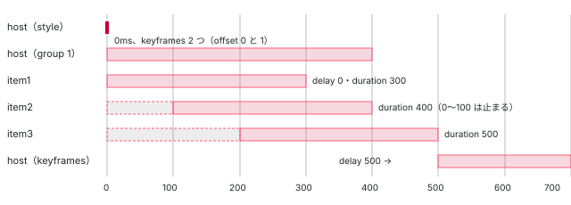

[目次](../README.md) › [animations の説明文の読み残し](README.md) › 第 5 回 / 全 9 回

# タイムラインを組む：animation\_timeline\_builder

> animations/browser/src/dsl/animation\_timeline\_builder.ts の未読の行：頭のコメントが約束する時間の数え方、startTime と duration、group と sequence の分かれ方、keyframes と query と stagger の遅れ、animateChild の keyframe の引き延ばし。本物の build でタイムラインを取り出して並べ、コメントの例と stagger('full') の食い違いを見る。

angular/angular · 読了 約 14 分 · 発展 · [サイトで読む（デモが動きます）](https://angular-deep-dive-cyan.vercel.app/chapter/anm-timeline)

---

この章で分かること：DSL の AST（[第 4 回](04-anm-ast.md)）を、要素ごとの「keyframes・duration・delay・easing」の命令（timeline）に変える `animation_timeline_builder.ts` が、時間をどう数えるか。ファイルの頭の長いコメントが約束する数え方を 1 段落ずつ読み、group・sequence・keyframes・query・stagger・animateChild の visit を行で追い、本物の 22.2.6 の `buildAnimationTimelines` に DSL を通して出てきた timeline と突き合わせます。結果として、コメントの例の出力 2 つ（頭の例と、animateChild の引き延ばしの例）は本物と合わず、`stagger('full')` には、前に `style()` があるときと親が先に進んでいるときに時刻がずれる不具合がありました。

読む対象は `packages/animations/browser/src/dsl/` の `animation_timeline_builder.ts`（1076 行）・`animation_timeline_instruction.ts`・`element_instruction_map.ts` です（../angular、8576f161ae4）。`style()` と `animate()` を keyframe にする中心（`visitAnimate`・`visitStyle`・`setStyles`・`buildKeyframes`）と `invokeQuery` は[旧 DSL の章](../animations/15-animations-legacy-dsl.md)の 6 節で読んだので、ここでは引きません。できた命令を誰がプレイヤーにするかは[旧エンジンの章](../animations/16-animations-legacy-engine.md)と[次回](06-anm-engine.md)です。

1. [1. trigger・state・style・animate](01-anm-trigger-state.md)
2. [2. transition・query・stagger](02-anm-transition-query.md)
3. [3. AnimationBuilder とプレイヤー](03-anm-builder-players.md)
4. [4. DSL を AST に](04-anm-ast.md)
5. **5. タイムライン**（この章）
6. [6. 遷移のエンジン](06-anm-engine.md)
7. [7. Web Animations のドライバー](07-anm-driver.md)
8. [8. provideAnimations](08-anm-module.md)
9. [9. spec と issue](09-anm-tests-issues.md)

> [!TIP]
> **新卒エンジニアへ**
>
> timeline（タイムライン）は「1 つの要素の、ある時刻からある時刻までの keyframes の並び」です。Web Animations API の `element.animate(keyframes, {duration, delay, easing})` に 1 回で渡せる単位で、1 つの遷移から要素の数だけ（group があればそれ以上）できます。このサイトには `@angular/animations` が入っていないので、DEMO は、npm から取った本物の 22.2.6 を手元で headless Chrome に読み込ませて取った記録の再生です。

## 1. ファイルの頭のコメントが約束すること

📄 `angular/packages/animations/browser/src/dsl/animation_timeline_builder.ts` L54–77 （▶ の行: 61–64, 69–72, 75–76）

````ts
54 │ /*
55 │  * The code within this file aims to generate web-animations-compatible keyframes from Angular's
56 │  * animation DSL code.
57 │  *
58 │  * The code below will be converted from:
59 │  *
60 │  * ```ts
61 ▶  * sequence([
62 ▶  *   style({ opacity: 0 }),
63 ▶  *   animate(1000, style({ opacity: 0 }))
64 ▶  * ])
65 │  * ```
66 │  *
67 │  * To:
68 │  * ```ts
69 ▶  * keyframes = [{ opacity: 0, offset: 0 }, { opacity: 1, offset: 1 }]
70 ▶  * duration = 1000
71 ▶  * delay = 0
72 ▶  * easing = ''
73 │  * ```
74 │  *
75 ▶  * For this operation to cover the combination of animation verbs (style, animate, group, etc...) a
76 ▶  * combination of AST traversal and merge-sort-like algorithms are used.
77 │  *
````

61〜64 行目の DSL が、69〜72 行目の 4 つの値になる、という例です。ところが 63 行目の `animate` の中は `opacity: 0` で、69 行目の出力は `opacity: 1` で終わっています。DEMO の「コメントの例」で 61〜64 行目をそのまま通すと、keyframes は `0 → {opacity: 0}`・`1 → {opacity: 0}`（動かない）で、easing は 72 行目の `''` ではなく `null` でした（`TimelineBuilder` の L735 の既定が `null`）。この例は 16c8167886d（2017-04-26、`feat(animations): introduce a wave of new animation features`）のときから同じ形で、最新の main（8b15295e8c7、2026-11-20）でも変わっていません。

📄 `angular/packages/animations/browser/src/dsl/animation_timeline_builder.ts` L78–102 （▶ の行: 88–93, 95–99）

```ts
 78 │  * [AST Traversal]
 79 │  * Each of the animation verbs, when executed, will return an string-map object representing what
 80 │  * type of action it is (style, animate, group, etc...) and the data associated with it. This means
 81 │  * that when functional composition mix of these functions is evaluated (like in the example above)
 82 │  * then it will end up producing a tree of objects representing the animation itself.
 83 │  *
 84 │  * When this animation object tree is processed by the visitor code below it will visit each of the
 85 │  * verb statements within the visitor. And during each visit it will build the context of the
 86 │  * animation keyframes by interacting with the `TimelineBuilder`.
 87 │  *
 88 ▶  * [TimelineBuilder]
 89 ▶  * This class is responsible for tracking the styles and building a series of keyframe objects for a
 90 ▶  * timeline between a start and end time. The builder starts off with an initial timeline and each
 91 ▶  * time the AST comes across a `group()`, `keyframes()` or a combination of the two within a
 92 ▶  * `sequence()` then it will generate a sub timeline for each step as well as a new one after
 93 ▶  * they are complete.
 94 │  *
 95 ▶  * As the AST is traversed, the timing state on each of the timelines will be incremented. If a sub
 96 ▶  * timeline was created (based on one of the cases above) then the parent timeline will attempt to
 97 ▶  * merge the styles used within the sub timelines into itself (only with group() this will happen).
 98 ▶  * This happens with a merge operation (much like how the merge works in mergeSort) and it will only
 99 ▶  * copy the most recently used styles from the sub timelines into the parent timeline. This ensures
100 │  * that if the styles are used later on in another phase of the animation then they will be the most
101 │  * up-to-date values.
102 │  *
```

88〜93 行目は「`group()` と `keyframes()` に来ると、手順ごとの sub timeline と、それが終わったあとの新しい timeline を作る」。95〜99 行目は「sub timeline で使ったスタイルを、親の timeline に mergeSort の merge のように、新しいほうだけ写す」。97 行目の括弧の中の「これをするのは group() だけ」は実物と違います。`mergeTimelineCollectedStyles` を呼ぶ行は、group の 368 行目のほかに、keyframes の 444 行目と query の 507 行目にもあります（4・5・6 節）。

📄 `angular/packages/animations/browser/src/dsl/animation_timeline_builder.ts` L103–131 （▶ の行: 104–105, 108, 112–114, 118–122, 124–126, 129–130）

````ts
103 │  * [How Missing Styles Are Updated]
104 ▶  * Each timeline has a `backFill` property which is responsible for filling in new styles into
105 ▶  * already processed keyframes if a new style shows up later within the animation sequence.
106 │  *
107 │  * ```ts
108 ▶  * sequence([
109 │  *   style({ width: 0 }),
110 │  *   animate(1000, style({ width: 100 })),
111 │  *   animate(1000, style({ width: 200 })),
112 ▶  *   animate(1000, style({ width: 300 }))
113 ▶  *   animate(1000, style({ width: 400, height: 400 })) // notice how `height` doesn't exist anywhere
114 ▶  * else
115 │  * ])
116 │  * ```
117 │  *
118 ▶  * What is happening here is that the `height` value is added later in the sequence, but is missing
119 ▶  * from all previous animation steps. Therefore when a keyframe is created it would also be missing
120 ▶  * from all previous keyframes up until where it is first used. For the timeline keyframe generation
121 ▶  * to properly fill in the style it will place the previous value (the value from the parent
122 ▶  * timeline) or a default value of `*` into the backFill map.
123 │  *
124 ▶  * When a sub-timeline is created it will have its own backFill property. This is done so that
125 ▶  * styles present within the sub-timeline do not accidentally seep into the previous/future timeline
126 ▶  * keyframes
127 │  *
128 │  * [Validation]
129 ▶  * The code in this file is not responsible for validation. That functionality happens with within
130 ▶  * the `AnimationValidatorVisitor` code.
131 │  */
````

118〜122 行目の約束は、DEMO の「backFill」でそのとおりでした。`height` は 5 つ目の keyframe（offset 1）で初めて出て、それより前の 4 つは `height: "*"` で埋まり、`postStyleProps` に `height` が入りました（`*` はエンジンが「終わりの計算済みの値」に置き換える印。次回）。ただし 108〜115 行目の例は、そのまま書くと動きません。112 行目の行末にカンマが無く、113〜114 行目は行のコメントが折り返して `else` だけの行になっています。strict の tsc に通すと、下のとおり `TS1005` が 2 件と `TS1128` が 2 件でした（61〜64 行目の例だけなら 0 件）。129〜130 行目の `AnimationValidatorVisitor` という名前のクラスは今の packages/animations にありません。検査をするのは animation\_ast\_builder.ts の `AnimationAstBuilderVisitor` です（[第 4 回](04-anm-ast.md)）。

📄 `コメントの例を strict の tsc に通した結果`

```
// L108〜115 の backFill の例を、そのまま strict の tsc 6.0.3 に通した（手元の記録、2026-11-23）
export const ex2 = sequence([
  style({ width: 0 }),
  animate(1000, style({ width: 100 })),
  animate(1000, style({ width: 200 })),
  animate(1000, style({ width: 300 }))
  animate(1000, style({ width: 400, height: 400 })) // notice how `height` doesn't exist anywhere
else
]);
// timeline-ex.ts(11,3): error TS1005: ',' expected.   ← L112 の行末にカンマが無い
// timeline-ex.ts(12,1): error TS1005: ',' expected.   ← L114 の "else" はコメントの折り返し
// timeline-ex.ts(13,1): error TS1128: Declaration or statement expected.
// timeline-ex.ts(13,2): error TS1128: Declaration or statement expected.
// L61〜64 の最初の例だけを別のファイルにすると 0 件で通った
```

## 2. 入口と出口：命令が空にならないための 1 つ

📄 `angular/packages/animations/browser/src/dsl/animation_timeline_builder.ts` L132–157 （▶ の行: 132–144）

```ts
132 ▶ export function buildAnimationTimelines(
133 ▶   driver: AnimationDriver,
134 ▶   rootElement: any,
135 ▶   ast: Ast<AnimationMetadataType>,
136 ▶   enterClassName: string,
137 ▶   leaveClassName: string,
138 ▶   startingStyles: ɵStyleDataMap = new Map(),
139 ▶   finalStyles: ɵStyleDataMap = new Map(),
140 ▶   options: AnimationOptions,
141 ▶   subInstructions?: ElementInstructionMap,
142 ▶   errors: Error[] = [],
143 ▶ ): AnimationTimelineInstruction[] {
144 ▶   return new AnimationTimelineBuilderVisitor().buildKeyframes(
145 │     driver,
146 │     rootElement,
147 │     ast,
148 │     enterClassName,
149 │     leaveClassName,
150 │     startingStyles,
151 │     finalStyles,
152 │     options,
153 │     subInstructions,
154 │     errors,
155 │   );
156 │ }
157 │ 
```

呼ぶのは 2 か所です。遷移のときは `AnimationTransitionFactory.build`（[旧 DSL の章](../animations/15-animations-legacy-dsl.md)の 5 節）が前後の state のスタイルを 138・139 行目に渡し、AnimationBuilder のときは `TimelineAnimationEngine.create`（次回）が両方とも空の `Map` を渡します。136・137 行目の 2 つのクラス名は `ng-enter`・`ng-leave` の印で、`query(':enter')` をこのクラスのセレクタに書き換えるのに使います（invokeQuery、旧 DSL の章）。141 行目の `subInstructions` は animateChild が使う「子の遷移の命令」の表です（7 節）。

📄 `angular/packages/animations/browser/src/dsl/animation_timeline_builder.ts` L190–211 （▶ の行: 195, 197, 199, 204–205, 208–210）

```ts
190 │ 
191 │     // note: we just want to apply the final styles for the rootElement, so we do not
192 │     //       just apply the styles to the last timeline but the last timeline which
193 │     //       element is the root one (basically `*`-styles are replaced with the actual
194 │     //       state style values only for the root element)
195 ▶     if (timelines.length && finalStyles.size) {
196 │       let lastRootTimeline: TimelineBuilder | undefined;
197 ▶       for (let i = timelines.length - 1; i >= 0; i--) {
198 │         const timeline = timelines[i];
199 ▶         if (timeline.element === rootElement) {
200 │           lastRootTimeline = timeline;
201 │           break;
202 │         }
203 │       }
204 ▶       if (lastRootTimeline && !lastRootTimeline.allowOnlyTimelineStyles()) {
205 ▶         lastRootTimeline.setStyles([finalStyles], null, context.errors, options);
206 │       }
207 │     }
208 ▶     return timelines.length
209 ▶       ? timelines.map((timeline) => timeline.buildKeyframes())
210 ▶       : [createTimelineInstruction(rootElement, [], [], [], 0, delay, '', false)];
211 │   }
```

1. **195〜206 行目：終わりの state のスタイルは「根の要素の最後の timeline」だけに**

   191〜194 行目のコメントのとおり、query した子の timeline には入れません。さらに 204 行目の `!allowOnlyTimelineStyles()` が真になるのは、最後の keyframe が `animate(500)` のような「スタイルの無い animate」で作られたときだけです（8 節の 857 行目）。DEMO の「長さ 0・options」で、終わりのスタイルを `{width: '99px'}` にすると、`[style(…10px), animate(500)]` は最後が `99px`、`animate(500, style({width: '20px'}))` は `20px` のままでした。
2. **208〜209 行目：timeline ごとに buildKeyframes**

   中身は旧 DSL の章の 924〜968 行目です（offset = 時刻 / duration）。
3. **210 行目：何も動かなくても 1 つ返す**

   DEMO の「長さ 0・options」の `[style({opacity: 0.5})]` は、keyframes が空・duration 0・easing `''` の命令が 1 つでした。`style()` だけを置く手順は `_pendingStyles` に溜まるだけで、旧 DSL の章の 189 行目の `containsAnimation()` の時点では keyframe に入っていないためです（3 節の 764〜773 行目）。

📄 `angular/packages/animations/browser/src/dsl/animation_timeline_instruction.ts` L15–50 （▶ の行: 15, 22, 24–25, 39, 46, 48）

```ts
15 ▶ export interface AnimationTimelineInstruction extends AnimationEngineInstruction {
16 │   element: any;
17 │   keyframes: Array<ɵStyleDataMap>;
18 │   preStyleProps: string[];
19 │   postStyleProps: string[];
20 │   duration: number;
21 │   delay: number;
22 ▶   totalTime: number;
23 │   easing: string | null;
24 ▶   stretchStartingKeyframe?: boolean;
25 ▶   subTimeline: boolean;
26 │ }
27 │ 
28 │ export function createTimelineInstruction(
29 │   element: any,
30 │   keyframes: Array<ɵStyleDataMap>,
31 │   preStyleProps: string[],
32 │   postStyleProps: string[],
33 │   duration: number,
34 │   delay: number,
35 │   easing: string | null = null,
36 │   subTimeline: boolean = false,
37 │ ): AnimationTimelineInstruction {
38 │   return {
39 ▶     type: AnimationTransitionInstructionType.TimelineAnimation,
40 │     element,
41 │     keyframes,
42 │     preStyleProps,
43 │     postStyleProps,
44 │     duration,
45 │     delay,
46 ▶     totalTime: duration + delay,
47 │     easing,
48 ▶     subTimeline,
49 │   };
50 │ }
```

命令の形です。46 行目の `totalTime` は `duration + delay`、48 行目の `subTimeline` は animateChild が作った命令だけが `true` です（1049 行目）。24 行目の `stretchStartingKeyframe` は、この関数では決して入らず、エンジンの transition\_animation\_engine.ts の L1166 だけが `true` にします（7 節）。

## 3. 時間の数え方：startTime と duration

📄 `angular/packages/animations/browser/src/dsl/animation_timeline_builder.ts` L764–781 （▶ の行: 764–766, 768–769, 771, 779–780）

```ts
764 ▶   containsAnimation(): boolean {
765 ▶     switch (this._keyframes.size) {
766 ▶       case 0:
767 │         return false;
768 ▶       case 1:
769 ▶         return this.hasCurrentStyleProperties();
770 │       default:
771 ▶         return true;
772 │     }
773 │   }
774 │ 
775 │   hasCurrentStyleProperties(): boolean {
776 │     return this._currentKeyframe.size > 0;
777 │   }
778 │ 
779 ▶   get currentTime() {
780 ▶     return this.startTime + this.duration;
781 │   }
```

📄 `angular/packages/animations/browser/src/dsl/animation_timeline_builder.ts` L783–808 （▶ の行: 784–788, 790–793, 796, 800–801, 805）

```ts
783 │   delayNextStep(delay: number) {
784 ▶     // in the event that a style() step is placed right before a stagger()
785 ▶     // and that style() step is the very first style() value in the animation
786 ▶     // then we need to make a copy of the keyframe [0, copy, 1] so that the delay
787 ▶     // properly applies the style() values to work with the stagger...
788 ▶     const hasPreStyleStep = this._keyframes.size === 1 && this._pendingStyles.size;
789 │ 
790 ▶     if (this.duration || hasPreStyleStep) {
791 ▶       this.forwardTime(this.currentTime + delay);
792 ▶       if (hasPreStyleStep) {
793 ▶         this.snapshotCurrentStyles();
794 │       }
795 │     } else {
796 ▶       this.startTime += delay;
797 │     }
798 │   }
799 │ 
800 ▶   fork(element: any, currentTime?: number): TimelineBuilder {
801 ▶     this.applyStylesToKeyframe();
802 │     return new TimelineBuilder(
803 │       this._driver,
804 │       element,
805 ▶       currentTime || this.currentTime,
806 │       this._elementTimelineStylesLookup,
807 │     );
808 │   }
```

1 つの `TimelineBuilder` は 2 つの数で時間を持ちます。`startTime`（命令の delay になる）と `duration`（命令の duration）で、779〜780 行目の `currentTime` はその和です。「待つ」を delay で表すか、keyframes の中の止まった区間で表すかは、783 行目の `delayNextStep` が決めます。

1. **796 行目：まだ何も積んでいなければ startTime を進める**

   delay になります。DEMO の「query と stagger（数）」の 2 つ目、`stagger(100, [style({opacity: 0}), animate(200, …)])` は、3 つの要素が delay 0・100・200、duration 200 でした。
2. **790〜793 行目：もう duration があるか、最初の style() が待っていれば duration を進める**

   784〜787 行目のコメントの「stagger の直前の最初の style() は、keyframe を \[0, 写し, 1\] にする」です。`query('.item', [style({opacity: 0}), stagger(100, …)])` では、delay は 3 つとも 0 で、2 つ目は duration 300・keyframes `0 / 0.3333 / 1`、3 つ目は 400・`0 / 0.5 / 1` になりました。待つ間も `opacity: 0` が画面に出ている形です。
3. **800〜805 行目：fork は「今の時刻から始まる新しい timeline」**

   801 行目で溜めた値を keyframe に入れてから、805 行目の `currentTime`（または渡された時刻）を `startTime` にします。sub timeline も、sequence のあとの timeline も、これで作ります。

## 4. sequence と group：どこで timeline が分かれるか

📄 `angular/packages/animations/browser/src/dsl/animation_timeline_builder.ts` L311–346 （▶ の行: 316–318, 320–322, 327, 332, 335, 340–341）

```ts
311 │   visitSequence(ast: SequenceAst, context: AnimationTimelineContext) {
312 │     const subContextCount = context.subContextCount;
313 │     let ctx = context;
314 │     const options = ast.options;
315 │ 
316 ▶     if (options && (options.params || options.delay)) {
317 ▶       ctx = context.createSubContext(options);
318 ▶       ctx.transformIntoNewTimeline();
319 │ 
320 ▶       if (options.delay != null) {
321 ▶         if (ctx.previousNode.type == AnimationMetadataType.Style) {
322 ▶           ctx.currentTimeline.snapshotCurrentStyles();
323 │           ctx.previousNode = DEFAULT_NOOP_PREVIOUS_NODE;
324 │         }
325 │ 
326 │         const delay = resolveTimingValue(options.delay);
327 ▶         ctx.delayNextStep(delay);
328 │       }
329 │     }
330 │ 
331 │     if (ast.steps.length) {
332 ▶       ast.steps.forEach((s) => visitDslNode(this, s, ctx));
333 │ 
334 │       // this is here just in case the inner steps only contain or end with a style() call
335 ▶       ctx.currentTimeline.applyStylesToKeyframe();
336 │ 
337 │       // this means that some animation function within the sequence
338 │       // ended up creating a sub timeline (which means the current
339 │       // timeline cannot overlap with the contents of the sequence)
340 ▶       if (ctx.subContextCount > subContextCount) {
341 ▶         ctx.transformIntoNewTimeline();
342 │       }
343 │     }
344 │ 
345 │     context.previousNode = ast;
346 │   }
```

sequence はふつう新しい timeline を作らず、332 行目で同じ文脈のまま順に visit します。分かれるのは 2 つの場合だけです。316〜318 行目、sequence 自身に `delay` か `params` の options があるとき（その前の行が `style()` なら 321〜322 行目でそのスタイルを写してから待つ）。340〜341 行目、中で group や keyframes が sub timeline を作ったとき（337〜339 行目のコメント「sequence の中身と今の timeline は重ならない」）。

📄 `angular/packages/animations/browser/src/dsl/animation_timeline_builder.ts` L348–372 （▶ の行: 350–351, 353–354, 356, 359–360, 364–368, 370）

```ts
348 │   visitGroup(ast: GroupAst, context: AnimationTimelineContext) {
349 │     const innerTimelines: TimelineBuilder[] = [];
350 ▶     let furthestTime = context.currentTimeline.currentTime;
351 ▶     const delay = ast.options && ast.options.delay ? resolveTimingValue(ast.options.delay) : 0;
352 │ 
353 ▶     ast.steps.forEach((s) => {
354 ▶       const innerContext = context.createSubContext(ast.options);
355 │       if (delay) {
356 ▶         innerContext.delayNextStep(delay);
357 │       }
358 │ 
359 ▶       visitDslNode(this, s, innerContext);
360 ▶       furthestTime = Math.max(furthestTime, innerContext.currentTimeline.currentTime);
361 │       innerTimelines.push(innerContext.currentTimeline);
362 │     });
363 │ 
364 ▶     // this operation is run after the AST loop because otherwise
365 ▶     // if the parent timeline's collected styles were updated then
366 ▶     // it would pass in invalid data into the new-to-be forked items
367 ▶     innerTimelines.forEach((timeline) =>
368 ▶       context.currentTimeline.mergeTimelineCollectedStyles(timeline),
369 │     );
370 ▶     context.transformIntoNewTimeline(furthestTime);
371 │     context.previousNode = ast;
372 │   }
```

📄 `angular/packages/animations/browser/src/dsl/animation_timeline_builder.ts` L629–663 （▶ の行: 634, 643, 645, 648–649, 653–654, 659–661）

```ts
629 │   createSubContext(
630 │     options: AnimationOptions | null = null,
631 │     element?: any,
632 │     newTime?: number,
633 │   ): AnimationTimelineContext {
634 ▶     const target = element || this.element;
635 │     const context = new AnimationTimelineContext(
636 │       this._driver,
637 │       target,
638 │       this.subInstructions,
639 │       this._enterClassName,
640 │       this._leaveClassName,
641 │       this.errors,
642 │       this.timelines,
643 ▶       this.currentTimeline.fork(target, newTime || 0),
644 │     );
645 ▶     context.previousNode = this.previousNode;
646 │     context.currentAnimateTimings = this.currentAnimateTimings;
647 │ 
648 ▶     context.options = this._copyOptions();
649 ▶     context.updateOptions(options);
650 │ 
651 │     context.currentQueryIndex = this.currentQueryIndex;
652 │     context.currentQueryTotal = this.currentQueryTotal;
653 ▶     context.parentContext = this;
654 ▶     this.subContextCount++;
655 │     return context;
656 │   }
657 │ 
658 │   transformIntoNewTimeline(newTime?: number) {
659 ▶     this.previousNode = DEFAULT_NOOP_PREVIOUS_NODE;
660 ▶     this.currentTimeline = this.currentTimeline.fork(this.element, newTime);
661 ▶     this.timelines.push(this.currentTimeline);
662 │     return this.currentTimeline;
663 │   }
```

1. **354 行目：手順ごとに sub context**

   643 行目で今の timeline を fork するので、どの手順も同じ時刻から始まります。654 行目で数（`subContextCount`）を増やすのが、sequence の 340 行目の判断の材料です。
2. **360 行目：いちばん遅く終わった時刻**

   DEMO の「group」では、`animate(1000, …)` が 0〜1000、`animate('500ms 200ms ease-in', …)` が 0〜700（delay を keyframe の止まった区間にして、offset 0.2857 の keyframe に `easing: "ease-in"`）でした。
3. **367〜368 行目：スタイルを親に merge してから**

   364〜366 行目のコメントは「ループの中で merge すると、次に fork する手順に途中の値が渡ってしまう」。
4. **370 行目：furthestTime から新しい timeline**

   group のあとの `animate(300, style({opacity: 0}))` は delay 1000・duration 300 の別の timeline で、最初の keyframe は group の前の `opacity: 1` でした。

## 5. keyframes()：animate の長さの中に offset で置く

📄 `angular/packages/animations/browser/src/dsl/animation_timeline_builder.ts` L427–450 （▶ の行: 429–431, 433, 436–438, 444, 448）

```ts
427 │   visitKeyframes(ast: KeyframesAst, context: AnimationTimelineContext) {
428 │     const currentAnimateTimings = context.currentAnimateTimings!;
429 ▶     const startTime = context.currentTimeline!.duration;
430 ▶     const duration = currentAnimateTimings.duration;
431 ▶     const innerContext = context.createSubContext();
432 │     const innerTimeline = innerContext.currentTimeline;
433 ▶     innerTimeline.easing = currentAnimateTimings.easing;
434 │ 
435 │     ast.styles.forEach((step) => {
436 ▶       const offset: number = step.offset || 0;
437 ▶       innerTimeline.forwardTime(offset * duration);
438 ▶       innerTimeline.setStyles(step.styles, step.easing, context.errors, context.options);
439 │       innerTimeline.applyStylesToKeyframe();
440 │     });
441 │ 
442 │     // this will ensure that the parent timeline gets all the styles from
443 │     // the child even if the new timeline below is not used
444 ▶     context.currentTimeline.mergeTimelineCollectedStyles(innerTimeline);
445 │ 
446 │     // we do this because the window between this timeline and the sub timeline
447 │     // should ensure that the styles within are exactly the same as they were before
448 ▶     context.transformIntoNewTimeline(startTime + duration);
449 │     context.previousNode = ast;
450 │   }
```

keyframes はいつも sub timeline です（431 行目）。433 行目で `animate` の easing を timeline 全体の easing にし、436〜437 行目で各 `style()` を `offset × duration` の時刻に置き、444 行目で親に merge、448 行目で親の timeline を `startTime + duration` から作り直します。DEMO の「keyframes()」で、`animate('1000ms 500ms', keyframes([…0, 0.3, 1]))` は、keyframes の timeline が delay 500・duration 1000・offset `0 / 0.3 / 1` で、easing は `''`（433 行目で timings の easing を入れるため、`null` ではない）でした。offset を書かない 4 つは、[AST の段階](04-anm-ast.md)で `0 / 0.3333 / 0.6667 / 1` に割り振られていました。

## 6. query と stagger：要素ごとの timeline と遅れ

📄 `angular/packages/animations/browser/src/dsl/animation_timeline_builder.ts` L452–477 （▶ の行: 453–454, 457, 459–462, 464, 469）

```ts
452 │   visitQuery(ast: QueryAst, context: AnimationTimelineContext) {
453 ▶     // in the event that the first step before this is a style step we need
454 ▶     // to ensure the styles are applied before the children are animated
455 │     const startTime = context.currentTimeline.currentTime;
456 │     const options = (ast.options || {}) as AnimationQueryOptions;
457 ▶     const delay = options.delay ? resolveTimingValue(options.delay) : 0;
458 │ 
459 ▶     if (
460 ▶       delay &&
461 ▶       (context.previousNode.type === AnimationMetadataType.Style ||
462 ▶         (startTime == 0 && context.currentTimeline.hasCurrentStyleProperties()))
463 │     ) {
464 ▶       context.currentTimeline.snapshotCurrentStyles();
465 │       context.previousNode = DEFAULT_NOOP_PREVIOUS_NODE;
466 │     }
467 │ 
468 │     let furthestTime = startTime;
469 ▶     const elms = context.invokeQuery(
470 │       ast.selector,
471 │       ast.originalSelector,
472 │       ast.limit,
473 │       ast.includeSelf,
474 │       options.optional ? true : false,
475 │       context.errors,
476 │     );
477 │ 
```

📄 `angular/packages/animations/browser/src/dsl/animation_timeline_builder.ts` L478–512 （▶ の行: 478, 481–484, 487–488, 491, 496, 498–499, 504, 506–508）

```ts
478 ▶     context.currentQueryTotal = elms.length;
479 │     let sameElementTimeline: TimelineBuilder | null = null;
480 │     elms.forEach((element, i) => {
481 ▶       context.currentQueryIndex = i;
482 ▶       const innerContext = context.createSubContext(ast.options, element);
483 ▶       if (delay) {
484 ▶         innerContext.delayNextStep(delay);
485 │       }
486 │ 
487 ▶       if (element === context.element) {
488 ▶         sameElementTimeline = innerContext.currentTimeline;
489 │       }
490 │ 
491 ▶       visitDslNode(this, ast.animation, innerContext);
492 │ 
493 │       // this is here just incase the inner steps only contain or end
494 │       // with a style() call (which is here to signal that this is a preparatory
495 │       // call to style an element before it is animated again)
496 ▶       innerContext.currentTimeline.applyStylesToKeyframe();
497 │ 
498 ▶       const endTime = innerContext.currentTimeline.currentTime;
499 ▶       furthestTime = Math.max(furthestTime, endTime);
500 │     });
501 │ 
502 │     context.currentQueryIndex = 0;
503 │     context.currentQueryTotal = 0;
504 ▶     context.transformIntoNewTimeline(furthestTime);
505 │ 
506 ▶     if (sameElementTimeline) {
507 ▶       context.currentTimeline.mergeTimelineCollectedStyles(sameElementTimeline);
508 ▶       context.currentTimeline.snapshotCurrentStyles();
509 │     }
510 │ 
511 │     context.previousNode = ast;
512 │   }
```

469 行目の `invokeQuery`（要素を探す。旧 DSL の章）で見つけた要素ごとに、482 行目で「その要素を対象にした sub context」を作ります。478・481 行目の数と番号が、stagger の計算に使われます。457 行目と 483〜484 行目の query の `delay` は要素ごとの `delayNextStep` で、DEMO の `{delay: 300, limit: 2}` は 2 つの要素とも delay 300 でした。459〜466 行目は、query の前の `style()` を待つ前に写しておく分岐です（453〜454 行目のコメント）。487〜488・506〜508 行目は、`query(':self')` などで自分自身が選ばれたときに、その timeline のスタイルを親に戻す行です。

📄 `angular/packages/animations/browser/src/dsl/animation_timeline_builder.ts` L514–547 （▶ の行: 518–520, 522, 524–525, 527–528, 533–534, 537–538, 541–546）

```ts
514 │   visitStagger(ast: StaggerAst, context: AnimationTimelineContext) {
515 │     const parentContext = context.parentContext!;
516 │     const tl = context.currentTimeline;
517 │     const timings = ast.timings;
518 ▶     const duration = Math.abs(timings.duration);
519 ▶     const maxTime = duration * (context.currentQueryTotal - 1);
520 ▶     let delay = duration * context.currentQueryIndex;
521 │ 
522 ▶     let staggerTransformer = timings.duration < 0 ? 'reverse' : timings.easing;
523 │     switch (staggerTransformer) {
524 ▶       case 'reverse':
525 ▶         delay = maxTime - delay;
526 │         break;
527 ▶       case 'full':
528 ▶         delay = parentContext.currentStaggerTime;
529 │         break;
530 │     }
531 │ 
532 │     const timeline = context.currentTimeline;
533 ▶     if (delay) {
534 ▶       timeline.delayNextStep(delay);
535 │     }
536 │ 
537 ▶     const startingTime = timeline.currentTime;
538 ▶     visitDslNode(this, ast.animation, context);
539 │     context.previousNode = ast;
540 │ 
541 ▶     // time = duration + delay
542 ▶     // the reason why this computation is so complex is because
543 ▶     // the inner timeline may either have a delay value or a stretched
544 ▶     // keyframe depending on if a subtimeline is not used or is used.
545 ▶     parentContext.currentStaggerTime =
546 ▶       tl.currentTime - startingTime + (tl.startTime - parentContext.currentTimeline.startTime);
547 │   }
```

1. **518〜520 行目：数の stagger**

   遅れは `|duration| × 番号`。522〜525 行目、負の数なら `最大 - 遅れ` で逆順です（DEMO の `stagger(-100, …)` は item3 が 0、item1 が 200 遅れ）。
2. **527〜528 行目：'full'**

   `stagger('full', …)` は「1 つ前の要素の手順が終わってから次」を表す印で、AST の段階で `{duration: 0, easing: 'full'}` になります（animation\_ast\_builder.ts L575〜576）。公開の `stagger()` の説明文には書かれていません（animation\_metadata.ts に `'full'` の語は無い）。遅れは、親の文脈に覚えた `currentStaggerTime` です。
3. **545〜546 行目：currentStaggerTime を覚える**

   541〜544 行目のコメントは「time = duration + delay。式が複雑なのは、中の timeline が delay を持つ場合と、keyframe が引き延ばされる場合があるから」。`startingTime` は 537 行目、つまり 534 行目で待ったあとの時刻です。

この式は、コメントの 2 つの場合のうち「引き延ばされる場合」で数え違えます。DEMO の `stagger('full')` で比べると、次のとおりでした（各要素の timeline が動き出す時刻）。

| DSL（3 つの .item） | item1 | item2 | item3 | 正しくは |
| --- | --- | --- | --- | --- |
| `stagger('full', [style({opacity: 0}), animate(1000), animate(500)])`（spec L723 の形） | 0 | 1500 | 3000 | 同じ |
| `[style({opacity: 0}), stagger('full', [animate(1000), animate(500)])]` | 0 | 1500 | **1500** | 0・1500・3000 |
| `animate(500, …)` のあとに `stagger('full', [style(…), animate(1000)])` | 500 | **2000** | **3500** | 500・1500・2500 |

1. **表の 2 つ目：前に style() があると、遅れが数えられない**

   item2 は 3 節の 790〜793 行目で「止まった区間」になり、`startTime` は 0 のまま `duration` が 1500 進みます。537 行目の `startingTime` はその後の 1500 なので、546 行目は `3000 - 1500 + (0 - 0) = 1500` で、item2 自身の 1500 の遅れが抜けます。item3 の遅れも 1500 になり、item2 と同時に動き出しました。
2. **表の 3 つ目：親が先に進んでいると、その分が毎回足される**

   query の sub timeline は親の今の時刻（500）から fork されます（643 行目）。546 行目の `tl.startTime - parentContext.currentTimeline.startTime` は 500 を含むので、item2 の遅れは 1000 + 500、item3 は 2000 + 1000 になりました。

546 行目の式は 16c8167886d（2017-04-26）からで、3 節の「止まった区間にする」分岐（790〜793 行目）は 34f3832af92（2017-06-14、`fix(animations): do not delay style() values before a stagger() runs`）で入りました。spec にあるのは表の 1 つ目の形だけです（テストの節）。最新の main（8b15295e8c7）でも同じ行です。

## 7. animateChild：子の命令を親の時間に並べる

📄 `angular/packages/animations/browser/src/dsl/animation_timeline_builder.ts` L225–242 （▶ の行: 226–228, 230, 235, 238）

```ts
225 │   visitAnimateChild(ast: AnimateChildAst, context: AnimationTimelineContext): any {
226 ▶     const elementInstructions = context.subInstructions.get(context.element);
227 ▶     if (elementInstructions) {
228 ▶       const innerContext = context.createSubContext(ast.options);
229 │       const startTime = context.currentTimeline.currentTime;
230 ▶       const endTime = this._visitSubInstructions(
231 │         elementInstructions,
232 │         innerContext,
233 │         innerContext.options as AnimateChildOptions,
234 │       );
235 ▶       if (startTime != endTime) {
236 │         // we do this on the upper context because we created a sub context for
237 │         // the sub child animations
238 ▶         context.transformIntoNewTimeline(endTime);
239 │       }
240 │     }
241 │     context.previousNode = ast;
242 │   }
```

📄 `angular/packages/animations/browser/src/dsl/animation_timeline_builder.ts` L276–303 （▶ の行: 284–288, 290, 295–297）

```ts
276 │   private _visitSubInstructions(
277 │     instructions: AnimationTimelineInstruction[],
278 │     context: AnimationTimelineContext,
279 │     options: AnimateChildOptions,
280 │   ): number {
281 │     const startTime = context.currentTimeline.currentTime;
282 │     let furthestTime = startTime;
283 │ 
284 ▶     // this is a special-case for when a user wants to skip a sub
285 ▶     // animation from being fired entirely.
286 ▶     const duration = options.duration != null ? resolveTimingValue(options.duration) : null;
287 ▶     const delay = options.delay != null ? resolveTimingValue(options.delay) : null;
288 ▶     if (duration !== 0) {
289 │       instructions.forEach((instruction) => {
290 ▶         const instructionTimings = context.appendInstructionToTimeline(
291 │           instruction,
292 │           duration,
293 │           delay,
294 │         );
295 ▶         furthestTime = Math.max(
296 ▶           furthestTime,
297 ▶           instructionTimings.duration + instructionTimings.delay,
298 │         );
299 │       });
300 │     }
301 │ 
302 │     return furthestTime;
303 │   }
```

📄 `angular/packages/animations/browser/src/dsl/animation_timeline_builder.ts` L665–697 （▶ の行: 671–673, 675, 682, 684, 693–694）

```ts
665 │   appendInstructionToTimeline(
666 │     instruction: AnimationTimelineInstruction,
667 │     duration: number | null,
668 │     delay: number | null,
669 │   ): AnimateTimings {
670 │     const updatedTimings: AnimateTimings = {
671 ▶       duration: duration != null ? duration : instruction.duration,
672 ▶       delay: this.currentTimeline.currentTime + (delay != null ? delay : 0) + instruction.delay,
673 ▶       easing: '',
674 │     };
675 ▶     const builder = new SubTimelineBuilder(
676 │       this._driver,
677 │       instruction.element,
678 │       instruction.keyframes,
679 │       instruction.preStyleProps,
680 │       instruction.postStyleProps,
681 │       updatedTimings,
682 ▶       instruction.stretchStartingKeyframe,
683 │     );
684 ▶     this.timelines.push(builder);
685 │     return updatedTimings;
686 │   }
687 │ 
688 │   incrementTime(time: number) {
689 │     this.currentTimeline.forwardTime(this.currentTimeline.duration + time);
690 │   }
691 │ 
692 │   delayNextStep(delay: number) {
693 ▶     // negative delays are not yet supported
694 ▶     if (delay > 0) {
695 │       this.currentTimeline.delayNextStep(delay);
696 │     }
697 │   }
```

📄 `angular/packages/animations/browser/src/dsl/element_instruction_map.ts` L10–32 （▶ の行: 13–14, 17, 22）

```ts
10 │ export class ElementInstructionMap {
11 │   private _map = new Map<any, AnimationTimelineInstruction[]>();
12 │ 
13 ▶   get(element: any): AnimationTimelineInstruction[] {
14 ▶     return this._map.get(element) || [];
15 │   }
16 │ 
17 ▶   append(element: any, instructions: AnimationTimelineInstruction[]) {
18 │     let existingInstructions = this._map.get(element);
19 │     if (!existingInstructions) {
20 │       this._map.set(element, (existingInstructions = []));
21 │     }
22 ▶     existingInstructions.push(...instructions);
23 │   }
24 │ 
25 │   has(element: any): boolean {
26 │     return this._map.has(element);
27 │   }
28 │ 
29 │   clear() {
30 │     this._map.clear();
31 │   }
32 │ }
```

animateChild は、この要素にある子のトリガーの遷移（エンジンが先に組み立てて `subInstructions` に入れたもの）を、自分の timeline の中に並べます。226 行目の `get` は、無ければ空の配列を返す（element\_instruction\_map.ts の 14 行目）ので、227 行目の `if` はいつも真です。284〜288 行目、`animateChild({duration: 0})` なら子を 1 つも並べません（「子のアニメーションを丸ごと飛ばす」特別な場合）。672 行目の delay は「今の時刻 + options の delay + 子の命令の delay」、671 行目の duration は options に書けばそれで上書きです。675〜684 行目の `SubTimelineBuilder` は、子の keyframes を作り直さずにそのまま持ちます。

📄 `angular/packages/animations/browser/src/dsl/animation_timeline_builder.ts` L971–1007 （▶ の行: 981, 984, 988, 994, 996–997, 1000–1001, 1004–1005）

```ts
 971 │ class SubTimelineBuilder extends TimelineBuilder {
 972 │   public timings: AnimateTimings;
 973 │ 
 974 │   constructor(
 975 │     driver: AnimationDriver,
 976 │     element: any,
 977 │     public keyframes: Array<ɵStyleDataMap>,
 978 │     public preStyleProps: string[],
 979 │     public postStyleProps: string[],
 980 │     timings: AnimateTimings,
 981 ▶     private _stretchStartingKeyframe: boolean = false,
 982 │   ) {
 983 │     super(driver, element, timings.delay);
 984 ▶     this.timings = {duration: timings.duration, delay: timings.delay, easing: timings.easing};
 985 │   }
 986 │ 
 987 │   override containsAnimation(): boolean {
 988 ▶     return this.keyframes.length > 1;
 989 │   }
 990 │ 
 991 │   override buildKeyframes(): AnimationTimelineInstruction {
 992 │     let keyframes = this.keyframes;
 993 │     let {delay, duration, easing} = this.timings;
 994 ▶     if (this._stretchStartingKeyframe && delay) {
 995 │       const newKeyframes: Array<ɵStyleDataMap> = [];
 996 ▶       const totalTime = duration + delay;
 997 ▶       const startingGap = delay / totalTime;
 998 │ 
 999 │       // the original starting keyframe now starts once the delay is done
1000 ▶       const newFirstKeyframe = new Map(keyframes[0]);
1001 ▶       newFirstKeyframe.set('offset', 0);
1002 │       newKeyframes.push(newFirstKeyframe);
1003 │ 
1004 ▶       const oldFirstKeyframe = new Map(keyframes[0]);
1005 ▶       oldFirstKeyframe.set('offset', roundOffset(startingGap));
1006 │       newKeyframes.push(oldFirstKeyframe);
1007 │ 
```

📄 `angular/packages/animations/browser/src/dsl/animation_timeline_builder.ts` L1008–1031 （▶ の行: 1009–1012, 1016, 1018, 1020, 1027–1029）

```ts
1008 │       /*
1009 ▶         When the keyframe is stretched then it means that the delay before the animation
1010 ▶         starts is gone. Instead the first keyframe is placed at the start of the animation
1011 ▶         and it is then copied to where it starts when the original delay is over. This basically
1012 ▶         means nothing animates during that delay, but the styles are still rendered. For this
1013 │         to work the original offset values that exist in the original keyframes must be "warped"
1014 │         so that they can take the new keyframe + delay into account.
1015 │ 
1016 ▶         delay=1000, duration=1000, keyframes = 0 .5 1
1017 │ 
1018 ▶         turns into
1019 │ 
1020 ▶         delay=0, duration=2000, keyframes = 0 .33 .66 1
1021 │        */
1022 │ 
1023 │       // offsets between 1 ... n -1 are all warped by the keyframe stretch
1024 │       const limit = keyframes.length - 1;
1025 │       for (let i = 1; i <= limit; i++) {
1026 │         let kf = new Map(keyframes[i]);
1027 ▶         const oldOffset = kf.get('offset') as number;
1028 ▶         const timeAtKeyframe = delay + oldOffset * duration;
1029 ▶         kf.set('offset', roundOffset(timeAtKeyframe / totalTime));
1030 │         newKeyframes.push(kf);
1031 │       }
```

📄 `angular/packages/animations/browser/src/dsl/animation_timeline_builder.ts` L1033–1057 （▶ の行: 1034–1036, 1049, 1054–1056）

```ts
1033 │       // the new starting keyframe should be added at the start
1034 ▶       duration = totalTime;
1035 ▶       delay = 0;
1036 ▶       easing = '';
1037 │ 
1038 │       keyframes = newKeyframes;
1039 │     }
1040 │ 
1041 │     return createTimelineInstruction(
1042 │       this.element,
1043 │       keyframes,
1044 │       this.preStyleProps,
1045 │       this.postStyleProps,
1046 │       duration,
1047 │       delay,
1048 │       easing,
1049 ▶       true,
1050 │     );
1051 │   }
1052 │ }
1053 │ 
1054 ▶ function roundOffset(offset: number, decimalPoints = 3): number {
1055 ▶   const mult = Math.pow(10, decimalPoints - 1);
1056 ▶   return Math.round(offset * mult) / mult;
1057 │ }
```

994 行目、エンジンが `stretchStartingKeyframe` を立てていて delay があれば、delay を無くして最初の keyframe を「先頭」と「delay が終わる所」の 2 つに写します（1009〜1014 行目のコメント「delay の間は何も動かないが、スタイルは出ている」）。1028〜1029 行目のとおり、元の offset は `(delay + offset × duration) / 全体` に移ります。1016〜1020 行目の例、`delay=1000, duration=1000, keyframes = 0 .5 1` をこの式で計算すると `0 .5 .75 1` で、コメントの `0 .33 .66 1` にはなりません。DEMO の「animateChild の keyframe の引き延ばし」で、子の命令を delay 0・duration 1000・offset `0 / 0.5 / 1`、親を `query('.child', animateChild({delay: 1000}))` にすると、結果は duration 2000・delay 0・offset `0 / 0.5 / 0.75 / 1` でした。子の duration を 2000 にすると `0 / 0.33 / 0.67 / 1` で、コメントの数はこちらに近い（ただし .66 ではなく .67）ものです。

1054〜1056 行目の `roundOffset` は、引数の名前が `decimalPoints = 3` なのに、1055 行目で `10 ** (3 - 1) = 100` を掛けるので小数 2 桁に丸めます（記録の 0.33・0.67）。このコメントと関数も 16c8167886d からで、main でも同じです。

## 8. 長さだけの animate と、merge の中身

📄 `angular/packages/animations/browser/src/dsl/animation_timeline_builder.ts` L838–859 （▶ の行: 838–839, 843–844, 847–851, 853–855, 857）

```ts
838 ▶   allowOnlyTimelineStyles() {
839 ▶     return this._currentEmptyStepKeyframe !== this._currentKeyframe;
840 │   }
841 │ 
842 │   applyEmptyStep(easing: string | null) {
843 ▶     if (easing) {
844 ▶       this._previousKeyframe.set('easing', easing);
845 │     }
846 │ 
847 ▶     // special case for animate(duration):
848 ▶     // all missing styles are filled with a `*` value then
849 ▶     // if any destination styles are filled in later on the same
850 ▶     // keyframe then they will override the overridden styles
851 ▶     // We use `_globalTimelineStyles` here because there may be
852 │     // styles in previous keyframes that are not present in this timeline
853 ▶     for (let [prop, value] of this._globalTimelineStyles) {
854 ▶       this._backFill.set(prop, value || AUTO_STYLE);
855 ▶       this._currentKeyframe.set(prop, AUTO_STYLE);
856 │     }
857 ▶     this._currentEmptyStepKeyframe = this._currentKeyframe;
858 │   }
859 │ 
```

`animate(500)` のようにスタイルの無い animate は、これまで出てきた全部のプロパティを `*`（終わりの計算済みの値）にします（847〜851 行目のコメント）。DEMO の `[style({width: '10px'}), animate(500)]` は `0 → {width: "10px"}`・`1 → {width: "*"}` で、`postStyleProps` に `width` が入りました。857 行目で覚えたこの keyframe が、2 節の 204 行目の `allowOnlyTimelineStyles()`（839 行目）の答えになります。最後の keyframe がこれのときだけ、遷移の終わりの state のスタイルがその `*` を上書きします。`transition('a => b', animate(500))` が state b のスタイルへ動くのは、この 2 か所の組み合わせです。

📄 `angular/packages/animations/browser/src/dsl/animation_timeline_builder.ts` L896–923 （▶ の行: 896–899, 907, 909, 915–919）

```ts
896 ▶   snapshotCurrentStyles() {
897 ▶     for (let [prop, val] of this._localTimelineStyles) {
898 ▶       this._pendingStyles.set(prop, val);
899 ▶       this._updateStyle(prop, val);
900 │     }
901 │   }
902 │ 
903 │   getFinalKeyframe() {
904 │     return this._keyframes.get(this.duration);
905 │   }
906 │ 
907 ▶   get properties() {
908 │     const properties: string[] = [];
909 ▶     for (let prop in this._currentKeyframe) {
910 │       properties.push(prop);
911 │     }
912 │     return properties;
913 │   }
914 │ 
915 ▶   mergeTimelineCollectedStyles(timeline: TimelineBuilder) {
916 ▶     timeline._styleSummary.forEach((details1, prop) => {
917 ▶       const details0 = this._styleSummary.get(prop);
918 ▶       if (!details0 || details1.time > details0.time) {
919 ▶         this._updateStyle(prop, details1.value);
920 │       }
921 │     });
922 │   }
923 │ 
```

915〜919 行目の merge は、プロパティごとに「最後に値を入れた時刻」（`_styleSummary`）が新しいほうを残すだけです。1 節の 98 行目の「mergeSort の merge のように」の中身はこれです。907〜913 行目の `properties` は、`Map` を `for…in` で回すので、いつも空の配列を返します。packages/animations の中に、これを読む行はありません（grep で 0 件）。



*DEMO の「全部を組み合わせた 1 本」で出てきた 6 つの timeline（横は ms。濃い所は値が動く区間、薄い所は止まった区間）*

> **🧪 DEMO — 本物の buildAnimationTimelines が返した timeline（記録の再生）**
>
> ボタンは、npm pack で取った @angular/animations 22.2.6 の `ɵAnimation`（`new Animation(driver, dsl).buildTimelines(host, [], [], options)`。中で buildAnimationTimelines を呼ぶ）に DSL を通し、返った命令を headless Chrome 157 で取り出した記録を再生します。host の中に `.item` が 3 つと `.child` が 1 つあります。開発モードと本番（`ngDevMode = false`）で結果は同じで、console の出力は 0 行でした。「説明と違う」の行は左に印を付けます。
>
> ボタンを押すと、その記録の表が出ます。
>
> ▶ [このデモはサイトで動かせます](https://angular-deep-dive-cyan.vercel.app/chapter/anm-timeline)

## ここまでの呼び出し（遷移の 1 回分）

- `AnimationTransitionFactory.build(…)` — animation\_transition\_factory.ts — *前後の state のスタイルを持って（旧 DSL の章）*
  - `buildAnimationTimelines(driver, element, ast, 'ng-enter', 'ng-leave', start, end, options, subInstructions)` — L132
    - `AnimationTimelineBuilderVisitor.buildKeyframes` — L159〜 — *根の TimelineBuilder、options.delay、開始のスタイル*
      - `visitSequence` / `visitGroup` — L311・L348 — *group は手順ごとに fork（L643）*
        - `visitQuery` → `invokeQuery` — L452・L699 — *要素ごとの sub context*
          - `visitStagger` — L514 — *delayNextStep（L783）。'full' は currentStaggerTime*
        - `visitKeyframes` — L427 — *offset × duration に置く sub timeline*
        - `visitAnimateChild` → `appendInstructionToTimeline` — L225・L665 — *SubTimelineBuilder*
    - `timelines.filter(containsAnimation)` — L189
    - `lastRootTimeline.setStyles([finalStyles])` — L204〜205
    - `timeline.buildKeyframes()` — L924 / L991 — *offset を付けた命令。引き延ばしは L994〜1039*

## テストと直し方

| ファイル | describe › it（行） | 固めている約束 |
| --- | --- | --- |
| `packages/animations/browser/test/dsl/animation_spec.ts` | `keyframe building`（298）› `sequence()`（425）・`keyframes()`（730）・`group()`（996）› `should respect delays after group entries`（1110）・`query()`（1200）・`timing values`（1262） | 4〜6 節。group のあとの delay 2000 と keyframes `0 / 0.5 / 1` など。`stagger` と `animateChild` の it は、このファイルに無い |
| `packages/core/test/legacy_animation/legacy_animation_query_integration_spec.ts` | `query()`（70）› `should properly apply pre styling before a stagger is issued`（650）・`should apply a full stagger step delay if the timing data is left undefined`（723） | 650 は 3 節の「止まった区間」（数の stagger）。723 は 'full' を style() の無い形でだけ（delay 0・1500・3000・4500・6000） |
| 同じ | `sub triggers`（1868）› `should stretch the starting keyframe of a child animation queries are issued by the parent`（3103） | 7 節の引き延ばし。keyframes が 3 つで、最初の 2 つが同じことだけを見る（offset は消して比べる） |

📄 `走らせたコマンドと結果（2026-11-23）`

```
$ cd ~/angular-research/angular      # 8576f161ae4、読むだけ
$ pnpm bazel test //packages/animations/browser/test:test //packages/animations/browser/test:test_web_chromium \
    --nocache_test_results --test_output=all
//packages/animations/browser/test:test               PASSED   17 specs, 0 failures（dsl/animation_spec.ts は Node では空の it 1 本だけ）
//packages/animations/browser/test:test_web_chromium  PASSED   124 passed, 0 failed
```

dsl/animation\_spec.ts は L42〜46 の `if (isNode)` で Node では空の it 1 本だけを登録するので、上の it が走るのはブラウザー版の 124 本の中です。core の 2 つの it は `//packages/core/test:test_web_chromium` に入っています（このシリーズでは走らせていない。[旧エンジンの章](../animations/16-animations-legacy-engine.md)の準備で 1591 passed）。

直すとしたら、`stagger('full')` は visitStagger の 545〜546 行目です。「親の文脈の今の時刻から、この要素の timeline の今の時刻まで」を覚えればよく、手元で npm の 22.2.6 の写しの fesm2022 をその 1 行だけ変えて同じ記録を取ると、下のとおり 'full' の 3 つだけが変わり、ほかの記録は 1 つも変わりませんでした。spec は、dsl/animation\_spec.ts の `invokeAnimationSequence`（L1449）で `query` を通す it が書きやすく、`style()` を stagger の前に置く形と、`animate()` のあとに query する形の 2 本です。手元の作業木（8576f161ae4 から作り、記録のあと消した）で、546 行目を 1 行にしてこの 2 本を足すと `test_web_chromium` は 126 passed・0 failed、直しだけを戻すと 2 本が「Expected $\[2\] = 3000 to equal 4500.」「Expected $\[1\] = 2000 to equal 1500.」で落ちました（[第 9 回](09-anm-tests-issues.md)）。直すと 537 行目の `startingTime` は使われなくなります。core の L723 の it を、直した形で走らせてはいません。コメントの直しは 1 節の 63 行目（または 69 行目）・72 行目・97 行目・112〜114 行目・130 行目と、7 節の 1020 行目です。

📄 `stagger('full') の直しを試した記録`

```
// 試した直し（npm の 22.2.6 の写しの fesm2022/browser.mjs で 1 行だけ。写しは記録のあと消した。本家の作業木の結果は第 9 回）
// L545〜546
parentContext.currentStaggerTime =
  tl.currentTime - startingTime + (tl.startTime - parentContext.currentTimeline.startTime);
// ↓
parentContext.currentStaggerTime = tl.currentTime - parentContext.currentTimeline.currentTime;

// 結果（各要素の timeline が始まる時刻 = delay + 先頭の止まっている区間）
// full-no-prestyle   : 0 / 1500 / 3000  → 0 / 1500 / 3000（spec L723 の形。変わらない）
// full-prestyle      : 0 / 1500 / 1500  → 0 / 1500 / 3000
// full-after-animate : 500 / 2000 / 3500 → 500 / 1500 / 2500
// 記録 24 件のうち変わったのは 'full' の 3 件だけ（上の 2 つと、前に style() がある形をもう 1 つ）。
// 数の stagger（100・-100）を含むほかの 21 件は 1 つも変わらない
```

## 聞かれそうな質問

**Q. group の中の手順は、どこから始まりますか？**

みな group に来た時刻からです。354 行目で手順ごとに sub context を作り、643 行目で今の timeline を fork するからです。group のあとは、いちばん遅く終わった時刻（360 行目）から新しい timeline が始まります（370 行目）。

**Q. stagger の遅れは、Web Animations の delay になりますか？**

場合によります。stagger の中で最初に `style()` があれば delay（796 行目）です。query の中で stagger の前に `style()` があれば、delay は 0 で、keyframes の先頭に止まった区間が入ります（790〜793 行目）。待つ間も最初のスタイルを画面に出すためです（784〜787 行目）。

**Q. あとから出てきたプロパティは、前の keyframe でどうなりますか？**

前の値か `*` で埋まります（118〜122 行目、`_backFill`）。`*` はエンジンが動かす直前に、終わりの計算済みの値に置き換えます（次回）。DEMO の「backFill」で、height が前の 4 つの keyframe で `"*"` でした。

**Q. `animateChild({delay: 1000})` の子は、delay 1000 の命令になりますか？**

エンジンを通すとなりません。エンジンが `stretchStartingKeyframe` を立てるので（transition\_animation\_engine.ts L1166）、delay は 0 になり、duration に delay が足され、最初の keyframe が先頭に写されます（994〜1039 行目）。offset は `(delay + offset × duration) / 全体` で、小数 2 桁に丸められます。

**Q. `stagger('full')` は使えますか？**

AST が受け付ける値で（animation\_ast\_builder.ts L575）、core の spec にも 1 本あります。ただし公開の説明文には無く、6 節の表のとおり、query の中で stagger の前に `style()` を置くか、query の前に親の手順があると、2 つ目より後の要素の時刻がずれます。

## 読み終えて

- timeline の時間は `startTime`（delay）と `duration` の 2 つ。待つのを delay にするか keyframe の止まった区間にするかは `delayNextStep`（783 行目）が決める。
- sub timeline を作るのは group・keyframes・query・animateChild。sequence は options か中の sub timeline があるときだけ分かれる。
- 頭のコメントの例は、出力が本物と違う（opacity 0 → 0、easing `null`）。引き延ばしの例の offset も違う（本物は `0 .5 .75 1`）。backFill の例は tsc に通らない。
- `stagger('full')` は、前の `style()` か親の進んだ時間があると、546 行目の式で時刻がずれる。spec は style() の無い形だけ。
- spec は browser/test/dsl/animation\_spec.ts（ブラウザー版 124 本の中）と core の legacy\_animation\_query\_integration\_spec.ts。

---

← 前: [DSL を AST にする：animation\_ast\_builder と transition\_factory](04-anm-ast.md)  
次: [遷移のエンジン：TransitionAnimationEngine ほか](06-anm-engine.md) →
