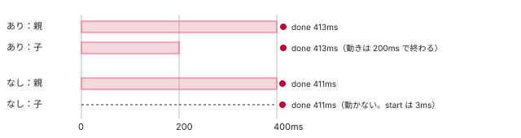

[目次](../README.md) › [animations の説明文の読み残し](README.md) › 第 6 回 / 全 9 回

# 遷移のエンジン：TransitionAnimationEngine ほか

> animations/browser/src/render の transition\_animation\_engine.ts・timeline\_animation\_engine.ts・animation\_engine\_next.ts・animation\_renderer.ts の未読の行：トリガーの値と params だけの変化、リスナー、名前空間の並び、途中での置き換え、親子と animateChild、@.disabled、\* と ! のスタイル、AnimationBuilder の側のエンジン。

angular/angular · 読了 約 14 分 · 発展 · [サイトで読む（デモが動きます）](https://angular-deep-dive-cyan.vercel.app/chapter/anm-engine)

---

この章で分かること：`TransitionAnimationEngine` の 1944 行のうち、[旧エンジンの章](../animations/16-animations-legacy-engine.md)が読まなかった行（約 1500 行）にある約束です。トリガーの値の形、同じ値で params だけ変わったとき、リスナーの登録と外し方、名前空間の並べ方、遷移の途中での置き換え、親子のアニメーション（animateChild）、`@.disabled`、`*` と `!` のスタイルの計算を、コメントと行で読み、本物の 22.2.6 を headless Chrome で動かした時刻つきの記録と突き合わせます。AnimationBuilder の側の `TimelineAnimationEngine` と、2 つのエンジンの窓口の残りの行も、ここで読みます。

読む対象は `packages/animations/browser/src/render/` の `transition_animation_engine.ts`・`timeline_animation_engine.ts`・`animation_engine_next.ts`・`animation_renderer.ts` と `web_animations/web_animations_player.ts` の 1 か所です（../angular、8576f161ae4）。trigger → 待ち行列 → flush → プレイヤー → 要素を外す、の大筋は[旧エンジンの章](../animations/16-animations-legacy-engine.md)、レンダラーがどうエンジンを呼ぶかは[旧パッケージの入口の章](../animations/14-animations-legacy-setup.md)、timeline の中身は[前回](05-anm-timeline.md)です。

1. [1. trigger・state・style・animate](01-anm-trigger-state.md)
2. [2. transition・query・stagger](02-anm-transition-query.md)
3. [3. AnimationBuilder とプレイヤー](03-anm-builder-players.md)
4. [4. DSL を AST に](04-anm-ast.md)
5. [5. タイムライン](05-anm-timeline.md)
6. **6. 遷移のエンジン**（この章）
7. [7. Web Animations のドライバー](07-anm-driver.md)
8. [8. provideAnimations](08-anm-module.md)
9. [9. spec と issue](09-anm-tests-issues.md)

> [!TIP]
> **新卒エンジニアへ**
>
> 名前空間（namespace）は、`animations` を持つコンポーネントのインスタンス 1 つ分の入れ物です。トリガーの定義・要素ごとのリスナー・待ち行列を持ちます（`AnimationTransitionNamespace`）。エンジンは 1 つで、名前空間をアプリの中の数だけ持ちます。DEMO は、npm から取った本物の `@angular/animations`・`core`・`platform-browser` 22.2.6 で `provideAnimations()` の小さなアプリを作り、手元の headless Chrome で動かした記録の再生です（このページはそのパッケージを読み込みません）。

## 1. エンジンが要素に付けるクラスと、消える要素の印

📄 `angular/packages/animations/browser/src/render/transition_animation_engine.ts` L53–75 （▶ の行: 53, 55, 57, 61–66, 68, 73）

```ts
53 ▶ const QUEUED_CLASSNAME = 'ng-animate-queued';
54 │ const QUEUED_SELECTOR = '.ng-animate-queued';
55 ▶ const DISABLED_CLASSNAME = 'ng-animate-disabled';
56 │ const DISABLED_SELECTOR = '.ng-animate-disabled';
57 ▶ const STAR_CLASSNAME = 'ng-star-inserted';
58 │ const STAR_SELECTOR = '.ng-star-inserted';
59 │ 
60 │ const EMPTY_PLAYER_ARRAY: TransitionAnimationPlayer[] = [];
61 ▶ const NULL_REMOVAL_STATE: ElementAnimationState = {
62 ▶   namespaceId: '',
63 ▶   setForRemoval: false,
64 ▶   setForMove: false,
65 ▶   hasAnimation: false,
66 ▶   removedBeforeQueried: false,
67 │ };
68 ▶ const NULL_REMOVED_QUERIED_STATE: ElementAnimationState = {
69 │   namespaceId: '',
70 │   setForMove: false,
71 │   setForRemoval: false,
72 │   hasAnimation: false,
73 ▶   removedBeforeQueried: true,
74 │ };
75 │ 
```

53 行目の `ng-animate-queued` は「待ち行列に積んだ」（旧エンジンの章の 2 節）、55 行目の `ng-animate-disabled` は `[@.disabled]` の要素（7 節）、57 行目の `ng-star-inserted` は flush で「入った」要素に付けるクラスです。61〜74 行目の 2 つは、消える要素に付ける `__ng_removed` の印（92 行目）の既定の値で、68〜74 行目は 73 行目の `removedBeforeQueried: true`、つまり「親のアニメーションが query する前に消えた」印です（8 節の 1815 行目）。DEMO の「出入り」で、入った要素は tick の直後に `ng-trigger ng-trigger-fade ng-star-inserted ng-animating` を持ち、動き終わると `ng-animating` だけが外れていました（`ng-trigger` の 2 つは 3 節の 188〜189 行目）。

## 2. トリガーの値：文字列か、{value, params} か

📄 `angular/packages/animations/browser/src/render/transition_animation_engine.ts` L103–141 （▶ の行: 115–118, 120–121, 125–126, 130, 134–136）

```ts
103 │ class StateValue {
104 │   public value: string;
105 │   public options: AnimationOptions;
106 │ 
107 │   get params(): {[key: string]: any} {
108 │     return this.options.params as {[key: string]: any};
109 │   }
110 │ 
111 │   constructor(
112 │     input: any,
113 │     public namespaceId: string = '',
114 │   ) {
115 ▶     const isObj = input && Object.hasOwn(input, 'value');
116 ▶     const value = isObj ? input['value'] : input;
117 ▶     this.value = normalizeTriggerValue(value);
118 ▶     if (isObj) {
119 │       // we drop the value property from options.
120 ▶       const {value, ...options} = input;
121 ▶       this.options = options as AnimationOptions;
122 │     } else {
123 │       this.options = {};
124 │     }
125 ▶     if (!this.options.params) {
126 ▶       this.options.params = {};
127 │     }
128 │   }
129 │ 
130 ▶   absorbOptions(options: AnimationOptions) {
131 │     const newParams = options.params;
132 │     if (newParams) {
133 │       const oldParams = this.options.params!;
134 ▶       Object.keys(newParams).forEach((prop) => {
135 ▶         if (oldParams[prop] == null) {
136 ▶           oldParams[prop] = newParams[prop];
137 │         }
138 │       });
139 │     }
140 │   }
141 │ }
```

📄 `angular/packages/animations/browser/src/render/transition_animation_engine.ts` L1773–1786 （▶ の行: 1774–1777, 1781, 1785）

```ts
1773 │ function normalizeTriggerValue(value: any): any {
1774 ▶   // we use `!= null` here because it's the most simple
1775 ▶   // way to test against a "falsy" value without mixing
1776 ▶   // in empty strings or a zero value. DO NOT OPTIMIZE.
1777 ▶   return value != null ? value : null;
1778 │ }
1779 │ 
1780 │ function isElementNode(node: any) {
1781 ▶   return node && node['nodeType'] === 1;
1782 │ }
1783 │ 
1784 │ function isTriggerEventValid(eventName: string): boolean {
1785 ▶   return eventName == 'start' || eventName == 'done';
1786 │ }
```

`[@x]="v"` の v は、自前の `value` を持つオブジェクトなら 116 行目でその値、120〜121 行目で残りを options（params など）にします。そうでなければ v そのものです。1777 行目は `undefined` も `null` にします（1774〜1776 行目のコメント「空文字や 0 を混ぜずに偽の値を調べる一番簡単な形。最適化するな」）。そのため、値を書かない `<div @fade>` の要素では、DEMO の「出入り」の `(@fade.start)` の `toState` が `null`、leave の `fromState` が `null` でした（入る前の値は 'void'）。130〜140 行目の `absorbOptions` は、まだ値の無い（135 行目の `== null`）params だけを埋めます。

📄 `angular/packages/animations/browser/src/render/transition_animation_engine.ts` L261–286 （▶ の行: 262–264, 268–271, 273–274, 278–280, 284）

```ts
261 │ 
262 ▶     // normally this isn't reached by here, however, if an object expression
263 ▶     // is passed in then it may be a new object each time. Comparing the value
264 ▶     // is important since that will stay the same despite there being a new object.
265 │     // The removal arc here is special cased because the same element is triggered
266 │     // twice in the event that it contains animations on the outer/inner portions
267 │     // of the host container
268 ▶     if (!isRemoval && fromState.value === toState.value) {
269 ▶       // this means that despite the value not changing, some inner params
270 ▶       // have changed which means that the animation final styles need to be applied
271 ▶       if (!objEquals(fromState.params, toState.params)) {
272 │         const errors: Error[] = [];
273 ▶         const fromStyles = trigger.matchStyles(fromState.value, fromState.params, errors);
274 ▶         const toStyles = trigger.matchStyles(toState.value, toState.params, errors);
275 │         if (errors.length) {
276 │           this._engine.reportError(errors);
277 │         } else {
278 ▶           this._engine.afterFlush(() => {
279 ▶             eraseStyles(element, fromStyles);
280 ▶             setStyles(element, toStyles);
281 │           });
282 │         }
283 │       }
284 ▶       return;
285 │     }
286 │ 
```

値が同じなら、ふつうは 1 つ前の行（旧エンジンの章の 247〜254 行目）で終わっていて、ここには来ません。262〜264 行目のコメントのとおり、`{value, params}` のオブジェクトは変更検知のたびに新しくなるので、ここで value を比べ直します。268 行目、同じ value で params だけが違えば、273〜274 行目で前後の state のスタイルを作り直し、278〜281 行目で flush のあとに付け替えて、284 行目で帰ります。プレイヤーは作りません。DEMO の「params だけの変化」で、`state('on', style({width: '{{ w }}px'}))` の w を 10 から 80 にすると、tick の直後に `style="width: 80px;"` になり、`getAnimations()` は 0 個、`(@prm.done)` は呼ばれませんでした。

## 3. リスナー：(@x.start) と (@x.done) だけ

📄 `angular/packages/animations/browser/src/render/transition_animation_engine.ts` L165–192 （▶ の行: 166–167, 170–171, 174–175, 178, 180, 187–190）

```ts
165 │   listen(element: any, name: string, phase: string, callback: (event: any) => boolean): () => any {
166 ▶     if (!this._triggers.has(name)) {
167 ▶       throw missingTrigger(phase, name);
168 │     }
169 │ 
170 ▶     if (phase == null || phase.length == 0) {
171 ▶       throw missingEvent(name);
172 │     }
173 │ 
174 ▶     if (!isTriggerEventValid(phase)) {
175 ▶       throw unsupportedTriggerEvent(phase, name);
176 │     }
177 │ 
178 ▶     const listeners = getOrSetDefaultValue(this._elementListeners, element, []);
179 │     const data = {name, phase, callback};
180 ▶     listeners.push(data);
181 │ 
182 │     const triggersWithStates = getOrSetDefaultValue(
183 │       this._engine.statesByElement,
184 │       element,
185 │       new Map<string, StateValue>(),
186 │     );
187 ▶     if (!triggersWithStates.has(name)) {
188 ▶       addClass(element, NG_TRIGGER_CLASSNAME);
189 ▶       addClass(element, NG_TRIGGER_CLASSNAME + '-' + name);
190 ▶       triggersWithStates.set(name, DEFAULT_STATE_VALUE);
191 │     }
192 │ 
```

📄 `angular/packages/animations/browser/src/render/transition_animation_engine.ts` L193–208 （▶ の行: 194–197, 200, 203–204）

```ts
193 │     return () => {
194 ▶       // the event listener is removed AFTER the flush has occurred such
195 ▶       // that leave animations callbacks can fire (otherwise if the node
196 ▶       // is removed in between then the listeners would be deregistered)
197 ▶       this._engine.afterFlush(() => {
198 │         const index = listeners.indexOf(data);
199 │         if (index >= 0) {
200 ▶           listeners.splice(index, 1);
201 │         }
202 │ 
203 ▶         if (!this._triggers.has(name)) {
204 ▶           triggersWithStates.delete(name);
205 │         }
206 │       });
207 │     };
208 │   }
```

166〜176 行目の 3 つの確かめで、知らないトリガー・空のフェーズ・start と done 以外（1784〜1786 行目）はエラーです（文と番号は[次回](07-anm-driver.md)の表）。187〜191 行目、初めて聞く要素には `ng-trigger` のクラスと「値は void」を入れます。193〜207 行目の外す関数は、すぐには外さず flush のあとに外します。194〜196 行目のコメントのとおり、消える要素の leave の done を、外す前に呼べるようにするためです。

📄 `angular/packages/animations/browser/src/render/transition_animation_engine.ts` L438–469 （▶ の行: 439–440, 444, 448–449, 452–455, 458, 465）

```ts
438 │   prepareLeaveAnimationListeners(element: any) {
439 ▶     const listeners = this._elementListeners.get(element);
440 ▶     const elementStates = this._engine.statesByElement.get(element);
441 │ 
442 │     // if this statement fails then it means that the element was picked up
443 │     // by an earlier flush (or there are no listeners at all to track the leave).
444 ▶     if (listeners && elementStates) {
445 │       const visitedTriggers = new Set<string>();
446 │       listeners.forEach((listener) => {
447 │         const triggerName = listener.name;
448 ▶         if (visitedTriggers.has(triggerName)) return;
449 ▶         visitedTriggers.add(triggerName);
450 │ 
451 │         const trigger = this._triggers.get(triggerName)!;
452 ▶         const transition = trigger.fallbackTransition;
453 ▶         const fromState = elementStates.get(triggerName) || DEFAULT_STATE_VALUE;
454 ▶         const toState = new StateValue(VOID_VALUE);
455 ▶         const player = new TransitionAnimationPlayer(this.id, triggerName, element);
456 │ 
457 │         this._engine.totalQueuedPlayers++;
458 ▶         this._queue.push({
459 │           element,
460 │           triggerName,
461 │           transition,
462 │           fromState,
463 │           toState,
464 │           player,
465 ▶           isFallbackTransition: true,
466 │         });
467 │       });
468 │     }
469 │   }
```

アニメーションの無い要素が消えるとき（旧エンジンの章の 510 行目から呼ばれる）、リスナーがあるトリガーごとに、452 行目の `fallbackTransition`（何も動かさない遷移）を 465 行目の印つきで積みます。こうして `(@x.done)` は、アニメーションが無くても呼ばれます。448〜449 行目で同じトリガーは 1 回だけ、442〜443 行目のコメントのとおり、前の flush で拾われた要素は何もしません。

## 4. 名前空間の並び：親が先、子が後

📄 `angular/packages/animations/browser/src/render/transition_animation_engine.ts` L638–656 （▶ の行: 640–641, 646, 653, 655）

```ts
638 │   createNamespace(namespaceId: string, hostElement: any) {
639 │     const ns = new AnimationTransitionNamespace(namespaceId, hostElement, this);
640 ▶     if (this.bodyNode && this.driver.containsElement(this.bodyNode, hostElement)) {
641 ▶       this._balanceNamespaceList(ns, hostElement);
642 │     } else {
643 │       // defer this later until flush during when the host element has
644 │       // been inserted so that we know exactly where to place it in
645 │       // the namespace list
646 ▶       this.newHostElements.set(hostElement, ns);
647 │ 
648 │       // given that this host element is a part of the animation code, it
649 │       // may or may not be inserted by a parent node that is of an
650 │       // animation renderer type. If this happens then we can still have
651 │       // access to this item when we query for :enter nodes. If the parent
652 │       // is a renderer then the set data-structure will normalize the entry
653 ▶       this.collectEnterElement(hostElement);
654 │     }
655 ▶     return (this._namespaceLookup[namespaceId] = ns);
656 │   }
```

📄 `angular/packages/animations/browser/src/render/transition_animation_engine.ts` L658–691 （▶ の行: 664–666, 668, 672–673, 680–683, 686）

```ts
658 │   private _balanceNamespaceList(ns: AnimationTransitionNamespace, hostElement: any) {
659 │     const namespaceList = this._namespaceList;
660 │     const namespacesByHostElement = this.namespacesByHostElement;
661 │     const limit = namespaceList.length - 1;
662 │     if (limit >= 0) {
663 │       let found = false;
664 ▶       // Find the closest ancestor with an existing namespace so we can then insert `ns` after it,
665 ▶       // establishing a top-down ordering of namespaces in `this._namespaceList`.
666 ▶       let ancestor = this.driver.getParentElement(hostElement);
667 │       while (ancestor) {
668 ▶         const ancestorNs = namespacesByHostElement.get(ancestor);
669 │         if (ancestorNs) {
670 │           // An animation namespace has been registered for this ancestor, so we insert `ns`
671 │           // right after it to establish top-down ordering of animation namespaces.
672 ▶           const index = namespaceList.indexOf(ancestorNs);
673 ▶           namespaceList.splice(index + 1, 0, ns);
674 │           found = true;
675 │           break;
676 │         }
677 │         ancestor = this.driver.getParentElement(ancestor);
678 │       }
679 │       if (!found) {
680 ▶         // No namespace exists that is an ancestor of `ns`, so `ns` is inserted at the front to
681 ▶         // ensure that any existing descendants are ordered after `ns`, retaining the desired
682 ▶         // top-down ordering.
683 ▶         namespaceList.unshift(ns);
684 │       }
685 │     } else {
686 ▶       namespaceList.push(ns);
687 │     }
688 │ 
689 │     namespacesByHostElement.set(hostElement, ns);
690 │     return ns;
691 │   }
```

ホストの要素がもう body の中にあれば 641 行目ですぐ並べ、まだなら 646 行目で flush まで待ちます（643〜645 行目のコメント）。653 行目で、その要素を「入った要素」にも数えるので、親のアニメーションの `query(':enter')` から見えます（647〜652 行目のコメント）。664〜665 行目のコメントのとおり、並べ方は「いちばん近い祖先の名前空間のすぐ後」で、祖先が無ければ 683 行目で先頭です。こうして `_namespaceList` は DOM の上から下の順になります。

📄 `angular/packages/animations/browser/src/render/transition_animation_engine.ts` L1088–1122 （▶ の行: 1090, 1092, 1097–1101, 1106, 1113, 1118–1119）

```ts
1088 │     const allPlayers: TransitionAnimationPlayer[] = [];
1089 │     const erroneousTransitions: AnimationTransitionInstruction[] = [];
1090 ▶     for (let i = this._namespaceList.length - 1; i >= 0; i--) {
1091 │       const ns = this._namespaceList[i];
1092 ▶       ns.drainQueuedTransitions(microtaskId).forEach((entry) => {
1093 │         const player = entry.player;
1094 │         const element = entry.element;
1095 │         allPlayers.push(player);
1096 │ 
1097 ▶         if (this.collectedEnterElements.length) {
1098 ▶           const details = element[REMOVAL_FLAG] as ElementAnimationState;
1099 ▶           // animations for move operations (elements being removed and reinserted,
1100 ▶           // e.g. when the order of an *ngFor list changes) are currently not supported
1101 ▶           if (details && details.setForMove) {
1102 │             if (
1103 │               details.previousTriggersValues &&
1104 │               details.previousTriggersValues.has(entry.triggerName)
1105 │             ) {
1106 ▶               const previousValue = details.previousTriggersValues.get(entry.triggerName) as string;
1107 │ 
1108 │               // we need to restore the previous trigger value since the element has
1109 │               // only been moved and hasn't actually left the DOM
1110 │               const triggersWithStates = this.statesByElement.get(entry.element);
1111 │               if (triggersWithStates && triggersWithStates.has(entry.triggerName)) {
1112 │                 const state = triggersWithStates.get(entry.triggerName)!;
1113 ▶                 state.value = previousValue;
1114 │                 triggersWithStates.set(entry.triggerName, state);
1115 │               }
1116 │             }
1117 │ 
1118 ▶             player.destroy();
1119 ▶             return;
1120 │           }
1121 │         }
1122 │ 
```

flush は 1090 行目で、その並びを**後ろから**回します。子の名前空間の遷移が先に命令になり、親の遷移を組み立てるときには、子の命令がもう `subTimelines` に入っています（L1173 の `subTimelines.append`）。[前回](05-anm-timeline.md)の animateChild が子の命令を親の timeline に並べられるのは、この順番のためです。1097〜1120 行目は、消すと印を付けた要素がまた入った「移動」（1099〜1100 行目のコメント「\*ngFor の並べ替えなど。今は移動のアニメーションはサポートしない」）で、1113 行目で前の値に戻し、1118 行目でプレイヤーを捨てます。

📄 `angular/packages/animations/browser/src/render/transition_animation_engine.ts` L693–722 （▶ の行: 694, 696, 703–704, 710, 712, 717, 719–720）

```ts
693 │   register(namespaceId: string, hostElement: any) {
694 ▶     let ns = this._namespaceLookup[namespaceId];
695 │     if (!ns) {
696 ▶       ns = this.createNamespace(namespaceId, hostElement);
697 │     }
698 │     return ns;
699 │   }
700 │ 
701 │   registerTrigger(namespaceId: string, name: string, trigger: AnimationTrigger) {
702 │     let ns = this._namespaceLookup[namespaceId];
703 ▶     if (ns && ns.register(name, trigger)) {
704 ▶       this.totalAnimations++;
705 │     }
706 │   }
707 │ 
708 │   destroy(namespaceId: string, context: any) {
709 │     if (!namespaceId) return;
710 ▶     this.afterFlush(() => {});
711 │ 
712 ▶     this.afterFlushAnimationsDone(() => {
713 │       const ns = this._fetchNamespace(namespaceId);
714 │       this.namespacesByHostElement.delete(ns.hostElement);
715 │       const index = this._namespaceList.indexOf(ns);
716 │       if (index >= 0) {
717 ▶         this._namespaceList.splice(index, 1);
718 │       }
719 ▶       ns.destroy(context);
720 ▶       delete this._namespaceLookup[namespaceId];
721 │     });
722 │   }
```

📄 `angular/packages/animations/browser/src/render/transition_animation_engine.ts` L379–403 （▶ の行: 380, 382–384, 388, 391–392, 394, 398–401）

```ts
379 │   private _signalRemovalForInnerTriggers(rootElement: any, context: any) {
380 ▶     const elements = this._engine.driver.query(rootElement, NG_TRIGGER_SELECTOR, true);
381 │ 
382 ▶     // emulate a leave animation for all inner nodes within this node.
383 ▶     // If there are no animations found for any of the nodes then clear the cache
384 ▶     // for the element.
385 │     elements.forEach((elm) => {
386 │       // this means that an inner remove() operation has already kicked off
387 │       // the animation on this element...
388 ▶       if (elm[REMOVAL_FLAG]) return;
389 │ 
390 │       const namespaces = this._engine.fetchNamespacesByElement(elm);
391 ▶       if (namespaces.size) {
392 ▶         namespaces.forEach((ns) => ns.triggerLeaveAnimation(elm, context, false, true));
393 │       } else {
394 ▶         this.clearElementCache(elm);
395 │       }
396 │     });
397 │ 
398 ▶     // If the child elements were removed along with the parent, their animations might not
399 ▶     // have completed. Clear all the elements from the cache so we don't end up with a memory leak.
400 ▶     this._engine.afterFlushAnimationsDone(() =>
401 ▶       elements.forEach((elm) => this.clearElementCache(elm)),
402 │     );
403 │   }
```

コンポーネントが壊されると、`destroy` は 712 行目で「この flush のアニメーションが全部終わってから」名前空間を外します。719 行目の `ns.destroy` から 380 行目、ホストの中の `ng-trigger` の要素ごとに、392 行目で leave を真似るか、名前空間が無ければ 394 行目で覚えていた状態を消します。398〜401 行目のコメントは「親と一緒に外された子のアニメーションは終わっていないことがある。メモリリークにならないよう全部消す」。704 行目の `totalAnimations` は、旧エンジンの章の 959 行目で `ng-star-inserted` を付けるかの判断に使う数です。

## 5. 途中での置き換え：前のプレイヤーの今の値から

📄 `angular/packages/animations/browser/src/render/transition_animation_engine.ts` L1449–1481 （▶ の行: 1457–1458, 1463, 1465, 1467–1468, 1473, 1475–1476）

```ts
1449 │   private _getPreviousPlayers(
1450 │     element: string,
1451 │     isQueriedElement: boolean,
1452 │     namespaceId?: string,
1453 │     triggerName?: string,
1454 │     toStateValue?: any,
1455 │   ): TransitionAnimationPlayer[] {
1456 │     let players: TransitionAnimationPlayer[] = [];
1457 ▶     if (isQueriedElement) {
1458 ▶       const queriedElementPlayers = this.playersByQueriedElement.get(element);
1459 │       if (queriedElementPlayers) {
1460 │         players = queriedElementPlayers;
1461 │       }
1462 │     } else {
1463 ▶       const elementPlayers = this.playersByElement.get(element);
1464 │       if (elementPlayers) {
1465 ▶         const isRemovalAnimation = !toStateValue || toStateValue == VOID_VALUE;
1466 │         elementPlayers.forEach((player) => {
1467 ▶           if (player.queued) return;
1468 ▶           if (!isRemovalAnimation && player.triggerName != triggerName) return;
1469 │           players.push(player);
1470 │         });
1471 │       }
1472 │     }
1473 ▶     if (namespaceId || triggerName) {
1474 │       players = players.filter((player) => {
1475 ▶         if (namespaceId && namespaceId != player.namespaceId) return false;
1476 ▶         if (triggerName && triggerName != player.triggerName) return false;
1477 │         return true;
1478 │       });
1479 │     }
1480 │     return players;
1481 │   }
```

📄 `angular/packages/animations/browser/src/render/transition_animation_engine.ts` L1488–1524 （▶ の行: 1491–1494, 1496, 1504, 1511–1514, 1516, 1521–1523）

```ts
1488 │     const triggerName = instruction.triggerName;
1489 │     const rootElement = instruction.element;
1490 │ 
1491 ▶     // when a removal animation occurs, ALL previous players are collected
1492 ▶     // and destroyed (even if they are outside of the current namespace)
1493 ▶     const targetNameSpaceId: string | undefined = instruction.isRemovalTransition
1494 ▶       ? undefined
1495 │       : namespaceId;
1496 ▶     const targetTriggerName: string | undefined = instruction.isRemovalTransition
1497 │       ? undefined
1498 │       : triggerName;
1499 │ 
1500 │     for (const timelineInstruction of instruction.timelines) {
1501 │       const element = timelineInstruction.element;
1502 │       const isQueriedElement = element !== rootElement;
1503 │       const players = getOrSetDefaultValue(allPreviousPlayersMap, element, []);
1504 ▶       const previousPlayers = this._getPreviousPlayers(
1505 │         element,
1506 │         isQueriedElement,
1507 │         targetNameSpaceId,
1508 │         targetTriggerName,
1509 │         instruction.toState,
1510 │       );
1511 ▶       previousPlayers.forEach((player) => {
1512 ▶         const realPlayer = (player as TransitionAnimationPlayer).getRealPlayer() as any;
1513 ▶         if (realPlayer.beforeDestroy) {
1514 ▶           realPlayer.beforeDestroy();
1515 │         }
1516 ▶         player.destroy();
1517 │         players.push(player);
1518 │       });
1519 │     }
1520 │ 
1521 ▶     // this needs to be done so that the PRE/POST styles can be
1522 ▶     // computed properly without interfering with the previous animation
1523 ▶     eraseStyles(rootElement, instruction.fromStyles);
1524 │   }
```

📄 `angular/packages/animations/browser/src/render/web_animations/web_animations_player.ts` L223–238 （▶ の行: 225–228, 230, 232, 237）

```ts
223 │   beforeDestroy() {
224 │     const styles: ɵStyleDataMap = new Map();
225 ▶     if (this.hasStarted()) {
226 ▶       // note: this code is invoked only when the `play` function was called prior to this
227 ▶       // (thus `hasStarted` returns true), this implies that the code that initializes
228 ▶       // `_finalKeyframe` has also been executed and the non-null assertion can be safely used here
229 │       const finalKeyframe = this._finalKeyframe!;
230 ▶       finalKeyframe.forEach((val, prop) => {
231 │         if (prop !== 'offset') {
232 ▶           styles.set(prop, this._finished ? val : computeStyle(this.element, prop));
233 │         }
234 │       });
235 │     }
236 │ 
237 ▶     this.currentSnapshot = styles;
238 │   }
```

1. **1467 行目：まだ積まれたままのプレイヤーは数えない**

   同じ回の中の 2 回目の値は、旧エンジンの章の 297〜298 行目で先に捨てられています。ここで見るのは、もう動いているものだけです。1468 行目、消えるのでない遷移は同じトリガーのものだけを数えます。
2. **1493〜1498 行目：消える遷移なら、名前空間もトリガーも問わず全部**

   1491〜1492 行目のコメント「removal のときは、今の名前空間の外のものも含めて、前のプレイヤーを全部集めて壊す」。
3. **1512〜1516 行目：壊す前に今の値を写す**

   `WebAnimationsPlayer.beforeDestroy` は、動き出していれば（225 行目）最後の keyframe のプロパティごとに、終わっていなければ `getComputedStyle` の今の値を取ります（232 行目）。この値が、ドライバーの animate で次の最初の keyframe に混ぜられます（旧エンジンの章の 5 節）。
4. **1523 行目：前の state のスタイルを消す**

   1521〜1522 行目のコメント「前のアニメーションに邪魔されずに pre / post のスタイルを計算するため」（8 節）。

DEMO の「途中での置き換え」では、a → b（10px → 100px、600ms）の 300ms 目に c（50px）にすると、同じ時刻に `(@size.done)`（a → b、totalTime 600）が呼ばれ、続いて `(@size.start)`（b → c）でした。新しいアニメーションの keyframes は `0 → height: 54.9844px`・`1 → height: 50px` で、置き換えた時の高さから始まりました。終わると `style="height: 50px;"` が残りました（state のスタイル）。

## 6. 親子：子のトリガーは親のプレイヤーに合わせる

📄 `angular/packages/animations/browser/src/render/transition_animation_engine.ts` L1291–1327 （▶ の行: 1293, 1296–1299, 1301–1302, 1307–1309, 1313–1314, 1317–1318, 1320, 1325）

```ts
1291 │     const rootPlayers: TransitionAnimationPlayer[] = [];
1292 │     const subPlayers: TransitionAnimationPlayer[] = [];
1293 ▶     const NO_PARENT_ANIMATION_ELEMENT_DETECTED = {};
1294 │     queuedInstructions.forEach((entry) => {
1295 │       const {element, player, instruction} = entry;
1296 ▶       // this means that it was never consumed by a parent animation which
1297 ▶       // means that it is independent and therefore should be set for animation
1298 ▶       if (subTimelines.has(element)) {
1299 ▶         if (disabledElementsSet.has(element)) {
1300 │           player.onDestroy(() => setStyles(element, instruction.toStyles));
1301 ▶           player.disabled = true;
1302 ▶           player.overrideTotalTime(instruction.totalTime);
1303 │           skippedPlayers.push(player);
1304 │           return;
1305 │         }
1306 │ 
1307 ▶         // this will flow up the DOM and query the map to figure out
1308 ▶         // if a parent animation has priority over it. In the situation
1309 ▶         // that a parent is detected then it will cancel the loop. If
1310 │         // nothing is detected, or it takes a few hops to find a parent,
1311 │         // then it will fill in the missing nodes and signal them as having
1312 │         // a detected parent (or a NO_PARENT value via a special constant).
1313 ▶         let parentWithAnimation: any = NO_PARENT_ANIMATION_ELEMENT_DETECTED;
1314 ▶         if (animationElementMap.size > 1) {
1315 │           let elm = element;
1316 │           const parentsToAdd: any[] = [];
1317 ▶           while ((elm = elm.parentNode)) {
1318 ▶             const detectedParent = animationElementMap.get(elm);
1319 │             if (detectedParent) {
1320 ▶               parentWithAnimation = detectedParent;
1321 │               break;
1322 │             }
1323 │             parentsToAdd.push(elm);
1324 │           }
1325 ▶           parentsToAdd.forEach((parent) => animationElementMap.set(parent, parentWithAnimation));
1326 │         }
1327 │ 
```

1313〜1326 行目で、この要素から DOM を上にたどり、アニメーションする祖先（`animationElementMap`）を探します。見つかれば、旧エンジンの章の 1342〜1346 行目で、自分のプレイヤーに `parentPlayer` を付けて「飛ばすもの（skippedPlayers）」にします。自分では play しません。1307〜1312 行目のコメント「親が見つかったらループを止める。途中の要素は、見つかった親（か NO\_PARENT）を書き込んで、次の要素が早く見つけられるようにする」が 1325 行目です。

📄 `angular/packages/animations/browser/src/render/transition_animation_engine.ts` L1573–1607 （▶ の行: 1573–1576, 1579–1580, 1593, 1595–1597, 1600–1603）

```ts
1573 ▶       // this means that this particular player belongs to a sub trigger. It is
1574 ▶       // important that we match this player up with the corresponding (@trigger.listener)
1575 ▶       if (timelineInstruction.subTimeline && skippedPlayersMap) {
1576 ▶         allSubElements.add(element);
1577 │       }
1578 │ 
1579 ▶       if (isQueriedElement) {
1580 ▶         const wrappedPlayer = new TransitionAnimationPlayer(namespaceId, triggerName, element);
1581 │         wrappedPlayer.setRealPlayer(player);
1582 │         allQueriedPlayers.push(wrappedPlayer);
1583 │       }
1584 │ 
1585 │       return player;
1586 │     });
1587 │ 
1588 │     allQueriedPlayers.forEach((player) => {
1589 │       getOrSetDefaultValue(this.playersByQueriedElement, player.element, []).push(player);
1590 │       player.onDone(() => deleteOrUnsetInMap(this.playersByQueriedElement, player.element, player));
1591 │     });
1592 │ 
1593 ▶     allConsumedElements.forEach((element) => addClass(element, NG_ANIMATING_CLASSNAME));
1594 │     const player = optimizeGroupPlayer(allNewPlayers);
1595 ▶     player.onDestroy(() => {
1596 ▶       allConsumedElements.forEach((element) => removeClass(element, NG_ANIMATING_CLASSNAME));
1597 ▶       setStyles(rootElement, instruction.toStyles);
1598 │     });
1599 │ 
1600 ▶     // this basically makes all of the callbacks for sub element animations
1601 ▶     // be dependent on the upper players for when they finish
1602 ▶     allSubElements.forEach((element) => {
1603 ▶       getOrSetDefaultValue(skippedPlayersMap, element, []).push(player);
1604 │     });
1605 │ 
1606 │     return player;
1607 │   }
```

📄 `angular/packages/animations/browser/src/render/transition_animation_engine.ts` L1372–1385 （▶ の行: 1372–1374, 1376–1377, 1379）

```ts
1372 ▶     // the reason why we don't actually play the animation is
1373 ▶     // because all that a skipped player is designed to do is to
1374 ▶     // fire the start/done transition callback events
1375 │     skippedPlayers.forEach((player) => {
1376 ▶       if (player.parentPlayer) {
1377 ▶         player.syncPlayerEvents(player.parentPlayer);
1378 │       } else {
1379 ▶         player.destroy();
1380 │       }
1381 │     });
1382 │ 
1383 │     // run through all of the queued removals and see if they
1384 │     // were picked up by a query. If not then perform the removal
1385 │     // operation right away unless a parent animation is ongoing.
```

📄 `angular/packages/animations/browser/src/render/transition_animation_engine.ts` L1664–1681 （▶ の行: 1673, 1675–1676, 1678–1679）

```ts
1664 │ 
1665 │   getRealPlayer() {
1666 │     return this._player;
1667 │   }
1668 │ 
1669 │   overrideTotalTime(totalTime: number) {
1670 │     (this as any).totalTime = totalTime;
1671 │   }
1672 │ 
1673 ▶   syncPlayerEvents(player: AnimationPlayer) {
1674 │     const p = this._player as any;
1675 ▶     if (p.triggerCallback) {
1676 ▶       player.onStart(() => p.triggerCallback!('start'));
1677 │     }
1678 ▶     player.onDone(() => this.finish());
1679 ▶     player.onDestroy(() => this.destroy());
1680 │   }
1681 │ 
```

1. **1575〜1577 行目：親の命令の中の「子の timeline」**

   animateChild で親の timeline に並べた子の命令は `subTimeline: true`（前回の 1049 行目）です。その子の要素を覚え、1602〜1604 行目で「この要素の子のトリガーは、このプレイヤーで動く」と記録します。
2. **1376〜1377 行目：飛ばしたプレイヤーは、親に合わせてイベントだけ出す**

   1372〜1374 行目のコメント「飛ばしたプレイヤーがするのは start と done のコールバックを出すことだけ」。1676 行目で親が始まったら start、1678 行目で親が終わったら自分を finish（done）にします。

DEMO の「親子」で、親の `:enter` が 400ms、子の `:enter` が 200ms です。animateChild ありでは、子の要素は親と同時に動き出して 200ms で幅が 40px になり、`(@child.done)` は 413ms、親の `(@parentWith.done)` と同じ時刻でした（子の動きは 200ms で終わっていても、done は親に合わせる）。親の要素には、style だけの長さ 0 のアニメーションと 400ms のアニメーションの 2 つがありました。animateChild なしでは、子の要素には `getAnimations()` が 1 つも無く（幅は 50px のまま、動かない）、それでも `(@child.start)` は 3ms、`(@child.done)` は親と同じ 411ms に呼ばれ、`totalTime` は子自身の 200 でした。



*DEMO の「親子」の記録から：子の動きと、子の done が呼ばれる時刻*

## 7. @.disabled：プレイヤーを作らず、イベントだけ

📄 `angular/packages/animations/browser/src/render/transition_animation_engine.ts` L797–811 （▶ の行: 798, 801–805, 807–809）

```ts
797 │   collectEnterElement(element: any) {
798 ▶     this.collectedEnterElements.push(element);
799 │   }
800 │ 
801 ▶   markElementAsDisabled(element: any, value: boolean) {
802 ▶     if (value) {
803 ▶       if (!this.disabledNodes.has(element)) {
804 ▶         this.disabledNodes.add(element);
805 ▶         addClass(element, DISABLED_CLASSNAME);
806 │       }
807 ▶     } else if (this.disabledNodes.has(element)) {
808 ▶       this.disabledNodes.delete(element);
809 ▶       removeClass(element, DISABLED_CLASSNAME);
810 │     }
811 │   }
```

📄 `angular/packages/animations/browser/src/render/transition_animation_engine.ts` L1009–1030 （▶ の行: 1021–1024, 1026）

```ts
1009 │   private _flushAnimations(
1010 │     cleanupFns: Function[],
1011 │     microtaskId: number,
1012 │   ): TransitionAnimationPlayer[] {
1013 │     const subTimelines = new ElementInstructionMap();
1014 │     const skippedPlayers: TransitionAnimationPlayer[] = [];
1015 │     const skippedPlayersMap = new Map<any, AnimationPlayer[]>();
1016 │     const queuedInstructions: QueuedTransition[] = [];
1017 │     const queriedElements = new Map<any, TransitionAnimationPlayer[]>();
1018 │     const allPreStyleElements = new Map<any, Set<string>>();
1019 │     const allPostStyleElements = new Map<any, Set<string>>();
1020 │ 
1021 ▶     const disabledElementsSet = new Set<any>();
1022 ▶     this.disabledNodes.forEach((node) => {
1023 ▶       disabledElementsSet.add(node);
1024 ▶       const nodesThatAreDisabled = this.driver.query(node, QUEUED_SELECTOR, true);
1025 │       for (let i = 0; i < nodesThatAreDisabled.length; i++) {
1026 ▶         disabledElementsSet.add(nodesThatAreDisabled[i]);
1027 │       }
1028 │     });
1029 │ 
1030 │     const bodyNode = this.bodyNode;
```

`[@.disabled]="true"` は、レンダラーから `disableAnimations`（10 節の 95〜97 行目）を通って 801 行目に来て、805 行目でクラスを付けます。DEMO の親の要素は `class="s4wrap ng-animate-disabled"` でした。flush の 1022〜1027 行目で、止める要素の集合を「その要素」と「その中で待ち行列に積まれた要素（1024 行目の `.ng-animate-queued`）」にします。6 節の 1299〜1304 行目で、その要素のプレイヤーは 1301 行目で `disabled`、1302 行目で totalTime を命令の長さにして、飛ばすものになります。

DEMO の「@.disabled」では、入るときも消えるときも `getAnimations()` は 0 個で、`(@fade.start)` と `(@fade.done)` が tick の直後の同じ時刻に、`disabled: true`・`totalTime: 300`（動いていないのに、遷移の長さ）で呼ばれました。消えるときは tick の直後にもう DOM に無く、done の時点でも「無い」でした。

## 8. \* と ! のスタイル：見えなくして計算する

📄 `angular/packages/animations/browser/src/render/transition_animation_engine.ts` L1246–1272 （▶ の行: 1246–1254, 1257, 1259, 1264）

```ts
1246 ▶     // this is a special case for nodes that will be removed either by
1247 ▶     // having their own leave animations or by being queried in a container
1248 ▶     // that will be removed once a parent animation is complete. The idea
1249 ▶     // here is that * styles must be identical to ! styles because of
1250 ▶     // backwards compatibility (* is also filled in by default in many places).
1251 ▶     // Otherwise * styles will return an empty value or "auto" since the element
1252 ▶     // passed to getComputedStyle will not be visible (since * === destination)
1253 ▶     const replaceNodes = allLeaveNodes.filter((node) => {
1254 ▶       return replacePostStylesAsPre(node, allPreStyleElements, allPostStyleElements);
1255 │     });
1256 │ 
1257 ▶     // POST STAGE: fill the * styles
1258 │     const postStylesMap = new Map<any, ɵStyleDataMap>();
1259 ▶     const allLeaveQueriedNodes = cloakAndComputeStyles(
1260 │       postStylesMap,
1261 │       this.driver,
1262 │       leaveNodesWithoutAnimations,
1263 │       allPostStyleElements,
1264 ▶       AUTO_STYLE,
1265 │     );
1266 │ 
1267 │     allLeaveQueriedNodes.forEach((node) => {
1268 │       if (replacePostStylesAsPre(node, allPreStyleElements, allPostStyleElements)) {
1269 │         replaceNodes.push(node);
1270 │       }
1271 │     });
1272 │ 
```

📄 `angular/packages/animations/browser/src/render/transition_animation_engine.ts` L1273–1290 （▶ の行: 1273, 1275–1276, 1281, 1285, 1288）

```ts
1273 ▶     // PRE STAGE: fill the ! styles
1274 │     const preStylesMap = new Map<any, ɵStyleDataMap>();
1275 ▶     enterNodeMap.forEach((nodes, root) => {
1276 ▶       cloakAndComputeStyles(
1277 │         preStylesMap,
1278 │         this.driver,
1279 │         new Set(nodes),
1280 │         allPreStyleElements,
1281 ▶         PRE_STYLE,
1282 │       );
1283 │     });
1284 │ 
1285 ▶     replaceNodes.forEach((node) => {
1286 │       const post = postStylesMap.get(node);
1287 │       const pre = preStylesMap.get(node);
1288 ▶       postStylesMap.set(node, new Map([...(post?.entries() ?? []), ...(pre?.entries() ?? [])]));
1289 │     });
1290 │ 
```

📄 `angular/packages/animations/browser/src/render/transition_animation_engine.ts` L1794–1828 （▶ の行: 1802, 1806, 1809, 1812–1816, 1825）

```ts
1794 │ function cloakAndComputeStyles(
1795 │   valuesMap: Map<any, ɵStyleDataMap>,
1796 │   driver: AnimationDriver,
1797 │   elements: Set<any>,
1798 │   elementPropsMap: Map<any, Set<string>>,
1799 │   defaultStyle: string,
1800 │ ): any[] {
1801 │   const cloakVals: string[] = [];
1802 ▶   elements.forEach((element) => cloakVals.push(cloakElement(element)));
1803 │ 
1804 │   const failedElements: any[] = [];
1805 │ 
1806 ▶   elementPropsMap.forEach((props: Set<string>, element: any) => {
1807 │     const styles: ɵStyleDataMap = new Map();
1808 │     props.forEach((prop) => {
1809 ▶       const value = driver.computeStyle(element, prop, defaultStyle);
1810 │       styles.set(prop, value);
1811 │ 
1812 ▶       // there is no easy way to detect this because a sub element could be removed
1813 ▶       // by a parent animation element being detached.
1814 ▶       if (!value || value.length == 0) {
1815 ▶         element[REMOVAL_FLAG] = NULL_REMOVED_QUERIED_STATE;
1816 ▶         failedElements.push(element);
1817 │       }
1818 │     });
1819 │     valuesMap.set(element, styles);
1820 │   });
1821 │ 
1822 │   // we use a index variable here since Set.forEach(a, i) does not return
1823 │   // an index value for the closure (but instead just the value)
1824 │   let i = 0;
1825 ▶   elements.forEach((element) => cloakElement(element, cloakVals[i++]));
1826 │ 
1827 │   return failedElements;
1828 │ }
```

keyframes の `*`（`AUTO_STYLE`）は「終わりの計算済みの値」、`!`（`PRE_STYLE`）は「始まる前の計算済みの値」です。どちらもエンジンが動かす直前に、`driver.computeStyle` で本物の値に置き換えます。1257〜1265 行目の POST の段では、アニメーションの無い消える要素を 1802 行目で `display: none` にしてから計算し、1825 行目で元に戻します。1273〜1283 行目の PRE の段は、入った要素のまとまりごとに同じことをします。1812〜1816 行目、計算した値が空なら、その要素は親と一緒にもう外されたとみなして、1 節の `removedBeforeQueried` の印を付けます。1246〜1252 行目のコメントは「互換のため、自分の leave があるか、消える親の中で query される要素では、`*` を `!` と同じにする（終わりの値を見えない要素で計算すると空か auto になる）」で、1285〜1289 行目がその付け替えです。

📄 `angular/packages/animations/browser/src/render/transition_animation_engine.ts` L1830–1869 （▶ の行: 1831–1833, 1835–1838, 1857–1862, 1865）

```ts
1830 │ /*
1831 ▶ Since the Angular renderer code will return a collection of inserted
1832 ▶ nodes in all areas of a DOM tree, it's up to this algorithm to figure
1833 ▶ out which nodes are roots for each animation @trigger.
1834 │ 
1835 ▶ By placing each inserted node into a Set and traversing upwards, it
1836 ▶ is possible to find the @trigger elements and well any direct *star
1837 ▶ insertion nodes, if a @trigger root is found then the enter element
1838 ▶ is placed into the Map[@trigger] spot.
1839 │  */
1840 │ function buildRootMap(roots: any[], nodes: any[]): Map<any, any[]> {
1841 │   const rootMap = new Map<any, any[]>();
1842 │   roots.forEach((root) => rootMap.set(root, []));
1843 │ 
1844 │   if (nodes.length == 0) return rootMap;
1845 │ 
1846 │   const NULL_NODE = 1;
1847 │   const nodeSet = new Set(nodes);
1848 │   const localRootMap = new Map<any, any>();
1849 │ 
1850 │   function getRoot(node: any): any {
1851 │     if (!node) return NULL_NODE;
1852 │ 
1853 │     let root = localRootMap.get(node);
1854 │     if (root) return root;
1855 │ 
1856 │     const parent = node.parentNode;
1857 ▶     if (rootMap.has(parent)) {
1858 ▶       // ngIf inside @trigger
1859 ▶       root = parent;
1860 ▶     } else if (nodeSet.has(parent)) {
1861 ▶       // ngIf inside ngIf
1862 ▶       root = NULL_NODE;
1863 │     } else {
1864 │       // recurse upwards
1865 ▶       root = getRoot(parent);
1866 │     }
1867 │ 
1868 │     localRootMap.set(node, root);
1869 │     return root;
```

旧エンジンの章の 1032 行目が、入った要素を「どのトリガーの要素の下か」でまとめる関数です。1831〜1838 行目のコメントのとおり、各要素から親をたどり、トリガーの要素に当たればそこへ（1857〜1859 行目、「@trigger の中の ngIf」）、途中で別の入った要素に当たればまとめない（1860〜1862 行目、「ngIf の中の ngIf」。外側がまとめられる）。1836 行目の「and well any direct \*star insertion nodes」は文が崩れています（b2a586cee17、2017、`fix(animations): ensure multi-level enter animations work (#19455)` から）。

## 9. 終わりを待つ：whenRenderingDone と afterFlushAnimationsDone

📄 `angular/packages/animations/browser/src/render/transition_animation_engine.ts` L908–923 （▶ の行: 909, 911, 915, 917–918, 920）

```ts
908 │   finishActiveQueriedAnimationOnElement(element: any) {
909 ▶     const players = this.playersByQueriedElement.get(element);
910 │     if (players) {
911 ▶       players.forEach((player) => player.finish());
912 │     }
913 │   }
914 │ 
915 ▶   whenRenderingDone(): Promise<any> {
916 │     return new Promise<void>((resolve) => {
917 ▶       if (this.players.length) {
918 ▶         return optimizeGroupPlayer(this.players).onDone(() => resolve());
919 │       } else {
920 ▶         resolve();
921 │       }
922 │     });
923 │   }
```

📄 `angular/packages/animations/browser/src/render/transition_animation_engine.ts` L987–1007 （▶ の行: 988–993, 995–997, 1000, 1006）

```ts
 987 │ 
 988 ▶     if (this._whenQuietFns.length) {
 989 ▶       // we move these over to a variable so that
 990 ▶       // if any new callbacks are registered in another
 991 ▶       // flush they do not populate the existing set
 992 ▶       const quietFns = this._whenQuietFns;
 993 ▶       this._whenQuietFns = [];
 994 │ 
 995 ▶       if (players.length) {
 996 ▶         optimizeGroupPlayer(players).onDone(() => {
 997 ▶           quietFns.forEach((fn) => fn());
 998 │         });
 999 │       } else {
1000 ▶         quietFns.forEach((fn) => fn());
1001 │       }
1002 │     }
1003 │   }
1004 │ 
1005 │   reportError(errors: Error[]) {
1006 ▶     throw triggerTransitionsFailed(errors);
1007 │   }
```

`whenRenderingDone` は、今あるプレイヤーを 1 つのグループにして、その done で解決する Promise です。`ComponentFixture.whenRenderingDone()` がレンダラーの工場を通してこれを呼びます（animation\_renderer.ts の 132〜134 行目、10 節）。flush の 988〜1002 行目は、`afterFlushAnimationsDone` で頼まれた関数を、この flush で作ったプレイヤーが全部終わってから呼びます。989〜991 行目のコメント「別の flush で足されたものが混ざらないよう、変数に移してから」。1006 行目の `reportError` は、遷移のエラーを NG03402 にまとめて投げます（次回の表）。

## 10. 窓口の残り：AnimationEngine と AnimationRendererFactory

📄 `angular/packages/animations/browser/src/render/animation_engine_next.ts` L78–98 （▶ の行: 79–80, 83–84, 87–88, 91–92, 95–96）

```ts
78 │ 
79 ▶   register(namespaceId: string, hostElement: any) {
80 ▶     this._transitionEngine.register(namespaceId, hostElement);
81 │   }
82 │ 
83 ▶   destroy(namespaceId: string, context: any) {
84 ▶     this._transitionEngine.destroy(namespaceId, context);
85 │   }
86 │ 
87 ▶   onInsert(namespaceId: string, element: any, parent: any, insertBefore: boolean): void {
88 ▶     this._transitionEngine.insertNode(namespaceId, element, parent, insertBefore);
89 │   }
90 │ 
91 ▶   onRemove(namespaceId: string, element: any, context: any): void {
92 ▶     this._transitionEngine.removeNode(namespaceId, element, context);
93 │   }
94 │ 
95 ▶   disableAnimations(element: any, disable: boolean) {
96 ▶     this._transitionEngine.markElementAsDisabled(element, disable);
97 │   }
98 │ 
```

📄 `angular/packages/animations/browser/src/render/animation_renderer.ts` L131–145 （▶ の行: 132–133, 136–137, 140–143）

```ts
131 │ 
132 ▶   whenRenderingDone(): Promise<any> {
133 ▶     return this.engine.whenRenderingDone();
134 │   }
135 │ 
136 ▶   /**
137 ▶    * Used during HMR to clear any cached data about a component.
138 │    * @param componentId ID of the component that is being replaced.
139 │    */
140 ▶   protected componentReplaced(componentId: string) {
141 ▶     // Flush the engine since the renderer destruction waits for animations to be done.
142 ▶     this.engine.flush();
143 ▶     (this.delegate as {componentReplaced?: (id: string) => void}).componentReplaced?.(componentId);
144 │   }
145 │ }
```

`AnimationEngine` の 79〜97 行目は、レンダラーから来た呼び出しを `TransitionAnimationEngine` にそのまま渡すだけです（`[@.disabled]` は 95〜97 行目）。140〜144 行目は HMR（開発サーバーでコンポーネントを差し替える）のときの処理で、141 行目のコメント「レンダラーを壊すときはアニメーションの終わりを待つので、先に flush する」。最新の main では、a62ae5b04df（2026-11-08、`fix(animations): memory leak in renderer`）が同じファイルの `createRenderer` の行を、ホストの要素を閉じ込めない形に書き換えています（この章の引用の行は変わっていない）。

## 11. AnimationBuilder の側：TimelineAnimationEngine

📄 `angular/packages/animations/browser/src/render/timeline_animation_engine.ts` L80–111 （▶ の行: 82, 87–88, 94–95, 97, 100, 106, 109）

```ts
 80 │   create(id: string, element: any, options: AnimationOptions = {}): AnimationPlayer {
 81 │     const errors: Error[] = [];
 82 ▶     const ast = this._animations.get(id);
 83 │     let instructions: AnimationTimelineInstruction[];
 84 │ 
 85 │     const autoStylesMap = new Map<any, ɵStyleDataMap>();
 86 │ 
 87 ▶     if (ast) {
 88 ▶       instructions = buildAnimationTimelines(
 89 │         this._driver,
 90 │         element,
 91 │         ast,
 92 │         ENTER_CLASSNAME,
 93 │         LEAVE_CLASSNAME,
 94 ▶         new Map(),
 95 ▶         new Map(),
 96 │         options,
 97 ▶         EMPTY_INSTRUCTION_MAP,
 98 │         errors,
 99 │       );
100 ▶       instructions.forEach((inst) => {
101 │         const styles = getOrSetDefaultValue(
102 │           autoStylesMap,
103 │           inst.element,
104 │           new Map<string, string | number | null>(),
105 │         );
106 ▶         inst.postStyleProps.forEach((prop) => styles.set(prop, null));
107 │       });
108 │     } else {
109 ▶       errors.push(missingOrDestroyedAnimation());
110 │       instructions = [];
111 │     }
```

📄 `angular/packages/animations/browser/src/render/timeline_animation_engine.ts` L113–133 （▶ の行: 113–114, 117–119, 125, 127, 129）

```ts
113 ▶     if (errors.length) {
114 ▶       throw createAnimationFailed(errors);
115 │     }
116 │ 
117 ▶     autoStylesMap.forEach((styles, element) => {
118 ▶       styles.forEach((_, prop) => {
119 ▶         styles.set(prop, this._driver.computeStyle(element, prop, AUTO_STYLE));
120 │       });
121 │     });
122 │ 
123 │     const players = instructions.map((i) => {
124 │       const styles = autoStylesMap.get(i.element);
125 ▶       return this._buildPlayer(i, new Map(), styles);
126 │     });
127 ▶     const player = optimizeGroupPlayer(players);
128 │     this._playersById.set(id, player);
129 ▶     player.onDestroy(() => this.destroy(id));
130 │ 
131 │     this.players.push(player);
132 │     return player;
133 │   }
```

📄 `angular/packages/animations/browser/src/render/timeline_animation_engine.ts` L165–204 （▶ の行: 166–167, 171–173, 177, 197–198, 200–201）

```ts
165 │   command(id: string, element: any, command: string, args: any[]): void {
166 ▶     if (command == 'register') {
167 ▶       this.register(id, args[0] as AnimationMetadata | AnimationMetadata[]);
168 │       return;
169 │     }
170 │ 
171 ▶     if (command == 'create') {
172 ▶       const options = (args[0] || {}) as AnimationOptions;
173 ▶       this.create(id, element, options);
174 │       return;
175 │     }
176 │ 
177 ▶     const player = this._getPlayer(id);
178 │     switch (command) {
179 │       case 'play':
180 │         player.play();
181 │         break;
182 │       case 'pause':
183 │         player.pause();
184 │         break;
185 │       case 'reset':
186 │         player.reset();
187 │         break;
188 │       case 'restart':
189 │         player.restart();
190 │         break;
191 │       case 'finish':
192 │         player.finish();
193 │         break;
194 │       case 'init':
195 │         player.init();
196 │         break;
197 ▶       case 'setPosition':
198 ▶         player.setPosition(parseFloat(args[0] as string));
199 │         break;
200 ▶       case 'destroy':
201 ▶         this.destroy(id);
202 │         break;
203 │     }
204 │   }
```

`AnimationBuilder.build(…).create(el)` は、レンダラーの `setProperty(el, '@@id:create', …)` を通ってここに来ます（[第 3 回](03-anm-builder-players.md)）。165〜175 行目の `command` の `'register'` と `'create'` 以外は、177 行目でプレイヤーを探し（無ければ NG03301）、名前のとおりのメソッドを呼びます。198 行目の `setPosition` は文字列を `parseFloat` します。`create` は 88〜99 行目で、前回の buildAnimationTimelines に開始と終わりのスタイルを**空**で渡し（94〜95 行目）、106 行目で `*` のプロパティを集めて、117〜121 行目で **create の時点で**`computeStyle` します。play の時点ではありません。109 行目、登録されていない id は NG03300 です。129 行目、プレイヤーが壊されたら `destroy(id)` で一覧から外します。遷移のエンジンと違って、待ち行列も flush もありません。

> **🧪 DEMO — 本物の TransitionAnimationEngine を時刻つきで記録したもの（記録の再生）**
>
> ボタンは、npm pack で取った @angular/animations・core・platform-browser 22.2.6 で `bootstrapApplication(Root, {providers: [provideAnimations()]})` の JIT のアプリを headless Chrome 157 で起動し、signal を変えて `appRef.tick()` を呼んだ記録を再生します。時刻は操作の開始からの ms で、要素の class（`ng-tns-…` は省く）、`getAnimations()`、`getComputedStyle`、`(@x.start)` と `(@x.done)` の `AnimationEvent` を並べます。本番（`ngDevMode = false`）でも、時刻の数 ms のずれと置き換えの途中の値（54.9844px と 55px）のほかは同じ並びでした。
>
> ボタンを押すと、その記録の表が出ます。
>
> ▶ [このデモはサイトで動かせます](https://angular-deep-dive-cyan.vercel.app/chapter/anm-engine)

## ここまでの呼び出し（1 回の flush の中、この章で読んだ所）

- `TransitionAnimationEngine.flush(microtaskId)` — L949 — *旧エンジンの章*
  - `_flushAnimations(cleanupFns, microtaskId)` — L1009
    - `disabledNodes` → `disabledElementsSet` — L1021〜1028 — *@.disabled の要素と、その中の待ち行列の要素*
    - `buildRootMap(…)` で ng-enter / ng-leave — L1840
    - `for (i = _namespaceList.length - 1; …) ns.drainQueuedTransitions()` — L1090〜1092 — *子の名前空間から先に命令に*
      - `_buildInstruction` → 前回の `buildAnimationTimelines` — L861
    - `_beforeAnimationBuild` → `_getPreviousPlayers` — L1483・L1449 — *前のプレイヤーの今の値を写して壊す*
    - `cloakAndComputeStyles(… AUTO_STYLE)` / `(… PRE_STYLE)` — L1259・L1276 — *\* と ! を本物の値に*
    - 祖先のアニメーションを探す — L1313〜1326 — *あれば parentPlayer と skippedPlayers*
      - `_buildAnimation` → `driver.animate` — L1526・L1609 — *子の timeline の要素を skippedPlayersMap に*
    - `player.syncPlayerEvents(player.parentPlayer)` / `player.destroy()` — L1376〜1380 — *親に合わせて start / done*
  - `_whenQuietFns` を全プレイヤーの done で — L988〜1002 — *名前空間の destroy など*

## テストと直し方

| ファイル | describe › it（行） | 固めている約束 |
| --- | --- | --- |
| `packages/animations/browser/test/render/transition_animation_engine_spec.ts` | `property setting`（76）› `should not queue an animation if the property value has not changed at all`（101） | 2 節。値が同じなら積まない |
| 同じ | `event listeners`（247）› `should throw an error when an event is listened to that isn't supported`（285）・`… for a trigger that doesn't exist`（297）・`should throw an error when an undefined event is listened for`（306）・`should allow a listener to be deregistered, but only after a flush occurs`（361） | 3 節の 166〜176 行目と 193〜207 行目 |
| 同じ | `transition operations`（430）› `should cancel a previously running animation when a follow-up transition kicks off on the same trigger`（523）・`should pass in the previously running players into the follow-up transition player when cancelled`（554）・`should cancel all existing players if a removal animation is set to occur`（585） | 5 節。前のプレイヤーを壊し、次のプレイヤーの previousPlayers に渡す。removal なら全部 |
| `packages/animations/browser/test/render/timeline_animation_engine_spec.ts` | `TimelineAnimationEngine`（36）› `should not destroy timeline-based animations after they have finished`（55）・``should normalize `*` values``（97） | 11 節。done のあとも destroy まで残る。`*` の計算 |
| `packages/core/test/legacy_animation/legacy_animation_query_integration_spec.ts` | `sub triggers`（1868）› `should build, but not run sub triggers when a parent animation is scheduled`（2866）・`should fire and synchronize the start/done callbacks on sub triggers even if they are not allowed to animate within the animation`（2920） | 6 節。DEMO の「animateChild なし」と同じ形 |
| `packages/core/test/legacy_animation/legacy_animation_integration_spec.ts` | `animation control flags`（3589）› `[@.disabled]`（3590）› `should properly resolve animation event listeners when disabled`（3829）、`animation triggers`（364）› `should cancel and merge in mid-animation styles into the follow-up animation, but only for animation keyframes that start right away`（1471） | 7 節と 5 節 |

📄 `走らせたコマンドと結果（2026-11-23）`

```
$ cd ~/angular-research/angular      # 8576f161ae4、読むだけ
$ pnpm bazel test //packages/animations/browser/test:test_web_chromium --nocache_test_results --test_output=all
//packages/animations/browser/test:test_web_chromium  PASSED   124 passed, 0 failed
（render/ の transition_animation_engine_spec.ts 31 本・timeline_animation_engine_spec.ts 4 本はこの中。
  どちらも L40・L34 の if (isNode) return; で、Node の :test では 1 本も登録しない）
```

名前に params を含む it を grep した範囲（legacy\_animation\_integration\_spec.ts の 5 本）には、2 節の「同じ value で params だけ変える」を確かめるものはありませんでした。足すなら transition\_animation\_engine\_spec.ts の `property setting` に、`{value: 'on', params: {w: 10}}` から `{value: 'on', params: {w: 80}}` に変えて flush し、`MockAnimationDriver.log` が空のまま要素の style が変わることを見る it です。直すとしたら、値の扱いは `StateValue`（103 行目）と `AnimationTransitionNamespace.trigger`、置き換えは `_beforeAnimationBuild`（L1483）、親子は `_flushAnimations` の 1291〜1385 行目です。8 節の 1836 行目のコメントの崩れは、本家の main（8b15295e8c7）でも同じです。

## 聞かれそうな質問

**Q. 遷移の途中で値を変えると、前のアニメーションの done は呼ばれますか？**

呼ばれます。次の flush で `_beforeAnimationBuild` が前のプレイヤーを `beforeDestroy()` してから `destroy()` し（1512〜1516 行目）、WebAnimationsPlayer の destroy は done も呼びます。DEMO では、置き換えた tick の中で前の done、続いて次の start の順でした。次のアニメーションは、写した今の値（54.9844px）から始まります。

**Q. animateChild を書かないと、子のトリガーはどうなりますか？**

親が同じ flush でアニメーションするなら、子は動きません。子のプレイヤーは親を見つけて（1313〜1326 行目）飛ばすものになり、start と done だけを親に合わせて出します（1376〜1377 行目、1673〜1680 行目）。DEMO で子の `getAnimations()` は 0 個、done は親と同じ 411ms でした。

**Q. `[@.disabled]` のとき、`(@x.done)` の `totalTime` は 0 ですか？**

0 ではなく、遷移の長さです。1302 行目の `overrideTotalTime(instruction.totalTime)` のためで、DEMO では 300 でした。`disabled: true` で、start と done はどちらも flush の中ですぐ呼ばれます。

**Q. params だけを変えると、アニメーションしますか？**

しません。value が同じなら 268〜285 行目で state のスタイルを付け替えるだけで、プレイヤーを作らず、done も呼ばれません。動かしたいなら value も変えます。

**Q. `AnimationBuilder` の `*` は、いつの値になりますか？**

`create()` を呼んだときの計算済みの値です（timeline\_animation\_engine.ts の 117〜121 行目）。create と play の間に要素のスタイルが変わっても、keyframes の `*` は create の時点の値のままです。

## 読み終えて

- トリガーの値は文字列か `{value, params}`。`undefined` は `null` になり、値の無い `@fade` の enter の toState は `null`。
- 同じ value で params だけ違えば、スタイルの付け替えだけでプレイヤーも done も無い。
- 名前空間は DOM の上から下に並び、flush は後ろから回すので、子の命令が先にできて親の animateChild に入る。
- 途中での置き換えは、前のプレイヤーの今の値を写して壊し（done が呼ばれる）、次の最初の keyframe に入れる。
- 親がアニメーションするとき、子のトリガーは動かず、start / done だけを親に合わせる。`@.disabled` はプレイヤーを作らず、遷移の長さの totalTime で done。

---

← 前: [タイムラインを組む：animation\_timeline\_builder](05-anm-timeline.md)  
次: [Web Animations のドライバーとスタイルの小道具](07-anm-driver.md) →
