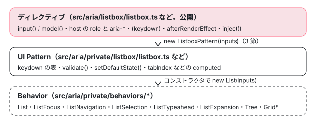

[目次](../README.md) › [Angular Aria の内側](README.md) › 第 1 回 / 全 20 回

# Angular Aria の全体像：ディレクティブ・UI Pattern・Behavior の 3 層

> @angular/aria のエントリポイント（accordion・combobox・grid・listbox・menu・tabs・toolbar・tree と private）と、ディレクティブ → UI Pattern → Behavior の 3 層。Listbox ディレクティブが自分の input を \`...this\` で ListboxPattern に渡す行。CDK の a11y（ListKeyManager）や CDK Menu との違い、このサイトに入れた 22.1.8 と読んでいる 22.2.0-next.5 の差。spec の置き場と、ブラウザで走る bazel のテスト。

angular/components · 読了 約 12 分 · 基礎 · [サイトで読む（デモが動きます）](https://angular-deep-dive-cyan.vercel.app/chapter/aria-overview)

---

`@angular/aria` は、見た目を持たずに「キーボードで動かせる・画面読み上げに正しく伝わる」部品（Listbox・Tabs・Tree など）を作るためのパッケージです。この章では、パッケージがどんなエントリポイント（`import` できる入口）に分かれているか、そして中身が**ディレクティブ → UI Pattern → Behavior の 3 層**になっていることを、実際のファイルで確かめます。最後に、spec がどこにあり、bazel でどう走るかの地図を描きます。

読む対象は `src/aria/config.bzl`・`src/aria/BUILD.bazel`・`src/aria/package.json`・`src/aria/private/public-api.ts`・`src/aria/private/ui-pattern-rules.md`・`src/aria/listbox/listbox.ts`（コンストラクタ）・`tools/bazel/web_test_suite.bzl` です。ソースは angular/components の e81c398a86（2026-09-10、22.2.0-next.5）、このページで動くデモは npm の `@angular/aria` 22.1.8 です。

1. **1. 全体像**（この章）
2. [2. SignalLike](02-aria-signal-like.md)
3. [3. SortedCollection](03-aria-collection.md)
4. [4. イベントマネージャ](04-aria-events.md)
5. [5. ListFocus](05-aria-list-focus.md)
6. [6. ListNavigation](06-aria-list-navigation.md)
7. [7. ListSelection](07-aria-list-selection.md)
8. [8. ListTypeahead](08-aria-typeahead.md)
9. [9. Listbox](09-aria-listbox.md)
10. [10. Accordion](10-aria-accordion.md)
11. [11. DeferredContent](11-aria-deferred-content.md)
12. [12. Tabs](12-aria-tabs.md)
13. [13. Toolbar](13-aria-toolbar.md)
14. [14. Tree](14-aria-tree.md)
15. [15. Grid](15-aria-grid.md)
16. [16. Grid のセル](16-aria-grid-cells.md)
17. [17. Combobox](17-aria-combobox.md)
18. [18. Menu](18-aria-menu.md)
19. [19. テスト](19-aria-testing.md)
20. [20. issue と PR を読む](20-aria-issues.md)

## 1. エントリポイント：config.bzl の 1 つの配列

📄 `components/src/aria/config.bzl` L1–24 （▶ の行: 2, 19, 23–24）

```python
 1 │ # List of all entry-points of the Angular Aria package.
 2 ▶ ARIA_ENTRYPOINTS = [
 3 │     "accordion",
 4 │     "accordion/testing",
 5 │     "grid",
 6 │     "grid/testing",
 7 │     "listbox",
 8 │     "listbox/testing",
 9 │     "menu",
10 │     "menu/testing",
11 │     "combobox",
12 │     "combobox/testing",
13 │     "tabs",
14 │     "tabs/testing",
15 │     "toolbar",
16 │     "toolbar/testing",
17 │     "tree",
18 │     "tree/testing",
19 ▶     "private",
20 │ ]
21 │ 
22 │ # List of all entry-point targets of the Angular Aria package.
23 ▶ ARIA_TARGETS = ["//src/aria"] + \
24 ▶                ["//src/aria/%s" % ep for ep in ARIA_ENTRYPOINTS]
```

2〜20 行目の `ARIA_ENTRYPOINTS` が、パッケージの入口の一覧です。部品は 8 つ（accordion・grid・listbox・menu・combobox・tabs・toolbar・tree）、それぞれに `/testing`（テスト用のハーネス。[harness](../cdk/20-harness.md)）が付き、最後の 19 行目に `private` があります。23〜24 行目の `ARIA_TARGETS` は、この一覧を bazel のターゲット名（`//src/aria/listbox` など）に直し、先頭にルートの `//src/aria` を足したものです。

ルートの `@angular/aria` 自体には部品がありません。`src/aria/index.ts` は `export * from './public-api'`、`public-api.ts` は `export * from './version'` だけで、取り出せるのは `VERSION` だけです。部品は必ず `@angular/aria/listbox` のように**部品ごとの入口**から import します。

📄 `components/src/aria/BUILD.bazel` L19–43 （▶ の行: 19, 21, 29–31, 40, 42）

```python
19 ▶ ng_package(
20 │     name = "npm_package",
21 ▶     package_name = "@angular/aria",
22 │     srcs = [
23 │         "package.json",
24 │     ],
25 │     nested_packages = select({
26 │         "//:snapshot_adev_assets": [":adev_assets"],
27 │         "//conditions:default": [],
28 │     }),
29 ▶     package_deps = [
30 ▶         ":node_modules/@angular/cdk",
31 ▶     ],
32 │     replace_prefixes = {
33 │         "adev_assets/": "_adev_assets/",
34 │     },
35 │     tags = ["release-package"],
36 │     visibility = [
37 │         "//:__pkg__",
38 │         "//goldens:__pkg__",
39 │         "//integration:__subpackages__",
40 ▶         "//src/material-experimental:__subpackages__",
41 │     ],
42 ▶     deps = ARIA_TARGETS,
43 │ )
```

19 行目の `ng_package` が npm に出す 1 つのパッケージを作る規則です。42 行目の `deps = ARIA_TARGETS` で、さっきの一覧の全部を 1 つの `@angular/aria` に束ねます。29〜31 行目の `package_deps` に `@angular/cdk` があり、CDK に依存していることがビルドの段階でも分かります（5 節）。40 行目の `visibility` には `//src/material-experimental` がありますが、src/material と src/material-experimental の .ts を grep しても `@angular/aria` の import は 1 つもありませんでした（「聞かれそうな質問」の 2 問目）。

## 2. 3 層：ディレクティブ → UI Pattern → Behavior

📄 `components/src/aria/private/ui-pattern-rules.md` L1–13 （▶ の行: 5–6, 8, 11–12）

```md
 1 │ # UI Patterns
 2 │ 
 3 │ ## Conceptual Description
 4 │ 
 5 ▶ Accessibility patterns are established, reusable solutions for creating accessible web content and
 6 ▶ applications. Some common accessibility patterns include the Tree View, Switch, Listbox, and Grid.
 7 │ 
 8 ▶ Behaviors are TypeScript classes that encapsulate the common behaviors of Accessibility Patterns.
 9 │ Some common behaviors include navigation and selection.
10 │ 
11 ▶ UI Patterns are TypeScript classes that encapsulate Accessibility Patterns. UI Patterns are built
12 ▶ by utilizing multiple Behavior classes to implement the complete functionality of an Accessibility
13 │ Pattern.
```

src/aria/private/ui-pattern-rules.md は、Pattern を書く人向けの決まりです。5〜6 行目の Accessibility Pattern は「アクセシブルな Web の中身を作るための、確立した再利用できる作り方」で、例に Tree View・Switch・Listbox・Grid が挙がっています。8 行目で **Behavior**＝「移動」「選択」のような共通のふるまいを持つ TypeScript のクラス、11〜12 行目で **UI Pattern**＝ Behavior をいくつも組み合わせて 1 つの Accessibility Pattern を実装するクラス、と定義しています。この 2 つの上に、Angular のディレクティブ（`ngListbox` など）が乗ります。



*3 層。ディレクティブだけが Angular の DI・テンプレート・DOM を知り、Pattern と Behavior は signal だけを受け取る（2 回目・3 回目で確かめる）*

どの部品がどの Behavior を使うかを、src/aria/private/&lt;部品&gt;/\*.ts の import と `new` を grep して表にしました（spec は除く）。

| 部品 | UI Pattern（private/&lt;部品&gt;） | コンストラクタで作る Behavior |
| --- | --- | --- |
| listbox | ListboxPattern・OptionPattern | `List`（中で ListFocus・ListSelection・ListTypeahead・ListNavigation） |
| menu | MenuPattern・MenuBarPattern・MenuTriggerPattern・MenuItemPattern | `List`（menu.ts の 2 か所） |
| tree | TreePattern・TreeItemPattern | `Tree`（中で ListFocus 系・ListSelection・ListTypeahead・ListExpansion・ListNavigation） |
| tabs | TabListPattern・TabPattern・TabPanelPattern | ListFocus・ListNavigation・ListExpansion |
| accordion | AccordionGroupPattern・AccordionTriggerPattern | ListFocus・ListNavigation・ListExpansion |
| toolbar | ToolbarPattern・ToolbarWidgetPattern・ToolbarWidgetGroupPattern | ListFocus・ListNavigation |
| grid | GridPattern・GridRowPattern・GridCellPattern・GridCellWidgetPattern | `Grid`（中で GridData・GridFocus・GridNavigation・GridSelection） |
| combobox | ComboboxPattern・ComboboxPopupPattern | なし（ExpansionItem の型だけを使い、イベントマネージャを 2 つ作る） |

全部の Pattern が使っているのは `signal-like`（[第 2 回](02-aria-signal-like.md)）と `event-manager`（[第 4 回](04-aria-events.md)）です。一方、private/behaviors にある `PopupControl`（popup）と `LabelControl`（label）は、spec 以外のどのファイルからも import されていませんでした（この snapshot の時点）。

## 3. Listbox が Pattern を作る行

📄 `components/src/aria/listbox/listbox.ts` L143–156 （▶ の行: 144–150, 153, 155）

```ts
143 │   constructor() {
144 ▶     const inputs = {
145 ▶       ...this,
146 ▶       id: this.id,
147 ▶       items: this._orderedItemPatterns,
148 ▶       activeItem: signal(undefined),
149 ▶       textDirection: this.textDirection,
150 ▶       element: () => this._elementRef.nativeElement,
151 │     };
152 │ 
153 ▶     this._pattern = new ListboxPattern<V>(inputs);
154 │ 
155 ▶     this.activeDescendant = computed(() => this._pattern.activeDescendant());
156 │ 
```

1. **144〜145 行目 自分自身をばらして渡す**

   `{ ...this }` は、ディレクティブのインスタンスが持つプロパティを新しいオブジェクトに写します。`orientation`・`multi`・`wrap`・`focusMode`・`selectionMode` のような `input()` と、`value` の `model()` は、クラスのフィールドとしてコンストラクタより先に初期化されているので、ここで**signal のまま** Pattern の入力になります。なぜ signal のまま渡せるのかは[第 2 回](02-aria-signal-like.md)で読みます。
2. **146〜150 行目 一部だけ上書きする**

   147 行目の `items` は、子の `ngOption` を DOM の順に並べた computed（`_orderedItemPatterns`。[第 3 回](03-aria-collection.md)）です。148 行目の `activeItem` は、いまキーボードで指している項目を持つ `signal(undefined)`。149 行目の `textDirection` は CDK の `Directionality` から取った向き、150 行目の `element` は「ホスト要素を返す関数」です。
3. **153 行目 Pattern を作る**

   `new ListboxPattern<V>(inputs)`。ここから先、キー操作も tabindex も `aria-*` も、Pattern の computed が決めます。ディレクティブの host は `_pattern.tabIndex()` などを属性に写すだけです（中身は[第 9 回](09-aria-listbox.md)）。
4. **155 行目 公開用の signal を 1 つ作る**

   `activeDescendant` は Pattern の値を読むだけの computed で、ディレクティブの外から読めるように公開されています。

## 4. private を export している

📄 `components/src/aria/private/public-api.ts` L9–29 （▶ の行: 9, 12, 24–29）

```ts
 9 ▶ export * from './listbox/listbox';
10 │ export * from './listbox/option';
11 │ export * from './menu/menu';
12 ▶ export * from './behaviors/signal-like/signal-like';
13 │ export * from './tabs/tabs';
14 │ export * from './toolbar/toolbar';
15 │ export * from './toolbar/toolbar-widget';
16 │ export * from './toolbar/toolbar-widget-group';
17 │ export * from './accordion/accordion';
18 │ export * from './tree/tree';
19 │ export * from './grid/grid';
20 │ export * from './grid/row';
21 │ export * from './grid/cell';
22 │ export * from './grid/widget';
23 │ export * from './deferred-content';
24 ▶ export * from './utils/collection';
25 ▶ export * from './utils/element';
26 ▶ export * from './utils/element-resolver';
27 ▶ export * from './utils/transforms';
28 ▶ export * from './utils/violations';
29 ▶ export * from './combobox/combobox';
```

`@angular/aria/private` から出ているのは、各部品の Pattern（9 行目の listbox から 29 行目の combobox まで）と、12 行目の `signal-like`、24〜28 行目の utils です。Behavior（List・ListFocus など）と event-manager は**ここに入っていません**。npm の 22.1.8 の `fesm2022/private.mjs` の export も、Pattern・`SortedCollection`・`signal`・`computed`・`linkedSignal`・`untracked` などで、Behavior の名前はありませんでした。

ディレクティブはこの入口から Pattern を取ります（listbox.ts の import 文は `import {ListboxPattern, SortedCollection, tabIndexTransform, reportViolations} from '../private'`）。ただし npm に出たあとの `fesm2022/listbox.mjs` は `@angular/aria/private` を import しておらず、`./_option-chunk.mjs` のような共有のチャンクを直接読んでいます。名前については、#32174（2025-10-24）で `ui-patterns` から `private` へ改名したときの PR の説明に「we don't want to expose these APIs publicly yet（まだ公開 API にしたくない）」とあります。

> [!WARNING]
> **ハマりどころ**
>
> `@angular/aria/private` は名前のとおり安定した API ではありません。このシリーズのデモで private の export を使うときは、そのつど「private」と書きます。

## 5. CDK との関係

📄 `components/src/aria/package.json` L14–33 （▶ の行: 14–16, 31）

```json
14 ▶   "peerDependencies": {
15 ▶     "@angular/cdk": "0.0.0-PLACEHOLDER",
16 ▶     "@angular/core": "0.0.0-NG"
17 │   },
18 │   "devDependencies": {
19 │     "@angular/cdk": "workspace:*"
20 │   },
21 │   "dependencies": {
22 │     "tslib": "^2.3.0"
23 │   },
24 │   "angular": {
25 │     "examples": {
26 │       "format": "sqlite",
27 │       "path": "./resources/code-examples.db"
28 │     }
29 │   },
30 │   "ng-update": {
31 ▶     "packageGroup": "NG_UPDATE_PACKAGE_GROUP"
32 │   },
33 │   "sideEffects": false
```

📄 `components/packages.bzl` L19–34 （▶ の行: 24, 26, 32–33）

```python
19 │ # Each placeholder is used to stamp versions during the build process, replacing the key with its
20 │ # value pair. These replacements occur during building of `npm_package` and `ng_package` stamping in
21 │ # the peer dependencies and versions, primarily in `package.json`s.
22 │ NPM_PACKAGE_SUBSTITUTIONS = dict(PKG_GROUP_REPLACEMENTS, **{
23 │     # Peer dependency version on the Angular framework.
24 ▶     "0.0.0-NG": "{{STABLE_FRAMEWORK_PEER_DEP_RANGE}}",
25 │     # Version of the local package being built, generated via the `--workspace_status_command` flag.
26 ▶     "0.0.0-PLACEHOLDER": "{{STABLE_PROJECT_VERSION}}",
27 │ })
28 │ 
29 │ NO_STAMP_NPM_PACKAGE_SUBSTITUTIONS = dict(NPM_PACKAGE_SUBSTITUTIONS, **{
30 │     # When building NPM packages for tests (where stamping is disabled),
31 │     # we use `0.0.0` for the version placeholder.
32 ▶     "0.0.0-PLACEHOLDER": "0.0.0",
33 ▶     "0.0.0-NG": ">=0.0.0",
34 │ })
```

package.json の 15 行目の `0.0.0-PLACEHOLDER` は、packages.bzl の 26 行目でビルドのときに**このパッケージ自身の版**（`STABLE_PROJECT_VERSION`）に置き換わります。つまり `@angular/aria` の peerDependency の `@angular/cdk` は、いつも**同じ版の CDK** です。実際、このサイトの node\_modules/@angular/aria/package.json は `"@angular/cdk": "22.1.8"`、16 行目の `0.0.0-NG`（24 行目で `STABLE_FRAMEWORK_PEER_DEP_RANGE`）は `"^22.0.0 || ^23.0.0"` になっていました。31 行目の `packageGroup` は `ng update` で material・cdk などと一緒に上げるための指定です。

CDK から実際に使っているものを、src/aria の .ts（spec を除く）で grep すると 3 つだけでした。

- `_IdGenerator`（`@angular/cdk/a11y`）— ディレクティブが `ng-listbox-` のような id を作る。14 ファイル。
- `Directionality`（`@angular/cdk/bidi`）— 左から右か右から左か（[cdk-platform-bidi](../cdk/02-cdk-platform-bidi.md)）。10 ファイル。
- `_getEventTarget`（`@angular/cdk/platform`）— Shadow DOM の中でも本当の発生元を取る。Pattern の 10 ファイル（#33691 で入った）。

CDK の同じ役目の部品とは、作りがはっきり違います（どれもソースで確かめた範囲です）。

- **ListKeyManager**（[cdk-key-manager](../cdk/10-cdk-key-manager.md)）は `QueryList` か配列か Signal を受け取り、`withWrap()` などで設定し、変化を rxjs の `Subject`（`change`・`tabOut`）で知らせ、受け持つのは「アクティブな項目」だけです。Aria の List は全部の設定を signal で受け取り、選択（ListSelection）まで持ち、src/aria には rxjs の import がありません。
- **CDK Menu**（[cdk-menu](../cdk/13-cdk-menu.md)）は menu-base.ts で `FocusKeyManager` を使います。Aria の Menu は `List` Behavior です（表の menu の行）。
- **CdkTree**（[cdk-tree](../cdk/17-cdk-tree.md)）は `dataSource` を受け取って節を描きます。Aria の tree/\*.ts には `dataSource` が 1 つも無く、項目は利用者がテンプレートに `ngTreeItem` を並べて作ります。

## 6. このページの 22.1.8 と、読んでいる 22.2.0-next.5 の差

npm の 22.1.8 の sourcemap から元の .ts を戻して snapshot と比べると、84 ファイルのうち 71 は同じで、違うのは次の 13 ファイルでした。22.1.8 は 2026-09-23 に 22.1.x の枝から出た版で、snapshot（2026-09-10 の main）より**後**に出ていますが、main にしか入っていない変更もあります。

| ファイル | 違い | 元の変更 |
| --- | --- | --- |
| accordion/accordion-trigger.ts | 22.1.8 だけ host に `'ngAccordionTrigger': ''` がある | #33839（2026-09-18、22.1.x の枝。snapshot より後） |
| menu/menu.ts・menu-bar.ts・menu-item.ts・private/menu/menu.ts | snapshot では MenuItem の `value` が省略でき、型が `V \| undefined` | #33715 cd9c7da8b6（main だけ）。[第 18 回](18-aria-menu.md) |
| toolbar/toolbar.ts・toolbar-widget.ts・toolbar-widget-group.ts・toolbar-tokens.ts、private/toolbar/ の 3 つ | snapshot では toolbar から選択の Behavior が外れている | #33747 0b81ad7e3c（main だけ）。[第 13 回](13-aria-toolbar.md) |
| version.ts | `'22.1.8'` と `'0.0.0-PLACEHOLDER'` | ビルドの置き換え（5 節） |

この章のデモで使う listbox と、第 2〜4 回で読む signal-like・collection・event-manager は 13 ファイルに入っていないので、デモの動きは引用のコードどおりです。

## 7. デモ：プリレンダーの tabindex と、起動したあとの tabindex

このサイトはビルドのときに全ページを HTML にしておく（プリレンダー。[ssr-prerender](../platform/06-ssr-prerender.md)）ので、下の listbox も最初は HTML として届きます。このページのビルド出力（`aria-overview/index.html`）を見ると、`ngListbox` の `ul` も 4 つの `li` も、すべて `tabindex="-1"` でした。Listbox の `setDefaultStateEffect` は `afterRenderEffect` の中（ブラウザでしか走らない）で呼ばれるので、プリレンダーの時点では「最初にフォーカスを受ける項目」がまだ決まっていないからです（[第 9 回](09-aria-listbox.md)）。

> **🧪 DEMO — このページの @angular/aria（22.1.8）の ngListbox**
>
> これは再現ではなく本物の `ngListbox`（単一選択・`focusMode="roving"`・`selectionMode="follow"`）です。キーボードで操作できます。Tab でリストに入り、↑ ↓ で動きます。「いまの属性を読む」を押すと、`ul` と各 `li` の `tabindex`・`aria-selected`（T / f）、`[(value)]` に結んだ値、`document.activeElement` をログに出します。キーを押したりクリックしたりしたあとも、描画のあとに同じものを読みます。
>
> ▶ [このデモはサイトで動かせます](https://angular-deep-dive-cyan.vercel.app/chapter/aria-overview)

ページを開いてすぐに（何も操作せずに）「いまの属性を読む」を押すと、`li tabindex=[0 -1 -1 -1]`・`aria-selected=[T f f f]`・`value=["red"]` と出ます（2026-11-02 にヘッドレスの Chrome でこのページを開いて確かめました）。プリレンダーの HTML では全部 `tabindex="-1"`・`aria-selected="false"` だったので、起動したあとに先頭の `red` が `0` になり、しかも**選ばれた**ことになります。`selectionMode="follow"`（既定）のときは、`setDefaultState` が先頭をアクティブにしたあと選択もするからです（[第 9 回](09-aria-listbox.md)）。つまり `[(value)]` に結んだ signal は、利用者が触る前に `[]` から `["red"]` に書き換わります。↓ を押すと `green` が `0` になり、`value` は `["green"]` です。`ul` 自身は roving のあいだ `tabindex="-1"` のままです。

## 8. 呼び出しの連なり

- 👤 `<ul ngListbox [(value)]="value">` — あなたのテンプレート
  - `new Listbox()` — listbox/listbox.ts — *input() / model() はフィールドとして先に作られる*
    - `inputs = { ...this, items, activeItem, textDirection, element }` — listbox.ts L144-151
    - `new ListboxPattern(inputs)` — listbox.ts L153 — *private/listbox/listbox.ts*
      - `new List(inputs)` — private/listbox/listbox.ts — *Behavior の束（第 9 回）*
        - `ListFocus / ListSelection / ListTypeahead / ListNavigation` — private/behaviors/\* — *第 5〜8 回*
  - `afterRenderEffect → setDefaultStateEffect()` — listbox.ts — *ブラウザでだけ。ここで先頭が tabindex=0 に*

## テストと直し方

spec は 3 種類の場所にあります（どれも `*.spec.ts`）。

| 場所 | 何を確かめるか | 例 |
| --- | --- | --- |
| src/aria/&lt;部品&gt;/ | ディレクティブ。TestBed でテンプレートを描き、DOM の属性とキー操作を見る | listbox/listbox.spec.ts |
| src/aria/&lt;部品&gt;/testing/ | ハーネス | listbox/testing/listbox-harness.spec.ts |
| src/aria/private/&lt;部品&gt;/ | UI Pattern。DOM を描かず、signal と作った KeyboardEvent で動かす | private/listbox/listbox.spec.ts |
| src/aria/private/behaviors/&lt;名前&gt;/ | Behavior。signal だけ | private/behaviors/list/list.spec.ts |
| src/aria/private/utils/ など | SortedCollection・resolveElement、DeferredContent | private/utils/collection.spec.ts |

spec が**無い**のは private/behaviors/event-manager と private/behaviors/signal-like です。この 2 つは、使う側の Pattern と Behavior の spec を通して確かめられています（[第 2 回](02-aria-signal-like.md)・[第 4 回](04-aria-events.md)）。

📄 `components/src/aria/listbox/BUILD.bazel` L21–43 （▶ の行: 22, 25, 32, 40–42）

```python
21 │ ng_project(
22 ▶     name = "unit_test_sources",
23 │     testonly = True,
24 │     srcs = glob(
25 ▶         ["**/*.spec.ts"],
26 │         exclude = ["**/*.e2e.spec.ts"],
27 │     ),
28 │     deps = [
29 │         ":listbox",
30 │         "//:node_modules/@angular/core",
31 │         "//:node_modules/@angular/platform-browser",
32 ▶         "//:node_modules/axe-core",
33 │         "//src/aria/private/testing",
34 │         "//src/cdk/testing",
35 │         "//src/cdk/testing/private",
36 │         "//src/cdk/testing/testbed",
37 │     ],
38 │ )
39 │ 
40 ▶ ng_web_test_suite(
41 ▶     name = "unit_tests",
42 ▶     deps = [":unit_test_sources"],
43 │ )
```

部品の BUILD.bazel は、spec を集めた `ng_project`（22 行目の `unit_test_sources`、25 行目で `**/*.spec.ts`）と、それを走らせる 40 行目の `ng_web_test_suite` の組です。32 行目の `axe-core` は依存にだけあります（[第 19 回](19-aria-testing.md)）。

📄 `components/tools/bazel/web_test_suite.bzl` L25–35 （▶ の行: 25–26, 30–32）

```python
25 ▶ def ng_web_test_suite(deps = [], static_css = [], **kwargs):
26 ▶     # Always include a prebuilt theme in the test suite because otherwise tests, which depend on CSS
27 │     # that is needed for measuring, will unexpectedly fail. Also always adding a prebuilt theme
28 │     # reduces the amount of setup that is needed to create a test suite Bazel target. Note that the
29 │     # prebuilt theme will be also added to CDK test suites but shouldn't affect anything.
30 ▶     static_css = static_css + [
31 ▶         "//src/material/prebuilt-themes:azure-blue",
32 ▶     ]
33 │ 
34 │     bootstrap = []
35 │ 
```

📄 `components/tools/bazel/web_test_suite.bzl` L60–70 （▶ の行: 65, 68）

```python
60 │                     document.head.appendChild(cssElement);'
61 │          echo "$$js_template" > $@
62 │       """ % css_label,
63 │         )
64 │ 
65 ▶     _web_test(
66 │         # Depend on our custom test initialization script. This needs to be the first dependency.
67 │         deps = deps,
68 ▶         bootstrap = ["//test:angular_test_init"] + bootstrap,
69 │         **kwargs
70 │     )
```

📄 `components/tools/bazel/web_test_suite.bzl` L1–23 （▶ の行: 2, 5, 9, 18–20）

```python
 1 │ load("@devinfra//bazel/spec-bundling:index.bzl", "spec_bundle")
 2 ▶ load("@rules_browsers//wtr:index.bzl", "wtr_test")
 3 │ 
 4 │ def _web_test(name, tags = [], deps = [], bootstrap = [], **kwargs):
 5 ▶     spec_bundle(
 6 │         name = "%s_bundle" % name,
 7 │         srcs = ["//src:build-tsconfig"],
 8 │         bootstrap = bootstrap,
 9 ▶         deps = deps,
10 │         config = {
11 │             "resolveExtensions": [".js"],
12 │             "tsconfig": "./src/bazel-tsconfig-build.json",
13 │         },
14 │     )
15 │ 
16 │     test_tags = ["partial-compilation-integration"] + tags
17 │ 
18 ▶     wtr_test(
19 ▶         name = name,
20 ▶         deps = [":%s_bundle" % name],
21 │         tags = test_tags,
22 │         **kwargs
23 │     )
```

1. **30〜32 行目 material のテーマを必ず読む**

   26〜29 行目のコメントのとおり、寸法を測るテストのために prebuilt theme（azure-blue）の CSS を毎回足します。aria のテストでも同じです。
2. **68 行目 最初に //test:angular\_test\_init**

   test/angular-test.init.ts は `zone.js` と `zone.js/testing` を import し、`provideZonelessChangeDetection()` と `provideCheckNoChangesConfig({exhaustive: true})` を入れたモジュールで `TestBed.initTestEnvironment` を呼びます。ログに NG0914（zoneless なのに Zone.js を読み込んでいる）が出るのはこのためです。
3. **5 行目 spec を 1 つにまとめる**

   `spec_bundle` がターゲットの spec を 1 つの JS（`unit_tests_bundle.spec.js`）に束ね、18 行目の `wtr_test`（rules\_browsers の web-test-runner の規則）に渡します。`wtr_test` は 1 つの名前から `unit_tests_chromium`・`unit_tests_firefox`・手で開く `unit_tests_debug` の 3 つを作ります（bazel の外部リポジトリ rules\_browsers の wtr/index.bzl）。テストの枠組みは jasmine です。
4. **spec を絞るオプションは無い**

   rules\_browsers の wtr/wtr.config.mjs を読むと、渡すのは spec の glob と jasmine の乱数の種（環境変数 `JASMINE_RANDOM_SEED`）だけで、名前で絞る設定はありませんでした。だから 1 本のターゲットを走らせると、そのターゲットの spec が全部走ります。1 本だけ見たいときは、自分の作業コピーで `it` を `fit` に変えると jasmine がそれだけを走らせます。私たちは ../components を変えない約束なので、これは**試していません**。

📄 `ターミナル`

```
cd ~/angular-research/components
pnpm bazel test //src/aria/private/utils:unit_tests_chromium //src/aria/listbox:unit_tests_chromium --nocache_test_results --test_output=all
pnpm bazel test //src/aria/listbox:unit_tests_firefox --nocache_test_results --test_output=all

# listbox.spec.ts に書かれている it の数（ループの中の it は 1 回と数える）
grep -cE '^\s*it\(' src/aria/listbox/listbox.spec.ts
```

📄 `出力（抜粋。2026-11-02 に実行）`

```
src/aria/listbox/unit_tests_bundle.spec.js:
      NG0914: The application is using zoneless change detection, but is still loading Zone.js. ...
      Jasmine randomize seed: 07074
Chromium: |██████████████████████████████| 1/1 test files | 105 passed, 0 failed
Finished running tests in 1.5s, all tests passed!
//src/aria/listbox:unit_tests_chromium                                   PASSED in 2.0s
//src/aria/private/utils:unit_tests_chromium                             PASSED in 0.9s

Firefox: |██████████████████████████████| 1/1 test files | 105 passed, 0 failed
Finished running tests in 3s, all tests passed!
//src/aria/listbox:unit_tests_firefox                                    PASSED in 3.8s

85
```

listbox.spec.ts の `it(` は 85 個ですが、走ったのは 105 本でした。listbox.spec.ts の :681〜:865 は関数 `runNavigationTests(focusMode, ...)` の中にあり、その関数が :866 で `'roving'`、:870 で `'activedescendant'` を渡して 2 回呼ばれるので、中の 20 個の it が 2 回ずつ登録されます（85 + 20 = 105）。ターゲットごとの件数（chromium、2026-11-02）は次のとおりです。自分で走らせた listbox・private/utils・private/listbox・private/behaviors/list と firefox の listbox は、表の数と同じでした。

| 層 | ターゲットと件数 |
| --- | --- |
| ディレクティブ | accordion 42・combobox 112・grid 71・listbox 105・menu 90・tabs 85・toolbar 62・tree 142 |
| ハーネス | accordion/testing 13・combobox/testing 10・grid/testing 13・listbox/testing 8・menu/testing 13・tabs/testing 11・toolbar/testing 12・tree/testing 7 |
| UI Pattern | private/accordion 27・combobox 21・grid 51・listbox 68・menu 86・tabs 37・toolbar 111・tree 95 |
| Behavior | expansion 33・grid 213・label 6・list 42・list-focus 11・list-navigation 39・list-selection 52・list-typeahead 17・popup 3・tree 49 |
| その他 | private/utils 11・private 11（同じ utils の spec）・private/deferred-content 5 |

1. **直すとしたら、どの層か**

   キーを押したときの動きがおかしいなら、まず Pattern（private/&lt;部品&gt;/\*.ts の `keydown`）か Behavior です。直したら private/&lt;部品&gt;/\*.spec.ts か private/behaviors/&lt;名前&gt;/\*.spec.ts に、DOM なしの it を足すのが入口です。属性（role・aria-\*・tabindex）の写し方や、afterRenderEffect の順番の問題なら、ディレクティブ（&lt;部品&gt;/\*.ts）と &lt;部品&gt;/\*.spec.ts です。
2. **issue を読むときの手がかり**

   ラベルは部品ごと（`area: aria/listbox` など）で、`area: aria` だけのラベルはありません。開いている issue の多くに外部の PR が既に付いています。一覧は[第 20 回](20-aria-issues.md)にまとめます。

## 聞かれそうな質問

**Q. CDK の ListKeyManager と何が違うのですか？**

ListKeyManager は 1 つのクラスで「アクティブな項目」と矢印キー・頭文字を受け持ち、変化を rxjs の `Subject` で知らせます。役目や aria 属性を付けるのは使う側です。Aria は 3 節の 153 行目のように、ディレクティブが input をすべて signal のまま Pattern に渡し、Pattern が Behavior（フォーカス・移動・選択・頭文字を別々のクラス）を組み合わせます。role や `aria-selected` もディレクティブの host が Pattern の computed から写します。

**Q. Angular Material はもう Aria を使っていますか？**

この snapshot（2026-09-10）では使っていません。src/material と src/material-experimental の .ts に `@angular/aria` の import は 0 件、BUILD.bazel にも `//src/aria` の依存はありませんでした。ルートの BUILD.bazel の 40 行目で `npm_package` を `//src/material-experimental` から見えるようにしてはいますが、使っている所は見つかりません。src/components-examples/aria には `@angular/aria` を import する .ts が 82 個あります。

**Q. なぜ「private」を export しているのですか？**

理由はソースに書かれていません。分かる事実は 3 つです。config.bzl の 19 行目で `private` がエントリポイントの 1 つになっていること、ディレクティブは `'../private'` から Pattern を import していること、そして #32174 の説明に、`ui-patterns` から `private` に改名したのは「まだ公開したくないから」とあることです。npm に出た `listbox.mjs` は private の入口を通らず共有のチャンクを読んでいます。

**Q. プリレンダーした HTML で全部の option が tabindex="-1" なのは問題になりませんか？**

起動する前は Tab キーで listbox に入れません。起動したあとは afterRenderEffect の中の `setDefaultStateEffect` が先頭（選ばれている項目があればそれ）を `0` にします。7 節のデモの最初のログがそれで、`selectionMode="follow"` なら同時に先頭が選ばれて `value` も変わります。決める処理と、いつ呼ばれるかは[第 9 回](09-aria-listbox.md)で読みます。

## 読み終えて

- 入口は config.bzl の `ARIA_ENTRYPOINTS`：8 部品 + 各 /testing + private。ルートには `VERSION` だけ。
- 3 層：ディレクティブが `{...this}` で signal を渡して Pattern を作り（listbox.ts L144-153）、Pattern がコンストラクタで Behavior を作る。
- private から出るのは Pattern・signal-like・utils。Behavior と event-manager は出ていない。
- CDK は同じ版を peerDependency にし、使うのは `_IdGenerator`・`Directionality`・`_getEventTarget` の 3 つ。
- テストは `ng_web_test_suite` → spec\_bundle → `wtr_test` で chromium と firefox。名前で絞れないので、ターゲットの spec が全部走る。

---

← 前: [animations の issue と変更を読む：直されたバグから学ぶ](../animations/20-animations-issues.md)  
次: [SignalLike：Pattern が core の signal を直接使わない理由](02-aria-signal-like.md) →
