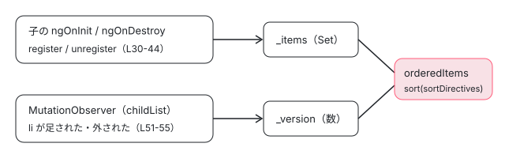

[目次](../README.md) › [Angular Aria の内側](README.md) › 第 3 回 / 全 20 回

# SortedCollection：項目を DOM の順に並べる

> ngOption などの子が register / unregister で親に名乗り出て、SortedCollection が Set と version の signal から orderedItems を計算する仕組み。sortDirectives が compareDocumentPosition で並べる行、MutationObserver が childList の変化だけで version を進める理由、afterNextRender で見張りを始める理由。contentChildren から置き換えた変更と、その TODO。

angular/components · 読了 約 12 分 · 中核 · [サイトで読む（デモが動きます）](https://angular-deep-dive-cyan.vercel.app/chapter/aria-collection)

---

`ngListbox` は、自分の中にある `ngOption` を「DOM に並んでいる順」に知っていなければなりません。↓ キーで次へ進むには、次がどれかが分からないといけないからです。この章では、その一覧を持つ `SortedCollection` を 1 行ずつ読みます。子が `register` / `unregister` で名乗り出て、`Set` と `version` の 2 つの signal から `orderedItems` を計算し、`MutationObserver` が DOM の並べ替えを知らせる仕組みです。

読む対象は `src/aria/private/utils/collection.ts`（全部）・`element.ts`（`sortDirectives`）・`element-resolver.ts`・`transforms.ts`、呼ぶ側の例として `src/aria/grid/grid-row.ts` です。

1. [1. 全体像](01-aria-overview.md)
2. [2. SignalLike](02-aria-signal-like.md)
3. **3. SortedCollection**（この章）
4. [4. イベントマネージャ](04-aria-events.md)
5. [5. ListFocus](05-aria-list-focus.md)
6. [6. ListNavigation](06-aria-list-navigation.md)
7. [7. ListSelection](07-aria-list-selection.md)
8. [8. ListTypeahead](08-aria-typeahead.md)
9. [9. Listbox](09-aria-listbox.md)
10. [10. Accordion](10-aria-accordion.md)
11. [11. DeferredContent](11-aria-deferred-content.md)
12. [12. Tabs](12-aria-tabs.md)
13. [13. Toolbar](13-aria-toolbar.md)
14. [14. Tree](14-aria-tree.md)
15. [15. Grid](15-aria-grid.md)
16. [16. Grid のセル](16-aria-grid-cells.md)
17. [17. Combobox](17-aria-combobox.md)
18. [18. Menu](18-aria-menu.md)
19. [19. テスト](19-aria-testing.md)
20. [20. issue と PR を読む](20-aria-issues.md)

## 1. 並べ方：sortDirectives と compareDocumentPosition

📄 `components/src/aria/private/utils/element.ts` L9–20 （▶ の行: 9–10, 16–19）

```ts
 9 ▶ export interface HasElement {
10 ▶   element: HTMLElement;
11 │ }
12 │ 
13 │ /**
14 │  * Sort directives by their document order.
15 │  */
16 ▶ export function sortDirectives(a: HasElement, b: HasElement) {
17 ▶   return (a.element.compareDocumentPosition(b.element) & Node.DOCUMENT_POSITION_PRECEDING) > 0
18 ▶     ? 1
19 ▶     : -1;
20 │ }
```

9〜11 行目の `HasElement` は「`element` という HTMLElement を持っている」ことだけを求める型です。`ngOption` などのディレクティブは `readonly element = this._elementRef.nativeElement` を持つので、これを満たします。

1. **17 行目 a から見た b の位置を聞く**

   `a.element.compareDocumentPosition(b.element)` は DOM の標準のメソッドで、2 つのノードの位置関係をビットの組で返します。`Node.DOCUMENT_POSITION_PRECEDING`（値は 2）は「b が a より**前**にある」というビットです。
2. **17〜19 行目 前なら 1、そうでなければ -1**

   b が前にあれば `1`（a を後ろへ）、そうでなければ `-1`（a を前へ）。`Array.prototype.sort` の比較関数として使うと、DOM の順（文書の順）に並びます。`0` を返すことはありません。ディレクティブを作った順でも、`register` した順でもなく、**いま DOM に並んでいる順**で決まる、というのがこの関数の要点です。

## 2. 持っている状態：Set と version

📄 `components/src/aria/private/utils/collection.ts` L9–28 （▶ の行: 9, 13, 17, 20–21, 24–27）

```ts
 9 ▶ import {signal, computed, Signal} from '@angular/core';
10 │ import {sortDirectives, HasElement} from './element';
11 │ 
12 │ /**
13 ▶  * A collection that lazily sorts its items based on their DOM position.
14 │  * It uses manual registration and updates its order when items are added/removed
15 │  * or when structural DOM changes are detected via MutationObserver.
16 │  *
17 ▶  * TODO(ok7sai): replace Mutation Observer with internal API.
18 │  */
19 │ export class SortedCollection<T extends HasElement> {
20 ▶   private readonly _items = signal<Set<T>>(new Set());
21 ▶   private readonly _version = signal(0);
22 │   private _observer?: MutationObserver;
23 │ 
24 ▶   readonly orderedItems: Signal<T[]> = computed(() => {
25 ▶     this._version(); // Track DOM changes
26 ▶     const itemsArray = Array.from(this._items());
27 ▶     return itemsArray.sort(sortDirectives);
28 │   });
```

1. **9 行目 これは core の signal**

   collection.ts は `@angular/core` の `signal` と `computed` を使います。使うのは Pattern ではなくディレクティブ（`Listbox` の `_collection` など）なので、[第 2 回](02-aria-signal-like.md)の「Pattern は signal-like から」の決まりの外です。
2. **20〜21 行目 2 つの signal**

   `_items` は登録された子の `Set`、`_version` は「DOM の構造が変わった回数」を数える数です。
3. **24〜28 行目 orderedItems は computed**

   25 行目で `this._version()` を**読むだけ**（値は使わない）。これで `_version` が変わったときにも計算し直します（コメント「Track DOM changes」）。26 行目で Set を配列にし、27 行目で 1 節の `sortDirectives` で並べます。計算は `orderedItems()` が読まれたときに初めて走ります（13 行目のコメントの「lazily」。computed の遅延評価は [signals-computed](../signals/06-signals-computed.md)）。

## 3. register と unregister：毎回新しい Set を作る

📄 `components/src/aria/private/utils/collection.ts` L30–44 （▶ の行: 31–34, 40–41）

```ts
30 │   register(item: T) {
31 ▶     this._items.update(set => {
32 ▶       const newSet = new Set(set);
33 ▶       newSet.add(item);
34 ▶       return newSet;
35 │     });
36 │   }
37 │ 
38 │   unregister(item: T) {
39 │     this._items.update(set => {
40 ▶       const newSet = new Set(set);
41 ▶       newSet.delete(item);
42 │       return newSet;
43 │     });
44 │   }
```

32 行目で**元の Set を写した新しい Set**を作り、33 行目で足して、34 行目でそれを返します。`update` が返した新しい値が signal の値になります。元の Set に `add` して同じものを返すと、signal の既定の等しさの比べ方（`Object.is`）で「変わっていない」とみなされ、`orderedItems` が計算し直されません（[signals-set](../signals/04-signals-set.md)）。消すときも 40〜41 行目で同じように写してから `delete` します。

## 4. startObserving：MutationObserver が version を進める

📄 `components/src/aria/private/utils/collection.ts` L46–64 （▶ の行: 47–48, 51–54, 58, 62–63）

```ts
46 │   startObserving(element: HTMLElement) {
47 ▶     if (this._observer) {
48 ▶       this._observer.disconnect();
49 │     }
50 │ 
51 ▶     this._observer = new MutationObserver(mutations => {
52 ▶       const hasStructuralChange = mutations.some(m => m.addedNodes.length || m.removedNodes.length);
53 ▶       if (hasStructuralChange) {
54 ▶         this._version.update(v => v + 1);
55 │       }
56 │     });
57 │ 
58 ▶     this._observer.observe(element, {childList: true, subtree: true});
59 │   }
60 │ 
61 │   stopObserving() {
62 ▶     this._observer?.disconnect();
63 ▶     this._observer = undefined;
64 │   }
```

1. **47〜49 行目 2 回目なら前の見張りを外す**

   同じ collection で `startObserving` が 2 回呼ばれても、見張りは 1 つだけになります。
2. **58 行目 何を見張るか**

   `{childList: true, subtree: true}`。親の要素から下の全部で、**子ノードの追加と削除だけ**を見ます。`attributes` も `characterData` も指定していないので、属性（`tabindex` や `aria-selected`）や文字の変化では、そもそもコールバックが呼ばれません。
3. **52〜55 行目 構造が変わったら version + 1**

   届いた記録（`MutationRecord`）のどれかに追加か削除のノードがあれば、54 行目で `_version` を 1 進めます。これで 25 行目を読んでいる `orderedItems` が古くなり、次に読まれたときに 27 行目でもう一度並べ直されます。
4. **62〜63 行目 止める**

   `stopObserving` は親のディレクティブの `ngOnDestroy` から呼ばれます（5 節）。



*orderedItems が計算し直されるのは 2 つの signal のどちらかが変わったとき。子が増える・減るときは \_items、DOM の中で動いただけのときは \_version*

> [!NOTE]
> **さらに深く**
>
> なぜ version が要るのか。`@for` で配列の順を入れ替えると、Angular は `track` で同じと分かった項目のビューを**作り直さずに DOM の中で動かします**（[for-track](../template/01-for-track.md)）。ディレクティブは作り直されないので `register` も `unregister` も呼ばれず、`_items` の Set は変わりません。変わったのは DOM の順だけです。このとき `li` は親の中で一度外されて別の位置に入るので、MutationObserver には childList の記録が届き、54 行目が走ります。6 節のデモでこの順番を確かめます。

## 5. 呼ぶ側：子は ngOnInit で名乗り、親は afterNextRender で見張る

📄 `components/src/aria/grid/grid-row.ts` L75–88 （▶ の行: 76–77, 81–82, 86–87）

```ts
75 │   constructor() {
76 ▶     afterNextRender(() => {
77 ▶       this._collection.startObserving(this.element);
78 │     });
79 │   }
80 │ 
81 ▶   ngOnInit() {
82 ▶     this._grid._collection.register(this);
83 │   }
84 │ 
85 │   ngOnDestroy() {
86 ▶     this._grid._collection.unregister(this);
87 ▶     this._collection.stopObserving();
88 │   }
```

`GridRow` は、自分のセルの collection を持つ**親**であり、`Grid` の collection に入る**子**でもあるので、両方の書き方が 1 つのファイルに出ています。

1. **76〜78 行目 親：afterNextRender で見張りを始める**

   `afterNextRender` は、次の描画が終わったあとに**ブラウザでだけ** 1 回呼ばれます（サーバーやプリレンダーでは呼ばれない。[cd-after-render](../cd/08-cd-after-render.md)）。`MutationObserver` はブラウザの API なので、この中で作れば、プリレンダー中に作ろうとすることはありません。また、この時点では最初の描画で子の DOM が入り終わっています。
2. **81〜83 行目 子：ngOnInit で register**

   `_grid` は `inject(GRID)` で取った親です。DI はコンポーネントの境目を越えて親を探せるので、親と子が別のコンポーネントのテンプレートにあっても届きます（「聞かれそうな質問」の 2 問目）。
3. **85〜88 行目 子：ngOnDestroy で unregister、親としての見張りも止める**

   子が消えれば Set から抜け、`orderedItems` が計算し直されます。

ほかの部品も同じ形です（grep で確かめた register / startObserving の場所）。

| 親（collection を持つ） | 子（register する） | 子が register する所 |
| --- | --- | --- |
| Listbox | Option | ngOnInit |
| TabList / Tabs | Tab / TabPanel | ngOnInit |
| Tree | TreeItem | ngOnInit（TreeItemGroup への `_register` も） |
| AccordionGroup | AccordionTrigger | ngOnInit（Pattern もここで作る） |
| Toolbar | ToolbarWidget | ngOnInit |
| Menu / MenuBar | MenuItem | ngOnInit（`this.parent?._collection`） |
| Grid / GridRow | GridRow / GridCell | ngOnInit |

親の 10 個（Listbox・TabList・Tabs・Tree・AccordionGroup・Toolbar・Menu・MenuBar・Grid・GridRow）は、どれも `afterNextRender` の中で `startObserving(this.element)`、`ngOnDestroy` で `stopObserving()` です。

## 6. デモ：並べ替えたあと、↓ の順は DOM の順になるか

> **🧪 DEMO — このページの @angular/aria（22.1.8）の ngListbox を @for で並べ替える**
>
> 本物の `ngListbox`（`selectionMode="explicit"`）です。キーボードで操作できます。Tab でリストに入り、↑ ↓ で動きます。「↓ で巡る」は `gotoFirst()`（Listbox の公開メソッド）のあと、`ul` に `keydown`（ArrowDown）を `dispatchEvent` で 3 回送り、そのたびに `document.activeElement` の文字を読みます。並べ替えのボタンは、描画のあとに DOM の `li` の順をログに出します。
>
> ▶ [このデモはサイトで動かせます](https://angular-deep-dive-cyan.vercel.app/chapter/aria-collection)

見るところは 3 つです（2026-11-02 にヘッドレスの Chrome でこのページを開き、ボタンを押して記録したログで確かめました）。

- **逆順に並べ替える → ↓ で巡る**：DOM の順が `D C B A` になり、巡る順も `D → C → B → A` です。ディレクティブは作り直されていないので、順が直ったのは 4 節の 54 行目（version）のおかげです。
- **逆順にして、描画の直後とそのあとに巡る**：描画の直後（`afterNextRender` の read の中）に巡ると、DOM はもう逆順なのに、巡る順は**並べ替える前の順**のままでした。`setTimeout` のあとに巡ると DOM の順に直っています。MutationObserver のコールバックは DOM が変わったその場ではなく、あとのマイクロタスクで呼ばれるので、そのあいだは `orderedItems` が古い並びを返す、ということです。
- **先頭に足す / 先頭を消す**：新しい `ngOption` が作られて `ngOnInit` で `register` されるので、Set が変わって並べ直されます（3 節）。

## 7. contentChildren から置き換えた変更

いまの形になる前は、親が `contentChildren(Option, {descendants: true})` で子を集めていました。git log で順に読むと、次のように置き換わっています。

1. **100dc2bb51（#33027、2026-04-16）accordion**

   PR の説明：「Fixes #32995 where contentChildren for linking triggers with the parent group does not work when the directive is used within another component」。#32995 は「`ngAccordionGroup` が、子のコンポーネントのテンプレートの中にある `ngAccordionTrigger` を見つけられない」という報告で、本文に「`contentChildren` は content の DOM しか見ず、子のコンポーネントのビューの境目を越えない。逆向きの `inject(ACCORDION_GROUP)` は境目を越えて届く」と書かれています。この変更で `sortDirectives` も tree/utils.ts から private/utils/element.ts に移りました。
2. **dc6a9a3bb3（#33151、2026-04-29）SortedCollection を作る**

   collection.ts と collection.spec.ts が新しくでき、accordion・listbox・tabs が移りました。listbox.ts では `contentChildren(Option, ...)` の行が消え、`_collection = new SortedCollection` と `afterNextRender` の `startObserving` が入っています。
3. **2026-05-04 の 4 つ**

   84d86ec9d3（#33172 grid）・d167476466（#33174 tree）・28626bdcc6（#33178 toolbar）・c6e99f1904（#33186 menu）。grid.ts の差分では `contentChildren(GRID_ROW, {descendants: true})` が `new SortedCollection<GridRow>()` に替わっています。

#33151 と #33172 の PR の説明は 1 行か空で、「何が困っていたか」まで書いてあるのは #33027（と、その元の #32995）だけでした。collection.ts の 17 行目には `TODO(ok7sai): replace Mutation Observer with internal API.` が残っています。「internal API」が何を指すかは書かれていません。

## 8. utils の残り：resolveElement と tabIndexTransform

📄 `components/src/aria/private/utils/element-resolver.ts` L11–28 （▶ の行: 12–14, 17, 24–25, 27）

```ts
11 │ /** A type that allows lazy resolution of a DOM Element. */
12 ▶ export type ElementResolver<T = HTMLElement> =
13 ▶   | ElementRef<T>
14 ▶   | T
15 │   | undefined
16 │   | null
17 ▶   | ((context: HTMLElement) => T | null | undefined);
18 │ 
19 │ /** Evaluates an ElementResolver to return the underlying DOM element, or undefined. */
20 │ export function resolveElement<T = HTMLElement>(
21 │   resolver: ElementResolver<T>,
22 │   context: HTMLElement,
23 │ ): T | undefined {
24 ▶   if (typeof resolver === 'function') {
25 ▶     return (resolver as Function)(context) ?? undefined;
26 │   }
27 ▶   return (resolver instanceof ElementRef ? resolver.nativeElement : resolver) ?? undefined;
28 │ }
```

`ElementResolver` は「要素そのもの・`ElementRef`・null / undefined・`(context) => 要素` の関数」のどれかです（12〜17 行目）。24〜25 行目で関数なら context を渡して呼び、27 行目で `ElementRef` なら中身を取り出します。使っているのは private/grid/widget.ts だけで、grid のセルの中でフォーカスを当てる要素（`focusTarget`）を決めるためです（[第 16 回](16-aria-grid-cells.md)）。

📄 `components/src/aria/private/utils/transforms.ts` L9–17 （▶ の行: 15–16）

```ts
 9 │ import {numberAttribute} from '@angular/core';
10 │ 
11 │ /**
12 │  * Transform function for tabIndex inputs.
13 │  * Returns undefined if the value is undefined, otherwise converts it to a number.
14 │  */
15 ▶ export function tabIndexTransform(v: string | number | undefined): number | undefined {
16 ▶   return v === undefined ? undefined : numberAttribute(v);
17 │ }
```

`tabIndexTransform` は `tabindex` の input 用で、`undefined` はそのまま、それ以外は `numberAttribute` で数に直します。`undefined` を残すのは、Listbox の host が「`tabIndex()` が undefined なら Pattern の値を使う」と分けているためです（[第 9 回](09-aria-listbox.md)）。tree・listbox・combobox・grid の 4 つのディレクティブが使っています。

## 9. 呼び出しの連なり

- 👤 `@for (it of items(); track it) { <li ngOption> }` — あなたのテンプレート
  - `Option.ngOnInit → _listbox._collection.register(this)` — listbox/option.ts — *Set を写して足す（collection.ts L30-36）*
  - `afterNextRender → startObserving(element)` — listbox.ts — *childList + subtree（L58）*
- 👤 `items.set([...reversed])` — あなたのコード
  - `@for が li を DOM の中で動かす` — core — *register は呼ばれない*
    - `MutationObserver のコールバック → _version.update(v => v + 1)` — collection.ts L51-55 — *マイクロタスク*
      - `orderedItems() → Array.from(Set).sort(sortDirectives)` — collection.ts L24-28
        - `compareDocumentPosition & DOCUMENT_POSITION_PRECEDING` — element.ts L17

## テストと直し方

📄 `components/src/aria/private/utils/collection.spec.ts` L58–77 （▶ の行: 66–69, 71, 74–75）

```ts
58 │   it('should maintain initial collection order before shuffling', () => {
59 │     const orderedItems = collectionDirective._collection.orderedItems();
60 │ 
61 │     expect(orderedItems.length).toBe(3);
62 │     expect(orderedItems[0].value).toBe('A');
63 │     expect(orderedItems[2].value).toBe('C');
64 │   });
65 │ 
66 ▶   it('should update collection order when items are shuffled', async () => {
67 ▶     testComponent.items.set(['C', 'B', 'A']);
68 ▶     fixture.detectChanges();
69 ▶     await waitForMicrotasks();
70 │ 
71 ▶     const orderedItems = collectionDirective._collection.orderedItems();
72 │ 
73 │     expect(orderedItems.length).toBe(3);
74 ▶     expect(orderedItems[0].value).toBe('C');
75 ▶     expect(orderedItems[2].value).toBe('A');
76 │   });
77 │ });
```

📄 `components/src/aria/private/utils/collection.spec.ts` L98–133 （▶ の行: 106, 110–112, 116–117, 124, 132）

```ts
 98 │ @Component({
 99 │   selector: 'testItem',
100 │   template: `
101 │     <div>{{value}}</div>
102 │   `,
103 │ })
104 │ class TestItemComponent implements HasElement, OnDestroy {
105 │   readonly element = inject(ElementRef).nativeElement as HTMLElement;
106 ▶   private readonly _parent = inject(TestCollectionComponent);
107 │ 
108 │   @Input() value!: string;
109 │ 
110 ▶   constructor() {
111 ▶     afterNextRender(() => {
112 ▶       this._parent._collection.register(this);
113 │     });
114 │   }
115 │ 
116 ▶   ngOnDestroy() {
117 ▶     this._parent._collection.unregister(this);
118 │   }
119 │ }
120 │ 
121 │ @Component({
122 │   template: `
123 │     <testCollection>
124 ▶       @for (item of items(); track item) {
125 │         <testItem [value]="item" />
126 │       }
127 │     </testCollection>
128 │   `,
129 │   imports: [TestCollectionComponent, TestItemComponent],
130 │ })
131 │ class TestComponent {
132 ▶   readonly items = signal(['A', 'B', 'C']);
133 │ }
```

collection.spec.ts は `describe('SortedCollection with real directives')`（:16）の 4 本の it だけです。66 行目の `it('should update collection order when items are shuffled')` は、67 行目で配列を `['C', 'B', 'A']` にし、69 行目の `waitForMicrotasks()` で MutationObserver のコールバックを待ってから、71 行目で `orderedItems()` を読みます。6 節のデモの 2 つ目で見た「マイクロタスクを待たないと古い」が、この 69 行目の理由です。

ただし 110〜114 行目のとおり、spec の子のコンポーネントは `ngOnInit` ではなく `afterNextRender` の中で `register` しています。5 節の本物のディレクティブとは名乗り出る時機が違うことは、読むときに覚えておくとよい所です。

📄 `ターミナル`

```
cd ~/angular-research/components
pnpm bazel test //src/aria/private/utils:unit_tests_chromium --nocache_test_results --test_output=all

# 2 つの spec の it を数える
grep -cE '^\s*it\(' src/aria/private/utils/collection.spec.ts src/aria/private/utils/element-resolver.spec.ts
```

📄 `出力（抜粋。2026-11-02 に実行）`

```
src/aria/private/utils/unit_tests_bundle.spec.js:
      Jasmine randomize seed: 10227
Chromium: |██████████████████████████████| 1/1 test files | 11 passed, 0 failed
Finished running tests in 0.4s, all tests passed!
//src/aria/private/utils:unit_tests_chromium                             PASSED in 0.9s

src/aria/private/utils/collection.spec.ts:4
src/aria/private/utils/element-resolver.spec.ts:7
```

1. **同じ spec が 2 つのターゲットで走る**

   private/utils の BUILD の `unit_test_sources` は、private/BUILD.bazel の `unit_tests` の deps にも入っています。だから `//src/aria/private:unit_tests_chromium` の 11 本は、`//src/aria/private/utils:unit_tests_chromium` と同じ 11 本です（collection 4 + element-resolver 7）。
2. **部品の側の spec**

   listbox/listbox.spec.ts にも `describe('with shuffled items')` の `it('should update collection order when items are shuffled')`（:428）があります。ただ、この it が確かめているのは並べ替えたあとの **DOM の**`li` の文字の順（:452〜:453）で、↓ キーの移動順までは見ていません。
3. **直すとしたら**

   並べ方は element.ts の `sortDirectives`、見張り方は collection.ts の `startObserving` です。足す spec は collection.spec.ts の `describe` に。その場合も 69 行目のように、MutationObserver のマイクロタスクを待ってから `orderedItems()` を読む必要があります。

## 聞かれそうな質問

**Q. なぜ contentChildren ではいけなかったのですか？**

ソースの記録にある理由は 1 つです。#33027 の説明と #32995 の本文のとおり、`contentChildren` は子のコンポーネントのテンプレートの中まで見ないので、「`ngAccordionTrigger` を中に持つ部品コンポーネント」を親の `ngAccordionGroup` の下に並べると、親がトリガーを見つけられませんでした。子が `inject` で親を見つけて自分から `register` する形（5 節の 82 行目）なら、DI がコンポーネントの境目を越えるので届きます。

**Q. 別のコンポーネントの中の option も数えますか？Shadow DOM の中なら？**

別のコンポーネントのテンプレートの中でも、`inject` で親に届けば `register` されるので数えます。並べる順は 1 節の `compareDocumentPosition` で決まります。Shadow DOM については、collection.ts にも element.ts にも Shadow DOM を扱う行はありません。#33691（2026-08-17「account for shadow dom in aria directives」）が直したのは、Pattern がイベントの `target` を直接読んでいた所（`_getEventTarget` に置き換え）で、collection は変えていません。ヘッドレスの Chrome で確かめると、シャドウルートの外のノードから中のノードへの `compareDocumentPosition` は 37（`DISCONNECTED` 1 + `FOLLOWING` 4 + `IMPLEMENTATION_SPECIFIC` 32）、中から後ろの外のノードへは 35（1 + `PRECEDING` 2 + 32）でした。つまり別の木どうしの前後は「実装が決める」値で、1 節の 17 行目はその中の PRECEDING のビットだけを見ます。また、親の要素に `{childList: true, subtree: true}` で張った MutationObserver は、シャドウルートの中に要素を足しても 1 件も記録を受け取りませんでした。この組み合わせを確かめる spec は src/aria に見つかりませんでした。

**Q. MutationObserver の費用は気にしなくてよいのですか？**

コードから分かるのは、見張るのが childList だけ（58 行目）で、属性の変化ではコールバックが呼ばれないこと、コールバックの中でするのは 54 行目の数を 1 つ進めることだけで、並べ直し（27 行目の sort）は `orderedItems()` が次に読まれたときに 1 回だけ、ということです。一方で `subtree: true` なので、option の中身（たとえば `@if` でアイコンを出し入れする）でも childList の記録が来て version が進み、次の読み取りで sort が走ります。17 行目の TODO は、MutationObserver を内部の API に置き換えたいと書いています。

## 読み終えて

- 子は `ngOnInit` で親の `_collection.register(this)`、`ngOnDestroy` で `unregister`。register は毎回新しい Set を作る（L30-44）。
- `orderedItems` は Set と `_version` から作る computed で、`sortDirectives`（`compareDocumentPosition`）で DOM の順に並べる（L24-28、element.ts L16-20）。
- 親は `afterNextRender` で MutationObserver（childList + subtree）を張り、構造が変わったら version を進める（L46-59）。
- `@for` の並べ替えは register を呼ばないので、順が直るのは MutationObserver のマイクロタスクのあと。
- contentChildren から移った理由として記録にあるのは、コンポーネントの境目を越えられないこと（#33027 / #32995）。

---

← 前: [SignalLike：Pattern が core の signal を直接使わない理由](02-aria-signal-like.md)  
次: [イベントマネージャ：キーと修飾キーを処理に結びつける](04-aria-events.md) →
