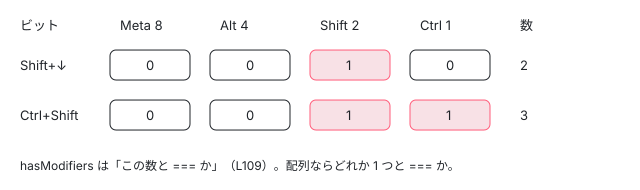

[目次](../README.md) › [Angular Aria の内側](README.md) › 第 4 回 / 全 20 回

# イベントマネージャ：キーと修飾キーを処理に結びつける

> KeyboardEventManager・PointerEventManager・ClickEventManager が on(修飾キー, キー, 処理) で config を積み、handle が合ったものを全部、積んだ順に走らせる仕組み。getModifiers・hasModifiers（完全一致のビット）、preventDefault と stopPropagation の既定、Pattern の keydown が computed で、組み立てのときに読んだ signal が変わったときだけ作り直される理由、isFakeClick・isProgrammaticClick、プロトタイプ汚染を避けた変更と、配列なしの Ctrl | Shift が合わない落とし穴。

angular/components · 読了 約 12 分 · 中核 · [サイトで読む（デモが動きます）](https://angular-deep-dive-cyan.vercel.app/chapter/aria-events)

---

Aria の Pattern は、「Shift を押しながら ↓ なら範囲を選ぶ」のようなキーと処理の対応を、`if (event.key === ...)` を並べて書くのではなく、イベントマネージャに `.on(修飾キー, キー, 処理)` で積んで作ります。この章では、そのイベントマネージャ（`EventManager`・`KeyboardEventManager`・`PointerEventManager`・`ClickEventManager`）を 1 行ずつ読みます。`handle` がどの順で何を走らせるか、修飾キーのビット、`preventDefault` と `stopPropagation` の既定、スクリーンリーダーの仮想クリックの見分け方、Pattern の `keydown` が computed になっている意味が分かります。

読む対象は `src/aria/private/behaviors/event-manager/` の 4 つの .ts（全部）と、使う側の例として `src/aria/private/tree/tree.ts` の `keydown` です。

1. [1. 全体像](01-aria-overview.md)
2. [2. SignalLike](02-aria-signal-like.md)
3. [3. SortedCollection](03-aria-collection.md)
4. **4. イベントマネージャ**（この章）
5. [5. ListFocus](05-aria-list-focus.md)
6. [6. ListNavigation](06-aria-list-navigation.md)
7. [7. ListSelection](07-aria-list-selection.md)
8. [8. ListTypeahead](08-aria-typeahead.md)
9. [9. Listbox](09-aria-listbox.md)
10. [10. Accordion](10-aria-accordion.md)
11. [11. DeferredContent](11-aria-deferred-content.md)
12. [12. Tabs](12-aria-tabs.md)
13. [13. Toolbar](13-aria-toolbar.md)
14. [14. Tree](14-aria-tree.md)
15. [15. Grid](15-aria-grid.md)
16. [16. Grid のセル](16-aria-grid-cells.md)
17. [17. Combobox](17-aria-combobox.md)
18. [18. Menu](18-aria-menu.md)
19. [19. テスト](19-aria-testing.md)
20. [20. issue と PR を読む](20-aria-issues.md)

## 1. 部品：設定の型と Modifier のビット

📄 `components/src/aria/private/behaviors/event-manager/event-manager.ts` L21–54 （▶ の行: 26–29, 36, 39–41, 45–51, 54）

```ts
21 │ /**
22 │  * Options that are applicable to all event handlers.
23 │  *
24 │  * This library has not yet had a need for stopPropagationImmediate.
25 │  */
26 ▶ export interface EventHandlerOptions {
27 ▶   ignoreRepeat?: boolean;
28 ▶   stopPropagation: boolean;
29 ▶   preventDefault: boolean;
30 │ }
31 │ 
32 │ /** A basic event handler. */
33 │ export type EventHandler<T extends Event> = (event: T) => void;
34 │ 
35 │ /** A function that determines whether an event is to be handled. */
36 ▶ export type EventMatcher<T extends Event> = (event: T) => boolean;
37 │ 
38 │ /** A config that specifies how to handle a particular event. */
39 ▶ export interface EventHandlerConfig<T extends Event> extends EventHandlerOptions {
40 ▶   matcher: EventMatcher<T>;
41 ▶   handler: EventHandler<T>;
42 │ }
43 │ 
44 │ /** Bit flag representation of the possible modifier keys that can be present on an event. */
45 ▶ export enum Modifier {
46 ▶   None = 0,
47 ▶   Ctrl = 0b1,
48 ▶   Shift = 0b10,
49 ▶   Alt = 0b100,
50 ▶   Meta = 0b1000,
51 ▶   Any = 'Any',
52 │ }
53 │ 
54 ▶ export type ModifierInputs = Modifier | Modifier[];
```

1. **26〜30 行目 EventHandlerOptions**

   1 つの処理ごとに「キーを押しっぱなしにしたときの繰り返し（`repeat`）を無視するか」「`stopPropagation` するか」「`preventDefault` するか」を持ちます。`ignoreRepeat` だけ省略できます（#32728 で足された）。
2. **36〜42 行目 matcher と handler の組**

   `EventMatcher` は「このイベントを扱うか」を返す関数、`EventHandlerConfig` はそれと処理（`handler`）と 26 行目のオプションを 1 つにしたものです。マネージャはこの config を配列に積んでいきます。
3. **45〜52 行目 Modifier はビット**

   `Ctrl = 0b1`（1）、`Shift = 0b10`（2）、`Alt = 0b100`（4）、`Meta = 0b1000`（8）。押している修飾キーの組は足し算（ビットの OR）で 1 つの数になります。Ctrl と Shift なら 3 です。51 行目の `Any` だけは数ではなく文字列 `'Any'` で、「修飾キーは何でもよい」を表します。54 行目の `ModifierInputs` は 1 つか配列です。

## 2. EventManager.handle：合ったものを全部、積んだ順に

📄 `components/src/aria/private/behaviors/event-manager/event-manager.ts` L56–85 （▶ の行: 59–60, 63–64, 67–70, 72–73, 76–77, 84）

```ts
56 │ /**
57 │  * Abstract base class for all event managers.
58 │  *
59 ▶  * Event managers are designed to normalize how event handlers are authored and create a safety net
60 ▶  * for common event handling gotchas like remembering to call preventDefault or stopPropagation.
61 │  */
62 │ export abstract class EventManager<T extends Event> {
63 ▶   protected configs: EventHandlerConfig<T>[] = [];
64 ▶   abstract options: EventHandlerOptions;
65 │ 
66 │   /** Runs the handlers that match with the given event. */
67 ▶   handle(event: T): void {
68 ▶     for (const config of this.configs) {
69 ▶       if (config.matcher(event)) {
70 ▶         config.handler(event);
71 │ 
72 ▶         if (config.preventDefault) {
73 ▶           event.preventDefault();
74 │         }
75 │ 
76 ▶         if (config.stopPropagation) {
77 ▶           event.stopPropagation();
78 │         }
79 │       }
80 │     }
81 │   }
82 │ 
83 │   /** Configures the event manager to handle specific events. (See subclasses for more). */
84 ▶   abstract on(...args: [...unknown[]]): this;
85 │ }
```

1. **59〜60 行目 何のためにあるか**

   コメントのとおり、イベント処理の書き方をそろえ、`preventDefault` や `stopPropagation` の呼び忘れという「よくある落とし穴」の安全網にするためです。
2. **68 行目 積んだ順に全部見る**

   `for (const config of this.configs)` は途中で `break` しません。**合ったものが 2 つあれば 2 つとも走ります**。最初に合った 1 つで止まるわけではありません。手元で `.on('a', ...)` と `.on('A', ...)` を積んで `a` を渡すと、両方の処理が走り、`preventDefault` も 2 回呼ばれました（22.1.8 の event-manager を Node から直接読み込んで確かめた。event-manager は 22.1.8 と snapshot で同じ）。
3. **69〜78 行目 処理のあとに既定のふるまいを止める**

   合ったら 70 行目で処理を呼び、そのあと 72〜74 行目と 76〜78 行目で、その config のオプションに従って `preventDefault()` と `stopPropagation()` を呼びます。合わなかったイベントには何もしません。
4. **84 行目 on はサブクラスが決める**

   `on` の引数の形はキーボード・ポインタ・クリックで違うので、抽象メソッドです。どれも `this` を返すので `.on(...).on(...)` とつなげられます。

## 3. getModifiers と hasModifiers：ぴったり同じ組だけ

📄 `components/src/aria/private/behaviors/event-manager/event-manager.ts` L87–110 （▶ の行: 90–93, 102–103, 105–106, 109）

```ts
 87 │ /** Gets bit flag representation of the modifier keys present on the given event. */
 88 │ export function getModifiers(event: EventWithModifiers): number {
 89 │   return (
 90 ▶     (+event.ctrlKey && Modifier.Ctrl) |
 91 ▶     (+event.shiftKey && Modifier.Shift) |
 92 ▶     (+event.altKey && Modifier.Alt) |
 93 ▶     (+event.metaKey && Modifier.Meta)
 94 │   );
 95 │ }
 96 │ 
 97 │ /**
 98 │  * Checks if the given event has modifiers that are an exact match for any of the given modifier
 99 │  * flag combinations.
100 │  */
101 │ export function hasModifiers(event: EventWithModifiers, modifiers: ModifierInputs): boolean {
102 ▶   const eventModifiers = getModifiers(event);
103 ▶   const modifiersList = Array.isArray(modifiers) ? modifiers : [modifiers];
104 │ 
105 ▶   if (modifiersList.includes(Modifier.Any)) {
106 ▶     return true;
107 │   }
108 │ 
109 ▶   return modifiersList.some(modifiers => eventModifiers === modifiers);
110 │ }
```

1. **90〜93 行目 イベントからビットを作る**

   `+event.ctrlKey` は true / false を 1 / 0 にします。`1 && Modifier.Ctrl` は 1、`0 && ...` は 0。それを `|` でつなぐと、Shift だけなら 2、Ctrl+Shift なら 3 です。
2. **105〜107 行目 Any なら何でも通す**

   リストのどれかが `Modifier.Any` なら、修飾キーを見ずに true です。
3. **109 行目 完全一致**

   `eventModifiers === modifiers`。「少なくともこれを押している」ではなく「**押しているのがちょうどこの組**」です。だから `.on('a', ...)`（修飾キーなし ＝ 0）は Shift+A では呼ばれません。配列なら、どれか 1 つの組と一致すれば通ります（103 行目と 109 行目の `some`）。



*Shift+↓ のイベントは getModifiers で 0b0010 = 2。.on(Modifier.Shift, ...) の 2 と一致し、.on(\[Ctrl|Shift, Meta|Shift\], ...) の 3・10 とは一致しない*

## 4. KeyboardEventManager：既定は「止める」

📄 `components/src/aria/private/behaviors/event-manager/keyboard-event-manager.ts` L19–36 （▶ の行: 25, 28–29, 32–35）

```ts
19 │ /**
20 │  * Used to represent a keycode.
21 │  *
22 │  * This is used to match whether an events keycode should be handled. The ability to match using a
23 │  * string, SignalLike, or Regexp gives us more flexibility when authoring event handlers.
24 │  */
25 ▶ type KeyCode = string | SignalLike<string> | RegExp;
26 │ 
27 │ /**
28 ▶  * An event manager that is specialized for handling keyboard events. By default this manager stops
29 ▶  * propagation and prevents default on all events it handles.
30 │  */
31 │ export class KeyboardEventManager<T extends KeyboardEvent> extends EventManager<T> {
32 ▶   readonly options: EventHandlerOptions = {
33 ▶     ignoreRepeat: true,
34 ▶     preventDefault: true,
35 ▶     stopPropagation: true,
36 │   };
```

25 行目のとおり、キーは文字列・`SignalLike<string>`・正規表現のどれかで書けます。32〜36 行目の既定は、**繰り返しは無視・`preventDefault` する・`stopPropagation` する**です（28〜29 行目のコメント）。キーボードの処理が合ったら、ブラウザのスクロールなどの既定の動きを止め、親の要素にもイベントを渡しません。

📄 `components/src/aria/private/behaviors/event-manager/keyboard-event-manager.ts` L38–75 （▶ の行: 39, 42, 52–56, 63–67）

```ts
38 │   /** Configures this event manager to handle events with a specific key and no modifiers. */
39 ▶   on(key: KeyCode, handler: EventHandler<T>, options?: Partial<EventHandlerOptions>): this;
40 │ 
41 │   /**  Configures this event manager to handle events with a specific modifer and key combination. */
42 ▶   on(
43 │     modifiers: ModifierInputs,
44 │     key: KeyCode,
45 │     handler: EventHandler<T>,
46 │     options?: Partial<EventHandlerOptions>,
47 │   ): this;
48 │ 
49 │   on(...args: unknown[]) {
50 │     const {modifiers, key, handler, options} = this._normalizeInputs(...args);
51 │ 
52 ▶     this.configs.push({
53 ▶       handler: handler,
54 ▶       matcher: event => this._isMatch(event, key, modifiers, options),
55 ▶       ...this.options,
56 ▶       ...options,
57 │     });
58 │ 
59 │     return this;
60 │   }
61 │ 
62 │   private _normalizeInputs(...args: unknown[]) {
63 ▶     const withModifiers = Array.isArray(args[0]) || Modifier.hasOwnProperty(args[0] as string);
64 ▶     const modifiers = withModifiers ? args[0] : Modifier.None;
65 ▶     const key = withModifiers ? args[1] : args[0];
66 ▶     const handler = withModifiers ? args[2] : args[1];
67 ▶     const options = withModifiers ? args[3] : args[2];
68 │ 
69 │     return {
70 │       key: key as KeyCode,
71 │       handler: handler as EventHandler<T>,
72 │       modifiers: modifiers as ModifierInputs,
73 │       options: (options ?? {}) as Partial<EventHandlerOptions>,
74 │     };
75 │   }
```

1. **39・42 行目 2 つの書き方**

   `on(キー, 処理, オプション?)` と `on(修飾キー, キー, 処理, オプション?)` です（多重定義＝同じ名前で引数の形を変えたもの）。
2. **63 行目 最初の引数が修飾キーかを見分ける**

   配列か、`Modifier.hasOwnProperty(args[0])` が true なら修飾キーつきの形とみなし、64〜67 行目で引数をずらして読みます。TypeScript の数の enum は、`Modifier.Ctrl === 1` と逆向きの `Modifier[1] === 'Ctrl'` の両方をオブジェクトに持つので、`hasOwnProperty(1)` も `hasOwnProperty('Any')` も true です。
3. **53〜57 行目 オプションを重ねる**

   `...this.options`（既定）のあとに `...options`（その処理だけの指定）を広げるので、`{ignoreRepeat: false}` のように**一部だけ上書き**できます。54 行目の matcher は、キーと修飾キーを閉じ込めた関数です。

> [!NOTE]
> **さらに深く**
>
> 63 行目は 68b3fd2482（2026-06-11「refactor: avoid prototype pollution in keyboard manager」）で変わりました。前は `(args[0] as string) in Modifier` でした。`in` はプロトタイプの鎖もたどるので、`'toString'` や `'constructor'` のように `Object.prototype` にある名前、あるいは誰かが `Object.prototype` に足した名前（プロトタイプ汚染）も「修飾キー」と判定されてしまいます。`hasOwnProperty` は enum 自身のキーしか見ません。いまの版で `.on('toString', 処理)` を積んで key が `'toString'` のイベントを渡すと、処理が走りました（Node で確かめた）。

📄 `components/src/aria/private/behaviors/event-manager/keyboard-event-manager.ts` L77–100 （▶ の行: 83–85, 89–90, 93–94, 97–98）

```ts
 77 │   private _isMatch(
 78 │     event: T,
 79 │     key: KeyCode,
 80 │     modifiers: ModifierInputs,
 81 │     options?: Partial<EventHandlerOptions>,
 82 │   ): boolean {
 83 ▶     // In some cases the `key` may be undefined, despite the types saying otherwise. See #33359.
 84 ▶     if (event.key == null || !hasModifiers(event, modifiers)) {
 85 ▶       return false;
 86 │     }
 87 │ 
 88 │     // Default is to ignore repeated key events unless explicitly set to false.
 89 ▶     if (event.repeat && options?.ignoreRepeat !== false) {
 90 ▶       return false;
 91 │     }
 92 │ 
 93 ▶     if (key instanceof RegExp) {
 94 ▶       return key.test(event.key);
 95 │     }
 96 │ 
 97 ▶     const keyStr = typeof key === 'string' ? key : key();
 98 ▶     return keyStr.toLowerCase() === event.key.toLowerCase();
 99 │   }
100 │ }
```

1. **83〜86 行目 key が無い・修飾キーが違う**

   ブラウザの自動入力などが出す合成の `keydown` には `key` が無いことがあり、前は 98 行目の `event.key.toLowerCase()` で例外になっていました（#33359、03685a98d7 で直した。コメントにも番号がある）。
2. **89〜91 行目 繰り返しは無視（既定）**

   `event.repeat` が true で、その処理に `ignoreRepeat: false` が付いていなければ合わないことにします。矢印キーの移動には `{ignoreRepeat: false}` が付いているので押しっぱなしで動き続け、Space の選択の切り替えなどは 1 回だけ、という分け方です（#32728 の PR の説明）。
3. **93〜95 行目 正規表現**

   頭文字の検索（[第 8 回](08-aria-typeahead.md)）は `/^.$/`（1 文字のキー）で積まれています。
4. **97〜98 行目 SignalLike は「合わせるとき」に読む**

   キーが関数なら、ここで初めて `key()` を呼びます。つまり `.on(this.prevKey, ...)` と signal を渡しておけば、イベントが来た時点の値（縦なら ArrowUp、横なら ArrowLeft）で比べます。98 行目で大文字小文字を無視するので `'A'` と `'a'` は同じです。

## 5. Pattern 側：keydown が computed である意味

📄 `components/src/aria/private/tree/tree.ts` L222–241 （▶ の行: 223–224, 228–229, 232–233, 237, 241）

```ts
222 │   /** The keydown event manager for the tree. */
223 ▶   readonly keydown = computed(() => {
224 ▶     const manager = new KeyboardEventManager();
225 │     const tree = this.treeBehavior;
226 │ 
227 │     manager
228 ▶       .on(this.prevKey, () => tree.prev({selectOne: this.followFocus()}), {ignoreRepeat: false})
229 ▶       .on(this.nextKey, () => tree.next({selectOne: this.followFocus()}), {ignoreRepeat: false})
230 │       .on('Home', () => tree.first({selectOne: this.followFocus()}))
231 │       .on('End', () => tree.last({selectOne: this.followFocus()}))
232 ▶       .on(this.typeaheadRegexp, e => tree.search(e.key, {selectOne: this.followFocus()}))
233 ▶       .on(Modifier.Shift, '*', () => tree.expandSiblings())
234 │       .on(this.expandKey, () => this._expandOrFirstChild({selectOne: this.followFocus()}))
235 │       .on(this.collapseKey, () => this._collapseOrParent({selectOne: this.followFocus()}));
236 │ 
237 ▶     if (this.inputs.multi()) {
238 │       manager
239 │         // TODO: Tracking the anchor by index can break if the
240 │         // tree is expanded or collapsed causing the index to change.
241 ▶         .on(Modifier.Any, 'Shift', () => tree.anchor(this.treeBehavior.activeIndex()))
```

1. **223 行目 マネージャを作る式全体が computed**

   `keydown` は「マネージャを返す computed」です。`onKeydown(event)` は `this.keydown().handle(event)` を呼ぶだけで（ui-pattern-rules.md の 132〜134 行目の形）、computed は値をとっておくので、**毎回組み直すわけではありません**。
2. **237 行目 組み立てるときに読んだ signal だけが依存になる**

   `if (this.inputs.multi())` は computed の**中で** signal を読んでいるので、`multi` が変わると computed が古くなり、次の `keydown()` で Shift の処理を足した（または外した）マネージャが作り直されます。この keydown は 241 行目のあとにも `if` が続き、組み立てのときに読む signal は `multi`・`followFocus`・`nav` の 3 つです。どの処理を積むかがこの 3 つで変わります。
3. **228〜229 行目 signal を「呼ばずに」渡す**

   `this.prevKey` は呼ばずに渡しているので、組み立てのときには読まれず、依存になりません。読まれるのは 4 節の 97 行目、イベントが来たときです。だから向き（orientation）や `dir` が変わっても、マネージャは作り直されずに正しいキーで比べます。処理の中の `this.followFocus()` も、矢印関数の中なので呼ばれるのはイベントのときです。
4. **232〜233・241 行目 正規表現と修飾キー**

   232 行目が頭文字、233 行目が `Modifier.Shift` と `'*'`（兄弟を全部開く）、241 行目が `Modifier.Any` と `'Shift'`（Shift キーそのものを押したら範囲の起点を覚える）です。

確かめのため、22.1.8 の `TabListPattern` を DOM なしで作り、`keydown()` を読んでから `orientation` と `selectionMode` の signal を変えてもう一度読みました。返ってきたマネージャは 3 回とも**同じオブジェクト**でした。tabs の keydown は `prevKey` / `nextKey` を呼ばずに渡し、`followFocus()` を処理の矢印関数の中で読むので、組み立てのときに読む signal が 1 つも無いからです。Listbox の keydown は tree と同じく `readonly`・`followFocus`・`multi` で積むものを変えます（[第 9 回](09-aria-listbox.md)）。

📄 `components/src/aria/private/ui-pattern-rules.md` L112–141 （▶ の行: 116–117, 123–124, 132–133, 137–138）

````md
112 │ export class ExamplePattern {
113 │   // Behaviors...
114 │ 
115 │   /** The keydown event manager for the accessibility pattern. */
116 ▶   keydown = computed(() => {
117 ▶     return new KeyboardEventManager()
118 │       .on('ArrowUp', () => { /* Arrow up logic. */ })
119 │       .on('ArrowDown', () => { /* Arrow down logic. */ });
120 │   });
121 │ 
122 │   /** The pointerdown event manager for the listbox. */
123 ▶   pointerdown = computed(() => {
124 ▶     return new PointerEventManager().on(() => {/* Pointerdown logic. */});
125 │   });
126 │ 
127 │   // Constructor...
128 │ 
129 │   // Core Methods...
130 │ 
131 │   /** Handles keydown events for the accessibility pattern. */
132 ▶   onKeydown(event: KeyboardEvent) {
133 ▶     this.keydown().handle(event);
134 │   }
135 │ 
136 │   /** Handles pointer events for the accessibility pattern. */
137 ▶   onPointerdown(event: PointerEvent) {
138 ▶     this.pointerdown().handle(event);
139 │   }
140 │ }
141 │ ```
````

決まりの上でも、keydown は 116 行目のように `computed(() => new KeyboardEventManager()...)` と書き、132〜134 行目の `onKeydown` から `this.keydown().handle(event)` を呼ぶ形です。123〜125 行目は `PointerEventManager` の例ですが、いまの snapshot の Pattern に `new PointerEventManager` は 1 つもありません。クリックは 6 節の `ClickEventManager` に移り（e01062ac52 #33031・61f9ac0870 #33036）、`new KeyboardEventManager` は 9 ファイルに 11 個（menu.ts だけ 3 個）、`new ClickEventManager` は 6 ファイルに 1 個ずつでした。

📄 `components/src/aria/private/ui-pattern-rules.md` L187–198 （▶ の行: 187–188, 194）

````md
187 ▶ Holding multiple `Modifier` keys when performing a keydown event can be represented by using the
188 ▶ bitwise OR operator.
189 │ 
190 │ ```ts
191 │   /** The keydown event manager for the accessibility pattern. */
192 │   keydown = computed(() => {
193 │     return new KeyboardEventManager()
194 ▶       .on(Modifier.Ctrl | Modifier.Shift, 'ArrowUp', () => {
195 │         /* Arrow up while holding ctrl + shift logic. */
196 │       });
197 │   });
198 │ ```
````

> [!WARNING]
> **ハマりどころ**
>
> 187〜188 行目は「修飾キーを同時に押す組は `|` で表す」とし、194 行目で `.on(Modifier.Ctrl | Modifier.Shift, 'ArrowUp', ...)` と配列なしで書いています。ところが `Modifier.Ctrl | Modifier.Shift` は 3 で、`Modifier.hasOwnProperty(3)` は false です（enum の逆向きのキーは 0・1・2・4・8 だけ）。だから 4 節の 63 行目はこれを「修飾キーなしの形」と読み、キーを 3、処理を `'ArrowUp'` と取り違えます。Node で 22.1.8 の KeyboardEventManager にこの書き方で積み、Ctrl+Shift+ArrowUp を渡したところ、処理は呼ばれず、例外も出ませんでした。`[Modifier.Ctrl | Modifier.Shift]` と配列にすると呼ばれました。実際の Pattern は、listbox も tree も `[Modifier.Ctrl | Modifier.Shift, Modifier.Meta | Modifier.Shift]` と配列で書いています。

## 6. PointerEventManager と ClickEventManager

📄 `components/src/aria/private/behaviors/event-manager/pointer-event-manager.ts` L18–51 （▶ の行: 21–24, 29–31, 38, 43, 51）

```ts
18 │ /**
19 │  * The different mouse buttons that may appear on a pointer event.
20 │  */
21 ▶ export enum MouseButton {
22 ▶   Main = 0,
23 ▶   Auxiliary = 1,
24 ▶   Secondary = 2,
25 │ }
26 │ 
27 │ /** An event manager that is specialized for handling pointer events. */
28 │ export class PointerEventManager<T extends PointerEvent> extends EventManager<T> {
29 ▶   readonly options: EventHandlerOptions = {
30 ▶     preventDefault: false,
31 ▶     stopPropagation: false,
32 │   };
33 │ 
34 │   /**
35 │    * Configures this event manager to handle events with a specific modifer and mouse button
36 │    * combination.
37 │    */
38 ▶   on(button: MouseButton, modifiers: ModifierInputs, handler: EventHandler<T>): this;
39 │ 
40 │   /**
41 │    * Configures this event manager to handle events with a specific mouse button and no modifiers.
42 │    */
43 ▶   on(modifiers: ModifierInputs, handler: EventHandler<T>): this;
44 │ 
45 │   /**
46 │    * Configures this event manager to handle events with the main mouse button and no modifiers.
47 │    *
48 │    * @param handler The handler function
49 │    * @param options Options for whether to stop propagation or prevent default.
50 │    */
51 ▶   on(handler: EventHandler<T>): this;
```

📄 `components/src/aria/private/behaviors/event-manager/pointer-event-manager.ts` L53–91 （▶ の行: 65, 73, 81, 89）

```ts
53 │   on(...args: any[]) {
54 │     const {button, handler, modifiers} = this._normalizeInputs(...args);
55 │ 
56 │     this.configs.push({
57 │       handler,
58 │       matcher: event => this._isMatch(event, button, modifiers),
59 │       ...this.options,
60 │     });
61 │     return this;
62 │   }
63 │ 
64 │   private _normalizeInputs(...args: any[]) {
65 ▶     if (args.length === 3) {
66 │       return {
67 │         button: args[0] as MouseButton,
68 │         modifiers: args[1] as ModifierInputs,
69 │         handler: args[2] as EventHandler<T>,
70 │       };
71 │     }
72 │ 
73 ▶     if (args.length === 2) {
74 │       return {
75 │         button: MouseButton.Main,
76 │         modifiers: args[0] as ModifierInputs,
77 │         handler: args[1] as EventHandler<T>,
78 │       };
79 │     }
80 │ 
81 ▶     return {
82 │       button: MouseButton.Main,
83 │       modifiers: Modifier.None,
84 │       handler: args[0] as EventHandler<T>,
85 │     };
86 │   }
87 │ 
88 │   _isMatch(event: PointerEvent, button: MouseButton, modifiers: ModifierInputs) {
89 ▶     return button === (event.button ?? 0) && hasModifiers(event, modifiers);
90 │   }
91 │ }
```

ポインタは既定で何も止めません（29〜32 行目）。引数の数で形を見分け（65・73・81 行目）、89 行目で押したボタン（`event.button`、無ければ 0 ＝ 主ボタン）と修飾キーを比べます。43 行目の多重定義のコメントは「specific mouse button and no modifiers」ですが、引数は `(modifiers, handler)` で、73〜78 行目のとおりボタンは主ボタンに決まり、修飾キーを指定する形です。

📄 `components/src/aria/private/behaviors/event-manager/click-event-manager.ts` L18–49 （▶ の行: 21–23, 25–26, 33–34, 40–43, 46–48）

```ts
18 │ /**
19 │  * Gets whether an event could be a simulated click event.
20 │  *
21 ▶  * Screen readers and keyboard activation (Enter/Space) often dispatch fake click
22 ▶  * events. We distinguish them by checking if `event.detail` is zero or if
23 ▶  * `event.pointerType` is missing.
24 │  */
25 ▶ export function isFakeClick(event: PointerEvent): boolean {
26 ▶   return event.detail === 0 || !event.pointerType;
27 │ }
28 │ 
29 │ /**
30 │  * Gets whether an event is a programmatic click (e.g. triggered by .click() or .dispatchEvent()).
31 │  * Programmatic events are untrusted.
32 │  */
33 ▶ export function isProgrammaticClick(event: Event): boolean {
34 ▶   return !event.isTrusted;
35 │ }
36 │ 
37 │ /**
38 │  * An event manager that is specialized for handling click events.
39 │  *
40 ▶  * This manager should ONLY be used to handle click events. It explicitly
41 ▶  * filters out simulated click events generated by browsers when Enter or Space
42 ▶  * keys are pressed, to avoid concurrent logic or overwriting selection state
43 ▶  * when handling keyboard activation explicitly via KeyboardEventManager.
44 │  */
45 │ export class ClickEventManager<T extends PointerEvent> extends EventManager<T> {
46 ▶   readonly options: EventHandlerOptions = {
47 ▶     preventDefault: false,
48 ▶     stopPropagation: false,
49 │   };
```

📄 `components/src/aria/private/behaviors/event-manager/click-event-manager.ts` L63–92 （▶ の行: 66–69, 88–90）

```ts
63 │   on(...args: unknown[]) {
64 │     const {handler, modifiers} = this._normalizeInputs(...args);
65 │ 
66 ▶     this.configs.push({
67 ▶       handler,
68 ▶       matcher: event => this._isMatch(event, modifiers),
69 ▶       ...this.options,
70 │     });
71 │     return this;
72 │   }
73 │ 
74 │   private _normalizeInputs(...args: unknown[]) {
75 │     if (args.length === 2) {
76 │       return {
77 │         modifiers: args[0] as ModifierInputs,
78 │         handler: args[1] as EventHandler<T>,
79 │       };
80 │     }
81 │ 
82 │     return {
83 │       modifiers: Modifier.None,
84 │       handler: args[0] as EventHandler<T>,
85 │     };
86 │   }
87 │ 
88 ▶   _isMatch(event: T, modifiers: ModifierInputs) {
89 ▶     const isAllowed = isProgrammaticClick(event) || !isFakeClick(event);
90 ▶     return isAllowed && hasModifiers(event, modifiers);
91 │   }
92 │ }
```

1. **25〜27 行目 isFakeClick**

   21〜23 行目のコメントのとおり、スクリーンリーダーやキーボード（Enter / Space）は「本物のポインタではない click」を送ることがよくあります。それを `event.detail === 0`（クリックの回数が 0）か `pointerType` が空、で見分けます。
2. **33〜35 行目 isProgrammaticClick**

   `el.click()` や `dispatchEvent` で作ったイベントは `isTrusted` が false です。
3. **89 行目 通すのは「プログラムから」か「本物のポインタ」**

   `isProgrammaticClick(event) || !isFakeClick(event)`。ブラウザがキーボードの操作から作った click（`isTrusted` は true で `detail` が 0）だけを弾きます。40〜44 行目のコメントのとおり、キーボードの処理は KeyboardEventManager が既にしているので、同じ操作を 2 回処理して選択を上書きしないためです。プログラムからの click は通すので、spec の `element.click()` も処理されます。
4. **46〜49 行目 既定は止めない**

   click も `preventDefault` も `stopPropagation` もしません。listbox と tabs のクリックがこの形に移ったのが e01062ac52（#33031。PR の説明に「Fixes #32915 #32971」。#32915 はタッチのスクロールで選ばれてしまう報告）です。

## 7. デモ：修飾キー付きのキーで、何が止められたか

> **🧪 DEMO — このページの @angular/aria（22.1.8）の ngListbox（multi・explicit）**
>
> 本物の `ngListbox` に `[multi]="true"` と `selectionMode="explicit"` を付けています。キーボードで操作できます。Tab でリストに入り、↑ ↓ で動きます。次を押してみてください：Shift だけ、Shift+↓ を 2 回、Space、Ctrl+A（Mac は ⌘+A）、Home、End、Ctrl+Shift+Home、Tab、Ctrl+B。リストの外側の `div` に `(keydown)` があり、泡立って届いたかを記録します。描画のあとに `event.defaultPrevented`・`document.activeElement`・`[(value)]` を読みます。
>
> ▶ [このデモはサイトで動かせます](https://angular-deep-dive-cyan.vercel.app/chapter/aria-events)

見るところは 4 つです（2026-11-02 にヘッドレスの Chrome で apple にフォーカスを置いてキーを送り、ログで確かめました）。

- **扱ったキーは止まる**：↓・Shift+↓・Space・Ctrl+A・Home・End・Ctrl+Shift+Home は `preventDefault=true`、`外の div に泡立った=false` です。4 節の 32〜36 行目の既定どおりです。
- **扱わないキーは素通り**：Tab・Ctrl+B・Control キーそのものは `preventDefault=false`、`泡立った=true`。合う config が無ければ 2 節の 69 行目を通らないので、何もしません。Tab はそのままリストの外へフォーカスを移します。
- **Shift キーそのものは止まる**：Control と違い、Shift の keydown は `.on(Modifier.Any, 'Shift', ...)`（範囲の起点を覚える。multi のときだけ積まれる）に合うので止められます。
- **Shift+↓ で範囲、Ctrl+A で全部**：↓ で banana へ移り、Shift+↓ を 2 回押すと `value` は `["banana","cherry","grape"]`。Ctrl+A を押すと全部が選ばれ、もう一度で `[]` に戻りました。ログの key は小文字の `a` ですが、`'A'` で積んだ処理に合います（4 節の 98 行目）。

## 8. 呼び出しの連なり

- 👤 `Shift+ArrowDown を押す` — 利用者
  - `host (keydown) → _pattern.onKeydown($event)` — listbox/listbox.ts — *第 9 回*
    - `this.keydown()` — private/listbox/listbox.ts — *computed。multi などが変わったときだけ組み直す*
    - `EventManager.handle(event)` — event-manager.ts L67 — *configs を全部、積んだ順に*
      - `matcher → KeyboardEventManager._isMatch` — keyboard-event-manager.ts L77
        - `hasModifiers → getModifiers` — event-manager.ts L101 / L88 — *2 === Modifier.Shift*
        - `key() と event.key を小文字で比べる` — keyboard-event-manager.ts L97-98
      - `handler → listBehavior.next({selectRange: true})` — Pattern — *第 7 回*
      - `event.preventDefault() / event.stopPropagation()` — event-manager.ts L72-78

## テストと直し方

event-manager のフォルダには BUILD.bazel と 5 つの .ts だけがあり、spec はありません。BUILD.bazel にも `ts_project` が 1 つあるだけです。このコードを確かめているのは使う側の spec です。たとえば private/listbox/listbox.spec.ts は、cdk の `createKeyboardEvent('keydown', 40, 'ArrowDown', mods)` で作ったイベントを `listbox.onKeydown()` に渡します（:21〜:31 の `down`・`shift` などの小さな関数）。

- `describe('Keyboard Selection')`（:193）→ `describe('explicit focus & multi select')`（:279）→ `it('should select a range of options on Shift + ArrowDown/ArrowUp (explicit focus & multi select)')`（:310）— Shift の keydown（241 行目と同じ `Modifier.Any, 'Shift'` の形）と、Shift+↓。
- 同じ describe の `it('should select all options on Ctrl + A')`（:417）— `[Modifier.Ctrl, Modifier.Meta]` の配列の形。

📄 `ターミナル`

```
cd ~/angular-research/components
pnpm bazel test //src/aria/private/listbox:unit_tests_chromium --nocache_test_results --test_output=all

# event-manager に spec はあるか
ls src/aria/private/behaviors/event-manager/
# repeat: true の keydown を投げる spec はあるか
grep -rn "repeat" --include='*.spec.ts' src/aria | wc -l
```

📄 `出力（抜粋。2026-11-02 に実行）`

```
src/aria/private/listbox/unit_tests_bundle.spec.js:
      Jasmine randomize seed: 98722
Chromium: |██████████████████████████████| 1/1 test files | 68 passed, 0 failed
Finished running tests in 0.7s, all tests passed!
//src/aria/private/listbox:unit_tests_chromium                           PASSED in 1.4s

BUILD.bazel
click-event-manager.ts
event-manager.ts
index.ts
keyboard-event-manager.ts
pointer-event-manager.ts
       0
```

1. **確かめられていない所**

   src/aria の spec に `repeat` という文字は 1 つもありませんでした。cdk の `createKeyboardEvent` も `repeat` を設定しないので、4 節の 89〜91 行目（繰り返しを無視する）を通る spec はありません。#32728 の PR の説明にも「we are missing tests for this」とあります。5 節の注意（配列なしの `Ctrl | Shift`）も、spec では確かめられていません。
2. **直すとしたら**

   キーの判定は keyboard-event-manager.ts の `_normalizeInputs`（62 行目）と `_isMatch`（77 行目）、走らせ方は event-manager.ts の `handle`（67 行目）です。spec を足すなら、event-manager のフォルダに spec と、第 1 回で見た `ng_project` + `ng_web_test_suite` の組を新しく作ることになります。いまある形のまま足すなら、private/&lt;部品&gt;/\*.spec.ts に、`new KeyboardEvent('keydown', {key, repeat: true})` を渡す it を足すのが入口です。
3. **issue を読むときの手がかり**

   「キーを押しっぱなしにすると…」「Enter で 2 回選ばれる」「タッチで選ばれる」のような報告は、まず keyboard-event-manager.ts の 89 行目（repeat）、click-event-manager.ts の 89 行目（isFakeClick）、`handle` の「合ったものは全部走る」のどれに当たるかを分けて読みます。部品ごとの issue は[第 20 回](20-aria-issues.md)です。

## 聞かれそうな質問

**Q. キーの割り当てを変えられますか？**

ディレクティブの input には、キーの割り当てを渡すものはありません（Listbox の input は orientation・multi・wrap・softDisabled・focusMode・selectionMode・typeaheadDelay・disabled・readonly・tabindex・value）。割り当ては Pattern の `keydown` という読み取り専用の computed の中に書かれていて、向き（orientation）と `dir` で矢印が入れ替わるのは、5 節の `prevKey` のような signal のキーが 4 節の 97 行目で読まれるからです。

**Q. IME で変換している最中のキーはどう扱われますか？**

src/aria の .ts に `isComposing` も `compositionstart` もありませんでした。KeyboardEventManager は 4 節の 77〜100 行目のとおり、`key`・修飾キー・`repeat` だけを見ます。変換中の keydown がどんな `key` で届くかはブラウザと IME によるので、ここでは確かめていません。頭文字の検索の正規表現 `/^.$/` は 1 文字の key にだけ合います。

**Q. なぜ event-manager に spec が無いのですか？何がこのコードを確かめていますか？**

spec を置かない理由はソースにもコミットにも書かれていません。#32728 の PR の説明には「テストは、repeat だけでなく click の問題もつかまえられるように、もっと上の層で足すべきだろう」とあります。実際に確かめているのは、Pattern の spec（private/listbox など。`onKeydown` に作ったイベントを渡す）と、ディレクティブの spec（listbox.spec.ts など。DOM にキーを送る）です。

**Q. 1 つのキーに 2 つの処理が合ったらどうなりますか？**

両方が積んだ順に走ります（2 節の 68 行目は break しない）。`preventDefault` と `stopPropagation` もそれぞれの config のぶん呼ばれます。Pattern は `if` で積むものを分けて、1 つのキーに 1 つの処理になるように書いています（tree は 237 行目から `if` を 4 つ並べています。続きは[第 14 回](14-aria-tree.md)）。

## 読み終えて

- マネージャは config（matcher + handler + オプション）を配列に積み、`handle` は合ったものを**全部**積んだ順に走らせる（event-manager.ts L67-81）。
- 修飾キーはビット。`hasModifiers` は完全一致、`Any` だけ例外（L88-110）。同時押しの組は配列に入れて渡す。
- KeyboardEventManager の既定は ignoreRepeat・preventDefault・stopPropagation がすべて true。処理ごとに一部だけ上書きできる（L32-36・L52-57）。
- SignalLike のキーはイベントのときに読む（L97）。Pattern の keydown は computed で、組み立てのときに読んだ signal が変わったときだけ作り直される。
- ClickEventManager は、キーボードやスクリーンリーダーが作った click（detail 0 か pointerType 無し）を、プログラムからの click 以外は弾く（click-event-manager.ts L25-35・L88-91）。

---

← 前: [SortedCollection：項目を DOM の順に並べる](03-aria-collection.md)  
次: [ListFocus：roving tabindex と aria-activedescendant](05-aria-list-focus.md) →
