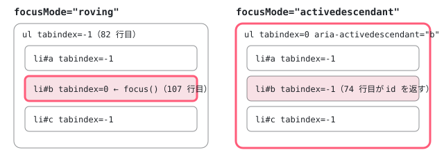

[目次](../README.md) › [Angular Aria の内側](README.md) › 第 5 回 / 全 20 回

# ListFocus：roving tabindex と aria-activedescendant

> ListFocus が activeItem の signal から activeIndex を計算し、focusMode が roving なら項目の tabindex を 0 / -1 で切り替え、activedescendant ならコンテナにフォーカスを残して aria-activedescendant を返す行。softDisabled で無効な項目にもフォーカスを置く理由、isFocusable、focus() が要素に本当に focus するかどうかの opts。

angular/components · 読了 約 12 分 · 中核 · [サイトで読む（デモが動きます）](https://angular-deep-dive-cyan.vercel.app/chapter/aria-list-focus)

---

リストの中で「いまどの項目にいるか」を持ち、それを `tabindex` と `aria-activedescendant` に直すのが `ListFocus` です。この章では、**activeItem という 1 つの signal から、項目の tabindex・コンテナの tabindex・aria-activedescendant の 3 つがどう決まるか**、そして `focus()` が本物の DOM のフォーカスを動かすのはどの場合か、無効な項目にフォーカスを置ける `softDisabled` がどの行で効くかを 1 行ずつ追います。

読む対象は `src/aria/private/behaviors/list-focus/list-focus.ts`（118 行）と、その spec の `list-focus.spec.ts` です。行番号は ../components の e81c398a86（2026-09-10、22.2.0-next.5）のものです。

1. [1. 全体像](01-aria-overview.md)
2. [2. SignalLike](02-aria-signal-like.md)
3. [3. SortedCollection](03-aria-collection.md)
4. [4. イベントマネージャ](04-aria-events.md)
5. **5. ListFocus**（この章）
6. [6. ListNavigation](06-aria-list-navigation.md)
7. [7. ListSelection](07-aria-list-selection.md)
8. [8. ListTypeahead](08-aria-typeahead.md)
9. [9. Listbox](09-aria-listbox.md)
10. [10. Accordion](10-aria-accordion.md)
11. [11. DeferredContent](11-aria-deferred-content.md)
12. [12. Tabs](12-aria-tabs.md)
13. [13. Toolbar](13-aria-toolbar.md)
14. [14. Tree](14-aria-tree.md)
15. [15. Grid](15-aria-grid.md)
16. [16. Grid のセル](16-aria-grid-cells.md)
17. [17. Combobox](17-aria-combobox.md)
18. [18. Menu](18-aria-menu.md)
19. [19. テスト](19-aria-testing.md)
20. [20. issue と PR を読む](20-aria-issues.md)

用語を 2 つだけ先に決めます。**roving tabindex** は「いまの項目だけ `tabindex="0"`、ほかは `-1`」にして、本物のフォーカスを項目から項目へ動かすやり方です。**aria-activedescendant** は、フォーカスはコンテナ（`role="listbox"` の要素）に置いたまま、コンテナの `aria-activedescendant` 属性に「いまの項目の id」を書き、支援技術（スクリーンリーダーなど）にそれを伝えるやり方です。`ListFocus` はこの 2 つを `focusMode` という 1 つの入力で切り替えます。

## 1. 入力の形：項目は 3 つ、リストは 6 つ

📄 `components/src/aria/private/behaviors/list-focus/list-focus.ts` L11–42 （▶ の行: 12, 14, 17, 20, 24, 26, 32, 35, 38, 41）

```ts
11 │ /** Represents an item in a collection, such as a listbox option, than may receive focus. */
12 ▶ export interface ListFocusItem {
13 │   /** A unique identifier for the item. */
14 ▶   id: SignalLike<string>;
15 │ 
16 │   /** The html element that should receive focus. */
17 ▶   element: SignalLike<HTMLElement | undefined>;
18 │ 
19 │   /** Whether an item is disabled. */
20 ▶   disabled: SignalLike<boolean>;
21 │ }
22 │ 
23 │ /** Represents the required inputs for a collection that contains focusable items. */
24 ▶ export interface ListFocusInputs<T extends ListFocusItem> {
25 │   /** The focus strategy used by the list. */
26 ▶   focusMode: SignalLike<'roving' | 'activedescendant'>;
27 │ 
28 │   /** Whether the list is disabled. */
29 │   disabled: SignalLike<boolean>;
30 │ 
31 │   /** The items in the list. */
32 ▶   items: SignalLike<T[]>;
33 │ 
34 │   /** The active item. */
35 ▶   activeItem: WritableSignalLike<T | undefined>;
36 │ 
37 │   /** Whether disabled items in the list should be focusable. */
38 ▶   softDisabled: SignalLike<boolean>;
39 │ 
40 │   /** The html element that should receive focus. */
41 ▶   element: SignalLike<HTMLElement | undefined>;
42 │ }
```

1. **12〜21 行目 項目に要るのは id・element・disabled だけ**

   `ListFocusItem` は 14 行目の `id`（aria-activedescendant に書く文字列）、17 行目の `element`（roving のときに `focus()` を呼ぶ要素）、20 行目の `disabled` の 3 つです。どれも `SignalLike`（「引数なしで呼ぶと値を返す関数」。[第 2 回](02-aria-signal-like.md)）なので、Angular の signal でも、ただの関数でも渡せます。
2. **24〜42 行目 リストの入力**

   26 行目の `focusMode` が `'roving' | 'activedescendant'`、32 行目の `items` が項目の配列（DOM の順に並べるのは [第 3 回](03-aria-collection.md)の `SortedCollection`）、38 行目の `softDisabled` が「無効な項目にもフォーカスを置くか」、41 行目の `element` がコンテナの要素です。
3. **35 行目 書き込めるのは activeItem だけ**

   6 つの入力のうち `WritableSignalLike`（`set` と `update` を持つ）は `activeItem` だけです。`ListFocus` が自分で状態を書き換えるのはこの 1 か所で、残りはすべて外から読むだけの値です。

この `activeItem` は、ほかの Behavior とも共有されます。4 つを束ねる `List`（[第 9 回](09-aria-listbox.md)）のコンストラクタを見ます。

📄 `components/src/aria/private/behaviors/list/list.ts` L93–101 （▶ の行: 94–96, 99）

```ts
 93 │   constructor(readonly inputs: ListInputs<T, V>) {
 94 ▶     this.focusBehavior = new ListFocus(inputs);
 95 ▶     this.selectionBehavior = new ListSelection({...inputs, focusManager: this.focusBehavior});
 96 ▶     this.typeaheadBehavior = new ListTypeahead({...inputs, focusManager: this.focusBehavior});
 97 │     this.navigationBehavior = new ListNavigation({
 98 │       ...inputs,
 99 ▶       focusManager: this.focusBehavior,
100 │       wrap: computed(() => this._wrap() && this.inputs.wrap()),
101 │     });
```
*list.ts の引用はこの 9 行だけです。List の残りは第 9 回で読みます。*

94 行目で `ListFocus` を 1 つ作り、95・96・99 行目で `ListSelection`・`ListTypeahead`・`ListNavigation` に `focusManager` として同じものを渡しています。だから、矢印キーで動いても（[第 6 回](06-aria-list-navigation.md)）、頭文字で飛んでも（[第 8 回](08-aria-typeahead.md)）、最後に書かれるのは同じ `activeItem` で、選択（[第 7 回](07-aria-list-selection.md)）は引数が無ければその `activeItem` を選びます。

## 2. 持っている状態：activeIndex は「数えた結果」

📄 `components/src/aria/private/behaviors/list-focus/list-focus.ts` L44–64 （▶ の行: 47, 50–51, 55–56, 59, 62–63）

```ts
44 │ /** Controls focus for a list of items. */
45 │ export class ListFocus<T extends ListFocusItem> {
46 │   /** The last item that was active. */
47 ▶   readonly prevActiveItem = signal<T | undefined>(undefined);
48 │ 
49 │   /** The index of the last item that was active. */
50 ▶   readonly prevActiveIndex = computed(() => {
51 ▶     return this.prevActiveItem() ? this.inputs.items().indexOf(this.prevActiveItem()!) : -1;
52 │   });
53 │ 
54 │   /** The current active index in the list. */
55 ▶   readonly activeIndex = computed(() => {
56 ▶     return this.inputs.activeItem() ? this.inputs.items().indexOf(this.inputs.activeItem()!) : -1;
57 │   });
58 │ 
59 ▶   constructor(readonly inputs: ListFocusInputs<T>) {}
60 │ 
61 │   /** Whether the list is in a disabled state. */
62 ▶   isListDisabled(): boolean {
63 ▶     return this.inputs.disabled() || this.inputs.items().every(i => i.disabled());
64 │   }
```

1. **55〜57 行目 activeIndex は computed**

   番号は保存していません。56 行目で毎回 `items().indexOf(activeItem())` を数えます。項目の並びが変わっても（`SortedCollection` が並べ直しても）、`activeItem` が同じ項目を指していれば番号は自動で追いつきます。`activeItem` が `items()` に無いときは `indexOf` が `-1` を返し、`activeItem` が `undefined` のときも 56 行目で `-1` です。
2. **47・50〜52 行目 1 つ前の項目**

   `prevActiveItem` は `ListFocus` が自分で作る signal（9 行目で signal-like.ts から import した `signal`）です。書くのは 4 節の 102 行目だけ、読むのは `prevActiveIndex` を通した `ListSelection.selectRange` だけでした（`grep -rn prevActiveIndex src/aria` で list-selection.ts:173 と :176 の 2 か所）。Shift+矢印の範囲選択で「どこから動いたか」を知るためのものです（[第 7 回](07-aria-list-selection.md)）。
3. **62〜64 行目 リスト全体が無効か**

   `disabled` 入力が真か、**すべての項目が無効**なら、リスト全体を無効とみなします。63 行目は `Array.prototype.every` なので、項目が 0 個のときも `true` になります。項目がまだ 1 つも登録されていないリストは「無効」として扱われます。

## 3. tabindex と aria-activedescendant を返す 3 つのメソッド

📄 `components/src/aria/private/behaviors/list-focus/list-focus.ts` L66–94 （▶ の行: 68, 71, 74, 79–80, 82, 87–88, 90, 93）

```ts
66 │   /** The id of the current active item. */
67 │   getActiveDescendant(): string | undefined {
68 ▶     if (this.isListDisabled()) {
69 │       return undefined;
70 │     }
71 ▶     if (this.inputs.focusMode() === 'roving') {
72 │       return undefined;
73 │     }
74 ▶     return this.inputs.activeItem()?.id() ?? undefined;
75 │   }
76 │ 
77 │   /** The tab index for the list. */
78 │   getListTabIndex(): -1 | 0 {
79 ▶     if (this.isListDisabled()) {
80 ▶       return 0;
81 │     }
82 ▶     return this.inputs.focusMode() === 'activedescendant' ? 0 : -1;
83 │   }
84 │ 
85 │   /** Returns the tab index for the given item. */
86 │   getItemTabIndex(item: T): -1 | 0 {
87 ▶     if (this.isListDisabled()) {
88 ▶       return -1;
89 │     }
90 ▶     if (this.inputs.focusMode() === 'activedescendant') {
91 │       return -1;
92 │     }
93 ▶     return this.inputs.activeItem() === item ? 0 : -1;
94 │   }
```

3 つとも最初に `isListDisabled()` を見て（68・79・87 行目）、そのあと `focusMode` で分かれます。結果を表にします。

| 状態 | getListTabIndex（コンテナ） | getItemTabIndex（項目） | getActiveDescendant |
| --- | --- | --- | --- |
| リスト全体が無効 | `0`（80 行目） | すべて `-1`（88 行目） | `undefined`（69 行目） |
| roving | `-1`（82 行目） | activeItem だけ `0`（93 行目） | `undefined`（72 行目） |
| activedescendant | `0`（82 行目） | すべて `-1`（91 行目） | activeItem の id（74 行目） |



*activeItem が 2 番目の項目のとき。太線が本物のフォーカスのある要素、塗りが activeItem。*

1. **roving：Tab で止まるのは項目 1 つ**

   82 行目でコンテナは `-1`、93 行目で `activeItem` と同じ項目だけが `0` です。Tab キーで入ると、その 1 つの項目に本物のフォーカスが当たります。
2. **activedescendant：Tab で止まるのはコンテナ**

   82 行目でコンテナが `0`、91 行目で項目はすべて `-1`。74 行目でコンテナの `aria-activedescendant` に今の項目の `id()` を返します。`activeItem` が無ければ `?.` と `?? undefined` で `undefined` になり、Angular の `[attr.…]` バインディングは属性を外します。
3. **リスト全体が無効：コンテナを 1 つの Tab の止まり場所にする**

   80 行目は `focusMode` に関係なく `0` を返します。項目には入れませんが、コンテナには Tab で止まれるので、「ここに無効なリストがある」ことは伝わります。Listbox の spec の `it('should set tabindex="0" for the listbox when disabled and focusMode is "roving"')`（listbox.spec.ts:209）がこれを確かめています。

この 3 つの値を DOM に書くのはディレクティブの host バインディングです（引用は第 9 回の持ち場なので、場所だけ示します）。

- `Listbox host '[attr.tabindex]'` — listbox/listbox.ts:58 — *利用者が tabindex を渡していなければ \_pattern.tabIndex()*
  - `ListboxPattern.tabIndex → List.tabIndex` — private/listbox/listbox.ts:41 / list.ts:71
    - `ListFocus.getListTabIndex()` — list-focus.ts L78
- `Listbox host '[attr.aria-activedescendant]'` — listbox/listbox.ts:63
  - `ListFocus.getActiveDescendant()` — list-focus.ts L67
- `Option host '[attr.tabindex]'` — listbox/option.ts:48
  - `OptionPattern.tabIndex → List.getItemTabindex` — private/listbox/option.ts:56 / list.ts:105
    - `ListFocus.getItemTabIndex(item)` — list-focus.ts L86

> [!WARNING]
> **ハマりどころ**
>
> プリレンダーした HTML では、Listbox のコンテナも項目もすべて `tabindex="-1"` です（このシリーズの調べで確かめた出力）。表で言えば roving の行で、`activeItem` がまだ `undefined` なので 93 行目が全部 `-1` を返すからです。`activeItem` を最初の項目（か選ばれている項目）に決める `setDefaultState` は `afterRenderEffect` の中で、ブラウザでしか走りません（[第 9 回](09-aria-listbox.md)）。つまり JavaScript が動き出す前の HTML では、roving の Listbox には Tab で入れません。

## 4. focus()：activeItem を書き、roving のときだけ本物のフォーカスを動かす

📄 `components/src/aria/private/behaviors/list-focus/list-focus.ts` L96–117 （▶ の行: 97–99, 102–103, 105–107, 111, 115–116）

```ts
 96 │   /** Moves focus to the given item if it is focusable. */
 97 ▶   focus(item: T, opts?: {focusElement?: boolean}): boolean {
 98 ▶     if (this.isListDisabled() || !this.isFocusable(item)) {
 99 ▶       return false;
100 │     }
101 │ 
102 ▶     this.prevActiveItem.set(this.inputs.activeItem());
103 ▶     this.inputs.activeItem.set(item);
104 │ 
105 ▶     if (opts?.focusElement || opts?.focusElement === undefined) {
106 ▶       if (this.inputs.focusMode() === 'roving') {
107 ▶         item.element()?.focus();
108 │       }
109 │     }
110 │ 
111 ▶     return true;
112 │   }
113 │ 
114 │   /** Returns true if the given item can be navigated to. */
115 ▶   isFocusable(item: T): boolean {
116 ▶     return !item.disabled() || this.inputs.softDisabled();
117 │   }
```

1. **98〜100 行目 動けないなら false**

   リスト全体が無効か、渡された項目が `isFocusable` でなければ何もせず `false` を返します。この戻り値は「動いたか」の印で、`List` は動いたときだけ選択を更新します（list.ts:228〜231。[第 9 回](09-aria-listbox.md)）。
2. **102〜103 行目 前の項目を覚えてから書く**

   102 行目で今の `activeItem` を `prevActiveItem` に移し、103 行目で新しい項目を `activeItem` に書きます。これで 3 節の 3 つのメソッドの結果が変わり、次の描画で host バインディングが tabindex と aria-activedescendant を書き直します。
3. **105 行目 focusElement を省くと true 扱い**

   `opts?.focusElement || opts?.focusElement === undefined` なので、`opts` を渡さない・`focusElement` を書かないときは「要素にフォーカスする」側に入ります。止めたいときだけ `{ focusElement: false }` を渡します。Listbox の公開メソッド `gotoFirst()` と `gotoIndex(index)`（listbox/listbox.ts:209・:214。後者は #33483 の要望を受けたコミット ee20441fa7 で 2026-07-03 に追加）も、opts なしで `List.first` / `List.goto` を呼ぶので、roving なら本物のフォーカスが動きます。src/aria の中で `false` を書いているのは Menu だけです（private/menu/menu.ts:218 の `setDefaultState` と、:258 の `onMouseOver` の中で親のメニューの項目を合わせる行。どちらも activeItem だけ合わせて、本物のフォーカスは動かさない）。
4. **106〜107 行目 本物の focus() は roving のときだけ**

   `item.element()?.focus()` を呼ぶのは roving のときだけです。activedescendant のときは DOM に何もしません。フォーカスはコンテナに残り、変わるのは 74 行目の戻り値（＝ aria-activedescendant）だけです。`element()` が `undefined` でも `?.` で落ちません。
5. **115〜117 行目 isFocusable：無効でも softDisabled なら入れる**

   `!item.disabled() || this.inputs.softDisabled()`。有効な項目は常に入れ、無効な項目は `softDisabled` が真のときだけ入れます。[第 6 回](06-aria-list-navigation.md)の矢印キーも、[第 8 回](08-aria-typeahead.md)の頭文字検索も、飛ばすかどうかをこの 1 つのメソッドで決めます。

> [!NOTE]
> **ポイント**
>
> Listbox の `softDisabled` は既定で `true` です（listbox/listbox.ts:99。コミット 28a50f5dad「refactor(multiple): default softDisabled to true (#32240)」）。その直前の 95〜98 行目のコメントは「true なら無効な項目にもフォーカスが当たるが操作はできない。false ならナビゲーションで飛ばす」です。「無効な option にキーボードで届いてしまう」という報告 #33430 には、メンテナーが「意図した動きで、そうしないと利用者はそこに項目があることを知れない。飛ばしたいなら `[softDisabled]="false"`」と答えて閉じています（2026-06-23）。

> **🧪 DEMO — このページの @angular/aria（22.1.8）の ngListbox で ListFocus を見る**
>
> これは再現ではなく本物の `ngListbox` です。`cherry` は `[disabled]="true"` です。Tab でリストに入り、上下の矢印キーで動いてみてください。キーを押したあと・クリックしたあと・外からフォーカスが入ったあとに、描画が終わった時点の `document.activeElement`、コンテナと各項目の `tabindex`、`aria-activedescendant` を読んで下に出します（新しい行が上）。背景の色は `data-active`（今の項目）、`✓` は `aria-selected="true"` です。既定の `selectionMode="follow"` なので、動くと選択も付いてきます（[第 7 回](07-aria-list-selection.md)）。
>
> ▶ [このデモはサイトで動かせます](https://angular-deep-dive-cyan.vercel.app/chapter/aria-list-focus)

試すと次のことが見えます。

- roving で下へ動くと、`activeElement` が `#lf-opt-…` と一緒に動き、`li tabindex` の `0` が 1 つずつずれます（93・107 行目）。`ul tabindex` は `-1` のままです（82 行目）。
- activedescendant に切り替えると、`ul tabindex=0`、`li` は全部 `-1`。動いても `activeElement` は `ul[role=listbox]` のままで、`aria-activedescendant` だけが変わります（74・91 行目、107 行目を通らない）。
- `softDisabled` を外すと `cherry` を飛ばします。付けたままだと `cherry` に止まりますが、✓ は付きません（無効な項目は選べない。[第 7 回](07-aria-list-selection.md)）。

## 5. 矢印キー 1 回の流れ

- 👤 `（利用者）ArrowDown を押す` — keydown
  - `ListboxPattern.onKeydown → keydown().handle` — private/listbox/listbox.ts:235 — *キーの表は第 9 回*
    - `List.next → ListNavigation.next → _peek` — list.ts:120 / list-navigation.ts:52 — *第 6 回*
      - `ListFocus.isFocusable(item)` — list-focus.ts L115
    - `ListNavigation.goto → ListFocus.focus(item, opts)` — list-focus.ts L97
      - `prevActiveItem.set / activeItem.set` — list-focus.ts L102-103
      - `item.element()?.focus()` — list-focus.ts L107 — *roving のときだけ*
  - `（次の描画）host バインディング` — listbox.ts:58・:63 / option.ts:48 — *getListTabIndex・getActiveDescendant・getItemTabIndex を読む*

CDK にも同じ役目の `FocusKeyManager`（本物のフォーカス）と `ActiveDescendantKeyManager`（aria-activedescendant）があり、こちらは**別々のクラス**です（[cdk-key-manager](../cdk/10-cdk-key-manager.md)）。`ListFocus` は 1 つのクラスの中で `focusMode()` を毎回読むので、デモのように動いている途中で切り替えられます。

## テストと直し方

spec は DOM を使いません。`SignalLike` の入力を signal で作って `ListFocus` に直接渡します。

📄 `components/src/aria/private/behaviors/list-focus/list-focus.spec.ts` L20–44 （▶ の行: 20, 23, 25–27, 29, 34, 39）

```ts
20 ▶ export function getListFocus(inputs: TestInputs = {}): ListFocus<ListFocusItem> {
21 │   const items = inputs.items || getItems(inputs.numItems ?? 5);
22 │   return new ListFocus({
23 ▶     activeItem: signal(items()[0]),
24 │     disabled: signal(false),
25 ▶     softDisabled: signal(true),
26 ▶     focusMode: signal('roving'),
27 ▶     element: signal({focus: () => {}} as HTMLElement),
28 │     items: items,
29 ▶     ...inputs,
30 │   });
31 │ }
32 │ 
33 │ function getItems(length: number): SignalLike<ListFocusItem[]> {
34 ▶   return signal(
35 │     Array.from({length}).map((_, i) => {
36 │       return {
37 │         id: signal(`${i}`),
38 │         disabled: signal(false),
39 ▶         element: signal({focus: () => {}} as HTMLElement),
40 │         index: signal(i),
41 │       };
42 │     }),
43 │   );
44 │ }
```

1. **20〜31 行目 getListFocus：既定値を置いて、渡されたもので上書き**

   23 行目で最初の項目を `activeItem` に、25 行目で `softDisabled: true`、26 行目で roving を既定にし、29 行目の `...inputs` で呼び出し側の値が勝ちます。`signal` は 9 行目で signal-like.ts から import したもので、Angular の注入コンテキストは要りません。
2. **27・39 行目 要素は「focus を持つだけのオブジェクト」**

   `{focus: () => {}} as HTMLElement` で、本物の要素の代わりにします。`ListFocus` が要素に触るのは 107 行目の `focus()` だけなので、これで足ります。
3. **20 行目 export されている**

   `getListFocus` は export され、list-navigation.spec.ts・list-selection.spec.ts・list-typeahead.spec.ts がどれも 11 行目で `import {getListFocus} from '../list-focus/list-focus.spec'` しています。spec ファイルを import すると、その中の `describe('List Focus')` も一緒に登録されます。下の「件数」に効いてきます。

📄 `components/src/aria/private/behaviors/list-focus/list-focus.spec.ts` L46–71 （▶ の行: 54–55, 62, 64, 67）

```ts
46 │ describe('List Focus', () => {
47 │   describe('roving', () => {
48 │     let focusManager: ListFocus<ListFocusItem>;
49 │ 
50 │     beforeEach(() => {
51 │       focusManager = getListFocus({focusMode: signal('roving')});
52 │     });
53 │ 
54 ▶     it('should set the list   to -1', () => {
55 ▶       expect(focusManager.getListTabIndex()).toBe(-1);
56 │     });
57 │ 
58 │     it('should set the active descendant to undefined', () => {
59 │       expect(focusManager.getActiveDescendant()).toBeUndefined();
60 │     });
61 │ 
62 ▶     it('should set the tab index based on the active index', () => {
63 │       const items = focusManager.inputs.items() as TestItem[];
64 ▶       focusManager.inputs.activeItem.set(focusManager.inputs.items()[2]);
65 │       expect(focusManager.getItemTabIndex(items[0])).toBe(-1);
66 │       expect(focusManager.getItemTabIndex(items[1])).toBe(-1);
67 ▶       expect(focusManager.getItemTabIndex(items[2])).toBe(0);
68 │       expect(focusManager.getItemTabIndex(items[3])).toBe(-1);
69 │       expect(focusManager.getItemTabIndex(items[4])).toBe(-1);
70 │     });
71 │   });
```

📄 `components/src/aria/private/behaviors/list-focus/list-focus.spec.ts` L98–108 （▶ の行: 100, 103–106）

```ts
 98 │     it('should update the activedescendant of the list when navigating', () => {
 99 │       focusManager.inputs.activeItem.set(focusManager.inputs.items()[1]);
100 ▶       expect(focusManager.getActiveDescendant()).toBe(focusManager.inputs.items()[1].id());
101 │     });
102 │ 
103 ▶     it('should NOT focus the list element when focusing an item', () => {
104 ▶       const focusSpy = spyOn(focusManager.inputs.element()!, 'focus');
105 ▶       focusManager.focus(focusManager.inputs.items()[1]);
106 ▶       expect(focusSpy).not.toHaveBeenCalled();
107 │     });
108 │   });
```

`describe('roving')`（:47）は 3 節の表の roving の行を、64 行目で `activeItem` を直接 `set` してから 67 行目で確かめます。54 行目の it の名前 `'should set the list to -1'` は、"tab index" が抜けたように空白が 3 つ並んでいます（原文のまま）。`describe('activedescendant')`（:73）の 103〜107 行目は、`focus()` を呼んでも**コンテナの**`focus` が呼ばれないことを、spy で確かめています。

📄 `ターミナル`

```
cd ~/angular-research/components
pnpm bazel test //src/aria/private/behaviors/list-focus:unit_tests_chromium --nocache_test_results --test_output=all

# この spec の it を数える
grep -cE '^\s*it\(' src/aria/private/behaviors/list-focus/list-focus.spec.ts
```

📄 `出力（抜粋。2026-11-02 に実行。ログは scratchpad/aria-logs/b-behaviors.log）`

```
src/aria/private/behaviors/list-focus/unit_tests_bundle.spec.js:
      Jasmine randomize seed: 39339
Chromium: |██████████████████████████████| 1/1 test files | 11 passed, 0 failed
Finished running tests in 0.6s, all tests passed!
//src/aria/private/behaviors/list-focus:unit_tests_chromium              PASSED in 1.3s

11
```

1. **1 ターゲット = 1 spec ファイル、件数は 11**

   BUILD.bazel の `unit_test_sources` は `glob(["**/*.spec.ts"])` で、このフォルダには list-focus.spec.ts しかありません。走るのは 11 本で、grep で数えた it の数と同じです。`Jasmine randomize seed` の行のとおり、順番は毎回ランダムです。
2. **ほかの 3 つのターゲットにも 11 本が混ざる**

   同じ日に走らせた件数は list-navigation 39・list-selection 52・list-typeahead 17 でした。それぞれの spec の it は 28・41・6 本で、差はちょうど 11 本です。上の 20 行目の `getListFocus` を import した結果、`describe('List Focus')` がどのターゲットでも走っています。
3. **確かめられていない行：107 行目**

   list-focus.spec.ts の spy は 104 行目の 1 つだけで、roving のときに**項目の**`element().focus()` が呼ばれること（107 行目）を確かめる it はありません。Listbox の spec も、roving の「フォーカスがある」を `tabindex === '0'` で判定しています（listbox.spec.ts:866〜868）。`document.activeElement` を見ている spec は src/aria では toolbar・menu・grid だけでした（grep）。手元で足すなら `describe('roving')` に「`spyOn(items[1].element()!, 'focus')` して `focus(items[1])`、呼ばれたことを見る」it です。
4. **直すとしたら / issue を読むときの手がかり**

   tabindex と aria-activedescendant の食い違いは 3 節の 3 メソッド、「フォーカスが動かない／動きすぎる」は 4 節の 98・105・106 行目が入口です。足す spec は list-focus.spec.ts です。開いている #34041（listbox の項目が変わる途中で Enter を押すと、もう描かれていない項目が選ばれる。2026-11-01）は、`activeItem` が `items()` から消えた項目を指したままの一瞬に起きます。`ListFocus` 側から見ると、そのとき 56 行目の `activeIndex` は `-1` になりますが、`activeItem` 自体は消えた項目のままで、115 行目の `isFocusable` も「items にいるか」は見ません。issue の本文が指している修正の場所は Listbox ディレクティブの `afterRenderEffect`（消えた activeItem を戻す処理）と Combobox の Enter の中継で、`ListFocus` ではありません（[第 9 回](09-aria-listbox.md)、[第 20 回](20-aria-issues.md)）。
5. **PR #34009 は ListFocus を変えていない**

   開いている PR #34009「fix(aria): sync active items with external focus」（外部の作者、2026-10-24、#33934 を直すもの）は menu と tabs の 6 ファイルだけを変えます。中身は「`focusin` で、フォーカスを受けた項目へ `goto(item, {focusElement: false})` する」で、4 節の 105 行目の分かれ道の `false` 側を使います。Listbox の `onFocusIn`（private/listbox/listbox.ts:249）も `hasBeenInteracted` を立てるだけで `activeItem` は合わせませんが、PR は listbox には触れていません。本家に PR を出すのではなく、ここまでを手元で確かめ、issue を読む手がかりにします。

## 聞かれそうな質問

**Q. roving と activedescendant はどちらを選ぶべきですか？**

ソースに書いてあるのは違いだけで、どちらを選ぶべきかは書いてありません。Listbox の `focusMode` のコメント（listbox/listbox.ts:101〜105）は 「roving：tabindex を使って今の項目にフォーカスを動かす／activedescendant：フォーカスはコンテナに残り、aria-activedescendant で今の項目を示す」です。既定は roving（:106）。コードから言えるのは、activedescendant だと 107 行目を通らないので**本物のフォーカスが動かない**こと。フォーカスを入力欄に置いたまま候補を動かしたい Combobox とは、この性質が合います。実際、components リポジトリの src/components-examples/aria の autocomplete・combobox の例は `ngListbox` に `focusMode="activedescendant"` を付けており、#34041 の再現コードも同じです。

**Q. 無効な項目にフォーカスを置いて何がうれしいのですか？**

#33430 でのメンテナーの答えは「そうしないと利用者はそこに項目があることを知れない」です。115 行目で `softDisabled` が真なら無効でも `isFocusable` が真になり、矢印キーで止まれます。止まっても選べはしません（`ListSelection.select` が `disabled()` を見て返る。[第 7 回](07-aria-list-selection.md)）。止まらせたくないときは `[softDisabled]="false"` です。

**Q. アクティブな項目がリストから消えたらどうなりますか？**

`ListFocus` は自分では何もしません。56 行目の `activeIndex` が `-1` になり、93 行目の `activeItem() === item` がどの項目でも偽になるので、roving では全項目が `-1` になります。それを直すのは Listbox ディレクティブの `afterRenderEffect` で、`unfocus()` と `setDefaultState()` を呼んで最初の項目などに戻します（[第 9 回](09-aria-listbox.md)）。その「描画 1 回分のすき間」が #34041 です。

**Q. focusMode を途中で変えても大丈夫ですか？**

3 つのメソッドは呼ばれるたびに 71・82・90・106 行目で `focusMode()` を読むので、次の描画から新しい値で tabindex と aria-activedescendant が決まります。`activeItem` はそのまま残ります。デモのラジオで切り替えると、今の項目を保ったまま表の行が入れ替わるのが見えます。

**Q. focus() が false を返すのはどんなときですか？**

98 行目の 2 つだけです。リスト全体が無効（`disabled` 入力が真か、全項目が無効か、項目が 0 個。63 行目）か、渡した項目が無効で `softDisabled` が偽のとき（116 行目）。今と同じ項目を渡しても `false` にはならず、102〜103 行目を通って `true` を返します。

## 読み終えて

- `ListFocus` が書く状態は `activeItem`（L103）と `prevActiveItem`（L102）だけ。`activeIndex` は毎回数える computed（L55-57）。
- tabindex と aria-activedescendant は 3 つのメソッドが `isListDisabled` → `focusMode` の順で決める（L66-94）。無効なリストはコンテナが Tab の止まり場所になる（L80）。
- 本物の `focus()` は roving のときだけ、`focusElement` が false でないときだけ（L105-108）。
- 「飛ばすか」は `isFocusable` の 1 行（L116）。Listbox の既定は `softDisabled = true` で、無効な項目にも止まる。
- spec の `getListFocus` は 3 つの spec が import するので、List Focus の 11 本はどのターゲットでも走る。L107 を直接確かめる it は無い。

---

← 前: [イベントマネージャ：キーと修飾キーを処理に結びつける](04-aria-events.md)  
次: [ListNavigation：次へ・前へ・最初・最後](06-aria-list-navigation.md) →
