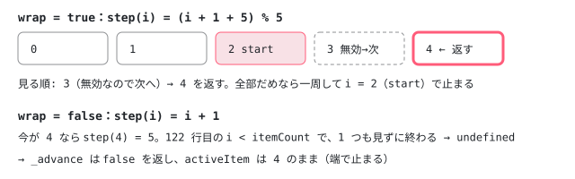

[目次](../README.md) › [Angular Aria の内側](README.md) › 第 6 回 / 全 20 回

# ListNavigation：次へ・前へ・最初・最後

> ListNavigation の next / prev / first / last / goto が \_advance と \_peek で、wrap と無効な項目の飛ばし方（ListFocus.isFocusable）を見ながら次の項目を探す行。peek 系が動かずに先を見る理由と使っている場所（Toolbar・Menu）。orientation と textDirection は入力にあるが ListNavigation は読まず、矢印キーの読み替え（右から左で左右が逆）は ListboxPattern の prevKey / nextKey が受け持つこと。

angular/components · 読了 約 11 分 · 中核 · [サイトで読む（デモが動きます）](https://angular-deep-dive-cyan.vercel.app/chapter/aria-list-navigation)

---

矢印キーで「次の項目」「前の項目」へ、Home / End で「最初」「最後」へ動くとき、どの項目が「次」なのかを決めるのが `ListNavigation` です。この章では、`next` / `prev` / `first` / `last` / `goto` が `_advance` と `_peek` の 2 つに集まり、**wrap（端から反対の端へ回るか）と、無効な項目を飛ばすかを、1 本の for ループの条件だけで決めている**ことを 1 行ずつ確かめます。そして、`ListNavigation` 自身は「上下」も「左右」も知らないことを見ます。

読む対象は `src/aria/private/behaviors/list-navigation/list-navigation.ts`（130 行）と `list-navigation.spec.ts` です。フォーカスの置き方そのもの（`ListFocus.focus` と `isFocusable`）は[第 5 回](05-aria-list-focus.md)で読みました。

1. [1. 全体像](01-aria-overview.md)
2. [2. SignalLike](02-aria-signal-like.md)
3. [3. SortedCollection](03-aria-collection.md)
4. [4. イベントマネージャ](04-aria-events.md)
5. [5. ListFocus](05-aria-list-focus.md)
6. **6. ListNavigation**（この章）
7. [7. ListSelection](07-aria-list-selection.md)
8. [8. ListTypeahead](08-aria-typeahead.md)
9. [9. Listbox](09-aria-listbox.md)
10. [10. Accordion](10-aria-accordion.md)
11. [11. DeferredContent](11-aria-deferred-content.md)
12. [12. Tabs](12-aria-tabs.md)
13. [13. Toolbar](13-aria-toolbar.md)
14. [14. Tree](14-aria-tree.md)
15. [15. Grid](15-aria-grid.md)
16. [16. Grid のセル](16-aria-grid-cells.md)
17. [17. Combobox](17-aria-combobox.md)
18. [18. Menu](18-aria-menu.md)
19. [19. テスト](19-aria-testing.md)
20. [20. issue と PR を読む](20-aria-issues.md)

## 1. 入力と goto：動くのは ListFocus に任せる

📄 `components/src/aria/private/behaviors/list-navigation/list-navigation.ts` L12–49 （▶ の行: 13, 16, 18, 21, 24, 33, 39, 44, 47–48）

```ts
12 │ /** Represents an item in a collection, such as a listbox option, than can be navigated to. */
13 ▶ export interface ListNavigationItem extends ListFocusItem {}
14 │ 
15 │ /** Represents the required inputs for a collection that has navigable items. */
16 ▶ export interface ListNavigationInputs<T extends ListNavigationItem> extends ListFocusInputs<T> {
17 │   /** Whether focus should wrap when navigating. */
18 ▶   wrap: SignalLike<boolean>;
19 │ 
20 │   /** Whether the list is vertically or horizontally oriented. */
21 ▶   orientation: SignalLike<'vertical' | 'horizontal'>;
22 │ 
23 │   /** The direction that text is read based on the users locale. */
24 ▶   textDirection: SignalLike<'rtl' | 'ltr'>;
25 │ }
26 │ 
27 │ /** Options for list navigation. */
28 │ export interface ListNavigationOpts<T> {
29 │   /**
30 │    * Whether to focus the item's element.
31 │    * Defaults to true.
32 │    */
33 ▶   focusElement?: boolean;
34 │ 
35 │   /**
36 │    * The list of items to navigate through.
37 │    * Defaults to the list of items from the inputs.
38 │    */
39 ▶   items?: T[];
40 │ }
41 │ 
42 │ /** Controls navigation for a list of items. */
43 │ export class ListNavigation<T extends ListNavigationItem> {
44 ▶   constructor(readonly inputs: ListNavigationInputs<T> & {focusManager: ListFocus<T>}) {}
45 │ 
46 │   /** Navigates to the given item. */
47 ▶   goto(item?: T, opts?: ListNavigationOpts<T>): boolean {
48 ▶     return item ? this.inputs.focusManager.focus(item, opts) : false;
49 │   }
```

1. **13 行目 項目に足すものは無い**

   `ListNavigationItem` は `ListFocusItem` を広げるだけで、何も足していません。「次へ動けるか」の判断に要るのは `disabled` だけで、それは `ListFocusItem` にもうあるからです。
2. **16〜25 行目 入力は ListFocus の入力 + 3 つ**

   16 行目で `ListFocusInputs` を広げ、18 行目の `wrap`、21 行目の `orientation`、24 行目の `textDirection` を足します。ただし、このファイルの中で `orientation` と `textDirection` を読む行は**どこにもありません**（`grep -n "orientation\|textDirection" list-navigation.ts` は 21・24 行目の宣言だけ）。2 節の最後で、それを読んでいる場所へ行きます。
3. **28〜40 行目 1 回ごとのオプション**

   33 行目の `focusElement` は、そのまま `ListFocus.focus` の 2 つ目の引数になります（省くと要素に本物の focus。[第 5 回](05-aria-list-focus.md)）。39 行目の `items` を渡すと、`inputs.items()` の代わりに**その配列の中だけ**で次を探します（4 節）。
4. **44・47〜49 行目 focusManager を受け取り、goto はそれを呼ぶだけ**

   44 行目のコンストラクタは入力に `focusManager: ListFocus` を足した形を受け取ります。Listbox では `List` が作った 1 つの `ListFocus` が渡されます（list.ts:94〜101。[第 5 回](05-aria-list-focus.md)）。48 行目の `goto` は、項目があれば `focusManager.focus(item, opts)` の結果を返し、無ければ `false`。`ListNavigation` は自分では状態を持たず、`activeItem` を書くのは常に `ListFocus` です。

## 2. 公開メソッド：動く版と「覗くだけ」の版

📄 `components/src/aria/private/behaviors/list-navigation/list-navigation.ts` L51–81 （▶ の行: 53, 58, 63, 68, 73–74, 79–80）

```ts
51 │   /** Navigates to the next item in the list. */
52 │   next(opts?: ListNavigationOpts<T>): boolean {
53 ▶     return this._advance(1, opts);
54 │   }
55 │ 
56 │   /** Peeks the next item in the list. */
57 │   peekNext(opts?: ListNavigationOpts<T>): T | undefined {
58 ▶     return this._peek(1, opts);
59 │   }
60 │ 
61 │   /** Navigates to the previous item in the list. */
62 │   prev(opts?: ListNavigationOpts<T>): boolean {
63 ▶     return this._advance(-1, opts);
64 │   }
65 │ 
66 │   /** Peeks the previous item in the list. */
67 │   peekPrev(opts?: ListNavigationOpts<T>): T | undefined {
68 ▶     return this._peek(-1, opts);
69 │   }
70 │ 
71 │   /** Navigates to the first item in the list. */
72 │   first(opts?: ListNavigationOpts<T>): boolean {
73 ▶     const item = this.peekFirst(opts);
74 ▶     return item ? this.goto(item, opts) : false;
75 │   }
76 │ 
77 │   /** Navigates to the last item in the list. */
78 │   last(opts?: ListNavigationOpts<T>): boolean {
79 ▶     const item = this.peekLast(opts);
80 ▶     return item ? this.goto(item, opts) : false;
81 │   }
```

6 つのメソッドが 2 組に分かれています。`next` / `prev` は 53・63 行目で `_advance(±1)` を、`peekNext` / `peekPrev` は 58・68 行目で `_peek(±1)` を呼びます。`first` / `last` は 73・79 行目で `peekFirst` / `peekLast` で項目を探し、74・80 行目でそれを `goto` します。つまり**どのメソッドも「peek で探す → goto で動く」の 2 段**で、peek の側は `activeItem` を書きません。

📄 `components/src/aria/private/behaviors/list-navigation/list-navigation.ts` L83–98 （▶ の行: 85–86, 92–93, 97）

```ts
83 │   /** Gets the first focusable item from the given list of items. */
84 │   peekFirst(opts?: ListNavigationOpts<T>): T | undefined {
85 ▶     const items = opts?.items ?? this.inputs.items();
86 ▶     return items.find(i => this.inputs.focusManager.isFocusable(i));
87 │   }
88 │ 
89 │   /** Gets the last focusable item from the given list of items. */
90 │   peekLast(opts?: ListNavigationOpts<T>): T | undefined {
91 │     const items = opts?.items ?? this.inputs.items();
92 ▶     for (let i = items.length - 1; i >= 0; i--) {
93 ▶       if (this.inputs.focusManager.isFocusable(items[i])) {
94 │         return items[i];
95 │       }
96 │     }
97 ▶     return;
98 │   }
```

1. **85〜86 行目 peekFirst は先頭から isFocusable な最初の 1 つ**

   `Array.prototype.find` で先頭から順に `focusManager.isFocusable(i)` を見ます。今どこにいるか（activeIndex）は見ません。
2. **92〜97 行目 peekLast は末尾から逆向き**

   for ループで末尾から見て、最初に見つかった focusable な項目を返します。1 つも無ければ 97 行目で `undefined`、呼んだ `last()` は 80 行目で `false` です。

peek 系を「動かずに覗く」目的で使っているのは、src/aria では Toolbar・Menu です（`grep -rn "peekNext\|peekPrev\|peekFirst\|peekLast" src/aria`）。Toolbar は private/toolbar/toolbar.ts:135 で `peekNext()?.group()` を見て「次の項目は同じグループか」を判断し、違えば :143 で `peekFirst({items: currGroup.inputs.items()})` と**グループの中だけ**を探します（[第 13 回](13-aria-toolbar.md)）。Menu は private/menu/menu.ts:216 で、最初に止まる項目を `peekFirst()` で探します（[第 18 回](18-aria-menu.md)）。

> [!NOTE]
> **ポイント**
>
> 矢印キーの向きはここではなく、Pattern の側で決まります。ListboxPattern の `prevKey` / `nextKey`（private/listbox/listbox.ts:59〜72）が、`orientation` が vertical なら ArrowUp / ArrowDown、horizontal なら `textDirection` が rtl のとき ArrowRight / ArrowLeft（左右が逆）、ltr のとき ArrowLeft / ArrowRight を返し、そのキーに `listBehavior.prev()` / `next()` を結びます（[第 9 回](09-aria-listbox.md)）。`ListNavigation` が受け取るのは「+1 か -1 か」だけです。`textDirection` は Listbox ディレクティブが `inject(Directionality).valueSignal` から作ります（listbox/listbox.ts:84。Directionality は [cdk-platform-bidi](../cdk/02-cdk-platform-bidi.md)）。

## 3. \_advance と \_peek：1 本の for ループ

📄 `components/src/aria/private/behaviors/list-navigation/list-navigation.ts` L100–129 （▶ の行: 102–103, 108, 110–114, 116–117, 122–124, 128）

```ts
100 │   /** Advances to the next or previous focusable item in the list based on the given delta. */
101 │   private _advance(delta: 1 | -1, opts?: ListNavigationOpts<T>): boolean {
102 ▶     const item = this._peek(delta, opts);
103 ▶     return item ? this.goto(item, opts) : false;
104 │   }
105 │ 
106 │   /** Peeks the next or previous focusable item in the list based on the given delta. */
107 │   private _peek(delta: 1 | -1, opts?: ListNavigationOpts<T>): T | undefined {
108 ▶     const items = opts?.items ?? this.inputs.items();
109 │     const itemCount = items.length;
110 ▶     const activeItem = this.inputs.focusManager.inputs.activeItem();
111 ▶     const startIndex =
112 ▶       opts?.items && activeItem
113 ▶         ? items.indexOf(activeItem)
114 ▶         : this.inputs.focusManager.activeIndex();
115 │ 
116 ▶     const step = (i: number) =>
117 ▶       this.inputs.wrap() ? (i + delta + itemCount) % itemCount : i + delta;
118 │ 
119 │     // If wrapping is enabled, this loop ultimately terminates when `i` gets back to `startIndex`
120 │     // in the case that all options are disabled. If wrapping is disabled, the loop terminates
121 │     // when the index goes out of bounds.
122 ▶     for (let i = step(startIndex); i !== startIndex && i < itemCount && i >= 0; i = step(i)) {
123 ▶       if (this.inputs.focusManager.isFocusable(items[i])) {
124 ▶         return items[i];
125 │       }
126 │     }
127 │ 
128 ▶     return;
129 │   }
```

1. **101〜104 行目 \_advance は \_peek + goto**

   102 行目で覗いて、103 行目で見つかれば `goto`。見つからなければ `false` を返し、`activeItem` は変わりません。
2. **108〜114 行目 どこから数え始めるか**

   108 行目で探す配列を決めます（`opts.items` があればそれ）。111〜114 行目の `startIndex` は、`opts.items` があり `activeItem` もあるときだけ「その部分配列の中での位置」（113 行目）、それ以外は `focusManager.activeIndex()`（114 行目。全体の中の位置、無ければ `-1`）です。
3. **116〜117 行目 1 歩の進み方**

   wrap なら `(i + delta + itemCount) % itemCount`。`+ itemCount` は、`i + delta` が `-1` になったとき JavaScript の `%` が負の数を返さないようにするためで、0 番目の前は末尾になります。wrap でなければただの `i + delta` で、端を越えると `-1` や `itemCount` になります。
4. **122 行目 ループが止まる 3 つの条件**

   `i !== startIndex`（一周して元の位置に戻った）、`i < itemCount` と `i >= 0`（端を越えた）。119〜121 行目のコメントのとおり、wrap のときは 1 つ目の条件で、wrap でないときは残りの 2 つで止まります。**wrap の有無で書き分けた分岐はありません**。116 行目の 1 歩の進み方が違うだけです。
5. **123〜124 行目 飛ばすかどうかは isFocusable**

   `focusManager.isFocusable(items[i])` が真の最初の項目を返します。`isFocusable` は「無効でない、または softDisabled」（[第 5 回](05-aria-list-focus.md)）なので、Listbox の既定（`softDisabled = true`）では無効な項目も飛ばさず、そこで止まります。



*5 項目、今が 3 番目（index 2）で 4 番目（index 3）が無効、softDisabled=false のとき next() が見る順。*

> [!NOTE]
> **さらに深く**
>
> **activeItem が無いときの prev は、末尾ではなく末尾の 1 つ手前から始まります。** 114 行目の `startIndex` が `-1` で wrap のとき、117 行目の最初の 1 歩は `(-1 - 1 + n) % n = n - 2` です。さらに、ループの `i` は 0〜n-1 を回り続けて `-1`（＝ startIndex）にならないので、focusable な項目が 1 つも無いと 122 行目のループは終わりません。これは scratchpad に list-focus.ts と list-navigation.ts をそのまま写し、Node で動かして確かめました（5 項目で `peekPrev()` が index 3 を返す。全部無効・softDisabled=false・wrap で `next()` を呼ぶと `isFocusable` が 10 万回を超えて呼ばれ続ける）。ふだんの Listbox では起きにくい形です。`activeItem` は `setDefaultState` が先に決め（[第 9 回](09-aria-listbox.md)）、全部無効なら `isListDisabled()` が真で ListboxPattern の `onKeydown` が何もしません（private/listbox/listbox.ts:236）。spec の `getListFocus` は必ず最初の項目を `activeItem` にする（list-focus.spec.ts:23）ので、この形を確かめる it はありません。意図した動きかどうかはソースからは分かりません。

## 4. items の部分配列で動く

39 行目の `items` を渡すと、全体のうち一部だけを順に回れます。spec がこの使い方を確かめています。

📄 `components/src/aria/private/behaviors/list-navigation/list-navigation.spec.ts` L258–294 （▶ の行: 262, 268–269, 276–277, 283, 285, 288–289）

```ts
258 │   describe('with items subset', () => {
259 │     it('should navigate only within the provided subset for next/prev', () => {
260 │       const nav = getNavigation();
261 │       const allItems = nav.inputs.items();
262 ▶       const subset = [allItems[0], allItems[2], allItems[4]];
263 │ 
264 │       // Start at 0
265 │       expect(nav.inputs.activeItem()).toBe(allItems[0]);
266 │ 
267 │       // next(subset) -> 2 (skip 1)
268 ▶       nav.next({focusElement: false, items: subset});
269 ▶       expect(nav.inputs.activeItem()).toBe(allItems[2]);
270 │ 
271 │       // next(subset) -> 4 (skip 3)
272 │       nav.next({focusElement: false, items: subset});
273 │       expect(nav.inputs.activeItem()).toBe(allItems[4]);
274 │ 
275 │       // prev(subset) -> 2 (skip 3)
276 ▶       nav.prev({focusElement: false, items: subset});
277 ▶       expect(nav.inputs.activeItem()).toBe(allItems[2]);
278 │     });
279 │ 
280 │     it('should wrap within the subset', () => {
281 │       const nav = getNavigation({wrap: signal(true)});
282 │       const allItems = nav.inputs.items();
283 ▶       const subset = [allItems[0], allItems[2], allItems[4]];
284 │ 
285 ▶       nav.goto(allItems[4]);
286 │ 
287 │       // next(subset) -> 0 (wrap)
288 ▶       nav.next({focusElement: false, items: subset});
289 ▶       expect(nav.inputs.activeItem()).toBe(allItems[0]);
290 │ 
291 │       // prev(subset) -> 4 (wrap)
292 │       nav.prev({focusElement: false, items: subset});
293 │       expect(nav.inputs.activeItem()).toBe(allItems[4]);
294 │     });
```

262 行目の部分配列は 0・2・4 番目です。268 行目の `next({items: subset})` は、3 節の 113 行目で「部分配列の中の位置」0 から数えて部分配列の 1 番目、つまり全体の 2 番目へ動きます（269 行目）。285〜289 行目は wrap のとき、部分配列の末尾（全体の 4 番目）から先頭（全体の 0 番目）へ回ることを確かめています。`focusElement: false` を付けているのは、spec の要素が `{focus: () => {}}` の作り物で、本物のフォーカスを見ないからです（[第 5 回](05-aria-list-focus.md)）。

> **🧪 DEMO — ngListbox の wrap・softDisabled・orientation・dir を切り替えて矢印キーで動く**
>
> 本物の `ngListbox`（@angular/aria 22.1.8）です。「3」と「5」は `[disabled]="true"`。外側の `div` に CDK の `Dir` ディレクティブ（`[dir]`）を付けています。Tab でリストに入り、矢印キー・Home・End を押してください。キーを押すたびに、押す前と描画のあとの「今の項目」（`data-active="true"` の項目）を下に出します（新しい行が上）。
>
> ▶ [このデモはサイトで動かせます](https://angular-deep-dive-cyan.vercel.app/chapter/aria-list-navigation)

- wrap を外して「5」の上で ArrowDown（softDisabled を外していれば「4」の上で）を押すと「（動かない）」になります。図の下半分、122 行目の `i < itemCount` です。
- softDisabled を外すと「3」「5」を飛ばします（123 行目の `isFocusable` が偽）。End は「4」に止まります（92〜93 行目の `peekLast`）。
- horizontal + dir=rtl にすると、ArrowLeft で次（右から左へ並んだ次の項目）へ動きます。`ListNavigation` は変わらず `next()` を呼ばれているだけで、キーの読み替えは ListboxPattern の `nextKey` です。
- `dir` 属性を HTML に書くだけでは効きません。Listbox が `inject(Directionality)` で受け取るのは、近くの要素に CDK の `Dir` ディレクティブがあればそれ、無ければ root の `Directionality`（作られたときに document の dir を 1 回読むだけ）です。このデモでは `Dir` を章のコンポーネントの `imports` に入れています。

## 5. 矢印キー 1 回の流れ

- 👤 `（利用者）ArrowDown / ArrowLeft(rtl) を押す` — keydown
  - `ListboxPattern.nextKey で読み替え → List.next` — private/listbox/listbox.ts:67 / list.ts:120 — *第 9 回*
    - `ListNavigation.next(opts)` — list-navigation.ts L52
      - `_advance(1, opts)` — list-navigation.ts L101
        - `_peek(1, opts)：startIndex → step → isFocusable` — list-navigation.ts L107-128
        - `goto(item, opts) → ListFocus.focus(item, opts)` — list-navigation.ts L47-48 — *activeItem を書く（第 5 回）*
  - `（動いたら）List.updateSelection` — list.ts:230-231 — *selectOne など（第 7 回）*

CDK の `ListKeyManager` は、キーの読み替え（`withHorizontalOrientation('rtl')` など）と、無効な項目を飛ばす判断（`skipPredicate`）と、wrap（`withWrap`）を 1 つのクラスに持ち、`skipPredicate` の既定は「無効な項目を飛ばす」です（list-key-manager.ts の `item => item.disabled`）（[cdk-key-manager](../cdk/10-cdk-key-manager.md)）。Aria ではキーの読み替えが Pattern、飛ばす判断が `ListFocus.isFocusable`、順番の計算だけが `ListNavigation` と、3 か所に分かれていて、既定は飛ばさない側（softDisabled = true）です。

## テストと直し方

📄 `components/src/aria/private/behaviors/list-navigation/list-navigation.spec.ts` L20–30 （▶ の行: 21–28）

```ts
20 │ function getNavigation(inputs: TestInputs = {}): ListNavigation<ListNavigationItem> {
21 ▶   const focusManager = getListFocus(inputs);
22 ▶   return new ListNavigation({
23 ▶     focusManager,
24 ▶     ...focusManager.inputs,
25 ▶     wrap: signal(false),
26 ▶     textDirection: signal('ltr'),
27 ▶     orientation: signal('vertical'),
28 ▶     ...inputs,
29 │   });
30 │ }
```

21 行目で[第 5 回](05-aria-list-focus.md)の `getListFocus`（list-focus.spec.ts から import）を呼び、22〜24 行目で同じ `focusManager` と、その入力をそのまま広げて渡します。25 行目で `wrap: false` を既定にし、26〜27 行目の `textDirection` / `orientation` は型を満たすためだけの値です（1 節のとおり、ListNavigation はこれを読みません）。28 行目の `...inputs` で呼び出し側が上書きします。`softDisabled` は `getListFocus` の既定の `true` なので、「飛ばす」it は `softDisabled: signal(false)` を明示しています。

📄 `components/src/aria/private/behaviors/list-navigation/list-navigation.spec.ts` L91–122 （▶ の行: 92–94, 101–102, 108, 114–115, 119–120）

```ts
 91 │     it('should wrap and skip disabled items (#next)', () => {
 92 ▶       const nav = getNavigation({
 93 ▶         wrap: signal(true),
 94 ▶         softDisabled: signal(false),
 95 │       });
 96 │       const items = nav.inputs.items() as TestItem[];
 97 │       items[2].disabled.set(true);
 98 │       items[3].disabled.set(true);
 99 │       items[4].disabled.set(true);
100 │ 
101 ▶       nav.next(); // 0 -> 1
102 ▶       nav.next(); // 1 -> 0
103 │ 
104 │       expect(nav.inputs.activeItem()).toBe(nav.inputs.items()[0]);
105 │     });
106 │ 
107 │     it('should do nothing if other items are disabled (#next)', () => {
108 ▶       const nav = getNavigation({softDisabled: signal(false)});
109 │       const items = nav.inputs.items() as TestItem[];
110 │       items[1].disabled.set(true);
111 │       items[2].disabled.set(true);
112 │       items[3].disabled.set(true);
113 │       items[4].disabled.set(true);
114 ▶       nav.next(); // 0 -> 0
115 ▶       expect(nav.inputs.activeItem()).toBe(nav.inputs.items()[0]);
116 │     });
117 │ 
118 │     it('should do nothing if there are no other items to navigate to (#next)', () => {
119 ▶       const nav = getNavigation({numItems: 1});
120 ▶       nav.next(); // 0 -> 0
121 │       expect(nav.inputs.activeItem()).toBe(nav.inputs.items()[0]);
122 │     });
```

91〜105 行目は、wrap と softDisabled=false で 2〜4 番目が無効なとき、1 → 0 と回ることを確かめます（3 節の 117 行目の 1 歩と 123 行目の判断の組み合わせ）。107〜116 行目は wrap を付けず（25 行目の既定 `false`）、ほかが全部無効なら動かないこと、118〜122 行目は項目が 1 つしか無ければ動かないことです。

📄 `ターミナル`

```
cd ~/angular-research/components
pnpm bazel test //src/aria/private/behaviors/list-navigation:unit_tests_chromium --nocache_test_results --test_output=all

# この spec の it と、import した list-focus.spec.ts の it を数える
grep -cE '^\s*it\(' src/aria/private/behaviors/list-navigation/list-navigation.spec.ts
grep -cE '^\s*it\(' src/aria/private/behaviors/list-focus/list-focus.spec.ts
```

📄 `出力（抜粋。2026-11-02 に実行。ログは scratchpad/aria-logs/b-behaviors.log）`

```
src/aria/private/behaviors/list-navigation/unit_tests_bundle.spec.js:
Chromium: |██████████████████████████████| 1/1 test files | 39 passed, 0 failed
Finished running tests in 0.7s, all tests passed!
//src/aria/private/behaviors/list-navigation:unit_tests_chromium         PASSED in 1.4s

28
11
```

1. **39 本 = この spec の 28 本 + List Focus の 11 本**

   list-navigation.spec.ts:11 で `getListFocus` を import しているので、`describe('List Focus')` も同じバンドルに入ります（[第 5 回](05-aria-list-focus.md)）。このターゲットの spec ファイルは 1 つなので、走らせると必ずこの 39 本が走ります。1 本だけ見たいときは、自分の作業コピーで `it` を `fit` に変えると jasmine がそれだけを走らせます。私たちは ../components を変えない約束なので、これは試していません。
2. **直すとしたら**

   「次」の決め方は `_peek`（107〜129 行目）だけで、wrap・無効な項目・部分配列はすべてここを通ります。端の決め方は `peekFirst` / `peekLast`（84〜98 行目）。spec を足すなら list-navigation.spec.ts の `describe('#next')` / `describe('#prev')` です。3 節の deep の箱の形（activeItem が無い）を試すなら、`getNavigation({wrap: signal(true)})` のあと `nav.inputs.activeItem.set(undefined)` してから `nav.prev()` を呼ぶ it になります（書いて走らせてはいません。Node での再現だけです）。
3. **#33430 は「直した行」が無い**

   「無効な option がキーボードで届く」という #33430（2026-06-22）は、コードを変えずに閉じられました。メンテナーの答えは「意図した動き。飛ばしたいなら `[softDisabled]="false"`」で、123 行目の `isFocusable` と Listbox の既定値（listbox/listbox.ts:99）がそのまま答えです。このファイルの最後のコミットは 3da71ce7f9（2026-03-10、bazel のルールの場所の更新）で、#33430 のあとに変わっていません。最新の main（2026-11-02 に gh で取得）でも list-navigation.ts は snapshot と同じでした。

## 聞かれそうな質問

**Q. wrap しないとき、端でキーを押すとどうなりますか？**

何も起きません。117 行目の 1 歩が `itemCount` か `-1` になり、122 行目の条件で 1 つも見ずにループを抜け、128 行目で `undefined`。103 行目で `goto` を呼ばずに `false` を返します。`activeItem` も選択も変わりません（`List` は動いたときだけ選択を更新する。list.ts:230）。spec は `it('should not wrap (#next)')`（:65）と `it('should not wrap (#prev)')`（:146）です。

**Q. 全部の項目が無効だと？**

Listbox からは何も起きません。`ListFocus.isListDisabled()` が真（全項目が無効）になり、ListboxPattern の `onKeydown` が最初にそれを見て返ります（private/listbox/listbox.ts:236）。`ListNavigation` を直接呼んだ場合は、activeItem があれば一周して 122 行目の `i !== startIndex` で止まり `false`。activeItem が無く wrap のときは、3 節の deep の箱のとおりループが終わりません（Node で再現）。

**Q. Home / End は wrap や今の位置に関係しますか？**

関係しません。`first()` / `last()` は `peekFirst` / `peekLast` を使い、86 行目は先頭から、92 行目は末尾から、`isFocusable` な最初の項目を探すだけです。`wrap()` も `activeIndex()` も読みません。softDisabled が偽で先頭が無効なら、Home は 2 番目に止まります（spec `it('should skip disabled items (#first)')`、:211）。

**Q. 右から左の言語で矢印キーが逆になるのは、どこで決まりますか？**

`ListNavigation` ではありません。21・24 行目で入力として受け取りますが、読む行がありません。読み替えは ListboxPattern の `prevKey` / `nextKey`（private/listbox/listbox.ts:59〜72）で、horizontal のときだけ rtl で左右を入れ替えます。vertical では rtl でも上下のままです。

**Q. Shift+矢印で範囲選択している最中も wrap しますか？**

しません。`List` は `ListNavigation` に `wrap: computed(() => this._wrap() && this.inputs.wrap())` を渡し（list.ts:100。[第 5 回](05-aria-list-focus.md)）、範囲選択のときだけ `_wrap` を false にしてから動きます（list.ts:223〜224。[第 9 回](09-aria-listbox.md)）。`ListNavigation` は 117 行目で `wrap()` を毎回読むので、その一瞬だけ wrap しない動きになります。

## 読み終えて

- `ListNavigation` は状態を持たない。探すのは `_peek` / `peekFirst` / `peekLast`、動くのは `goto` → `ListFocus.focus`（L47-48）。
- wrap の有無は 1 歩の進み方（L116-117）だけで表し、ループの止まり方は 122 行目の 3 つの条件で共通。
- 無効な項目を飛ばすかは `isFocusable`（L123）。Listbox の既定 softDisabled=true では飛ばさない。#33430 はコードを変えずに閉じた。
- `orientation` と `textDirection` は入力にあるが読まれない。キーの読み替えは Pattern、Directionality は CDK の `Dir` ディレクティブ経由。
- activeItem が無いときの prev（wrap）は末尾の 1 つ手前から始まり、focusable が無ければ止まらない。spec には無い形で、Node で再現した。

---

← 前: [ListFocus：roving tabindex と aria-activedescendant](05-aria-list-focus.md)  
次: [ListSelection：選ぶ・外す・範囲で選ぶ](07-aria-list-selection.md) →
