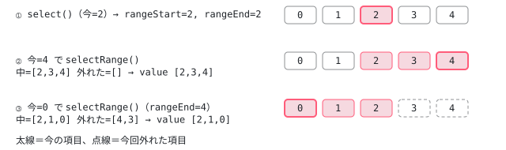

[目次](../README.md) › [Angular Aria の内側](README.md) › 第 7 回 / 全 20 回

# ListSelection：選ぶ・外す・範囲で選ぶ

> ListSelection の select / deselect / toggle / selectOne / selectAll / selectRange が value の WritableSignalLike を書き換える行。multi のとき Shift で範囲を選ぶための rangeStartIndex / rangeEndIndex と ListFocus.prevActiveIndex、無効な項目と readonly の扱い。selectionMode は入力にあるが ListSelection は読まず、follow / explicit は ListboxPattern のキーの表（selectOne を付けて動くか）で分かれること。

angular/components · 読了 約 13 分 · 中核 · [サイトで読む（デモが動きます）](https://angular-deep-dive-cyan.vercel.app/chapter/aria-list-selection)

---

Listbox の `[(value)]` に入る「選ばれた値の配列」を書き換えるのが `ListSelection` です。この章では、`select` / `deselect` / `toggle` / `toggleOne` / `selectOne` / `selectAll` / `deselectAll` / `toggleAll` / `selectRange` が **どの条件で何もせずに返り、どの 1 行で value を書くか**を順に読みます。Shift+矢印の範囲選択を支える `rangeStartIndex` / `rangeEndIndex` と、`ListFocus` の `prevActiveIndex` の関係もここで分かります。

読む対象は `src/aria/private/behaviors/list-selection/list-selection.ts`（225 行）と `list-selection.spec.ts` です。「今の項目」（activeItem）は[第 5 回](05-aria-list-focus.md)の `ListFocus` が持っていて、`ListSelection` はそれを読むだけです。

1. [1. 全体像](01-aria-overview.md)
2. [2. SignalLike](02-aria-signal-like.md)
3. [3. SortedCollection](03-aria-collection.md)
4. [4. イベントマネージャ](04-aria-events.md)
5. [5. ListFocus](05-aria-list-focus.md)
6. [6. ListNavigation](06-aria-list-navigation.md)
7. **7. ListSelection**（この章）
8. [8. ListTypeahead](08-aria-typeahead.md)
9. [9. Listbox](09-aria-listbox.md)
10. [10. Accordion](10-aria-accordion.md)
11. [11. DeferredContent](11-aria-deferred-content.md)
12. [12. Tabs](12-aria-tabs.md)
13. [13. Toolbar](13-aria-toolbar.md)
14. [14. Tree](14-aria-tree.md)
15. [15. Grid](15-aria-grid.md)
16. [16. Grid のセル](16-aria-grid-cells.md)
17. [17. Combobox](17-aria-combobox.md)
18. [18. Menu](18-aria-menu.md)
19. [19. テスト](19-aria-testing.md)
20. [20. issue と PR を読む](20-aria-issues.md)

## 1. 入力と状態：value は「項目」ではなく「値」の配列

📄 `components/src/aria/private/behaviors/list-selection/list-selection.ts` L12–46 （▶ の行: 15, 18, 24, 27, 30, 36, 39, 42–43, 46）

```ts
12 │ /** Represents an item in a collection, such as a listbox option, that can be selected. */
13 │ export interface ListSelectionItem<V> extends ListFocusItem {
14 │   /** The value of the item. */
15 ▶   value: SignalLike<V>;
16 │ 
17 │   /** Whether the item is selectable. */
18 ▶   selectable: SignalLike<boolean>;
19 │ }
20 │ 
21 │ /** Represents the required inputs for a collection that contains selectable items. */
22 │ export interface ListSelectionInputs<T extends ListSelectionItem<V>, V> extends ListFocusInputs<T> {
23 │   /** Whether multiple items in the list can be selected at once. */
24 ▶   multi: SignalLike<boolean>;
25 │ 
26 │   /** The current value of the list selection. */
27 ▶   value: WritableSignalLike<V[]>;
28 │ 
29 │   /** The selection strategy used by the list. */
30 ▶   selectionMode: SignalLike<'follow' | 'explicit'>;
31 │ }
32 │ 
33 │ /** Controls selection for a list of items. */
34 │ export class ListSelection<T extends ListSelectionItem<V>, V> {
35 │   /** The start index to use for range selection. */
36 ▶   readonly rangeStartIndex = signal<number>(0);
37 │ 
38 │   /** The end index to use for range selection. */
39 ▶   readonly rangeEndIndex = signal<number>(0);
40 │ 
41 │   /** The currently selected items. */
42 ▶   readonly selectedItems = computed(() =>
43 ▶     this.inputs.items().filter(item => this.inputs.value().includes(item.value())),
44 │   );
45 │ 
46 ▶   constructor(readonly inputs: ListSelectionInputs<T, V> & {focusManager: ListFocus<T>}) {}
```

1. **15・18 行目 項目に足すのは value と selectable**

   `ListSelectionItem` は `ListFocusItem`（id・element・disabled）に、15 行目の `value` と 18 行目の `selectable` を足します。Listbox の `OptionPattern` は `selectable` を常に `() => true` にしています（private/listbox/option.ts:44）。項目ごとに入力で変えられるのは Tree の項目です（private/tree/tree.ts:72 で `inputs.selectable()` を読む）。
2. **27 行目 書き込む先は value: WritableSignalLike&lt;V\[\]&gt;**

   `ListSelection` が持つのは「選ばれた**値**」の配列で、項目そのものではありません。Listbox ディレクティブでは `model<V[]>([])`（listbox/listbox.ts:131）がそのまま渡り、`[(value)]` の相手になります。
3. **24・30 行目 multi は読む、selectionMode は読まない**

   `multi` はこのファイルの 62・100・159 行目で読みます。ところが 30 行目の `selectionMode` は、このファイルのどこからも読まれていません（`grep -n selectionMode list-selection.ts` は 30 行目だけ）。「動いたら選ぶ（follow）」か「Space や Enter で選ぶ（explicit）」かは、**どのメソッドを呼ぶか**で決まり、それを決めるのは Pattern です（4 節）。
4. **36・39・42〜44 行目 自分で持つ状態**

   `rangeStartIndex` と `rangeEndIndex` は範囲選択の両端の番号（5 節）。`selectedItems` は「value に値が入っている項目」を毎回 filter する computed です。value に入っていても、その値の項目がリストに無ければ `selectedItems` には出てきません。

## 2. select：5 つの「何もしない」と 1 行の書き込み

📄 `components/src/aria/private/behaviors/list-selection/list-selection.ts` L48–71 （▶ の行: 49–50, 53–57, 62–63, 66–68, 70）

```ts
48 │   /** Selects the item at the current active index. */
49 ▶   select(item?: ListSelectionItem<V>, opts = {anchor: true}) {
50 ▶     item = item ?? (this.inputs.focusManager.inputs.activeItem() as ListSelectionItem<V>);
51 │ 
52 │     if (
53 ▶       !item ||
54 ▶       item.disabled() ||
55 ▶       !item.selectable() ||
56 ▶       !this.inputs.focusManager.isFocusable(item as T) ||
57 ▶       this.inputs.value().includes(item.value())
58 │     ) {
59 │       return;
60 │     }
61 │ 
62 ▶     if (!this.inputs.multi()) {
63 ▶       this.deselectAll();
64 │     }
65 │ 
66 ▶     const index = this.inputs.items().findIndex(i => i === item);
67 ▶     if (opts.anchor) {
68 ▶       this.beginRangeSelection(index);
69 │     }
70 ▶     this.inputs.value.update(values => values.concat(item.value()));
71 │   }
```

1. **50 行目 引数が無ければ今の項目**

   `item ?? focusManager.inputs.activeItem()`。キーボードから呼ばれるときはふつう引数なしで、[第 5 回](05-aria-list-focus.md)の `activeItem` が選ばれます。
2. **52〜60 行目 返る条件**

   項目が無い（53）、無効（54）、選べない（55）、フォーカスできない（56）、もう選ばれている（57）。どれか 1 つでも当たれば value を触りません。無効な項目は `softDisabled` が真ならフォーカスは当たりますが（`isFocusable`）、54 行目で選べません。なお、`isFocusable` が偽になるのは「無効で、かつ softDisabled が偽」のときだけなので、56 行目に届く時点（54 行目を通った＝無効でない）では常に真です。
3. **62〜64 行目 単一選択なら、先に全部外す**

   `multi()` が偽なら `deselectAll()`（3 節）を呼んでから足します。単一選択で「1 つだけ」を保つのはこの 1 行です。
4. **66〜69 行目 範囲選択の起点にする**

   `opts.anchor` は既定で `true`（49 行目）。選んだ項目の番号で `beginRangeSelection` を呼び、`rangeStartIndex` と `rangeEndIndex` の両方をそこにします（5 節の 200〜203 行目）。`selectAll` や `selectRange` の中から呼ぶときは `{anchor: false}` を渡して起点を動かしません。
5. **70 行目 value を書く唯一の形**

   `values.concat(item.value())` で新しい配列を作って `update` します。元の配列は書き換えないので、`model` の向こうの利用者には新しい参照が届きます。末尾に足すので、value の並びは「選んだ順」です（spec :349 の `[3, 2, 1]` や :404 の `[1, 0]` がそれ）。

📄 `components/src/aria/private/behaviors/list-selection/list-selection.ts` L73–96 （▶ の行: 75, 77–78, 86, 92, 94）

```ts
73 │   /** Deselects the item at the current active index. */
74 │   deselect(item?: ListSelectionItem<V>) {
75 ▶     item = item ?? this.inputs.focusManager.inputs.activeItem();
76 │ 
77 ▶     if (item && !item.disabled() && item.selectable()) {
78 ▶       this.inputs.value.update(values => values.filter(value => value !== item.value()));
79 │     }
80 │   }
81 │ 
82 │   /** Toggles the item at the current active index. */
83 │   toggle(item?: ListSelectionItem<V>) {
84 │     item = item ?? this.inputs.focusManager.inputs.activeItem();
85 │     if (item) {
86 ▶       this.inputs.value().includes(item.value()) ? this.deselect(item) : this.select(item);
87 │     }
88 │   }
89 │ 
90 │   /** Toggles only the item at the current active index. */
91 │   toggleOne() {
92 ▶     const item = this.inputs.focusManager.inputs.activeItem();
93 │     if (item) {
94 ▶       this.inputs.value().includes(item.value()) ? this.deselect() : this.selectOne();
95 │     }
96 │   }
```

1. **77〜78 行目 deselect も無効な項目は触らない**

   無効か選べない項目は外しません。だから「無効にする前に選ばれていた値」は、キーボードでもクリックでも外れずに残ります（spec `it('should not deselect disabled items')`、:111）。外すときは `filter(value => value !== item.value())`、つまり `!==` の比較です。値がオブジェクトなら同じ参照でないと外れません。
2. **86 行目 toggle と 94 行目 toggleOne**

   どちらも「value に入っていれば外す、無ければ選ぶ」ですが、選ぶ側が違います。`toggle` は `select(item)`（multi ならほかの選択を残す）、`toggleOne` は `selectOne()`（3 節。ほかを全部外してから選ぶ）。Listbox の explicit・単一選択の Space / Enter は `toggleOne`、explicit・複数選択では `toggle` です（private/listbox/listbox.ts:136〜143）。

## 3. 全部を選ぶ・外す、1 つだけにする

📄 `components/src/aria/private/behaviors/list-selection/list-selection.ts` L98–133 （▶ の行: 100–101, 104–105, 108, 113, 116, 118, 126–127, 129–131）

```ts
 98 │   /** Selects all items in the list. */
 99 │   selectAll() {
100 ▶     if (!this.inputs.multi()) {
101 ▶       return; // Should we log a warning?
102 │     }
103 │ 
104 ▶     for (const item of this.inputs.items()) {
105 ▶       this.select(item, {anchor: false});
106 │     }
107 │ 
108 ▶     this.beginRangeSelection();
109 │   }
110 │ 
111 │   /** Deselects all items in the list. */
112 │   deselectAll() {
113 ▶     // If an item is not in the list, it forcefully gets deselected.
114 │     // This actually creates a bug for the following edge case:
115 │     //
116 ▶     // Setup: An item is not in the list (maybe it's lazily loaded), and it is disabled & selected.
117 │     // Expected: If deselectAll() is called, it should NOT get deselected (because it is disabled).
118 ▶     // Actual: Calling deselectAll() will still deselect the item.
119 │     //
120 │     // Why? Because we can't check if the item is disabled if it's not in the list.
121 │     //
122 │     // Alternatively, we could NOT deselect items that are not in the list, but this has the
123 │     // inverse (and more common) effect of keeping enabled items selected when they aren't in the
124 │     // list.
125 │ 
126 ▶     for (const value of this.inputs.value()) {
127 ▶       const item = this.inputs.items().find(i => i.value() === value);
128 │ 
129 ▶       item
130 ▶         ? this.deselect(item)
131 ▶         : this.inputs.value.update(values => values.filter(v => v !== value));
132 │     }
133 │   }
```

1. **99〜109 行目 selectAll は multi のときだけ**

   100 行目で単一選択なら何もせず返ります（101 行目のコメント「警告を出すべき？」のとおり、警告もありません）。104〜106 行目は全項目に `select(item, {anchor: false})` を呼ぶだけなので、無効・選べない・選択済みの項目は 2 節の条件で自然に飛ばされます。最後に 108 行目で、今の項目の位置を範囲の起点にします（`beginRangeSelection()` の引数の既定は `activeIndex()`、200 行目）。
2. **126〜132 行目 deselectAll：リストに無い値は強制的に外す**

   value の値を 1 つずつ見て、127 行目でその値の項目を探します。見つかれば 130 行目で `deselect(item)`（無効なら残る）、見つからなければ 131 行目で値を直接取り除きます。
3. **113〜124 行目 コメントに書かれた既知の穴**

   「リストに無い項目（遅れて読み込まれるなど）が無効で選択済みのとき、deselectAll では外れてほしくないが、実際は外れる。リストに無いので無効かどうか確かめられないから」。反対に「リストに無い値を残す」と、有効な項目が選ばれたまま残るほうがよく起きる、と書いてあります。ソースの作者が、2 つの困りごとのうち少ないほうを選んだ記録です。

📄 `components/src/aria/private/behaviors/list-selection/list-selection.ts` L135–164 （▶ の行: 140, 142, 145–147, 153–154, 157, 159–160, 163）

```ts
135 │   /**
136 │    * Selects all items in the list or deselects all
137 │    * items in the list if all items are already selected.
138 │    */
139 │   toggleAll() {
140 ▶     const selectableValues = this.inputs
141 │       .items()
142 ▶       .filter(i => !i.disabled() && i.selectable() && this.inputs.focusManager.isFocusable(i))
143 │       .map(i => i.value());
144 │ 
145 ▶     selectableValues.every(i => this.inputs.value().includes(i))
146 ▶       ? this.deselectAll()
147 ▶       : this.selectAll();
148 │   }
149 │ 
150 │   /** Sets the selection to only the current active item. */
151 │   selectOne() {
152 │     const item = this.inputs.focusManager.inputs.activeItem();
153 ▶     if (item && (item.disabled() || !item.selectable())) {
154 ▶       return;
155 │     }
156 │ 
157 ▶     this.deselectAll();
158 │ 
159 ▶     if (this.inputs.value().length > 0 && !this.inputs.multi()) {
160 ▶       return;
161 │     }
162 │ 
163 ▶     this.select();
164 │   }
```

1. **140〜147 行目 toggleAll：「選べる値」が全部入っているか**

   142 行目で無効・選べない・フォーカスできない項目を除いた値の一覧を作り、145 行目でそれが全部 value に入っていれば `deselectAll`、1 つでも欠けていれば `selectAll` です。無効な項目は数に入れないので、無効な項目が選ばれていなくても「全部選んだ」とみなされます（spec `it('should ignore disabled items when determining if all items are selected')`、:246）。
2. **152〜155 行目 selectOne：今の項目が選べないなら、何も変えない**

   今の項目が無効か選べないときは、**今の選択を外すこともせず**返ります。follow のとき、無効な項目へ矢印で動いても前の選択が残るのはこの行です（デモで「c」に止まると見えます）。
3. **157〜163 行目 全部外して、外しきれたら選ぶ**

   157 行目で `deselectAll()`。そのあと 159 行目で、まだ value に何か残っていて（無効な項目の値は 77 行目で外れない）単一選択なら、選ばずに返ります。2 つ目の値を足すと単一選択の約束が崩れるからです。最後に 163 行目で引数なしの `select()`、つまり今の項目を選びます。

## 4. follow と explicit はどこで分かれるか

1 節のとおり `ListSelection` は `selectionMode` を読みません。分かれるのは ListboxPattern のキーの表です（[第 9 回](09-aria-listbox.md)の持ち場なので、行の場所と中身だけ示します）。

| キー | follow（private/listbox/listbox.ts:102〜109） | explicit（:93〜100、:134〜144） |
| --- | --- | --- |
| 上下の矢印・Home・End・頭文字 | `next({selectOne: true})` など。動いたら `selectOne` | `next()`。動くだけ |
| Space / Enter（単一） | （割り当てなし） | `toggleOne()` |
| Space / Enter（multi） | Ctrl / Meta と一緒に `toggle()`（:154〜155） | `toggle()` |
| Ctrl / Meta + A（multi） | `toggleAll()` のあと `select()`（:158〜161） | `toggleAll()`（:138） |
| Shift + 矢印（multi） | `next({selectRange: true})` / `prev({selectRange: true})`（:114〜119） |   |

`{selectOne: true}` のような印を受け取って、**動けたときだけ**`ListSelection` のメソッドを呼ぶのは `List.updateSelection` と `_navigate` です（list.ts:195〜238。[第 9 回](09-aria-listbox.md)）。`readonly` の Listbox は、キーの表を「動くだけ」の 5 行で作って返し（private/listbox/listbox.ts:84〜91）、`ListSelection` のメソッドを 1 つも結びません。`ListSelection` の側に readonly の考えはありません。

> [!NOTE]
> **ポイント**
>
> #33101「listbox multi key combinations ctrl+a, maj+KeyDown」（2026-04-17）は、Ctrl+A や Shift+矢印を求める要望でした。Listbox では `[multi]="true"` で上の表のとおり既に使え、問題は Combobox の中の Listbox で、キーを Combobox が受けていたことだと分かりました。PR #33196（2026-05-04 にマージ、a08f1cbba5「forward advanced combination keys in SimpleComboboxPattern」）が一部の組み合わせを Combobox から中継するようにし、Ctrl+A は入力欄の文字の全選択に使うので中継しない、という説明で閉じられています（[第 17 回](17-aria-combobox.md)）。

## 5. selectRange：起点から今の項目まで

📄 `components/src/aria/private/behaviors/list-selection/list-selection.ts` L166–203 （▶ の行: 173, 175–176, 179–181, 184–185, 188–189, 192–193, 195, 200–202）

```ts
166 │   /**
167 │    * Selects all items in the list up to the anchor item.
168 │    *
169 │    * Deselects all items that were previously within the
170 │    * selected range that are now outside of the selected range
171 │    */
172 │   selectRange(opts = {anchor: true}) {
173 ▶     const isStartOfRange = this.inputs.focusManager.prevActiveIndex() === this.rangeStartIndex();
174 │ 
175 ▶     if (isStartOfRange && opts.anchor) {
176 ▶       this.beginRangeSelection(this.inputs.focusManager.prevActiveIndex());
177 │     }
178 │ 
179 ▶     const itemsInRange = this._getItemsFromIndex(this.rangeStartIndex());
180 ▶     const itemsOutOfRange = this._getItemsFromIndex(this.rangeEndIndex()).filter(
181 ▶       i => !itemsInRange.includes(i),
182 │     );
183 │ 
184 ▶     for (const item of itemsOutOfRange) {
185 ▶       this.deselect(item);
186 │     }
187 │ 
188 ▶     for (const item of itemsInRange) {
189 ▶       this.select(item, {anchor: false});
190 │     }
191 │ 
192 ▶     if (itemsInRange.length) {
193 ▶       const item = itemsInRange.pop();
194 │       const index = this.inputs.items().findIndex(i => i === item);
195 ▶       this.rangeEndIndex.set(index);
196 │     }
197 │   }
198 │ 
199 │   /** Marks the given index as the start of a range selection. */
200 ▶   beginRangeSelection(index: number = this.inputs.focusManager.activeIndex()) {
201 ▶     this.rangeStartIndex.set(index);
202 ▶     this.rangeEndIndex.set(index);
203 │   }
```

📄 `components/src/aria/private/behaviors/list-selection/list-selection.ts` L205–224 （▶ の行: 207–208, 211–212, 215, 219–220）

```ts
205 │   /** Returns the items in the list starting from the given index.  */
206 │   private _getItemsFromIndex(index: number) {
207 ▶     if (index === -1) {
208 ▶       return [];
209 │     }
210 │ 
211 ▶     const upper = Math.max(this.inputs.focusManager.activeIndex(), index);
212 ▶     const lower = Math.min(this.inputs.focusManager.activeIndex(), index);
213 │ 
214 │     const items = [];
215 ▶     for (let i = lower; i <= upper; i++) {
216 │       items.push(this.inputs.items()[i]);
217 │     }
218 │ 
219 ▶     if (this.inputs.focusManager.activeIndex() < index) {
220 ▶       return items.reverse();
221 │     }
222 │ 
223 │     return items;
224 │   }
```

1. **206〜224 行目 \_getItemsFromIndex：index から今の項目までを、index 側から並べる**

   211〜212 行目で今の項目の位置（`activeIndex()`）と index の大きいほう・小さいほうを取り、215 行目で小さいほうから順に集めます。219 行目で今の項目のほうが前にあれば 220 行目で逆順にするので、返る配列はいつも「index の項目 → 今の項目」の順です。index が `-1` なら 207〜208 行目で空です。
2. **173〜177 行目 動き始めなら、1 つ前の位置を起点にする**

   `prevActiveIndex()`（[第 5 回](05-aria-list-focus.md)の `ListFocus` が覚えている「動く前の位置」）が `rangeStartIndex` と同じなら、今が範囲の出発点から動いた直後です。176 行目でその位置を `beginRangeSelection` し、両端を揃えます。Shift+矢印では、`List` が動く前に `rangeStartIndex` を「Shift を押した位置」（`_anchorIndex`）にしてから呼びます（list.ts:223〜226）。
3. **179〜182 行目 範囲の中と、外れた分**

   `itemsInRange` は起点（`rangeStartIndex`）から今の項目まで。`itemsOutOfRange` は「前回の終点（`rangeEndIndex`）から今の項目まで」のうち範囲の中に無いもの、つまり**前回は範囲に入っていて今回外れた項目**です。
4. **184〜190 行目 外れた分を外し、中を選ぶ**

   外すのは `deselect`（無効なら残る）、選ぶのは `select(item, {anchor: false})`（無効・選べない・選択済みは 2 節で飛ばす。起点は動かさない）です。
5. **192〜196 行目 終点を記録する**

   `itemsInRange.pop()` は配列の最後、つまり今の項目です。195 行目でその位置を `rangeEndIndex` にし、次の `selectRange` で「外れた分」を計算する基準にします。



*spec の it('should deselect items within the range when the range is changed') の 3 段（:352〜367）。起点は 2。*

> **🧪 DEMO — ngListbox の multi と selectionMode を切り替えて選ぶ**
>
> 本物の `ngListbox`（@angular/aria 22.1.8）で、`[(value)]` の中身を操作のたびに下へ出します（新しい行が上）。「c」は `[disabled]="true"`（softDisabled は既定の true なので止まれる）。Tab でリストに入り、矢印・Space・Enter・Shift+矢印・Ctrl（Mac は ⌘）+A・クリック・Shift+クリックを試してください。点線の枠が今の項目、塗りと ✓ が選ばれた項目です。multi を外すときは、開発モードの検査（単一選択なのに値が 2 つ以上だと `console.warn`。private/listbox/listbox.ts:213）に引っかからないよう、デモの側で先に value を 1 つに減らしています。
>
> ▶ [このデモはサイトで動かせます](https://angular-deep-dive-cyan.vercel.app/chapter/aria-list-selection)

- explicit + multi で「a」で Space、Shift+↓ を 3 回押すと、「c」（無効）を飛ばして `["a","b","d"]` になります（189 行目の `select` が 54 行目で返る）。続けて Shift+↑ で戻ると、外れた分が 185 行目で外れます。
- follow + 単一で下へ動くと、動くたびに value が入れ替わります（`selectOne`）。「c」に止まると value は前の値のまま（153〜154 行目）。
- 選ばれた値の並びは選んだ順です。Shift+↑ で上へ範囲を広げると `["d","b","a"]` のように逆に並びます（70 行目の `concat`）。

## 6. Shift+矢印 1 回の流れ

- 👤 `（利用者）Shift を押す → Shift+ArrowDown を押す` — keydown × 2
  - `List.anchor(activeIndex)` — private/listbox/listbox.ts:113 — *Shift だけで「起点の候補」を覚える*
  - `List.next({selectRange: true}) → _navigate` — list.ts:120・:222 — *wrap を止め、rangeStartIndex = 起点の候補*
    - `ListNavigation.next → ListFocus.focus` — 第 6 回・第 5 回 — *prevActiveItem が動く前の項目になる*
    - `List.updateSelection({selectRange: true})` — list.ts:195
      - `ListSelection.selectRange()` — list-selection.ts L172
        - `beginRangeSelection(prevActiveIndex)` — L176 — *動き始めのときだけ*
        - `deselect(外れた分) / select(中, {anchor: false})` — L184-190
        - `value.update(concat)` — L70 — *新しい配列 → \[(value)\] へ*

CDK には選択の Behavior に当たるものとして `SelectionModel`（@angular/cdk/collections）がありますが、`ListKeyManager` 自体は選択を持ちません（[cdk-key-manager](../cdk/10-cdk-key-manager.md)）。Aria は「今の項目」と「選択」を別の Behavior にしつつ、`focusManager` を共有して `activeItem` と `prevActiveIndex` を読み合います。

## テストと直し方

📄 `components/src/aria/private/behaviors/list-selection/list-selection.spec.ts` L22–35 （▶ の行: 23–24, 27–28, 30–33）

```ts
22 │ function getSelection(inputs: TestInputs = {}): ListSelection<ListSelectionItem<number>, number> {
23 ▶   const items = getItems(inputs.numItems ?? 5);
24 ▶   const focusManager = getListFocus({...inputs, items}) as ListFocus<TestItem>;
25 │ 
26 │   return new ListSelection({
27 ▶     focusManager,
28 ▶     ...focusManager.inputs,
29 │     items,
30 ▶     value: signal([]),
31 ▶     multi: signal(false),
32 ▶     selectionMode: signal('follow'),
33 ▶     ...inputs,
34 │   });
35 │ }
```

23 行目で value と selectable を持つ項目を作り、24 行目で[第 5 回](05-aria-list-focus.md)の `getListFocus` に渡して `focusManager` を作ります。30〜32 行目の既定は `value: []`・単一選択・`selectionMode: 'follow'` です。1 節のとおり `selectionMode` は読まれないので、32 行目はどの it の結果にも効きません。

📄 `components/src/aria/private/behaviors/list-selection/list-selection.spec.ts` L352–384 （▶ の行: 355, 357, 360–361, 364–366, 372, 378, 382–383）

```ts
352 │     it('should deselect items within the range when the range is changed', () => {
353 │       const selection = getSelection({multi: signal(true)});
354 │       const items = selection.inputs.items() as TestItem[];
355 ▶       selection.inputs.activeItem.set(items[2]);
356 │ 
357 ▶       selection.select(); // [2]
358 │       expect(selection.inputs.value()).toEqual([2]);
359 │ 
360 ▶       selection.inputs.focusManager.focus(items[4]);
361 ▶       selection.selectRange(); // [2, 3, 4]
362 │       expect(selection.inputs.value()).toEqual([2, 3, 4]);
363 │ 
364 ▶       selection.inputs.focusManager.focus(items[0]);
365 ▶       selection.selectRange(); // [2, 1, 0]
366 ▶       expect(selection.inputs.value()).toEqual([2, 1, 0]);
367 │     });
368 │ 
369 │     it('should not select a disabled item', () => {
370 │       const selection = getSelection({multi: signal(true)});
371 │       const items = selection.inputs.items() as TestItem[];
372 ▶       items[1].disabled.set(true);
373 │ 
374 │       selection.select(); // [0]
375 │       expect(selection.inputs.value()).toEqual([0]);
376 │ 
377 │       selection.inputs.focusManager.focus(items[1]);
378 ▶       selection.selectRange(); // [0]
379 │       expect(selection.inputs.value()).toEqual([0]);
380 │ 
381 │       selection.inputs.focusManager.focus(items[2]);
382 ▶       selection.selectRange(); // [0, 2]
383 ▶       expect(selection.inputs.value()).toEqual([0, 2]);
384 │     });
```

355 行目で `activeItem` を直接 `set`、360・364 行目では `focusManager.focus` で動かしています。後者は `prevActiveItem` も書くので（[第 5 回](05-aria-list-focus.md)）、5 節の 173 行目の判定がそのまま働きます。366 行目の `[2, 1, 0]` が上の図の ③ です。369〜384 行目は、範囲が無効な項目「1」にかかっても選ばれないことを確かめています。

📄 `ターミナル`

```
cd ~/angular-research/components
pnpm bazel test //src/aria/private/behaviors/list-selection:unit_tests_chromium --nocache_test_results --test_output=all

grep -cE '^\s*it\(' src/aria/private/behaviors/list-selection/list-selection.spec.ts
```

📄 `出力（抜粋。2026-11-02 に実行。ログは scratchpad/aria-logs/b-behaviors.log）`

```
src/aria/private/behaviors/list-selection/unit_tests_bundle.spec.js:
Chromium: |██████████████████████████████| 1/1 test files | 52 passed, 0 failed
Finished running tests in 0.7s, all tests passed!
//src/aria/private/behaviors/list-selection:unit_tests_chromium          PASSED in 1.3s

41
```

1. **52 本 = この spec の 41 本 + List Focus の 11 本**

   list-selection.spec.ts:11 の `import {getListFocus}` で、`describe('List Focus')` も一緒に走ります。
2. **spec の中の小さな食い違い**

   `describe('#selectOne')` の `it('should not select disabled items (#selectOne)')`（:277）は、名前は selectOne ですが :282 で呼んでいるのは `selection.select()` です。selectOne の「今の項目が無効なら何もしない」は、別の it（:301 `'should do nothing if the current active item is disabled'`）が確かめています。手元で spec を読むときの手がかりになります。
3. **直すとしたら**

   value の書き込みは 70・78・131 行目の 3 か所だけです。「選べるのに選ばれない」なら 52〜60 行目と 153・159 行目、「範囲が合わない」なら 173〜196 行目と `_getItemsFromIndex`、「無効な項目が外れる／外れない」なら 77 行目と 113〜131 行目のコメントの場面です。spec は list-selection.spec.ts の該当する `describe('#…')` に足します。
4. **issue を読むときの手がかり**

   Listbox の選択の報告は、まず「Pattern がどのメソッドを呼んだか」（4 節の表）と「`ListSelection` のどの条件で返ったか」に分けると読めます。値が「選ばれて、すぐ消える」ように見えるときは、選んだ値の項目がリストから消えると Listbox ディレクティブの `afterRenderEffect` が value から外すことも思い出してください（[第 9 回](09-aria-listbox.md)）。開いている #34041 の `['apple']` → `[]` がそれです（[第 20 回](20-aria-issues.md)）。

## 聞かれそうな質問

**Q. value に同じ値が 2 回入ることはありますか？**

`ListSelection` を通る限りはありません。57 行目で「もう入っている値」なら `select` が返ります（spec `it('should do nothing to already selected items (#select)')`、:96）。ただし value は `[(value)]` で外からも書けるので、利用者が重複した配列を渡すことはでき、`ListSelection` はそれを直しません。別の話として、**option の値**が重複していると、開発モードの検査が「Duplicate option value」を `console.warn` で出します（private/listbox/listbox.ts:219〜223）。

**Q. 範囲選択の起点はどこですか？**

`rangeStartIndex` です。`select()` で選んだ項目（66〜68 行目）、`selectAll()` のときの今の項目（108 行目）、`beginRangeSelection(index)` を直接呼んだ位置（200〜202 行目）が起点になります。Listbox の Shift+矢印では、Shift を押した時点の位置を `List` が覚え（private/listbox/listbox.ts:113）、それを `rangeStartIndex` に入れてから `selectRange` が走ります。起点が無効な項目でもかまいません（spec `it('should be able to select a range starting on a disabled item')`、:443。結果は `[1, 2]` で、0 は選ばれない）。

**Q. multi を途中で切り替えたら、選択はどうなりますか？**

`ListSelection` は value を減らしません。`multi()` を読むのは 62・100・159 行目で、**次に呼ばれたメソッドから**新しい値で動くだけです。たとえば値が 3 つある状態で単一選択にし、別の項目で `select()` を呼ぶと、63 行目の `deselectAll()` で全部外れてから 1 つ入ります。そのあいだ値が 2 つ以上残っていると、開発モードの検査が `console.warn` を出します（private/listbox/listbox.ts:213〜217）。デモでは multi を外すときに先に 1 つへ減らしています。

**Q. 無効な項目は選択でどう扱われますか？**

選べず（54 行目）、外れもしません（77 行目）。`toggleAll` の「全部選んだか」の数にも入りません（142 行目）。単一選択で無効な項目の値が残っていると、`selectOne` は 159 行目で新しい値を足さずに返ります（spec :315 `'should not select an item if the list is not multiselectable and not all items are deselected'`）。例外は「リストに無い値」で、`deselectAll` の 131 行目は無効かどうか確かめられないまま外します（113〜124 行目のコメント）。

**Q. 選ばれた値の項目がリストから消えたら？**

`ListSelection` の中では、43 行目の `selectedItems` から消えるだけで、value は変わりません。value から外すのは Listbox ディレクティブの `afterRenderEffect` です（[第 9 回](09-aria-listbox.md)）。

## 読み終えて

- `ListSelection` が書くのは value（値の配列）だけで、書く行は 70・78・131 行目の 3 つ。どれも新しい配列を作る。
- `select` は 5 つの条件で返る（L52-60）。無効な項目はフォーカスできても選べず、外れもしない。
- `selectionMode` は入力にあるが読まれない。follow / explicit と readonly は Pattern のキーの表で決まる。
- 範囲選択は「起点（rangeStartIndex）→ 今の項目」を選び、「前回の終点（rangeEndIndex）からの外れた分」を外す（L179-195）。動き始めの判定に `ListFocus.prevActiveIndex` を使う（L173）。
- spec は `getListFocus` を共有し、52 本のうち 11 本は List Focus。`selectOne` の describe の中に `select()` を呼ぶ it が 1 つある。

---

← 前: [ListNavigation：次へ・前へ・最初・最後](06-aria-list-navigation.md)  
次: [ListTypeahead：頭文字で項目を探す](08-aria-typeahead.md) →
