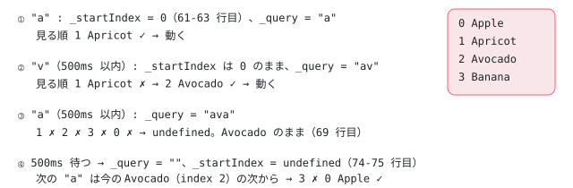

[目次](../README.md) › [Angular Aria の内側](README.md) › 第 8 回 / 全 20 回

# ListTypeahead：頭文字で項目を探す

> ListTypeahead.search が打った文字を \_query にためて typeaheadDelay（既定 500 ms）で消し、今の項目の次から label の前方一致で探す行。isTyping の間はスペースを選択ではなく文字として扱う理由。CDK の Typeahead（cdk-key-manager）との違い。

angular/components · 読了 約 10 分 · 中核 · [サイトで読む（デモが動きます）](https://angular-deep-dive-cyan.vercel.app/chapter/aria-typeahead)

---

リストにフォーカスがあるときに「b」「l」と打つと「Blueberry」へ飛ぶ、頭文字検索（typeahead）を受け持つのが `ListTypeahead` です。この章では、`search(char)` が打った文字を `_query` にため、**どこから探し始めるか（`_startIndex`）を最初の 1 文字のときに固定し**、`typeaheadDelay` ミリ秒たつと `setTimeout` でためた文字を捨てる流れを 1 行ずつ追います。スペースを「文字」として扱うか「選択のキー」として扱うかを分ける `isTyping` も読みます。

読む対象は `src/aria/private/behaviors/list-typeahead/list-typeahead.ts`（104 行）と `list-typeahead.spec.ts` です。見つけた項目へ動くのは[第 5 回](05-aria-list-focus.md)の `ListFocus.focus` です。

1. [1. 全体像](01-aria-overview.md)
2. [2. SignalLike](02-aria-signal-like.md)
3. [3. SortedCollection](03-aria-collection.md)
4. [4. イベントマネージャ](04-aria-events.md)
5. [5. ListFocus](05-aria-list-focus.md)
6. [6. ListNavigation](06-aria-list-navigation.md)
7. [7. ListSelection](07-aria-list-selection.md)
8. **8. ListTypeahead**（この章）
9. [9. Listbox](09-aria-listbox.md)
10. [10. Accordion](10-aria-accordion.md)
11. [11. DeferredContent](11-aria-deferred-content.md)
12. [12. Tabs](12-aria-tabs.md)
13. [13. Toolbar](13-aria-toolbar.md)
14. [14. Tree](14-aria-tree.md)
15. [15. Grid](15-aria-grid.md)
16. [16. Grid のセル](16-aria-grid-cells.md)
17. [17. Combobox](17-aria-combobox.md)
18. [18. Menu](18-aria-menu.md)
19. [19. テスト](19-aria-testing.md)
20. [20. issue と PR を読む](20-aria-issues.md)

## 1. 入力と状態：searchTerm と、3 つの内部の値

📄 `components/src/aria/private/behaviors/list-typeahead/list-typeahead.ts` L12–49 （▶ の行: 18, 27, 33, 36, 39, 42, 45, 48）

```ts
12 │ /**
13 │  * Represents an item in a collection, such as a listbox option, than can be navigated to by
14 │  * typeahead.
15 │  */
16 │ export interface ListTypeaheadItem extends ListFocusItem {
17 │   /** The text used by the typeahead search. */
18 ▶   searchTerm: SignalLike<string>;
19 │ }
20 │ 
21 │ /**
22 │  * Represents the required inputs for a collection that contains items that can be navigated to by
23 │  * typeahead.
24 │  */
25 │ export interface ListTypeaheadInputs<T extends ListTypeaheadItem> extends ListFocusInputs<T> {
26 │   /** The amount of time before the typeahead search is reset. */
27 ▶   typeaheadDelay: SignalLike<number>;
28 │ }
29 │ 
30 │ /** Controls typeahead for a list of items. */
31 │ export class ListTypeahead<T extends ListTypeaheadItem> {
32 │   /** A reference to the timeout for resetting the typeahead search. */
33 ▶   timeout?: ReturnType<typeof setTimeout> | undefined;
34 │ 
35 │   /** The focus controller of the parent list. */
36 ▶   readonly focusManager: ListFocus<T>;
37 │ 
38 │   /** Whether the user is actively typing a typeahead search query. */
39 ▶   readonly isTyping = computed(() => this._query().length > 0);
40 │ 
41 │   /** Keeps track of the characters that typeahead search is being called with. */
42 ▶   private readonly _query = signal('');
43 │ 
44 │   /** The index where that the typeahead search was initiated from. */
45 ▶   private readonly _startIndex = signal<number | undefined>(undefined);
46 │ 
47 │   constructor(readonly inputs: ListTypeaheadInputs<T> & {focusManager: ListFocus<T>}) {
48 ▶     this.focusManager = inputs.focusManager;
49 │   }
```

1. **18 行目 探す文字は searchTerm**

   項目に足すのは `searchTerm` だけです。Listbox では `ngOption` の `label` 入力がそのまま入ります。Option ディレクティブが `searchTerm: () => this.label() ?? ''` を渡しているので（listbox/option.ts:88）、**label を付けない option は空文字になり、頭文字検索では一度も当たりません**（空文字は 1 文字以上の query で始まらない）。表示している文字（要素の textContent）は見ません。
2. **27 行目 typeaheadDelay はミリ秒**

   ためた文字を捨てるまでの時間です。Listbox の既定は `input<number>(500)` で、コメントは「Picked arbitrarily.（適当に決めた）」です（listbox/listbox.ts:116）。単位がミリ秒になったのはコミット cb956b877b「fix(multiple): change delays to use ms (#32321)」（2025-11-12）からです。
3. **39・42・45 行目 内部の値**

   `_query` はためた文字列、`_startIndex` は「探し始める基準の位置」、`isTyping` は `_query` が空でない間だけ真になる computed です。33 行目の `timeout` は 3 節の `setTimeout` の戻り値を持っておき、次の文字で取り消すためのものです。
4. **47〜49 行目 focusManager を自分のフィールドにも持つ**

   ほかの Behavior と同じく `focusManager` を入力で受け取り、48 行目で `this.focusManager` にも入れます。Listbox では `List` が作った 1 つの `ListFocus` です（list.ts:96）。

## 2. search：1 文字ごとに、すぐ探す

📄 `components/src/aria/private/behaviors/list-typeahead/list-typeahead.ts` L51–79 （▶ の行: 53, 57, 61–62, 65–67, 69–70, 73–76, 78）

```ts
51 │   /** Performs a typeahead search, appending the given character to the search string. */
52 │   search(char: string): boolean {
53 ▶     if (char.length !== 1) {
54 │       return false;
55 │     }
56 │ 
57 ▶     if (!this.isTyping() && char === ' ') {
58 │       return false;
59 │     }
60 │ 
61 ▶     if (this._startIndex() === undefined) {
62 ▶       this._startIndex.set(this.focusManager.activeIndex());
63 │     }
64 │ 
65 ▶     clearTimeout(this.timeout);
66 ▶     this._query.update(q => q + char.toLowerCase());
67 ▶     const item = this._getItem();
68 │ 
69 ▶     if (item) {
70 ▶       this.focusManager.focus(item);
71 │     }
72 │ 
73 ▶     this.timeout = setTimeout(() => {
74 ▶       this._query.set('');
75 ▶       this._startIndex.set(undefined);
76 ▶     }, this.inputs.typeaheadDelay());
77 │ 
78 ▶     return true;
79 │   }
```

1. **53〜55 行目 1 文字でなければ false**

   `"Shift"` や `"ArrowDown"` のような名前のキーは長さが 1 でないので、ここで落ちます。`false` は「typeahead として扱わなかった」の印で、`List` はそのとき選択を更新しません（list.ts:228〜230）。
2. **57〜59 行目 打ち始めのスペースは文字にしない**

   まだ何も打っていない（`isTyping()` が偽）ときのスペースは `false` で返します。そのスペースは選択のキーとして別の処理が受けます（4 節）。
3. **61〜63 行目 探し始める位置は最初の 1 文字のときに決める**

   `_startIndex` が `undefined` のとき（＝ためた文字が無いとき）だけ、今の位置（`activeIndex()`）を入れます。2 文字目からは変えません。「a」で Apple に動いたあと「ap」と打っても、探し始めは Apple に動く**前**の位置のままなので、Apple の次（Apricot）へ飛ばずに Apple に当たり続けます。
4. **65〜67 行目 タイマーを止め、文字を足し、探す**

   65 行目で前の `setTimeout` を取り消します。66 行目で **小文字にして**`_query` の末尾に足し、67 行目で `_getItem()`（3 節）を呼びます。
5. **69〜71 行目 見つかったら動く、見つからなければそのまま**

   見つかれば `focusManager.focus(item)`（[第 5 回](05-aria-list-focus.md)。roving なら本物の focus も動く）。見つからなくても文字は捨てず、今の項目も変えません。
6. **73〜78 行目 もう一度タイマーを張り、true を返す**

   `typeaheadDelay()` ミリ秒後に `_query` を空に、`_startIndex` を `undefined` に戻します。**最後のキーから**数えるのは、毎回 65 行目で取り消して張り直すからです。見つかったかどうかに関係なく 78 行目で `true` を返すので、見つからない文字でも `List` は「動いた」として選択の更新を呼びます（list.ts:230〜231）。

## 3. \_getItem：基準の次から一周、前方一致

📄 `components/src/aria/private/behaviors/list-typeahead/list-typeahead.ts` L81–103 （▶ の行: 86, 88, 90–92, 95–96, 98, 102）

```ts
 81 │   /**
 82 │    * Returns the first item whose search term matches the
 83 │    * current query starting from the the current anchor index.
 84 │    */
 85 │   private _getItem() {
 86 ▶     const items = this.focusManager.inputs.items();
 87 │     const itemCount = items.length;
 88 ▶     const startIndex = this._startIndex()!;
 89 │ 
 90 ▶     for (let i = 0; i < itemCount; i++) {
 91 ▶       const index = (startIndex + 1 + i) % itemCount;
 92 ▶       const item = items[index];
 93 │ 
 94 │       if (
 95 ▶         this.focusManager.isFocusable(item) &&
 96 ▶         item.searchTerm().toLowerCase().startsWith(this._query())
 97 │       ) {
 98 ▶         return item;
 99 │       }
100 │     }
101 │ 
102 ▶     return undefined;
103 │   }
```

1. **90〜91 行目 基準の「次」から始めて、基準そのものは最後に見る**

   `(startIndex + 1 + i) % itemCount` を `i = 0` から `itemCount - 1` まで回すので、基準の次 → 末尾 → 先頭 → 基準、の順に全項目を 1 回ずつ見ます。基準が `-1`（今の項目が無い）なら 0 番目から順です。この形はコミット c27b1b4306「refactor(multiple): improve aria ListTypeahead.\_getItem (#32579)」（2025-12-29）で、配列を slice して並べ直していた前の書き方から変わりました。
2. **95 行目 無効な項目に当たるかは isFocusable**

   `ListNavigation` と同じく `focusManager.isFocusable(item)` で決めます。Listbox の既定（`softDisabled = true`）では、無効な項目も検索に当たります。
3. **96 行目 小文字どうしの startsWith**

   `searchTerm().toLowerCase().startsWith(this._query())`。`_query` は 66 行目で小文字にしてあるので、大文字小文字を区別しない前方一致です。`trim()` はしないので、label の先頭に空白があると当たりにくくなります。言語ごとの大文字小文字（`toLocaleLowerCase`）ではなく `toLowerCase` です。



*Apple・Apricot・Avocado・Banana と並び、今が Apple（index 0）のとき。打つ文字と \_getItem が見る順。*

## 4. スペースはどちらが受けるか：isTyping

Listbox で Space は 2 つの意味を持ちます。explicit のときの「選ぶ」（[第 7 回](07-aria-list-selection.md)）と、頭文字検索の途中の「文字としての空白」（"Ice cream" の空白）です。分けているのは ListboxPattern の 2 か所です（[第 9 回](09-aria-listbox.md)の持ち場なので場所だけ示します）。

1. **dynamicSpaceKey（private/listbox/listbox.ts:75）**

   `computed(() => (this.listBehavior.isTyping() ? '' : ' '))`。`List.isTyping` は `typeaheadBehavior.isTyping()`（39 行目）を返します（list.ts:150〜152）。打っている途中は、選択のキーとして登録したキーが `''` になり、どのキーにも一致しません。
2. **typeaheadRegexp = /^.$/（private/listbox/listbox.ts:78）**

   1 文字のキーは全部 `search(e.key)` へ送られます。スペースも 1 文字なので送られますが、打ち始めなら 57 行目で `false` になって何も起きず、そのあとに登録された選択のキー（`' '`）が受けます。イベントマネージャは一致した処理を全部、登録順に呼びます（[第 4 回](04-aria-events.md)）。

つまり「打ち始めのスペース」は 57 行目が、「途中のスペースで選ばれてしまう」ことは `dynamicSpaceKey` が防いでいます。**2 か所がそろって初めて**、スペースが文脈で意味を変えます。

> [!WARNING]
> **ハマりどころ**
>
> Listbox は typeahead の処理を**修飾キーなし**で登録しています（`.on(this.typeaheadRegexp, ...)`。修飾キーを書かないと `Modifier.None` になる）。イベントマネージャの `hasModifiers` は「押されている修飾キーの組がちょうど一致するか」を見るので（private/behaviors/event-manager/event-manager.ts:109）、**Shift を押しながら打った大文字は `search` まで届きません**。CapsLock で打った大文字は Shift が立たないので届き、66 行目で小文字になります。このページのデモに `new KeyboardEvent('keydown', {key: 'B', shiftKey: true})` を送ると今の項目は動かず、`shiftKey` なしの `'B'` なら Banana へ動くことを確かめました（2026-11-02、Chrome）。

> **🧪 DEMO — 項目の多い ngListbox で頭文字検索**
>
> 本物の `ngListbox`（@angular/aria 22.1.8、`selectionMode="explicit"`）です。各 option に `[label]` を付けています。「Coconut」は `[disabled]="true"`（softDisabled は既定の true）。Tab でリストに入り、文字を打ってください。キーごとに「前のキーからの時間」と、描画のあとの今の項目を出します（新しい行が上）。`typeaheadDelay` を変えて、同じ打ち方で結果が変わるのを見てください。
>
> ▶ [このデモはサイトで動かせます](https://angular-deep-dive-cyan.vercel.app/chapter/aria-typeahead)

- 「b」「l」「u」と続けて打つと Banana → Blackberry → Blueberry。ゆっくり（delay より長く空けて）打つと、毎回 1 文字の検索になり、「b」→ Banana、「l」→ Lemon、のように飛びます。
- 最初の今の項目は Apple です。「a」を何度も素早く打つと、1 回目で Apricot（Apple の次から探す）に動き、2 回目からは動きません（query が "aa" になり当たらない）。delay より長く空けて打つと Avocado → Apple → Apricot と一周します（図の ④）。
- 「i」「c」「e」「Space」「c」と素早く打つと Ice cream へ。途中のスペースでは選択されません（4 節）。打ち始めの Space は選択（explicit の `toggleOne`）です。
- 「c」「o」で無効な Coconut にも止まります（95 行目の `isFocusable`）。

## 5. 1 文字の流れ

- 👤 `（利用者）"b" を押す` — keydown
  - `ListboxPattern: typeaheadRegexp に一致 → List.search(e.key, opts)` — private/listbox/listbox.ts:99 / list.ts:145 — *follow なら {selectOne: true}（:108）*
    - `ListTypeahead.search("b")` — list-typeahead.ts L52
      - `_startIndex を決める（最初の 1 文字だけ）` — L61-63
      - `clearTimeout → _query += "b" → _getItem()` — L65-67・L85
      - `focusManager.focus(item)` — L70 — *第 5 回*
      - `setTimeout(reset, typeaheadDelay())` — L73-76
  - `（true が返ったので）List.updateSelection(opts)` — list.ts:230-231 — *第 7 回*

CDK の `Typeahead`（`ListKeyManager.withTypeAhead`）は、打った文字を rxjs の `debounceTime`（既定 200 ms）でまとめ、**打ち終わってから 1 回だけ**探して文字を捨てます（[cdk-key-manager](../cdk/10-cdk-key-manager.md)）。Aria の `ListTypeahead` は **1 文字ごとにすぐ探し**、最後のキーから `typeaheadDelay`（既定 500 ms）たってから文字を捨てます。rxjs は使わず、`setTimeout` と signal だけです。

## テストと直し方

📄 `components/src/aria/private/behaviors/list-typeahead/list-typeahead.spec.ts` L21–46 （▶ の行: 22–23, 25–27, 29, 39, 41）

```ts
21 │ function getTypeahead(inputs: TestInputs = {}): ListTypeahead<TestItem> {
22 ▶   const items = getItems(inputs.numItems ?? 5);
23 ▶   const focusManager = getListFocus({...inputs, items}) as ListFocus<TestItem>;
24 │ 
25 ▶   return new ListTypeahead({
26 ▶     focusManager,
27 ▶     ...focusManager.inputs,
28 │     items,
29 ▶     typeaheadDelay: signal(500),
30 │     ...inputs,
31 │   });
32 │ }
33 │ 
34 │ function getItems(length: number): SignalLike<TestItem[]> {
35 │   return signal(
36 │     Array.from({length}).map((_, i) => {
37 │       return {
38 │         index: signal(i),
39 ▶         searchTerm: signal(`Item ${i}`),
40 │         id: signal(`${i}`),
41 ▶         disabled: signal(false),
42 │         element: signal({focus: () => {}} as HTMLElement),
43 │       };
44 │     }),
45 │   );
46 │ }
```

22 行目で項目を作り、23 行目で[第 5 回](05-aria-list-focus.md)の `getListFocus` に渡します。29 行目で `typeaheadDelay: signal(500)`。39 行目の `searchTerm` は `Item 0`〜`Item 4` で、**全部が同じ「item 」で始まる**のがこの spec の工夫です。最後の数字まで打たないと区別できないので、2 節の 61〜63 行目（基準を固定する）と 3 節の一周の順がそのまま試されます。

📄 `components/src/aria/private/behaviors/list-typeahead/list-typeahead.spec.ts` L57–92 （▶ の行: 59–60, 66–67, 71, 74, 76–77, 82, 84, 89, 91）

```ts
57 │   describe('#search', () => {
58 │     it('should navigate to an item', () => {
59 ▶       typeahead.search('i');
60 ▶       expect(typeahead.inputs.focusManager.activeIndex()).toBe(1);
61 │ 
62 │       typeahead.search('t');
63 │       typeahead.search('e');
64 │       typeahead.search('m');
65 │       typeahead.search(' ');
66 ▶       typeahead.search('3');
67 ▶       expect(typeahead.inputs.focusManager.activeIndex()).toBe(3);
68 │     });
69 │ 
70 │     it('should reset after a delay', async () => {
71 ▶       typeahead.search('i');
72 │       expect(typeahead.inputs.focusManager.activeIndex()).toBe(1);
73 │ 
74 ▶       await new Promise(resolve => setTimeout(resolve, 500));
75 │ 
76 ▶       typeahead.search('i');
77 ▶       expect(typeahead.inputs.focusManager.activeIndex()).toBe(2);
78 │     });
79 │ 
80 │     it('should skip disabled items', () => {
81 │       items[1].disabled.set(true);
82 ▶       (typeahead.inputs.softDisabled as WritableSignalLike<boolean>).set(false);
83 │       typeahead.search('i');
84 ▶       expect(typeahead.inputs.focusManager.activeIndex()).toBe(2);
85 │     });
86 │ 
87 │     it('should not skip disabled items', () => {
88 │       items[1].disabled.set(true);
89 ▶       (typeahead.inputs.softDisabled as WritableSignalLike<boolean>).set(true);
90 │       typeahead.search('i');
91 ▶       expect(typeahead.inputs.focusManager.activeIndex()).toBe(1);
92 │     });
```

1. **58〜68 行目 1 文字目で次へ、最後まで打てば目当てへ**

   今が 0 なので、59 行目の「i」は 0 の次の 1（Item 1）に当たります（60 行目）。そのまま「tem 3」と打つと、基準は 0 のままなので 3 に当たります（67 行目）。
2. **70〜78 行目 本物の時間を待つ**

   74 行目で `await new Promise(resolve => setTimeout(resolve, 500))`。偽の時計（`fakeAsync`）は使っていません。この spec は 2025-10-30 のコミット 25f15bf805「test: move aria tests away from fakeAsync (#32214)」で今の形になりました。待ったあとの「i」は、今の 1 の次の 2 に当たります（77 行目）。この it は 0.5 秒かかるので、このターゲットだけ実行時間が少し長くなっています（下の 1.2s）。
3. **80〜92 行目 softDisabled で結果が変わる**

   1 番目を無効にして、softDisabled が偽なら 2 へ（84 行目）、真なら無効な 1 に当たる（91 行目）。95 行目の `isFocusable` の 2 通りです。`softDisabled` を `WritableSignalLike` にキャストして `set` しているのは、`getListFocus` が `signal(true)` で作っているからです。

📄 `components/src/aria/private/behaviors/list-typeahead/list-typeahead.spec.ts` L94–117 （▶ の行: 99, 102, 104, 108, 113, 115）

```ts
 94 │     it('should ignore keys like shift', () => {
 95 │       typeahead.search('i');
 96 │       typeahead.search('t');
 97 │       typeahead.search('e');
 98 │ 
 99 ▶       typeahead.search('Shift');
100 │ 
101 │       typeahead.search('m');
102 ▶       typeahead.search(' ');
103 │       typeahead.search('2');
104 ▶       expect(typeahead.inputs.focusManager.activeIndex()).toBe(2);
105 │     });
106 │ 
107 │     it('should not allow a query to begin with a space', () => {
108 ▶       typeahead.search(' ');
109 │       typeahead.search('i');
110 │       typeahead.search('t');
111 │       typeahead.search('e');
112 │       typeahead.search('m');
113 ▶       typeahead.search(' ');
114 │       typeahead.search('3');
115 ▶       expect(typeahead.inputs.focusManager.activeIndex()).toBe(3);
116 │     });
117 │   });
```

99 行目の `search('Shift')` は 53 行目で落ちるだけで、ためた文字は消えません（104 行目で 2 に当たる）。108 行目の打ち始めのスペースは 57 行目で捨てられ、113 行目の途中のスペースは文字として足されます（115 行目）。

📄 `ターミナル`

```
cd ~/angular-research/components
pnpm bazel test //src/aria/private/behaviors/list-typeahead:unit_tests_chromium --nocache_test_results --test_output=all

grep -cE '^\s*it\(' src/aria/private/behaviors/list-typeahead/list-typeahead.spec.ts
```

📄 `出力（抜粋。2026-11-02 に実行。ログは scratchpad/aria-logs/b-behaviors.log）`

```
src/aria/private/behaviors/list-typeahead/unit_tests_bundle.spec.js:
Chromium: |██████████████████████████████| 1/1 test files | 17 passed, 0 failed
Finished running tests in 1.2s, all tests passed!
//src/aria/private/behaviors/list-typeahead:unit_tests_chromium          PASSED in 1.9s

6
```

1. **17 本 = この spec の 6 本 + List Focus の 11 本**

   list-typeahead.spec.ts:11 で `getListFocus` を import しているためです（[第 5 回](05-aria-list-focus.md)）。
2. **spec に無い形**

   この spec の 6 本は、3 節の「一周して基準の前に戻る」（基準より前の項目に当たる）場合と、「見つからない文字でも 78 行目で true を返す」ことを直接は確かめていません。また、Listbox 側の spec（listbox.spec.ts:798 の `describe('typeahead functionality ...')`）は `type('B')` のような大文字のキーで試していますが、4 節の warn の箱の「Shift を押した大文字」は確かめていません（この spec の `type` の中身は第 19 回の持ち場なので、ここでは読んでいません）。
3. **直すとしたら**

   比べ方（大文字小文字・空白・前方一致）は 96 行目、探す順は 90〜91 行目、時間の扱いは 65・73〜76 行目、スペースの扱いは 57 行目です。spec は list-typeahead.spec.ts の `describe('#search')` に足します。「スペースで選ばれてしまう／選べない」という報告なら、57 行目だけでなく ListboxPattern の `dynamicSpaceKey` と登録の順も一緒に見ます（[第 9 回](09-aria-listbox.md)）。2026-11-02 の時点で、`area: aria/listbox` の開いている issue に typeahead を題にしたものはありませんでした（[第 20 回](20-aria-issues.md)）。

## 聞かれそうな質問

**Q. 日本語の項目でも使えますか？**

比べ方は 96 行目の `toLowerCase().startsWith()` なので、label が「りんご」で、keydown の `e.key` に「り」の 1 文字が来れば当たります。ひらがなとカタカナ（「り」と「リ」）は別の文字として比べるので、同じとはみなしません。問題は「1 文字の `e.key` が来るか」で、Listbox は `/^.$/` に一致した keydown だけを送り（private/listbox/listbox.ts:78）、53 行目も長さ 1 を求めます。IME で変換しながら打つときに keydown の `key` に何が入るかはブラウザと IME の話で、このコードの外です。ここでは確かめていません。デモの「いちご」「りんご」「レモン」で手元のブラウザを試せます。

**Q. 同じ文字を続けて押すと、次の候補へ進みますか？**

delay の間に続けて押すと進みません。66 行目で `_query` が「aa」になり、61〜63 行目で基準も固定されているので、「aa」で始まる項目を探すだけです（無ければ 69 行目で動かない）。delay より長く空けると 74〜75 行目でリセットされ、次の「a」は今の項目の次から探すので、Apple → Apricot → Avocado と進みます（spec `it('should reset after a delay')`、:70）。

**Q. 無効な項目は検索に当たりますか？**

`softDisabled` 次第です。95 行目の `isFocusable` は「無効でない、または softDisabled」なので、Listbox の既定（true）では当たり、`[softDisabled]="false"` なら飛ばします（spec :80・:87）。当たっても選べないのは[第 7 回](07-aria-list-selection.md)のとおりです。

**Q. label を付けないとどうなりますか？**

Option の `searchTerm` が空文字になるので（listbox/option.ts:88）、96 行目の `''.startsWith(query)` は常に偽で、その項目は頭文字検索で一度も当たりません。要素に表示した文字は使われません。

**Q. 打っている途中で Enter や矢印を押すと？**

`ListTypeahead` は何もしません。矢印は `ListNavigation` へ行き、ためた文字は残ったまま、最後の文字から `typeaheadDelay` たつと 73〜76 行目のタイマーで消えます。矢印で動いたあとすぐに文字を打つと、`_startIndex` は前の基準のまま（61 行目で `undefined` でないので更新しない）で続きが探されます。

## 読み終えて

- `search` は 1 文字ごとにすぐ探す（L67）。ためた文字は最後のキーから `typeaheadDelay` ミリ秒で消える（L65・L73-76）。
- 探し始めの基準 `_startIndex` は最初の 1 文字のときだけ決まる（L61-63）。だから同じ文字の連打では次へ進まない。
- 比べ方は小文字どうしの前方一致（L96）、相手は Option の `label`。無効な項目に当たるかは `isFocusable`（L95）。
- スペースは「打ち始めなら捨てる」（L57）と ListboxPattern の `dynamicSpaceKey` の 2 か所で意味が分かれる。
- CDK の Typeahead は打ち終わってから 1 回探す（debounce 200 ms）。Aria は毎回探し、rxjs を使わない。

---

← 前: [ListSelection：選ぶ・外す・範囲で選ぶ](07-aria-list-selection.md)  
次: [Listbox：Behavior を組み合わせた最初の部品](09-aria-listbox.md) →
