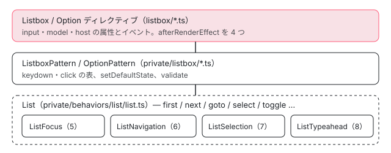

[目次](../README.md) › [Angular Aria の内側](README.md) › 第 9 回 / 全 20 回

# Listbox：Behavior を組み合わせた最初の部品

> List が ListFocus・ListNavigation・ListSelection・ListTypeahead を 1 つにまとめ、ListboxPattern が keydown / pointerdown の表を組み、Listbox ディレクティブが host に role・aria-multiselectable・aria-activedescendant を書く行。afterRenderEffect で setDefaultState を走らせる理由、選んだ値が無くなった項目を value から外す effect、開発モードの validate と reportViolations。

angular/components · 読了 約 14 分 · 中核 · [サイトで読む（デモが動きます）](https://angular-deep-dive-cyan.vercel.app/chapter/aria-listbox)

---

第 5〜8 回で 1 つずつ読んだ Behavior（フォーカス・移動・選択・頭文字検索）を、実際の部品が初めて組み合わせるのが `ngListbox` です。この章では、`List` が 4 つの Behavior を 1 つの窓口にまとめる行、`ListboxPattern` が「どのキーで何を呼ぶか」の表を組む行、`Listbox` ディレクティブが host に `role`・`tabindex`・`aria-*` を書き、`afterRenderEffect` で既定の状態と `value` の後始末をする行を、順に追います。

読む対象は `src/aria/private/behaviors/list/list.ts`、`src/aria/private/listbox/listbox.ts`・`option.ts`、`src/aria/listbox/listbox.ts`・`option.ts` です（../components の e81c398a86。ページの上のデモは @angular/aria 22.1.8 で、この 5 ファイルは中身が同じです）。

1. [1. 全体像](01-aria-overview.md)
2. [2. SignalLike](02-aria-signal-like.md)
3. [3. SortedCollection](03-aria-collection.md)
4. [4. イベントマネージャ](04-aria-events.md)
5. [5. ListFocus](05-aria-list-focus.md)
6. [6. ListNavigation](06-aria-list-navigation.md)
7. [7. ListSelection](07-aria-list-selection.md)
8. [8. ListTypeahead](08-aria-typeahead.md)
9. **9. Listbox**（この章）
10. [10. Accordion](10-aria-accordion.md)
11. [11. DeferredContent](11-aria-deferred-content.md)
12. [12. Tabs](12-aria-tabs.md)
13. [13. Toolbar](13-aria-toolbar.md)
14. [14. Tree](14-aria-tree.md)
15. [15. Grid](15-aria-grid.md)
16. [16. Grid のセル](16-aria-grid-cells.md)
17. [17. Combobox](17-aria-combobox.md)
18. [18. Menu](18-aria-menu.md)
19. [19. テスト](19-aria-testing.md)
20. [20. issue と PR を読む](20-aria-issues.md)



*ngListbox の 3 層。ディレクティブが signal を集めて Pattern に渡し、Pattern は List を 1 つ持ち、List が 4 つの Behavior を持つ*

## 1. List：4 つの Behavior を 1 つの窓口にする

📄 `components/src/aria/private/behaviors/list/list.ts` L50–74 （▶ の行: 53, 56, 59, 62, 65, 68, 71, 74）

```ts
50 │ /** Controls the state of a list. */
51 │ export class List<T extends ListItem<V>, V> {
52 │   /** Controls navigation for the list. */
53 ▶   readonly navigationBehavior: ListNavigation<T>;
54 │ 
55 │   /** Controls selection for the list. */
56 ▶   readonly selectionBehavior: ListSelection<T, V>;
57 │ 
58 │   /** Controls typeahead for the list. */
59 ▶   readonly typeaheadBehavior: ListTypeahead<T>;
60 │ 
61 │   /** Controls focus for the list. */
62 ▶   readonly focusBehavior: ListFocus<T>;
63 │ 
64 │   /** Whether the list is disabled. */
65 ▶   readonly disabled = computed(() => this.focusBehavior.isListDisabled());
66 │ 
67 │   /** The id of the current active item. */
68 ▶   readonly activeDescendant = computed(() => this.focusBehavior.getActiveDescendant());
69 │ 
70 │   /** The tab index of the list. */
71 ▶   readonly tabIndex = computed(() => this.focusBehavior.getListTabIndex());
72 │ 
73 │   /** The index of the currently active item in the list. */
74 ▶   readonly activeIndex = computed(() => this.focusBehavior.activeIndex());
```

53〜62 行目で、`List` は 4 つの Behavior をフィールドに持ちます。65〜74 行目の 4 つの `computed` は、どれも `focusBehavior`（ListFocus）にそのまま聞いているだけです。つまり「無効か」「`aria-activedescendant` に書く id」「リスト自身の `tabindex`」「いまの位置」は、すべて第 5 回の `ListFocus` が決めます（[aria-list-focus](05-aria-list-focus.md)）。

コンストラクタは[第 5 回](05-aria-list-focus.md)で引用しているので、ここでは結果だけ書きます。最初に `ListFocus` を作り、それを `focusManager` として `ListSelection`・`ListTypeahead`・`ListNavigation` の 3 つに渡します。`ListNavigation` にだけは `wrap` を「`_wrap` と利用者の `wrap` の両方が true のとき」に差し替えて渡します。この `_wrap` を動かすのが次の `_navigate` です。

📄 `components/src/aria/private/behaviors/list/list.ts` L213–238 （▶ の行: 223–225, 228, 230–233, 237）

```ts
213 │   /**
214 │    * Safely performs a navigation operation.
215 │    *
216 │    * Handles conditionally disabling wrapping for when a navigation
217 │    * operation is occurring while the user is selecting a range of options.
218 │    *
219 │    * Handles boilerplate calling of focus & selection operations. Also ensures these
220 │    * additional operations are only called if the navigation operation moved focus to a new option.
221 │    */
222 │   private _navigate(opts: NavOptions = {}, operation: () => boolean) {
223 ▶     if (opts?.selectRange) {
224 ▶       this._wrap.set(false);
225 ▶       this.selectionBehavior.rangeStartIndex.set(this._anchorIndex());
226 │     }
227 │ 
228 ▶     const moved = operation();
229 │ 
230 ▶     if (moved) {
231 ▶       this.updateSelection(opts);
232 ▶       if (!opts?.selectRange) {
233 ▶         this.anchor(this.activeIndex());
234 │       }
235 │     }
236 │ 
237 ▶     this._wrap.set(true);
238 │   }
```

1. **223〜226 行目 範囲選択のときは折り返しを止める**

   Shift を押しながら矢印で選ぶ（`selectRange`）ときは、224 行目で `_wrap` を false にし、225 行目で範囲の始点を `_anchorIndex`（範囲を始めるかもしれない位置）に合わせます。端で折り返して反対の端まで選んでしまわないためです（213〜221 行目のコメント）。
2. **228 行目 移動そのもの**

   `operation` は呼び出し元が渡した関数で、`navigationBehavior.next()` や `typeaheadBehavior.search(char)` です。動けたら true を返します。
3. **230〜235 行目 動けたときだけ選択を更新する**

   231 行目の `updateSelection(opts)` が、`opts` に書かれた選択の操作（下の 196〜207 行目）を行います。動けなかったとき（端で止まった、無効な項目しかない）は選択も変えません。232〜233 行目で、範囲選択でなければ「次の範囲の始点」をいまの位置にします。
4. **237 行目 折り返しを元に戻す**

📄 `components/src/aria/private/behaviors/list/list.ts` L194–211 （▶ の行: 195–196, 199, 202, 205, 208–209）

```ts
194 │   /** Handles updating selection for the list. */
195 ▶   updateSelection(opts: NavOptions = {anchor: true}) {
196 ▶     if (opts.toggle) {
197 │       this.selectionBehavior.toggle();
198 │     }
199 ▶     if (opts.select) {
200 │       this.selectionBehavior.select();
201 │     }
202 ▶     if (opts.selectOne) {
203 │       this.selectionBehavior.selectOne();
204 │     }
205 ▶     if (opts.selectRange) {
206 │       this.selectionBehavior.selectRange();
207 │     }
208 ▶     if (!opts.anchor) {
209 ▶       this.anchor(this.selectionBehavior.rangeStartIndex());
210 │     }
211 │   }
```

`NavOptions` の 4 つのフラグ（`toggle`・`select`・`selectOne`・`selectRange`）を、196〜207 行目でそれぞれ `ListSelection` の同名の関数に渡します（[aria-list-selection](07-aria-list-selection.md)）。「矢印で動いて、ついでに選ぶ」は、`next({selectOne: true})` のように**移動の関数にフラグを付けて呼ぶ**ことで表します。次の節の表は、このフラグの付け方の一覧です。

## 2. ListboxPattern：キーと操作の表

📄 `components/src/aria/private/listbox/listbox.ts` L58–78 （▶ の行: 60–61, 63, 68–69, 71, 74–75, 78）

```ts
58 │   /** The key used to navigate to the previous item in the list. */
59 │   readonly prevKey = computed(() => {
60 ▶     if (this.inputs.orientation() === 'vertical') {
61 ▶       return 'ArrowUp';
62 │     }
63 ▶     return this.inputs.textDirection() === 'rtl' ? 'ArrowRight' : 'ArrowLeft';
64 │   });
65 │ 
66 │   /** The key used to navigate to the next item in the list. */
67 │   readonly nextKey = computed(() => {
68 ▶     if (this.inputs.orientation() === 'vertical') {
69 ▶       return 'ArrowDown';
70 │     }
71 ▶     return this.inputs.textDirection() === 'rtl' ? 'ArrowLeft' : 'ArrowRight';
72 │   });
73 │ 
74 ▶   /** Represents the space key. Does nothing when the user is actively using typeahead. */
75 ▶   readonly dynamicSpaceKey = computed(() => (this.listBehavior.isTyping() ? '' : ' '));
76 │ 
77 │   /** The regexp used to decide if a key should trigger typeahead. */
78 ▶   readonly typeaheadRegexp = /^.$/;
```

前後に動くキーは固定ではありません。60〜61 行目で縦（`orientation` が `'vertical'`、既定）なら `ArrowUp`、63 行目で横なら左から右に書く言語（ltr）は `ArrowLeft`、右から左（rtl）なら `ArrowRight` を「前」にします。67〜72 行目の「次」も同じです。75 行目の `dynamicSpaceKey` は、頭文字検索の途中（`isTyping()`）は空文字になり、どのキーにも一致しなくなります。74 行目のコメントのとおり、頭文字検索の途中に押した Space は選択のキーとして扱いません（頭文字検索は[第 8 回](08-aria-typeahead.md)）。

📄 `components/src/aria/private/listbox/listbox.ts` L80–109 （▶ の行: 81–82, 84–85, 93, 102, 104, 108）

```ts
 80 │   /** The keydown event manager for the listbox. */
 81 ▶   readonly keydown = computed(() => {
 82 ▶     const manager = new KeyboardEventManager();
 83 │ 
 84 ▶     if (this.readonly()) {
 85 ▶       return manager
 86 │         .on(this.prevKey, () => this.listBehavior.prev(), {ignoreRepeat: false})
 87 │         .on(this.nextKey, () => this.listBehavior.next(), {ignoreRepeat: false})
 88 │         .on('Home', () => this.listBehavior.first())
 89 │         .on('End', () => this.listBehavior.last())
 90 │         .on(this.typeaheadRegexp, e => this.listBehavior.search(e.key));
 91 │     }
 92 │ 
 93 ▶     if (!this.followFocus()) {
 94 │       manager
 95 │         .on(this.prevKey, () => this.listBehavior.prev(), {ignoreRepeat: false})
 96 │         .on(this.nextKey, () => this.listBehavior.next(), {ignoreRepeat: false})
 97 │         .on('Home', () => this.listBehavior.first())
 98 │         .on('End', () => this.listBehavior.last())
 99 │         .on(this.typeaheadRegexp, e => this.listBehavior.search(e.key));
100 │     }
101 │ 
102 ▶     if (this.followFocus()) {
103 │       manager
104 ▶         .on(this.prevKey, () => this.listBehavior.prev({selectOne: true}), {ignoreRepeat: false})
105 │         .on(this.nextKey, () => this.listBehavior.next({selectOne: true}), {ignoreRepeat: false})
106 │         .on('Home', () => this.listBehavior.first({selectOne: true}))
107 │         .on('End', () => this.listBehavior.last({selectOne: true}))
108 ▶         .on(this.typeaheadRegexp, e => this.listBehavior.search(e.key, {selectOne: true}));
109 │     }
```

📄 `components/src/aria/private/listbox/listbox.ts` L111–144 （▶ の行: 111, 113–114, 120, 126, 134, 136–138, 141–143）

```ts
111 ▶     if (this.inputs.multi()) {
112 │       manager
113 ▶         .on(Modifier.Any, 'Shift', () => this.listBehavior.anchor(this.listBehavior.activeIndex()))
114 ▶         .on(Modifier.Shift, this.prevKey, () => this.listBehavior.prev({selectRange: true}), {
115 │           ignoreRepeat: false,
116 │         })
117 │         .on(Modifier.Shift, this.nextKey, () => this.listBehavior.next({selectRange: true}), {
118 │           ignoreRepeat: false,
119 │         })
120 ▶         .on([Modifier.Ctrl | Modifier.Shift, Modifier.Meta | Modifier.Shift], 'Home', () =>
121 │           this.listBehavior.first({selectRange: true, anchor: false}),
122 │         )
123 │         .on([Modifier.Ctrl | Modifier.Shift, Modifier.Meta | Modifier.Shift], 'End', () =>
124 │           this.listBehavior.last({selectRange: true, anchor: false}),
125 │         )
126 ▶         .on(Modifier.Shift, 'Enter', () =>
127 │           this.listBehavior.updateSelection({selectRange: true, anchor: false}),
128 │         )
129 │         .on(Modifier.Shift, this.dynamicSpaceKey, () =>
130 │           this.listBehavior.updateSelection({selectRange: true, anchor: false}),
131 │         );
132 │     }
133 │ 
134 ▶     if (!this.followFocus() && this.inputs.multi()) {
135 │       manager
136 ▶         .on(this.dynamicSpaceKey, () => this.listBehavior.toggle())
137 ▶         .on('Enter', () => this.listBehavior.toggle())
138 ▶         .on([Modifier.Ctrl, Modifier.Meta], 'A', () => this.listBehavior.toggleAll());
139 │     }
140 │ 
141 ▶     if (!this.followFocus() && !this.inputs.multi()) {
142 ▶       manager.on(this.dynamicSpaceKey, () => this.listBehavior.toggleOne());
143 ▶       manager.on('Enter', () => this.listBehavior.toggleOne());
144 │     }
```

📄 `components/src/aria/private/listbox/listbox.ts` L146–165 （▶ の行: 146, 148, 154–155, 158, 160）

```ts
146 ▶     if (this.inputs.multi() && this.followFocus()) {
147 │       manager
148 ▶         .on([Modifier.Ctrl, Modifier.Meta], this.prevKey, () => this.listBehavior.prev(), {
149 │           ignoreRepeat: false,
150 │         })
151 │         .on([Modifier.Ctrl, Modifier.Meta], this.nextKey, () => this.listBehavior.next(), {
152 │           ignoreRepeat: false,
153 │         })
154 ▶         .on([Modifier.Ctrl, Modifier.Meta], ' ', () => this.listBehavior.toggle())
155 ▶         .on([Modifier.Ctrl, Modifier.Meta], 'Enter', () => this.listBehavior.toggle())
156 │         .on([Modifier.Ctrl, Modifier.Meta], 'Home', () => this.listBehavior.first())
157 │         .on([Modifier.Ctrl, Modifier.Meta], 'End', () => this.listBehavior.last())
158 ▶         .on([Modifier.Ctrl, Modifier.Meta], 'A', () => {
159 │           this.listBehavior.toggleAll();
160 ▶           this.listBehavior.select(); // Ensure the currect option remains selected.
161 │         });
162 │     }
163 │ 
164 │     return manager;
165 │   });
```

81 行目の `keydown` は `computed` です。中で `readonly()`・`followFocus()`・`inputs.multi()` を読むので、どれかが変わると `KeyboardEventManager`（[第 4 回](04-aria-events.md)）を作り直します。84〜91 行目の `readonly` のときは、移動だけを登録して 85 行目で**すぐ返す**ので、選択のキーは 1 つも入りません。そうでなければ、条件ごとに `.on(...)` を足していきます。

| 条件 | キー | 呼ぶもの | 行 |
| --- | --- | --- | --- |
| readonly | 前 / 次・Home・End・1 文字 | `prev()``next()``first()``last()``search()`（選ばない） | 84〜91 |
| explicit | 前 / 次・Home・End・1 文字 | 同じ（動くだけ） | 93〜100 |
| follow（既定） | 前 / 次・Home・End・1 文字 | 同じ関数に `{selectOne: true}` | 102〜109 |
| multi | Shift（どの修飾でも） | `anchor(activeIndex)` | 113 |
| multi | Shift+前 / 次、Ctrl(⌘)+Shift+Home / End、Shift+Enter / Space | `{selectRange: true}` を付けて移動、または `updateSelection` | 114〜131 |
| explicit かつ multi | Space・Enter、Ctrl(⌘)+A | `toggle()`、`toggleAll()` | 134〜139 |
| explicit かつ単一 | Space・Enter | `toggleOne()` | 141〜144 |
| multi かつ follow | Ctrl(⌘)+前 / 次・Home・End、Ctrl(⌘)+Space / Enter、Ctrl(⌘)+A | 選ばずに動く、`toggle()`、`toggleAll()` のあと `select()` | 146〜161 |

> [!WARNING]
> **ハマりどころ**
>
> 表に「follow かつ単一」の Enter / Space の行はありません。102〜109 行目は移動のキーだけで、Space / Enter を登録するのは 134 行目（explicit かつ multi）と 141 行目（explicit かつ単一）の条件の中だけだからです。既定（follow・単一）の listbox では、Enter を押しても何も起きません。矢印で動けばその場で選ばれるので、要らないという作りです。下のデモで確かめられます。

📄 `components/src/aria/private/listbox/listbox.ts` L167–200 （▶ の行: 168–169, 172, 176–177, 182, 186, 191–192, 196）

```ts
167 │   /** The click event manager for the listbox. */
168 ▶   readonly clickManager = computed(() => {
169 ▶     const manager = new ClickEventManager<PointerEvent>();
170 │ 
171 │     if (this.readonly()) {
172 ▶       return manager.on(e => this.listBehavior.goto(this._getItem(e)!));
173 │     }
174 │ 
175 │     if (this.multi()) {
176 ▶       manager.on(Modifier.Shift, e =>
177 ▶         this.listBehavior.goto(this._getItem(e)!, {selectRange: true}),
178 │       );
179 │     }
180 │ 
181 │     if (!this.multi() && this.followFocus()) {
182 ▶       return manager.on(e => this.listBehavior.goto(this._getItem(e)!, {selectOne: true}));
183 │     }
184 │ 
185 │     if (!this.multi() && !this.followFocus()) {
186 ▶       return manager.on(e => this.listBehavior.goto(this._getItem(e)!, {toggle: true}));
187 │     }
188 │ 
189 │     if (this.multi() && this.followFocus()) {
190 │       return manager
191 ▶         .on(e => this.listBehavior.goto(this._getItem(e)!, {selectOne: true}))
192 ▶         .on(Modifier.Ctrl, e => this.listBehavior.goto(this._getItem(e)!, {toggle: true}));
193 │     }
194 │ 
195 │     if (this.multi() && !this.followFocus()) {
196 ▶       return manager.on(e => this.listBehavior.goto(this._getItem(e)!, {toggle: true}));
197 │     }
198 │ 
199 │     return manager;
200 │   });
```

クリックも同じ形です。169 行目の `ClickEventManager` は `click` イベントを受けます（以前は `pointerdown` でした。#33031 で `click` に変わった経緯は[第 12 回](12-aria-tabs.md)）。どの条件でも `goto(項目, フラグ)` を呼び、項目は `_getItem(e)` が `e` の発生元から一番近い `[role="option"]` を探して見つけます（同じファイルの `_getItem`）。単一の follow は 182 行目で `selectOne`、単一の explicit は 186 行目で `toggle`（もう一度押すと外れる）、multi の follow は 191 行目で `selectOne`・192 行目で Ctrl+クリックが `toggle` です。

## 3. 入口：onKeydown・onClick・onFocusIn と validate

📄 `components/src/aria/private/listbox/listbox.ts` L234–251 （▶ の行: 236–238, 243–245, 249–250）

```ts
234 │   /** Handles keydown events for the listbox. */
235 │   onKeydown(event: KeyboardEvent) {
236 ▶     if (!this.disabled()) {
237 ▶       this.hasBeenInteracted.set(true);
238 ▶       this.keydown().handle(event);
239 │     }
240 │   }
241 │ 
242 │   onClick(event: PointerEvent) {
243 ▶     if (!this.disabled()) {
244 ▶       this.hasBeenInteracted.set(true);
245 ▶       this.clickManager().handle(event);
246 │     }
247 │   }
248 │ 
249 ▶   onFocusIn() {
250 ▶     this.hasBeenInteracted.set(true);
251 │   }
```

236 行目で無効なら何もしません。無効でなければ 237 行目で `hasBeenInteracted` を true にし、238 行目で表（`keydown()`）に渡します。249〜251 行目の `onFocusIn` は表を通さず、`hasBeenInteracted` を立てるだけです。この「一度でも触られたか」は、4 節の `setDefaultStateEffect` が見ます。

📄 `components/src/aria/private/listbox/listbox.ts` L202–232 （▶ の行: 206, 213–214, 219–221, 225–227）

```ts
202 │   constructor(readonly inputs: ListboxInputs<V>) {
203 │     this.readonly = inputs.readonly;
204 │     this.orientation = inputs.orientation;
205 │     this.multi = inputs.multi;
206 ▶     this.listBehavior = new List(inputs);
207 │   }
208 │ 
209 │   /** Returns a set of violations */
210 │   validate(): string[] {
211 │     const violations: string[] = [];
212 │ 
213 ▶     if (!this.inputs.multi() && this.inputs.value().length > 1) {
214 ▶       violations.push(
215 │         `A single-select listbox should not have multiple selected options. Selected options: ${this.inputs.value().join(', ')}`,
216 │       );
217 │     }
218 │ 
219 ▶     const values = this.inputs.items().map(o => o.value());
220 ▶     const duplicates = values.filter((val, idx) => values.indexOf(val) !== idx);
221 ▶     if (duplicates.length > 0) {
222 │       violations.push(`Duplicate option value '${duplicates[0]}' detected inside ngListbox.`);
223 │     }
224 │ 
225 ▶     const ids = this.inputs.items().map(o => o.id());
226 ▶     const duplicateIds = ids.filter((id, idx) => ids.indexOf(id) !== idx);
227 ▶     if (duplicateIds.length > 0) {
228 │       violations.push(`Duplicate option ID '${duplicateIds[0]}' detected inside ngListbox.`);
229 │     }
230 │ 
231 │     return violations;
232 │   }
```

206 行目で `List` を 1 つ作ります（`inputs` をそのまま渡すので、ディレクティブが集めた signal が 4 つの Behavior まで届きます）。`validate()` は 3 つを調べて文字列の配列を返します。213 行目は「単一選択なのに `value` が 2 つ以上」、219〜223 行目は `value` の重複、225〜229 行目は `id` の重複です。重複は `indexOf`（`===` での比較）で見るので、`value` に object を渡したときは**同じ参照**かどうかで判定されます。返した配列を `console.warn` に出すのは `reportViolations`（[第 19 回](19-aria-testing.md)）で、呼ぶのは 6 節のディレクティブです。

## 4. setDefaultState：起動したあと、どの項目に止まるか

📄 `components/src/aria/private/listbox/listbox.ts` L253–293 （▶ の行: 259–260, 266–268, 271–273, 278–281, 289–290, 292）

```ts
253 │   /**
254 │    * Sets the listbox to it's default initial state.
255 │    *
256 │    * Sets the active index of the listbox to the first focusable selected
257 │    * item if one exists. Otherwise, sets focus to the first focusable item.
258 │    *
259 ▶    * This method should be called once the listbox and it's options are properly initialized,
260 ▶    * meaning the ListboxPattern and OptionPatterns should have references to each other before this
261 │    * is called.
262 │    */
263 │   setDefaultState() {
264 │     let firstItem: OptionPattern<V> | null = null;
265 │ 
266 ▶     for (const item of this.inputs.items()) {
267 ▶       if (this.listBehavior.isFocusable(item)) {
268 ▶         if (!firstItem) {
269 │           firstItem = item;
270 │         }
271 ▶         if (item.selected()) {
272 ▶           this.inputs.activeItem.set(item);
273 ▶           return;
274 │         }
275 │       }
276 │     }
277 │ 
278 ▶     if (firstItem) {
279 ▶       this.inputs.activeItem.set(firstItem);
280 ▶       if (this.followFocus()) {
281 ▶         this.listBehavior.select();
282 │       }
283 │     }
284 │   }
285 │ 
286 │   /**
287 │    * Sets the default active state of the listbox before receiving interaction for the first time.
288 │    */
289 ▶   setDefaultStateEffect(): void {
290 ▶     if (this.hasBeenInteracted()) return;
291 │ 
292 ▶     this.setDefaultState();
293 │   }
```

1. **266〜276 行目 選ばれている項目を探す**

   項目を順に見て、フォーカスできる（267 行目。`softDisabled` が既定の true なら無効な項目も含む）最初の項目を `firstItem` に覚えます。271〜273 行目で、選ばれている項目（`value` に入っている）があれば、それを `activeItem` にして終わります。
2. **278〜283 行目 無ければ先頭に止まる。follow なら選ぶ**

   279 行目で `firstItem` を `activeItem` にします。`activeItem` が決まると、`ListFocus` が roving（既定）ではその項目の `tabindex` を 0、他を -1 にします（第 5 回）。280〜282 行目で、follow なら `listBehavior.select()` で**先頭を選びます**。`value` を `[]` で渡しても、起動すると `[先頭の値]` になるのはこの行です。
3. **289〜293 行目 触られる前だけ走る**

   `setDefaultStateEffect` は、3 節の `hasBeenInteracted` が true なら何もしません。259〜261 行目のコメントは「Pattern と項目が互いを参照できてから呼ぶこと」と書いています。いつ呼ぶかを決めるのは、6 節のディレクティブです。

📄 `components/src/aria/private/listbox/option.ts` L34–56 （▶ の行: 35, 38, 41, 56）

```ts
34 │   /** The position of the option in the list. */
35 ▶   readonly index = computed(() => this.listbox()?.inputs.items().indexOf(this) ?? -1);
36 │ 
37 │   /** Whether the option is active. */
38 ▶   readonly active = computed(() => this.listbox()?.inputs.activeItem() === this);
39 │ 
40 │   /** Whether the option is selected. */
41 ▶   readonly selected = computed(() => this.listbox()?.inputs.value().includes(this.value()));
42 │ 
43 │   /** Whether the option is selectable. */
44 │   readonly selectable = () => true;
45 │ 
46 │   /** Whether the option is disabled. */
47 │   readonly disabled: SignalLike<boolean>;
48 │ 
49 │   /** The text used by the typeahead search. */
50 │   readonly searchTerm: SignalLike<string>;
51 │ 
52 │   /** A reference to the parent listbox. */
53 │   readonly listbox: SignalLike<ListboxPattern<V> | undefined>;
54 │ 
55 │   /** The tab index of the option. */
56 ▶   readonly tabIndex = computed(() => this.listbox()?.listBehavior.getItemTabindex(this));
```

項目の側（`OptionPattern`）は、自分の状態を**持たず**、親に聞いて計算します。35 行目の位置は親の `items()` の中の `indexOf`、38 行目の「アクティブか」は親の `activeItem` と同じか、41 行目の「選ばれているか」は親の `value` に自分の `value` が入っているか（`includes`）、56 行目の `tabIndex` は親の `List` に聞きます。だから `value` を書き換えるだけで、全項目の `aria-selected` が変わります。

## 5. Listbox ディレクティブ：host と input

📄 `components/src/aria/listbox/listbox.ts` L52–72 （▶ の行: 56, 58, 61–66, 68, 72）

```ts
52 │ @Directive({
53 │   selector: '[ngListbox]',
54 │   exportAs: 'ngListbox',
55 │   host: {
56 ▶     'role': 'listbox',
57 │     '[attr.id]': 'id()',
58 ▶     '[attr.tabindex]': 'tabIndex() !== undefined ? tabIndex() : _pattern.tabIndex()',
59 │     '[attr.aria-readonly]': '_pattern.readonly()',
60 │     '[attr.aria-disabled]': '_pattern.disabled()',
61 ▶     '[attr.aria-orientation]': '_pattern.orientation()',
62 ▶     '[attr.aria-multiselectable]': '_pattern.multi()',
63 ▶     '[attr.aria-activedescendant]': '_pattern.activeDescendant()',
64 ▶     '(keydown)': '_pattern.onKeydown($event)',
65 ▶     '(click)': '_pattern.onClick($event)',
66 ▶     '(focusin)': '_pattern.onFocusIn()',
67 │   },
68 ▶   providers: [{provide: LISTBOX, useExisting: Listbox}],
69 │ })
70 │ export class Listbox<V> implements OnDestroy {
71 │   /** A unique identifier for the listbox. */
72 ▶   readonly id = input(inject(_IdGenerator).getId('ng-listbox-', true));
```

1. **56〜63 行目 属性**

   56 行目で `role="listbox"`。58 行目の `tabindex` は、利用者が `tabindex` を渡していればそれ、無ければ Pattern の値です（roving なら -1。項目の側に 0 が付く）。61〜63 行目の `aria-orientation`・`aria-multiselectable`・`aria-activedescendant` も Pattern の signal をそのまま書きます。
2. **64〜66 行目 イベント**

   `keydown`・`click`・`focusin` を listbox の要素 1 つで受けます。項目ごとにリスナーを付けないので、項目が増えてもリスナーの数は変わりません。
3. **68 行目 LISTBOX トークン**

   `ngOption` は `inject(LISTBOX)` で親を見つけます（下の Option の 61 行目）。この `LISTBOX`（listbox/tokens.ts）は #33607（2026-07、「サブクラスを作れるように」）で public-api.ts からも export されました。

📄 `components/src/aria/listbox/listbox.ts` L99–131 （▶ の行: 99, 106, 113, 116, 119, 122, 125, 131）

```ts
 99 ▶   readonly softDisabled = input(true, {transform: booleanAttribute});
100 │ 
101 │   /**
102 │    * The focus strategy used by the list.
103 │    * - `roving`: Focus is moved to the active item using `tabindex`.
104 │    * - `activedescendant`: Focus remains on the listbox container, and `aria-activedescendant` is used to indicate the active item.
105 │    */
106 ▶   readonly focusMode = input<'roving' | 'activedescendant'>('roving');
107 │ 
108 │   /**
109 │    * The selection strategy used by the list.
110 │    * - `follow`: The focused item is automatically selected.
111 │    * - `explicit`: Items are selected explicitly by the user (e.g., via click or spacebar).
112 │    */
113 ▶   readonly selectionMode = input<'follow' | 'explicit'>('follow');
114 │ 
115 │   /** The amount of time before the typeahead search is reset. */
116 ▶   readonly typeaheadDelay = input<number>(500); // Picked arbitrarily.
117 │ 
118 │   /** Whether the listbox is disabled. */
119 ▶   readonly disabled = input(false, {transform: booleanAttribute});
120 │ 
121 │   /** Whether the listbox is readonly. */
122 ▶   readonly readonly = input(false, {transform: booleanAttribute});
123 │ 
124 │   /** The tabindex of the listbox. */
125 ▶   readonly tabIndex = input(undefined, {
126 │     alias: 'tabindex',
127 │     transform: tabIndexTransform,
128 │   });
129 │ 
130 │   /** The values of the currently selected items. */
131 ▶   readonly value = model<V[]>([]);
```

既定値を 1 か所で見ておきます。99 行目 `softDisabled` は true（無効な項目にもフォーカスは止まる）、106 行目 `focusMode` は `'roving'`、113 行目 `selectionMode` は `'follow'`、116 行目 `typeaheadDelay` は 500ms、131 行目 `value` は `model<V[]>([])` です。**単一選択でも配列**です（「聞かれそうな質問」の 1 問目）。

📄 `components/src/aria/listbox/option.ts` L41–67 （▶ の行: 45–49, 61, 64, 67）

```ts
41 │ @Directive({
42 │   selector: '[ngOption]',
43 │   exportAs: 'ngOption',
44 │   host: {
45 ▶     'role': 'option',
46 ▶     '[attr.data-active]': 'active()',
47 ▶     '[attr.id]': '_pattern.id()',
48 ▶     '[attr.tabindex]': '_pattern.tabIndex()',
49 ▶     '[attr.aria-selected]': '_pattern.selected()',
50 │     '[attr.aria-disabled]': '_pattern.disabled()',
51 │   },
52 │ })
53 │ export class Option<V> implements OnInit, OnDestroy {
54 │   /** A reference to the host element. */
55 │   readonly element = inject(ElementRef).nativeElement as HTMLElement;
56 │ 
57 │   /** Whether the option is currently active (focused). */
58 │   readonly active = computed(() => this._pattern.active());
59 │ 
60 │   /** The parent Listbox. */
61 ▶   private readonly _listbox = inject(LISTBOX);
62 │ 
63 │   /** A unique identifier for the option. */
64 ▶   readonly id = input(inject(_IdGenerator).getId('ng-option-', true));
65 │ 
66 │   /** The parent Listbox UIPattern. */
67 ▶   private readonly _listboxPattern = computed(() => this._listbox._pattern);
```

📄 `components/src/aria/listbox/option.ts` L81–97 （▶ の行: 82, 86, 88, 92, 96）

```ts
81 │   /** The Option UIPattern. */
82 ▶   readonly _pattern = new OptionPattern<V>({
83 │     ...this,
84 │     id: this.id,
85 │     value: this.value,
86 ▶     listbox: this._listboxPattern,
87 │     element: () => this.element,
88 ▶     searchTerm: () => this.label() ?? '',
89 │   });
90 │ 
91 │   ngOnInit() {
92 ▶     this._listbox._collection.register(this);
93 │   }
94 │ 
95 │   ngOnDestroy() {
96 ▶     this._listbox._collection.unregister(this);
97 │   }
```

`ngOption` は 45 行目で `role="option"`、48〜49 行目で Pattern の `tabIndex()` と `selected()` を書きます。61 行目で親を `inject(LISTBOX)` し、86 行目でその `_pattern` を `OptionPattern` に渡します。88 行目の頭文字検索の文字は `label` 入力（無ければ空文字）です。92 行目の `ngOnInit` で親の `_collection` に自分を登録し、96 行目の `ngOnDestroy` で外します。並び順を DOM の順にそろえる仕組みは[第 3 回](03-aria-collection.md)です。

## 6. afterRenderEffect の 4 つ

コンストラクタの前半（`inputs` を集めて `new ListboxPattern` する部分）は[第 1 回](01-aria-overview.md)で読みました。ここではその続きです。

📄 `components/src/aria/listbox/listbox.ts` L157–170 （▶ の行: 157–158, 162–165, 170）

```ts
157 ▶     afterNextRender(() => {
158 ▶       this._collection.startObserving(this.element);
159 │     });
160 │ 
161 │     // Check for any violations after the DOM has been updated.
162 ▶     if (typeof ngDevMode === 'undefined' || ngDevMode) {
163 ▶       afterRenderEffect({
164 ▶         read: () => {
165 ▶           reportViolations(this._pattern.validate(), this.element);
166 │         },
167 │       });
168 │     }
169 │ 
170 ▶     afterRenderEffect({write: () => this._pattern.setDefaultStateEffect()});
```

1. **157〜159 行目 並び順の監視を始める**

   `afterNextRender` で、最初の描画のあとに 1 回だけ `MutationObserver` を付けます（第 3 回）。
2. **162〜168 行目 開発モードだけ validate**

   `ngDevMode` が偽（本番ビルド）ならこの `afterRenderEffect` 自体を作りません。`read` の段階で 3 節の `validate()` を呼び、`reportViolations` に渡します。`validate()` の中で読む `value`・`items` が変わるたびに、描画のあとでもう一度走ります。
3. **170 行目 既定の状態**

   4 節の `setDefaultStateEffect` を `write` の段階で呼びます。中で `items()` と各項目の `selected()` を読むので、項目が増えた・`value` が変わったときも、触られる前なら走り直します。`afterRenderEffect` はサーバーでは何もしない（[signals-after-render-effect](../signals/10-signals-after-render-effect.md)）ので、プリレンダーした HTML では `activeItem` が決まらず、**全項目が `tabindex="-1"`** のままです。このページのプリレンダー出力でも、デモの 4 項目はすべて `tabindex="-1" aria-selected="false"` でした。

📄 `components/src/aria/listbox/listbox.ts` L172–198 （▶ の行: 176–177, 179–181, 190–191, 193–194）

```ts
172 │     // Ensure that if the active item is removed from
173 │     // the list, the listbox updates it's focus state.
174 │     afterRenderEffect({
175 │       write: () => {
176 ▶         const items = inputs.items();
177 ▶         const activeItem = untracked(() => inputs.activeItem());
178 │ 
179 ▶         if (activeItem && !items.some(i => i === activeItem)) {
180 ▶           this._pattern.listBehavior.unfocus();
181 ▶           this._pattern.setDefaultState();
182 │         }
183 │       },
184 │     });
185 │ 
186 │     // Ensure that the value is always in sync with the available options.
187 │     // This needs to be after the render for the value to always be available.
188 │     afterRenderEffect({
189 │       write: () => {
190 ▶         const items = inputs.items();
191 ▶         const value = untracked(() => this.value());
192 │ 
193 ▶         if (items && value.some(v => !items.some(i => i.value() === v))) {
194 ▶           this.value.set(value.filter(v => items.some(i => i.value() === v)));
195 │         }
196 │       },
197 │     });
198 │   }
```

1. **176〜183 行目 アクティブな項目が消えたら、既定の状態に戻す**

   176 行目で `items()` を読む（＝項目が変わるたびに走る）一方、177 行目の `activeItem` は `untracked` で読みます（変わっても走らない）。179 行目で、アクティブな項目がもう `items` に無ければ、180 行目で `unfocus()`（`activeItem` を `undefined` に）、181 行目で `setDefaultState()` を**直接**呼びます。`setDefaultStateEffect` ではないので、`hasBeenInteracted` が true でも走ります。#33199（2026-05）で、フォーカスを捨てるだけだったところを `setDefaultState` に変えました。
2. **190〜196 行目 value を、いまある項目に合わせる**

   193 行目で、`value` の中に、どの項目の `value()` とも `===` で一致しないものがあれば、194 行目でそれを除いた配列を `set` します。`model` なので `valueChange` も出ます。つまり、**選んでいた項目を DOM から消すと、利用者が何もしなくても `value` から外れます**。

> [!NOTE]
> **ポイント**
>
> この 190〜196 行目は #33396（2026-06 に閉じた）で「候補を一部しか読み込まない自動補完で、読み込んでいない選択が消える」と報告されました。メンテナの返事は「Aria のディレクティブはテンプレート（見えている DOM）を元に `aria-selected` などを決めるので、意図した動き。ディレクティブは真実の一部として扱い、`ngListbox` の `value` に自分の業務の値を足して使ってほしい」というものでした。オプションを足す PR #33400 は閉じられています。

## 7. gotoFirst と gotoIndex

📄 `components/src/aria/listbox/listbox.ts` L200–221 （▶ の行: 205, 210, 215–216, 219）

```ts
200 │   ngOnDestroy() {
201 │     this._collection.stopObserving();
202 │   }
203 │ 
204 │   scrollActiveItemIntoView(options: ScrollIntoViewOptions = {block: 'nearest'}) {
205 ▶     this._pattern.inputs.activeItem()?.element()?.scrollIntoView(options);
206 │   }
207 │ 
208 │   /** Navigates to the first item in the listbox. */
209 │   gotoFirst() {
210 ▶     this._pattern.listBehavior.first();
211 │   }
212 │ 
213 │   /** Navigates to an item at a specific index in the listbox. */
214 │   gotoIndex(index: number) {
215 ▶     const patterns = this._orderedItemPatterns();
216 ▶     const item = patterns[Math.min(Math.max(index, 0), patterns.length - 1)];
217 │ 
218 │     if (item) {
219 ▶       this._pattern.listBehavior.goto(item);
220 │     }
221 │   }
```

210 行目の `gotoFirst()` は `listBehavior.first()` を**フラグなし**で呼びます。1 節の `updateSelection({})` では選択の操作が 1 つも走らないので、follow の listbox でもフォーカスが動くだけで選ばれません。214〜221 行目の `gotoIndex(index)` は #33485（2026-07、#33483「任意の項目をアクティブにする公開 API がほしい」への対応）で足されました。216 行目で添字を 0〜末尾に丸めて、219 行目で同じくフラグなしの `goto` を呼びます。roving なら `ListFocus` がその項目の要素に `focus()` します（第 5 回）。205 行目の `scrollActiveItemIntoView` は、アクティブな項目を `scrollIntoView({block: 'nearest'})` するだけです。

## 8. デモ：本物の ngListbox で tabindex と value を読む

> **🧪 DEMO — このページの @angular/aria 22.1.8 の ngListbox**
>
> これは再現ではなく本物の `ngListbox` / `ngOption` です。`[(value)]` は章のコンポーネントの `value` signal と結んであり、初期値は `[]` です。キーボードで操作できます。Tab でリストに入り、↑↓・Home・End で動き、Space / Enter で選びます（どのキーが効くかは選択の方式で変わります。2 節の表）。キーやクリックのあと 50ms 待って、各項目の `tabindex`・`aria-selected` と `document.activeElement` を読んでログに出します。
>
> ▶ [このデモはサイトで動かせます](https://angular-deep-dive-cyan.vercel.app/chapter/aria-listbox)

2026-11-02 にヘッドレスの Chrome でこのページを開き、ボタンとキーで操作して記録したログから、見るところを 5 つ挙げます。

- **起動直後**：何も押していないのに `valueChange → [apple]` が出て、「いまの属性を読む」で `りんご=0✓ みかん=-1 ぶどう=-1 もも=-1` になります。プリレンダーの HTML では全部 -1 だったものが、ブラウザで 170 行目の effect が走り、279 行目で先頭に止まり、281 行目（follow）で選ばれたからです。listbox 自身の `tabindex` は roving なので -1 です。
- **みかんをクリック**：`valueChange → []` のあとに `valueChange → [orange]` が出ます。182 行目の `selectOne` が、単一選択では先に全部を外してから足す（第 7 回）ので、`model` の出力が 2 回出ます。
- **選んでいる項目を消す**（follow・単一）：消したのはアクティブな項目でもあるので、179〜181 行目で `setDefaultState()` が走り、残りの先頭（りんご）が `tabindex=0` になって選ばれます。`value` は章のコンポーネントでは触っていません。
- **gotoIndex(2) のあと Enter**：フォーカスと `tabindex=0` は 3 番目に移りますが、`value` は変わりません（フラグなしの `goto`）。続けて Enter を押しても何も変わりません（2 節の警告）。
- **multi にして全部消してから足す**：項目が 0 になると listbox 自身が `tabindex=0` になり（`ListFocus` は「全項目が無効」を無効と数え、空の配列はそれに当たる。第 5 回）、そこで 1 つ足すと、足した項目も listbox も `tabindex=-1` のままで、Shift+Tab で listbox を飛ばしました。消した時点で 181 行目の `setDefaultState()` は止まる項目が無く、足したときは 177〜179 行目の `activeItem` がもう `undefined` で、290 行目は `hasBeenInteracted` で返るからです。`area: aria/listbox` の開いている issue（2026-11-02 に取得した 2 件）には、この形の報告はありませんでした。

## 9. 呼び出しの連なり（↓ を押して次の項目が選ばれるまで）

- 👤 `keydown "ArrowDown"` — ブラウザ — *listbox の要素で受ける*
  - `(keydown) → _pattern.onKeydown($event)` — listbox/listbox.ts L64
    - `ListboxPattern.onKeydown` — private/listbox/listbox.ts L235 — *L237 hasBeenInteracted = true*
      - `keydown().handle(event)` — L238 — *表は L81 の computed*
        - `listBehavior.next({selectOne: true})` — L105 — *follow のとき*
          - `List._navigate` — list.ts L222
            - `navigationBehavior.next()` — L228 — *第 6 回。focus() まで*
            - `updateSelection({selectOne: true})` — L231 → L202 — *第 7 回 selectOne*
  - `value.update(...) → valueChange` — model — *host の aria-selected・tabindex が書き換わる*

## テストと直し方

📄 `components/src/aria/listbox/listbox.spec.ts` L888–902 （▶ の行: 888–889, 891, 895–898, 901）

```ts
888 ▶   describe('item mutations and focus stability', () => {
889 ▶     it('should recover focus by shifting to the default state if the active option is removed', async () => {
890 │       await setupListbox({focusMode: 'activedescendant'});
891 ▶       await click(2);
892 │       expect(listboxElement.getAttribute('aria-activedescendant')).toBe(optionElements[2].id);
893 │ 
894 │       const testComponent = fixture.componentInstance as ListboxExample;
895 ▶       const updatedOptions = testComponent.options().filter(o => o.value !== 2);
896 ▶       testComponent.options.set(updatedOptions);
897 ▶       await fixture.whenStable();
898 ▶       await waitForMicrotasks();
899 │       defineTestVariables(fixture);
900 │ 
901 ▶       expect(listboxElement.getAttribute('aria-activedescendant')).toBe(optionElements[0].id);
902 │     });
```

6 節の 176〜183 行目を確かめているのは、listbox.spec.ts の `describe('item mutations and focus stability')`（:888）の `it('should recover focus by shifting to the default state if the active option is removed')`（:889）です。891 行目で 3 番目をクリックしてアクティブにし、895〜896 行目でその項目を配列から消し、897〜898 行目で描画とマイクロタスクを待ち、901 行目で `aria-activedescendant` が先頭の id になったことを見ます。

この章の仕組みに当たる it は、ほかに次のものがあります（行番号は ../components の e81c398a86）。

- `it('should set aria-selected to "true" for the first option and "false" for others by default')`（listbox.spec.ts:154）— 4 節の 280〜282 行目（follow なら先頭を選ぶ）。
- `it('should set initial focus (tabindex="0") on the first non-disabled option if no values are set')`（:215）— 4 節の 279 行目。
- `describe('#setDefaultState')`（private/listbox/listbox.spec.ts:814）と、その中の `describe('#setDefaultStateEffect')`（:859）— Pattern を単体で動かす版。
- `describe('structural validations')`（listbox.spec.ts:457）— 3 節の `validate()` の 3 つの警告。

📄 `ターミナル`

```
cd ~/angular-research/components
pnpm bazel test //src/aria/listbox:unit_tests_chromium --nocache_test_results --test_output=all
pnpm bazel test //src/aria/private/listbox:unit_tests_chromium --nocache_test_results --test_output=all
```

📄 `出力（抜粋。2026-11-02 に 1 本目を実行）`

```
Chromium: |██████████████████████████████| 1/1 test files | 105 passed, 0 failed
Finished running tests in 1.5s, all tests passed! 🎉
INFO: Elapsed time: 2.367s, Critical Path: 2.06s
//src/aria/listbox:unit_tests_chromium                                   PASSED in 2.0s
```

1. **絞れないので数える**

   `ng_web_test_suite`（tools/bazel/web\_test\_suite.bzl）にはテストを絞る引数が無く、`:unit_tests_chromium` を走らせると listbox.spec.ts の全部（105 本）が走ります。Pattern 側の `//src/aria/private/listbox:unit_tests_chromium` は、シリーズでまとめて走らせた記録（2026-11-02）では 68 本でした。1 本だけ見たいときは自分の作業コピーで `it` を `fit` に変えると jasmine がそれだけを走らせますが、私たちは ../components を変えないので**試していません**。
2. **spec が無いところ**

   src/aria の spec を grep すると、`gotoFirst` と `gotoIndex` を呼ぶ spec は 1 本もありません。6 節の 190〜196 行目（`value` を項目に合わせる）を名前で確かめる it も見つかりませんでした。足すなら listbox/listbox.spec.ts です。デモの最後の「全部消してから足す」も、手元で確かめるならこのファイルに it を書くのが入口です。
3. **直すとしたら**

   キーと操作の対応は `ListboxPattern.keydown` / `clickManager`（private/listbox/listbox.ts 81・168 行目）、既定の状態は `setDefaultState`（263 行目）、項目の出入りの後始末はディレクティブの `afterRenderEffect`（listbox/listbox.ts 174〜197 行目）です。Pattern を変えたら private/listbox/listbox.spec.ts、ディレクティブを変えたら listbox/listbox.spec.ts に足します。
4. **issue を読むときの手がかり**

   開いているのは #32762（`gotoFirst()` のあと Enter で選べない。2026-10 にコントリビューターが「main では combobox を開いた状態で再現しない」とコメント）と #34041（2026-11-01。選択肢が変わる描画の途中で Enter が届くと、消えた項目が選ばれる）です。#34041 の本文は「listbox は MutationObserver で項目を知る」と書いていますが、このスナップショットでは項目の出入りは 92・96 行目の `register` / `unregister` で、MutationObserver は並び順を数え直すだけです（第 3 回）。Enter がどの描画で届くかは combobox 側の話なので、[第 17 回](17-aria-combobox.md)と[第 20 回](20-aria-issues.md)で扱います。

## 聞かれそうな質問

**Q. 単一選択でも value が配列なのはなぜですか？**

131 行目の `value` が `model<V[]>([])` だからです。単一と複数で同じ `ListSelection`（第 7 回）を使い、項目の「選ばれているか」も 41 行目の `includes` 1 つで計算します。単一かどうかは `multi` で切り替え、単一なのに 2 つ以上入っていれば 213 行目の `validate()` が開発モードで警告します。なお名前は以前 `values` で、#33012（2026-04）で「signal forms との互換のため」`value` に改名されています。

**Q. ngOption の value に object を使えますか？**

型は `V`（ジェネリック）なので渡せます。ただし比べ方はどこも参照の一致です。41 行目の `includes`、193〜194 行目の `===`、219〜220 行目の `indexOf`。中身が同じでも別の object を `value` に入れると、どの項目にも一致しないので、6 節の 193〜194 行目で描画のあとに外されます。同じ参照を使い回してください。

**Q. リアクティブフォームや Signal Forms と結べますか？**

src/aria を grep しても `ControlValueAccessor` / `NG_VALUE_ACCESSOR` はありません。`formControlName` がつなぎ先を探す仕組み（[forms-value-accessor](../forms/09-forms-value-accessor.md)）には見つからないので、リアクティブフォームとは `[(value)]` を自分で `FormControl` とやり取りして結びます。Signal Forms の `FormValueControl`（angular の packages/forms/signals/src/api/control.ts）は「`value` という `model()` を持つこと」を求めていて、131 行目はその形をしています。実際に `[formField]` を付けて動かすところは、この章では試していません（[signal-forms](../signals/17-signal-forms.md)）。

**Q. 何も選んでいないのに、起動すると先頭が選ばれるのはなぜですか？**

113 行目の既定が `selectionMode: 'follow'`（フォーカスした項目が選ばれる）で、4 節の 280〜282 行目が、選ばれている項目が無いときに先頭へ止まって `select()` するからです。起動時に選ばせたくなければ `selectionMode="explicit"` にします。その場合 278〜283 行目は `activeItem` を決めるだけです。

**Q. プリレンダーした HTML で項目に Tab で入れないのはなぜですか？**

どの項目を `tabindex="0"` にするかを決める 170 行目が `afterRenderEffect` で、サーバーでは何もしないからです。HTML が表示されてから JavaScript が起動するまでの間は、全項目が -1、listbox も roving なら -1 です。起動して 170 行目が走ると、先頭（または選ばれている項目）が 0 になります。デモの最初のログがそれです。

## 読み終えて

- `List` は 4 つの Behavior を持ち、`_navigate` が「動けたら、フラグに書いた選択をする」を 1 か所で行う（list.ts L222-238）。
- `ListboxPattern.keydown` は `readonly`・follow / explicit・multi の組み合わせごとに `.on()` を足す表。follow かつ単一には Enter / Space が無い（L81-165）。
- `setDefaultState` は選ばれている項目、無ければ先頭に止まり、follow なら先頭を選ぶ。触られる前だけ `afterRenderEffect` で走る（L263-293、ディレクティブ L170）。
- アクティブな項目が消えたら `setDefaultState` をやり直し、`value` は残っている項目の値だけに絞る（ディレクティブ L172-197）。
- プリレンダーの HTML では全項目が `tabindex="-1"`。0 が付くのはブラウザで起動したあと。

---

← 前: [ListTypeahead：頭文字で項目を探す](08-aria-typeahead.md)  
次: [Accordion：ListExpansion で開いて閉じる](10-aria-accordion.md) →
