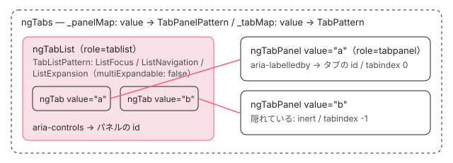

[目次](../README.md) › [Angular Aria の内側](README.md) › 第 12 回 / 全 20 回

# Tabs：選んだタブとパネルを結ぶ

> TabListPattern が List を使わずに ListFocus・ListNavigation・ListExpansion（multiExpandable: false）を組み、選択を「1 つだけ開く」で表す行。フォーカスと選択を分ける selectionMode、value の文字列でタブとパネルを結ぶ aria-controls・aria-labelledby、パネルの tabindex。pointerdown でなく click で選ぶ変更、選んだタブを消したときにタブの止まり場所が無くなる開いている issue と、それに付いた PR。

angular/components · 読了 約 12 分 · 中核 · [サイトで読む（デモが動きます）](https://angular-deep-dive-cyan.vercel.app/chapter/aria-tabs)

---

タブは「並んだタブのうち 1 つを選ぶと、対応するパネルだけが見える」部品です。Angular Aria のタブは、**選ぶこと**を第 7 回の `ListSelection` ではなく、第 10 回の `ListExpansion`（1 つしか開けない設定）で表します。この章では、`TabListPattern` が `ListFocus`・`ListNavigation`・`ListExpansion` を組む行、`selectionMode` でフォーカスと選択を分ける行、タブとパネルを `value` の文字列で結んで `aria-controls`・`aria-labelledby` を書く行、パネルの `tabindex` を読みます。最後に、`pointerdown` から `click` への変更（#32971）と、**選んだタブを消すと Tab キーで入れなくなる**開いている issue #33961 を、ページの上の本物で確かめます。

読む対象は `src/aria/private/tabs/tabs.ts` と、`src/aria/tabs/tabs.ts`・`tab-list.ts`・`tab.ts`・`tab-panel.ts` です。どれも 22.1.8 と e81c398a86 で同じです。

1. [1. 全体像](01-aria-overview.md)
2. [2. SignalLike](02-aria-signal-like.md)
3. [3. SortedCollection](03-aria-collection.md)
4. [4. イベントマネージャ](04-aria-events.md)
5. [5. ListFocus](05-aria-list-focus.md)
6. [6. ListNavigation](06-aria-list-navigation.md)
7. [7. ListSelection](07-aria-list-selection.md)
8. [8. ListTypeahead](08-aria-typeahead.md)
9. [9. Listbox](09-aria-listbox.md)
10. [10. Accordion](10-aria-accordion.md)
11. [11. DeferredContent](11-aria-deferred-content.md)
12. **12. Tabs**（この章）
13. [13. Toolbar](13-aria-toolbar.md)
14. [14. Tree](14-aria-tree.md)
15. [15. Grid](15-aria-grid.md)
16. [16. Grid のセル](16-aria-grid-cells.md)
17. [17. Combobox](17-aria-combobox.md)
18. [18. Menu](18-aria-menu.md)
19. [19. テスト](19-aria-testing.md)
20. [20. issue と PR を読む](20-aria-issues.md)



*4 つのディレクティブと、value で結ばれるタブとパネル。ngTabs が 2 つの Map を持ち、タブはパネルの Pattern を、パネルはタブの Pattern を value で引く*

## 1. TabListPattern：List を使わず、選択を「開く」で表す

📄 `components/src/aria/private/tabs/tabs.ts` L200–217 （▶ の行: 201–202, 206, 208, 210, 213, 215）

```ts
200 │   constructor(readonly inputs: TabListInputs) {
201 ▶     this.selectedTab = inputs.selectedTab;
202 ▶     this.activeTab = inputs.activeItem;
203 │     this.orientation = inputs.orientation;
204 │     this.disabled = inputs.disabled;
205 │ 
206 ▶     this.focusBehavior = new ListFocus(inputs);
207 │ 
208 ▶     this.navigationBehavior = new ListNavigation({
209 │       ...inputs,
210 ▶       focusManager: this.focusBehavior,
211 │     });
212 │ 
213 ▶     this.expansionBehavior = new ListExpansion({
214 │       ...inputs,
215 ▶       multiExpandable: () => false,
216 │     });
217 │   }
```

206 行目で `ListFocus`、208 行目で `ListNavigation`（210 行目で `focusManager` を渡す）、213 行目で `ListExpansion` を作ります。`ListSelection` はありません。215 行目で `multiExpandable` を `() => false` に固定するので、[第 10 回](10-aria-accordion.md)の `ListExpansion.open` のとおり、1 つを開くと他は全部閉じます。これが「タブは 1 つだけ選べる」の正体です。201〜202 行目で、選ばれているタブ（`selectedTab`）とアクティブなタブ（`activeItem`。フォーカスの止まり場所）を**別の signal**として受け取ります。

📄 `components/src/aria/private/tabs/tabs.ts` L50–75 （▶ の行: 50–54, 56–57, 61, 64, 67, 70）

```ts
50 ▶   /*
51 ▶    * Whether the tab panel is expanded.
52 ▶    * Primarily controlled by the behavior, which will read/write this value.
53 ▶    * The consumer of this pattern will instead only use the selectedTab input.
54 ▶    * The pattern will be responsible for synchronizing their state.
55 │    */
56 ▶   readonly expanded: WritableSignalLike<boolean> = linkedSignal(
57 ▶     () => this.inputs.tabList().selectedTab() === this,
58 │   );
59 │ 
60 │   /** Whether the tab is active. */
61 ▶   readonly active = computed(() => this.inputs.tabList().inputs.activeItem() === this);
62 │ 
63 │   /** Whether the tab is selected. */
64 ▶   readonly selected = computed(() => this.inputs.tabList().selectedTab() === this);
65 │ 
66 │   /** The tab index of the tab. */
67 ▶   readonly tabIndex = computed(() => this.inputs.tabList().focusBehavior.getItemTabIndex(this));
68 │ 
69 │   /** The id of the tabpanel associated with the tab. */
70 ▶   readonly controls = computed(() => this.inputs.tabPanel()?.id());
71 │ 
72 │   constructor(readonly inputs: TabInputs) {
73 │     this.id = inputs.id;
74 │     this.disabled = inputs.disabled;
75 │   }
```

1. **56〜58 行目 expanded は linkedSignal**

   `ListExpansion` は項目の `expanded` を書きます。でも「どのタブが選ばれているか」の正は `selectedTab` です。そこで `expanded` を `linkedSignal(() => selectedTab() === this)` にしています。`ListExpansion` が書けば一時的にその値になり、`selectedTab` が変われば計算し直されます（50〜55 行目のコメント）。`linkedSignal` は「元の signal から計算されるが、書くこともできる signal」です（[signals](../signals/01-signals.md)）。
2. **61・64 行目 active と selected は別**

   61 行目は `activeItem` と同じか、64 行目は `selectedTab` と同じかです。`selectionMode="explicit"` では、この 2 つがずれます。
3. **67 行目 tabindex はアクティブな 1 つだけ 0**

   `focusBehavior.getItemTabIndex(this)`（第 5 回）。roving なら `activeItem` のタブだけが 0、ほかは -1 です。アコーディオン（全部 0）とはここが違います。
4. **70 行目 aria-controls はパネルの id**

   `inputs.tabPanel()` は 3 節で見る「value で引いたパネルの Pattern」です。対応するパネルが無ければ `undefined` で、属性は付きません。

📄 `components/src/aria/private/tabs/tabs.ts` L92–109 （▶ の行: 98, 101, 104）

```ts
 92 │ /** A tabpanel associated with a tab. */
 93 │ export class TabPanelPattern {
 94 │   /** A global unique identifier for the tabpanel. */
 95 │   readonly id: SignalLike<string>; // set from inputs
 96 │ 
 97 │   /** Whether the tabpanel is hidden. */
 98 ▶   readonly hidden = computed(() => this.inputs.tab()?.expanded() === false);
 99 │ 
100 │   /** The tab index of this tabpanel. */
101 ▶   readonly tabIndex = computed(() => (this.hidden() ? -1 : 0));
102 │ 
103 │   /** The aria-labelledby value for this tabpanel. */
104 ▶   readonly labelledBy = computed(() => this.inputs.tab()?.id());
105 │ 
106 │   constructor(readonly inputs: TabPanelInputs) {
107 │     this.id = inputs.id;
108 │   }
109 │ }
```

パネルの Pattern は 3 つの `computed` だけです。98 行目で、対応するタブの `expanded()` が **false のときだけ**隠れます（タブが無い `undefined` のときは隠れない）。101 行目で、見えているパネルは `tabindex="0"`、隠れているパネルは -1。104 行目の `aria-labelledby` はタブの id です。見えているパネルが 0 なので、タブの列から Tab を押すとパネルにフォーカスが移ります。デモで、ボタンの列から Shift+Tab で戻るとパネル（`role="tabpanel"`）に止まりました。

## 2. キーとクリック：selectionMode で開くかどうかを変える

📄 `components/src/aria/private/tabs/tabs.ts` L155–172 （▶ の行: 156, 160–161, 163, 168, 171）

```ts
155 │   /** Whether selection should follow focus. */
156 ▶   readonly followFocus = computed(() => this.inputs.selectionMode() === 'follow');
157 │ 
158 │   /** The key used to navigate to the previous tab in the tablist. */
159 │   readonly prevKey = computed(() => {
160 ▶     if (this.inputs.orientation() === 'vertical') {
161 ▶       return 'ArrowUp';
162 │     }
163 ▶     return this.inputs.textDirection() === 'rtl' ? 'ArrowRight' : 'ArrowLeft';
164 │   });
165 │ 
166 │   /** The key used to navigate to the next item in the list. */
167 │   readonly nextKey = computed(() => {
168 ▶     if (this.inputs.orientation() === 'vertical') {
169 │       return 'ArrowDown';
170 │     }
171 ▶     return this.inputs.textDirection() === 'rtl' ? 'ArrowLeft' : 'ArrowRight';
172 │   });
```

📄 `components/src/aria/private/tabs/tabs.ts` L174–198 （▶ の行: 179, 184, 187–190, 195–196）

```ts
174 │   /** The keydown event manager for the tablist. */
175 │   readonly keydown = computed(() => {
176 │     return new KeyboardEventManager()
177 │       .on(
178 │         this.prevKey,
179 ▶         () => this._navigate(() => this.navigationBehavior.prev(), this.followFocus()),
180 │         {ignoreRepeat: false},
181 │       )
182 │       .on(
183 │         this.nextKey,
184 ▶         () => this._navigate(() => this.navigationBehavior.next(), this.followFocus()),
185 │         {ignoreRepeat: false},
186 │       )
187 ▶       .on('Home', () => this._navigate(() => this.navigationBehavior.first(), this.followFocus()))
188 ▶       .on('End', () => this._navigate(() => this.navigationBehavior.last(), this.followFocus()))
189 ▶       .on(' ', () => this.open())
190 ▶       .on('Enter', () => this.open());
191 │   });
192 │ 
193 │   /** The click event manager for the tablist. */
194 │   readonly clickManager = computed(() => {
195 ▶     return new ClickEventManager<PointerEvent>().on(e =>
196 ▶       this._navigate(() => this.navigationBehavior.goto(this._getItem(e)!), true),
197 │     );
198 │   });
```

📄 `components/src/aria/private/tabs/tabs.ts` L262–296 （▶ の行: 265–266, 272, 278, 280, 282–284, 291–294）

```ts
262 │   /** The click event manager for the tablist. */
263 │   onClick(event: PointerEvent) {
264 │     if (!this.disabled()) {
265 ▶       this.hasBeenInteracted.set(true);
266 ▶       this.clickManager().handle(event);
267 │     }
268 │   }
269 │ 
270 │   /** Handles focusin events for the tablist. */
271 │   onFocusIn() {
272 ▶     this.hasBeenInteracted.set(true);
273 │   }
274 │ 
275 │   /** Opens the given tab or the current active tab. */
276 │   open(tab?: TabPattern): boolean;
277 │   open(tab: TabPattern | undefined): boolean {
278 ▶     tab ??= this.activeTab();
279 │ 
280 ▶     if (tab === undefined) return false;
281 │ 
282 ▶     const success = this.expansionBehavior.open(tab);
283 ▶     if (success) {
284 ▶       this.selectedTab.set(tab);
285 │     }
286 │ 
287 │     return success;
288 │   }
289 │ 
290 │   /** Executes a navigation operation and expand the active tab if needed. */
291 ▶   private _navigate(op: () => boolean, shouldExpand: boolean = false): void {
292 ▶     const success = op();
293 ▶     if (success && shouldExpand) {
294 ▶       this.open();
295 │     }
296 │   }
```

1. **156 行目 followFocus**

   `selectionMode` が `'follow'`（既定）なら true です。160〜171 行目の前後のキーは listbox と同じで、既定の横（`horizontal`）では ← / →、rtl なら入れ替わり、縦なら ↑ / ↓ です。
2. **179・184・187・188 行目 移動のあと、follow なら開く**

   どの移動も `_navigate(移動, this.followFocus())` です。291〜296 行目の `_navigate` は、292 行目で移動し、293 行目で「動けた かつ `shouldExpand`」なら 294 行目で `open()` します。follow なら矢印で動いた先のタブが選ばれ、explicit ならフォーカスが動くだけです。
3. **189〜190 行目 Space / Enter はいつでも open**

   explicit で、動いた先のタブを選ぶキーです。follow では既に選ばれているので、278〜282 行目の `open` は`ListExpansion.open` が「もう開いている」として false を返し（第 10 回）、何も変わりません。
4. **195〜196 行目 クリックは常に開く**

   `_navigate(goto(クリックしたタブ), true)` です。第 2 引数が `followFocus()` ではなく `true` なので、explicit でもクリックすれば選ばれます。クリックしたタブは、発生元から一番近い `[role="tab"]` を探して見つけます（同じファイルの `_getItem`）。
5. **277〜288 行目 open：開けたら selectedTab を書く**

   278 行目で、引数が無ければアクティブなタブを使います。282 行目の `expansionBehavior.open(tab)` は、無効なタブなら false（第 10 回の `isExpandable`）、成功すれば他のタブを閉じてこのタブを開きます。283〜284 行目で、成功したときだけ `selectedTab.set(tab)` します。
6. **265・272 行目 触ったことを覚える**

   `onClick` と `onFocusIn`（と、すぐ上の `onKeydown`）は `hasBeenInteracted` を true にします。4 節の #33961 に関わります。

### pointerdown から click へ（#32971）

📄 `git show e01062ac52（#33031）の private/tabs/tabs.ts と tabs/tab-list.ts から抜粋`

```
-  /** The pointerdown event manager for the tablist. */
-  readonly pointerdown = computed(() => {
-    return new PointerEventManager().on(e =>
+  /** The click event manager for the tablist. */
+  readonly clickManager = computed(() => {
+    return new ClickEventManager<PointerEvent>().on(e =>
       this._navigate(() => this.navigationBehavior.goto(this._getItem(e)!), true),
     );
   });
 ...
-    '(pointerdown)': '_pattern.onPointerdown($event)',
+    '(click)': '_pattern.onClick($event)',
```

#32971（2026-04）は「タブは `pointerdown` で選ばれるので、スクロールできるタブの列で指でスクロールしようとすると、触れたタブが選ばれてしまう。`click` で選べるようにしてほしい」という要望でした。#33031「refactor(multiple): migrate Listbox and Tabs to ClickEventManager」（2026-04-06）で、Pattern の `pointerdown` の `PointerEventManager` が `clickManager`（`ClickEventManager`）に、tab-list.ts の host の `(pointerdown)` が `(click)` に変わり、issue は 2026-04-27 に「直った」として閉じられました。いまの 194〜198 行目がその結果です。同じコミットで listbox も `click` になっています（[第 9 回](09-aria-listbox.md)）。

## 3. ディレクティブ：value の文字列でタブとパネルを結ぶ

📄 `components/src/aria/tabs/tabs.ts` L64–97 （▶ の行: 65, 68, 79, 81–82, 88, 92–93）

```ts
64 │   /** The TabList registered for this container. */
65 ▶   readonly _tabList = signal<TabList | undefined>(undefined);
66 │ 
67 │   /** The collection of TabPanels. */
68 ▶   readonly _collection = new SortedCollection<TabPanel>();
69 │ 
70 │   /** The Tab UIPattern of the child Tabs. */
71 │   readonly _tabPatterns = computed<TabPattern[] | undefined>(() => this._tabList()?._tabPatterns());
72 │ 
73 │   /** The TabPanel UIPattern of the child TabPanels. */
74 │   readonly _tabPanelPatterns = computed<TabPanelPattern[]>(() =>
75 │     this._collection.orderedItems().map(tabpanel => tabpanel._pattern),
76 │   );
77 │ 
78 │   /** A reactive map of tab values to their TabPanelPattern. */
79 ▶   readonly _panelMap = computed(() => {
80 │     const map = new Map<string, TabPanelPattern>();
81 ▶     for (const panel of this._collection.orderedItems()) {
82 ▶       map.set(panel.value(), panel._pattern);
83 │     }
84 │     return map;
85 │   });
86 │ 
87 │   /** A reactive map of tab values to their TabPattern. */
88 ▶   readonly _tabMap = computed(() => {
89 │     const map = new Map<string, TabPattern>();
90 │     const tabList = this._tabList();
91 │     if (tabList) {
92 ▶       for (const tab of tabList._collection.orderedItems()) {
93 ▶         map.set(tab.value(), tab._pattern);
94 │       }
95 │     }
96 │     return map;
97 │   });
```

外側の `ngTabs` は、65 行目にタブの列（`TabList`。1 つだけ）、68 行目にパネルの集まり（`SortedCollection`）を持ちます。79〜85 行目の `_panelMap` は「パネルの `value()` → パネルの Pattern」、88〜97 行目の `_tabMap` は「タブの `value()` → タブの Pattern」の `Map` です。どちらも `computed` なので、タブやパネルが増減すると作り直されます。

📄 `components/src/aria/tabs/tab-list.ts` L46–59 （▶ の行: 50–51, 54–57, 59）

```ts
46 │ @Directive({
47 │   selector: '[ngTabList]',
48 │   exportAs: 'ngTabList',
49 │   host: {
50 ▶     'role': 'tablist',
51 ▶     '[attr.tabindex]': '_pattern.tabIndex()',
52 │     '[attr.aria-disabled]': '_pattern.disabled()',
53 │     '[attr.aria-orientation]': '_pattern.orientation()',
54 ▶     '[attr.aria-activedescendant]': '_pattern.activeDescendant()',
55 ▶     '(keydown)': '_pattern.onKeydown($event)',
56 ▶     '(click)': '_pattern.onClick($event)',
57 ▶     '(focusin)': '_pattern.onFocusIn()',
58 │   },
59 ▶   providers: [{provide: TAB_LIST, useExisting: TabList}],
```

タブの列（`ngTabList`）は 50 行目で `role="tablist"`、51 行目の `tabindex` は roving なら -1（タブの側に 0 が付く）、54 行目の `aria-activedescendant` は `focusMode="activedescendant"` のときだけ値が入ります。55〜57 行目で `keydown`・`click`・`focusin` を列の要素で受け、59 行目で自分を `TAB_LIST` として provide します。タブは `inject(TAB_LIST)` で列を、列とパネルは `inject(TABS)` で外側の `ngTabs` を見つけます。

📄 `components/src/aria/tabs/tab.ts` L38–49 （▶ の行: 42, 45–46, 48）

```ts
38 │ @Directive({
39 │   selector: '[ngTab]',
40 │   exportAs: 'ngTab',
41 │   host: {
42 ▶     'role': 'tab',
43 │     '[attr.data-active]': 'active()',
44 │     '[attr.id]': '_pattern.id()',
45 ▶     '[attr.tabindex]': '_pattern.tabIndex()',
46 ▶     '[attr.aria-selected]': 'selected()',
47 │     '[attr.aria-disabled]': '_pattern.disabled()',
48 ▶     '[attr.aria-controls]': '_pattern.controls()',
49 │   },
```

📄 `components/src/aria/tabs/tab.ts` L64–87 （▶ の行: 65–66, 73, 85–86）

```ts
64 │   /** The TabPanel UIPattern associated with the tab */
65 ▶   private readonly _tabpanelPattern = computed(() => {
66 ▶     return this._tabList._tabsParent._panelMap().get(this.value());
67 │   });
68 │ 
69 │   /** Whether a tab is disabled. */
70 │   readonly disabled = input(false, {transform: booleanAttribute});
71 │ 
72 │   /** The remote tabpanel unique identifier. */
73 ▶   readonly value = input.required<string>();
74 │ 
75 │   /** Whether the tab is active. */
76 │   readonly active = computed(() => this._pattern.active());
77 │ 
78 │   /** Whether the tab is selected. */
79 │   readonly selected = computed(() => this._pattern.selected());
80 │ 
81 │   /** The Tab UIPattern. */
82 │   readonly _pattern: TabPattern = new TabPattern({
83 │     ...this,
84 │     element: () => this.element,
85 ▶     tabList: () => this._tabList._pattern,
86 ▶     tabPanel: this._tabpanelPattern,
87 │   });
```

📄 `components/src/aria/tabs/tab-panel.ts` L42–58 （▶ の行: 46, 48–50, 52, 54–55）

```ts
42 │ @Directive({
43 │   selector: '[ngTabPanel]',
44 │   exportAs: 'ngTabPanel',
45 │   host: {
46 ▶     'role': 'tabpanel',
47 │     '[attr.id]': '_pattern.id()',
48 ▶     '[attr.tabindex]': '_pattern.tabIndex()',
49 ▶     '[attr.inert]': '!visible() ? true : null',
50 ▶     '[attr.aria-labelledby]': '_pattern.labelledBy()',
51 │   },
52 ▶   hostDirectives: [
53 │     {
54 ▶       directive: DeferredContentAware,
55 ▶       inputs: ['preserveContent'],
56 │     },
57 │   ],
58 │ })
```

📄 `components/src/aria/tabs/tab-panel.ts` L72–90 （▶ の行: 76–77, 81, 84, 89）

```ts
72 │   /** A global unique identifier for the tab. */
73 │   readonly id = input(inject(_IdGenerator).getId('ng-tabpanel-', true));
74 │ 
75 │   /** The Tab UIPattern associated with the tabpanel */
76 ▶   private readonly _tabPattern = computed(() => {
77 ▶     return this._tabs._tabMap().get(this.value());
78 │   });
79 │ 
80 │   /** A local unique identifier for the tabpanel. */
81 ▶   readonly value = input.required<string>();
82 │ 
83 │   /** Whether the tab panel is visible. */
84 ▶   readonly visible = computed(() => !this._pattern.hidden());
85 │ 
86 │   /** The TabPanel UIPattern. */
87 │   readonly _pattern: TabPanelPattern = new TabPanelPattern({
88 │     ...this,
89 ▶     tab: this._tabPattern,
90 │   });
```

1. **タブ → パネル**

   tab.ts の 65〜67 行目で、タブは自分の `value()`（73 行目。必須の文字列）で `_panelMap` を引き、86 行目でそれを `TabPattern` の `tabPanel` に渡します。これが 1 節の 70 行目の `controls` になり、host の 48 行目で `aria-controls` に書かれます。
2. **パネル → タブ**

   tab-panel.ts の 76〜78 行目で、パネルは自分の `value()`（81 行目）で `_tabMap` を引き、89 行目で `TabPanelPattern` の `tab` に渡します。これが 1 節の 104 行目の `labelledBy` になり、host の 50 行目で `aria-labelledby` に書かれます。
3. **パネルの tabindex と inert**

   host の 48 行目に 1 節の 101 行目（見えていれば 0）、49 行目で隠れていれば `inert`。アコーディオンと同じく、`inert` は見た目を消さないので、デモでは CSS で隠しています。52〜57 行目の `hostDirectives` で `DeferredContentAware` を付けるのは[第 11 回](11-aria-deferred-content.md)のためです。

タブとパネルは DOM のどこにあってもよく、id を手で合わせる必要もありません。`value` の文字列さえ同じなら、両方の Map が引き合います。同じ `value` のタブが 2 つあると、開発モードで `Duplicate value` の警告が出ます（tab-list.ts の violations）。

## 4. selectedTab の往復と、既定の状態

📄 `components/src/aria/tabs/tab-list.ts` L108–130 （▶ の行: 109, 112–114, 116, 127, 129）

```ts
108 │   /** The current selected tab as a model input. */
109 ▶   readonly selectedTab = model<string | undefined>();
110 │ 
111 │   /** The current selected Tab pattern, passed to the List pattern. */
112 ▶   private readonly _selectedTabPattern: WritableSignal<TabPattern | undefined> = linkedSignal(
113 ▶     () => {
114 ▶       const tab = this.findTab(this.selectedTab());
115 │ 
116 ▶       return tab?._pattern;
117 │     },
118 │   );
119 │ 
120 │   /** Whether the tablist is disabled. */
121 │   readonly disabled = input(false, {transform: booleanAttribute});
122 │ 
123 │   /** The TabList UIPattern. */
124 │   readonly _pattern: TabListPattern = new TabListPattern({
125 │     ...this,
126 │     element: () => this._elementRef.nativeElement,
127 ▶     activeItem: signal(undefined),
128 │     items: this._tabPatterns,
129 ▶     selectedTab: this._selectedTabPattern,
130 │   });
```

📄 `components/src/aria/tabs/tab-list.ts` L132–149 （▶ の行: 137–138, 143, 145–147）

```ts
132 │   constructor() {
133 │     afterNextRender(() => {
134 │       this._collection.startObserving(this.element);
135 │     });
136 │ 
137 ▶     afterRenderEffect(() => {
138 ▶       this._pattern.setDefaultStateEffect();
139 │     });
140 │ 
141 │     // This needs to be in an afterRenderEffect to ensure the tabs have all been initialized.
142 │     // Otherwise, the lookup here can fail and it does not get re-run afterwards.
143 ▶     afterRenderEffect({
144 │       write: () => {
145 ▶         const pattern = this._selectedTabPattern();
146 ▶         const tab = this._collection.orderedItems().find(tab => tab._pattern == pattern);
147 ▶         this.selectedTab.set(tab?.value());
148 │       },
149 │     });
```

1. **109〜118 行目 文字列 → Pattern**

   利用者に見える `selectedTab` は `model<string | undefined>`（タブの `value`）です。112〜118 行目の `linkedSignal` が、それを `findTab` で Pattern に直し、129 行目で Pattern の `selectedTab` として渡します。`linkedSignal` なので、Pattern の側（2 節の 284 行目）から書くこともできます。
2. **143〜149 行目 Pattern → 文字列**

   描画のあとの `write` で、いまの Pattern に当たるタブを探し（146 行目）、147 行目でその `value()` を `selectedTab` に書き戻します。見つからなければ `undefined` です。141〜142 行目のコメントは「タブが全部初期化されてから探さないと失敗し、その後走り直さない」ので `afterRenderEffect` にした、と書いています。
3. **選ばれているタブを消すと**

   `_collection` からタブが外れると、113〜114 行目の `findTab` が見つけられず Pattern が `undefined` になり、147 行目で `selectedTab` も `undefined` になります。残ったタブの `expanded` はどれも false なので、**どのパネルも見えなくなります**。別のタブを選び直す行はありません。
4. **137〜139 行目 既定の状態**

   `setDefaultStateEffect`（下の 248〜252 行目）を `afterRenderEffect` で呼びます。プリレンダーした HTML では走らないので、このページの出力でも 3 つのタブはすべて `tabindex="-1"`（`aria-selected` は A だけ true）でした。

📄 `components/src/aria/private/tabs/tabs.ts` L227–260 （▶ の行: 230–231, 237–238, 242–243, 248–249, 251, 257）

```ts
227 │   setDefaultState() {
228 │     let firstItem: TabPattern | undefined;
229 │ 
230 ▶     for (const item of this.inputs.items()) {
231 ▶       if (!this.focusBehavior.isFocusable(item)) continue;
232 │ 
233 │       if (firstItem === undefined) {
234 │         firstItem = item;
235 │       }
236 │ 
237 ▶       if (item.selected()) {
238 ▶         this.inputs.activeItem.set(item);
239 │         return;
240 │       }
241 │     }
242 ▶     if (firstItem !== undefined) {
243 ▶       this.inputs.activeItem.set(firstItem);
244 │     }
245 │   }
246 │ 
247 │   /** Sets the default active state of the tablist before receiving interaction for the first time. */
248 ▶   setDefaultStateEffect(): void {
249 ▶     if (this.hasBeenInteracted()) return;
250 │ 
251 ▶     this.setDefaultState();
252 │   }
253 │ 
254 │   /** Handles keydown events for the tablist. */
255 │   onKeydown(event: KeyboardEvent) {
256 │     if (!this.disabled()) {
257 ▶       this.hasBeenInteracted.set(true);
258 │       this.keydown().handle(event);
259 │     }
260 │   }
```

230〜241 行目は listbox と同じく「選ばれているタブ、無ければフォーカスできる先頭」を `activeItem` にします。listbox と違い、follow でも先頭を**選びはしません**（`selectedTab` を書く行が無い）。249 行目のとおり、`hasBeenInteracted` が true になったあとは二度と走りません。

### 開いている #33961：アクティブなタブを消すと、Tab で入れなくなる

#33961（2026-10-15）は「一度タブを触ったあとで、`tabindex="0"` のタブ（アクティブなタブ）を消すと、残ったどのタブも 0 にならず、タブの列に Tab / Shift+Tab で入れなくなる」という報告です。行で追うと次のとおりです。

1. **触ると 257 行目（と 265・272 行目）で `hasBeenInteracted` が true**
2. **アクティブなタブを消しても、`activeItem` は消えた Pattern を指したまま**

   listbox にはこれを直す `afterRenderEffect` がありました（第 9 回の 6 節）。tab-list.ts のコンストラクタには、それに当たるものがありません。
3. **249 行目で `setDefaultStateEffect` が返る**

   残ったタブに `activeItem` と一致するものが無いので、1 節の 67 行目でどれも -1 になります。タブの列自身も roving なので -1 です。

開いている PR #33969（2026-10-17、外部のコントリビューター）は、249 行目の条件を「触ったことがあり、**かつ**アクティブなタブがまだ `items` にあるとき」だけ返すように変えます。

📄 `PR #33969 の private/tabs/tabs.ts の差分（gh pr diff で読んだもの）`

```
   setDefaultStateEffect(): void {
-    if (this.hasBeenInteracted()) return;
+    const activeTab = this.activeTab();
+    if (this.hasBeenInteracted() && activeTab && this.inputs.items().includes(activeTab)) return;

     this.setDefaultState();
   }
```

spec には tabs.spec.ts の `describe('Dynamic tabs')` に「アクティブなタブを消すと、残ったタブが `tabindex="0"` になる」it を足しています。2026-11-02 の時点で開いたままで、main の private/tabs/tabs.ts は snapshot から変わっていません。

## 5. デモ：本物のタブで #33961 が出るか

> **🧪 DEMO — このページの @angular/aria 22.1.8 のタブ**
>
> 本物の `ngTabs` / `ngTabList` / `ngTab` / `ngTabPanel` / `ngTabContent` です。`[(selectedTab)]` の初期値は `'a'` です。キーボードで操作できます。Tab でタブの列に入り、←→・Home・End で動きます（explicit のときは Enter / Space で選びます）。キーやクリックやボタンのあと 50ms 待って、各タブの `tabindex`・`aria-selected`、`inert` の付いていないパネル、フォーカスのある要素を読みます。
>
> ▶ [このデモはサイトで動かせます](https://angular-deep-dive-cyan.vercel.app/chapter/aria-tabs)

2026-11-02 にヘッドレスの Chrome で操作して記録しました。**22.1.8 で #33961 の症状は出ました**。

- **起動直後**：`タブA=0✓ タブB=-1 タブC=-1`、見えているパネルは `[a]`。プリレンダーでは全部 -1 だったものが、137〜139 行目で A に止まりました。
- **タブ B をクリック**：`タブB=0✓`、`selectedTab = b`、見えているパネル `[b]`。
- **「tabindex="0" のタブを消す」**（＝B）：`タブA=-1 タブC=-1`、`selectedTab = undefined`、見えているパネル `[]`。このあと先頭のボタンから Shift+Tab で戻ると、フォーカスはタブの列を飛ばして selectionMode の `<select>` に移りました。
- **「最初に戻す」**：A・B・C が戻り `selectedTab = a` になっても、`タブA=-1✓ タブB=-1 タブC=-1` のままでした。新しく作られたタブの Pattern は、消えた B の Pattern と一致しないからです。タブをクリックすれば直ります。
- **読み込み直後に何も触らず「tabindex="0" のタブを消す」**（＝A）：`タブB=0` になりました。`hasBeenInteracted` が false なので 249 行目を通り抜け、B に止まり直したからです。`selectedTab` は `undefined` になり、パネルは見えません。
- **explicit で A をクリックして → を 2 回、Enter**：→ の間は `selectedTab = a` のまま `タブC=0` へフォーカスだけが動き、Enter で `selectedTab = c` になりました（189〜190 行目）。explicit で「選んでいる A とフォーカスのある B」がずれた状態で B を消しても、同じく全部 -1 になりました（#33961 の本文が「explicit で起きやすい」と書いている形）。

## 6. 呼び出しの連なり（follow で → を押す）

- 👤 `keydown "ArrowRight"` — タブの列
  - `(keydown) → _pattern.onKeydown($event)` — tab-list.ts L55
    - `TabListPattern.onKeydown` — tabs.ts L255 — *L257 hasBeenInteracted = true*
      - `_navigate(() => navigationBehavior.next(), followFocus())` — L184 → L291
        - `ListNavigation.next() → ListFocus.focus()` — 第 6 回・第 5 回 — *activeItem が変わり、tabindex が移る*
        - `open() → expansionBehavior.open(tab)` — L294 → L282 — *他を閉じて開く*
        - `selectedTab.set(tab)` — L284 — *tab-list.ts の linkedSignal*
  - `afterRenderEffect：selectedTab.set(tab?.value())` — tab-list.ts L147 — *\[(selectedTab)\] に出る*
  - `パネルの hidden() が変わる → inert・tabindex・contentVisible` — tabs.ts L98・L101 / tab-panel.ts L49

## テストと直し方

📄 `components/src/aria/tabs/tabs.spec.ts` L757–768 （▶ の行: 757–758, 760, 764, 767）

```ts
757 ▶     it('should update selection when active tab is removed', async () => {
758 ▶       expect(testComponent.selectedTab()).toBe('tab2');
759 │ 
760 ▶       testComponent.tabsData.set([
761 │         {value: 'tab1', label: 'Tab 1', content: 'Content 1'},
762 │         {value: 'tab3', label: 'Tab 3', content: 'Content 3'},
763 │       ]);
764 ▶       await fixture.whenStable();
765 │       defineTestVariables();
766 │ 
767 ▶       expect(testComponent.selectedTab()).toBeUndefined();
768 │     });
```

tabs.spec.ts の `describe('Dynamic tabs')`（:744）の `it('should update selection when active tab is removed')`（:757）です。選ばれている tab2 を消すと、767 行目で `selectedTab()` が `undefined` になることを見ます（4 節の 147 行目）。名前に「active」とありますが、この it はタブを触っていない（`hasBeenInteracted` が false）ので、#33961 の形（触ったあとで消す）は確かめていません。`tabindex` も見ていません。PR #33969 が足すのはその it です。

ほかに、この章の仕組みに当たる it です（行番号は e81c398a86）。

- `describe('selectionMode="explicit"')`（:583）の `it('should not select tab on focus via ArrowKeys')`（:588）と `it('should select focused tab on Enter')`（:619）— 2 節の 179〜190 行目。
- `it('should not select a disabled tab via keyboard')`（:686）— 282 行目の `open` が false を返す形。
- `describe('TabPanel')`（:224）の `it('should have tabindex="0" when visible.')`（:231）— 1 節の 101 行目。

📄 `ターミナル`

```
cd ~/angular-research/components
pnpm bazel test //src/aria/tabs:unit_tests_chromium --nocache_test_results --test_output=all
pnpm bazel test //src/aria/private/tabs:unit_tests_chromium --nocache_test_results --test_output=all
```

📄 `出力（抜粋。2026-11-02 に実行）`

```
Chromium: |██████████████████████████████| 1/1 test files | 85 passed, 0 failed
Finished running tests in 0.9s, all tests passed! 🎉
INFO: Elapsed time: 1.759s, Critical Path: 1.50s
//src/aria/tabs:unit_tests_chromium                                      PASSED in 1.4s

Chromium: |██████████████████████████████| 1/1 test files | 37 passed, 0 failed
Finished running tests in 0.4s, all tests passed! 🎉
INFO: Elapsed time: 1.174s, Critical Path: 0.93s
//src/aria/private/tabs:unit_tests_chromium                              PASSED in 0.8s
```

1. **本数**

   ターゲットを絞る引数は無いので、tabs.spec.ts の 85 本と、Pattern の private/tabs/tabs.spec.ts の 37 本がそれぞれ全部走ります。
2. **直すとしたら**

   #33961 の入口は `TabListPattern.setDefaultStateEffect`（private/tabs/tabs.ts 248〜252 行目）か、listbox のように tab-list.ts のコンストラクタに「アクティブなタブが消えたら」の `afterRenderEffect` を足すかのどちらかです。PR #33969 は前者です。振る舞いは tabs/tabs.spec.ts の `describe('Dynamic tabs')` に、Pattern だけなら private/tabs/tabs.spec.ts に足します。
3. **issue を読むときの手がかり**

   タブの「止まり場所」の報告は、`activeItem`（フォーカス）と `selectedTab`（選択）のどちらの話かを最初に分けます。前者は 249 行目の `hasBeenInteracted`、後者は tab-list.ts の 143〜149 行目です。#33961 には既に外部の PR #33969 が付いています（[第 20 回](20-aria-issues.md)）。

## 聞かれそうな質問

**Q. 縦に並んだタブにできますか？**

`ngTabList` に `orientation="vertical"` を付けます（既定は `'horizontal'`）。2 節の 160〜161 行目で、前後のキーが ↑ / ↓ になり、host の `aria-orientation` も `vertical` になります。並べ方（CSS）は利用者が書きます。

**Q. タブを無効にするとどうなりますか？**

`ngTab` に `disabled` を付けると `aria-disabled="true"` になり、282 行目の `expansionBehavior.open` が false を返すので、クリックでもキーでも選ばれません（spec :686）。`softDisabled` が既定の true なら、矢印でフォーカスは止まります。false にすると矢印で飛ばされます（第 6 回）。

**Q. 選んでいるタブを URL と同期するには？**

Aria の外の話です。src/aria はルーターを import していません。`selectedTab` は `value` の文字列の `model`（109 行目）なので、ルートのパラメータやクエリパラメータから作った signal と `[(selectedTab)]` で結び、変わったら `Router.navigate` する、を利用者が書きます（[router](../router/01-router.md)）。

**Q. パネルの中身は、選ばれていない間も作られていますか？**

`<ng-template ngTabContent>` の中に書いた場合は作られていません。見えるようになった描画のあとで作られ、既定では隠れると壊されます（[第 11 回](11-aria-deferred-content.md)）。パネルの直下に書いた中身は最初から作られて残りますが、開発モードで「`ngTabContent` が要る」と警告が出ます（#33950 と PR #33966）。

## 読み終えて

- `TabListPattern` は ListFocus・ListNavigation・ListExpansion（`multiExpandable: false`）を組む。選択は「1 つだけ開く」で表す（tabs.ts L200-217）。
- follow は移動のたびに `open()`、explicit は Space / Enter とクリックのときだけ `open()`。クリックは常に開く（L174-198、L291-296）。
- タブとパネルは `value` の文字列で `ngTabs` の 2 つの Map を引き合い、`aria-controls`・`aria-labelledby` を書く。見えているパネルは `tabindex="0"`（L98-104）。
- `selectedTab` は文字列と Pattern の間を `linkedSignal` と `afterRenderEffect` で往復する。選ばれているタブを消すと `undefined` になり、どのパネルも見えない（tab-list.ts L108-149）。
- #33961：触ったあとでアクティブなタブを消すと、`setDefaultStateEffect` が返るので止まり場所が無くなる。22.1.8 のデモでも出る（L248-252）。

---

← 前: [DeferredContent：閉じているパネルの中身を作らない](11-aria-deferred-content.md)  
次: [Toolbar：ウィジェットの集まりと、22.1.8 からの書き換え](13-aria-toolbar.md) →
