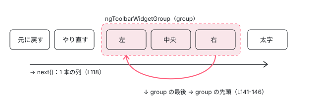

[目次](../README.md) › [Angular Aria の内側](README.md) › 第 13 回 / 全 20 回

# Toolbar：ウィジェットの集まりと、22.1.8 からの書き換え

> ToolbarPattern が ToolbarWidget と ToolbarWidgetGroup を 1 本の List として並べ、ラジオのような group の中と外で矢印キーの意味を変える行。このサイトの 22.1.8 と読んでいる 22.2.0-next.5 の差（選択の Behavior を外した #33747）を diff で読み、同じ API 名でも中身が変わったことを確かめる。

angular/components · 読了 約 12 分 · 発展 · [サイトで読む（デモが動きます）](https://angular-deep-dive-cyan.vercel.app/chapter/aria-toolbar)

---

ツールバー（`role="toolbar"`）は、ボタンやラジオの集まりを「Tab では 1 か所だけ止まり、中は矢印キーで動く」ひとかたまりにする部品です。この章では、`ToolbarPattern` がすべてのウィジェットを 1 本の列として `ListFocus` と `ListNavigation` に渡し、**今いるウィジェットが group の中にあるときだけ**、もう一方の向きの矢印キーを「group の中を回る」キーとして足す行を読みます。そのあと、このサイトに入れた `@angular/aria` 22.1.8 と、読んでいる snapshot（22.2.0-next.5）の差、つまり選択の仕組みを外した #33747 を diff で読みます。

読む対象は `src/aria/private/toolbar/toolbar.ts`（`ToolbarPattern`）、`toolbar-widget.ts`（`ToolbarWidgetPattern`）、`toolbar-widget-group.ts`（`ToolbarWidgetGroupPattern`）と、公開ディレクティブの `src/aria/toolbar/toolbar.ts`・`toolbar-widget.ts`・`toolbar-widget-group.ts` です（../components、e81c398a86）。

1. [1. 全体像](01-aria-overview.md)
2. [2. SignalLike](02-aria-signal-like.md)
3. [3. SortedCollection](03-aria-collection.md)
4. [4. イベントマネージャ](04-aria-events.md)
5. [5. ListFocus](05-aria-list-focus.md)
6. [6. ListNavigation](06-aria-list-navigation.md)
7. [7. ListSelection](07-aria-list-selection.md)
8. [8. ListTypeahead](08-aria-typeahead.md)
9. [9. Listbox](09-aria-listbox.md)
10. [10. Accordion](10-aria-accordion.md)
11. [11. DeferredContent](11-aria-deferred-content.md)
12. [12. Tabs](12-aria-tabs.md)
13. **13. Toolbar**（この章）
14. [14. Tree](14-aria-tree.md)
15. [15. Grid](15-aria-grid.md)
16. [16. Grid のセル](16-aria-grid-cells.md)
17. [17. Combobox](17-aria-combobox.md)
18. [18. Menu](18-aria-menu.md)
19. [19. テスト](19-aria-testing.md)
20. [20. issue と PR を読む](20-aria-issues.md)

> [!WARNING]
> **ハマりどころ**
>
> toolbar は、このサイトの 22.1.8 と本文の snapshot とで**中身がいちばん違う部品**です。本文の引用は snapshot、ページの上のデモは 22.1.8 で動きます。デモは Enter / Space やクリックで「選択」を切り替えますが、snapshot ではその仕組みごと消えています。違いは 7 節で diff を見せます。

## 1. ToolbarPattern が持つもの

📄 `components/src/aria/private/toolbar/toolbar.ts` L51–79 （▶ の行: 54, 57, 60, 69, 72, 75, 78）

```ts
51 │ /** Controls the state of a toolbar. */
52 │ export class ToolbarPattern {
53 │   /** Controls focus for the toolbar. */
54 ▶   readonly focusManager: ListFocus<ToolbarWidgetPattern>;
55 │ 
56 │   /** Controls navigation for the toolbar. */
57 ▶   readonly navigationBehavior: ListNavigation<ToolbarWidgetPattern>;
58 │ 
59 │   /** Whether the toolbar has been interacted with. */
60 ▶   readonly hasBeenInteracted = signal(false);
61 │ 
62 │   /** Whether the toolbar is vertically or horizontally oriented. */
63 │   readonly orientation: SignalLike<'vertical' | 'horizontal'>;
64 │ 
65 │   /** Whether disabled items in the group should be focusable. */
66 │   readonly softDisabled: SignalLike<boolean>;
67 │ 
68 │   /** Whether the toolbar is disabled. */
69 ▶   readonly disabled = computed(() => this.focusManager.isListDisabled());
70 │ 
71 │   /** The tab index of the toolbar. */
72 ▶   readonly tabIndex = computed(() => this.focusManager.getListTabIndex());
73 │ 
74 │   /** The id of the current active widget. */
75 ▶   readonly activeDescendant = computed(() => this.focusManager.getActiveDescendant());
76 │ 
77 │   /** The currently active item in the toolbar. */
78 ▶   readonly activeItem = () => this.inputs.activeItem();
79 │ 
```

- 54・57 行目 Behavior は 2 つだけです。`ListFocus`（どれが「今いる項目」か、tabindex をどうするか。[第 5 回](05-aria-list-focus.md)）と `ListNavigation`（次・前・最初・最後へ動く。[第 6 回](06-aria-list-navigation.md)）。Listbox が持つ `ListSelection`（選択）と `ListTypeahead`（文字で飛ぶ）は**ありません**。
- 60 行目 `hasBeenInteracted` は「一度でも触られたか」。5 節の初期状態で使います。
- 69・72・75 行目 無効かどうか、ツールバー自身の tabindex、`aria-activedescendant` に使う id は、どれも `focusManager`（`ListFocus`）に聞くだけです。
- 78 行目 今いるウィジェットは入力の `activeItem` そのもの。ディレクティブが `signal(undefined)` を渡します（6 節）。

## 2. 矢印キーは 4 本：主の向きと、もう一方の向き

📄 `components/src/aria/private/toolbar/toolbar.ts` L80–110 （▶ の行: 82–83, 85, 90, 93, 98–99, 101, 106, 109）

```ts
 80 │   /** The key used to navigate to the previous widget. */
 81 │   private readonly _prevKey = computed(() => {
 82 ▶     if (this.inputs.orientation() === 'vertical') {
 83 ▶       return 'ArrowUp';
 84 │     }
 85 ▶     return this.inputs.textDirection() === 'rtl' ? 'ArrowRight' : 'ArrowLeft';
 86 │   });
 87 │ 
 88 │   /** The key used to navigate to the next widget. */
 89 │   private readonly _nextKey = computed(() => {
 90 ▶     if (this.inputs.orientation() === 'vertical') {
 91 │       return 'ArrowDown';
 92 │     }
 93 ▶     return this.inputs.textDirection() === 'rtl' ? 'ArrowLeft' : 'ArrowRight';
 94 │   });
 95 │ 
 96 │   /** The alternate key used to navigate to the previous widget. */
 97 │   private readonly _altPrevKey = computed(() => {
 98 ▶     if (this.inputs.orientation() === 'vertical') {
 99 ▶       return this.inputs.textDirection() === 'rtl' ? 'ArrowRight' : 'ArrowLeft';
100 │     }
101 ▶     return 'ArrowUp';
102 │   });
103 │ 
104 │   /** The alternate key used to navigate to the next widget. */
105 │   private readonly _altNextKey = computed(() => {
106 ▶     if (this.inputs.orientation() === 'vertical') {
107 │       return this.inputs.textDirection() === 'rtl' ? 'ArrowLeft' : 'ArrowRight';
108 │     }
109 ▶     return 'ArrowDown';
110 │   });
```

4 つの `computed` は、`orientation`（向き）と `textDirection`（右から左に読む言語か）からキーの名前を決めます。横向き（既定）なら、`_prevKey` / `_nextKey` が ArrowLeft / ArrowRight（85・93 行目。rtl なら左右が入れ替わる）、`_altPrevKey` / `_altNextKey` が ArrowUp / ArrowDown（101・109 行目）です。縦向きなら主が上下（83・90 行目）、もう一方が左右（99・106 行目）になります。

📄 `components/src/aria/private/toolbar/toolbar.ts` L112–130 （▶ の行: 114–115, 118–121, 123, 125–126）

```ts
112 │   /** The keydown event manager for the toolbar. */
113 │   private readonly _keydown = computed(() => {
114 ▶     const manager = new KeyboardEventManager();
115 ▶     const activeItem = this.inputs.activeItem();
116 │ 
117 │     manager
118 ▶       .on(this._nextKey, () => this.navigationBehavior.next(), {ignoreRepeat: false})
119 ▶       .on(this._prevKey, () => this.navigationBehavior.prev(), {ignoreRepeat: false})
120 ▶       .on('Home', () => this.navigationBehavior.first())
121 ▶       .on('End', () => this.navigationBehavior.last());
122 │ 
123 ▶     if (activeItem?.group()) {
124 │       manager
125 ▶         .on(this._altNextKey, () => this._groupNext(), {ignoreRepeat: false})
126 ▶         .on(this._altPrevKey, () => this._groupPrev(), {ignoreRepeat: false});
127 │     }
128 │ 
129 │     return manager;
130 │   });
```

1. **114〜115 行目 キーの表を作るたびに、今いるウィジェットを読む**

   `_keydown` は `computed` なので、115 行目で読んだ `activeItem` が変わると、次に読まれたときに表が作り直されます。`KeyboardEventManager` の `.on(キー, 処理)` は、既定で `preventDefault` と `stopPropagation` をします（[第 4 回](04-aria-events.md)）。
2. **118〜121 行目 主の向きと Home / End は、いつも**

   `navigationBehavior.next()` / `prev()` / `first()` / `last()`。動く相手は**ツールバーの全ウィジェットを並べた 1 本の列**で、group の中のウィジェットもその列に入っています。`ignoreRepeat: false` は、キーを押しっぱなしにしたときの繰り返しも受けるという指定です。
3. **123〜127 行目 もう一方の向きは、group の中にいるときだけ**

   `activeItem?.group()` があるときだけ `_altNextKey` / `_altPrevKey` を足します。group の外で横向きのツールバーに ArrowDown を押しても、表に無いので何もせず、`preventDefault` もしません。ブラウザの既定の動き（ページのスクロールや、`<select>` の選択肢を動かす）がそのまま起きます。この「group の外では足さない」形は #33747 で入りました（7 節）。

## 3. group の中を回る：\_groupNext

📄 `components/src/aria/private/toolbar/toolbar.ts` L132–153 （▶ の行: 134–135, 137, 141–144, 151）

```ts
132 │   /** Navigates to the next widget in a widget group. */
133 │   private _groupNext() {
134 ▶     const currGroup = this.inputs.activeItem()?.group();
135 ▶     const nextGroup = this.navigationBehavior.peekNext()?.group();
136 │ 
137 ▶     if (!currGroup) {
138 │       return;
139 │     }
140 │ 
141 ▶     if (currGroup !== nextGroup) {
142 ▶       this.navigationBehavior.goto(
143 ▶         this.navigationBehavior.peekFirst({
144 ▶           items: currGroup.inputs.items(),
145 │         })!,
146 │       );
147 │ 
148 │       return;
149 │     }
150 │ 
151 ▶     this.navigationBehavior.next();
152 │   }
153 │ 
```

1. **134〜135 行目 今の group と、「次」の group**

   `peekNext()` は動かずに「次に行く先」だけを返す `ListNavigation` の関数です。その先のウィジェットの group を取ります。
2. **141〜149 行目 次が別の group（か group の外）なら、group の先頭へ戻る**

   `peekFirst({items: currGroup.inputs.items()})` で、**この group のウィジェットだけ**を相手に最初のものを探し、`goto` で移ります。つまり group の最後で ArrowDown を押すと、group の外へは出ず、group の先頭に回ります。
3. **151 行目 同じ group の中なら、ふつうに次へ**

   `navigationBehavior.next()`。列の上で隣にいるので、主の向きの「次」と同じ動きです。

すぐ下の `_groupPrev` は向きが逆なだけで、`peekPrev()` と `peekLast({items})` を使い、group の先頭で ArrowUp を押すと group の最後に回ります。



*横向きのツールバー。→ / ← は全ウィジェットの 1 本の列を動き、↓ / ↑ は group の中だけを回る（group の外では ↓ / ↑ を受けない）*

## 4. 入口：onKeydown・onClick と、2 つの Behavior の作り方

📄 `components/src/aria/private/toolbar/toolbar.ts` L176–220 （▶ の行: 178, 181, 189, 191, 194, 196–197, 203–205, 209, 218–219）

```ts
176 │   /** Navigates to the widget targeted by a pointer event. */
177 │   private _goto(e: MouseEvent) {
178 ▶     const item = this.inputs.getItem(_getEventTarget(e) as Element);
179 │ 
180 │     if (item) {
181 ▶       this.navigationBehavior.goto(item);
182 │     }
183 │   }
184 │ 
185 │   constructor(readonly inputs: ToolbarInputs) {
186 │     this.orientation = inputs.orientation;
187 │     this.softDisabled = inputs.softDisabled;
188 │ 
189 ▶     this.focusManager = new ListFocus({
190 │       ...inputs,
191 ▶       focusMode: () => 'roving',
192 │     });
193 │ 
194 ▶     this.navigationBehavior = new ListNavigation({
195 │       ...inputs,
196 ▶       focusMode: () => 'roving',
197 ▶       focusManager: this.focusManager,
198 │     });
199 │   }
200 │ 
201 │   /** Handles keydown events for the toolbar. */
202 │   onKeydown(event: KeyboardEvent) {
203 ▶     if (this.disabled()) return;
204 ▶     this.hasBeenInteracted.set(true);
205 ▶     this._keydown().handle(event);
206 │   }
207 │ 
208 │   onPointerdown(event: PointerEvent) {
209 ▶     this.hasBeenInteracted.set(true);
210 │   }
211 │ 
212 │   onFocusIn() {
213 │     this.hasBeenInteracted.set(true);
214 │   }
215 │ 
216 │   /** Handles click events for the toolbar. */
217 │   onClick(event: MouseEvent) {
218 ▶     if (this.disabled() || (event as PointerEvent).pointerType === '') return;
219 ▶     this._goto(event);
220 │   }
```

1. **189〜198 行目 Behavior をコンストラクタで作る**

   入力をそのまま広げて渡し、`focusMode` だけは `() => 'roving'` に固定します（191・196 行目）。roving tabindex（今いる項目だけ tabindex="0"、ほかは "-1" にして、フォーカスそのものを動かすやり方）しか使いません。197 行目で `ListNavigation` に同じ `focusManager` を渡すので、動いた結果は `ListFocus` の `activeItem` と実際のフォーカスに反映されます。
2. **203〜205 行目 キー**

   無効なら何もしない。触られた印を付け、2 節の表で処理します。
3. **209 行目 pointerdown は印を付けるだけ**

   snapshot では `preventDefault` をしません。22.1.8 ではここで `event.preventDefault()` をしていて、ツールバーの中の `<select>` がクリックで開かない原因の 1 つでした（7 節の #33684）。
4. **218〜219 行目 クリック**

   `pointerType === ''` のクリックは無視します。キーボードの Enter / Space でボタンが出す合成の click がこれに当たります（ヘッドレスの Chrome で、Enter と Space の click は `""`、マウスの click は `"mouse"` でした）。それ以外は 177〜183 行目の `_goto` で、クリックされた要素を含むウィジェットを 181 行目の `goto` で「今いる項目」にします。

## 5. ウィジェットと group の Pattern、初期状態

📄 `components/src/aria/private/toolbar/toolbar-widget.ts` L33–59 （▶ の行: 33, 41, 44, 50, 53, 56）

```ts
33 ▶ export class ToolbarWidgetPattern implements ListFocusItem, ListNavigationItem {
34 │   /** A unique identifier for the widget. */
35 │   readonly id = () => this.inputs.id();
36 │ 
37 │   /** The html element that should receive focus. */
38 │   readonly element = () => this.inputs.element();
39 │ 
40 │   /** Whether the widget is disabled. */
41 ▶   readonly disabled = () => this.inputs.disabled() || this.group()?.disabled() || false;
42 │ 
43 │   /** A reference to the parent toolbar. */
44 ▶   readonly group = () => this.inputs.group();
45 │ 
46 │   /** A reference to the toolbar containing the widget. */
47 │   readonly toolbar = () => this.inputs.toolbar();
48 │ 
49 │   /** The tabindex of the widget. */
50 ▶   readonly tabIndex = computed(() => this.toolbar().focusManager.getItemTabIndex(this));
51 │ 
52 │   /** The position of the widget within the toolbar. */
53 ▶   readonly index = computed(() => this.toolbar().inputs.items().indexOf(this) ?? -1);
54 │ 
55 │   /** Whether the widget is currently the active one (focused). */
56 ▶   readonly active: SignalLike<boolean> = computed(() => this.toolbar().activeItem() === this);
57 │ 
58 │   constructor(readonly inputs: ToolbarWidgetInputs) {}
59 │ }
```

- 33 行目 `ToolbarWidgetPattern` が満たすのは `ListFocusItem` と `ListNavigationItem` の 2 つだけです。値（value）や「選べるか」は持ちません。
- 41 行目 自分が無効でなくても、属する group が無効なら無効です。
- 50 行目 tabindex は `focusManager.getItemTabIndex(this)`。roving なので、今いる 1 つだけが 0、ほかは -1 です。
- 53 行目 列の中の位置は、ツールバーの `items()` の中の位置です。group の中の位置ではありません。

📄 `components/src/aria/private/toolbar/toolbar-widget-group.ts` L13–34 （▶ の行: 22, 26, 28, 31）

```ts
13 │ /** Represents the required inputs for a toolbar widget group. */
14 │ export interface ToolbarWidgetGroupInputs {
15 │   /** A reference to the parent toolbar. */
16 │   toolbar: SignalLike<ToolbarPattern | undefined>;
17 │ 
18 │   /** Whether the widget group is disabled. */
19 │   disabled: SignalLike<boolean>;
20 │ 
21 │   /** The list of items within the widget group. */
22 ▶   items: SignalLike<ToolbarWidgetPattern[]>;
23 │ }
24 │ 
25 │ /** A group of widgets within a toolbar that provides nested navigation. */
26 ▶ export class ToolbarWidgetGroupPattern {
27 │   /** Whether the widget is disabled. */
28 ▶   readonly disabled = () => this.inputs.disabled();
29 │ 
30 │   /** A reference to the parent toolbar. */
31 ▶   readonly toolbar = () => this.inputs.toolbar();
32 │ 
33 │   constructor(readonly inputs: ToolbarWidgetGroupInputs) {}
34 │ }
```

`ToolbarWidgetGroupPattern` は、無効かどうか（28 行目）と親（31 行目）を返すだけの小さなクラスです。22 行目の `items` は、3 節の `_groupNext` が `currGroup.inputs.items()` として読みます。group は「自分の中を動く Behavior」を持っていません。**動かすのはいつもツールバーの `ListNavigation` で、group は相手の範囲を狭めるための印**です。

📄 `components/src/aria/private/toolbar/toolbar.ts` L222–245 （▶ の行: 228, 233, 239, 241–242）

```ts
222 │   /**
223 │    * Sets the toolbar to its default initial state.
224 │    *
225 │    * Sets the active index to the first focusable widget.
226 │    */
227 │   setDefaultState() {
228 ▶     const firstItem = this.navigationBehavior.peekFirst({
229 │       items: this.inputs.items(),
230 │     });
231 │ 
232 │     if (firstItem) {
233 ▶       this.inputs.activeItem.set(firstItem);
234 │     }
235 │   }
236 │ 
237 │   /** Sets the default active state of the toolbar before receiving interaction for the first time. */
238 │   setDefaultStateEffect(): void {
239 ▶     if (this.hasBeenInteracted()) return;
240 │ 
241 ▶     if (this.inputs.items().length > 0) {
242 ▶       this.setDefaultState();
243 │     }
244 │   }
245 │ }
```

228 行目 `peekFirst` で最初の「止まれる」ウィジェット（softDisabled が false なら無効なものを飛ばす）を探し、233 行目で今いる項目にします。239 行目のとおり、一度でも触られたらもう呼びません。22.1.8 のコメントにあった「選択されたウィジェットがあればそれ」は、選択が無くなったので消えています（7 節）。

## 6. ディレクティブ：Toolbar・ToolbarWidget・ToolbarWidgetGroup

📄 `components/src/aria/toolbar/toolbar.ts` L45–58 （▶ の行: 49–50, 52–56）

```ts
45 │ @Directive({
46 │   selector: '[ngToolbar]',
47 │   exportAs: 'ngToolbar',
48 │   host: {
49 ▶     'role': 'toolbar',
50 ▶     '[attr.tabindex]': '_pattern.tabIndex()',
51 │     '[attr.aria-disabled]': '_pattern.disabled()',
52 ▶     '[attr.aria-orientation]': '_pattern.orientation()',
53 ▶     '(keydown)': '_pattern.onKeydown($event)',
54 ▶     '(click)': '_pattern.onClick($event)',
55 ▶     '(pointerdown)': '_pattern.onPointerdown($event)',
56 ▶     '(focusin)': '_pattern.onFocusIn()',
57 │   },
58 │ })
```

📄 `components/src/aria/toolbar/toolbar.ts` L78–117 （▶ の行: 78, 84, 90, 93–97, 103, 106, 116）

```ts
 78 ▶   readonly orientation = input<'vertical' | 'horizontal'>('horizontal');
 79 │ 
 80 │   /**
 81 │    * Whether to allow disabled items to receive focus. When `true`, disabled items are
 82 │    * focusable but not interactive. When `false`, disabled items are skipped during navigation.
 83 │    */
 84 ▶   readonly softDisabled = input(true, {transform: booleanAttribute});
 85 │ 
 86 │   /** Whether the toolbar is disabled. */
 87 │   readonly disabled = input(false, {transform: booleanAttribute});
 88 │ 
 89 │   /** Whether focus should wrap when navigating. */
 90 ▶   readonly wrap = input(true, {transform: booleanAttribute});
 91 │ 
 92 │   /** The toolbar UIPattern. */
 93 ▶   readonly _pattern: ToolbarPattern = new ToolbarPattern({
 94 ▶     ...this,
 95 ▶     items: this._itemPatterns,
 96 ▶     activeItem: signal(undefined),
 97 ▶     textDirection: this.textDirection,
 98 │     element: () => this._elementRef.nativeElement,
 99 │     getItem: e => this._getItem(e),
100 │   });
101 │ 
102 │   constructor() {
103 ▶     afterRenderEffect({write: () => this._pattern.setDefaultStateEffect()});
104 │ 
105 │     afterNextRender(() => {
106 ▶       this._collection.startObserving(this.element);
107 │     });
108 │   }
109 │ 
110 │   ngOnDestroy() {
111 │     this._collection.stopObserving();
112 │   }
113 │ 
114 │   /** Finds the toolbar item associated with a given element. */
115 │   private _getItem(element: Element) {
116 ▶     return this._itemPatterns().find(item => item.element()?.contains(element));
117 │   }
```

1. **49〜56 行目 host**

   `role="toolbar"`、tabindex、`aria-disabled`、`aria-orientation` を付け、keydown / click / pointerdown / focusin を Pattern へ渡します。ツールバー自身の tabindex は 1 節の 72 行目で、roving なので -1 です（全部無効なときだけ 0）。
2. **78・84・90 行目 入力の既定**

   横向き、`softDisabled`（無効でもフォーカスは止まる）が true、`wrap`（端で反対の端へ回る）が true です。
3. **93〜100 行目 Pattern を作る**

   `...this` で入力の signal をまとめて渡し、`items` は `SortedCollection` が DOM の順に並べたウィジェットの Pattern（[第 3 回](03-aria-collection.md)）、`activeItem` は新しい `signal(undefined)` です。
4. **103・106 行目 描画のあと**

   `afterRenderEffect` の write で 5 節の `setDefaultStateEffect`、`afterNextRender` で並べ順の見張りを始めます。どちらもブラウザでだけ動くので、プリレンダーした HTML ではどのウィジェットも tabindex="-1" です。
5. **116 行目 クリックされた要素からウィジェットを探す**

   `item.element()?.contains(element)`。ボタンの中の `<span>` をクリックしても、外側のウィジェットが見つかります。

📄 `components/src/aria/toolbar/toolbar-widget.ts` L45–58 （▶ の行: 50, 52–55）

```ts
45 │ @Directive({
46 │   selector: '[ngToolbarWidget]',
47 │   exportAs: 'ngToolbarWidget',
48 │   host: {
49 │     // Ensure the attribute is applied even when used as a host directive.
50 ▶     'ngToolbarWidget': '',
51 │     '[attr.data-active]': 'active()',
52 ▶     '[attr.tabindex]': '_pattern.tabIndex()',
53 ▶     '[attr.inert]': 'hardDisabled() ? true : null',
54 ▶     '[attr.disabled]': 'hardDisabled() ? true : null',
55 ▶     '[attr.aria-disabled]': '_pattern.disabled()',
56 │     '[id]': '_pattern.id()',
57 │   },
58 │ })
```

📄 `components/src/aria/toolbar/toolbar-widget.ts` L67–106 （▶ の行: 67, 79, 82, 87–88, 91–94, 100）

```ts
 67 ▶   private readonly _toolbar = inject<Toolbar>(Toolbar);
 68 │ 
 69 │   /** A unique identifier for the widget. */
 70 │   readonly id = input(inject(_IdGenerator).getId('ng-toolbar-widget-', true));
 71 │ 
 72 │   /** The parent Toolbar UIPattern. */
 73 │   readonly _toolbarPattern = computed<ToolbarPattern>(() => this._toolbar._pattern);
 74 │ 
 75 │   /** Whether the widget is disabled. */
 76 │   readonly disabled = input(false, {transform: booleanAttribute});
 77 │ 
 78 │   /** Whether the widget is 'hard' disabled, which is different from `aria-disabled`. A hard disabled widget cannot receive focus. */
 79 ▶   readonly hardDisabled = computed(() => this._pattern.disabled() && !this._toolbar.softDisabled());
 80 │ 
 81 │   /** The optional ToolbarWidgetGroup this widget belongs to. */
 82 ▶   readonly _group = inject<ToolbarWidgetGroup>(TOOLBAR_WIDGET_GROUP, {optional: true});
 83 │ 
 84 │   /** Whether the widget is currently active (focused). */
 85 │   readonly active = computed(() => this._pattern.active());
 86 │ 
 87 ▶   private readonly _groupPattern: SignalLike<ToolbarWidgetGroupPattern | undefined> = () =>
 88 ▶     this._group?._pattern;
 89 │ 
 90 │   /** The ToolbarWidget UIPattern. */
 91 ▶   readonly _pattern = new ToolbarWidgetPattern({
 92 ▶     ...this,
 93 ▶     group: this._groupPattern,
 94 ▶     toolbar: this._toolbarPattern,
 95 │     id: this.id,
 96 │     element: () => this.element,
 97 │   });
 98 │ 
 99 │   ngOnInit() {
100 ▶     this._toolbar._collection.register(this);
101 │   }
102 │ 
103 │   ngOnDestroy() {
104 │     this._toolbar._collection.unregister(this);
105 │   }
106 │ }
```

- 50 行目 `hostDirectives` として使われても属性 `ngToolbarWidget` が付くようにしています。#33747 の例（simple-toolbar.ts）は、`button[toolbar-button]` のような自作ディレクティブの `hostDirectives` に `ToolbarWidget` を入れる形です。
- 53・54・79 行目 「無効」かつ softDisabled が false のとき（hardDisabled）だけ、`inert` と `disabled` 属性を付けて本当に触れなくします。softDisabled が true なら `aria-disabled` だけです（55 行目）。
- 67・82 行目 親のツールバーは `inject(Toolbar)`（必須）、group は `TOOLBAR_WIDGET_GROUP` トークンで任意に取ります。group をクラスではなくトークンで取る形は、d8fbab6155（2025-12-10、`refactor(aria/toolbar): split directives and resolve circular dependencies`）で 3 つのディレクティブを別のファイルに分けたときに入りました（そのときトークンは utils.ts に置かれ、今は toolbar-tokens.ts にある）。group の側（toolbar-widget-group.ts）は `ToolbarWidget` を import しています。
- 100 行目 `ngOnInit` でツールバーの `SortedCollection` に自分を登録します。

📄 `components/src/aria/toolbar/toolbar-widget-group.ts` L30–62 （▶ の行: 33, 43, 46, 55, 58）

```ts
30 │ @Directive({
31 │   selector: '[ngToolbarWidgetGroup]',
32 │   exportAs: 'ngToolbarWidgetGroup',
33 ▶   providers: [{provide: TOOLBAR_WIDGET_GROUP, useExisting: ToolbarWidgetGroup}],
34 │ })
35 │ export class ToolbarWidgetGroup {
36 │   /** A reference to the host element. */
37 │   private readonly _elementRef = inject(ElementRef);
38 │ 
39 │   /** A reference to the host element. */
40 │   readonly element = this._elementRef.nativeElement as HTMLElement;
41 │ 
42 │   /** The parent Toolbar. */
43 ▶   private readonly _toolbar = inject<Toolbar>(Toolbar, {optional: true});
44 │ 
45 │   /** The list of child widgets within the group. */
46 ▶   private readonly _widgets = contentChildren<ToolbarWidget>(ToolbarWidget, {descendants: true});
47 │ 
48 │   /** The parent Toolbar UIPattern. */
49 │   private readonly _toolbarPattern = computed(() => this._toolbar?._pattern);
50 │ 
51 │   /** Whether the widget group is disabled. */
52 │   readonly disabled = input(false, {transform: booleanAttribute});
53 │ 
54 │   /** The list of toolbar items within the group. */
55 ▶   private readonly _itemPatterns = () => this._widgets().map(w => w._pattern);
56 │ 
57 │   /** The ToolbarWidgetGroup UIPattern. */
58 ▶   readonly _pattern = new ToolbarWidgetGroupPattern({
59 │     ...this,
60 │     items: this._itemPatterns,
61 │     toolbar: this._toolbarPattern,
62 │   });
```

33 行目で自分を `TOOLBAR_WIDGET_GROUP` として provide し、46 行目の `contentChildren(ToolbarWidget, {descendants: true})` で中のウィジェットを集めて 55 行目で Pattern にします。**host のバインディングがありません**。`role="radiogroup"` や `aria-label` は使う側が書きます（#33747 の例も `ngToolbarWidgetGroup role="radiogroup"` と書いている）。

## 7. 22.1.8 との差：#33747「remove selection behavior」

0b81ad7e3c（2026-09-01、PR #33747、本文は `Removing selection behavior so Toolbar no longer listen to Enter and Space events.` と `Fixes #33684`）です。`git -C ../components merge-base --is-ancestor 0b81ad7e3c v22.1.8` は偽で、この変更は 22.1.8 に入っていません（入っているのは v22.2.0-next.4 以降のタグ）。scratchpad の diff（22.1.8 の sourcemap から戻した .ts と snapshot の差）から、キーの表と選択の部分を抜きます。`-` が 22.1.8、`+` が snapshot です。

📄 `diff: private/toolbar/toolbar.ts（_keydown）`

```
  /** The keydown event manager for the toolbar. */
  private readonly _keydown = computed(() => {
    const manager = new KeyboardEventManager();
+    const activeItem = this.inputs.activeItem();

-    return manager
-      .on(this._nextKey, () => this.listBehavior.next(), {ignoreRepeat: false})
-      .on(this._prevKey, () => this.listBehavior.prev(), {ignoreRepeat: false})
-      .on(this._altNextKey, () => this._groupNext(), {ignoreRepeat: false})
-      .on(this._altPrevKey, () => this._groupPrev(), {ignoreRepeat: false})
-      .on(' ', () => this.select())
-      .on('Enter', () => this.select())
-      .on('Home', () => this.listBehavior.first())
-      .on('End', () => this.listBehavior.last());
+    manager
+      .on(this._nextKey, () => this.navigationBehavior.next(), {ignoreRepeat: false})
+      .on(this._prevKey, () => this.navigationBehavior.prev(), {ignoreRepeat: false})
+      .on('Home', () => this.navigationBehavior.first())
+      .on('End', () => this.navigationBehavior.last());
+
+    if (activeItem?.group()) {
+      manager
+        .on(this._altNextKey, () => this._groupNext(), {ignoreRepeat: false})
+        .on(this._altPrevKey, () => this._groupPrev(), {ignoreRepeat: false});
+    }
+
+    return manager;
   });
```

1. **Enter と Space を受けなくなった**

   22.1.8 は `' '` と `'Enter'` で `select()` を呼び、`KeyboardEventManager` の既定で `preventDefault` もしていました。そのため、ボタンの Enter / Space が出す合成の click もブラウザの既定の動きなので止まります。snapshot ではツールバーは Enter / Space に触らず、ボタンなら合成の click、`<select>` なら開く、がそのまま起きます。
2. **もう一方の向きの矢印は group の中だけ**

   22.1.8 はいつも `_altNextKey` / `_altPrevKey` を表に入れていました。group の外では `_groupNext` が何もせず return しますが、表に当たったので `preventDefault` はされます。横向きのツールバーの `<select>` や `<input type="number">` で ArrowUp / ArrowDown が効かなかったのはこのためです。

📄 `diff: private/toolbar/toolbar.ts（_goto・select・onPointerdown）`

```
    if (item) {
-      this.listBehavior.goto(item);
-      this.select();
+      this.navigationBehavior.goto(item);
    }
  }

-  select() {
-    const group = this.inputs.activeItem()?.group();
-
-    if (!group?.multi()) {
-      group?.inputs.items().forEach(i => this.listBehavior.deselect(i));
-    }
-
-    this.listBehavior.toggle();
-  }
-
...
   onPointerdown(event: PointerEvent) {
     this.hasBeenInteracted.set(true);
-    event.preventDefault();
   }
```

22.1.8 には `List` Behavior（`multi: () => true`、`selectionMode: 'explicit'`）があり、`select()` は「group が multi でなければ group の中を全部外してから、今いる項目を toggle」でした。クリックでも `_goto` のあとに `select()` を呼び、`pointerdown` では `preventDefault` していました。snapshot ではどれも消えています。

📄 `diff: 公開 API から消えたもの（toolbar-widget.ts・toolbar.ts・toolbar-widget-group.ts）`

```
   /** The optional ToolbarWidgetGroup this widget belongs to. */
   readonly _group = inject<ToolbarWidgetGroup>(TOOLBAR_WIDGET_GROUP, {optional: true});

-  /** The value associated with the widget. */
-  readonly value = input.required<V>();
-
   /** Whether the widget is currently active (focused). */
   readonly active = computed(() => this._pattern.active());

-  /** Whether the widget is selected (only relevant in a selection group). */
-  readonly selected = () => this._pattern.selected();
...
-  /** The values of the selected widgets within the toolbar. */
-  readonly value = model<V[]>([]);          // toolbar/toolbar.ts
...
-  /** Whether the group allows multiple widgets to be selected. */
-  readonly multi = input(false, {transform: booleanAttribute});   // toolbar/toolbar-widget-group.ts
```

同じ `ngToolbar` / `ngToolbarWidget` / `ngToolbarWidgetGroup` という名前のまま、22.1.8 にあった `ToolbarWidget.value`（必須の input）・`selected()`、`Toolbar.value`（`model`）、`ToolbarWidgetGroup.multi`、型引数 `<V>` が消えました。値が重なったときの `validate()`（`Duplicate value ... detected inside ngToolbar.`）も消えています。「押されている」「選ばれている」は、#33747 の例の `SimpleToolbarToggleButton`（`[attr.aria-pressed]` と `(click)` を自分で持つ）のように、使う側が持つ形になりました。

> [!NOTE]
> **さらに深く**
>
> #33684（2026-08-14、`feat(aria/toolbar): Support Select/Comboboxes in the toolbar`、2026-09-02 に COMPLETED で閉じた）は、ツールバーの中の `<select>` がクリックでも Enter / Space でも開かず、`<input type="number">` の上下も効かない、という報告でした。上の 3 つ（pointerdown の `preventDefault`、Enter / Space の `select()`、group の外でも受ける ArrowUp / ArrowDown）がちょうどその原因に当たり、#33747 がその 3 つを外しています。#33747 は `toolbar-select-and-combobox` の例（`<select ngToolbarWidget>`、`<input ngToolbarWidget type="number">`、Combobox）も足しました。

## 8. デモ：本物の ngToolbar（22.1.8）

> **🧪 DEMO — ボタン 3 つと、ラジオの group（このサイトの @angular/aria 22.1.8）**
>
> Tab でツールバーに入り、← / → で動きます。「揃え」の group の中では ↑ / ↓ でも動きます。Enter / Space やクリックのあと、`#tb="ngToolbar"` の `value()`（22.1.8 にだけある選択の model）と各ウィジェットの tabindex をログに出します。22.1.8 なので、Enter / Space で value が変わります（snapshot では変わらない。7 節）。
>
> ▶ [このデモはサイトで動かせます](https://angular-deep-dive-cyan.vercel.app/chapter/aria-toolbar)

2026-11-02 にヘッドレスの Chrome でこのページを開き、本物のキー入力（CDP の `Input.dispatchKeyEvent`）で確かめた結果です。

- Tab で入ると「元に戻す」に止まり、tabindex が 0 なのはそれだけです（1 本の列の最初。5 節の 228 行目）。
- → を 2 回で「左」へ入り、そのまま → で「中央」「右」「太字」と、group をまたいで進みます（2 節の 118 行目）。「太字」で → を押すと、`wrap` が true なので「元に戻す」へ戻ります。
- 「右」で ↓ を押すと「左」へ、「左」で ↑ を押すと「右」へ回ります（3 節の 141〜146 行目と、その逆向き）。
- group の外の「元に戻す」で ↓ を押しても動かず、ページもスクロールしませんでした。22.1.8 は group の外でも ↓ を表に入れていて、`preventDefault` するからです（7 節）。snapshot なら表に無いので、ページがスクロールします。
- 「中央」で Space を押すと value が `["center"]`、続けて「右」で Space なら `["right"]` です。group は multi でないので、22.1.8 の `select()` が group の中を先に外します。「元に戻す」で Space なら `"undo"` が足されて `["right","undo"]` になります。
- Tab でツールバーの外（「ログをクリア」）へ出て、Shift+Tab で戻ると、最後にいた「元に戻す」に止まります。
- コンソールには開発モードの起動の 2 行（`console.log`）のほか、警告もエラーも出ませんでした。

## 9. 呼び出しの連なり（group の中で ↓）

- 👤 `keydown ArrowDown` — ngToolbar の host — *toolbar.ts L53*
  - `ToolbarPattern.onKeydown(event)` — private/toolbar/toolbar.ts L202 — *hasBeenInteracted = true*
    - `_keydown()` — L113 — *activeItem に group がある → alt のキーを足す（L123-126）*
    - `manager.handle(event)` — event-manager.ts — *当たった → preventDefault + stopPropagation*
      - `_groupNext()` — L133 — *peekNext の group と比べる（L135-141）*
        - `navigationBehavior.next()` または `goto(peekFirst({items: group}))` — L151 / L142
          - `ListFocus.focus(item)` — list-focus.ts — *activeItem.set → element.focus()（第 5 回）*
  - `[attr.tabindex]="_pattern.tabIndex()"` — toolbar-widget.ts L52 — *次の描画で 0 / -1 が付け替わる*

## テストと直し方

📄 `components/src/aria/toolbar/toolbar.spec.ts` L590–610 （▶ の行: 599, 604–605, 607–608）

```ts
590 │   describe('Interactions', () => {
591 │     beforeEach(async () => await setupToolbar());
592 │ 
593 │     it('should set active item on click', async () => {
594 │       const item1 = getWidgetEl('item 1')!;
595 │       await click(item1);
596 │       expect(document.activeElement).toBe(item1);
597 │     });
598 │ 
599 ▶     it('should not intercept Enter or Space key events for toolbar-level selection', async () => {
600 │       const item0 = getWidgetEl('item 0')!;
601 │       await click(item0);
602 │       expect(document.activeElement).toBe(item0);
603 │ 
604 ▶       await keydown('Enter');
605 ▶       expect(document.activeElement).toBe(item0);
606 │ 
607 ▶       await keydown(' ');
608 ▶       expect(document.activeElement).toBe(item0);
609 │     });
610 │   });
```

`describe('Toolbar')` → `describe('Interactions')` の `it('should not intercept Enter or Space key events for toolbar-level selection')`（toolbar.spec.ts:599）です。#33747 で書き直された it で、Enter と Space を押してもフォーカスが動かないことだけを見ています（選択が無いので value は見ない）。Pattern 側の同じ形は private/toolbar/toolbar.spec.ts:1309 の `it('should not intercept Enter or Space for toolbar-level selection')` です。

📄 `components/src/aria/toolbar/toolbar.spec.ts` L700–735 （▶ の行: 700, 706–707, 713, 724–725, 733–734）

```ts
700 ▶     it('should not move toolbar focus on ArrowUp/ArrowDown on select in horizontal toolbar', async () => {
701 │       const selectEl = formFixture.debugElement.query(By.css('select'))
702 │         .nativeElement as HTMLElement;
703 │       await click(selectEl);
704 │       expect(document.activeElement).toBe(selectEl);
705 │ 
706 ▶       await down(selectEl);
707 ▶       expect(document.activeElement).toBe(selectEl);
708 │ 
709 │       await up(selectEl);
710 │       expect(document.activeElement).toBe(selectEl);
711 │     });
712 │ 
713 ▶     it('should navigate across toolbar on ArrowRight / ArrowLeft from select', async () => {
714 │       const selectEl = formFixture.debugElement.query(By.css('select'))
715 │         .nativeElement as HTMLElement;
716 │       const inputEl = formFixture.debugElement.query(By.css('input')).nativeElement as HTMLElement;
717 │       const buttons = formFixture.debugElement
718 │         .queryAll(By.css('button'))
719 │         .map(de => de.nativeElement as HTMLElement);
720 │ 
721 │       await click(selectEl);
722 │       expect(document.activeElement).toBe(selectEl);
723 │ 
724 ▶       await right(selectEl);
725 ▶       expect(document.activeElement).toBe(inputEl);
726 │ 
727 │       await right(inputEl);
728 │       expect(document.activeElement).toBe(buttons[1]); // Italic button
729 │ 
730 │       await left(buttons[1]);
731 │       expect(document.activeElement).toBe(inputEl);
732 │ 
733 ▶       await left(inputEl);
734 ▶       expect(document.activeElement).toBe(selectEl);
735 │ 
```

`describe('Form controls and embedded widgets')`（:687）の 2 本です。:700 は横向きのツールバーの `<select>` で ↓ / ↑ を押してもフォーカスが動かないこと（2 節の 123 行目）、:713 は ← / → なら `<select>` からも隣へ動くこと（118・119 行目）を見ています。group の中と外の ↓ は、:151 `it('should not navigate next on ArrowDown when not in a widget group (horizontal, ltr)')` と :165 `it('should navigate next in a widget group on ArrowDown (horizontal, ltr)')`、group の端で回るのは :179 `it('should navigate last to first in a widget group on ArrowDown (horizontal, ltr)')` です。

📄 `ターミナル`

```
cd ~/angular-research/components
pnpm bazel test //src/aria/toolbar:unit_tests_chromium --nocache_test_results --test_output=all

# この章の仕組みに当たる it を数える
grep -c "^\s*it(" src/aria/toolbar/toolbar.spec.ts src/aria/private/toolbar/toolbar.spec.ts
# #33747 が足した it
git show 0b81ad7e3c -- src/aria/toolbar/toolbar.spec.ts | grep "^+.*it("
```

📄 `出力（抜粋。2026-11-02 に実行）`

```
Chromium: |██████████████████████████████| 1/1 test files | 62 passed, 0 failed
Finished running tests in 0.8s, all tests passed!
//src/aria/toolbar:unit_tests_chromium                                   PASSED in 1.3s

src/aria/toolbar/toolbar.spec.ts:62
src/aria/private/toolbar/toolbar.spec.ts:111
```

1. **走らせ方**

   `ng_web_test_suite` は spec を `spec_bundle` で 1 つにまとめて web-test-runner で走らせるので、ターゲットの spec が全部走ります（絞るオプションは確かめていません）。62 passed, 0 failed、PASSED in 1.3s でした（ビルドは他の担当が走らせたあとで、キャッシュが効いていた）。Pattern 側は `//src/aria/private/toolbar:unit_tests_chromium`（共通ブリーフの記録で 111 件。この章では走らせていない）。1 本だけ見たいときは、自分の作業コピーで `it` を `fit` にすると jasmine はそれだけを走らせます（私たちは ../components を変えないので試していません）。
2. **直すとしたら**

   キーの割り当ては `ToolbarPattern._keydown`（private/toolbar/toolbar.ts L113）、group の中を回るのは `_groupNext`（L133）とそのすぐ下の `_groupPrev`、クリックは `onClick` と `_goto`（L217・L177）です。キーの振る舞いを変えたら、Pattern の private/toolbar/toolbar.spec.ts の `describe('Navigation')` と、ディレクティブの toolbar/toolbar.spec.ts の同じ名前の describe の両方に it を足すのが、#33747 の足し方でした（`git show --stat 0b81ad7e3c` で両方の spec を直している）。
3. **issue を読むときの手がかり**

   `area: aria/toolbar` の開いている issue は 0 件、閉じたものは #33684 の 1 件でした（2026-11-02 に gh で取得）。「ツールバーの中で ○○ のキーが効かない」と聞いたら、まず使っている版で 2 節の表にそのキーが入っているか（22.1.8 なら Enter / Space / 上下がいつも入っている）を見ます。過去の報告の一覧は[第 20 回](20-aria-issues.md)です。

## 聞かれそうな質問

**Q. ツールバーの中に Listbox を置けますか？**

snapshot の例（`toolbar-select-and-combobox`）は、Listbox を直接ウィジェットにするのではなく、`ngToolbarWidget` を付けた Combobox のポップアップの中に置いています。ツールバーが動かす相手は `ngToolbarWidget` を付けた要素だけで（6 節の 100 行目で登録したもの）、Listbox の option はツールバーの列に入りません。ポップアップの中で押した矢印キーは Listbox の `KeyboardEventManager` が先に処理して `stopPropagation` するので、ツールバーまで届きません（[第 4 回](04-aria-events.md)）。Listbox の要素そのものに `ngToolbarWidget` も付ける形は、例にも spec にも見つからなかったので、ここでは「できる」とは言いません（どちらも host で tabindex を付けるので、ぶつかります）。

**Q. Tab でツールバーの外に出ますか？**

出ます。2 節の表に Tab はありません。roving なので tabindex="0" は今いる 1 つ（5 節の 50 行目）、ツールバー自身は -1（1 節の 72 行目）で、Tab はブラウザのふつうの動きで次の要素へ行きます。戻ってきたときは、最後にいたウィジェットに止まります（`activeItem` がそのままなので）。

**Q. 22.1.8 から 22.2 に上げると壊れますか？**

diff の範囲で、壊れる書き方があります。`[(value)]` を `ngToolbar` に、`[multi]` を `ngToolbarWidgetGroup` に、`w.selected()` を `ngToolbarWidget` の参照に書いていると、その input / メソッドが無くなるのでコンパイルが通りません。`Toolbar<string>` のような型引数も消えました。`value="x"` を静的な属性で書いただけなら、`<button>` の素の属性として残るだけです。動きも変わります。Enter / Space で選択が切り替わらなくなり、ボタンの合成の click が届くようになります。押した状態は自分で持つ必要があります（7 節）。

**Q. group の中で ↓ を押し続けると外に出ますか？**

出ません。3 節の 141〜146 行目で、次が別の group なら同じ group の先頭へ戻ります。外へ出るのは主の向きの → / ←（118・119 行目）か Home / End です。なお `wrap` を false にしても、group の中を回るこの動きは変わりません（`peekFirst` は wrap を見ない）。

**Q. ツールバーに選択（value）はもう無いのですか？**

snapshot にはありません。`ToolbarPattern` の Behavior は `ListFocus` と `ListNavigation` だけです（1 節の 54・57 行目）。トグルボタンやラジオの状態は、#33747 の例のように各ボタンが signal と `(click)` で持ちます。

## 読み終えて

- `ToolbarPattern` は全ウィジェットを 1 本の列にして、`ListFocus`（roving 固定）と `ListNavigation` で動かす（L189-198）。
- group は範囲の印。今いるウィジェットが group の中のときだけ、もう一方の向きの矢印が「group の中を回る」キーになる（L123-126、L141-146）。
- snapshot のツールバーは Enter / Space に触らず、pointerdown も止めない。だから中の select やボタンがふつうに動く。
- このサイトの 22.1.8 は #33747 の前。value / selected / multi があり、Enter / Space とクリックで選択していた。

---

← 前: [Tabs：選んだタブとパネルを結ぶ](12-aria-tabs.md)  
次: [Tree：入れ子の項目を平らなリストとして動かす](14-aria-tree.md) →
