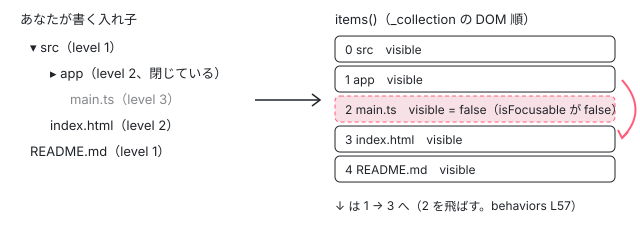

[目次](../README.md) › [Angular Aria の内側](README.md) › 第 14 回 / 全 20 回

# Tree：入れ子の項目を平らなリストとして動かす

> Tree の Behavior が DOM の順に並べた平らなリストの上で、見えている項目だけに止まり（TreeListFocus）、→ で開くか最初の子へ進み、← で閉じるか親へ戻る行。parent / firstChild / nextSibling、aria-level・aria-setsize・aria-posinset の計算、クリックが選択と開閉を続けて呼ぶ行と、それをドキュメントで答えた #33468。TreeItemGroup を要素から ng-template の構造ディレクティブにした 2f094f2ffa。CdkTree（cdk-tree）との違い。

angular/components · 読了 約 13 分 · 発展 · [サイトで読む（デモが動きます）](https://angular-deep-dive-cyan.vercel.app/chapter/aria-tree)

---

ツリー（`role="tree"`）は入れ子の項目ですが、Angular Aria の中では**入れ子を 1 本の平らなリストとして**動かします。この章では、`Tree` Behavior が `ListFocus` を継いで「見えている項目だけに止まる」ようにし、→ で「開く、開いていれば最初の子へ」、← で「閉じる、閉じていれば親へ」と動く行、`TreeItemPattern` が `aria-level`・`aria-setsize`・`aria-posinset` を親から計算する行、ディレクティブが子の項目を `TreeItemGroup` 経由でつなぐ行を読みます。

読む対象は `src/aria/private/behaviors/tree/tree.ts`（`Tree`、327 行）、`src/aria/private/tree/tree.ts`（`TreePattern` と `TreeItemPattern`、490 行）、`src/aria/tree/tree.ts`・`tree-item.ts`・`tree-item-group.ts` です（../components、e81c398a86）。tree のファイルは、このサイトの 22.1.8 と同じ中身です。

1. [1. 全体像](01-aria-overview.md)
2. [2. SignalLike](02-aria-signal-like.md)
3. [3. SortedCollection](03-aria-collection.md)
4. [4. イベントマネージャ](04-aria-events.md)
5. [5. ListFocus](05-aria-list-focus.md)
6. [6. ListNavigation](06-aria-list-navigation.md)
7. [7. ListSelection](07-aria-list-selection.md)
8. [8. ListTypeahead](08-aria-typeahead.md)
9. [9. Listbox](09-aria-listbox.md)
10. [10. Accordion](10-aria-accordion.md)
11. [11. DeferredContent](11-aria-deferred-content.md)
12. [12. Tabs](12-aria-tabs.md)
13. [13. Toolbar](13-aria-toolbar.md)
14. **14. Tree**（この章）
15. [15. Grid](15-aria-grid.md)
16. [16. Grid のセル](16-aria-grid-cells.md)
17. [17. Combobox](17-aria-combobox.md)
18. [18. Menu](18-aria-menu.md)
19. [19. テスト](19-aria-testing.md)
20. [20. issue と PR を読む](20-aria-issues.md)

> [!NOTE]
> **ポイント**
>
> CDK にも `CdkTree` があります（[CDK の CdkTree](../cdk/17-cdk-tree.md)）。あちらはデータ（`dataSource` と子を返す関数）から項目のビューを作る部品で、Angular Aria の `ngTree` はビューを作りません。あなたが `@for` などで書いた要素に、役割と ARIA 属性とキーの動きを付けるだけです。

## 1. Tree Behavior：5 つの Behavior と「見えている項目だけ」

📄 `components/src/aria/private/behaviors/tree/tree.ts` L29–59 （▶ の行: 30, 38, 41, 44, 48, 55–57）

```ts
29 │ /** Represents an item in the tree. */
30 ▶ export interface TreeItem<V, T extends TreeItem<V, T>>
31 │   extends
32 │     ListTypeaheadItem,
33 │     ListNavigationItem,
34 │     ListSelectionItem<V>,
35 │     ListFocusItem,
36 │     ExpansionItem {
37 │   /** The children of this item. */
38 ▶   children: SignalLike<T[] | undefined>;
39 │ 
40 │   /** The parent of this item. */
41 ▶   parent: SignalLike<T | undefined>;
42 │ 
43 │   /** Whether this item is visible. */
44 ▶   visible: SignalLike<boolean>;
45 │ }
46 │ 
47 │ /** The necessary inputs for the tree behavior. */
48 ▶ export type TreeInputs<T extends TreeItem<V, T>, V> = ListFocusInputs<T> &
49 │   ListNavigationInputs<T> &
50 │   ListSelectionInputs<T, V> &
51 │   ListTypeaheadInputs<T> &
52 │   ListExpansionInputs;
53 │ 
54 │ /** Controls focus for a tree, ensuring that only visible items are focusable. */
55 ▶ class TreeListFocus<T extends TreeItem<V, T>, V> extends ListFocus<T> {
56 ▶   override isFocusable(item: T): boolean {
57 ▶     return super.isFocusable(item) && item.visible();
58 │   }
59 │ }
```

- 30〜45 行目 ツリーの項目は、リストの項目の型（文字で飛ぶ・動く・選ぶ・フォーカス・開閉）を全部まとめたものに、`children`（38 行目）・`parent`（41 行目）・`visible`（44 行目）を足したものです。入力の型も 48〜52 行目のとおり、5 つの Behavior の入力をつないだだけです。
- 55〜59 行目 `TreeListFocus` は `ListFocus` を継ぎ、`isFocusable` に「`item.visible()` であること」を足します（57 行目）。`ListNavigation` は次の項目を探すとき `isFocusable` で止まれるかを聞くので（[第 6 回](06-aria-list-navigation.md)）、**閉じた親の下の項目は、リストに入っていても飛ばされます**。



*入れ子の要素を DOM の順に並べると、深さ優先の平らなリストになる。閉じた親の子は visible が false で、↓ はそこを飛ばす（ngTreeItem の既定では、閉じた子は DOM にも作られない。7 節）*

📄 `components/src/aria/private/behaviors/tree/tree.ts` L78–106 （▶ の行: 91, 94, 97–101, 104）

```ts
 78 │   /** Whether the tree is disabled. */
 79 │   readonly disabled = computed(() => this.focusBehavior.isListDisabled());
 80 │ 
 81 │   /** The id of the current active item. */
 82 │   readonly activeDescendant = computed(() => this.focusBehavior.getActiveDescendant());
 83 │ 
 84 │   /** The tab index of the tree. */
 85 │   readonly tabIndex = computed(() => this.focusBehavior.getListTabIndex());
 86 │ 
 87 │   /** The index of the currently active item in the tree (within the flattened list). */
 88 │   readonly activeIndex = computed(() => this.focusBehavior.activeIndex());
 89 │ 
 90 │   /** The uncommitted index for selecting a range of options. */
 91 ▶   private readonly _anchorIndex = signal(0);
 92 │ 
 93 │   /** Whether the list should wrap. */
 94 ▶   private readonly _wrap = signal(true);
 95 │ 
 96 │   constructor(readonly inputs: TreeInputs<T, V>) {
 97 ▶     this.focusBehavior = new TreeListFocus<T, V>(inputs);
 98 ▶     this.selectionBehavior = new ListSelection<T, V>({...inputs, focusManager: this.focusBehavior});
 99 ▶     this.typeaheadBehavior = new ListTypeahead<T>({...inputs, focusManager: this.focusBehavior});
100 ▶     this.expansionBehavior = new ListExpansion(inputs);
101 ▶     this.navigationBehavior = new ListNavigation<T>({
102 │       ...inputs,
103 │       focusManager: this.focusBehavior,
104 ▶       wrap: computed(() => this._wrap() && this.inputs.wrap()),
105 │     });
106 │   }
```

96〜106 行目のコンストラクタで 5 つの Behavior を作ります。97 行目のフォーカスだけが `TreeListFocus` で、98・99・101 行目の選択・文字で飛ぶ・動くにはその同じ `focusBehavior` を渡します。100 行目の `ListExpansion`（開閉。[第 10 回](10-aria-accordion.md)で読む Behavior）にはフォーカスを渡しません。104 行目の `wrap` は「入力の wrap」かつ「94 行目の `_wrap`」で、範囲選択の途中だけ折り返しを止めるための仕掛けです（2 節の \_navigate）。

## 2. 親・子・兄弟へ動く：items を差し替えるだけ

📄 `components/src/aria/private/behaviors/tree/tree.ts` L133–158 （▶ の行: 136–138, 146–147, 154–156）

```ts
133 │   /** Navigates to the first child of the current active item. */
134 │   firstChild(opts?: NavOptions<T>) {
135 │     this._navigate(opts, () => {
136 ▶       const item = this.inputs.activeItem();
137 ▶       const items = item?.children?.() ?? [];
138 ▶       return this.navigationBehavior.first({items, ...opts});
139 │     });
140 │   }
141 │ 
142 │   /** Navigates to the last child of the current active item. */
143 │   lastChild(opts?: NavOptions<T>) {
144 │     this._navigate(opts, () => {
145 │       const item = this.inputs.activeItem();
146 ▶       const items = item?.children?.() ?? [];
147 ▶       return this.navigationBehavior.last({items, ...opts});
148 │     });
149 │   }
150 │ 
151 │   /** Navigates to the next sibling of the current active item. */
152 │   nextSibling(opts?: NavOptions<T>) {
153 │     this._navigate(opts, () => {
154 ▶       const item = this.inputs.activeItem();
155 ▶       const items = item?.parent?.()?.children?.() ?? [];
156 ▶       return this.navigationBehavior.next({items, ...opts});
157 │     });
158 │   }
```

📄 `components/src/aria/private/behaviors/tree/tree.ts` L160–184 （▶ の行: 164–165, 170, 172, 178）

```ts
160 │   /** Navigates to the previous sibling of the current active item. */
161 │   prevSibling(opts?: NavOptions<T>) {
162 │     this._navigate(opts, () => {
163 │       const item = this.inputs.activeItem();
164 ▶       const items = item?.parent?.()?.children?.() ?? [];
165 ▶       return this.navigationBehavior.prev({items, ...opts});
166 │     });
167 │   }
168 │ 
169 │   /** Navigates to the parent of the current active item. */
170 ▶   parent(opts?: NavOptions<T>) {
171 │     this._navigate(opts, () =>
172 ▶       this.navigationBehavior.goto(this.inputs.activeItem()?.parent?.(), opts),
173 │     );
174 │   }
175 │ 
176 │   /** Navigates to the given item in the tree. */
177 │   goto(item: T, opts?: NavOptions<T>) {
178 ▶     this._navigate(opts, () => this.navigationBehavior.goto(item, opts));
179 │   }
180 │ 
181 │   /** Removes focus from the tree. */
182 │   unfocus() {
183 │     this.inputs.activeItem.set(undefined);
184 │   }
```

1. **136〜138 行目 firstChild**

   今いる項目の `children()` を `items` として `navigationBehavior.first({items})` を呼びます。`ListNavigation` は `items` を渡されると、そのリストの中だけで探します。子のための特別な探し方はありません。
2. **154〜156 行目 nextSibling**

   親の `children()` を `items` にして `next`。兄弟の中で「次」を探します（164〜165 行目の prevSibling も同じ形）。ルートの項目は 155 行目の `parent?.()` が無いので、`items` が空になり動きません。
3. **170〜172 行目 parent**

   `navigationBehavior.goto(親)`。親が無ければ `goto(undefined)` で、何もしません。

📄 `components/src/aria/private/behaviors/tree/tree.ts` L291–327 （▶ の行: 292, 296, 299, 302, 305, 313–316, 319, 321–322, 325）

```ts
291 │   /** Handles updating selection for the tree. */
292 ▶   updateSelection(opts: NavOptions<T> = {anchor: true}) {
293 │     if (opts.toggle) {
294 │       this.selectionBehavior.toggle();
295 │     }
296 ▶     if (opts.select) {
297 │       this.selectionBehavior.select();
298 │     }
299 ▶     if (opts.selectOne) {
300 │       this.selectionBehavior.selectOne();
301 │     }
302 ▶     if (opts.selectRange) {
303 │       this.selectionBehavior.selectRange();
304 │     }
305 ▶     if (!opts.anchor) {
306 │       this.anchor(this.selectionBehavior.rangeStartIndex());
307 │     }
308 │   }
309 │ 
310 │   /**
311 │    * Safely performs a navigation operation.
312 │    */
313 ▶   private _navigate(opts: NavOptions<T> = {}, operation: () => boolean) {
314 ▶     if (opts?.selectRange) {
315 ▶       this._wrap.set(false);
316 ▶       this.selectionBehavior.rangeStartIndex.set(this._anchorIndex());
317 │     }
318 │ 
319 ▶     const moved = operation();
320 │ 
321 ▶     if (moved) {
322 ▶       this.updateSelection(opts);
323 │     }
324 │ 
325 ▶     this._wrap.set(true);
326 │   }
327 │ }
```

動く関数はどれも 313〜326 行目の `_navigate` を通ります。319 行目で実際に動き、動けたときだけ 322 行目で `updateSelection(opts)` を呼びます。`opts` に `selectOne` があれば選ぶ（299 行目）、`selectRange` なら範囲（302 行目）。何も無ければ動くだけです。314〜316 行目は範囲選択のときだけ折り返しを止め、範囲の始まりを 91 行目の `_anchorIndex` にします。**動くことと選ぶことは、この `opts` で分かれています**。

## 3. 開く・閉じる・兄弟を全部開く

📄 `components/src/aria/private/behaviors/tree/tree.ts` L236–269 （▶ の行: 238–239, 241–242, 248–249, 255, 265–266, 268）

```ts
236 │   /** Toggles the expansion of the given item. */
237 │   toggleExpansion(item?: T) {
238 ▶     item ??= this.inputs.activeItem();
239 ▶     if (!item || !this.isFocusable(item)) return;
240 │ 
241 ▶     if (this.isExpandable(item)) {
242 ▶       this.expansionBehavior.toggle(item);
243 │     }
244 │   }
245 │ 
246 │   /** Expands the given item. */
247 │   expand(item: T) {
248 ▶     if (this.isExpandable(item)) {
249 ▶       this.expansionBehavior.open(item);
250 │     }
251 │   }
252 │ 
253 │   /** Collapses the given item. */
254 │   collapse(item: T) {
255 ▶     this.expansionBehavior.close(item);
256 │   }
257 │ 
258 │   /** Expands all sibling items of the given item (or active item). */
259 │   expandSiblings(item?: T) {
260 │     item ??= this.inputs.activeItem();
261 │     if (!item) return;
262 │ 
263 │     // If the item has a parent, get all of the parent's children.
264 │     // Otherwise, it is a root item, and get all other root items.
265 ▶     const parent = item.parent?.();
266 ▶     const siblings = parent ? parent.children?.() : this.inputs.items().filter(i => !i.parent?.());
267 │ 
268 ▶     siblings?.forEach(s => this.expand(s));
269 │   }
```

- 238〜243 行目 `toggleExpansion` は、止まれない項目（無効で softDisabled が false、または見えていない）には何もせず、開ける項目なら `ListExpansion.toggle`。
- 248〜249 行目 `expand` は開ける項目なら `open`。`ListExpansion.isExpandable` は「ツリーも項目も無効でなく、`expandable()`」です。
- 265〜268 行目 `expandSiblings` は、親があればその子、無ければ親の無い項目（ルートの項目）を全部 `expand` します。キーの `Shift + *` がこれです（5 節）。

## 4. TreeItemPattern：level・visible・setsize・posinset

📄 `components/src/aria/private/tree/tree.ts` L56–95 （▶ の行: 57–59, 63, 66, 69, 72, 78, 81–82, 86, 89, 95）

```ts
56 │   /** The parent item. */
57 ▶   readonly parent: SignalLike<TreeItemPattern<V> | undefined> = computed(() => {
58 ▶     const parent = this.inputs.parent();
59 ▶     return parent instanceof TreeItemPattern ? parent : undefined;
60 │   });
61 │ 
62 │   /** The children items. */
63 ▶   readonly children: SignalLike<TreeItemPattern<V>[]> = () => this.inputs.children() ?? [];
64 │ 
65 │   /** The position of this item among its siblings. */
66 ▶   readonly index = computed(() => this.tree().inputs.items().indexOf(this));
67 │ 
68 │   /** Whether the item is expandable. It's expandable if children item exist. */
69 ▶   readonly expandable: SignalLike<boolean> = () => this.inputs.hasChildren();
70 │ 
71 │   /** Whether the item is selectable. */
72 ▶   readonly selectable: SignalLike<boolean> = () => this.inputs.selectable();
73 │ 
74 │   /** Whether the item is expanded. */
75 │   readonly expanded: WritableSignalLike<boolean>;
76 │ 
77 │   /** The level of the current item in a tree. */
78 ▶   readonly level: SignalLike<number> = computed(() => this.inputs.parent().level() + 1);
79 │ 
80 │   /** Whether this item is visible. */
81 ▶   readonly visible: SignalLike<boolean> = computed(
82 ▶     () => this.inputs.parent().expanded() && this.inputs.parent().visible(),
83 │   );
84 │ 
85 │   /** The number of items under the same parent at the same level. */
86 ▶   readonly setsize = computed(() => this.inputs.parent().children().length);
87 │ 
88 │   /** The position of this item among its siblings (1-based). */
89 ▶   readonly posinset = computed(() => this.inputs.parent().children().indexOf(this) + 1);
90 │ 
91 │   /** Whether the item is active. */
92 │   readonly active = computed(() => this.tree().activeItem() === this);
93 │ 
94 │   /** The tab index of the item. */
95 ▶   readonly tabIndex = computed(() => this.tree().treeBehavior.getItemTabindex(this));
```

📄 `components/src/aria/private/tree/tree.ts` L155–176 （▶ の行: 159, 162, 165, 174–175）

```ts
155 │   /** Whether the tree has been interacted with. */
156 │   readonly hasBeenInteracted = signal(false);
157 │ 
158 │   /** The root level is 0. */
159 ▶   readonly level = () => 0;
160 │ 
161 │   /** The root is always expanded. */
162 ▶   readonly expanded = () => true;
163 │ 
164 │   /** The root is always visible. */
165 ▶   readonly visible = () => true;
166 │ 
167 │   /** The tab index of the tree. */
168 │   readonly tabIndex: SignalLike<-1 | 0> = computed(() => this.treeBehavior.tabIndex());
169 │ 
170 │   /** The id of the current active item. */
171 │   readonly activeDescendant = computed(() => this.treeBehavior.activeDescendant());
172 │ 
173 │   /** The direct children of the root (top-level tree items). */
174 ▶   readonly children = computed(() =>
175 ▶     this.inputs.items().filter(item => item.level() === this.level() + 1),
176 │   );
```

1. **入力の parent は「項目かツリー」**

   `inputs.parent` は、ルートの項目ならツリーの `TreePattern`、それ以外は親の `TreeItemPattern` です（ディレクティブの側は 7 節）。57〜60 行目の `parent` は、`TreeItemPattern` のときだけ返し、ツリーなら `undefined` にします。2 節の `parent()` がルートで動かないのはこのためです。
2. **78 行目 aria-level**

   `inputs.parent().level() + 1`。ツリーの `level` は 159 行目で 0 なので、ルートの項目は 1、その子は 2 です。
3. **81〜83 行目 visible**

   「親が開いていて、親も見えている」。ツリーは 162・165 行目でいつも開いていて見えているので、ルートの項目はいつも見え、深い項目は祖先が全部開いているときだけ見えます。1 節の 57 行目がこれを読みます。
4. **86・89 行目 aria-setsize・aria-posinset**

   親の `children()` の長さと、その中の自分の位置 + 1。ツリーの `children` は 174〜176 行目で「level が 1 の項目」を集めたものです。66 行目の `index`（ツリーの平らなリストの中の位置）とは別物です。
5. **69 行目 開けるか**

   `expandable` は `inputs.hasChildren()`。子の項目が今 DOM にあるかではなく、「子の group があるか」です（7 節）。だから閉じていて子がまだ作られていなくても `aria-expanded="false"` が付きます。

## 5. キーとクリック：→ は「開くか、最初の子へ」

📄 `components/src/aria/private/tree/tree.ts` L200–221 （▶ の行: 202–203, 205, 210, 213, 217, 220）

```ts
200 │   /** The key for collapsing an item or moving to its parent. */
201 │   readonly collapseKey = computed(() => {
202 ▶     if (this.inputs.orientation() === 'horizontal') {
203 ▶       return 'ArrowUp';
204 │     }
205 ▶     return this.isRtl() ? 'ArrowRight' : 'ArrowLeft';
206 │   });
207 │ 
208 │   /** The key for expanding an item or moving to its first child. */
209 │   readonly expandKey = computed(() => {
210 ▶     if (this.inputs.orientation() === 'horizontal') {
211 │       return 'ArrowDown';
212 │     }
213 ▶     return this.isRtl() ? 'ArrowLeft' : 'ArrowRight';
214 │   });
215 │ 
216 │   /** Represents the space key. Does nothing when the user is actively using typeahead. */
217 ▶   readonly dynamicSpaceKey = computed(() => (this.treeBehavior.isTyping() ? '' : ' '));
218 │ 
219 │   /** Regular expression to match characters for typeahead. */
220 ▶   readonly typeaheadRegexp = /^.$/;
221 │ 
```

📄 `components/src/aria/private/tree/tree.ts` L452–490 （▶ の行: 457–458, 464–465, 467, 474–475, 477, 483, 487–488）

```ts
452 │   /** Navigates to the given tree item in the tree. */
453 │   goto(e: PointerEvent, opts?: SelectOptions) {
454 │     const item = this._getItem(e);
455 │     if (!item) return;
456 │ 
457 ▶     this.treeBehavior.goto(item, opts);
458 ▶     this.treeBehavior.toggleExpansion(item);
459 │   }
460 │ 
461 │   /** Expands the active item if possible, otherwise navigates to the first child. */
462 │   _expandOrFirstChild(opts?: SelectOptions) {
463 │     const item = this.treeBehavior.inputs.activeItem();
464 ▶     if (item && this.treeBehavior.isExpandable(item) && !item.expanded()) {
465 ▶       this.treeBehavior.expand(item);
466 │     } else {
467 ▶       this.treeBehavior.firstChild(opts);
468 │     }
469 │   }
470 │ 
471 │   /** Collapses the active item if possible, otherwise navigates to the parent. */
472 │   _collapseOrParent(opts?: SelectOptions) {
473 │     const item = this.treeBehavior.inputs.activeItem();
474 ▶     if (item && this.treeBehavior.isExpandable(item) && item.expanded()) {
475 ▶       this.treeBehavior.collapse(item);
476 │     } else {
477 ▶       this.treeBehavior.parent(opts);
478 │     }
479 │   }
480 │ 
481 │   /** Retrieves the TreeItemPattern associated with a DOM event, if any. */
482 │   protected _getItem(event: Event): TreeItemPattern<V> | undefined {
483 ▶     const target = _getEventTarget<Element>(event);
484 │     if (!target) {
485 │       return;
486 │     }
487 ▶     const element = target.closest('[role="treeitem"]');
488 ▶     return this.inputs.items().find(i => i.element() === element);
489 │   }
490 │ }
```

1. **201〜214 行目 開閉のキーの名前**

   縦向き（既定）なら開くが ArrowRight、閉じるが ArrowLeft（rtl なら逆）。横向きなら開くが ArrowDown、閉じるが ArrowUp です。上下（横向きなら左右）は、このすぐ上で同じ形に決める `prevKey` / `nextKey` で、平らなリストの前と次です。
2. **→（expandKey）で \_expandOrFirstChild**

   464 行目で「開ける項目で、まだ閉じている」なら 465 行目で開くだけ。そうでなければ（開いている、または子が無い）467 行目で最初の子へ動きます。子が無い項目では `children()` が空なので、動きません。
3. **←（collapseKey）で \_collapseOrParent**

   474 行目で「開ける項目で、開いている」なら 475 行目で閉じるだけ。そうでなければ 477 行目で親へ動きます。
4. **keydown の表のそのほか**

   上下と Home / End は `selectOne: followFocus()` を付けて動きます（`selectionMode="follow"` のときだけ動いた先を選ぶ）。220 行目の `typeaheadRegexp` に当たる 1 文字のキーで文字の頭へ飛ぶ（[第 8 回](08-aria-typeahead.md)）、`Shift + *` で兄弟を全部開く（3 節）。この表を作る `keydown` の `computed`（このすぐ下）は、[第 4 回](04-aria-events.md)で引用しています。**開閉のキーは選択のオプションを付けていても、開くだけ・閉じるだけのときは選びません**。選ぶのは 467・477 行目で動いたときだけです。
5. **457〜458 行目 クリックは「動いて選ぶ」と「開閉」の両方**

   クリックされた要素から 487 行目の `closest('[role="treeitem"]')` で項目を探し、457 行目で `goto(item, opts)`、458 行目で `toggleExpansion(item)`。`opts` は下の clickManager が決め、単一選択なら `{selectOne: true}` です。だから**マウスで親の項目をクリックすると、選ばれて、開閉もします**。

📄 `components/src/aria/private/tree/tree.ts` L291–314 （▶ の行: 296, 300, 305–306, 310）

```ts
291 │   /** The click event manager for the tree. */
292 │   readonly clickManager = computed(() => {
293 │     const manager = new ClickEventManager<PointerEvent>();
294 │ 
295 │     if (this.multi()) {
296 ▶       manager.on(Modifier.Shift, (e: PointerEvent) => this.goto(e, {selectRange: true}));
297 │     }
298 │ 
299 │     if (!this.multi()) {
300 ▶       return manager.on((e: PointerEvent) => this.goto(e, {selectOne: true}));
301 │     }
302 │ 
303 │     if (this.multi() && this.followFocus()) {
304 │       return manager
305 ▶         .on((e: PointerEvent) => this.goto(e, {selectOne: true}))
306 ▶         .on(Modifier.Ctrl, (e: PointerEvent) => this.goto(e, {toggle: true}));
307 │     }
308 │ 
309 │     if (this.multi() && !this.followFocus()) {
310 ▶       return manager.on((e: PointerEvent) => this.goto(e, {toggle: true}));
311 │     }
312 │ 
313 │     return manager;
314 │   });
```

📄 `components/src/aria/private/tree/tree.ts` L260–270 （▶ の行: 262–263, 268–269）

```ts
260 │     if (!this.followFocus() && this.inputs.multi()) {
261 │       manager
262 ▶         .on(this.dynamicSpaceKey, () => tree.toggle())
263 ▶         .on('Enter', () => tree.toggle(), {preventDefault: !this.nav()})
264 │         .on([Modifier.Ctrl, Modifier.Meta], 'A', () => tree.toggleAll());
265 │     }
266 │ 
267 │     if (!this.followFocus() && !this.inputs.multi()) {
268 ▶       manager.on(this.dynamicSpaceKey, () => tree.selectOne());
269 ▶       manager.on('Enter', () => tree.selectOne(), {preventDefault: !this.nav()});
270 │     }
```

クリックの `opts` は、単一選択なら `selectOne`（300 行目）、複数選択で follow なら `selectOne` と Ctrl で `toggle`（305〜306 行目）、複数選択で explicit なら `toggle`（310 行目）です。キーでの選択は、explicit のときだけ Space / Enter に付きます（262〜263・268〜269 行目）。Enter の `preventDefault` は `nav`（ナビゲーション用のツリー）でないときだけで、nav のツリーでは項目の中の `<a>` の Enter がリンクとして働きます。

> [!NOTE]
> **ポイント**
>
> 482〜488 行目の `_getItem` は 2 回直されています。e93f48ea05（2026-07-27、PR #33587 `fix(multiple): avoid instanceof checks in aria directives`）は、`event.target instanceof HTMLElement` で調べるのをやめました。コミットの本文は「SVG の要素が外れ、SSR でも問題になりうる」です（listbox と tabs も同じ変更）。そのあと 7dccecc784（2026-08-17、PR #33691 `account for shadow dom in aria directives`）が、`event.target` を直接読むのをやめて 483 行目の `_getEventTarget`（CDK の、shadow DOM の中の本当の発生元を返す関数）にしました。

> [!NOTE]
> **さらに深く**
>
> #33468（`feat(Tree): Aria tree items should support separate expansion and selection`、2026-07-07 に COMPLETED で閉じた）は、「複数選択の例で、フォルダの中のファイルだけを選びたいのに、フォルダをクリックすると選択と開閉が一緒に起きる」という報告でした。閉じたときの対応はコードの変更ではなく、angular/angular の PR #69650 でのドキュメントの更新です（担当者のコメント）。担当者は、開閉は別のボタンにする、選ばせたくない親には `[selectable]="false"` を付ける（4 節の 72 行目の `selectable`）、と答えています。snapshot でも 457〜458 行目は「動いて選ぶ」と「開閉」を続けて呼んでいます。項目の中にボタンを置いても、その click は泡立って `ngTree` の host の `(click)`（7 節の 81 行目）に届き、487 行目で外側の項目が見つかります。ボタンだけで開閉させたいなら、そのボタンの click が host まで届かないようにする工夫が要ります（このページでは試していません）。

## 6. 最初にどこに止まるか

📄 `components/src/aria/private/tree/tree.ts` L396–429 （▶ の行: 405–407, 410, 413–414, 420, 426）

```ts
396 │   /**
397 │    * Sets the tree to it's default initial state.
398 │    *
399 │    * Sets the active index of the tree to the first focusable selected tree item if one exists.
400 │    * Otherwise, sets focus to the first focusable tree item.
401 │    */
402 │   setDefaultState() {
403 │     let firstItem: TreeItemPattern<V> | undefined;
404 │ 
405 ▶     for (const item of this.inputs.items()) {
406 ▶       if (!item.visible()) continue;
407 ▶       if (!this.treeBehavior.isFocusable(item)) continue;
408 │ 
409 │       if (firstItem === undefined) {
410 ▶         firstItem = item;
411 │       }
412 │ 
413 ▶       if (item.selected()) {
414 ▶         this.activeItem.set(item);
415 │         return;
416 │       }
417 │     }
418 │ 
419 │     if (firstItem !== undefined) {
420 ▶       this.activeItem.set(firstItem);
421 │     }
422 │   }
423 │ 
424 │   /** Sets the default active state of the tree before receiving interaction for the first time. */
425 │   setDefaultStateEffect(): void {
426 ▶     if (this.hasBeenInteracted()) return;
427 │ 
428 │     this.setDefaultState();
429 │   }
```

平らなリストを前から見て、見えていて止まれる項目のうち、**選ばれている最初の項目**があればそこ（413〜414 行目）、無ければ最初の項目（420 行目）を今いる項目にします。426 行目のとおり、一度触られたらもう呼びません。

## 7. ディレクティブ：Tree・TreeItem・TreeItemGroup

📄 `components/src/aria/tree/tree.ts` L69–84 （▶ の行: 73, 75–76, 78–82）

```ts
69 │ @Directive({
70 │   selector: '[ngTree]',
71 │   exportAs: 'ngTree',
72 │   host: {
73 ▶     'role': 'tree',
74 │     '[attr.id]': 'id()',
75 ▶     '[attr.aria-orientation]': '_pattern.orientation()',
76 ▶     '[attr.aria-multiselectable]': '_pattern.multi()',
77 │     '[attr.aria-disabled]': '_pattern.disabled()',
78 ▶     '[attr.aria-activedescendant]': '_pattern.activeDescendant()',
79 ▶     '[tabindex]': 'tabIndex() !== undefined ? tabIndex() : _pattern.tabIndex()',
80 ▶     '(keydown)': '_pattern.onKeydown($event)',
81 ▶     '(click)': '_pattern.onClick($event)',
82 ▶     '(focusin)': '_pattern.onFocusIn()',
83 │   },
84 │ })
```

📄 `components/src/aria/tree/tree.ts` L162–201 （▶ の行: 166–167, 171, 176, 183, 189, 193–194, 196–198）

```ts
162 │   constructor() {
163 │     const inputs = {
164 │       ...this,
165 │       id: this.id,
166 ▶       items: computed(() => this._collection.orderedItems().map(item => item._pattern)),
167 ▶       activeItem: signal<TreeItemPattern<V> | undefined>(undefined),
168 │       element: () => this.element,
169 │     };
170 │ 
171 ▶     this._pattern = new TreePattern<V>(inputs);
172 │ 
173 │     this.activeDescendant = computed(() => this._pattern.activeDescendant());
174 │ 
175 │     afterNextRender(() => {
176 ▶       this._collection.startObserving(this.element);
177 │     });
178 │ 
179 │     // Check for any violations after the DOM has been updated.
180 │     if (typeof ngDevMode === 'undefined' || ngDevMode) {
181 │       afterRenderEffect({
182 │         read: () => {
183 ▶           reportViolations(this._pattern.validate(), this.element);
184 │         },
185 │       });
186 │     }
187 │ 
188 │     // Resets default focus based on selection state until interacted.
189 ▶     afterRenderEffect({write: () => this._pattern.setDefaultStateEffect()});
190 │ 
191 │     afterRenderEffect({
192 │       write: () => {
193 ▶         const items = inputs.items();
194 ▶         const activeItem = untracked(() => inputs.activeItem());
195 │ 
196 ▶         if (activeItem && !items.some(i => i === activeItem)) {
197 ▶           this._pattern.treeBehavior.unfocus();
198 ▶           this._pattern.setDefaultState();
199 │         }
200 │       },
201 │     });
```

1. **166 行目 平らなリストの正体**

   `_collection.orderedItems()` は、登録された `TreeItem` を **DOM の順**に並べたものです（[第 3 回](03-aria-collection.md)）。入れ子の `<li>` を DOM の順に並べると、深さ優先の順になります。
2. **176・183・189 行目 描画のあと**

   並べ順の見張り、開発モードだけの `validate()`（値の重なりと、単一選択なのに 2 つ以上選ばれている）、6 節の初期状態。どれもブラウザでだけ動きます。
3. **191〜201 行目 今いる項目が消えたら**

   項目のリストが変わり、今いる項目がもうリストに無ければ、`unfocus()` してから `setDefaultState()` をやり直します。198 行目の `setDefaultState()` は cd62949147（2026-05-06、`refactor(multiple): stabilize focus state when active item is deleted`）で足されました。それまでは `unfocus()` だけで、フォーカスの行き先が無くなっていました。194 行目は `untracked` で、今いる項目が変わっただけでは走りません。

📄 `components/src/aria/tree/tree-item.ts` L41–57 （▶ の行: 46, 48–49, 52–55）

```ts
41 │ @Directive({
42 │   selector: '[ngTreeItem]',
43 │   exportAs: 'ngTreeItem',
44 │   host: {
45 │     '[attr.data-active]': 'active()',
46 ▶     'role': 'treeitem',
47 │     '[id]': '_pattern.id()',
48 ▶     '[attr.aria-expanded]': '_expanded()',
49 ▶     '[attr.aria-selected]': 'selected()',
50 │     '[attr.aria-current]': '_pattern.current()',
51 │     '[attr.aria-disabled]': '_pattern.disabled()',
52 ▶     '[attr.aria-level]': 'level()',
53 ▶     '[attr.aria-setsize]': '_pattern.setsize()',
54 ▶     '[attr.aria-posinset]': '_pattern.posinset()',
55 ▶     '[attr.tabindex]': '_pattern.tabIndex()',
56 │   },
57 │ })
```

📄 `components/src/aria/tree/tree-item.ts` L112–151 （▶ の行: 113–114, 124, 130–131, 133, 137–138, 140, 146–147）

```ts
112 │   /** Whether the tree is expanded. Use this value for aria-expanded. */
113 ▶   protected readonly _expanded: Signal<boolean | undefined> = computed(() =>
114 ▶     this._pattern.expandable() ? this._pattern.expanded() : undefined,
115 │   );
116 │ 
117 │   /** The UI pattern for this item. */
118 │   _pattern!: TreeItemPattern<V>;
119 │ 
120 │   constructor() {
121 │     super();
122 │     afterRenderEffect({
123 │       write: () => {
124 ▶         this.contentVisible.set(this._pattern.expanded());
125 │       },
126 │     });
127 │   }
128 │ 
129 │   ngOnInit() {
130 ▶     if (this.parent() instanceof TreeItemGroup) {
131 ▶       (this.parent() as TreeItemGroup<V>)._register(this);
132 │     }
133 ▶     this.tree()._collection.register(this);
134 │ 
135 │     const treePattern = computed(() => this.tree()._pattern);
136 │     const parentPattern = computed(() => {
137 ▶       if (this.parent() instanceof Tree) {
138 ▶         return treePattern();
139 │       }
140 ▶       return (this.parent() as TreeItemGroup<V>).ownedBy()._pattern;
141 │     });
142 │     this._pattern = new TreeItemPattern<V>({
143 │       ...this,
144 │       tree: treePattern,
145 │       parent: parentPattern,
146 ▶       children: computed(() => this._group()?._childPatterns()),
147 ▶       hasChildren: computed(() => !!this._group()),
148 │       element: () => this.element,
149 │       searchTerm: () => this.searchTerm() ?? '',
150 │     });
151 │   }
```

1. **48・113〜115 行目 aria-expanded**

   開ける項目なら `expanded()`、そうでなければ `undefined`（属性を付けない）。葉の項目に `aria-expanded` は付きません。
2. **124 行目 開いているときだけ子を描く**

   `TreeItem` は `DeferredContentAware` を継いでいて、`contentVisible` に `expanded()` を入れます。子の group の `ng-template` がこれを見て、開いたときに中身を作ります（仕組みは[第 11 回](11-aria-deferred-content.md)）。
3. **130〜133 行目 登録は 2 か所**

   親が group なら group に、そしていつもツリーの `_collection` に登録します。
4. **137〜141 行目 Pattern の親**

   入力の `parent` がツリーならツリーの Pattern、group なら **その group を持つ項目（`ownedBy()`）の Pattern**。4 節の level と visible は、こうしてつないだ親をたどります。
5. **146〜147 行目 子と「子があるか」**

   子は自分の group の `_childPatterns()`、「子があるか」は group が登録されているか（`!!this._group()`）です。

📄 `components/src/aria/tree/tree-item-group.ts` L57–66 （▶ の行: 58, 61–62, 66）

```ts
57 │   /** All groupable items that are descendants of the group. */
58 ▶   private readonly _unorderedItems = signal(new Set<TreeItem<V>>());
59 │ 
60 │   /** Child items within this group. */
61 ▶   readonly _childPatterns = computed<TreeItemPattern<V>[]>(() =>
62 ▶     [...this._unorderedItems()].sort(sortDirectives).map(c => c._pattern),
63 │   );
64 │ 
65 │   /** Tree item that owns the group. */
66 ▶   readonly ownedBy = input.required<TreeItem<V>>();
```

📄 `components/src/aria/tree/tree-item-group.ts` L76–86 （▶ の行: 77–79, 82, 84）

```ts
76 │ 
77 ▶   _register(child: TreeItem<V>) {
78 ▶     this._unorderedItems().add(child);
79 ▶     this._unorderedItems.set(new Set(this._unorderedItems()));
80 │   }
81 │ 
82 ▶   _unregister(child: TreeItem<V>) {
83 │     this._unorderedItems().delete(child);
84 ▶     this._unorderedItems.set(new Set(this._unorderedItems()));
85 │   }
86 │ }
```

`TreeItemGroup` は、子の項目を `Set` に集め（77〜80 行目。`Set` を作り直して signal に入れ直すので、読んでいる `computed` が走り直す）、61〜62 行目で DOM の順に並べ替えて Pattern にします。66 行目の `ownedBy` は必須で、この group を持つ `ngTreeItem` を渡します。

> [!NOTE]
> **さらに深く**
>
> 2f094f2ffa（2025-10-15、PR #32079 `refactor(aria/tree): remove tree group wrapper`）より前の `TreeItemGroup` は、`role="group"`・`id`・`inert` を host に付ける**要素のディレクティブ**で、項目は `aria-owns` でその id を指していました。中身の遅延は別の `ng-template[ngTreeItemGroupContent]` が持っていました。この変更で `TreeItemGroup` は `ng-template[ngTreeItemGroup]` に付ける**構造ディレクティブ**になり、`hostDirectives: [DeferredContent]` を持つようにして `ngTreeItemGroupContent` を消し、`TreeItem` が `DeferredContentAware` を継ぐ形にしました。`aria-owns` も消えています。つまり「group の要素をやめた」のであって、`TreeItemGroup` というディレクティブは今もあります。`<ul role="group">` は使う側が書く素の要素です（tree.ts の冒頭のコメントの例）。

## 8. デモ：本物の ngTree（入れ子 3 段）

> **🧪 DEMO — src / app / main.ts の 3 段（このサイトの @angular/aria 22.1.8。tree は snapshot と同じ中身）**
>
> Tab でツリーに入り、↑ / ↓ で動き、→ / ← で開閉します。Home / End、`Shift + *`、文字のキー（例 r）も試せます。キーやクリックのあと、次の描画が終わってさらに 50ms 待ってから（子のビューは開いた次の描画で作られるため）、今いる項目の level と posinset / setsize、開ける項目の `aria-expanded`、DOM にある treeitem の数、`[(value)]` をログに出します。
>
> ▶ [このデモはサイトで動かせます](https://angular-deep-dive-cyan.vercel.app/chapter/aria-tree)

2026-11-02 にヘッドレスの Chrome でこのページを開き、本物のキー入力で確かめた結果です。

- ページを開いた直後（触る前）、DOM の treeitem は src・docs・README.md の 3 個だけで、src だけが tabindex="0" でした。閉じた項目の子は作られていません（7 節の 124 行目）。README.md には `aria-expanded` がありません（113〜115 行目）。
- src で → を押すと src が開き（464〜465 行目）、子の app と index.html が作られて treeitem が 5 個になります。もう一度 → で app へ（467 行目）。app で → で開き、→ で main.ts（level 3、1/2）。main.ts で → を押しても動きません（子が無い）。
- app.ts で ← を押すと親の app へ（477 行目）、app で ← を押すと閉じて treeitem が 5 個に戻ります（475 行目。閉じると子のビューは消える）。
- src と docs を閉じた状態で ↓ を押すと src → docs → README.md → src と、見えているルートの項目だけを回りました（`wrap` が true）。End で README.md、Home で src。
- src で `Shift + *` を押すと、src と docs（ルートの兄弟）が開き、app は閉じたままでした（3 節の 265〜268 行目）。
- src で Space を押すと value が `["src"]`、app へ ↓ で動いても value は変わらず、app で Enter を押すと `["app"]` になりました（explicit の単一選択。268〜269 行目）。
- r を押すと README.md へ飛びます（typeahead）。
- 開いている src をクリックすると、選ばれて（value が `["src"]`）閉じ、もう一度クリックすると開きました（457〜458 行目）。
- コンソールに警告もエラーも出ませんでした。

## 9. 呼び出しの連なり（閉じた「src」で →）

- 👤 `keydown ArrowRight` — ngTree の host — *tree.ts L80*
  - `TreePattern.onKeydown(event)` — private/tree/tree.ts — *keydown() の表で expandKey に当たる（第 4 回）*
    - `_expandOrFirstChild({selectOne: followFocus()})` — L462 — *開ける・閉じている → 開く（L464-465）*
      - `Tree.expand(item)` — behaviors/tree/tree.ts L247
        - `ListExpansion.open(item)` — expansion.ts — *item.expanded.set(true)*
  - `contentVisible.set(expanded())` — tree-item.ts L124 — *afterRenderEffect の write*
    - `DeferredContent` が子のビューを作る — 第 11 回 — *子の TreeItem が ngOnInit で登録（L130-133）*
  - `visible = parent.expanded() && parent.visible()` — private/tree/tree.ts L81 — *子が「止まれる」になる（behaviors L57）*

## テストと直し方

📄 `components/src/aria/tree/tree.spec.ts` L1201–1232 （▶ の行: 1201, 1205, 1209, 1214, 1217, 1225, 1230–1231）

```ts
1201 ▶         it('should expand a collapsed item with ArrowRight', async () => {
1202 │           const fruitsEl = getTreeItemElementByValue('fruits')!;
1203 │           expect(fruitsEl.getAttribute('aria-expanded')).toBe('false');
1204 │ 
1205 ▶           await right();
1206 │           expect(fruitsEl.getAttribute('aria-expanded')).toBe('true');
1207 │         });
1208 │ 
1209 ▶         it('should move focus to first child if ArrowRight on an expanded item', async () => {
1210 │           await right(); // Expands fruits
1211 │           expect(getFocusedTreeItemValue()).toBe('fruits');
1212 │ 
1213 │           await right();
1214 ▶           expect(getFocusedTreeItemValue()).toBe('apple');
1215 │         });
1216 │ 
1217 ▶         it('should collapse an expanded item with ArrowLeft', async () => {
1218 │           await right(); // Expands fruits
1219 │           const fruitsEl = getTreeItemElementByValue('fruits')!;
1220 │           expect(fruitsEl.getAttribute('aria-expanded')).toBe('true');
1221 │           await left();
1222 │           expect(fruitsEl.getAttribute('aria-expanded')).toBe('false');
1223 │         });
1224 │ 
1225 ▶         it('should move focus to parent if ArrowLeft on a collapsed non-root item', async () => {
1226 │           await right(); // Expands fruits
1227 │           await right(); // Focus apple (child of fruits)
1228 │           expect(getFocusedTreeItemValue()).toBe('apple');
1229 │ 
1230 ▶           await left();
1231 ▶           expect(getFocusedTreeItemValue()).toBe('fruits');
1232 │         });
```

`describe('Tree')` → `describe('expansion and collapse')`（:1118）→ `describe('LTR')` → `describe('orientation="vertical"')` の 4 本です。:1201 は → で開く、:1209 は開いた項目で → なら最初の子へ（5 節の 464〜467 行目）、:1217 は ← で閉じる、:1225 は閉じた子で ← なら親へ（474〜477 行目）を見ています。

📄 `components/src/aria/tree/tree.spec.ts` L283–311 （▶ の行: 283, 287–289, 307–309）

```ts
283 ▶       it('should set aria-level, aria-setsize, and aria-posinset correctly', async () => {
284 │         await expandAll();
285 │ 
286 │         const fruits = getTreeItemElementByValue('fruits')!;
287 ▶         expect(fruits.getAttribute('aria-level')).toBe('1');
288 ▶         expect(fruits.getAttribute('aria-setsize')).toBe('4');
289 ▶         expect(fruits.getAttribute('aria-posinset')).toBe('1');
290 │         expect(fruits.getAttribute('aria-expanded')).toBe('true');
291 │ 
292 │         const vegetables = getTreeItemElementByValue('vegetables')!;
293 │         expect(vegetables.getAttribute('aria-level')).toBe('1');
294 │         expect(vegetables.getAttribute('aria-setsize')).toBe('4');
295 │         expect(vegetables.getAttribute('aria-posinset')).toBe('2');
296 │         expect(vegetables.getAttribute('aria-expanded')).toBe('true');
297 │ 
298 │         const grains = getTreeItemElementByValue('grains')!;
299 │         expect(grains.getAttribute('aria-level')).toBe('1');
300 │         expect(grains.getAttribute('aria-setsize')).toBe('4');
301 │         expect(grains.getAttribute('aria-posinset')).toBe('3');
302 │ 
303 │         const dairy = getTreeItemElementByValue('dairy')!;
304 │         expect(dairy.getAttribute('aria-level')).toBe('1');
305 │         expect(dairy.getAttribute('aria-setsize')).toBe('4');
306 │         expect(dairy.getAttribute('aria-posinset')).toBe('4');
307 ▶ 
308 ▶         const apple = getTreeItemElementByValue('apple')!;
309 ▶         expect(apple.getAttribute('aria-level')).toBe('2');
310 │         expect(apple.getAttribute('aria-setsize')).toBe('3');
311 │         expect(apple.getAttribute('aria-posinset')).toBe('1');
```

`describe('ARIA attributes and roles')` → `describe('default configuration')` の `it('should set aria-level, aria-setsize, and aria-posinset correctly')`（:283）です。全部開いてから、ルートの項目が level 1・setsize 4、その子が level 2・setsize 3 であることを見ています（4 節の 78・86・89 行目）。Behavior だけの spec は private/behaviors/tree/tree.spec.ts の `describe('Tree hierarchy')`（:299）で、`it('should navigate to first child')` や `it('should skip invisible items (subset navigation)')`（:363）があります。

📄 `ターミナル`

```
cd ~/angular-research/components
pnpm bazel test //src/aria/tree:unit_tests_chromium --nocache_test_results --test_output=all

# 仮想スクロールの仕組みが src/aria にあるか
grep -rli "virtual" src/aria | wc -l
# 2f094f2ffa（tree group wrapper を外した）で変わったファイル
git show --stat 2f094f2ffa | tail -1
```

📄 `出力（抜粋。2026-11-02 に実行）`

```
Chromium: |██████████████████████████████| 1/1 test files | 142 passed, 0 failed
Finished running tests in 1.8s, all tests passed!
//src/aria/tree:unit_tests_chromium                                      PASSED in 2.3s

       0
 31 files changed, 82 insertions(+), 152 deletions(-)
```

1. **走らせ方**

   ターゲットの spec が全部走ります（spec を絞るオプションは確かめていません）。142 passed, 0 failed、PASSED in 2.3s でした。grep で数えた `it(` は 121 行で、件数が多いのは `describe('keyboard navigation')`（:1382）が `focusMode` の 2 通りで同じ it をくり返すからです。Pattern の spec は `//src/aria/private/tree:unit_tests_chromium`、Behavior は `//src/aria/private/behaviors/tree:unit_tests_chromium` です（この章では走らせていない）。
2. **直すとしたら**

   キーの割り当ては `TreePattern.keydown`（private/tree/tree.ts の `expandKey` のすぐ下）、→ / ← の中身は `_expandOrFirstChild` / `_collapseOrParent`（L462・L472）、クリックは `goto`（L453）です。ARIA 属性の計算は `TreeItemPattern`（L78〜L89）、「止まれるか」は `TreeListFocus.isFocusable`（behaviors/tree/tree.ts L56）。Pattern を直したら private/tree/tree.spec.ts、ディレクティブの振る舞いとして見えるものは tree/tree.spec.ts の同じ名前の describe に it を足します。
3. **issue を読むときの手がかり**

   `area: aria/tree` の開いている issue は 0 件、閉じたものは #33468（選択と開閉を分けたい）と #33489（ドキュメントに書いた `expandAll()`・`collapseAll()`・`selectAll()`・`clearSelection()` が `Tree<V>` ディレクティブに無い）の 2 件でした。#33489 の答えは「検討したがやめた API で、項目ごとの `expanded` と `value` で代わりになる」で、どちらも angular/angular の PR #69650 でドキュメントを直して閉じています。報告にあった `Tree<T extends TreeItem<V, T>, V>` は 1 節の Behavior のクラスで、`expandAll`（behaviors/tree/tree.ts、3 節の範囲のすぐ下）はそちらにあります。名前が同じ別のクラスです。一覧は[第 20 回](20-aria-issues.md)です。

## 聞かれそうな質問

**Q. 子を遅延で読み込めますか？**

子の「ビュー」は遅延で作られます。7 節の 124 行目で、開いているときだけ `contentVisible` が true になり、`ng-template[ngTreeItemGroup]` の中身はそのときに作られます（デモでも、開く前は子の treeitem が DOM にありません）。子の「データ」を開いたときにサーバーから取るのは、`ngTree` の仕事ではありません。`[(expanded)]`（tree-item.ts の `expanded = model(false)`）を見て自分で取り、`@for` の配列に入れます。そのあいだも `ngTreeItemGroup` の `ng-template` さえ置いておけば、4 節の 69 行目で `expandable` が true になり、`aria-expanded="false"` が付きます。

**Q. 選択だけして、展開しないようにするには？**

キーなら、もともと分かれています。Space / Enter は選ぶだけ（explicit のとき、262〜263・268〜269 行目）、→ / ← は開閉か移動だけです（464〜477 行目）。マウスのクリックは 457〜458 行目で両方が起きます。今のコードに「クリックで開閉しない」入力はありません。#33468 の担当者の答えのとおり、開閉させたくない項目には子の group を置かない（`expandable` が false なら 241 行目で何もしない）、選ばせたくない項目は `[selectable]="false"`、のように組み合わせます。

**Q. 何千件でも大丈夫ですか？**

src/aria を `grep -rli virtual` しても 0 件で、仮想スクロールの仕組みはありません。DOM に作った項目は全部 `_collection` に登録され（7 節の 133 行目）、平らなリストになります。各項目の `index` は平らなリストの `indexOf`（4 節の 66 行目）、`posinset` は兄弟の `indexOf`（89 行目）で、項目の数だけくり返します。ただし閉じた親の子は DOM に作られないので、数に入るのは開いている部分だけです。何件まで快適かは、このページでは測っていません。

**Q. Shift + \* は何をしますか？**

`keydown` の表の `.on(Modifier.Shift, '*', ...)` が `expandSiblings()` を呼び、今いる項目と同じ親を持つ項目を全部開きます（3 節の 265〜268 行目）。ルートの項目にいるならルートの項目を全部、です。子の子までは開きません。

**Q. CdkTree とどちらを使えばよいですか？**

`CdkTree` はデータから項目のビューを作り、平らなデータと入れ子のデータの両方を扱います（[CDK の CdkTree](../cdk/17-cdk-tree.md)）。`ngTree` はビューを作らず、あなたの書いた要素に ARIA とキーの動きを付けます。ビューを自分で組みたい（`@for` と `ng-template` で書く）なら `ngTree`、データから組ませたいなら `CdkTree`、という分かれ方です。

## 読み終えて

- 入れ子のツリーは、DOM の順に並べた 1 本の平らなリスト（tree.ts L166）。閉じた親の下は `TreeListFocus.isFocusable` が `visible()` で止まらせない（behaviors L57）。
- firstChild / nextSibling / parent は、`ListNavigation` に渡す `items` を子や兄弟に差し替えるだけ（L136-172）。
- → は「閉じていれば開く、そうでなければ最初の子へ」、← は「開いていれば閉じる、そうでなければ親へ」（L462-479）。クリックは選択と開閉を続けて呼ぶ（L457-458）。
- `aria-level` は親の level + 1、`aria-setsize` / `aria-posinset` は親の children から（L78-89）。ツリー自身は level 0。
- `TreeItemGroup` は 2f094f2ffa で要素から `ng-template` の構造ディレクティブになり、子を集めて項目と項目をつなぐ役になった。

---

← 前: [Toolbar：ウィジェットの集まりと、22.1.8 からの書き換え](13-aria-toolbar.md)  
次: [Grid：行と列の 2 次元を動く](15-aria-grid.md) →
