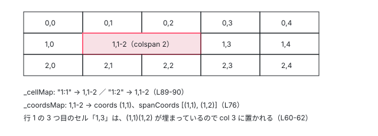

[目次](../README.md) › [Angular Aria の内側](README.md) › 第 15 回 / 全 20 回

# Grid：行と列の 2 次元を動く

> GridData がセルの行・列の広がり（rowspan / colspan）から座標の表を作り、GridFocus が今いるセルと座標を別々に持ち、GridNavigation が 3 種類の折り返しで上下左右・行の端へ動き、GridSelection が範囲の中のセルを選ぶ行。Behavior に残る selectionAnchor の linkedSignal と、キーとマウスからの範囲選択を外した 2a13f69e03、無効なセルを roving tabindex の計算から外した修正、大きな表で遅かった 2 つの問題（pointermove・セルの host のバインディング）の直し方。

angular/components · 読了 約 14 分 · 発展 · [サイトで読む（デモが動きます）](https://angular-deep-dive-cyan.vercel.app/chapter/aria-grid)

---

グリッド（`role="grid"`）は、行と列の 2 次元を矢印キーで動く部品です。リストの Behavior（第 5〜7 回）は 1 次元なので、grid には専用の Behavior が 5 つあります。この章では、`GridData` が rowspan / colspan からセルの座標の表を作り、`GridFocus` が「今いるセル」と「今いる座標」を別々に持ち、`GridNavigation` が 3 種類の折り返し（`continuous` / `loop` / `nowrap`）で次のセルを探し、`GridSelection` が範囲の中のセルを選ぶ行を読みます。最後に、大きな grid で遅かった 2 つの問題と、無効なセルを roving tabindex から外した修正を読みます。

読む対象は `src/aria/private/behaviors/grid/` の `grid-data.ts`・`grid-focus.ts`・`grid-navigation.ts`・`grid-selection.ts`・`grid.ts`、`src/aria/private/grid/grid.ts`（`GridPattern`）、`src/aria/grid/grid.ts`（`ngGrid`）です（../components、e81c398a86。このサイトの 22.1.8 と同じ中身）。セルの中のウィジェットと行・セルのディレクティブは[第 16 回](16-aria-grid-cells.md)で読みます。

1. [1. 全体像](01-aria-overview.md)
2. [2. SignalLike](02-aria-signal-like.md)
3. [3. SortedCollection](03-aria-collection.md)
4. [4. イベントマネージャ](04-aria-events.md)
5. [5. ListFocus](05-aria-list-focus.md)
6. [6. ListNavigation](06-aria-list-navigation.md)
7. [7. ListSelection](07-aria-list-selection.md)
8. [8. ListTypeahead](08-aria-typeahead.md)
9. [9. Listbox](09-aria-listbox.md)
10. [10. Accordion](10-aria-accordion.md)
11. [11. DeferredContent](11-aria-deferred-content.md)
12. [12. Tabs](12-aria-tabs.md)
13. [13. Toolbar](13-aria-toolbar.md)
14. [14. Tree](14-aria-tree.md)
15. **15. Grid**（この章）
16. [16. Grid のセル](16-aria-grid-cells.md)
17. [17. Combobox](17-aria-combobox.md)
18. [18. Menu](18-aria-menu.md)
19. [19. テスト](19-aria-testing.md)
20. [20. issue と PR を読む](20-aria-issues.md)

## 1. GridData：rowspan / colspan から座標の表を作る

📄 `components/src/aria/private/behaviors/grid/grid-data.ts` L44–83 （▶ の行: 50, 52, 54, 58, 60–61, 64–65, 72–73, 76, 78）

```ts
44 │   readonly maxRowCount = computed<number>(() => Math.max(...this._rowCountByCol().values(), 0));
45 │ 
46 │   /** The maximum number of columns in the grid, accounting for column spans. */
47 │   readonly maxColCount = computed<number>(() => Math.max(...this._colCountsByRow().values(), 0));
48 │ 
49 │   /** A map from a cell to its primary and spanned coordinates. */
50 ▶   private readonly _coordsMap = computed<Map<T, {coords: RowCol; spanCoords: RowCol[]}>>(() => {
51 │     const coordsMap = new Map();
52 ▶     const visitedCoords = new Set();
53 │ 
54 ▶     for (let rowIndex = 0; rowIndex < this.cells().length; rowIndex++) {
55 │       let colIndex = 0;
56 │       const row = this.cells()[rowIndex];
57 │ 
58 ▶       for (const cell of row) {
59 │         // Skip past cells that are already taken.
60 ▶         while (visitedCoords.has(`${rowIndex}:${colIndex}`)) {
61 ▶           colIndex++;
62 │         }
63 │ 
64 ▶         const rowspan = cell.rowSpan();
65 ▶         const colspan = cell.colSpan();
66 │         const spanCoords: RowCol[] = [];
67 │ 
68 │         for (let rowOffset = 0; rowOffset < rowspan; rowOffset++) {
69 │           const row = rowIndex + rowOffset;
70 │           for (let colOffset = 0; colOffset < colspan; colOffset++) {
71 │             const col = colIndex + colOffset;
72 ▶             visitedCoords.add(`${row}:${col}`);
73 ▶             spanCoords.push({row, col});
74 │           }
75 │         }
76 ▶         coordsMap.set(cell, {coords: spanCoords[0], spanCoords});
77 │ 
78 ▶         colIndex += colspan;
79 │       }
80 │     }
81 │ 
82 │     return coordsMap;
83 │   });
```

入力の `cells` は「行の配列の配列」です（`GridPattern` が行ごとのセルを集めて渡す。6 節）。行の中のセルには、自分が何列目かという情報がありません。それを決めるのが `_coordsMap` です。

1. **52 行目 埋まった座標の Set**

   `"行:列"` の文字列で、どの座標がもう誰かに使われたかを覚えます。
2. **58〜62 行目 次のセルの列を決める**

   行の中のセルを順に見て、`colIndex` を**埋まった座標の分だけ飛ばします**。上の行から rowspan で垂れてきたセルの場所は空いていないので、その右から置きます。
3. **64〜75 行目 広がる範囲を全部埋める**

   rowspan × colspan の長方形の座標を全部 `visitedCoords` に入れ、`spanCoords` にためます。
4. **76・78 行目 左上が「そのセルの座標」**

   `coords: spanCoords[0]`（長方形の左上）を、そのセルの座標として覚えます。78 行目で colspan の分だけ列を進めます。

📄 `components/src/aria/private/behaviors/grid/grid-data.ts` L85–109 （▶ の行: 86, 88–90, 97, 102–104）

```ts
 85 │   /** A map from a coordinate string to the cell at that coordinate. */
 86 ▶   private readonly _cellMap = computed<Map<CoordString, T>>(() => {
 87 │     const cellMap = new Map();
 88 ▶     for (const [cell, {spanCoords}] of this._coordsMap().entries()) {
 89 ▶       for (const {row, col} of spanCoords) {
 90 ▶         cellMap.set(`${row}:${col}`, cell);
 91 │       }
 92 │     }
 93 │     return cellMap;
 94 │   });
 95 │ 
 96 │   /** A map from a row index to the number of columns in that row. */
 97 ▶   private readonly _colCountsByRow = computed<Map<number, number>>(() => {
 98 │     const colCountByRow = new Map();
 99 │     for (const [_, {spanCoords}] of this._coordsMap().entries()) {
100 │       for (const {row, col} of spanCoords) {
101 │         const colCount = colCountByRow.get(row);
102 ▶         const newColCount = col + 1;
103 ▶         if (colCount === undefined || colCount < newColCount) {
104 ▶           colCountByRow.set(row, newColCount);
105 │         }
106 │       }
107 │     }
108 │     return colCountByRow;
109 │   });
```

逆向きの表 `_cellMap` は、**広がった座標の全部**を同じセルに向けます（89〜90 行目）。だから colspan が 2 のセルは、`getCell({row: 1, col: 1})` でも `getCell({row: 1, col: 2})` でも見つかります。97〜109 行目は行ごとの列の数（いちばん右の列 + 1）で、行によって長さが違う grid（spec の「jagged grid」）にも対応します。44・47 行目の `maxRowCount` / `maxColCount` はその最大です。



*デモの 5×5。行 1 の「1,1-2」は colspan 2 で、座標 (1,1) と (1,2) の両方から同じセルが引ける。セルの座標は左上の (1,1)*

## 2. GridFocus：今いるセルと、今いる座標

📄 `components/src/aria/private/behaviors/grid/grid-focus.ts` L42–78 （▶ の行: 45, 48, 51, 64, 70, 72, 74–77）

```ts
42 │ /** Controls focus for a 2D grid of cells. */
43 │ export class GridFocus<T extends GridFocusCell> {
44 │   /** The current active cell. */
45 ▶   readonly activeCell: WritableSignalLike<T | undefined> = signal(undefined);
46 │ 
47 │   /** The current active cell coordinates. */
48 ▶   readonly activeCoords = signal<RowCol>({row: -1, col: -1});
49 │ 
50 │   /** Whether the grid active state is empty (no active cell or coordinates). */
51 ▶   readonly stateEmpty = computed(
52 │     () =>
53 │       this.activeCell() === undefined ||
54 │       (this.activeCoords().row === -1 && this.activeCoords().col === -1),
55 │   );
56 │ 
57 │   /**
58 │    * Whether the grid focus state is stale.
59 │    *
60 │    * A stale state means the active cell or coordinates are no longer valid based on the
61 │    * current grid data, for example if the underlying cells have changed.
62 │    * A stale state should be re-initialized.
63 │    */
64 ▶   readonly stateStale = computed(() => {
65 │     if (this.stateEmpty()) {
66 │       return true;
67 │     }
68 │ 
69 │     const activeCell = this.activeCell();
70 ▶     const activeCellCoords = this.inputs.grid.getCoords(activeCell!);
71 │     const activeCoords = this.activeCoords();
72 ▶     const activeCoordsCell = this.inputs.grid.getCell(activeCoords);
73 │ 
74 ▶     const activeCellNotValid = activeCellCoords === undefined;
75 ▶     const activeCellMismatch = activeCell !== activeCoordsCell;
76 ▶     const activeCellNotFocusable = !this.isFocusable(activeCell!);
77 ▶     return activeCellNotValid || activeCellMismatch || activeCellNotFocusable;
78 │   });
```

- 45・48 行目 `activeCell`（セル）と `activeCoords`（座標）を**別々の signal** で持ちます。広がったセルでは、同じセルに複数の座標があるからです（下の `focusCoordinates`）。
- 64〜78 行目 `stateStale`（今の状態が古くなった）は、セルが表から消えた（74 行目）、座標のセルと今いるセルが違う（75 行目）、今いるセルにもう止まれない（76 行目）のどれかです。76 行目は b211bf15f7（#33566 の修正、2026-07-23）で足されました（7 節）。

📄 `components/src/aria/private/behaviors/grid/grid-focus.ts` L98–122 （▶ の行: 99–100, 103, 109, 113, 116, 120–121）

```ts
 98 │   /** The tab index for the grid container. */
 99 ▶   readonly gridTabIndex = computed<-1 | 0>(() => {
100 ▶     if (this.gridDisabled()) {
101 │       return 0;
102 │     }
103 ▶     return this.inputs.focusMode() === 'activedescendant' ? 0 : -1;
104 │   });
105 │ 
106 │   constructor(readonly inputs: GridFocusInputs & GridFocusDeps<T>) {}
107 │ 
108 │   /** Returns the tab index for the given grid cell cell. */
109 ▶   getCellTabIndex(cell: T): -1 | 0 {
110 │     if (this.gridDisabled()) {
111 │       return -1;
112 │     }
113 ▶     if (this.inputs.focusMode() === 'activedescendant') {
114 │       return -1;
115 │     }
116 ▶     return this.activeCell() === cell ? 0 : -1;
117 │   }
118 │ 
119 │   /** Returns true if the given cell can be navigated to. */
120 ▶   isFocusable(cell: T): boolean {
121 ▶     return this.inputs.grid.hasCell(cell) && (!cell.disabled() || this.inputs.softDisabled());
122 │   }
```

📄 `components/src/aria/private/behaviors/grid/grid-focus.ts` L124–163 （▶ の行: 130, 138–139, 150, 152, 160–161）

```ts
124 │   /** Focuses the given cell. */
125 │   focusCell(cell: T): boolean {
126 │     if (this.gridDisabled()) {
127 │       return false;
128 │     }
129 │ 
130 ▶     if (!this.isFocusable(cell)) {
131 │       return false;
132 │     }
133 │ 
134 │     if (this.inputs.grid.getCoords(cell) === undefined) {
135 │       return false;
136 │     }
137 │ 
138 ▶     this.activeCoords.set(this.inputs.grid.getCoords(cell)!);
139 ▶     this.activeCell.set(cell);
140 │ 
141 │     return true;
142 │   }
143 │ 
144 │   /** Moves focus to the cell at the given coordinates if it's part of a focusable cell. */
145 │   focusCoordinates(coords: RowCol): boolean {
146 │     if (this.gridDisabled()) {
147 │       return false;
148 │     }
149 │ 
150 ▶     const cell = this.inputs.grid.getCell(coords);
151 │ 
152 ▶     if (!cell || !this.isFocusable(cell)) {
153 │       return false;
154 │     }
155 │ 
156 │     if (this.inputs.grid.getCell(coords) === undefined) {
157 │       return false;
158 │     }
159 │ 
160 ▶     this.activeCoords.set(coords);
161 ▶     this.activeCell.set(this.inputs.grid.getCell(coords));
162 │ 
163 │     return true;
```

1. **109〜117 行目 tabindex**

   roving なら今いるセルだけ 0、ほかは -1（116 行目）。activedescendant ならセルは全部 -1 で（113 行目）、grid 自身が 0 です（103 行目）。全部のセルが無効なら grid が 0（100 行目）。
2. **120〜121 行目 止まれるか**

   表にあって、無効でないか、softDisabled（無効でも止まる）が true のとき。
3. **138 行目と 160 行目の違い**

   `focusCell(cell)` は座標を**そのセルの左上**にします（138 行目）。`focusCoordinates(coords)` は**渡された座標のまま**にします（160 行目）。デモで (0,2) から ↓ で「1,1-2」に入ると、`activeCoords` は (1,2) で、そこから ↓ なら (2,2) へ行きます。(0,1) から入れば (2,1) へ。クリックで入れば `focusCell` なので (1,1) です。

## 3. GridNavigation：3 種類の折り返し

📄 `components/src/aria/private/behaviors/grid/grid-navigation.ts` L13–30 （▶ の行: 19, 22–26, 30）

```ts
13 │ /** A utility type that ensures an object has exactly one key from a given set. */
14 │ type ExactlyOneKey<T, K extends keyof T = keyof T> = {
15 │   [P in K]: Record<P, T[P]> & Partial<Record<Exclude<K, P>, never>>;
16 │ }[K];
17 │ 
18 │ /** Represents a directional change in the grid, either by row or by column. */
19 ▶ type Delta = ExactlyOneKey<{row: -1 | 1; col: -1 | 1}>;
20 │ 
21 │ /** Constants for the four cardinal directions. */
22 ▶ export const direction: Record<'Up' | 'Down' | 'Left' | 'Right', Delta> = {
23 ▶   Up: {row: -1},
24 ▶   Down: {row: 1},
25 ▶   Left: {col: -1},
26 ▶   Right: {col: 1},
27 │ } as const;
28 │ 
29 │ /** The wrapping behavior for keyboard navigation. */
30 ▶ export type WrapStrategy = 'continuous' | 'loop' | 'nowrap';
```

📄 `components/src/aria/private/behaviors/grid/grid-navigation.ts` L75–114 （▶ の行: 81, 89–90, 98–100, 102–104）

```ts
 75 │   peek(
 76 │     direction: Delta,
 77 │     fromCoords: RowCol,
 78 │     wrap?: WrapStrategy,
 79 │     allowDisabled?: boolean,
 80 │   ): RowCol | undefined {
 81 ▶     wrap = wrap ?? (direction.row !== undefined ? this.inputs.rowWrap() : this.inputs.colWrap());
 82 │     return this._peekDirectional(direction, fromCoords, wrap, allowDisabled);
 83 │   }
 84 │ 
 85 │   /**
 86 │    * Navigates to the next focusable cell in a given direction.
 87 │    */
 88 │   advance(direction: Delta): boolean {
 89 ▶     const nextCoords = this.peek(direction, this.inputs.gridFocus.activeCoords());
 90 ▶     return !!nextCoords && this.gotoCoords(nextCoords);
 91 │   }
 92 │ 
 93 │   /**
 94 │    * Gets the coordinates of the first focusable cell.
 95 │    * If a row is not provided, searches the entire grid.
 96 │    */
 97 │   peekFirst(row?: number, allowDisabled?: boolean): RowCol | undefined {
 98 ▶     const fromCoords = {
 99 ▶       row: row ?? 0,
100 ▶       col: -1,
101 │     };
102 ▶     return row === undefined
103 ▶       ? this._peekDirectional(direction.Right, fromCoords, 'continuous', allowDisabled)
104 ▶       : this._peekDirectional(direction.Right, fromCoords, 'nowrap', allowDisabled);
105 │   }
106 │ 
107 │   /**
108 │    * Navigates to the first focusable cell.
109 │    * If a row is not provided, searches the entire grid.
110 │    */
111 │   first(row?: number): boolean {
112 │     const nextCoords = this.peekFirst(row);
113 │     return !!nextCoords && this.gotoCoords(nextCoords);
114 │   }
```

動く向き（`Delta`）は「行を ±1」か「列を ±1」のどちらか 1 つだけです（19 行目の `ExactlyOneKey`）。81 行目で、上下（`direction.row` がある）なら `rowWrap`、左右なら `colWrap` の折り返し方を使います。行の最初を探す `peekFirst(row)` は (row, -1) から右へ `nowrap` で（104 行目）、grid 全体の最初は (0, -1) から `continuous` で探します（103 行目）。

📄 `components/src/aria/private/behaviors/grid/grid-navigation.ts` L142–181 （▶ の行: 150, 157–158, 164, 167–169, 172, 175, 177–179）

```ts
142 │   private _peekDirectional(
143 │     delta: Delta,
144 │     fromCoords: RowCol,
145 │     wrap: 'continuous' | 'loop' | 'nowrap',
146 │     allowDisabled: boolean = false,
147 │   ): RowCol | undefined {
148 │     if (this.inputs.gridFocus.gridDisabled()) return undefined;
149 │ 
150 ▶     const fromCell = this.inputs.grid.getCell(fromCoords);
151 │     const maxRowCount = this.inputs.grid.maxRowCount();
152 │     const maxColCount = this.inputs.grid.maxColCount();
153 │     const rowDelta = delta.row ?? 0;
154 │     const colDelta = delta.col ?? 0;
155 │     let nextCoords = {...fromCoords};
156 │ 
157 ▶     for (let step = 0; step < this._maxSteps(); step++) {
158 ▶       const isWrapping =
159 │         nextCoords.col + colDelta < 0 ||
160 │         nextCoords.col + colDelta >= maxColCount ||
161 │         nextCoords.row + rowDelta < 0 ||
162 │         nextCoords.row + rowDelta >= maxRowCount;
163 │ 
164 ▶       if (wrap === 'nowrap' && isWrapping) return undefined;
165 │ 
166 │       if (wrap === 'continuous') {
167 ▶         const generalDelta = delta.row ?? delta.col;
168 ▶         const rowStep = isWrapping ? generalDelta : rowDelta;
169 ▶         const colStep = isWrapping ? generalDelta : colDelta;
170 │ 
171 │         // Reaching start or end.
172 ▶         const bothWrapping =
173 │           (nextCoords.row + rowStep >= maxRowCount && nextCoords.col + colStep >= maxColCount) ||
174 │           (nextCoords.row + rowStep < 0 && nextCoords.col + colStep < 0);
175 ▶         if (bothWrapping) return undefined;
176 │ 
177 ▶         nextCoords = {
178 ▶           row: (nextCoords.row + rowStep + maxRowCount) % maxRowCount,
179 ▶           col: (nextCoords.col + colStep + maxColCount) % maxColCount,
180 │         };
181 │       }
```

📄 `components/src/aria/private/behaviors/grid/grid-navigation.ts` L183–213 （▶ の行: 184–186, 191–192, 198, 202, 204–206, 208）

```ts
183 │       if (wrap === 'loop') {
184 ▶         nextCoords = {
185 ▶           row: (nextCoords.row + rowDelta + maxRowCount) % maxRowCount,
186 ▶           col: (nextCoords.col + colDelta + maxColCount) % maxColCount,
187 │         };
188 │       }
189 │ 
190 │       if (wrap === 'nowrap') {
191 ▶         nextCoords = {
192 ▶           row: nextCoords.row + rowDelta,
193 │           col: nextCoords.col + colDelta,
194 │         };
195 │       }
196 │ 
197 │       // Back to original coordinates.
198 ▶       if (nextCoords.row === fromCoords.row && nextCoords.col === fromCoords.col) {
199 │         return undefined;
200 │       }
201 │ 
202 ▶       const nextCell = this.inputs.grid.getCell(nextCoords);
203 │       if (
204 ▶         nextCell !== undefined &&
205 ▶         nextCell !== fromCell &&
206 ▶         (allowDisabled || this.inputs.gridFocus.isFocusable(nextCell))
207 │       ) {
208 ▶         return nextCoords;
209 │       }
210 │     }
211 │ 
212 │     return undefined;
213 │   }
```

1. **157 行目 1 マスずつ、最大で全マス数**

   `_maxSteps` は `maxRowCount × maxColCount`。1 マスずつ進み、止まれるセルが見つかったら返します。全部無効でも、この回数で終わります。
2. **158〜164 行目 nowrap は端で終わり**

   次の 1 マスが表の外なら `undefined`（動かない）。
3. **183〜188 行目 loop は同じ行（列）の反対の端へ**

   `% maxColCount` で回るだけです。→ で行の右端を越えると、同じ行の左端へ。grid の入力の既定は `rowWrap` も `colWrap` も `'loop'` です（8 節）。
4. **166〜181 行目 continuous は隣の行（列）へ**

   端を越えるとき（`isWrapping`）だけ、行と列の両方を `generalDelta`（+1 か -1）進めます（168〜169 行目）。→ で行の右端を越えると、次の行の左端へ。172〜175 行目で、grid の最後のマスから先、最初のマスから前へは行かず `undefined` にします。
5. **198〜209 行目 止まってよいセルか**

   一周して元の座標に戻ったら終わり（198 行目）。セルがあって（204 行目）、**出発したセルと違って**（205 行目）、止まれる（206 行目）なら、その座標を返します。205 行目があるので、colspan のセルの中で → を押しても、同じセルの次の座標には止まらず、その右のセルまで進みます。

## 4. GridSelection：範囲の中のセル、undo のための記録

📄 `components/src/aria/private/behaviors/grid/grid-selection.ts` L35–62 （▶ の行: 37, 42–44, 46, 50–51, 60–61）

```ts
35 │ export class GridSelection<T extends GridSelectionCell> {
36 │   /** The list of cells that were changed in the last selection operation. */
37 ▶   private readonly _undoList: WritableSignalLike<[T, boolean][]> = signal([]);
38 │ 
39 │   constructor(readonly inputs: GridSelectionInputs & GridSelectionDeps<T>) {}
40 │ 
41 │   /** Reverts the last selection change. */
42 ▶   undo(): void {
43 ▶     for (const [cell, oldState] of this._undoList()) {
44 ▶       cell.selected.set(oldState);
45 │     }
46 ▶     this._undoList.set([]);
47 │   }
48 │ 
49 │   /** Selects one or more cells in a given range. */
50 ▶   select(fromCoords: RowCol, toCoords?: RowCol): void {
51 ▶     this._updateState(fromCoords, toCoords ?? fromCoords, () => true);
52 │   }
53 │ 
54 │   /** Deselects one or more cells in a given range. */
55 │   deselect(fromCoords: RowCol, toCoords?: RowCol): void {
56 │     this._updateState(fromCoords, toCoords ?? fromCoords, () => false);
57 │   }
58 │ 
59 │   /** Toggles the selection state of one or more cells in a given range. */
60 ▶   toggle(fromCoords: RowCol, toCoords?: RowCol): void {
61 ▶     this._updateState(fromCoords, toCoords ?? fromCoords, oldState => !oldState);
62 │   }
```

📄 `components/src/aria/private/behaviors/grid/grid-selection.ts` L87–122 （▶ の行: 89, 92–93, 96, 98–99, 115, 117–119, 121）

```ts
 87 │   /** A generator that yields all cells within a given range. */
 88 │   *_validCells(fromCoords: RowCol, toCoords: RowCol): Generator<T> {
 89 ▶     const startRow = Math.min(fromCoords.row, toCoords.row);
 90 │     const startCol = Math.min(fromCoords.col, toCoords.col);
 91 │     const endRow = Math.max(fromCoords.row, toCoords.row);
 92 ▶     const endCol = Math.max(fromCoords.col, toCoords.col);
 93 ▶     const visited = new Set<T>();
 94 │     for (let row = startRow; row < endRow + 1; row++) {
 95 │       for (let col = startCol; col < endCol + 1; col++) {
 96 ▶         const cell = this.inputs.grid.getCell({row, col});
 97 │         if (cell === undefined) continue;
 98 ▶         if (!this.isSelectable(cell)) continue;
 99 ▶         if (visited.has(cell)) continue;
100 │         visited.add(cell);
101 │         yield cell;
102 │       }
103 │     }
104 │   }
105 │ 
106 │   /**
107 │    * Updates the selection state of cells in a given range and preserves previous changes
108 │    * to a undo list.
109 │    */
110 │   private _updateState(
111 │     fromCoords: RowCol,
112 │     toCoords: RowCol,
113 │     stateFn: (oldState: boolean) => boolean,
114 │   ): void {
115 ▶     const undoList: [T, boolean][] = [];
116 │     for (const cell of this._validCells(fromCoords, toCoords)) {
117 ▶       const oldState = cell.selected();
118 ▶       undoList.push([cell, oldState]);
119 ▶       cell.selected.set(stateFn(oldState));
120 │     }
121 ▶     this._undoList.set(undoList);
122 │   }
```

- 選択の状態は**セルが持ちます**（`cell.selected` は `WritableSignalLike`、ディレクティブでは `ngGridCell` の `[(selected)]`）。`GridSelection` は「どのセルを書き換えるか」を決めるだけです。
- 88〜104 行目 `_validCells` は 2 つの座標が作る長方形のマスを全部見て、選べるセル（`selectable` かつ無効でない）を 1 回ずつ返します。広がったセルは 99 行目で 2 回目を飛ばします。
- 110〜122 行目 書き換える前の値を `_undoList` に入れておき（118 行目）、42〜47 行目の `undo()` で直前の 1 回ぶんを戻せます。

## 5. Grid Behavior：selectionAnchor と selectionStabled

📄 `components/src/aria/private/behaviors/grid/grid.ts` L53–83 （▶ の行: 68, 71, 74, 77–78, 81–82）

```ts
53 │ /** The main class that orchestrates the grid behaviors. */
54 │ export class Grid<T extends GridCell> {
55 │   /** The underlying data structure for the grid. */
56 │   readonly data: GridData<T>;
57 │ 
58 │   /** Controls focus for the grid. */
59 │   readonly focusBehavior: GridFocus<T>;
60 │ 
61 │   /** Controls navigation for the grid. */
62 │   readonly navigationBehavior: GridNavigation<T>;
63 │ 
64 │   /** Controls selection for the grid. */
65 │   readonly selectionBehavior: GridSelection<T>;
66 │ 
67 │   /** The anchor point for range selection, linked to the active coordinates. */
68 ▶   readonly selectionAnchor = linkedSignal<RowCol>(() => this.focusBehavior.activeCoords());
69 │ 
70 │   /** The cell at the selection anchor. */
71 ▶   readonly selectionAnchorCell = computed(() => this.data.getCell(this.selectionAnchor()));
72 │ 
73 │   /** Whether a range selection has settled. */
74 ▶   readonly selectionStabled = signal(true);
75 │ 
76 │   /** Whether all selectable cells are selected. */
77 ▶   readonly allSelected: SignalLike<boolean> = computed(() =>
78 ▶     this.data
79 │       .cells()
80 │       .flat()
81 ▶       .filter(c => this.selectionBehavior.isSelectable(c))
82 ▶       .every(c => c.selected()),
83 │   );
```

📄 `components/src/aria/private/behaviors/grid/grid.ts` L127–151 （▶ の行: 131–133, 135）

```ts
127 │   /** Navigates to the cell above the currently active cell. */
128 │   up(opts: NavOptions = {}): boolean {
129 │     return this._navigateWithSelection(
130 │       () =>
131 ▶         opts.anchor
132 ▶           ? this._updateSelectionAnchor(() =>
133 ▶               this.navigationBehavior.peek(direction.Up, this.selectionAnchor(), 'nowrap', true),
134 │             )
135 ▶           : this.navigationBehavior.advance(direction.Up),
136 │       opts,
137 │     );
138 │   }
139 │ 
140 │   /** Navigates to the cell below the currently active cell. */
141 │   down(opts: NavOptions = {}): boolean {
142 │     return this._navigateWithSelection(
143 │       () =>
144 │         opts.anchor
145 │           ? this._updateSelectionAnchor(() =>
146 │               this.navigationBehavior.peek(direction.Down, this.selectionAnchor(), 'nowrap', true),
147 │             )
148 │           : this.navigationBehavior.advance(direction.Down),
149 │       opts,
150 │     );
151 │   }
```

📄 `components/src/aria/private/behaviors/grid/grid.ts` L377–413 （▶ の行: 379, 382, 388–389, 391–392, 400）

```ts
377 │   /** Updates the selection anchor to the given coordinates. */
378 │   private _updateSelectionAnchor(peekFn: () => RowCol | undefined): boolean {
379 ▶     const coords = peekFn();
380 │     const success = coords !== undefined;
381 │     if (!success) return false;
382 ▶     this.selectionAnchor.set(coords);
383 │     return success;
384 │   }
385 │ 
386 │   /** Updates the selection to include all cells between the anchor and the active cell. */
387 │   private _updateRangeSelection(): void {
388 ▶     if (!this.selectionStabled()) {
389 ▶       this.selectionBehavior.undo();
390 │     }
391 ▶     this.selectionBehavior.select(
392 ▶       ...this._getSelectionCoords(this.focusBehavior.activeCoords(), this.selectionAnchor()),
393 │     );
394 │   }
395 │ 
396 │   /** Gets the start and end coordinates for a selection range. */
397 │   private _getSelectionCoords(startCoords: RowCol, endCoords: RowCol): [RowCol, RowCol] {
398 │     const startCell = this.data.getCell(startCoords)!;
399 │     const endCell = this.data.getCell(endCoords)!;
400 ▶     const allCoords = [...this.data.getAllCoords(startCell)!, ...this.data.getAllCoords(endCell)!];
401 │     const allRows = allCoords.map(c => c.row);
402 │     const allCols = allCoords.map(c => c.col);
403 │     const fromCoords = {
404 │       row: Math.min(...allRows),
405 │       col: Math.min(...allCols),
406 │     };
407 │     const toCoords = {
408 │       row: Math.max(...allRows),
409 │       col: Math.max(...allCols),
410 │     };
411 │ 
412 │     return [fromCoords, toCoords];
413 │   }
```

📄 `components/src/aria/private/behaviors/grid/grid.ts` L415–455 （▶ の行: 417, 420–422, 427, 429, 434–436, 440, 445）

```ts
415 │   /** Executes a navigation operation and applies selection options. */
416 │   private _navigateWithSelection(op: () => boolean, opts: NavOptions = {}): boolean {
417 ▶     const success = op();
418 │     if (!success) return false;
419 │ 
420 ▶     if (opts.anchor) {
421 ▶       this._updateRangeSelection();
422 ▶       this.selectionStabled.set(false);
423 │       return success;
424 │     }
425 │ 
426 │     // Selection becomes stable after the active cell/coords moved.
427 ▶     this.selectionStabled.set(true);
428 │ 
429 ▶     if (opts.select) {
430 │       this.select();
431 │       return success;
432 │     }
433 │ 
434 ▶     if (opts.selectOne) {
435 ▶       this.deselectAll();
436 ▶       this.select();
437 │       return success;
438 │     }
439 │ 
440 ▶     if (opts.toggle) {
441 │       this.toggle();
442 │       return success;
443 │     }
444 │ 
445 ▶     if (opts.toggleOne) {
446 │       const selected = !!this.focusBehavior.activeCell()?.selected();
447 │       this.deselectAll();
448 │       if (!selected) {
449 │         this.select();
450 │       }
451 │       return success;
452 │     }
453 │ 
454 │     return success;
455 │   }
```

1. **68 行目 アンカーは今いる座標に「つながった」signal**

   `linkedSignal(() => activeCoords())` は、今いる座標が変わるたびにその値に戻り、そのあいだは `set` で別の値にもできる signal です（[第 2 回](02-aria-signal-like.md)）。範囲選択の「もう一方の端」を、今いるセルを動かさずに動かすために使います。
2. **131〜135 行目 opts.anchor のとき、動くのはアンカー**

   `anchor: true` なら、`advance`（今いるセルを動かす）ではなく、アンカーから 1 マス先を `nowrap`・無効も含めて `peek` し（133 行目）、382 行目でアンカーにします。今いるセルは動きません。
3. **420〜424・388〜393 行目 範囲を選び直す**

   動けたら `_updateRangeSelection`。前の範囲選択がまだ「落ち着いていない」（`selectionStabled` が false）なら、389 行目で前の 1 回ぶんを `undo` してから、今いるセルとアンカーの長方形を選びます。400 行目で両端のセルの広がった座標を全部入れてから min / max を取るので、colspan のセルが端にあっても長方形からはみ出しません。選んだあと 422 行目で `selectionStabled` を false にします。
4. **427 行目 ふつうに動いたら落ち着く**

   アンカーを使わずに動いたら true に戻し、`select` / `selectOne` / `toggle` / `toggleOne` のうち渡されたものをします（429〜452 行目）。

> [!WARNING]
> **ハマりどころ**
>
> この範囲選択の仕組み（`anchor: true`）は Behavior に残っていますが、**キーやマウスから呼ぶ行は今の `GridPattern` にありません**。2a13f69e03（2026-04-14、PR #33055 `refactor(aria/grid): remove range selection to reduce computational overhead`）が、Shift + 矢印・Shift + Home / End・Shift + クリック・ドラッグ（pointermove）で `anchor: true` を渡す行と、`enableRangeSelection` の入力を消しました。src/aria を `grep -rn "anchor: true"` すると、grid で `anchor: true` を渡しているのは behaviors/grid/grid.spec.ts の ``it('should range select on navigate when `anchor` is true')``（:186 の行）だけでした（ほかに当たる list・list-selection・tree の行は、それぞれの Behavior の既定の引数で、grid とは別のものです）。この変更は v22.1.8 に入っていて（`git merge-base --is-ancestor` で確かめた）、デモでも Shift + 矢印は何もしません。`GridPattern` の `dragging` の signal は、使う行が無いまま残っています。

## 6. GridPattern：キーとクリック

📄 `components/src/aria/private/grid/grid.ts` L98–137 （▶ の行: 101–102, 106–107, 110, 114, 116, 120–122, 129, 136–137）

```ts
 98 │   readonly keydown = computed(() => {
 99 │     const manager = new KeyboardEventManager();
100 │ 
101 ▶     if (this.pauseNavigation()) {
102 ▶       return manager;
103 │     }
104 │ 
105 │     // Navigation handlers.
106 ▶     const opts: NavOptions = {
107 ▶       selectOne: this.inputs.enableSelection() && this.inputs.selectionMode() === 'follow',
108 │     };
109 │     manager
110 ▶       .on('ArrowUp', () => this.gridBehavior.up(opts), {ignoreRepeat: false})
111 │       .on('ArrowDown', () => this.gridBehavior.down(opts), {ignoreRepeat: false})
112 │       .on(this.prevColKey(), () => this.gridBehavior.left(opts), {ignoreRepeat: false})
113 │       .on(this.nextColKey(), () => this.gridBehavior.right(opts), {ignoreRepeat: false})
114 ▶       .on('Home', () => this.gridBehavior.firstInRow(opts))
115 │       .on('End', () => this.gridBehavior.lastInRow(opts))
116 ▶       .on([Modifier.Ctrl], 'Home', () => this.gridBehavior.first(opts))
117 │       .on([Modifier.Ctrl], 'End', () => this.gridBehavior.last(opts));
118 │ 
119 │     // Basic explicit selection handlers.
120 ▶     if (this.inputs.enableSelection() && this.inputs.selectionMode() === 'explicit') {
121 ▶       manager.on(/Enter| /, () =>
122 ▶         this.inputs.multi() ? this.gridBehavior.toggle() : this.gridBehavior.toggleOne(),
123 │       );
124 │     }
125 │ 
126 │     // Explicit multiselection modifier handlers.
127 │     if (this.inputs.enableSelection() && this.inputs.multi()) {
128 │       manager
129 ▶         .on([Modifier.Ctrl, Modifier.Meta], 'A', () => {
130 │           if (this.gridBehavior.allSelected()) {
131 │             this.gridBehavior.deselectAll();
132 │           } else {
133 │             this.gridBehavior.selectAll();
134 │           }
135 │         })
136 ▶         .on([Modifier.Shift], ' ', () => this.gridBehavior.selectRow())
137 ▶         .on([Modifier.Ctrl, Modifier.Meta], ' ', () => this.gridBehavior.selectCol());
```

1. **101〜103 行目 セルの中のウィジェットが使っている間は、何も受けない**

   `pauseNavigation`（どれかのセルのウィジェットが activate されている）なら、空の表を返します。中身は[第 16 回](16-aria-grid-cells.md)です。
2. **106〜117 行目 動くキー**

   ↑ / ↓ / ← / →（左右は rtl で入れ替わる）、Home / End は**行の**最初と最後、Ctrl + Home / End は grid 全体の最初と最後。`selectionMode` が `'follow'`（既定）なら、動いた先だけを選びます（107 行目の `selectOne`）。どれも修飾キーの無いときだけ当たるので（[第 4 回](04-aria-events.md)の `hasModifiers` は完全一致）、Shift + 矢印は表に当たりません。
3. **120〜124 行目 explicit のときの Enter / Space**

   複数選択なら `toggle`、単一なら `toggleOne`（ほかを外して今のセルを切り替える）。
4. **127〜137 行目 複数選択のとき**

   Ctrl / Meta + A で全部を選ぶか全部外す、Shift + Space で行、Ctrl / Meta + Space で列を選びます（どれも、ほかの選択を全部外してから）。

📄 `components/src/aria/private/grid/grid.ts` L143–182 （▶ の行: 148, 150–151, 153, 158, 163–166, 171, 176）

```ts
143 │   /** The click event manager for the grid. */
144 │   readonly clickManager = computed(() => {
145 │     const manager = new ClickEventManager<PointerEvent>();
146 │ 
147 │     // Navigation without selection.
148 ▶     if (!this.inputs.enableSelection()) {
149 │       manager.on(e => {
150 ▶         const cell = this.inputs.getCell(_getEventTarget(e));
151 ▶         if (!cell || !this.gridBehavior.focusBehavior.isFocusable(cell)) return;
152 │ 
153 ▶         this.gridBehavior.gotoCell(cell);
154 │       });
155 │     }
156 │ 
157 │     // Navigation with selection.
158 ▶     if (this.inputs.enableSelection()) {
159 │       manager.on(e => {
160 │         const cell = this.inputs.getCell(_getEventTarget(e));
161 │         if (!cell || !this.gridBehavior.focusBehavior.isFocusable(cell)) return;
162 │ 
163 ▶         this.gridBehavior.gotoCell(cell, {
164 ▶           selectOne: this.inputs.selectionMode() === 'follow',
165 ▶           toggleOne: this.inputs.selectionMode() === 'explicit' && !this.inputs.multi(),
166 ▶           toggle: this.inputs.selectionMode() === 'explicit' && this.inputs.multi(),
167 │         });
168 │       });
169 │ 
170 │       // Selection with modifier keys.
171 ▶       if (this.inputs.multi()) {
172 │         manager.on([Modifier.Ctrl, Modifier.Meta], e => {
173 │           const cell = this.inputs.getCell(_getEventTarget(e));
174 │           if (!cell || !this.gridBehavior.focusBehavior.isFocusable(cell)) return;
175 │ 
176 ▶           this.gridBehavior.gotoCell(cell, {toggle: true});
177 │         });
178 │       }
179 │     }
180 │ 
181 │     return manager;
182 │   });
```

📄 `components/src/aria/private/grid/grid.ts` L214–248 （▶ の行: 216, 219–220, 237–238, 241, 245–246）

```ts
214 │   /** Handles keydown events on the grid. */
215 │   onKeydown(event: KeyboardEvent) {
216 ▶     if (this.disabled()) return;
217 │ 
218 │     this.hasBeenInteracted.set(true);
219 ▶     this.activeCell()?.onKeydown(event);
220 ▶     this.keydown().handle(event);
221 │   }
222 │ 
223 │   /** Handles click events on the grid. */
224 │   onClick(event: PointerEvent) {
225 │     if (this.disabled()) return;
226 │ 
227 │     this.hasBeenInteracted.set(true);
228 │     this.clickManager().handle(event);
229 │   }
230 │ 
231 │   /** Handles focusin events on the grid. */
232 │   onFocusIn(event: FocusEvent) {
233 │     this.isFocused.set(true);
234 │     this.hasBeenInteracted.set(true);
235 │ 
236 │     // Cell that receives focus.
237 ▶     const cell = this.inputs.getCell(_getEventTarget(event));
238 ▶     if (!cell || !this.gridBehavior.focusBehavior.isFocusable(cell)) return;
239 │ 
240 │     // Pass down the focusin event to the cell.
241 ▶     cell.onFocusIn(event);
242 │ 
243 │     // Update active cell state if the cell is receiving focus by
244 │     // tabbing, pointer, or any programmatic control into a widget inside the cell.
245 ▶     if (cell !== this.activeCell()) {
246 ▶       this.gridBehavior.gotoCell(cell);
247 │     }
248 │   }
```

- 163〜167 行目 クリックは `gotoCell`（2 節の `focusCell` を通るので、座標はセルの左上）に、follow なら `selectOne`、explicit なら単一で `toggleOne`・複数で `toggle` を付けます。
- 219〜220 行目 キーは、まず今いるセルに渡し（ウィジェットが activate するかもしれない）、そのあと grid の表で処理します。セルが activate したら、220 行目で読む `keydown()` は 101 行目の分岐で空になります。
- 237〜247 行目 `focusin` で、フォーカスが入った要素のセルが今いるセルと違えば `gotoCell` します。Tab で入ったとき、マウスでセルの中のボタンを押したときなどに、今いるセルを合わせるためです。

## 7. 直した行：無効なセル（#33566）・pointermove（#32700）・大きな grid の選択（#32759）

### #33566：roving tabindex が無効なセルを選んでしまう

#33566（2026-07-22 の報告）は、`softDisabled` が false の grid で項目を消すと、次の「今いるセル」に無効なボタンのセルが選ばれ、Tab でも矢印でも grid に入れなくなる、というものでした。b211bf15f7（PR #33571 `fix(aria/grid): account for disabled cell widgets and in-place disablement in roving tabindex`）の差分は 2 か所です。

1. **grid-focus.ts 76 行目（2 節）**

   `stateStale` に「今いるセルにもう止まれない」を足しました。今いるセルがその場で無効になっても、状態が古いと判定され、`resetState`（Behavior の grid.ts）が別のセルを探し直します。
2. **private/grid/cell.ts の `disabled`**

   セルの `disabled` を、自分の入力だけでなく「中のウィジェットが無効」でも true になる `computed` にしました（行は[第 16 回](16-aria-grid-cells.md)で引用）。ボタンのウィジェットに `disabled` を付けただけのセルも、2 節の 120〜121 行目で止まれないセルになります。

### #32700：pointermove のたびに変更検知が走る

#32700（2026-01-25）の報告は、`ngGrid` が host に `(pointermove)` を無条件に付けているので、選択もドラッグも無いのにマウスを動かすたびに変更検知が走り、全セルの host のバインディングが評価し直される、というものでした。0395ca20f4（PR #32705、2026-01-27）は host の `(pointermove)` を外し、コンストラクタで zone の外にリスナーを付けて、範囲選択でドラッグしているときだけ zone に戻すようにしました。

📄 `diff: src/aria/grid/grid.ts（0395ca20f4）`

```
  constructor() {
+    const ngZone = inject(NgZone);
+
+    // Since `pointermove` fires on each pixel, we need to
+    // be careful not to hit the zone unless it's necessary.
+    ngZone.runOutsideAngular(() => {
+      this.element.addEventListener(
+        'pointermove',
+        event => {
+          if (this._pattern.acceptsPointerMove()) {
+            ngZone.run(() => this._pattern.onPointermove(event));
+          }
+        },
+        {passive: true},
+      );
+    });
```

この行は今の grid.ts にはありません。5 節の囲みの 2a13f69e03 がドラッグの範囲選択ごと消したので、`pointermove` を聞く理由が無くなりました。今の host（8 節の 63〜66 行目）は keydown・click・focusin・focusout だけです。

### #32759：大きな grid で選択が遅い

#32759（50 × 50 のような grid で、選択がもたつく）を直したのは 70f8b6aac4（PR #32766、2026-02-11）です。コミットの本文は「host のバインディングの signal の読み出しに 0 でないコストがあり、それが積み重なる。effect の中でまとめて読むようにした」と書いています。`ngGridCell` の host にあった 13 個のバインディングを消し、`afterRenderEffect` の write の中で属性を直接付けるようにしました。

📄 `70f8b6aac4 の前の ngGridCell の host（消された行）`

```
  host: {
    '[attr.role]': 'role()',
    '[attr.id]': '_pattern.id()',
    '[attr.rowspan]': '_pattern.rowSpan()',
    '[attr.colspan]': '_pattern.colSpan()',
    '[attr.data-active]': 'active()',
    '[attr.data-anchor]': '_pattern.anchor()',
    '[attr.aria-disabled]': '_pattern.disabled()',
    '[attr.aria-rowspan]': '_pattern.rowSpan()',
    '[attr.aria-colspan]': '_pattern.colSpan()',
    '[attr.aria-rowindex]': '_pattern.ariaRowIndex()',
    '[attr.aria-colindex]': '_pattern.ariaColIndex()',
    '[attr.aria-selected]': '_pattern.ariaSelected()',
    '[tabindex]': '_tabIndex()',
  },
```

📄 `components/src/aria/grid/grid-cell.ts` L120–144 （▶ の行: 121–124, 126, 131–132, 140–141）

```ts
120 │   constructor() {
121 ▶     // Note: we don't go through host bindings for these, because the
122 ▶     // effect allows us to batch the reads together which drastically
123 ▶     // improves rendering performance in large grids (see #32759).
124 ▶     afterRenderEffect({
125 │       write: () => {
126 ▶         const {_pattern: pattern, _toggleAttribute: toggle} = this;
127 │         const rowSpan = pattern.rowSpan();
128 │         const colSpan = pattern.colSpan();
129 │         toggle('role', this.role());
130 │         toggle('id', pattern.id());
131 ▶         toggle('rowspan', rowSpan);
132 ▶         toggle('colspan', colSpan);
133 │         toggle('aria-rowspan', rowSpan);
134 │         toggle('aria-colspan', colSpan);
135 │         toggle('data-active', this.active());
136 │         toggle('data-anchor', pattern.anchor());
137 │         toggle('aria-disabled', pattern.disabled());
138 │         toggle('aria-rowindex', pattern.ariaRowIndex());
139 │         toggle('aria-colindex', pattern.ariaColIndex());
140 ▶         toggle('aria-selected', pattern.ariaSelected());
141 ▶         toggle('tabindex', this._tabIndex());
142 │       },
143 │     });
144 │   }
```

124〜143 行目が、その effect です。どれか 1 つの signal が変われば、このセルの 13 個の属性を全部付け直します（値が null なら属性を外す。`_toggleAttribute` は同じファイルの下の方にある）。70f8b6aac4 のときは、今の 132 行目に当たる行が `toggle('colspan', rowSpan)` になっていて、colspan 属性に rowspan の値が入っていました。`git log -S "toggle('colspan', colSpan)"` で探すと、直したのは 72498b4943（2026-03-05、PR #32841 `fix(aria/grid): unit tests and small fixes for grid directives`）です。

## 8. ディレクティブ：ngGrid の既定

📄 `components/src/aria/grid/grid.ts` L54–69 （▶ の行: 58–59, 61–66, 68）

```ts
54 │ @Directive({
55 │   selector: '[ngGrid]',
56 │   exportAs: 'ngGrid',
57 │   host: {
58 ▶     'role': 'grid',
59 ▶     '[tabindex]': 'tabIndex() !== undefined ? tabIndex() : _pattern.tabIndex()',
60 │     '[attr.aria-disabled]': '_pattern.disabled()',
61 ▶     '[attr.aria-multiselectable]': '_pattern.multiSelectable()',
62 ▶     '[attr.aria-activedescendant]': '_pattern.activeDescendant()',
63 ▶     '(keydown)': '_pattern.onKeydown($event)',
64 ▶     '(click)': '_pattern.onClick($event)',
65 ▶     '(focusin)': '_pattern.onFocusIn($event)',
66 ▶     '(focusout)': '_pattern.onFocusOut($event)',
67 │   },
68 ▶   providers: [{provide: GRID, useExisting: Grid}],
69 │ })
```

📄 `components/src/aria/grid/grid.ts` L105–131 （▶ の行: 105, 113, 121, 124, 131）

```ts
105 ▶   readonly focusMode = input<'roving' | 'activedescendant'>('roving');
106 │ 
107 │   /**
108 │    * The wrapping behavior for keyboard navigation along the row axis.
109 │    * - `continuous`: Navigation wraps from the last row to the first, and vice-versa.
110 │    * - `loop`: Navigation wraps within the current row.
111 │    * - `nowrap`: Navigation stops at the first/last item in the row.
112 │    */
113 ▶   readonly rowWrap = input<'continuous' | 'loop' | 'nowrap'>('loop');
114 │ 
115 │   /**
116 │    * The wrapping behavior for keyboard navigation along the column axis.
117 │    * - `continuous`: Navigation wraps from the last column to the first, and vice-versa.
118 │    * - `loop`: Navigation wraps within the current column.
119 │    * - `nowrap`: Navigation stops at the first/last item in the column.
120 │    */
121 ▶   readonly colWrap = input<'continuous' | 'loop' | 'nowrap'>('loop');
122 │ 
123 │   /** Whether multiple cells in the grid can be selected. */
124 ▶   readonly multi = input(false, {transform: booleanAttribute});
125 │ 
126 │   /**
127 │    * The selection strategy used by the grid.
128 │    * - `follow`: The focused cell is automatically selected.
129 │    * - `explicit`: Cells are selected explicitly by the user (e.g., via click or spacebar).
130 │    */
131 ▶   readonly selectionMode = input<'follow' | 'explicit'>('follow');
```

📄 `components/src/aria/grid/grid.ts` L150–170 （▶ の行: 152–156, 162, 168）

```ts
150 │   constructor() {
151 │     // Use Write mode for all direct DOM focus management actions.
152 ▶     afterRenderEffect({write: () => this._pattern.setDefaultStateEffect()});
153 ▶     afterRenderEffect({write: () => this._pattern.resetStateEffect()});
154 ▶     afterRenderEffect({write: () => this._pattern.resetFocusEffect()});
155 ▶     afterRenderEffect({write: () => this._pattern.restoreFocusEffect()});
156 ▶     afterRenderEffect({write: () => this._pattern.focusEffect()});
157 │ 
158 │     // Check for any violations after the DOM has been updated.
159 │     if (typeof ngDevMode === 'undefined' || ngDevMode) {
160 │       afterRenderEffect({
161 │         read: () => {
162 ▶           reportViolations(this._pattern.validate(), this.element);
163 │         },
164 │       });
165 │     }
166 │ 
167 │     afterNextRender(() => {
168 ▶       this._collection.startObserving(this.element);
169 │     });
170 │   }
```

- 68 行目 自分を `GRID` トークンとして provide します。行の `ngGridRow` はこれを inject します（第 16 回）。
- 105・113・121・131 行目 既定は roving、`rowWrap` と `colWrap` は `'loop'`、`selectionMode` は `'follow'` です。`enableSelection` の既定は false なので、何も付けなければ選択はしません。
- 152〜156 行目 初期状態、古い状態の直し、フォーカスの戻し、消されたときのフォーカスの戻し、今いるセルが変わったときのフォーカス、の 5 つの effect をどれも write で走らせます。

## 9. デモ：本物の ngGrid（5×5、colspan を 1 つ）

> **🧪 DEMO — enableSelection・multi・selectionMode="explicit"（このサイトの @angular/aria 22.1.8。grid は snapshot と同じ中身）**
>
> Tab で grid に入り、矢印キーで動きます。Home / End（行の端）、Ctrl + Home / End、Enter / Space（切り替え）、Shift + Space（行）、Ctrl + Space（列）、Ctrl + A（全部）、Shift + 矢印（何も起きないことを確かめる）を試せます。折り返しの種類は下の選択で変えられます。キーやクリックのあと、今いるセルの `aria-rowindex` / `aria-colindex` と tabindex、`aria-selected="true"` のセルをログに出します。
>
> ▶ [このデモはサイトで動かせます](https://angular-deep-dive-cyan.vercel.app/chapter/aria-grid)

2026-11-02 にヘッドレスの Chrome でこのページを開き、本物のキー入力で確かめた結果です。

- 触る前の tabindex="0" は「0,0」だけで、「1,1-2」の `<td>` には `colspan="2"` が付いていました（7 節の 131〜132 行目）。
- 「0,2」から ↓ で「1,1-2」（`aria-colindex` は左上の列 + 1 で 2）、もう一度 ↓ で「2,2」へ。「1,0」から → で「1,1-2」、もう一度 → で「1,1-2」の 2 つ目の座標には止まらず「1,3」へ（3 節の 205 行目）。
- End で行の最後「1,4」、そこで → を押すと loop なので同じ行の「1,0」へ。Ctrl + End で「4,4」、Ctrl + Home で「0,0」。「0,0」で ↑ は「4,0」、← は「4,4」（どちらも loop）。
- Space で「0,0」が選ばれ、Shift + → を押しても、今いるセルも選択も変わりませんでした（2a13f69e03 で範囲選択が無い）。Enter でもう一度切り替えて外れます。
- Shift + Space で行 0 の 5 つ、Ctrl + Space で列 0 の 5 つ（行の選択は外れる）、Ctrl + A で 24 セル全部、もう一度 Ctrl + A で全部外れました（6 節の 127〜137 行目）。
- colWrap を continuous にして「0,4」で → を押すと「1,0」へ、← で「0,4」へ戻ります。rowWrap を nowrap にして「4,4」で ↓ は動かず、continuous の colWrap でも最後の「4,4」で → は動きませんでした（3 節の 172〜175 行目）。
- 複数選択なので `anchorCell` が出ていて、今いるセルにいつも `data-anchor` 属性が付いていました（`selectionAnchor` は今いる座標に連動し、アンカーを動かす操作が無いため）。
- クリックした「0,4」は、explicit の複数選択なので `toggle` で選ばれました（6 節の 166 行目）。

## 10. 呼び出しの連なり（→ を押す）

- 👤 `keydown ArrowRight` — ngGrid の host — *grid.ts L63*
  - `GridPattern.onKeydown(event)` — private/grid/grid.ts L215 — *今いるセルに先に渡す（L219）*
    - `keydown().handle(event)` — L220 — *pauseNavigation でなければ表を作る（L101-117）*
      - `Grid.right(opts)` — behaviors/grid/grid.ts — *anchor は付かない → advance*
        - `GridNavigation.advance(direction.Right)` — grid-navigation.ts L88
          - `peek → _peekDirectional(delta, activeCoords, colWrap)` — L81 / L142 — *同じセルを飛ばす（L205）*
          - `gotoCoords → GridFocus.focusCoordinates` — grid-focus.ts L145 — *activeCoords と activeCell（L160-161）*
      - `_navigateWithSelection` — behaviors/grid/grid.ts L416 — *follow なら deselectAll + select（L434-436）*
  - `focusEffect()` — afterRenderEffect（grid.ts L156） — *今いるセルの element.focus()*

## テストと直し方

📄 `components/src/aria/grid/grid.spec.ts` L1125–1153 （▶ の行: 1125, 1130, 1132, 1139, 1144, 1148, 1151）

```ts
1125 ▶       it('should recalculate active cell when active cell dynamically becomes disabled and softDisabled is false', async () => {
1126 │         const gridData: RowConfig[] = [
1127 │           {
1128 │             cells: [{id: 'c0-0'}, {id: 'c0-1'}, {id: 'c0-2'}],
1129 │           },
1130 ▶         ];
1131 │         await setupGrid({
1132 ▶           gridData,
1133 │           softDisabled: false,
1134 │           focusMode: 'roving',
1135 │         });
1136 │         gridInstance._pattern.setDefaultStateEffect();
1137 │         await fixture.whenStable();
1138 │ 
1139 ▶         expect(getActiveCellId()).toBe('c0-0');
1140 │ 
1141 │         // Dynamically disable c0-0 in-place
1142 │         fixture.componentInstance.gridData.set([
1143 │           {
1144 ▶             cells: [{id: 'c0-0', disabled: true}, {id: 'c0-1'}, {id: 'c0-2'}],
1145 │           },
1146 │         ]);
1147 │         await fixture.whenStable();
1148 ▶         await fixture.whenStable();
1149 │ 
1150 │         expect(getActiveCellId()).toBe('c0-1');
1151 ▶       });
1152 │     });
1153 │   });
```

`describe('Grid directives')` → `describe('GridCellWidget')` の中の `describe('disabled element roving tabindex calculation')`（grid.spec.ts:1064）の 3 本目、`it('should recalculate active cell when active cell dynamically becomes disabled and softDisabled is false')`（:1125）です。今いる c0-0 をその場で無効にすると（1144 行目）、今いるセルが c0-1 に移ることを見ています（1151 行目）。2 節の 76 行目が無いと、c0-0 のままでした。同じ describe の :1065 と :1093 は、消したあとに無効なセル・無効なウィジェットのセルを選ばないことを見ています。3 本とも b211bf15f7 で足されました。

Behavior の spec は private/behaviors/grid/ に 5 ファイルあり、213 件でこのシリーズのターゲットでいちばん多いものです。grid-navigation.spec.ts だけで `it(` が 127 行あり、`describe('advance')` → `describe('wrap=continuous')` → `describe('up')` → `describe('case 2 (4x3 grid with spans)')` のように、折り返しの種類 × 向き × 広がったセルのある grid の形を総当たりで見ています。grid-data.spec.ts の冒頭には、spec で使う grid の形が罫線の図（GRID A、GRID B …）で描いてあります。

📄 `ターミナル`

```
cd ~/angular-research/components
pnpm bazel test //src/aria/private/behaviors/grid:unit_tests_chromium --nocache_test_results --test_output=all
pnpm bazel test //src/aria/grid:unit_tests_chromium --nocache_test_results --test_output=all

# Behavior の spec の it を数える
grep -c "^\s*it(" src/aria/private/behaviors/grid/*.spec.ts
```

📄 `出力（抜粋。2026-11-02 に実行）`

```
Chromium: |██████████████████████████████| 1/1 test files | 213 passed, 0 failed
//src/aria/private/behaviors/grid:unit_tests_chromium                    PASSED in 0.9s
Chromium: |██████████████████████████████| 1/1 test files | 71 passed, 0 failed
//src/aria/grid:unit_tests_chromium                                      PASSED in 0.9s

src/aria/private/behaviors/grid/grid-data.spec.ts:11
src/aria/private/behaviors/grid/grid-focus.spec.ts:31
src/aria/private/behaviors/grid/grid-navigation.spec.ts:127
src/aria/private/behaviors/grid/grid-selection.spec.ts:18
src/aria/private/behaviors/grid/grid.spec.ts:26
```

1. **走らせ方**

   どちらもターゲットの spec が全部走ります（絞るオプションは確かめていません）。Behavior が 213 passed・PASSED in 0.9s、ディレクティブが 71 passed・PASSED in 0.9s でした。Pattern は `//src/aria/private/grid:unit_tests_chromium`（51 passed、0.9s。第 16 回）。
2. **直すとしたら**

   座標は `GridData._coordsMap`（grid-data.ts L50）、止まれるかと tabindex は `GridFocus`（L109・L120）、次のセルは `GridNavigation._peekDirectional`（L142）、キーの割り当ては `GridPattern.keydown`（private/grid/grid.ts L98）です。Behavior を直したら behaviors/grid/ の対応する spec に、ディレクティブで見える振る舞いなら grid/grid.spec.ts に足します。b211bf15f7 は Behavior を直して、ディレクティブの spec に 3 本足す形でした。
3. **issue を読むときの手がかり**

   `area: aria/grid` の開いている issue は 0 件、閉じたものは 6 件でした（2026-11-02 に gh で取得。#33594・#33566・#32759・#32727・#32700・#32603）。開いている PR では #33859（`feat(aria/grid): add CDK table interop`、2026-09-23、外部の作者、本文に「This is a proposal」）があります。「Shift + 矢印で範囲選択できない」と聞いたら、5 節の囲みのとおり、2a13f69e03 で外したものです。一覧は[第 20 回](20-aria-issues.md)です。

## 聞かれそうな質問

**Q. table 要素でなくても使えますか？**

使えます。`ngGrid` / `ngGridRow` / `ngGridCell` のセレクタは属性だけで（8 節の 58 行目は `role` を付ける host、セレクタは `[ngGrid]`）、要素の種類を見ません。座標は 1 節のとおり、行のディレクティブの中のセルの並びと `rowSpan` / `colSpan` の入力から計算するので、`<table>` の rowspan の仕組みには頼っていません。snapshot の例でも、grid-pill-list は `<div>` で組んでいます。`<div>` で組むときは、見た目の 2 次元（CSS grid など）を自分で作ります。

**Q. CDK table と一緒に使えますか？**

今の snapshot だけでは、そのままでは使えません。#32603（`ngGridCell fails with NG0201 (No provider found for GRID_ROW) when used inside cdk-table`）の調べ（crisbeto のコメント）のとおり、DI は要素が**宣言された**場所で解決され、CDK table の `*cdkCellDef` のセルは行の外で宣言されるので、`ngGridCell` が `GRID_ROW` を見つけられません。この issue は 2026-07-02 に閉じていますが、開いている PR #33859 の本文は `Fixes: #32603` と書き、行とセルをつなぐ橋渡しのディレクティブ（`ngProvideGridRowForCdk`・`ngRegisterGridRowForCdk`）を提案しています。担当者は「一緒に使う前提で作っていないので、互いの aria 属性を上書きしうる」とコメントしています。

**Q. 仮想スクロールはありますか？**

ありません。src/aria を `grep -rli virtual` しても 0 件です。座標の表は DOM にある全セルから作るので（1 節）、表示していない行は grid の中に存在しません。大きな grid では、1 節の表の作り直しがセルの数に比例すること、7 節の #32759 のように各セルの属性の更新が積み重なることに気をつけます。

**Q. Shift + 矢印で範囲を選べますか？**

今の `GridPattern` ではできません。Behavior には `anchor: true` の仕組み（5 節）が残っていますが、キーから呼ぶ行は 2a13f69e03 で消えました。6 節の 110〜117 行目は修飾キーが無いときだけ当たるので、Shift + 矢印は何もしません（`preventDefault` もしない）。行や列をまとめて選ぶのは、Shift + Space と Ctrl + Space です（136・137 行目）。

**Q. colspan のセルの中で → を押すと、同じセルに 2 回止まりますか？**

止まりません。3 節の 205 行目で「出発したセルと同じ」セルは飛ばします。ただし、そのセルに**どの座標から入ったか**は覚えていて（2 節の 160 行目）、↓ で抜けるときはその列へ行きます。

## 読み終えて

- `GridData` は行ごとのセルの並びと rowspan / colspan から、セル → 左上の座標、座標 → セル の 2 つの表を作る（grid-data.ts L50-94）。
- `GridFocus` は今いるセルと今いる座標を別に持つ。広がったセルには、入ってきた座標のまま止まる（L160）。
- `GridNavigation` は 1 マスずつ進み、`nowrap` / `loop` / `continuous` で端の扱いを変え、同じセルを飛ばす（L157-209）。既定は上下も左右も loop。
- 範囲選択（`selectionAnchor` の linkedSignal と `selectionStabled`）は Behavior に残るが、キーとマウスからは 2a13f69e03 で外された。
- 大きな grid の 2 つの性能の修正（pointermove、セルの host のバインディング）と、無効なセルを roving から外す修正（L76）は、どれも 1〜2 ファイルの小さな差分だった。

---

← 前: [Tree：入れ子の項目を平らなリストとして動かす](14-aria-tree.md)  
次: [Grid のセルとウィジェット：セルの中の入力欄へ入る](16-aria-grid-cells.md) →
