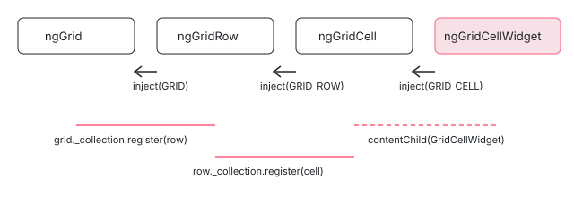

[目次](../README.md) › [Angular Aria の内側](README.md) › 第 16 回 / 全 20 回

# Grid のセルとウィジェット：セルの中の入力欄へ入る

> GridRow・GridCell・GridCellWidget が、セルの中のボタンや入力欄へ Enter で入り Escape で出る仕組み（widget の activate / deactivate と 3 つの widgetType）、セルを行の外で宣言すると GRID\_ROW が見つからない問題（#32603）と、注入トークンを公開して継いだ部品を作れるようにした変更（8d3da9ea36、22.2 から）。

angular/components · 読了 約 12 分 · 発展 · [サイトで読む（デモが動きます）](https://angular-deep-dive-cyan.vercel.app/chapter/aria-grid-cells)

---

グリッドのセルには、文字だけでなくボタンや入力欄を置けます。そのとき「矢印キーはセルを動くのか、入力欄の中のカーソルを動かすのか」を決める仕組みが要ります。この章では、`ngGridRow`・`ngGridCell`・`ngGridCellWidget` の 3 つのディレクティブと、その Pattern（`GridRowPattern`・`GridCellPattern`・`GridCellWidgetPattern`）を読み、セルの中のウィジェットが Enter で activate（グリッドの矢印キーを止めて、キーをウィジェットに渡す状態）になり、Escape で deactivate する行を 1 つずつ追います。最後に、セルを別のコンポーネントに分けると `GRID_ROW` が見つからなかった問題（#32603・#33594）と、注入トークンを公開した 8d3da9ea36 を読みます。

読む対象は `src/aria/grid/grid-row.ts`・`grid-cell.ts`・`grid-cell-widget.ts`・`grid-tokens.ts`、`src/aria/private/grid/row.ts`・`cell.ts`・`widget.ts` です（../components、e81c398a86）。グリッド全体の Behavior と `GridPattern` のキーの表は[第 15 回](15-aria-grid.md)で読みました。

1. [1. 全体像](01-aria-overview.md)
2. [2. SignalLike](02-aria-signal-like.md)
3. [3. SortedCollection](03-aria-collection.md)
4. [4. イベントマネージャ](04-aria-events.md)
5. [5. ListFocus](05-aria-list-focus.md)
6. [6. ListNavigation](06-aria-list-navigation.md)
7. [7. ListSelection](07-aria-list-selection.md)
8. [8. ListTypeahead](08-aria-typeahead.md)
9. [9. Listbox](09-aria-listbox.md)
10. [10. Accordion](10-aria-accordion.md)
11. [11. DeferredContent](11-aria-deferred-content.md)
12. [12. Tabs](12-aria-tabs.md)
13. [13. Toolbar](13-aria-toolbar.md)
14. [14. Tree](14-aria-tree.md)
15. [15. Grid](15-aria-grid.md)
16. **16. Grid のセル**（この章）
17. [17. Combobox](17-aria-combobox.md)
18. [18. Menu](18-aria-menu.md)
19. [19. テスト](19-aria-testing.md)
20. [20. issue と PR を読む](20-aria-issues.md)

## 1. 3 つのトークンと、親を探す向き

📄 `components/src/aria/grid/grid-tokens.ts` L9–21 （▶ の行: 10–12, 15, 18, 21）

```ts
 9 │ import {InjectionToken} from '@angular/core';
10 ▶ import type {GridCell} from './grid-cell';
11 ▶ import type {GridRow} from './grid-row';
12 ▶ import type {Grid} from './grid';
13 │ 
14 │ /** Token used to expose a `GridCell`. */
15 ▶ export const GRID_CELL = new InjectionToken<GridCell>('GRID_CELL');
16 │ 
17 │ /** Token used to expose a `GridRow`. */
18 ▶ export const GRID_ROW = new InjectionToken<GridRow>('GRID_ROW');
19 │ 
20 │ /** Token used to expose a `Grid`. */
21 ▶ export const GRID = new InjectionToken<Grid>('GRID');
```

`GRID`・`GRID_ROW`・`GRID_CELL` の 3 つの `InjectionToken` です。10〜12 行目はどれも `import type` で、このファイルはクラスを読み込みません。親はクラスではなくトークンで探します。`ngGrid` が `GRID` を、`ngGridRow` が `GRID_ROW` を、`ngGridCell` が `GRID_CELL` を provide し、子が inject します。



*子は inject で親を見つけ、親は SortedCollection に登録された子を DOM の順に並べる。下向き（登録）と上向き（inject）の 2 本でつながる*

## 2. ngGridRow と GridRowPattern

📄 `components/src/aria/grid/grid-row.ts` L35–63 （▶ の行: 39–40, 42, 52, 55–56, 60, 63）

```ts
35 │ @Directive({
36 │   selector: '[ngGridRow]',
37 │   exportAs: 'ngGridRow',
38 │   host: {
39 ▶     'role': 'row',
40 ▶     '[attr.aria-rowindex]': '_pattern.rowIndex()',
41 │   },
42 ▶   providers: [{provide: GRID_ROW, useExisting: GridRow}],
43 │ })
44 │ export class GridRow implements OnInit, OnDestroy {
45 │   /** A reference to the host element. */
46 │   private readonly _elementRef = inject(ElementRef);
47 │ 
48 │   /** A reference to the host element. */
49 │   readonly element = this._elementRef.nativeElement as HTMLElement;
50 │ 
51 │   /** The collection of cells in this row. */
52 ▶   readonly _collection = new SortedCollection<GridCell>();
53 │ 
54 │   /** The UI patterns for the cells in this row. */
55 ▶   private readonly _cellPatterns: Signal<any[]> = computed(() =>
56 ▶     this._collection.orderedItems().map(c => c._pattern),
57 │   );
58 │ 
59 │   /** The parent grid. */
60 ▶   private readonly _grid = inject(GRID);
61 │ 
62 │   /** The parent grid UI pattern. */
63 ▶   readonly _gridPattern = computed<GridPattern>(() => this._grid._pattern);
```

📄 `components/src/aria/grid/grid-row.ts` L65–74 （▶ の行: 66, 69, 71–72）

```ts
65 │   /** The index of this row within the grid. */
66 ▶   readonly rowIndex = input<number>();
67 │ 
68 │   /** The UI pattern for the grid row. */
69 ▶   readonly _pattern = new GridRowPattern({
70 │     ...this,
71 ▶     cells: this._cellPatterns,
72 ▶     grid: this._gridPattern,
73 │   });
74 │ 
```

📄 `components/src/aria/private/grid/row.ts` L13–33 （▶ の行: 16, 19, 22, 26, 28）

```ts
13 │ /** The inputs for the `GridRowPattern`. */
14 │ export interface GridRowInputs {
15 │   /** The `GridPattern` that this row belongs to. */
16 ▶   grid: SignalLike<GridPattern>;
17 │ 
18 │   /** The cells that make up this row. */
19 ▶   cells: SignalLike<GridCellPattern[]>;
20 │ 
21 │   /** The index of this row within the grid. */
22 ▶   rowIndex: SignalLike<number | undefined>;
23 │ }
24 │ 
25 │ /** The UI pattern for a grid row. */
26 ▶ export class GridRowPattern {
27 │   /** The index of this row within the grid. */
28 ▶   rowIndex: SignalLike<number | undefined>;
29 │ 
30 │   constructor(readonly inputs: GridRowInputs) {
31 │     this.rowIndex = inputs.rowIndex;
32 │   }
33 │ }
```

- 39〜42 行目 `role="row"` と `aria-rowindex` を付け、自分を `GRID_ROW` として provide します。
- 52〜57 行目 行は自分のセルを `SortedCollection` で DOM の順に持ちます（[第 3 回](03-aria-collection.md)）。これが第 15 回の `GridData` に渡る「行の中のセルの並び」です。
- 60 行目 `inject(GRID)`（`optional` なし）。このすぐ下の `ngOnInit` でグリッドの `_collection` に自分を登録し、`afterNextRender` でセルの並べ順の見張りを始めます（この部分は[第 3 回](03-aria-collection.md)で引用）。
- 26〜33 行目 `GridRowPattern` は `rowIndex` を持つだけの小さなクラスで、セルの並びは入力の `cells`（19 行目）としてグリッドに読まれます。

## 3. ngGridCell：host が無く、ウィジェットは 1 つ

📄 `components/src/aria/grid/grid-cell.ts` L43–73 （▶ の行: 43, 46, 59, 62–63, 67）

```ts
43 ▶ @Directive({
44 │   selector: '[ngGridCell]',
45 │   exportAs: 'ngGridCell',
46 ▶   providers: [{provide: GRID_CELL, useExisting: GridCell}],
47 │ })
48 │ export class GridCell implements OnInit, OnDestroy {
49 │   private readonly _elementRef = inject(ElementRef);
50 │   private readonly _renderer = inject(Renderer2);
51 │ 
52 │   /** A reference to the host element. */
53 │   readonly element = this._elementRef.nativeElement as HTMLElement;
54 │ 
55 │   /** Whether the cell is currently active (focused). */
56 │   readonly active = computed(() => this._pattern.active());
57 │ 
58 │   /** The widget contained within this cell, if any. */
59 ▶   private readonly _widget = contentChild(GridCellWidget, {descendants: true});
60 │ 
61 │   /** The UI pattern for the widget in this cell. */
62 ▶   private readonly _widgetPattern: Signal<GridCellWidgetPattern | undefined> = computed(
63 ▶     () => this._widget()?._pattern,
64 │   );
65 │ 
66 │   /** The parent row. */
67 ▶   private readonly _row = inject(GRID_ROW);
68 │ 
69 │   /** Text direction. */
70 │   readonly textDirection = inject(Directionality).valueSignal;
71 │ 
72 │   /** A unique identifier for the cell. */
73 │   readonly id = input(inject(_IdGenerator).getId('ng-grid-cell-', true));
```

📄 `components/src/aria/grid/grid-cell.ts` L79–118 （▶ の行: 79, 82, 91, 94, 106–107, 113–116）

```ts
 79 ▶   readonly rowSpan = input<number>(1);
 80 │ 
 81 │   /** The number of columns the cell should span. */
 82 ▶   readonly colSpan = input<number>(1);
 83 │ 
 84 │   /** The index of this cell's row within the grid. */
 85 │   readonly rowIndex = input<number>();
 86 │ 
 87 │   /** The index of this cell's column within the grid. */
 88 │   readonly colIndex = input<number>();
 89 │ 
 90 │   /** Whether the cell is disabled. */
 91 ▶   readonly disabled = input(false, {transform: booleanAttribute});
 92 │ 
 93 │   /** Whether the cell is selected. */
 94 ▶   readonly selected = model<boolean>(false);
 95 │ 
 96 │   /** Whether the cell is selectable. */
 97 │   readonly selectable = input<boolean>(true);
 98 │ 
 99 │   /** The tabindex override. */
100 │   readonly tabindex = input<number | undefined>();
101 │ 
102 │   /**
103 │    * The tabindex value set to the element.
104 │    * If a focus target exists then return -1. Unless an override.
105 │    */
106 ▶   protected readonly _tabIndex: Signal<number> = computed(
107 ▶     () => this.tabindex() ?? this._pattern.tabIndex(),
108 │   );
109 │ 
110 │   /** The UI pattern for the grid cell. */
111 │   readonly _pattern = new GridCellPattern({
112 │     ...this,
113 ▶     grid: this._row._gridPattern,
114 ▶     row: () => this._row._pattern,
115 ▶     widget: this._widgetPattern,
116 ▶     getWidget: e => this._getWidget(e),
117 │     element: () => this.element,
118 │   });
```

1. **43〜47 行目 host が無い**

   `@Directive` に `host` がありません。`role`・`aria-*`・tabindex は、第 15 回 7 節の `afterRenderEffect` の中で属性を直接付けます（#32759 の性能の修正）。
2. **59 行目 ウィジェットは contentChild で 1 つだけ**

   `contentChild(GridCellWidget, {descendants: true})`。複数ではなく 1 つです。bddfc394a3（2026-04-14、PR #33075 `refactor(aria/grid): simplify Grid cell to only support single widget`）で、セルが複数のウィジェットを持つ仕組みを外しました（private/grid/cell.ts の変更は 190 行で、ほとんどが削除）。`contentChild` なので、ウィジェットは**セルを書いたテンプレートの側**（セルの要素の子として書いた内容）に置く必要があります。
3. **67 行目 親の行は inject(GRID\_ROW)、optional なし**

   見つからなければ NG0201（No provider found）で止まります。6 節の #32603 がこれでした。
4. **79〜94 行目 入力**

   `rowSpan` / `colSpan`（第 15 回の `GridData` が読む）、`disabled`、`selected`（`model` なので `[(selected)]` で持てる）、`selectable`、tabindex の上書き。
5. **113〜116 行目 Pattern に渡すもの**

   グリッドの Pattern は行を経由して（113 行目の `this._row._gridPattern`）、行の Pattern、ウィジェットの Pattern、要素からウィジェットを探す関数。

📄 `components/src/aria/grid/grid-cell.ts` L146–178 （▶ の行: 147, 154–156, 158, 163, 170, 174）

```ts
146 │   ngOnInit() {
147 ▶     this._row._collection.register(this);
148 │   }
149 │ 
150 │   ngOnDestroy() {
151 │     this._row._collection.unregister(this);
152 │   }
153 │ 
154 ▶   private _toggleAttribute = (name: string, value: unknown) => {
155 ▶     if (value == null) {
156 ▶       this._renderer.removeAttribute(this.element, name);
157 │     } else {
158 ▶       this._renderer.setAttribute(this.element, name, value as string);
159 │     }
160 │   };
161 │ 
162 │   /** Gets the cell widget pattern for a given element. */
163 ▶   private _getWidget(element: Element | null | undefined): any | undefined {
164 │     let target = element;
165 │     const widget = this._widgetPattern();
166 │ 
167 │     if (!widget) return undefined;
168 │ 
169 │     while (target) {
170 ▶       if (widget.element() === target) {
171 │         return widget;
172 │       }
173 │ 
174 ▶       target = target.parentElement?.closest('[ngGridCellWidget]');
175 │     }
176 │ 
177 │     return undefined;
178 │   }
```

147 行目で行の `_collection` に登録します。163〜178 行目の `_getWidget` は、フォーカスやキーのイベントの発生元から `[ngGridCellWidget]` を上にたどり、このセルのウィジェットの要素と同じなら返します。154〜160 行目の `_toggleAttribute` は第 15 回 7 節の effect が使う関数で、値が `null` / `undefined` なら属性を外し、そうでなければ文字列にして付けます。

## 4. GridCellPattern：セルとウィジェットの仲立ち

📄 `components/src/aria/private/grid/cell.ts` L54–81 （▶ の行: 60–62, 71, 79–80）

```ts
54 │   readonly selected: WritableSignalLike<boolean>;
55 │ 
56 │   /** Whether the cell is selectable. */
57 │   readonly selectable: SignalLike<boolean> = () => this.inputs.selectable();
58 │ 
59 │   /** Whether a cell is disabled. */
60 ▶   readonly disabled: SignalLike<boolean> = computed(
61 ▶     () => this.inputs.disabled() || (this.inputs.widget()?.inputs.disabled() ?? false),
62 ▶   );
63 │ 
64 │   /** The number of rows the cell should span. */
65 │   readonly rowSpan: SignalLike<number> = () => this.inputs.rowSpan();
66 │ 
67 │   /** The number of columns the cell should span. */
68 │   readonly colSpan: SignalLike<number> = () => this.inputs.colSpan();
69 │ 
70 │   /** Whether the cell is active. */
71 ▶   readonly active: SignalLike<boolean> = computed(() => this.inputs.grid().activeCell() === this);
72 │ 
73 │   /** Whether the cell is a selection anchor. */
74 │   readonly anchor: SignalLike<true | undefined> = computed(() =>
75 │     this.inputs.grid().anchorCell() === this ? true : undefined,
76 │   );
77 │ 
78 │   /** The `aria-selected` attribute for the cell. */
79 ▶   readonly ariaSelected: SignalLike<boolean | undefined> = computed(() =>
80 ▶     this.inputs.grid().inputs.enableSelection() && this.selectable() ? this.selected() : undefined,
81 │   );
```

📄 `components/src/aria/private/grid/cell.ts` L96–135 （▶ の行: 97–98, 102–104, 106, 113, 120, 122, 126, 130, 134）

```ts
 96 │   /** The internal tab index calculation for the cell. */
 97 ▶   private readonly _tabIndex: SignalLike<-1 | 0> = computed(() =>
 98 ▶     this.inputs.grid().gridBehavior.cellTabIndex(this),
 99 │   );
100 │ 
101 │   /** The tab index for the cell. If the cell contains a widget, the cell's tab index is -1. */
102 ▶   readonly tabIndex: SignalLike<-1 | 0> = computed(() => {
103 ▶     if (this.inputs.widget()) {
104 ▶       return -1;
105 │     }
106 ▶     return this._tabIndex();
107 │   });
108 │ 
109 │   /** The widget in the cell. */
110 │   readonly widget: SignalLike<GridCellWidgetPattern | undefined> = () => this.inputs.widget();
111 │ 
112 │   /** Whether the cell or widget inside the cell is activated. */
113 ▶   readonly isActivated: SignalLike<boolean> = computed(() => this.widget()?.isActivated() ?? false);
114 │ 
115 │   constructor(readonly inputs: GridCellInputs) {
116 │     this.selected = inputs.selected;
117 │   }
118 │ 
119 │   /** Handles keydown events for the cell. */
120 ▶   onKeydown(event: KeyboardEvent): void {
121 │     if (this.disabled()) return;
122 ▶     this.widget()?.onKeydown(event);
123 │   }
124 │ 
125 │   /** Handles focusin events for the cell. */
126 ▶   onFocusIn(event: FocusEvent): void {
127 │     this.isFocused.set(true);
128 │ 
129 │     const focusTarget = _getEventTarget<Element>(event);
130 ▶     const widget = this.inputs.getWidget(focusTarget);
131 │     if (!widget) return;
132 │ 
133 │     // Pass down focusin event to the widget.
134 ▶     widget.onFocusIn(event);
135 │   }
```

📄 `components/src/aria/private/grid/cell.ts` L137–164 （▶ の行: 143, 146, 152, 155, 157, 162–163）

```ts
137 │   /** Handles focusout events for the cell. */
138 │   onFocusOut(event: FocusEvent): void {
139 │     const blurTarget = _getEventTarget<Element>(event);
140 │     const widget = this.inputs.getWidget(blurTarget);
141 │ 
142 │     // Pass down focusout event to the widget.
143 ▶     widget?.onFocusOut(event);
144 │ 
145 │     const focusTarget = event.relatedTarget as Element | null;
146 ▶     if (this.element().contains(focusTarget)) return;
147 │ 
148 │     this.isFocused.set(false);
149 │   }
150 │ 
151 │   /** Focuses the cell or the active widget. */
152 ▶   focus(): void {
153 │     const widget = this.widget();
154 │     if (widget) {
155 ▶       widget.focus();
156 │     } else {
157 ▶       this.element().focus();
158 │     }
159 │   }
160 │ 
161 │   /** Gets the tab index for the widget within the cell. */
162 ▶   widgetTabIndex(): -1 | 0 {
163 ▶     return this._tabIndex();
164 │   }
```

1. **60〜62 行目 中のウィジェットが無効なら、セルも無効**

   b211bf15f7（#33566 の修正）で `computed` になった行です（第 15 回 7 節）。
2. **102〜107 行目 ウィジェットがあれば、セルの tabindex はいつも -1**

   そのかわり、ウィジェットの tabindex に、セルが本来持つはずの値（97〜99 行目の `_tabIndex`）を 162〜164 行目の `widgetTabIndex()` で渡します。roving で今いるセルなら、**セルではなく中のボタンや入力欄が tabindex="0"** になり、Tab で入るとそこにフォーカスが行きます。155 行目の `focus()` も、ウィジェットがあればウィジェットへ向けます。
3. **113 行目 activate 中か**

   ウィジェットの `isActivated()` をそのまま返します。グリッドはこれを全セル分 OR して、キーを止めるかを決めます（次の引用）。
4. **120〜123・126〜135・138〜149 行目 イベントを下へ渡す**

   キー・focusin・focusout を、ウィジェットがあればウィジェットへ渡します。グリッドの `onKeydown` が先に今いるセルの `onKeydown` を呼ぶ（第 15 回 6 節）ので、キーは「グリッド → セル → ウィジェット」の順で届きます。

📄 `components/src/aria/private/grid/grid.ts` L66–76 （▶ の行: 71–72, 75）

```ts
66 │   readonly anchorCell: SignalLike<GridCellPattern | undefined> = computed(() =>
67 │     this.multiSelectable() ? this.gridBehavior.selectionAnchorCell() : undefined,
68 │   );
69 │ 
70 │   /** Whether to pause grid navigation and give the keyboard control to cell or widget. */
71 ▶   readonly pauseNavigation: SignalLike<boolean> = computed(() =>
72 ▶     this.gridBehavior.data
73 │       .cells()
74 │       .flat()
75 ▶       .reduce((res, c) => res || c.isActivated(), false),
76 │   );
```

`pauseNavigation` は「どれかのセルが activate 中」です。true のあいだ、`GridPattern.keydown` は空の表を返し（[第 15 回](15-aria-grid.md) 6 節）、矢印キーも Home / End も選択のキーも、グリッドは何もしません。`preventDefault` もしないので、キーはウィジェット（入力欄など）にそのまま届きます。

## 5. ngGridCellWidget と GridCellWidgetPattern：Enter で入り、Escape で出る

📄 `components/src/aria/grid/grid-cell-widget.ts` L40–67 （▶ の行: 44–46, 61, 67）

```ts
40 │ @Directive({
41 │   selector: '[ngGridCellWidget]',
42 │   exportAs: 'ngGridCellWidget',
43 │   host: {
44 ▶     '[attr.data-active]': 'active()',
45 ▶     '[attr.data-active-control]': 'isActivated() ? "widget" : "cell"',
46 ▶     '[tabindex]': '_tabIndex()',
47 │     '[attr.id]': 'id()',
48 │   },
49 │ })
50 │ export class GridCellWidget {
51 │   /** A reference to the host element. */
52 │   private readonly _elementRef = inject(ElementRef);
53 │ 
54 │   /** A reference to the host element. */
55 │   readonly element = this._elementRef.nativeElement as HTMLElement;
56 │ 
57 │   /** Whether the widget is currently active (focused). */
58 │   readonly active = computed(() => this._pattern.active());
59 │ 
60 │   /** The parent cell. */
61 ▶   private readonly _cell = inject(GRID_CELL);
62 │ 
63 │   /** A unique identifier for the widget. */
64 │   readonly id = input(inject(_IdGenerator).getId('ng-grid-cell-widget-', true));
65 │ 
66 │   /** The type of widget, which determines how it is activated. */
67 ▶   readonly widgetType = input<'simple' | 'complex' | 'editable'>('simple');
```

📄 `components/src/aria/grid/grid-cell-widget.ts` L75–114 （▶ の行: 76, 79, 88–89, 96–98, 102–103, 108, 112）

```ts
 75 │   /** Emits when the widget is activated. */
 76 ▶   readonly activated = output<KeyboardEvent | FocusEvent | undefined>();
 77 │ 
 78 │   /** Emits when the widget is deactivated. */
 79 ▶   readonly deactivated = output<KeyboardEvent | FocusEvent | undefined>();
 80 │ 
 81 │   /** The tabindex override. */
 82 │   readonly tabindex = input<number | undefined>();
 83 │ 
 84 │   /**
 85 │    * The tabindex value set to the element.
 86 │    * If a focus target exists then return -1. Unless an override.
 87 │    */
 88 ▶   protected readonly _tabIndex: Signal<number> = computed(
 89 ▶     () => this.tabindex() ?? this._pattern.tabIndex(),
 90 │   );
 91 │ 
 92 │   /** The UI pattern for the grid cell widget. */
 93 │   readonly _pattern = new GridCellWidgetPattern({
 94 │     ...this,
 95 │     element: () => this.element,
 96 ▶     cell: () => this._cell._pattern,
 97 ▶     onActivate: e => this.activated.emit(e),
 98 ▶     onDeactivate: e => this.deactivated.emit(e),
 99 │   });
100 │ 
101 │   /** Whether the widget is activated. */
102 ▶   get isActivated(): Signal<boolean> {
103 ▶     return computed(() => this._pattern.isActivated());
104 │   }
105 │ 
106 │   constructor() {
107 │     afterRenderEffect({
108 ▶       write: () => this._pattern.activationEffect(),
109 │     });
110 │ 
111 │     afterRenderEffect({
112 ▶       write: () => this._pattern.deactivationEffect(),
113 │     });
114 │   }
```

- 45 行目 `data-active-control` は、activate 中なら `"widget"`、そうでなければ `"cell"`。CSS で「今キーを持っているのはどちらか」を見せるのに使えます。
- 67 行目 `widgetType` は `'simple'`（既定）・`'complex'`・`'editable'` の 3 種類です（grep で確かめた種類はこれだけ）。
- 97〜98 行目 Pattern の `onActivate` / `onDeactivate` が、ディレクティブの出力 `(activated)` / `(deactivated)` を emit します。
- 107〜113 行目 activate と deactivate の後始末は、2 つの `afterRenderEffect` の write で走ります（下の 157〜181 行目）。

📄 `components/src/aria/private/grid/widget.ts` L45–81 （▶ の行: 50–51, 54–55, 60–61, 63, 72, 75）

```ts
45 │ export class GridCellWidgetPattern {
46 │   /** The html element that should receive focus. */
47 │   readonly element: SignalLike<HTMLElement> = () => this.inputs.element();
48 │ 
49 │   /** The element that should receive focus. */
50 ▶   readonly widgetHost: SignalLike<HTMLElement> = () =>
51 ▶     resolveElement(this.inputs.focusTarget(), this.element()) ?? this.element();
52 │ 
53 │   /** Whether the widget is disabled. */
54 ▶   readonly disabled: SignalLike<boolean> = computed(
55 ▶     () => this.inputs.disabled() || this.inputs.cell().disabled(),
56 │   );
57 │ 
58 │   /** The tab index for the widget. */
59 │   readonly tabIndex: SignalLike<-1 | 0> = computed(() => {
60 ▶     if (this.inputs.focusTarget()) {
61 ▶       return -1;
62 │     }
63 ▶     return this.inputs.cell().widgetTabIndex();
64 │   });
65 │ 
66 │   /** Whether the widget is the active widget in the cell. */
67 │   readonly active: SignalLike<boolean> = computed(
68 │     () => this.inputs.cell().active() && this.inputs.cell().widget() === this,
69 │   );
70 │ 
71 │   /** Whether the widget is currently activated. */
72 ▶   readonly isActivated: WritableSignalLike<boolean> = signal(false);
73 │ 
74 │   /** The last event that caused the widget to be activated. */
75 ▶   readonly lastActivateEvent: WritableSignalLike<KeyboardEvent | FocusEvent | undefined> =
76 │     signal(undefined);
77 │ 
78 │   /** The last event that caused the widget to be deactivated. */
79 │   readonly lastDeactivateEvent: WritableSignalLike<KeyboardEvent | FocusEvent | undefined> =
80 │     signal(undefined);
81 │ 
```

50〜51 行目 `widgetHost` は、`focusTarget`（要素・`ElementRef`・「ホストの要素を受け取って要素を返す関数」のどれか）があればその要素、無ければウィジェットの要素そのものです。60〜61 行目のとおり、`focusTarget` があるウィジェット自身は tabindex="-1" になります。

📄 `components/src/aria/private/grid/widget.ts` L82–120 （▶ の行: 87, 89–91, 93, 100–101, 103–104, 111, 113–115）

```ts
 82 │   /** The keyboard event manager for the widget. */
 83 │   readonly keydown = computed(() => {
 84 │     const manager = new KeyboardEventManager();
 85 │ 
 86 │     // Simple widgets emit notification on interaction without capturing event flow
 87 ▶     if (this.inputs.widgetType() === 'simple') {
 88 │       return manager
 89 ▶         .on('Enter', e => this.inputs.onActivate?.(e), {
 90 ▶           preventDefault: false,
 91 ▶           stopPropagation: false,
 92 │         })
 93 ▶         .on(' ', e => this.inputs.onActivate?.(e), {
 94 │           preventDefault: false,
 95 │           stopPropagation: false,
 96 │         });
 97 │     }
 98 │ 
 99 │     // If a widget is activated, only listen to events that exits activate state.
100 ▶     if (this.isActivated()) {
101 ▶       manager.on('Escape', e => this.deactivate(e));
102 │ 
103 ▶       if (this.inputs.widgetType() === 'editable') {
104 ▶         manager.on('Enter', e => this.deactivate(e));
105 │       }
106 │ 
107 │       return manager;
108 │     }
109 │ 
110 │     // Enter key is used to activate widget for both complex and editable type.
111 ▶     manager.on('Enter', e => this.activate(e));
112 │ 
113 ▶     if (this.inputs.widgetType() === 'editable') {
114 ▶       manager.on([Modifier.Shift, Modifier.None], /^[a-zA-Z0-9]$/, e => this.activate(e), {
115 ▶         preventDefault: false,
116 │       });
117 │     }
118 │ 
119 │     return manager;
120 │   });
```

1. **87〜97 行目 simple：知らせるだけ**

   Enter と Space で `onActivate`（＝ `(activated)` の emit）を呼ぶだけで、`preventDefault` も `stopPropagation` もしません（90〜91 行目）。activate 状態にもなりません（下の 186 行目でも simple は return）。だからボタンなら、ブラウザの既定の動きで click が出ます。ボタンのような「押すだけ」のものはこれで足ります。
2. **111 行目 complex / editable：Enter で activate**

   `activate(e)`。ここでは既定のとおり `preventDefault` と `stopPropagation` をします。
3. **113〜117 行目 editable：英数字の 1 文字でも activate**

   修飾キーなし、または Shift だけで `/^[a-zA-Z0-9]$/` に当たるキーなら activate し、`preventDefault: false` なので、その文字はそのまま入力欄に入ります。日本語の入力（IME）や記号のキーは、この正規表現に当たりません。
4. **100〜108 行目 activate 中は、出るキーだけ**

   Escape で deactivate。editable なら Enter でも deactivate。それ以外のキーは表に無いので、ウィジェットが自分で処理します（4 節の `pauseNavigation` でグリッドも止まっている）。

📄 `components/src/aria/private/grid/widget.ts` L122–155 （▶ の行: 126, 128, 134, 138–139, 146, 149, 154）

```ts
122 │   constructor(readonly inputs: GridCellWidgetInputs) {}
123 │ 
124 │   /** Handles keydown events for the widget. */
125 │   onKeydown(event: KeyboardEvent): void {
126 ▶     if (this.disabled()) return;
127 │ 
128 ▶     this.keydown().handle(event);
129 │   }
130 │ 
131 │   /** Handles focusin events for the widget. */
132 │   onFocusIn(event: FocusEvent): void {
133 │     // Simple widget does not have activate state.
134 ▶     if (this.inputs.widgetType() === 'simple') return;
135 │ 
136 │     // Set activate state if the focus is inside of widget.
137 │     const focusTarget = _getEventTarget<Element>(event);
138 ▶     if (this.widgetHost().contains(focusTarget) && this.widgetHost() !== focusTarget) {
139 ▶       this.activate(event);
140 │     }
141 │   }
142 │ 
143 │   /** Handles focusout events for the widget. */
144 │   onFocusOut(event: FocusEvent): void {
145 │     const focusTarget = event.relatedTarget as Element;
146 ▶     if (this.widgetHost().contains(focusTarget)) return;
147 │ 
148 │     // Reset states when focus leaving widget.
149 ▶     this.deactivate(event);
150 │   }
151 │ 
152 │   /** Focuses the widget's host element. */
153 │   focus(): void {
154 ▶     this.widgetHost().focus();
155 │   }
```

- 132〜141 行目 complex / editable では、フォーカスが `widgetHost` の**中の別の要素**に入ったら activate します（138 行目。`widgetHost` そのものに入っただけでは activate しない）。マウスでセルの中の入力欄を直接クリックしたときなどです。
- 144〜150 行目 フォーカスが `widgetHost` の外へ出たら deactivate。Tab でグリッドの外へ出たときもこれです。

📄 `components/src/aria/private/grid/widget.ts` L157–198 （▶ の行: 159, 161, 164–165, 172, 174, 177–178, 185–186, 188–189, 196–197）

```ts
157 │   /** Side-effect executed whenever the widget activates. Runs in the write phase. */
158 │   activationEffect(): void {
159 ▶     if (this.isActivated()) {
160 │       const event = this.lastActivateEvent();
161 ▶       this.inputs.onActivate?.(event);
162 │ 
163 │       // Only automatically redirect focus if explicit configuration was supplied.
164 ▶       if (this.inputs.focusTarget()) {
165 ▶         this.focus();
166 │       }
167 │     }
168 │   }
169 │ 
170 │   /** Side-effect executed whenever the widget deactivates. Runs in the write phase. */
171 │   deactivationEffect(): void {
172 ▶     const event = this.lastDeactivateEvent();
173 │     if (event) {
174 ▶       this.inputs.onDeactivate?.(event);
175 │ 
176 │       // Only automatically restore focus if the deactivation was triggered by user keyboard interaction.
177 ▶       if (event instanceof KeyboardEvent) {
178 ▶         this.focus();
179 │       }
180 │     }
181 │   }
182 │ 
183 │   /** Activates the widget. */
184 │   activate(event?: KeyboardEvent | FocusEvent): void {
185 ▶     if (this.isActivated()) return;
186 ▶     if (this.inputs.widgetType() === 'simple') return;
187 │ 
188 ▶     this.isActivated.set(true);
189 ▶     this.lastActivateEvent.set(event);
190 │   }
191 │ 
192 │   /** Deactivates the widget and restores focus to the widget's host element. */
193 │   deactivate(event?: KeyboardEvent | FocusEvent): void {
194 │     if (!this.isActivated()) return;
195 │ 
196 ▶     this.isActivated.set(false);
197 ▶     this.lastDeactivateEvent.set(event);
198 │   }
```

1. **184〜190 行目 activate は 2 つの signal を書くだけ**

   `isActivated` を true にし、きっかけのイベントを `lastActivateEvent` に入れます。出力の emit やフォーカスの移動は、ここではしません。
2. **158〜168 行目 activationEffect（描画のあとの write）**

   activate 中なら `(activated)` を emit し（161 行目）、`focusTarget` があるときだけそこへフォーカスを移します（164〜165 行目）。`focusTarget` が無い editable の入力欄は、もともと自分にフォーカスがあるので、フォーカスは動きません。
3. **171〜181 行目 deactivationEffect**

   `(deactivated)` を emit し（174 行目）、**キーボードで出たときだけ**（177 行目の `instanceof KeyboardEvent`）`widgetHost` にフォーカスを戻します。Tab でグリッドの外へ出たときの deactivate は `FocusEvent` なので、フォーカスを引き戻しません。

> [!NOTE]
> **さらに深く**
>
> f4e9a87357（2026-05-05、PR #33203 `refactor(aria/grid): consolidate widget focus logic and activation handling`）より前は、ディレクティブの `afterRenderEffect` の **read** の中で、activate したら必ず `this._pattern.focus()` を呼び、Escape / Enter の処理の中でも `this.focus()` を呼んでいました。この変更で、フォーカスを動かすのは `focusTarget` があるとき（164 行目）と、キーボードで出たとき（177 行目）だけになり、effect も write に移りました。simple のウィジェットが Enter / Space で `(activated)` を出す 87〜97 行目も、この変更で入りました。

## 6. セルを別のコンポーネントに分けると：#32603・#33594・8d3da9ea36

#32603（`ngGridCell fails with NG0201 (No provider found for GRID_ROW) when used inside cdk-table`）は、CDK table の `*cdkCellDef` の中に `ngGridCell` を書くと NG0201 になる、という報告でした。crisbeto の調べのコメントは「DI は要素が**宣言された**場所で解決される。この場合セルは行の外で宣言されているので、解決できない」です。3 節の 67 行目の `inject(GRID_ROW)` は optional ではないので、見つからなければ止まります。この issue は 2026-07-02 に閉じ、開いている PR #33859（外部の作者、2026-09-23）が `Fixes: #32603` を書いて、CDK table のための橋渡しのディレクティブを提案しています（[第 15 回](15-aria-grid.md)の質問）。

#33594（`Enable building reusable components based on Angular Aria directives`、2026-07-31 に閉じた）は別の場面です。`GridRow` / `GridCell` を継いだ自分のコンポーネントを作ると、トークンが公開されていないので自分のクラスを `GRID_ROW` として provide できず、NG0201 になる、という報告でした。8d3da9ea36（2026-07-31、PR #33607 `feat(multiple): export aria injection tokens to support custom subclasses`）が、grid の public-api.ts に `export {GRID, GRID_ROW, GRID_CELL} from './grid-tokens';` を足し、accordion・combobox・listbox・menu・tabs・toolbar のトークンも公開しました。足された spec がそのまま使い方の例です。

📄 `components/src/aria/grid/grid.spec.ts` L1283–1309 （▶ の行: 1286, 1288, 1293, 1295, 1299–1300）

```ts
1283 │ @Component({
1284 │   selector: 'my-custom-cell',
1285 │   template: `<ng-content></ng-content>`,
1286 ▶   providers: [{provide: GRID_CELL, useExisting: MyCustomCell}],
1287 │ })
1288 ▶ class MyCustomCell extends GridCell {}
1289 │ 
1290 │ @Component({
1291 │   selector: 'my-custom-row',
1292 │   template: `<ng-content></ng-content>`,
1293 ▶   providers: [{provide: GRID_ROW, useExisting: MyCustomRow}],
1294 │ })
1295 ▶ class MyCustomRow extends GridRow {}
1296 │ 
1297 │ @Component({
1298 │   template: `
1299 ▶     <table ngGrid>
1300 ▶       <my-custom-row>
1301 │         <my-custom-cell>Cell 1</my-custom-cell>
1302 │         <my-custom-cell>Cell 2</my-custom-cell>
1303 │       </my-custom-row>
1304 │     </table>
1305 │   `,
1306 │   imports: [Grid, MyCustomRow, MyCustomCell],
1307 │   changeDetection: ChangeDetectionStrategy.Eager,
1308 │ })
1309 │ class SubclassGridTestComponent {}
```

1286・1293 行目で、継いだクラスを**もう一度**トークンとして provide しています。`providers` は継承されないからです（../angular の `inherit_definition_feature.ts` は親の features のうち `ngInherit` が付いたものだけを走らせ、`ɵɵProvidersFeature` には `ngInherit` が付いていない。grep で確かめた）。

📄 `このサイトの 22.1.8`

```
// node_modules/@angular/aria/types/grid.d.ts（22.1.8）
export { Grid, GridCell, GridCellWidget, GridRow };
```

このサイトの 22.1.8 にはこの変更が入っていません（`git merge-base --is-ancestor 8d3da9ea36 v22.1.8` が偽）。インストールした `types/grid.d.ts` の export は上の 4 クラスだけで、`import {GRID_ROW} from '@angular/aria/grid'` は 22.1.8 ではコンパイルが通りません。ソースの grid-tokens.ts は 22.1.8 でも同じ中身（3 つのトークンがある）なので、違うのは public-api.ts の 1 行だけです（インストールした fesm2022 の sourcemap から戻したソースには public-api.ts が入っていないので、ソースどうしを比べてもこの差は見えません）。

## 7. デモ：セルの中のボタンと入力欄

> **🧪 DEMO — 名前・ボタン（simple）・入力欄（editable）の 3 列（このサイトの @angular/aria 22.1.8。grid は snapshot と同じ中身）**
>
> Tab で grid に入り、矢印キーでセルを動きます。入力欄のセルで Enter（または英数字のキー）を押すと activate し、矢印キーが入力欄の中のカーソルを動かすようになります。Escape（または Enter）で出ます。キーのあと、フォーカスがどこにあるか、`data-active-control="widget"` のウィジェット、`(activated)` / `(deactivated)` / `(click)` をログに出します。
>
> ▶ [このデモはサイトで動かせます](https://angular-deep-dive-cyan.vercel.app/chapter/aria-grid-cells)

2026-11-02 にヘッドレスの Chrome でこのページを開き、本物のキー入力で確かめた結果です。

- 触る前の tabindex="0" は「りんご」の名前のセルだけで、ウィジェットのあるセル（`<td>`）とボタン・入力欄はどれも -1 でした。
- Tab で「りんご」のセルに入り、→ でボタンへ。フォーカスはセルではなくボタンに行きます（4 節の 102〜107 行目、155 行目）。
- ボタンで Enter を押すと `(activated)`（event は keydown Enter）と `(click)` の両方が出ました。Space でも同じです。activate 中にはなりません（87〜97 行目）。
- → で入力欄へ、← でボタンへ戻ります。activate していない入力欄では、矢印キーはセルを動かします。
- 入力欄で Enter を押すと `(activated)` が出て `data-active-control="widget"` になり、h・i と打つと value が "hi"、← でカーソルが 1 文字左へ動きました（グリッドは動かない。4 節の `pauseNavigation`）。
- Escape で `(deactivated)`（event は keydown Escape）が出て、フォーカスは入力欄のまま。そのあと ↓ で「みかん」の入力欄へ動きました。
- 「みかん」の入力欄で x を押すと、それだけで activate し、x は入力欄に入りました（113〜117 行目）。editable なので Enter で deactivate します（103〜105 行目）。
- Tab を押すと grid の外へ出ます。セルもウィジェットも tabindex="0" は今いる 1 つだけだからです。
- コンソールに警告もエラーも出ませんでした。

## 8. 呼び出しの連なり（入力欄のセルで Enter → 矢印 → Escape）

- 👤 `keydown Enter` — ngGrid の host — *GridPattern.onKeydown（第 15 回）*
  - `activeCell.onKeydown(event)` — private/grid/cell.ts L120 — *ウィジェットへ（L122）*
    - `GridCellWidgetPattern.onKeydown` — widget.ts L125 — *editable・activate 前 → Enter は activate（L111）*
      - `activate(e)` — L184 — *isActivated = true（L188）*
  - `keydown().handle(event)` — GridPattern — *pauseNavigation（grid.ts L71）が true → 空の表*
  - `activationEffect()` — widget.ts L158 — *afterRenderEffect の write → (activated) を emit*
- 👤 `keydown ArrowLeft` — 入力欄 — *グリッドもウィジェットも処理しない → カーソルが動く*
- 👤 `keydown Escape` — 入力欄
  - `deactivate(e)` — widget.ts L193 — *L101 の表から*
  - `deactivationEffect()` — L171 — *(deactivated) → KeyboardEvent なので focus()（L177-178）*

## テストと直し方

📄 `components/src/aria/private/grid/grid.spec.ts` L246–276 （▶ の行: 247, 250–251, 254, 258–259, 262, 270, 273–274）

```ts
246 │     describe('Keyboard Events', () => {
247 ▶       it('should activate on Enter for complex widget', () => {
248 │         const {grid} = createGrid([{cells: [{widget: {widgetType: 'complex'}}]}], gridInputs);
249 │         const widget = grid.cells()[0][0].inputs.widget()!;
250 ▶         widget.onKeydown(enter());
251 ▶         expect(widget.isActivated()).toBe(true);
252 │       });
253 │ 
254 ▶       it('should deactivate on Escape when activated', () => {
255 │         const {grid} = createGrid([{cells: [{widget: {widgetType: 'complex'}}]}], gridInputs);
256 │         const widget = grid.cells()[0][0].inputs.widget()!;
257 │         widget.activate();
258 ▶         widget.onKeydown(escape());
259 ▶         expect(widget.isActivated()).toBe(false);
260 │       });
261 │ 
262 ▶       it('should deactivate on Enter for editable widget when activated', () => {
263 │         const {grid} = createGrid([{cells: [{widget: {widgetType: 'editable'}}]}], gridInputs);
264 │         const widget = grid.cells()[0][0].inputs.widget()!;
265 │         widget.activate();
266 │         widget.onKeydown(enter());
267 │         expect(widget.isActivated()).toBe(false);
268 │       });
269 │ 
270 ▶       it('should activate on character key for editable widget', () => {
271 │         const {grid} = createGrid([{cells: [{widget: {widgetType: 'editable'}}]}], gridInputs);
272 │         const widget = grid.cells()[0][0].inputs.widget()!;
273 ▶         widget.onKeydown(a());
274 ▶         expect(widget.isActivated()).toBe(true);
275 │       });
276 │ 
```

Pattern の spec、private/grid/grid.spec.ts の `describe('Grid')` → `describe('GridCellWidgetPattern')` → `describe('Keyboard Events')`（:246）です。ディレクティブを使わずに `createGrid` で Pattern を組み、`widget.onKeydown(enter())` のように Pattern を直接呼んで `isActivated()` を見ます。complex の Enter で activate（:247）、Escape で deactivate（:254）、editable の Enter で deactivate（:262）、editable の文字キーで activate（:270）。

📄 `components/src/aria/grid/grid.spec.ts` L1007–1021 （▶ の行: 1007, 1016–1017, 1019–1020）

```ts
1007 ▶       it('should emit the deactivated output when the widget loses active state', async () => {
1008 │         const gridData = createGridData();
1009 │         gridData[0].cells[0].widgets = [{id: 'w1', type: 'complex'}];
1010 │         await setupGrid({gridData});
1011 │         gridInstance._pattern.setDefaultStateEffect();
1012 │         await fixture.whenStable();
1013 │ 
1014 │         await tabIntoGrid();
1015 │ 
1016 ▶         await keydown('Enter');
1017 ▶         expect(fixture.componentInstance.onDeactivated).not.toHaveBeenCalled();
1018 │ 
1019 ▶         await keydown('Escape');
1020 ▶         expect(fixture.componentInstance.onDeactivated).toHaveBeenCalled();
1021 │       });
```

ディレクティブの spec では grid/grid.spec.ts の `describe('GridCellWidget')` → `describe('widget activation')`（:880）に、`it('should emit the deactivated output when the widget loses active state')`（:1007）などがあります。simple の Enter / Space で `(activated)` が出る `it('should emit the activated output on Enter for simple widget')`（:942）と Space の :957 は、f4e9a87357 で足されたものです（`git show f4e9a87357 -- src/aria/grid/grid.spec.ts` で確かめた）。

📄 `ターミナル`

```
cd ~/angular-research/components
pnpm bazel test //src/aria/private/grid:unit_tests_chromium --nocache_test_results --test_output=all

# widgetType の種類
grep -n "widgetType = input" src/aria/grid/grid-cell-widget.ts
# 8d3da9ea36 が grid の公開 API に足した行
git show 8d3da9ea36 -- src/aria/grid/public-api.ts | grep "^+export"
```

📄 `出力（抜粋。2026-11-02 に実行）`

```
Chromium: |██████████████████████████████| 1/1 test files | 51 passed, 0 failed
Finished running tests in 0.4s, all tests passed!
//src/aria/private/grid:unit_tests_chromium                              PASSED in 0.9s

67:  readonly widgetType = input<'simple' | 'complex' | 'editable'>('simple');
+export {GRID, GRID_ROW, GRID_CELL} from './grid-tokens';
```

1. **走らせ方**

   ターゲットの spec が全部走ります（絞るオプションは確かめていません）。51 passed, 0 failed、PASSED in 0.9s でした。ディレクティブの spec は `//src/aria/grid:unit_tests_chromium`（71 passed。第 15 回で走らせた）。1 本だけ見たいときは、自分の作業コピーで `it` を `fit` にすると jasmine はそれだけを走らせます（私たちは ../components を変えないので試していません）。
2. **直すとしたら**

   activate / deactivate のキーは `GridCellWidgetPattern.keydown`（widget.ts L83）、フォーカスの移動は `activationEffect` / `deactivationEffect`（L158・L171）、セルとウィジェットの tabindex の受け渡しは `GridCellPattern.tabIndex` と `widgetTabIndex`（cell.ts L102・L162）です。Pattern だけで確かめられる振る舞いは private/grid/grid.spec.ts の `describe('GridCellWidgetPattern')` に、フォーカスや出力が絡むものは grid/grid.spec.ts の `describe('widget activation')` に足します。
3. **issue を読むときの手がかり**

   「セルの中の入力欄で矢印キーが効かない」は activate していない（Enter か英数字を押していない）、「Escape のあとフォーカスがどこかへ行く」は 177 行目の `KeyboardEvent` の分岐、「NG0201 GRID\_ROW」はセルが行の外で宣言されている（6 節）、のどれかで読み始めます。一覧は[第 20 回](20-aria-issues.md)です。

## 聞かれそうな質問

**Q. セルを別のコンポーネントに分けるには？**

2 つ気をつけます。1 つ目は DI です。`ngGridCell` は 3 節の 67 行目で `inject(GRID_ROW)` するので、セルの要素は `ngGridRow` の要素の中で**宣言**されている必要があります（行のテンプレートの外の `ng-template` で宣言して、行の中に描くのはだめ。#32603）。2 つ目は、ウィジェットを `contentChild`（59 行目）で探すことです。セルのコンポーネントの**自分のテンプレートの中**に書いた `ngGridCellWidget` は、そのセルの content ではないので見つかりません。`GridCell` を継いだコンポーネントにする方法は 8d3da9ea36 で公開されたトークンを使い、6 節の spec のように `providers: [{provide: GRID_CELL, useExisting: 自分}]` を書き直します（22.2 以降。このサイトの 22.1.8 では使えない）。

**Q. 入力欄の中で矢印キーを押したらどうなりますか？**

activate していなければ、グリッドがセルを動かします。グリッドのキーの表は `preventDefault` するので、入力欄のカーソルは動きません（デモで確かめられます）。Enter か英数字のキーで activate すると、4 節の `pauseNavigation` が true になり、グリッドは空の表を返すので、矢印キーはカーソルを動かします。Escape か Enter で deactivate すると、また矢印でセルが動きます。

**Q. セルの編集モードはありますか？**

「編集モード」という名前のものは無く、`widgetType="editable"` の activate がそれに当たります（5 節の 103〜105・113〜117 行目）。表示と編集を切り替えたいときは、snapshot の grid-table の例のように、`ngGridCellWidget` を付けた要素の中で `#widget="ngGridCellWidget"` の `widget.isActivated()` を見て表示の要素と入力欄を出し分け、`[focusTarget]` に「入力欄を探す関数」を渡します。activate すると 164〜165 行目でその入力欄にフォーカスが移り、`(activated)` / `(deactivated)` で編集の開始と確定をします。

**Q. ボタンのセルで Enter を押すと、ボタンの click は出ますか？**

出ます。simple のウィジェットの Enter / Space は `preventDefault` をしない（90 行目）ので、ブラウザの既定の動きで click が出ます。ただしグリッドの `enableSelection` が true で `selectionMode="explicit"` のときは、グリッドのキーの表にも Enter / Space が入り（[第 15 回](15-aria-grid.md) 6 節）、そちらは既定で `preventDefault` します。ヘッドレスの Chrome で、keydown の Enter と Space を `preventDefault` したボタンは click を出しませんでした。だからこの組み合わせでは click は出ません（ngGrid でその組み合わせを組んで確かめてはいない）。

**Q. 1 つのセルにボタンを 2 つ置けますか？**

`ngGridCellWidget` として扱われるのは 1 つだけです（3 節の 59 行目の `contentChild`、bddfc394a3）。複数の操作を置きたいときは、それらを包む要素を `widgetType="complex"` のウィジェットにして、activate したら中のボタンへ自分でフォーカスを移す形になります（snapshot の grid-table の例は、`(activated)="select.focus()"` のように書いている）。

## 読み終えて

- 子は親をトークン（`GRID` / `GRID_ROW` / `GRID_CELL`）で inject し、親は子を `SortedCollection` に登録させる。セルのウィジェットだけは `contentChild` で 1 つ。
- ウィジェットのあるセルは tabindex -1 で、セルの tabindex はウィジェットに渡る（cell.ts L102-107・L162）。
- simple は Enter / Space を知らせるだけ。complex / editable は Enter（editable は英数字も）で activate し、そのあいだグリッドはキーを受けない（`pauseNavigation`）。Escape で出る。
- activate / deactivate は signal を書くだけで、emit とフォーカスの移動は描画のあとの effect でする（f4e9a87357）。
- NG0201 GRID\_ROW は「セルが行の外で宣言された」。継いだ部品を作るためのトークンの公開（8d3da9ea36）は 22.2 からで、このサイトの 22.1.8 には無い。

---

← 前: [Grid：行と列の 2 次元を動く](15-aria-grid.md)  
次: [Combobox：入力欄と、開いて閉じるポップアップ](17-aria-combobox.md) →
