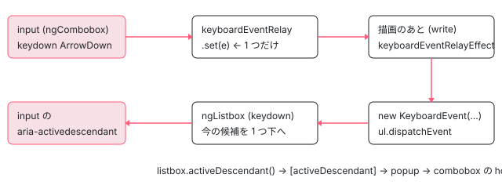

[目次](../README.md) › [Angular Aria の内側](README.md) › 第 17 回 / 全 20 回

# Combobox：入力欄と、開いて閉じるポップアップ

> ComboboxPattern が入力欄に残ったフォーカスのまま、キーを 1 つだけ持つ keyboardEventRelay の signal に置き、描画のあとの effect で写しを作ってポップアップ（Listbox・Tree・Grid）へ投げ直す仕組み、select と autocomplete を分ける isEditable・aria-autocomplete、フォーカスが外れたら setTimeout で閉じる行。この 1 年でいちばん多く直された部品で、zone.js との相性や中継の再送の修正、続けて打ったキーが落ちる開いている issue（#33973）をページの上で再現。PopupControl はどの Pattern にも使われておらず、filterMode は以前の combobox とともに消えた。

angular/components · 読了 約 14 分 · 発展 · [サイトで読む（デモが動きます）](https://angular-deep-dive-cyan.vercel.app/chapter/aria-combobox)

---

combobox（コンボボックス）は、入力欄やボタンのような「トリガー」と、開いたり閉じたりする「ポップアップ」の組です。この章では、**フォーカスは入力欄に残したまま**、矢印キーや Enter をポップアップの中の `ngListbox`（や Tree・Grid）へ届ける `keyboardEventRelay` の行、フォーカスが外れたら `setTimeout` のあとで閉じる行、入力欄に打った文字が `value` になる行を 1 ステップずつ読みます。この 1 年でいちばん多く直された部品なので、直した変更と、いま開いている「続けて押したキーが落ちる」issue（#33973）もページの上で確かめます。

読む対象は `src/aria/private/combobox/combobox.ts`（`ComboboxPattern`・`ComboboxPopupPattern`）、`src/aria/combobox/combobox.ts`（`Combobox`）、`combobox-popup.ts`（`ComboboxPopup`）、`combobox-widget.ts`（`ComboboxWidget`）、`src/aria/private/behaviors/popup/popup.ts`（`PopupControl`）です。

1. [1. 全体像](01-aria-overview.md)
2. [2. SignalLike](02-aria-signal-like.md)
3. [3. SortedCollection](03-aria-collection.md)
4. [4. イベントマネージャ](04-aria-events.md)
5. [5. ListFocus](05-aria-list-focus.md)
6. [6. ListNavigation](06-aria-list-navigation.md)
7. [7. ListSelection](07-aria-list-selection.md)
8. [8. ListTypeahead](08-aria-typeahead.md)
9. [9. Listbox](09-aria-listbox.md)
10. [10. Accordion](10-aria-accordion.md)
11. [11. DeferredContent](11-aria-deferred-content.md)
12. [12. Tabs](12-aria-tabs.md)
13. [13. Toolbar](13-aria-toolbar.md)
14. [14. Tree](14-aria-tree.md)
15. [15. Grid](15-aria-grid.md)
16. [16. Grid のセル](16-aria-grid-cells.md)
17. **17. Combobox**（この章）
18. [18. Menu](18-aria-menu.md)
19. [19. テスト](19-aria-testing.md)
20. [20. issue と PR を読む](20-aria-issues.md)

> [!NOTE]
> **ポイント**
>
> この章の引用は ../components の snapshot（22.2.0-next.5）、ページの上のデモはこのサイトに入れた `@angular/aria` 22.1.8 です。combobox の 5 ファイル（`combobox/*.ts` と `private/combobox/combobox.ts`）は、22.1.8 と snapshot で中身が同じでした。

## 1. 使う側の形：3 つのディレクティブ

まず、使う側がどう書くかを components の例で見ます。入力欄・ポップアップの `ng-template`・その中の listbox の 3 段です。

📄 `components/src/components-examples/aria/combobox/combobox-listbox/combobox-listbox-example.html` L1–33 （▶ の行: 4–5, 12, 14, 19–21）

```html
 1 │ <div class="example-combobox-container">
 2 │   <div #origin class="example-combobox-input-container">
 3 │     <span class="material-symbols-outlined example-icon example-search-icon">search</span>
 4 ▶     <input ngCombobox #combobox="ngCombobox" class="example-combobox-input" placeholder="Search..."
 5 ▶       [(value)]="searchString" [(expanded)]="popupExpanded" (click)="popupExpanded.set(true)" />
 6 │   </div>
 7 │ 
 8 │   <div aria-live="polite" class="cdk-visually-hidden">
 9 │     {{options().length === 0 ? 'No results found for ' + searchString() : ''}}
10 │   </div>
11 │ 
12 ▶   <ng-template [cdkConnectedOverlay]="{origin, usePopover: 'inline', matchWidth: true}" [cdkConnectedOverlayOpen]="popupExpanded()"
13 │     [cdkConnectedOverlayDisableClose]="true">
14 ▶     <ng-template ngComboboxPopup [combobox]="combobox">
15 │       <div class="example-popup">
16 │         @if (options().length === 0) {
17 │         <div class="example-no-results">No results found</div>
18 │         }
19 ▶         <div #listbox="ngListbox" ngListbox ngComboboxWidget class="example-listbox" focusMode="activedescendant"
20 ▶           [tabindex]="-1" selectionMode="explicit" [(value)]="selectedOption" (click)="onCommit()"
21 ▶           (keydown.enter)="onCommit()" [activeDescendant]="listbox.activeDescendant()"
22 │           [class.example-empty]="options().length === 0">
23 │           @for (option of options(); track option) {
24 │           <div class="example-option example-selectable example-stateful" ngOption [value]="option" [label]="option">
25 │             <span>{{option}}</span>
26 │             <span aria-hidden="true" class="material-symbols-outlined example-icon example-selected-icon">check</span>
27 │           </div>
28 │           }
29 │         </div>
30 │       </div>
31 │     </ng-template>
32 │   </ng-template>
33 │ </div>
```
*src/components-examples/aria/combobox/combobox-listbox/combobox-listbox-example.html*

- 4〜5 行目 `ngCombobox` を `<input>` に付けます。`[(value)]` が入力欄の文字、`[(expanded)]` が開閉です。
- 14 行目 `ngComboboxPopup` は `ng-template` に付け、`[combobox]="combobox"` でどの combobox のものかを渡します。
- 19〜21 行目 中身は `ngListbox ngComboboxWidget`。`focusMode="activedescendant"` で、フォーカスは入力欄に残し、今の候補は `aria-activedescendant`（「今の候補の id」を示す属性）で伝えます。`[activeDescendant]="listbox.activeDescendant()"` は `ComboboxWidget` の input で、listbox の今の候補の id を combobox へ渡す線です。21 行目の `(keydown.enter)` が入力欄ではなく listbox に付いている理由は 4 節で分かります。
- 12 行目 位置合わせは CDK の `cdkConnectedOverlay` の仕事で、Aria は関わりません（質問の節）。

## 2. 3 つがつながる：登録の向き

📄 `components/src/aria/combobox/combobox-popup.ts` L35–69 （▶ の行: 39, 42, 45, 48, 51, 54, 57, 59, 63–64, 68）

```ts
35 │ export class ComboboxPopup implements OnInit, OnDestroy {
36 │   private readonly _deferredContent = inject(DeferredContent);
37 │ 
38 │   /** The combobox that the popup belongs to. */
39 ▶   readonly combobox = input.required<Combobox>();
40 │ 
41 │   /** The widget contained within the popup. */
42 ▶   readonly _widget = signal<ComboboxWidget | undefined>(undefined);
43 │ 
44 │   /** The element that serves as the control target for the popup. */
45 ▶   readonly controlTarget = computed(() => this._widget()?.element);
46 │ 
47 │   /** The ID of the popup. */
48 ▶   readonly popupId = computed(() => this._widget()?.popupId());
49 │ 
50 │   /** The ID of the active descendant in the popup. */
51 ▶   readonly activeDescendant = computed(() => this._widget()?.activeDescendant());
52 │ 
53 │   /** The type of the popup (e.g., listbox, tree, grid, dialog). */
54 ▶   readonly popupType = input<'listbox' | 'tree' | 'grid' | 'dialog'>('listbox');
55 │ 
56 │   /** The popup pattern. */
57 ▶   readonly _pattern: ComboboxPopupPattern = new ComboboxPopupPattern({
58 │     ...this,
59 ▶     combobox: computed(() => this.combobox()._pattern),
60 │   });
61 │ 
62 │   ngOnInit() {
63 ▶     this.combobox()._registerPopup(this);
64 ▶     this._deferredContent.deferredContentAware.set(this.combobox());
65 │   }
66 │ 
67 │   ngOnDestroy() {
68 ▶     this.combobox()._unregisterPopup();
69 │   }
```

📄 `components/src/aria/combobox/combobox-widget.ts` L52–83 （▶ の行: 56, 58–59, 69, 72–73, 76, 81–82）

```ts
52 │   private _observer: MutationObserver | undefined;
53 │ 
54 │   constructor() {
55 │     const el = this.element;
56 ▶     this._observer = new MutationObserver(mutations => {
57 │       for (const mutation of mutations) {
58 ▶         if (mutation.attributeName === 'id') {
59 ▶           this.popupId.set(el.id);
60 │         }
61 │       }
62 │     });
63 │ 
64 │     this._observer.observe(el, {
65 │       attributes: true,
66 │       attributeFilter: ['id'],
67 │     });
68 │ 
69 ▶     afterNextRender(() => {
70 │       // Imperative, not a host binding: the element's id may already be owned by another
71 │       // directive (e.g. Listbox, Tree, Grid), so this can't collide with it.
72 ▶       if (!el.id) {
73 ▶         el.id = this._idGenerator.getId('ng-combobox-widget-', true);
74 │       }
75 │       // Set synchronously; the MutationObserver above only fires on the next microtask.
76 ▶       this.popupId.set(el.id);
77 │     });
78 │   }
79 │ 
80 │   ngOnInit() {
81 ▶     this.popupId.set(this.element.id);
82 ▶     this._popup._registerWidget(this);
83 │   }
```

1. **ComboboxPopup：ng-template の上に最初からいる**

   `ComboboxPopup` は `ng-template` 自身に付くので、ポップアップが閉じていても作られます。63 行目の `ngOnInit` で `this.combobox()._registerPopup(this)` と、自分を combobox に登録します。64 行目は、中身を描くかどうかを決める `DeferredContent` に、見るべき相手（`Combobox`。後で見るように `DeferredContentAware` を継承している）を直接渡す行です。`ng-template` は入力欄の子孫とは限らないので、DI で親を探す代わりにこうしています（DeferredContent そのものは[第 11 回](11-aria-deferred-content.md)）。
2. **ComboboxWidget：中身が描かれてから登録**

   中身の `ComboboxWidget` は、ポップアップが開いて `ng-template` の中身が描かれたときに初めて作られます。81 行目で id を読み、82 行目で `_registerWidget`。すると popup 側の 45・48・51 行目の computed（`controlTarget` = widget の要素、`popupId`、`activeDescendant`）が値を持ちます。
3. **id が無ければ付ける（c87e3a57e7、#33640）**

   69〜77 行目は 2026-08-07 の修正で足されました。ポップアップの中身が listbox ではなく dialog のように自分で id を持たない要素だと、`aria-controls` が空になっていました。いまは描画のあとに id が無ければ `ng-combobox-widget-` で始まる id を付け、76 行目で `popupId` に入れます。56〜67 行目の `MutationObserver` は、listbox などが後から id を書き換えたときに追いかけるためのものです。
4. **popupType は ComboboxPopup の input**

   54 行目、既定は `'listbox'`。`'tree' | 'grid' | 'dialog'` も選べます。何に効くかは 3・4 節と質問の節で見ます。

> [!NOTE]
> **さらに深く**
>
> 最新の main では 62〜69 行目が変わっています。`ngOnDestroy` で `this.combobox()`（`input.required`）を読むと、最初の変更検知の前に壊されたとき NG0950（必須 input がまだ無い）が出ていたためで、`ngOnInit` で `_registeredCombobox` に取っておき、`ngOnDestroy` はそれを使うようになりました（PR #33974、#33972 を閉じた。2026-10-20 にマージ、bbc575074e）。

📄 `components/src/aria/combobox/combobox.ts` L59–82 （▶ の行: 63–64, 67–72, 75–79, 82）

```ts
59 │ @Directive({
60 │   selector: '[ngCombobox]',
61 │   exportAs: 'ngCombobox',
62 │   host: {
63 ▶     'role': 'combobox',
64 ▶     '[attr.aria-autocomplete]': '_pattern.autocomplete()',
65 │     '[attr.aria-disabled]': '_pattern.disabled()',
66 │     '[attr.aria-readonly]': '_pattern.ariaReadonly()',
67 ▶     '[attr.aria-expanded]': '_pattern.isExpanded()',
68 ▶     '[attr.aria-activedescendant]': '_pattern.activeDescendant()',
69 ▶     '[attr.aria-controls]': '_pattern.popupId()',
70 ▶     '[attr.aria-haspopup]': '_pattern.popupType()',
71 ▶     '[attr.tabindex]':
72 ▶       'disabled() && !softDisabled() ? -1 : (tabIndex() !== undefined ? tabIndex() : 0)',
73 │     '[attr.disabled]': '_pattern.nativeDisabled()',
74 │     '[attr.readonly]': '_pattern.nativeReadonly()',
75 ▶     '(keydown)': '_pattern.onKeydown($event)',
76 ▶     '(focusin)': '_pattern.onFocusin()',
77 ▶     '(focusout)': '_pattern.onFocusout()',
78 ▶     '(click)': '_pattern.onClick($event)',
79 ▶     '(input)': '_pattern.onInput($event)',
80 │   },
81 │ })
82 ▶ export class Combobox extends DeferredContentAware implements OnInit {
```

`Combobox`（入力欄に付くディレクティブ）の host です。63 行目で `role="combobox"`、64〜70 行目で `aria-autocomplete`・`aria-expanded`・`aria-activedescendant`・`aria-controls`・`aria-haspopup` をすべて `_pattern` の signal から付けます。75〜79 行目で 5 つのイベントを Pattern に渡します。82 行目で `DeferredContentAware` を**継承**しているので、`Combobox` 自身が「中身を見せるか」の `contentVisible` を持ちます。71〜72 行目の `tabindex` は、`disabled` かつ `softDisabled` でないときだけ -1、それ以外は既定 0 です。

📄 `components/src/aria/combobox/combobox.ts` L121–157 （▶ の行: 122–123, 127, 133–135, 138, 140, 143, 155–156）

```ts
121 │   /** The combobox ui pattern. */
122 ▶   readonly _pattern = new ComboboxPattern({
123 ▶     ...this,
124 │     readonly: () => this.readonly(),
125 │     element: () => this.element,
126 │     expandable: () => true,
127 ▶     popup: computed(() => this._popup()?._pattern),
128 │   });
129 │ 
130 │   constructor() {
131 │     super();
132 │ 
133 ▶     afterRenderEffect({write: () => this._pattern.keyboardEventRelayEffect()});
134 ▶     afterRenderEffect(() => {
135 ▶       this.contentVisible.set(this._pattern.isExpanded());
136 │     });
137 │ 
138 ▶     if (this._pattern.isEditable()) {
139 │       afterRenderEffect(() => {
140 ▶         this._renderer.setProperty(this.element, 'value', this.value());
141 │       });
142 │       afterRenderEffect(() => {
143 ▶         this._pattern.highlightEffect();
144 │       });
145 │     }
146 │   }
147 │ 
148 │   ngOnInit() {
149 │     if (this.alwaysExpanded()) {
150 │       this.expanded.set(true);
151 │     }
152 │   }
153 │ 
154 │   /** Registers a popup with the combobox. */
155 ▶   _registerPopup(popup: ComboboxPopup) {
156 ▶     this._popup.set(popup);
157 │   }
```

1. **122〜128 行目 Pattern を作る**

   123 行目の `...this` で、ディレクティブの input（`disabled`・`alwaysExpanded`・`expanded`・`value`・`inlineSuggestion` など）をそのまま Pattern の入力にします（[第 2 回](02-aria-signal-like.md)）。127 行目の `popup` は 155〜157 行目で登録された `ComboboxPopup` の `_pattern` を読む computed です。
2. **133 行目 キーを渡すのは描画のあとの write 段階**

   `afterRenderEffect({write: ...})` で `keyboardEventRelayEffect` を呼びます。4 節の中心です（`afterRenderEffect` の段階は[signals の章](../signals/10-signals-after-render-effect.md)）。
3. **134〜136 行目 開いたら中身を描く**

   `isExpanded()` を `contentVisible` に写します。これで `DeferredContent` が `ng-template` の中身を作り、閉じれば壊します（`preserveContent` が false の既定のとき）。だから閉じると `ComboboxWidget` も消え、`aria-controls` も外れます（デモのログで確かめられます）。
4. **138〜145 行目 入力欄のときだけ**

   140 行目で `value` を入力欄の `value` プロパティへ書き、143 行目で 5 節の `highlightEffect` を回します。どちらも `<input>` か `<textarea>` のときだけ登録されます。

## 3. ComboboxPattern の状態

📄 `components/src/aria/private/combobox/combobox.ts` L65–98 （▶ の行: 66, 69, 72, 75, 77–79, 82, 85, 92, 95, 98）

```ts
65 │   /** The ID of the active descendant in the popup. */
66 ▶   readonly activeDescendant = computed(() => this.inputs.popup()?.activeDescendant());
67 │ 
68 │   /** The ID of the popup. */
69 ▶   readonly popupId = computed(() => this.inputs.popup()?.popupId());
70 │ 
71 │   /** The type of the popup. */
72 ▶   readonly popupType = computed(() => this.inputs.popup()?.popupType());
73 │ 
74 │   /** The autocomplete behavior of the combobox. */
75 ▶   readonly autocomplete = computed<'none' | 'inline' | 'list' | 'both'>(() => {
76 │     const popupType = this.popupType();
77 ▶     const hasAutocompletePopup = !!this.inputs.popup() && popupType !== 'dialog';
78 ▶     const hasInlineSuggestion = !!this.inlineSuggestion();
79 ▶     if (hasAutocompletePopup && hasInlineSuggestion) {
80 │       return 'both';
81 │     }
82 ▶     if (hasAutocompletePopup) {
83 │       return 'list';
84 │     }
85 ▶     if (hasInlineSuggestion) {
86 │       return 'inline';
87 │     }
88 │     return 'none';
89 │   });
90 │ 
91 │   /** A relay for keyboard events to the popup. */
92 ▶   readonly keyboardEventRelay = signal<KeyboardEvent | undefined>(undefined);
93 │ 
94 │   /** Whether the combobox is focused. */
95 ▶   readonly isFocused = signal(false);
96 │ 
97 │   /** Whether the most recent input event was a deletion. */
98 ▶   readonly isDeleting = signal(false);
```

- 66・69・72 行目 `activeDescendant`・`popupId`・`popupType` は、どれも popup（の先の widget）から読むだけです。combobox 自身は「今の候補」を持ちません。
- 75〜89 行目 `aria-autocomplete` の値。77 行目で「popup があり、dialog ではない」ときは一覧の補完（`'list'`）、78 行目の `inlineSuggestion`（入力欄の中に続きを薄く出す補完）があれば `'inline'`、両方で `'both'` です。入力欄かどうかは見ていません。プリレンダーした HTML の時点で、このページのデモの入力欄に `aria-autocomplete="list"` と `aria-haspopup="listbox"` が付いていました（`ComboboxPopup` が閉じていても登録済みだから）。
- 92 行目 `keyboardEventRelay` は `KeyboardEvent | undefined` を**1 つだけ**持つ signal です。この「1 つだけ」が 4 節の issue に効きます。
- 95・98 行目 `isFocused`（入力欄にフォーカスがあるか）と `isDeleting`（直前の入力が削除だったか）。

📄 `components/src/aria/private/combobox/combobox.ts` L100–116 （▶ の行: 101, 103–104, 108, 111–112, 116）

```ts
100 │   /** Whether the combobox is editable (i.e., an input or textarea). */
101 ▶   readonly isEditable = computed(
102 │     () =>
103 ▶       this.element().tagName.toLowerCase() === 'input' ||
104 ▶       this.element().tagName.toLowerCase() === 'textarea',
105 │   );
106 │ 
107 │   /** The aria-readonly attribute value for non-editable comboboxes. */
108 ▶   readonly ariaReadonly = computed(() => (this.readonly() && !this.isEditable() ? 'true' : null));
109 │ 
110 │   /** The native readonly attribute value for editable comboboxes. */
111 ▶   readonly nativeReadonly = computed(() =>
112 ▶     (this.readonly() || this.disabled()) && this.isEditable() ? '' : null,
113 │   );
114 │ 
115 │   /** The native disabled attribute value for hard-disabled comboboxes. */
116 ▶   readonly nativeDisabled = computed(() => (this.disabled() && !this.softDisabled() ? '' : null));
```

101〜105 行目 `isEditable` は要素のタグ名が `input` か `textarea` か、です。**select（打てない combobox）と autocomplete（打てる combobox）は、別のクラスではなくこの 1 つの computed で分かれます。** 108 行目 打てない要素の読み取り専用は `aria-readonly`、111〜112 行目 打てる要素ではネイティブの `readonly` 属性（`disabled` のときも）、116 行目 ネイティブの `disabled` は soft でないときだけ、です。

## 4. キーを中継する：keyboardEventRelay

📄 `components/src/aria/private/combobox/combobox.ts` L184–211 （▶ の行: 188, 190, 200–202, 207–209）

```ts
184 │   /** The click event manager for the combobox. */
185 │   click = computed(() => {
186 │     const manager = new ClickEventManager<PointerEvent>();
187 │ 
188 ▶     if (this.isEditable() || this.readonly()) return manager;
189 │ 
190 ▶     manager.on(() => this.inputs.expanded.update(v => !v));
191 │ 
192 │     return manager;
193 │   });
194 │ 
195 │   constructor(readonly inputs: ComboboxInputs) {
196 │     this.value = inputs.value;
197 │   }
198 │ 
199 │   /** Handles keydown events for the combobox. */
200 ▶   onKeydown(event: KeyboardEvent) {
201 ▶     if (!this.inputs.disabled()) {
202 ▶       this.keydown().handle(event);
203 │     }
204 │   }
205 │ 
206 │   /** Handles click events for the combobox. */
207 ▶   onClick(event: PointerEvent) {
208 ▶     if (!this.disabled()) {
209 ▶       this.click().handle(event);
210 │     }
211 │   }
```

200〜204 行目 `onKeydown` は、disabled でなければ `keydown()` computed が作った `KeyboardEventManager` の `handle` に渡すだけです（マネージャの仕組みは[第 4 回](04-aria-events.md)）。188・190 行目 クリックで開閉が切り替わるのは、打てない combobox で readonly でないときだけです。入力欄のクリックで開きたいときは、1 節の例の 5 行目のように使う側が `(click)="popupExpanded.set(true)"` と書きます。

📄 `components/src/aria/private/combobox/combobox.ts` L118–152 （▶ の行: 120, 123, 125, 127–129, 133, 136, 140, 142, 147, 149, 151–152）

```ts
118 │   /** The keydown event manager for the combobox. */
119 │   // TODO(tjshiu): Allow combo keys in combobox (#33101).
120 ▶   keydown = computed(() => {
121 │     const manager = new KeyboardEventManager();
122 │ 
123 ▶     if (!this.isExpanded()) {
124 │       if (!this.readonly()) {
125 ▶         manager.on('ArrowDown', () => this.inputs.expanded.set(true));
126 │ 
127 ▶         if (!this.isEditable()) {
128 ▶           manager.on('Enter', () => this.inputs.expanded.set(true));
129 ▶           manager.on(' ', () => this.inputs.expanded.set(true));
130 │         }
131 │       }
132 │ 
133 ▶       return manager;
134 │     }
135 │ 
136 ▶     manager
137 │       .on(
138 │         'ArrowLeft',
139 │         e => {
140 ▶           this.keyboardEventRelay.set(e);
141 │         },
142 ▶         {preventDefault: this.popupType() !== 'listbox', ignoreRepeat: false},
143 │       )
144 │       .on(
145 │         'ArrowRight',
146 │         e => {
147 ▶           this.keyboardEventRelay.set(e);
148 │         },
149 ▶         {preventDefault: this.popupType() !== 'listbox', ignoreRepeat: false},
150 │       )
151 ▶       .on('ArrowUp', e => this.keyboardEventRelay.set(e), {ignoreRepeat: false})
152 ▶       .on('ArrowDown', e => this.keyboardEventRelay.set(e), {ignoreRepeat: false})
```

📄 `components/src/aria/private/combobox/combobox.ts` L153–182 （▶ の行: 155, 158–161, 165–166, 169, 171, 176–177）

```ts
153 │       .on(Modifier.Shift, 'ArrowUp', e => this.keyboardEventRelay.set(e), {ignoreRepeat: false})
154 │       .on(Modifier.Shift, 'ArrowDown', e => this.keyboardEventRelay.set(e), {ignoreRepeat: false})
155 ▶       .on('Home', e => this.keyboardEventRelay.set(e))
156 │       .on('End', e => this.keyboardEventRelay.set(e))
157 │       .on('PageUp', e => this.keyboardEventRelay.set(e))
158 ▶       .on('PageDown', e => this.keyboardEventRelay.set(e))
159 ▶       .on('Escape', () => {
160 ▶         if (!this.inputs.alwaysExpanded()) {
161 ▶           this.inputs.expanded.set(false);
162 │         }
163 │       });
164 │ 
165 ▶     if (!this.readonly()) {
166 ▶       manager.on('Enter', e => this.keyboardEventRelay.set(e));
167 │     }
168 │ 
169 ▶     if (!this.isEditable() && !this.readonly()) {
170 │       manager
171 ▶         .on(' ', e => this.keyboardEventRelay.set(e))
172 │         .on([Modifier.Ctrl, Modifier.Meta], 'a', e => this.keyboardEventRelay.set(e))
173 │         .on([Modifier.Ctrl, Modifier.Meta], 'A', e => this.keyboardEventRelay.set(e))
174 │         .on(Modifier.Shift, 'Home', e => this.keyboardEventRelay.set(e))
175 │         .on(Modifier.Shift, 'End', e => this.keyboardEventRelay.set(e))
176 ▶         .on(/^.$/, e => {
177 ▶           this.keyboardEventRelay.set(e);
178 │         });
179 │     }
180 │ 
181 │     return manager;
182 │   });
```

1. **123〜134 行目 閉じているとき：開くだけ**

   125 行目 ArrowDown で `expanded.set(true)`。打てない combobox なら 127〜130 行目で Enter と Space でも開きます。閉じているときは何も中継しません。`keydown` は computed なので、`isExpanded()` が変わるたびにマネージャを作り直します（120 行目）。
2. **136〜158 行目 開いているとき：中継する**

   矢印・Shift+矢印・Home・End・PageUp・PageDown は、どれも `this.keyboardEventRelay.set(e)` だけです。ポップアップを直接動かしてはいません。142・149 行目、ArrowLeft / ArrowRight は popup が listbox のときだけ `preventDefault` しません。入力欄の中でカーソルを左右に動かせるようにするためで、tree や grid のときは左右が「開く・閉じる」「隣のセル」に使われるので止めます。151〜152 行目の `ignoreRepeat: false` は、キーを押しっぱなしにしたときの繰り返し（`event.repeat`）も受けるという意味です。
3. **159〜163 行目 Escape は自分で閉じる**

   `alwaysExpanded` でなければ `expanded.set(false)`。Escape だけは中継しません。
4. **165〜179 行目 Enter と、打てない combobox だけの中継**

   166 行目 Enter は readonly でなければ中継します。ポップアップの listbox が Enter を受けて今の候補を選ぶので、使う側は確定の処理を **listbox の `(keydown.enter)`** に書きます（1 節の例の 21 行目）。中継された Enter は listbox の要素の上で起きるからです。169〜179 行目は打てない combobox だけで、Space・Ctrl/Cmd+A・Shift+Home/End、そして 176 行目の `/^.$/`（1 文字のキー）も中継します。打てない combobox では文字キーが listbox の頭文字検索（[第 8 回](08-aria-typeahead.md)）に届き、入力欄では文字がそのまま入力欄に入ります。

📄 `components/src/aria/private/combobox/combobox.ts` L267–282 （▶ の行: 269–270, 273, 275–279）

```ts
267 │   /** Relays keyboard events to the popup. */
268 │   keyboardEventRelayEffect() {
269 ▶     const event = this.keyboardEventRelay();
270 ▶     if (event === undefined) return;
271 │ 
272 │     // Reset isDeleting when the user navigates, so that the highlight effect can run again.
273 ▶     this.isDeleting.set(false);
274 │ 
275 ▶     untracked(() => {
276 ▶       const popup = this.inputs.popup();
277 ▶       if (this.isExpanded()) {
278 ▶         const relayedEvent = new KeyboardEvent(event.type, event);
279 ▶         popup?.controlTarget()?.dispatchEvent(relayedEvent);
280 │       }
281 │     });
282 │   }
```

1. **269 行目 signal を読む（ここだけ追跡される）**

   `afterRenderEffect` の中で `keyboardEventRelay()` を読むので、signal が変わるたびにこの関数が次の描画のあとで呼ばれます。270 行目、まだ何も来ていなければ帰ります。
2. **273 行目 削除中の印を消す**

   矢印で動いたら、5 節のハイライトがまた働けるように `isDeleting` を false に戻します（3f631c829b で足された）。
3. **275〜281 行目 untracked の中で、写しを作って投げ直す**

   277 行目、開いているときだけ、278 行目で `new KeyboardEvent(event.type, event)` と**写し**を作り、279 行目で popup の `controlTarget()`（widget の要素 = listbox の `<ul>` など）に `dispatchEvent` します。listbox は自分の host の `(keydown)` でそれを受け、いつもどおり `ListboxPattern.onKeydown` で今の候補を動かします（[第 9 回](09-aria-listbox.md)）。



*ArrowDown が入力欄から listbox へ届き、aria-activedescendant になって戻ってくるまで*

### なぜ写しを作るのか、なぜ untracked なのか

この 275〜281 行目は、snapshot までに 2 回直されています。どちらも `git -C ../components show` で差分を読みました。

- **40b63f3a1c（2026-06-08、#33361「閉じて開き直すと、古い中継のキーがもう一度投げられる」）** 直す前は `popup` と `isExpanded` だけを `untracked` で読み、`popup?.controlTarget()?.dispatchEvent(event)` は追跡される場所にありました。閉じて開き直すと widget が作り直されて `controlTarget()` が変わり、effect がもう一度走って、signal に残っていた古いキーが新しい listbox に投げられていました。いまは 275 行目の `untracked` で全部を包み、追跡されるのは 269 行目だけです。
- **8002bce0c6（2026-06-26、#33448「zone.js で InvalidStateError: dispatchEvent ... already being dispatched」）** 直す前は受け取った `event` そのものを `dispatchEvent` していました。DOM は「配信中のイベントをもう一度配信する」ことを許さず `InvalidStateError` を投げます。報告では zoneless では起きず zone.js のアプリでだけ起きていたので、エラーの文言どおり、zone.js では元の keydown の配信がまだ終わらないうちにこの effect が走っていたことになります（zone.js で描画が走る時機は[zone の章](../zone/10-zone-ngzone-stability.md)）。278 行目で写しを投げるようにして直りました。同じ変更で 133 行目が `afterRenderEffect({write: ...})` になり、combobox.zone.spec.ts（1 本の it）が足されています。
- もう 1 つ、03685a98d7（2026-06-07、#33359）は、テストやツールが `key` の無い合成イベントを送ると `KeyboardEventManager` が例外を投げていたのを直しました。直したのは keyboard-event-manager.ts の `event.key == null` の判定で、combobox.ts ではありません（[第 4 回](04-aria-events.md)）。

### 続けて押したキーが落ちる（#33973、開いている）

92 行目の signal は 1 つしか持てず、269 行目が読むのは次の描画のあとです。だから**描画の前に 2 つ目のキーが来ると、1 つ目は上書きされて二度と投げられません**。zoneless のアプリでは、イベントのあとの描画は `setTimeout` と `requestAnimationFrame` の早いほうで来ます（[zoneless の章](../zoneless/04-zoneless-raf-race.md)）。キーとキーの間にその描画が挟まれば全部届きますが、スクリプトやテストが同じタスクの中で続けて送ると、最後の 1 つしか届きません。issue の本文も「間を置かずに打つと落ち、60 ms あけると届く」と書いており、下のデモでも同じでした。

2026-10-20 00:36（UTC）に #33973 が立ち、約 4 時間後の 04:17 に外部の PR #33975（drakeo338）が付きました。`gh pr diff 33975 -R angular/components` で読むと、keydown のハンドラをすべて `_relayKeyboardEvent(e)` に替え、そこで `_pendingRelayEvents` という配列に積んでから signal も set し、269 行目の関数で配列の全部を順に写して投げる形でした。signal はきっかけとして残しています。2026-11-02 の時点で reviews 0・comments 0、main の 92・152 行目は snapshot と同じ（`keyboardEventRelay.set(e)` のまま）でした。

> **🧪 DEMO — 本物の ngCombobox + ngListbox（このサイトの 22.1.8）**
>
> 入力欄に Tab で入り、ArrowDown で開いて上下の矢印で動き、Enter で確定できます。英字で打つと先頭一致で絞り込みます（絞り込みはこのページの `computed` で、Aria の仕事ではありません）。Escape で閉じ、Tab で外へ出ると閉じます。あなたが押したキー（`isTrusted` のもの）ごとに、120ms 後の入力欄の `aria-expanded`・`aria-controls` の有無・`aria-activedescendant` が指す候補・`value` を下に出します。下の 2 つのボタンは、入力欄に戻ってから Home を送り、`dispatchEvent` で ArrowDown を 3 回送ります。左は同じタスクの中で続けて、右は 60ms おきです。
>
> ▶ [このデモはサイトで動かせます](https://angular-deep-dive-cyan.vercel.app/chapter/aria-combobox)

2026-11-02 にヘッドレスの Chrome（156）でこのページの開発ビルドを開き、CDP で本物のキーとクリックを送って記録した結果です。

- 入力欄をクリックすると開き、`aria-controls` が付いて、最初の候補 Apple が `aria-activedescendant` になりました。ArrowDown で Apricot、Banana と動きます。
- `b` を打つと Banana と Blueberry に絞られ、ArrowDown、Enter で `selected=[Blueberry]`、入力欄も `Blueberry` になって閉じました。閉じると `aria-controls` が外れます（2 節の 134〜136 行目）。
- **続けて送る**：Apple から 3 回送っても **Apricot**（1 つだけ）。**60ms おき**：**Blueberry**（3 つ）。#33973 の症状は 22.1.8 でも出ました。
- どの操作でもコンソールに警告やエラーは出ませんでした。

## 5. 入力・ハイライト・閉じる

📄 `components/src/aria/private/combobox/combobox.ts` L237–265 （▶ の行: 240, 242–244, 252–253, 256, 259, 262–263）

```ts
237 │   /** Handles input events for the combobox. */
238 │   onInput(event: Event) {
239 │     const target = _getEventTarget(event);
240 ▶     if (!(target instanceof HTMLInputElement) || this.disabled() || this.readonly()) return;
241 │ 
242 ▶     this.inputs.expanded.set(true);
243 ▶     this.value.set(target.value);
244 ▶     this.isDeleting.set(event instanceof InputEvent && !!event.inputType.match(/^delete/));
245 │   }
246 │ 
247 │   /** Highlights the currently selected item in the combobox. */
248 │   highlightEffect() {
249 │     const value = this.value();
250 │     const inlineSuggestion = this.inlineSuggestion();
251 │ 
252 ▶     const isDeleting = untracked(() => this.isDeleting());
253 ▶     const isFocused = untracked(() => this.isFocused());
254 │     const isExpanded = this.isExpanded();
255 │ 
256 ▶     if (!inlineSuggestion || !isFocused || !isExpanded || isDeleting || this.readonly()) return;
257 │ 
258 │     const inputEl = this.element() as HTMLInputElement;
259 ▶     const isHighlightable = inlineSuggestion.toLowerCase().startsWith(value.toLowerCase());
260 │ 
261 │     if (isHighlightable) {
262 ▶       inputEl.value = value + inlineSuggestion.slice(value.length);
263 ▶       inputEl.setSelectionRange(value.length, inlineSuggestion.length);
264 │     }
265 │   }
```

1. **238〜245 行目 onInput：打ったら開いて value に入れる**

   240 行目で `HTMLInputElement` でないとき・disabled・readonly のときは何もしません。242 行目で開き、243 行目で入力欄の文字を `value` に入れ、244 行目で `inputType` が `delete` で始まる（Backspace など）なら `isDeleting` を立てます。絞り込みはここにはありません。使う側が `value` から候補を computed で作ります。
2. **248〜265 行目 highlightEffect：続きを入れて選択状態にする**

   `inlineSuggestion` が渡されていて、フォーカス中・開いている・削除中でない・readonly でないときだけ動きます（256 行目）。252〜253 行目の `untracked` で、`isDeleting` と `isFocused` の変化では走り直しません。259 行目で「候補が今の文字で始まるか」を大文字小文字を無視して見て、262 行目で入力欄に候補の全文を入れ、263 行目で打っていない部分を選択状態にします。次の 1 文字でその部分が置き換わります。

📄 `components/src/aria/private/combobox/combobox.ts` L213–235 （▶ の行: 215, 220–221, 227–229, 231–232）

```ts
213 │   /** Handles focus in events for the combobox. */
214 │   onFocusin() {
215 ▶     this.isFocused.set(true);
216 │   }
217 │ 
218 │   /** Handles focus out events for the combobox. */
219 │   onFocusout() {
220 ▶     this.isFocused.set(false);
221 ▶     this.closePopupOnFocusout();
222 │   }
223 │ 
224 │   /** Closes the popup once focus has left both the combobox and the popup. */
225 │   closePopupOnFocusout() {
226 │     // Give focus some time to move before we check it.
227 ▶     setTimeout(() => {
228 ▶       const comboboxFocused = this.isFocused();
229 ▶       const popupFocused = !!this.inputs.popup()?.isFocused();
230 │ 
231 ▶       if (!this.inputs.alwaysExpanded() && !comboboxFocused && !popupFocused) {
232 ▶         this.inputs.expanded.set(false);
233 │       }
234 │     });
235 │   }
```

📄 `components/src/aria/private/combobox/combobox.ts` L320–338 （▶ の行: 321, 327, 332–333, 335–336）

```ts
320 │   /** Whether the popup is focused. */
321 ▶   readonly isFocused = signal(false);
322 │ 
323 │   constructor(readonly inputs: ComboboxPopupInputs) {}
324 │ 
325 │   /** Handles focus in events for the popup. */
326 │   onFocusin() {
327 ▶     this.isFocused.set(true);
328 │   }
329 │ 
330 │   /** Handles focus out events for the popup. */
331 │   onFocusout(event: FocusEvent) {
332 ▶     const focusTarget = event.relatedTarget as Element | null;
333 ▶     if (this.controlTarget()?.contains(focusTarget)) return;
334 │ 
335 ▶     this.isFocused.set(false);
336 ▶     this.combobox()?.closePopupOnFocusout();
337 │   }
338 │ }
```

1. **220〜221 行目 入力欄の focusout**

   まず `isFocused` を false にし、`closePopupOnFocusout` を呼びます。
2. **227 行目 setTimeout で待つ**

   フォーカスが入力欄から listbox へ移るとき、ブラウザは入力欄の `focusout` を先に、listbox の `focusin` を後に出します。focusout の時点ではまだ「どこにもフォーカスが無い」ように見えるので、226 行目のコメントどおり、フォーカスが移り終わるのを `setTimeout` で待ってから、228〜229 行目で入力欄と popup のどちらかにフォーカスがあるかを見ます。231〜232 行目、どちらにも無ければ閉じます。
3. **popup 側：widget の focusin / focusout**

   `ComboboxWidget` の host の `(focusin)`・`(focusout)` が 327・331 行目に来ます。333 行目、移り先（`relatedTarget`）が widget の中なら何もしません。外なら 335 行目で `isFocused` を false にし、336 行目で combobox の `closePopupOnFocusout` を呼びます。336 行目は de579cc349（2026-08-27、#33696「選んだあと外側をクリックしても閉じないことがある」）で足されました。issue の本文によると、`tabindex="-1"` の選択肢をクリックするとフォーカスがポップアップへ移り、そのあとは入力欄の focusout が二度と来ないので、閉じる判定（当時は入力欄の focusout だけが起点）が走らなくなっていました。

> [!WARNING]
> **ハマりどころ**
>
> この「setTimeout で待って閉じる」は def7bc2a69（2026-07-10、#33516）で入りました。その前は `closePopupOnBlurEffect` という effect が、`isExpanded`・`isFocused`・popup の `isFocused` を読んで閉じるかを決めていました。コミットのメッセージは「effect が全部の binding を評価し終えてから走ることに頼っていて脆く、zone.js では signal が 1 つ変わるたびに effect が走るように見えた」と書いています。issue の再現は `(focus)="expanded.set(true)"` で、zone.js のアプリでは、その effect が入力欄の `isFocused` をまだ false と見て、すぐ `expanded` を false に戻していました（zoneless では起きない）。focusout という「フォーカスが本当に離れた」イベントを起点にして直しています。

## 6. PopupControl と filterMode はどこにあるか

📄 `components/src/aria/private/behaviors/popup/popup.ts` L32–51 （▶ の行: 33, 38–39, 43–44, 48–49）

```ts
32 │ /** A behavior that manages the open/close state of a component. */
33 ▶ export class PopupControl {
34 │   /** The inputs for the popup behavior, containing the `expanded` state signal. */
35 │   constructor(readonly inputs: PopupControlInputs) {}
36 │ 
37 │   /** Opens the popup by setting the expanded state to true. */
38 ▶   open(): void {
39 ▶     this.inputs.expanded.set(true);
40 │   }
41 │ 
42 │   /** Closes the popup by setting the expanded state to false. */
43 ▶   close(): void {
44 ▶     this.inputs.expanded.set(false);
45 │   }
46 │ 
47 │   /** Toggles the popup's expanded state. */
48 ▶   toggle(): void {
49 ▶     this.inputs.expanded.set(!this.inputs.expanded());
50 │   }
51 │ }
```

- `PopupControl` は `expanded` を true / false / 反転するだけの Behavior です（39・44・49 行目）。ところが `grep -rn PopupControl src/aria` で使っている所を探すと、popup.ts と popup.spec.ts の 2 つしか出てきません。`ComboboxPattern` は 125・161 行目のように `inputs.expanded.set(...)` を直接呼んでいます。private/public-api.ts も popup を export していません。2025-07-21 に cdk-experimental で足された（4ce794ca70）まま、どの Pattern にも使われていない Behavior です。
- `filterMode`（`'manual' | 'auto-select' | 'highlight'`）という input は、いまの src/aria にはありません。これは 0ca47b4a06（2026-05-06、#33206）で消えた以前の combobox の API です。このとき以前の combobox と autocomplete を削除し、「simple-combobox」を名前から `Simple` を外して `Combobox` にしました（コミットの BREAKING CHANGE）。いまの形では、「選んで確定」「動くと選ぶ」「続きを入れる」の違いは、使う側の listbox の `selectionMode`・確定の処理・`inlineSuggestion` で作ります。components-examples/aria/combobox にある auto-select・highlight の例がその書き方です。開いている #32658（`filterMode="auto-select"` が古い値を返す）は、題が以前の API の名前のままです。

## ここまでの流れ

- 👤 `keydown ArrowDown` — input（ngCombobox） — *開いているとき*
  - `ComboboxPattern.onKeydown(event)` — private/combobox/combobox.ts L200
    - `keydown().handle(event)` — L202 → L152 — *keyboardEventRelay.set(e)*
- `afterRenderEffect({write})` — combobox/combobox.ts L133 — *次の描画のあと*
  - `keyboardEventRelayEffect()` — L268
    - `new KeyboardEvent(event.type, event)` — L278
    - `popup.controlTarget().dispatchEvent(relayedEvent)` — L279
      - `ListboxPattern.onKeydown` — listbox の host (keydown) — *第 9 回*
- `listbox.activeDescendant()` — → ComboboxWidget \[activeDescendant\] → ComboboxPopup L51
  - `ComboboxPattern.activeDescendant` — L66 — *host の aria-activedescendant（L68）*

## テストと直し方

📄 `components/src/aria/combobox/combobox.spec.ts` L28–38 （▶ の行: 28–30, 37）

```ts
28 ▶     const keydown = async (key: string, modifierKeys: {} = {}) => {
29 ▶       await focus();
30 ▶       inputElement.dispatchEvent(
31 │         new KeyboardEvent('keydown', {
32 │           key,
33 │           bubbles: true,
34 │           ...modifierKeys,
35 │         }),
36 │       );
37 ▶       await fixture.whenStable();
38 │     };
```

📄 `components/src/aria/combobox/combobox.spec.ts` L155–187 （▶ の行: 155–156, 158–159, 162, 174–176, 178）

```ts
155 ▶     describe('Navigation', () => {
156 ▶       beforeEach(async () => await setupCombobox());
157 │ 
158 ▶       it('should navigate to the first item on ArrowDown', async () => {
159 ▶         await down();
160 │         const options = getOptions();
161 │ 
162 ▶         expect(inputElement.getAttribute('aria-activedescendant')).toBe(options[0].id);
163 │       });
164 │ 
165 │       it('should navigate to the last item on ArrowUp', async () => {
166 │         await down(); // Opens the focus on Alabama
167 │         await up();
168 │         const options = getOptions();
169 │         expect(inputElement.getAttribute('aria-activedescendant')).toBe(
170 │           options[options.length - 1].id,
171 │         );
172 │       });
173 │ 
174 ▶       it('should navigate to the next item on ArrowDown when open', async () => {
175 ▶         await down(); // Open popup
176 ▶         await down(); // Move to next item
177 │         const options = getOptions();
178 ▶         expect(inputElement.getAttribute('aria-activedescendant')).toBe(options[1].id);
179 │       });
180 │ 
181 │       it('should navigate to the previous item on ArrowUp when open', async () => {
182 │         await down(); // Open
183 │         await down(); // Move to next item
184 │         await up(); // Move back to first item
185 │         const options = getOptions();
186 │         expect(inputElement.getAttribute('aria-activedescendant')).toBe(options[0].id);
187 │       });
```

ディレクティブの spec（src/aria/combobox/combobox.spec.ts）の `describe('Combobox')` → `describe('with Listbox')` → `describe('Navigation')` です。28〜38 行目の `keydown` は、focusin を送り、keydown を送り、37 行目で **毎回 `await fixture.whenStable()`** します。だから 174 行目の `it('should navigate to the next item on ArrowDown when open')` も、キーとキーの間に必ず描画が挟まります。#33973 の「続けて押す」形は、この書き方では起きません。

Pattern の spec（src/aria/private/combobox/combobox.spec.ts）は DOM の要素を 2 つだけ作り、signal で入力を渡して `onKeydown` を直接呼びます。その形は[第 19 回](19-aria-testing.md)で読みます。中継に関わる it は次のとおりです。

- `describe('Advanced Combo Keys Relay')`（:268）の 3 本 — `pattern.keyboardEventRelay()` が送ったイベントと `toBe` で同じかを見ます。中継の「入口」だけで、listbox まで届くかは見ません。
- `describe('Blur behavior')`（:217）の 4 本 — `onFocusout()` のあと `await wait(100)` して `expanded()` を見ます。227 行目の setTimeout を待つためです。
- combobox.zone.spec.ts の `it('should relay ArrowDown to the listbox and update active descendant')`（:52）— `provideZoneChangeDetection()` で 2 回の ArrowDown が届くか。

📄 `ターミナル`

```
cd ~/angular-research/components
pnpm bazel test //src/aria/combobox:unit_tests_chromium --nocache_test_results --test_output=all
pnpm bazel test //src/aria/private/combobox:unit_tests_chromium --nocache_test_results --test_output=all

# it の数を数える（ターゲットの件数と合うか）
grep -cE "^\s*it\(" src/aria/combobox/combobox.spec.ts src/aria/combobox/combobox.zone.spec.ts src/aria/private/combobox/combobox.spec.ts
```

📄 `出力（抜粋。2026-11-02 に実行）`

```
Chromium: |██████████████████████████████| 1/1 test files | 112 passed, 0 failed
Finished running tests in 2.2s, all tests passed!
//src/aria/combobox:unit_tests_chromium                                  PASSED in 2.7s

Chromium: |██████████████████████████████| 1/1 test files | 21 passed, 0 failed
Finished running tests in 0.8s, all tests passed!
//src/aria/private/combobox:unit_tests_chromium                          PASSED in 1.2s

src/aria/combobox/combobox.spec.ts:111
src/aria/combobox/combobox.zone.spec.ts:1
src/aria/private/combobox/combobox.spec.ts:21
```

1. **走らせ方と件数**

   `//src/aria/combobox:unit_tests_chromium` は 112 passed（2.2s、PASSED in 2.7s）、`//src/aria/private/combobox:unit_tests_chromium` は 21 passed（0.8s）でした。112 は combobox.spec.ts の 111 本と combobox.zone.spec.ts の 1 本の合計です。ターゲットの中の spec を 1 本に絞るオプションは無く（[第 19 回](19-aria-testing.md)）、自分の作業コピーで `it` を `fit` にすれば jasmine はそれだけを走らせます（私たちは ../components を変えないので試していません）。
2. **直すとしたら**

   #33973 は private/combobox/combobox.ts の `keydown` computed（136〜179 行目のハンドラ）と `keyboardEventRelayEffect`（268 行目）です。PR #33975 もこの 2 か所だけを変えています。spec を足すなら combobox.spec.ts の `describe('Navigation')` の中に、`await` を挟まずに 3 回 `dispatchEvent` してから 1 回だけ `whenStable` を待つ it を書きます。PR #33975 の spec も 178 行目の後ろに同じ形で 1 本足していました。
3. **issue を読むときの手がかり**

   「キーが効かない・2 回押さないと効かない」は中継（269〜279 行目）と描画の順番、「勝手に閉じる・閉じない」は 227 行目の setTimeout と 2 つの `isFocused`、「aria-controls が無い」は widget の登録（2 節）から読むと、ほとんどの報告がどの行の話か分かります。combobox で開いている issue は #33973・#32765・#32712・#32659・#32658・#32504 の 6 件です（ラベル `area: aria/combobox`、2026-11-02）。一覧と経緯は[第 20 回](20-aria-issues.md)です。

## 聞かれそうな質問

**Q. select（打てない）と autocomplete（打てる）は何が違いますか？**

同じ `Combobox` で、違いは付けた要素のタグだけです（`isEditable`、101〜105 行目）。打てない場合は Enter / Space でも開き（127〜130 行目）、クリックで開閉し（188・190 行目）、文字キーも listbox へ中継されて頭文字検索になります（176 行目）。打てる場合は文字が入力欄に入り、`onInput` が開いて `value` を更新します（242〜243 行目）。readonly の表し方も、`aria-readonly`（108 行目）とネイティブの `readonly`（111 行目）で分かれます。

**Q. ポップアップを CDK Overlay で出すには？**

1 節の例の 12〜14 行目のように、`ngComboboxPopup` の `ng-template` を `cdkConnectedOverlay` の `ng-template` で包み、`[cdkConnectedOverlayOpen]` に `expanded` を渡します。combobox の BUILD.bazel の deps は core・aria/private・cdk/a11y・cdk/bidi だけで、Aria 側は overlay を知りません。開閉の判断は DOM の親子ではなく 2 つの `isFocused`（228〜229 行目）と widget の focusout（333 行目、移り先が widget の中か）で行うので、ポップアップが DOM の別の場所に移っても働きます。menu と combobox の例で overlay の使い方がそろっていない、という #32678 は 2026-05-04 に閉じました（[CDK Overlay の位置決め](../cdk/06-cdk-overlay-position.md)）。

**Q. zone.js のアプリで使えますか？**

使えます。ただし zone.js では描画の時機が違うので、2026 年の 6〜7 月に 2 つの修正が入りました。8002bce0c6 の写し（278 行目、#33448）と、def7bc2a69 の focusout からの閉じ方（227 行目、#33516）です。どちらも 22.1.8 に入っています。テストは下の combobox.zone.spec.ts の 1 本で、`provideZoneChangeDetection()` を providers に置き、キーごとに `detectChanges` します。

📄 `components/src/aria/combobox/combobox.zone.spec.ts` L17–45 （▶ の行: 22–24, 36, 38, 44）

```ts
17 │ describe('Combobox Zone.js integration', () => {
18 │   let fixture: ComponentFixture<ComboboxListboxZoneExample>;
19 │   let inputElement: HTMLInputElement;
20 │ 
21 │   beforeEach(async () => {
22 ▶     TestBed.configureTestingModule({
23 ▶       providers: [provideZoneChangeDetection()],
24 ▶     });
25 │     fixture = TestBed.createComponent(ComboboxListboxZoneExample);
26 │     await fixture.whenStable();
27 │     const inputDebugElement = fixture.debugElement.query(By.directive(Combobox));
28 │     inputElement = inputDebugElement.nativeElement as HTMLInputElement;
29 │   });
30 │ 
31 │   const focus = () => {
32 │     inputElement.dispatchEvent(new FocusEvent('focusin', {bubbles: true}));
33 │     fixture.detectChanges();
34 │   };
35 │ 
36 ▶   const keydown = (key: string) => {
37 │     focus();
38 ▶     inputElement.dispatchEvent(
39 │       new KeyboardEvent('keydown', {
40 │         key,
41 │         bubbles: true,
42 │       }),
43 │     );
44 ▶     fixture.detectChanges();
45 │   };
```

**Q. ポップアップに Tree や Grid を入れると何が変わりますか？**

`ngComboboxPopup` に `popupType="tree"` などを渡します（54 行目）。Pattern が使うのは 3 か所だけです。`aria-haspopup`（70 行目）、dialog のとき `aria-autocomplete` を付けない（77 行目）、ArrowLeft / ArrowRight の `preventDefault`（142・149 行目）。キーの意味は中継先の tree や grid が自分の keydown で決めます（[第 14 回](14-aria-tree.md)・[第 15 回](15-aria-grid.md)）。どちらも `focusMode="activedescendant"` にし、`[activeDescendant]` を widget に渡すのは listbox と同じです。

**Q. テストで ArrowDown を 3 回送ったのに 1 つしか動きません。**

#33973 です。92 行目の `keyboardEventRelay` は 1 つしか持てず、中継は描画のあと（133 行目）なので、間に `await fixture.whenStable()` などを挟まないと最後の 1 つしか届きません。デモの「続けて送る」で同じことが起きます。いまは 1 回ごとに描画を待つのが回避策で、components の spec もそう書いています（37 行目）。

## 読み終えて

- `Combobox` は入力欄に付き、`ComboboxPopup`（ng-template）→ `ComboboxWidget`（中身）の順に登録されて、`aria-controls`・`aria-activedescendant` は widget から読む（popup L45〜51）。
- 開いているときのキーは `keyboardEventRelay.set(e)` だけで、描画のあと `new KeyboardEvent` の写しを widget の要素に投げる（L268〜282）。だから確定の処理は listbox の `(keydown.enter)` に書く。
- 閉じるのは focusout から `setTimeout` を待ち、入力欄と popup の `isFocused` がどちらも false のとき（L227〜233、L336）。
- 中継の signal は 1 つしか持てないので、描画の前に続けて来たキーは落ちる（#33973、PR #33975 は配列に積む）。22.1.8 でもデモで再現する。
- `PopupControl` はどこからも使われておらず、`filterMode` は以前の combobox とともに消えた。

---

← 前: [Grid のセルとウィジェット：セルの中の入力欄へ入る](16-aria-grid-cells.md)  
次: [Menu と MenuBar：入れ子のメニューを開いて閉じる](18-aria-menu.md) →
