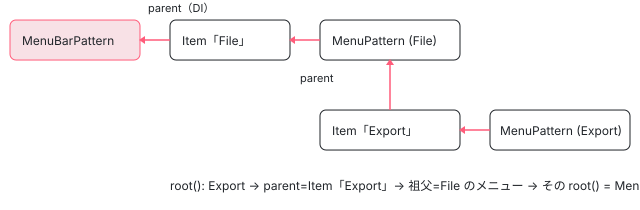

[目次](../README.md) › [Angular Aria の内側](README.md) › 第 18 回 / 全 20 回

# Menu と MenuBar：入れ子のメニューを開いて閉じる

> MenuPattern・MenuBarPattern・MenuTriggerPattern（private/menu/menu.ts、883 行）が、サブメニューを開く・閉じる・ホバーで移る・頭文字で移るを受け持つ行。項目が後から来てもフォーカスを中へ移す修正、サブメニューの中の DOM が変わるとたたまれていた問題。22.1.8 との差と、CDK Menu（cdk-menu）との違い。

angular/components · 読了 約 14 分 · 発展 · [サイトで読む（デモが動きます）](https://angular-deep-dive-cyan.vercel.app/chapter/aria-menu)

---

メニューは「開く・閉じる」が入れ子になる部品です。メニューバーの「File」を開き、その中の「Export」でサブメニューを開き、Escape で全部閉じる。この章では、それを受け持つ `MenuPattern`・`MenuBarPattern`・`MenuTriggerPattern`・`MenuItemPattern`（private/menu/menu.ts、883 行）が、**親をたどって「根」を求め、根の種類で振る舞いを変える**しくみ、ホバーで開くまでの `setTimeout`、項目が後から来てもフォーカスを中へ移す `pendingFocus` を 1 ステップずつ読みます。

読む対象は `src/aria/private/menu/menu.ts` と、ディレクティブの `src/aria/menu/menu.ts`（`Menu`）・`menu-item.ts`（`MenuItem`）・`menu-trigger.ts`（`MenuTrigger`）・`menu-bar.ts`（`MenuBar`）です。

1. [1. 全体像](01-aria-overview.md)
2. [2. SignalLike](02-aria-signal-like.md)
3. [3. SortedCollection](03-aria-collection.md)
4. [4. イベントマネージャ](04-aria-events.md)
5. [5. ListFocus](05-aria-list-focus.md)
6. [6. ListNavigation](06-aria-list-navigation.md)
7. [7. ListSelection](07-aria-list-selection.md)
8. [8. ListTypeahead](08-aria-typeahead.md)
9. [9. Listbox](09-aria-listbox.md)
10. [10. Accordion](10-aria-accordion.md)
11. [11. DeferredContent](11-aria-deferred-content.md)
12. [12. Tabs](12-aria-tabs.md)
13. [13. Toolbar](13-aria-toolbar.md)
14. [14. Tree](14-aria-tree.md)
15. [15. Grid](15-aria-grid.md)
16. [16. Grid のセル](16-aria-grid-cells.md)
17. [17. Combobox](17-aria-combobox.md)
18. **18. Menu**（この章）
19. [19. テスト](19-aria-testing.md)
20. [20. issue と PR を読む](20-aria-issues.md)

> [!WARNING]
> **ハマりどころ**
>
> menu は、このサイトに入れた 22.1.8 と引用の snapshot（22.2.0-next.5）で**中身が違う**部品です。差は cd9c7da8b6（2026-08-26、#33682「`ngMenuItem` の value が必須なのに読まれていない」）の 1 つだけでした。22.1.8 では `MenuItem` の `value` が `input.required<V>()`、`itemSelected` が `output<V>()`、`validate()` は `undefined` を除かずに重複を数えます。snapshot では value を省けて、省いた項目は `undefined` を出します（10 節）。ページの上のデモはすべての項目に `value` を書いているので、この差では動きが変わりません。ほかの修正（pendingFocus の 46b918edaf など）は 22.1.x にも入っていて、22.1.8 と snapshot で同じです。

## 1. 4 つのディレクティブと、親子のつなぎ方

📄 `components/src/aria/menu/menu.ts` L57–81 （▶ の行: 61, 65–71, 75–76, 79）

```ts
57 │ @Directive({
58 │   selector: '[ngMenu]',
59 │   exportAs: 'ngMenu',
60 │   host: {
61 ▶     'role': 'menu',
62 │     '[attr.id]': '_pattern.id()',
63 │     '[attr.aria-disabled]': '_pattern.disabled()',
64 │     '[attr.tabindex]': 'tabIndex()',
65 ▶     '[attr.data-visible]': 'visible()',
66 ▶     '(keydown)': '_pattern.onKeydown($event)',
67 ▶     '(mouseover)': '_pattern.onMouseOver($event)',
68 ▶     '(mouseout)': '_pattern.onMouseOut($event)',
69 ▶     '(focusout)': '_pattern.onFocusOut($event)',
70 ▶     '(focusin)': '_pattern.onFocusIn()',
71 ▶     '(click)': '_pattern.onClick($event)',
72 │   },
73 │   hostDirectives: [
74 │     {
75 ▶       directive: DeferredContentAware,
76 ▶       inputs: ['preserveContent'],
77 │     },
78 │   ],
79 ▶   providers: [{provide: MENU_COMPONENT, useExisting: Menu}],
80 │ })
81 │ export class Menu<V> implements OnDestroy {
```

📄 `components/src/aria/menu/menu-bar.ts` L55–70 （▶ の行: 59, 62–67, 69）

```ts
55 │ @Directive({
56 │   selector: '[ngMenuBar]',
57 │   exportAs: 'ngMenuBar',
58 │   host: {
59 ▶     'role': 'menubar',
60 │     '[attr.disabled]': '!softDisabled() && _pattern.disabled() ? true : null',
61 │     '[attr.aria-disabled]': '_pattern.disabled()',
62 ▶     '[attr.tabindex]': '_pattern.tabIndex()',
63 ▶     '(keydown)': '_pattern.onKeydown($event)',
64 ▶     '(mouseover)': '_pattern.onMouseOver($event)',
65 ▶     '(click)': '_pattern.onClick($event)',
66 ▶     '(focusin)': '_pattern.onFocusIn()',
67 ▶     '(focusout)': '_pattern.onFocusOut($event)',
68 │   },
69 ▶   providers: [{provide: MENU_COMPONENT, useExisting: MenuBar}],
70 │ })
```

- `ngMenu`（61 行目 `role="menu"`）は keydown・mouseover・mouseout・focusout・focusin・click の 6 つを Pattern に渡し、65 行目で `data-visible` を付けます。見せる・隠すの CSS は使う側が `[data-visible='false']` に書きます。
- `ngMenuBar`（59 行目 `role="menubar"`）は 5 つ。**mouseout はありません**。メニューバーは閉じないからです。
- どちらも `MENU_COMPONENT` というトークンで自分を出します（Menu 79 行目・MenuBar 69 行目）。`ngMenuItem` はこれを inject して「自分の親」を知ります。
- `ngMenu` は 75〜76 行目で `DeferredContentAware` を host directive に持ち、中身を `ng-template ngMenuContent` で後から描けます（[第 11 回](11-aria-deferred-content.md)）。

📄 `components/src/aria/menu/menu-item.ts` L65–104 （▶ の行: 68, 71, 74, 77, 80, 83, 95, 101–102）

```ts
 65 │   readonly id = input(inject(_IdGenerator).getId('ng-menu-item-', true));
 66 │ 
 67 │   /** The value of the menu item. */
 68 ▶   readonly value = input<V | undefined>(undefined);
 69 │ 
 70 │   /** Whether the menu item is disabled. */
 71 ▶   readonly disabled = input<boolean>(false);
 72 │ 
 73 │   /** The search term associated with the menu item. */
 74 ▶   readonly searchTerm = model<string>('');
 75 │ 
 76 │   /** The role of the menu item. */
 77 ▶   readonly role = input<'menuitem' | 'menuitemradio' | 'menuitemcheckbox'>('menuitem');
 78 │ 
 79 │   /** A reference to the parent menu or menubar. */
 80 ▶   readonly parent = inject<Menu<V> | MenuBar<V>>(MENU_COMPONENT, {optional: true});
 81 │ 
 82 │   /** The submenu associated with the menu item. */
 83 ▶   readonly submenu = input<Menu<V> | undefined>(undefined);
 84 │ 
 85 │   /** Whether the menu item is active. */
 86 │   readonly active = computed(() => this._pattern.active());
 87 │ 
 88 │   /** Whether the menu is expanded. */
 89 │   readonly expanded = computed(() => this._pattern.expanded());
 90 │ 
 91 │   /** Whether the menu item has a popup. */
 92 │   readonly hasPopup = computed(() => this._pattern.hasPopup());
 93 │ 
 94 │   /** The menu item ui pattern instance. */
 95 ▶   readonly _pattern: MenuItemPattern<V> = new MenuItemPattern<V>({
 96 │     id: this.id,
 97 │     value: this.value,
 98 │     element: computed(() => this._elementRef.nativeElement),
 99 │     disabled: this.disabled,
100 │     searchTerm: this.searchTerm,
101 ▶     parent: computed(() => this.parent?._pattern),
102 ▶     submenu: computed(() => this.submenu()?._pattern),
103 │     role: this.role,
104 │   });
```

📄 `components/src/aria/menu/menu-item.ts` L106–139 （▶ の行: 107, 124, 128, 133, 138）

```ts
106 │   constructor() {
107 ▶     effect(() => this.submenu()?.parent.set(this));
108 │ 
109 │     // Check for any violations after the DOM has been updated.
110 │     if (typeof ngDevMode === 'undefined' || ngDevMode) {
111 │       afterRenderEffect({
112 │         read: () => {
113 │           const violations: string[] = [];
114 │           if (!this.parent) {
115 │             violations.push('ngMenuItem must be placed inside an ngMenu or ngMenuBar container.');
116 │           }
117 │           reportViolations(violations, this.element);
118 │         },
119 │       });
120 │     }
121 │   }
122 │ 
123 │   ngOnInit() {
124 ▶     this.parent?._collection.register(this);
125 │   }
126 │ 
127 │   ngOnDestroy() {
128 ▶     this.parent?._collection.unregister(this);
129 │   }
130 │ 
131 │   /** Opens the submenu focusing on the first menu item. */
132 │   open() {
133 ▶     this._pattern.open({first: true});
134 │   }
135 │ 
136 │   /** Closes the submenu. */
137 │   close() {
138 ▶     this._pattern.close();
139 │   }
```

📄 `components/src/aria/menu/menu-trigger.ts` L82–98 （▶ の行: 83, 86, 91–92, 95–96）

```ts
82 │   /** The menu trigger ui pattern instance. */
83 ▶   readonly _pattern: MenuTriggerPattern<V> = new MenuTriggerPattern({
84 │     textDirection: this.textDirection,
85 │     element: computed(() => this._elementRef.nativeElement),
86 ▶     menu: computed(() => this.menu()?._pattern),
87 │     disabled: () => this.disabled(),
88 │   });
89 │ 
90 │   constructor() {
91 ▶     effect(() => this.menu()?.parent.set(this));
92 ▶     effect(() => this._pattern.pendingFocusEffect());
93 │ 
94 │     // Automatically prevent form submission.
95 ▶     if (this.element.tagName === 'BUTTON' && !this.element.hasAttribute('type')) {
96 ▶       this.element.setAttribute('type', 'button');
97 │     }
98 │   }
```

1. **項目 → 親（DI）**

   `MenuItem` の 80 行目 `inject(MENU_COMPONENT, {optional: true})` で、いちばん近い `ngMenu` か `ngMenuBar` を親にします。124 行目の `ngOnInit` で親の `_collection`（[SortedCollection](03-aria-collection.md)）に自分を登録します。101 行目、Pattern の `parent` は親ディレクティブの `_pattern` です。
2. **サブメニュー → 親（effect）**

   `[submenu]="exportMenu"` を受けた項目は、107 行目の `effect` で `exportMenu.parent.set(this)` と、**メニューの側に**「あなたの親は私」と書きます。トリガー（`ngMenuTrigger [menu]="m"`）も 91 行目で同じことをします。だから `ngMenu` は DOM のどこに置いてもよく、木の形は DOM ではなくこの `parent` の signal で決まります。
3. **値と見た目の input**

   68 行目 `value`（snapshot では省ける）、71 行目 `disabled`、74 行目 `searchTerm`（頭文字で移るときに比べる文字列。既定は空文字なので、渡さないと頭文字で移れない）、77 行目 `role`（`menuitemradio`・`menuitemcheckbox` に替えられる。50e281a7ac、#33264）。71 行目の `disabled` は `input<boolean>(false)` で `booleanAttribute` が無いので、`<div ngMenuItem disabled>` と素の属性で書くと strict な型チェックで落ちます。これが開いている #33964 です（10 節）。
4. **トリガーの小さな気配り**

   95〜96 行目、`<button>` に `type` が無ければ `type="button"` を付け、フォームの送信を防ぎます（11e2eb39c6、#33297）。92 行目の `pendingFocusEffect` は 4 節で読みます。

📄 `components/src/aria/menu/menu.ts` L120–150 （▶ の行: 133, 135, 137, 141, 150）

```ts
120 │   /** The menu ui pattern instance. */
121 │   readonly _pattern: MenuPattern<V>;
122 │ 
123 │   /**
124 │    * The menu item patterns for the menu items that are direct children of this menu, passed
125 │    * to the menu pattern.
126 │    *
127 │    * Note: contentChildren has an issue where it will return a successively smaller list
128 │    * each time that the menu is open and closed, eventually resulting in an empty list.
129 │    * The workaround is to trigger a recomputation of this signal whenever the menu is opened
130 │    * or closed, by calling this._pattern.visible() in the signal body. Otherwise, computed could
131 │    * not be used and would have to rebuild the list each time this method is called.
132 │    */
133 ▶   private readonly _itemPatterns = computed(() => {
134 │     // Only needed to force a recompute.
135 ▶     this._pattern.visible();
136 │ 
137 ▶     return this._items().map(i => i._pattern);
138 │   });
139 │ 
140 │   /** Whether the menu is visible. */
141 ▶   readonly visible = computed(() => this._pattern.visible());
142 │ 
143 │   /** The tab index of the menu. */
144 │   readonly tabIndex = computed(() => this._pattern.tabIndex());
145 │ 
146 │   /** A callback function triggered when a menu item is selected. */
147 │   readonly itemSelected = output<V | undefined>();
148 │ 
149 │   /** The delay in milliseconds before expanding sub-menus on hover. */
150 ▶   readonly expansionDelay = input<number>(100); // Arbitrarily chosen.
```

📄 `components/src/aria/menu/menu.ts` L152–191 （▶ の行: 155–156, 158, 161, 163, 169–170, 172–173, 179, 184–186, 191）

```ts
152 │   constructor() {
153 │     this._pattern = new MenuPattern({
154 │       ...this,
155 ▶       parent: computed(() => this.parent()?._pattern),
156 ▶       items: this._itemPatterns,
157 │       multi: () => false,
158 ▶       focusMode: () => 'roving',
159 │       orientation: () => 'vertical',
160 │       selectionMode: () => 'explicit',
161 ▶       activeItem: signal(undefined),
162 │       element: computed(() => this._elementRef.nativeElement),
163 ▶       itemSelected: (value: V | undefined) => this.itemSelected.emit(value),
164 │     });
165 │ 
166 │     afterRenderEffect({
167 │       write: () => {
168 │         const parent = this.parent();
169 ▶         if (parent instanceof MenuItem && parent.parent instanceof MenuBar) {
170 ▶           this._deferredContentAware?.contentVisible.set(true);
171 │         } else {
172 ▶           this._deferredContentAware?.contentVisible.set(
173 ▶             this._pattern.visible() || !!this.parent()?._pattern.hasBeenInteracted(),
174 │           );
175 │         }
176 │       },
177 │     });
178 │ 
179 ▶     // Focuses an active menu item when the menu becomes visible. This is needed to
180 │     // properly restore focus to the active item when returning to a menu, and to
181 │     // focus the first item when navigating into a submenu with hover.
182 │     afterRenderEffect({
183 │       write: () => {
184 ▶         if (this.visible()) {
185 ▶           const activeItem = untracked(() => this._pattern.inputs.activeItem());
186 ▶           this._pattern.listBehavior.goto(activeItem!);
187 │         }
188 │       },
189 │     });
190 │ 
191 ▶     afterRenderEffect({write: () => this._pattern.setDefaultStateEffect()});
```

1. **153〜164 行目 MenuPattern を作る**

   155 行目 `parent` は 1 つ前のステップの signal から、156 行目 `items` は 133〜138 行目の `_itemPatterns` です。158 行目 `focusMode: 'roving'`（フォーカスを項目そのものに動かす）、161 行目 今の項目は Pattern の中の `signal`、163 行目 選ばれたら `itemSelected` を emit します。135 行目で `visible()` を読んでいるのは、上のコメント（124〜132 行目）のとおり、開閉のたびに項目の配列を作り直させるためです。
2. **166〜177 行目 中身を描くか**

   親がメニューバーの項目なら 169〜170 行目でいつも描きます。それ以外は 172〜173 行目、見えているか、親が一度でも触られたら描きます（`ngMenuContent` を使ったときに効く）。
3. **179〜189 行目 見えたら、今の項目にフォーカスを移す**

   184 行目で見えているとき、185 行目で今の項目を `untracked` で読み、186 行目で `goto` します。179〜181 行目のコメントのとおり、戻ってきたときや、ホバーでサブメニューに入ったときに、今の項目へフォーカスを戻すためです。キーで開くときも効きます（4 節）。
4. **191 行目 最初の今の項目**

   8 節の `setDefaultStateEffect` です。150 行目の `expansionDelay`（既定 100 ms）は 5 節のホバーの待ち時間です。

## 2. 根（root）を求める

📄 `components/src/aria/private/menu/menu.ts` L81–118 （▶ の行: 92–93, 97, 100, 103, 106, 112, 115）

```ts
 81 │ export class MenuPattern<V> {
 82 │   /** The unique ID of the menu. */
 83 │   readonly id: SignalLike<string>;
 84 │ 
 85 │   /** The role of the menu. */
 86 │   readonly role = () => 'menu';
 87 │ 
 88 │   /** Whether the menu is disabled. */
 89 │   readonly disabled = () => this.inputs.disabled();
 90 │ 
 91 │   /** Whether the menu is visible. */
 92 ▶   readonly visible = computed(() =>
 93 ▶     this.inputs.parent() ? !!this.inputs.parent()?.expanded() : true,
 94 │   );
 95 │ 
 96 │   /** Controls list behavior for the menu items. */
 97 ▶   readonly listBehavior: List<MenuItemPattern<V>, V | undefined>;
 98 │ 
 99 │   /** Whether the menu or any of its child elements are currently focused. */
100 ▶   readonly isFocused = signal(false);
101 │ 
102 │   /** Whether the menu has received interaction. */
103 ▶   readonly hasBeenInteracted = signal(false);
104 │ 
105 │   /** Whether the menu trigger has been hovered. */
106 ▶   readonly hasBeenHovered = signal(false);
107 │ 
108 │   /** Items currently inside the menu. */
109 │   readonly items = () => this.inputs.items();
110 │ 
111 │   /** Timeout used to open sub-menus on hover. */
112 ▶   private _openTimeout: ReturnType<typeof setTimeout> | undefined;
113 │ 
114 │   /** Timeout used to close sub-menus on hover out. */
115 ▶   private _closeTimeout: ReturnType<typeof setTimeout> | undefined;
116 │ 
117 │   /** The tab index of the menu. */
118 │   readonly tabIndex = () => this.listBehavior.tabIndex();
```

📄 `components/src/aria/private/menu/menu.ts` L120–133 （▶ の行: 121–122, 124–125, 128–129）

```ts
120 │   /** Whether the menu should be focused on mouse over. */
121 ▶   readonly shouldFocus = computed(() => {
122 ▶     const root = this.root();
123 │ 
124 ▶     if (root instanceof MenuTriggerPattern) {
125 ▶       return true;
126 │     }
127 │ 
128 ▶     if (root instanceof MenuBarPattern || root instanceof MenuPattern) {
129 ▶       return root.isFocused();
130 │     }
131 │ 
132 │     return false;
133 │   });
```

📄 `components/src/aria/private/menu/menu.ts` L135–172 （▶ の行: 137, 142, 146, 149, 155, 157–158, 161–162, 165, 167–168, 171）

```ts
135 │   /** The key used to expand sub-menus. */
136 │   private readonly _expandKey = computed(() => {
137 ▶     return this.inputs.textDirection() === 'rtl' ? 'ArrowLeft' : 'ArrowRight';
138 │   });
139 │ 
140 │   /** The key used to collapse sub-menus. */
141 │   private readonly _collapseKey = computed(() => {
142 ▶     return this.inputs.textDirection() === 'rtl' ? 'ArrowRight' : 'ArrowLeft';
143 │   });
144 │ 
145 │   /** Represents the space key. Does nothing when the user is actively using typeahead. */
146 ▶   readonly dynamicSpaceKey = computed(() => (this.listBehavior.isTyping() ? '' : ' '));
147 │ 
148 │   /** The regexp used to decide if a key should trigger typeahead. */
149 ▶   readonly typeaheadRegexp = /^.$/;
150 │ 
151 │   /** The root of the menu. */
152 │   readonly root: SignalLike<
153 │     MenuTriggerPattern<V> | MenuBarPattern<V> | MenuPattern<V> | undefined
154 │   > = computed(() => {
155 ▶     const parent = this.inputs.parent();
156 │ 
157 ▶     if (!parent) {
158 ▶       return this;
159 │     }
160 │ 
161 ▶     if (parent instanceof MenuTriggerPattern) {
162 ▶       return parent;
163 │     }
164 │ 
165 ▶     const grandparent = parent.inputs.parent();
166 │ 
167 ▶     if (grandparent instanceof MenuBarPattern) {
168 ▶       return grandparent;
169 │     }
170 │ 
171 ▶     return grandparent?.root();
172 │   });
```

1. **92〜94 行目 visible**

   親がいれば「親が開いているか」、親がいなければ（ページに置いたままのメニュー）いつも true です。メニュー自身は「開いている」を持たず、親の項目かトリガーの `expanded` を見ます。
2. **152〜172 行目 root**

   親がいなければ自分（158 行目）、親がトリガーならトリガー（161〜162 行目）。親が項目なら、その項目の親（祖父）を見て、メニューバーならメニューバー（167〜168 行目）、メニューならその `root()` を再帰で（171 行目）求めます。根は 3 種類（`MenuTriggerPattern`・`MenuBarPattern`・`MenuPattern`）で、閉じ方・選んだあとの動き・左右キーの意味が、どれも根の種類で分かれます（3・6 節）。
3. **121〜133 行目 shouldFocus**

   ホバーしたときにフォーカスまで動かすか。根がトリガーならいつも、メニューバーかメニューなら根にフォーカスがあるときだけです（5 節）。
4. **137・142 行目 開く・閉じるキーは文字の向きで決まる**

   右から左の言語（rtl）では ArrowLeft で開き ArrowRight で閉じます。146 行目、頭文字を打っている最中の Space は空文字のキーにして、「選ぶ」にしません。



*デモのメニューの parent と root。Export のサブメニューは、親の項目 → 祖父の File メニュー → その root() とたどって MenuBarPattern に着く*

## 3. キー

📄 `components/src/aria/private/menu/menu.ts` L174–195 （▶ の行: 177–178, 181–186, 191–193）

```ts
174 │   /** Handles keyboard events for the menu. */
175 │   readonly keydownManager = computed(() => {
176 │     return new KeyboardEventManager()
177 ▶       .on('ArrowDown', () => this.next(), {ignoreRepeat: false})
178 ▶       .on('ArrowUp', () => this.prev(), {ignoreRepeat: false})
179 │       .on('Home', () => this.first())
180 │       .on('End', () => this.last())
181 ▶       .on('Enter', () => this.trigger())
182 ▶       .on('Escape', () => this.closeAll())
183 ▶       .on(this._expandKey, () => this.expand())
184 ▶       .on(this._collapseKey, () => this.collapse())
185 ▶       .on(this.dynamicSpaceKey, () => this.trigger())
186 ▶       .on(this.typeaheadRegexp, e => this.listBehavior.search(e.key));
187 │   });
188 │ 
189 │   constructor(readonly inputs: MenuInputs<V>) {
190 │     this.id = inputs.id;
191 ▶     this.listBehavior = new List<MenuItemPattern<V>, V | undefined>({
192 ▶       ...inputs,
193 ▶       value: signal([]),
194 │     });
195 │   }
```

📄 `components/src/aria/private/menu/menu.ts` L525–564 （▶ の行: 528–529, 532–536, 546–547, 553）

```ts
525 │   /** Handles keyboard events for the menu. */
526 │   readonly keydownManager = computed(() => {
527 │     return new KeyboardEventManager()
528 ▶       .on(this._nextKey, () => this.next(), {ignoreRepeat: false})
529 ▶       .on(this._previousKey, () => this.prev(), {ignoreRepeat: false})
530 │       .on('End', () => this.listBehavior.last())
531 │       .on('Home', () => this.listBehavior.first())
532 ▶       .on('Enter', () => this.inputs.activeItem()?.open({first: true}))
533 ▶       .on('ArrowUp', () => this.inputs.activeItem()?.open({last: true}))
534 ▶       .on('ArrowDown', () => this.inputs.activeItem()?.open({first: true}))
535 ▶       .on(this.dynamicSpaceKey, () => this.inputs.activeItem()?.open({first: true}))
536 ▶       .on(this.typeaheadRegexp, e => this.listBehavior.search(e.key));
537 │   });
538 │ 
539 │   constructor(readonly inputs: MenuBarInputs<V>) {
540 │     this.listBehavior = new List<MenuItemPattern<V>, V | undefined>(inputs);
541 │   }
542 │ 
543 │   /** Sets the default state for the menubar. */
544 │   setDefaultState() {
545 │     const firstFocusable = this.listBehavior.navigationBehavior.peekFirst();
546 ▶     if (firstFocusable) {
547 ▶       this.inputs.activeItem.set(firstFocusable);
548 │     }
549 │   }
550 │ 
551 │   /** Sets the default active state of the menubar before receiving interaction for the first time. */
552 │   setDefaultStateEffect(): void {
553 ▶     if (this.hasBeenInteracted()) return;
554 │ 
555 │     if (this.inputs.items().length > 0) {
556 │       this.setDefaultState();
557 │     }
558 │   }
559 │ 
560 │   /** Handles keyboard events for the menu. */
561 │   onKeydown(event: KeyboardEvent) {
562 │     this.hasBeenInteracted.set(true);
563 │     this.keydownManager().handle(event);
564 │   }
```

📄 `components/src/aria/private/menu/menu.ts` L650–689 （▶ の行: 652, 658, 661, 664, 670–671, 680–684）

```ts
650 │ export class MenuTriggerPattern<V> {
651 │   /** Whether the menu trigger is expanded. */
652 ▶   readonly expanded = signal(false);
653 │ 
654 │   /** Whether the menu trigger has received interaction. */
655 │   readonly hasBeenInteracted = signal(false);
656 │ 
657 │   /** The pending focus target when the menu is opened before the menu instance is available. */
658 ▶   readonly pendingFocus = signal<'first' | 'last' | undefined>(undefined);
659 │ 
660 │   /** The role of the menu trigger. */
661 ▶   readonly role = () => 'button';
662 │ 
663 │   /** Whether the menu trigger has a popup. */
664 ▶   readonly hasPopup = () => true;
665 │ 
666 │   /** The menu associated with the trigger. */
667 │   readonly menu: SignalLike<MenuPattern<V> | undefined>;
668 │ 
669 │   /** The tab index of the menu trigger. */
670 ▶   readonly tabIndex = computed(() =>
671 ▶     this.expanded() && this.menu()?.inputs.activeItem() ? -1 : 0,
672 │   );
673 │ 
674 │   /** Whether the menu trigger is disabled. */
675 │   readonly disabled = () => this.inputs.disabled();
676 │ 
677 │   /** Handles keyboard events for the menu trigger. */
678 │   readonly keydownManager = computed(() => {
679 │     return new KeyboardEventManager()
680 ▶       .on(' ', () => this.open({first: true}))
681 ▶       .on('Enter', () => this.open({first: true}))
682 ▶       .on('ArrowDown', () => this.open({first: true}))
683 ▶       .on('ArrowUp', () => this.open({last: true}))
684 ▶       .on('Escape', () => this.close({refocus: true}));
685 │   });
686 │ 
687 │   constructor(readonly inputs: MenuTriggerInputs<V>) {
688 │     this.menu = this.inputs.menu;
689 │   }
```

3 つの Pattern がそれぞれ `KeyboardEventManager` を持ちます（[第 4 回](04-aria-events.md)）。マネージャは扱ったキーの `stopPropagation` をするので、メニューの中で押した ArrowDown が外側のメニューバーにまで届いて二重に動くことはありません。

| キー | メニューの中（177〜186 行目） | メニューバー（528〜536 行目） | トリガー（680〜684 行目） |
| --- | --- | --- | --- |
| ArrowDown / ArrowUp | 次・前の項目 | 今の項目を開いて最初 / 最後へ | 開いて最初 / 最後へ |
| ArrowRight / ArrowLeft（ltr） | `expand()` / `collapse()` | 次・前の項目（開いていれば開き直す） | — |
| Enter / Space | `trigger()`：サブメニューがあれば開く、なければ選ぶ | 開いて最初へ | 開いて最初へ |
| Escape | `closeAll()` | — | 閉じてトリガーにフォーカス |
| Home / End | 最初・最後（`first()` / `last()`） | 最初・最後 | — |
| 1 文字 | 頭文字検索（[第 8 回](08-aria-typeahead.md)） | 頭文字検索 | — |

📄 `components/src/aria/private/menu/menu.ts` L372–401 （▶ の行: 374–375, 380–381, 398–400）

```ts
372 │   /** Focuses the previous menu item. */
373 │   prev() {
374 ▶     this.inputs.activeItem()?.close();
375 ▶     this.listBehavior.prev();
376 │   }
377 │ 
378 │   /** Focuses the next menu item. */
379 │   next() {
380 ▶     this.inputs.activeItem()?.close();
381 ▶     this.listBehavior.next();
382 │   }
383 │ 
384 │   /** Focuses the first menu item. */
385 │   first() {
386 │     this.inputs.activeItem()?.close();
387 │     this.listBehavior.first();
388 │   }
389 │ 
390 │   /** Focuses the last menu item. */
391 │   last() {
392 │     this.inputs.activeItem()?.close();
393 │     this.listBehavior.last();
394 │   }
395 │ 
396 │   /** Triggers the active menu item. */
397 │   trigger() {
398 ▶     this.inputs.activeItem()?.hasPopup()
399 ▶       ? this.inputs.activeItem()?.open({first: true})
400 ▶       : this.submit();
401 │   }
```

📄 `components/src/aria/private/menu/menu.ts` L423–450 （▶ の行: 428–431, 440–443, 449）

```ts
423 │   /** Collapses the current menu or focuses the previous item in the menubar. */
424 │   collapse() {
425 │     const root = this.root();
426 │     const parent = this.inputs.parent();
427 │ 
428 ▶     if (parent instanceof MenuItemPattern && !(parent.inputs.parent() instanceof MenuBarPattern)) {
429 ▶       parent.close({refocus: true});
430 ▶     } else if (root instanceof MenuBarPattern) {
431 ▶       root.prev();
432 │     }
433 │   }
434 │ 
435 │   /** Expands the current menu or focuses the next item in the menubar. */
436 │   expand() {
437 │     const root = this.root();
438 │     const activeItem = this.inputs.activeItem();
439 │ 
440 ▶     if (activeItem?.submenu()) {
441 ▶       activeItem.open({first: true});
442 ▶     } else if (root instanceof MenuBarPattern) {
443 ▶       root.next();
444 │     }
445 │   }
446 │ 
447 │   /** Closes the menu. */
448 │   close() {
449 ▶     this.inputs.parent()?.close();
450 │   }
```

📄 `components/src/aria/private/menu/menu.ts` L452–467 （▶ の行: 454, 456–457, 460–461, 464–465）

```ts
452 │   /** Closes the menu and all parent menus. */
453 │   closeAll() {
454 ▶     const root = this.root();
455 │ 
456 ▶     if (root instanceof MenuTriggerPattern) {
457 ▶       root.close({refocus: true});
458 │     }
459 │ 
460 ▶     if (root instanceof MenuBarPattern) {
461 ▶       root.close();
462 │     }
463 │ 
464 ▶     if (root instanceof MenuPattern) {
465 ▶       root.inputs.activeItem()?.close({refocus: true});
466 │     }
467 │   }
```

1. **374・380 行目 動く前に、今の項目のサブメニューを閉じる**

   上下で動くと、開いていたサブメニューは閉じます。そのあと `listBehavior`（[List](09-aria-listbox.md) の Behavior）で動きます。
2. **398〜400 行目 trigger：開くか選ぶか**

   今の項目に `hasPopup()`（サブメニューがある）なら `open({first: true})`、なければ 6 節の `submit()` です。
3. **428〜432 行目 collapse（ltr の ArrowLeft）**

   親が項目で、その親がメニューバーでない（= 2 段目以下のサブメニュー）なら、親の項目を閉じてそこへフォーカスを戻します（429 行目）。メニューバーの直下のメニューなら、メニューバーの前の項目へ移ります（431 行目）。
4. **440〜444 行目 expand（ltr の ArrowRight）**

   今の項目にサブメニューがあれば開いて最初へ（441 行目）。なければ、根がメニューバーのときだけ次の項目へ移ります（443 行目）。デモで「PDF」の上で ArrowRight を押すと「Edit」が開くのはこの行です。
5. **453〜467 行目 closeAll（Escape）**

   根がトリガーなら閉じてトリガーへフォーカス（457 行目）、メニューバーならメニューバーの `close()`（461 行目）、ページに置いたメニューなら、その今の項目のサブメニューを閉じます（465 行目）。どの段で押しても根から閉じるので、1 回で全部閉じます。

## 4. 開いて、中へフォーカスを移す

📄 `components/src/aria/private/menu/menu.ts` L824–853 （▶ の行: 832, 836, 841, 845, 847–848, 850–851）

```ts
824 │   /** The submenu associated with the menu item. */
825 │   readonly submenu: SignalLike<MenuPattern<V> | undefined>;
826 │ 
827 │   /** Whether the menu item is selectable. */
828 │   readonly selectable: SignalLike<boolean>;
829 │ 
830 │   constructor(readonly inputs: MenuItemInputs<V>) {
831 │     this.id = inputs.id;
832 ▶     this.value = inputs.value ?? signal(undefined);
833 │     this.element = inputs.element;
834 │     this.submenu = this.inputs.submenu;
835 │     this.searchTerm = inputs.searchTerm;
836 ▶     this.selectable = computed(() => !this.submenu());
837 │   }
838 │ 
839 │   /** Opens the submenu. */
840 │   open(opts?: {first?: boolean; last?: boolean}) {
841 ▶     if (this.disabled()) {
842 │       return;
843 │     }
844 │ 
845 ▶     this._expanded.set(true);
846 │ 
847 ▶     if (opts?.first) {
848 ▶       this.submenu()?.first();
849 │     }
850 ▶     if (opts?.last) {
851 ▶       this.submenu()?.last();
852 │     }
853 │   }
```

1. **項目の open**

   841 行目、無効なら何もしません。845 行目で `_expanded` を true にし、848 行目で `submenu()?.first()`。`first()` は 3 節の 385〜388 行目と同じ並びで、`listBehavior.first()` が最初の項目の `focus()` を呼びます。
2. **でも、まだ見えていない**

   この時点ではサブメニューの `data-visible` はまだ false で、CSS で `display: none` にしていれば `focus()` は効きません。描画のあと、1 節の `Menu` の 184〜186 行目が「見えたので今の項目へ `goto`」をもう一度行い、そこでフォーカスが入ります。

📄 `components/src/aria/private/menu/menu.ts` L691–722 （▶ の行: 692–695, 699–701, 703, 705, 711, 713, 720）

```ts
691 │   /** Flushes any pending focus when the menu instance becomes available. */
692 ▶   pendingFocusEffect(): void {
693 ▶     const menu = this.inputs.menu();
694 ▶     const intent = this.pendingFocus();
695 ▶     const items = menu?.items();
696 │ 
697 │     // We check the items so that we don't try calling into
698 │     // `first/last` until the items are actually available.
699 ▶     if (menu && intent && items?.length) {
700 ▶       if (intent === 'first') {
701 ▶         menu.first();
702 │       } else if (intent === 'last') {
703 ▶         menu.last();
704 │       }
705 ▶       this.pendingFocus.set(undefined);
706 │     }
707 │   }
708 │ 
709 │   /** Handles keyboard events for the menu trigger. */
710 │   onKeydown(event: KeyboardEvent) {
711 ▶     if (!this.inputs.disabled()) {
712 │       this.hasBeenInteracted.set(true);
713 ▶       this.keydownManager().handle(event);
714 │     }
715 │   }
716 │ 
717 │   /** Handles click events for the menu trigger. */
718 │   onClick() {
719 │     if (!this.inputs.disabled()) {
720 ▶       this.expanded() ? this.close() : this.open({first: true});
721 │     }
722 │   }
```

📄 `components/src/aria/private/menu/menu.ts` L743–772 （▶ の行: 745, 747–748, 750, 756–758, 760–761, 766, 768, 770）

```ts
743 │   /** Opens the menu. */
744 │   open(opts?: {first?: boolean; last?: boolean}) {
745 ▶     this.expanded.set(true);
746 │ 
747 ▶     if (opts?.first) {
748 ▶       this.pendingFocus.set('first');
749 │     } else if (opts?.last) {
750 ▶       this.pendingFocus.set('last');
751 │     }
752 │   }
753 │ 
754 │   /** Closes the menu. */
755 │   close(opts: {refocus?: boolean} = {}) {
756 ▶     this.expanded.set(false);
757 ▶     this.pendingFocus.set(undefined);
758 ▶     this.menu()?.listBehavior.unfocus();
759 │ 
760 ▶     if (opts.refocus) {
761 ▶       this.inputs.element()?.focus();
762 │     }
763 │ 
764 │     let menuitems = this.inputs.menu()?.inputs.items() ?? [];
765 │ 
766 ▶     while (menuitems.length) {
767 │       const menuitem = menuitems.pop();
768 ▶       menuitem?._expanded.set(false);
769 │       menuitem?.inputs.parent()?.listBehavior.unfocus();
770 ▶       menuitems = menuitems.concat(menuitem?.submenu()?.inputs.items() ?? []);
771 │     }
772 │   }
```

1. **トリガーの open は「あとで」を予約する**

   745 行目で `expanded` を true、748・750 行目で `pendingFocus` に `'first'` か `'last'` を入れるだけです。メニューの `first()` はここでは呼びません。トリガーのメニューは CDK Overlay の `ng-template` の中に置くことが多く、開いた瞬間にはまだメニューも項目も作られていないからです（629fe71c3a、2026-05-17、#33258 で `pendingFocus` が入った）。
2. **692〜707 行目 pendingFocusEffect**

   ディレクティブの effect（1 節の 92 行目）で回ります。693〜695 行目でメニュー・予約・項目を読み、699 行目で 3 つともそろったときだけ 701 / 703 行目で `first()` / `last()` を呼び、705 行目で予約を消します。`items?.length` の条件は 46b918edaf（2026-08-28、#33742「メニューを開いてもフォーカスが項目に移らない」）で足されました。それまでは `menu && intent` だけで、メニューは来たが項目がまだ 0 個のときに `first()` を空振りして予約を消し、二度とフォーカスが入りませんでした。issue の手順「Enter で開いてもフォーカスはトリガーのまま、もう一度押すと入る」はこの空振りです。
3. **755〜772 行目 トリガーの close**

   756〜758 行目で閉じて予約を消し、メニューの今の項目を外します。760〜761 行目、`refocus` ならトリガーにフォーカスを戻します。766〜771 行目は、メニューの項目からサブメニューの項目へと配列を広げながら、全部の `_expanded` を false にしていく行です。入れ子が何段でも 1 回で閉じます。

## 5. ホバーで移る：時間とフォーカス

📄 `components/src/aria/private/menu/menu.ts` L238–272 （▶ の行: 240, 244–245, 254–255, 257–258, 262–263, 266–267, 270–271）

```ts
238 │   /** Handles mouseover events for the menu. */
239 │   onMouseOver(event: MouseEvent) {
240 ▶     if (!this.visible()) {
241 │       return;
242 │     }
243 │ 
244 ▶     this.hasBeenHovered.set(true);
245 ▶     const item = this.inputs.items().find(i => i.element()?.contains(_getEventTarget(event)));
246 │ 
247 │     if (!item) {
248 │       return;
249 │     }
250 │ 
251 │     const parent = this.inputs.parent();
252 │     const activeItem = this.inputs.activeItem();
253 │ 
254 ▶     if (parent instanceof MenuItemPattern) {
255 ▶       const grandparent = parent.inputs.parent();
256 │       if (grandparent instanceof MenuPattern) {
257 ▶         grandparent._clearTimeouts();
258 ▶         grandparent.listBehavior.goto(parent, {focusElement: false});
259 │       }
260 │     }
261 │ 
262 ▶     if (activeItem && activeItem !== item) {
263 ▶       this._closeItem(activeItem);
264 │     }
265 │ 
266 ▶     if (item.expanded()) {
267 ▶       this._clearCloseTimeout();
268 │     }
269 │ 
270 ▶     this._openItem(item);
271 ▶     this.listBehavior.goto(item, {focusElement: this.shouldFocus()});
272 │   }
```

📄 `components/src/aria/private/menu/menu.ts` L274–294 （▶ の行: 276, 278–280, 282, 288, 290–291, 293）

```ts
274 │   /** Closes the specified menu item after a delay. */
275 │   private _closeItem(item: MenuItemPattern<V>) {
276 ▶     this._clearOpenTimeout();
277 │ 
278 ▶     if (!this._closeTimeout) {
279 ▶       this._closeTimeout = setTimeout(() => {
280 ▶         item.close();
281 │         this._closeTimeout = undefined;
282 ▶       }, this.inputs.expansionDelay());
283 │     }
284 │   }
285 │ 
286 │   /** Opens the specified menu item after a delay. */
287 │   private _openItem(item: MenuItemPattern<V>) {
288 ▶     this._clearOpenTimeout();
289 │ 
290 ▶     this._openTimeout = setTimeout(() => {
291 ▶       item.open();
292 │       this._openTimeout = undefined;
293 ▶     }, this.inputs.expansionDelay());
294 │   }
```

1. **240〜249 行目 見えているメニューの、どの項目の上か**

   見えていなければ何もしません。244 行目で「ホバーされた」印を付け（8 節）、245 行目で `event.target` を含む項目を探します。
2. **254〜260 行目 自分がサブメニューなら、親の項目を光らせ続ける**

   サブメニューの上に乗ったら、祖父のメニューのタイマーを止め（257 行目）、祖父のメニューの今の項目を自分の親の項目にします（258 行目、フォーカスは動かさない）。
3. **262〜268 行目 前の項目は「あとで閉じる」**

   別の項目に移ったら、前の項目を `_closeItem` で `expansionDelay` 後に閉じます（279〜282 行目）。乗った項目がもう開いていれば、閉じるタイマーを止めます（266〜267 行目）。
4. **270 行目 乗った項目を「あとで開く」**

   `_openItem` は前の開くタイマーを消してから（288 行目）、290〜293 行目の `setTimeout` で `expansionDelay` 後に `item.open()` を呼びます。マウスがメニューの上を通り過ぎるたびにサブメニューが開いたり閉じたりしないための待ち時間です。既定は 100 ms（1 節の 150 行目）。
5. **271 行目 今の項目にする。フォーカスは shouldFocus しだい**

   2 節の `shouldFocus` です。トリガーから開いたメニューならいつもフォーカスも動き、メニューバーなら、メニューバーかその中にフォーカスがあるときだけ動きます。

📄 `components/src/aria/private/menu/menu.ts` L296–321 （▶ の行: 298, 300, 308, 314, 318–319）

```ts
296 │   /** Handles mouseout events for the menu. */
297 │   onMouseOut(event: MouseEvent) {
298 ▶     this._clearOpenTimeout();
299 │ 
300 ▶     if (this.isFocused()) {
301 │       return;
302 │     }
303 │ 
304 │     const root = this.root();
305 │     const parent = this.inputs.parent();
306 │     const relatedTarget = event.relatedTarget as Node | null;
307 │ 
308 ▶     if (!root || !parent || parent instanceof MenuTriggerPattern) {
309 │       return;
310 │     }
311 │ 
312 │     const grandparent = parent.inputs.parent();
313 │ 
314 ▶     if (!grandparent || grandparent instanceof MenuBarPattern) {
315 │       return;
316 │     }
317 │ 
318 ▶     if (!grandparent.inputs.element()?.contains(relatedTarget)) {
319 ▶       parent.close();
320 │     }
321 │   }
```

298 行目、マウスが出たら開くタイマーを止めます。300 行目、フォーカスがこのメニューの中にあれば閉じません（キーで操作中の人のメニューを、マウスが通っただけで閉じない）。308・314 行目、トリガーやメニューバーの直下のメニューは閉じません。2 段目以下のサブメニューだけ、318〜319 行目で「マウスの行き先が祖父のメニューの中でなければ」親の項目を閉じます。

📄 `components/src/aria/private/menu/menu.ts` L566–601 （▶ の行: 568, 574–575, 580, 583, 595, 597–599）

```ts
566 │   /** Handles click events for the menu bar. */
567 │   onClick(event: MouseEvent) {
568 ▶     const item = this.inputs.items().find(i => i.element()?.contains(_getEventTarget(event)));
569 │ 
570 │     if (!item) {
571 │       return;
572 │     }
573 │ 
574 ▶     this.goto(item);
575 ▶     item.expanded() ? item.close() : item.open();
576 │   }
577 │ 
578 │   /** Handles mouseover events for the menu bar. */
579 │   onMouseOver(event: MouseEvent) {
580 ▶     const item = this.inputs.items().find(i => i.element()?.contains(_getEventTarget(event)));
581 │ 
582 │     if (item) {
583 ▶       this.goto(item, {focusElement: this.isFocused()});
584 │     }
585 │   }
586 │ 
587 │   /** Handles focusin events for the menu bar. */
588 │   onFocusIn() {
589 │     this.isFocused.set(true);
590 │     this.hasBeenInteracted.set(true);
591 │   }
592 │ 
593 │   /** Handles focusout events for the menu bar. */
594 │   onFocusOut(event: FocusEvent) {
595 ▶     const relatedTarget = event.relatedTarget as Node | null;
596 │ 
597 ▶     if (!this.inputs.element()?.contains(relatedTarget)) {
598 ▶       this.isFocused.set(false);
599 ▶       this.close();
600 │     }
601 │   }
```

📄 `components/src/aria/private/menu/menu.ts` L603–619 （▶ の行: 605–606, 608–610, 613–616）

```ts
603 │   /** Goes to and optionally focuses the specified menu item. */
604 │   goto(item: MenuItemPattern<V>, opts?: {focusElement?: boolean}) {
605 ▶     const prevItem = this.inputs.activeItem();
606 ▶     this.listBehavior.goto(item, opts);
607 │ 
608 ▶     if (prevItem?.expanded()) {
609 ▶       prevItem?.close();
610 ▶       this.inputs.activeItem()?.open();
611 │     }
612 │ 
613 ▶     if (item === prevItem) {
614 ▶       if (item.expanded() && item.submenu()?.inputs.activeItem()) {
615 ▶         item.submenu()?.inputs.activeItem()?.close();
616 ▶         item.submenu()?.listBehavior.unfocus();
617 │       }
618 │     }
619 │   }
```

📄 `components/src/aria/private/menu/menu.ts` L621–646 （▶ の行: 622, 624, 626–628, 633, 637–639, 645）

```ts
621 │   /** Focuses the next menu item. */
622 ▶   next() {
623 │     const prevItem = this.inputs.activeItem();
624 ▶     this.listBehavior.next();
625 │ 
626 ▶     if (prevItem?.expanded()) {
627 ▶       prevItem?.close();
628 ▶       this.inputs.activeItem()?.open({first: true});
629 │     }
630 │   }
631 │ 
632 │   /** Focuses the previous menu item. */
633 ▶   prev() {
634 │     const prevItem = this.inputs.activeItem();
635 │     this.listBehavior.prev();
636 │ 
637 ▶     if (prevItem?.expanded()) {
638 ▶       prevItem?.close();
639 ▶       this.inputs.activeItem()?.open({first: true});
640 │     }
641 │   }
642 │ 
643 │   /** Closes the menubar and refocuses the root menu bar item. */
644 │   close() {
645 ▶     this.inputs.activeItem()?.close({refocus: this.isFocused()});
646 │   }
```

メニューバーのホバー（579〜585 行目）にはタイマーがありません。583 行目の `goto` で今の項目にするだけで、608〜611 行目、**前の項目が開いていたときだけ**、それを閉じて新しい項目を開きます。だから一度クリックで開くと、あとはホバーで「File」「Edit」を行き来でき、何も開いていなければホバーしても開きません。クリック（567〜576 行目）は開閉の切り替えです。キーの次・前（622〜641 行目）も同じ形で、前の項目が開いていたら閉じて、新しい項目を `{first: true}` で開きます。645 行目の `close()` は、メニューバーにフォーカスがあるときだけ今の項目へフォーカスを戻します。

> **🧪 DEMO — 本物の ngMenuBar + ngMenu（このサイトの 22.1.8）**
>
> Tab でメニューバーに入り、左右の矢印で「File」「Edit」を移り、ArrowDown か Enter で開きます。開いたメニューの中は上下の矢印、「Export」で ArrowRight を押すとサブメニュー、ArrowLeft で戻り、Escape で全部閉じます。頭文字（N・O・E・P など）でも移れます（項目に `searchTerm` を渡しています）。マウスでは、クリックで開き、開いたあとは「File」と「Edit」の間をホバーで移れます。「Export」にマウスを乗せると、下で選んだ時間のあとにサブメニューが開きます。キー・クリック・ホバー（乗った項目が変わったときだけ）のときを 0ms として、`aria-expanded` が変わった時刻と、250ms 後に開いている項目・フォーカスのある項目を出します。Aria のキーのハンドラは伝わりを止めるので、ログは外側の要素で捕捉段階（`addEventListener(..., true)`）で聞いています。
>
> ▶ [このデモはサイトで動かせます](https://angular-deep-dive-cyan.vercel.app/chapter/aria-menu)

2026-11-02 にヘッドレスの Chrome（156）でこのページの開発ビルドを開き、CDP で本物のキーとマウスを送って記録した結果です。

- 「File」で ArrowDown：3ms で「File」の `aria-expanded` が true、250ms 後にはフォーカスが「New」にありました（4 節の 2 段階）。
- 「Export」で ArrowRight：1ms で開き、フォーカスは「PDF」。ArrowLeft で閉じて「Export」へ戻り（429 行目）、「PDF」の上の ArrowRight では「File」が閉じて「Edit」が開き、フォーカスは「Undo」でした（443 行目 → 622〜630 行目）。Escape で全部閉じ、フォーカスは「Edit」に戻りました。
- クリックで「File」を開いたあと「Export」にマウスを乗せると、**101ms** 後に `aria-expanded` が true になりました（290〜293 行目の `setTimeout`、既定 100）。クリックで「File」にフォーカスがあるので、ホバーでフォーカスも「Export」に移りました（271 行目）。
- `expansionDelay` を 500 にすると、「Export」の `aria-expanded` が true になったのは **504ms** 後でした。開いたまま「Edit」へホバーすると、1ms で「File」と「Export」が閉じて「Edit」が開きました（608〜611 行目、メニューバーにはタイマーが無い）。
- 頭文字：メニューバーで `e` を押すと「Edit」へ、開いた「Edit」の中で `p` を押すと「Paste」へ移りました。「File」を Enter で開いて「New」で ArrowLeft を押すと、「File」が閉じて（巻き戻って）「Edit」が開きました（431 行目 → 633〜640 行目）。
- 「PDF」をクリックすると `itemSelected: pdf` がメニューバーから出て、「File」と「Export」が閉じました（6 節）。コンソールに警告やエラーは出ませんでした。

## 6. 選ぶ・閉じる

📄 `components/src/aria/private/menu/menu.ts` L323–339 （▶ の行: 326, 328–331）

```ts
323 │   /** Handles click events for the menu. */
324 │   onClick(event: MouseEvent) {
325 │     const relatedTarget = _getEventTarget<Node>(event);
326 ▶     const item = this.inputs.items().find(i => i.element()?.contains(relatedTarget));
327 │ 
328 ▶     if (item) {
329 ▶       item.open();
330 ▶       this.listBehavior.goto(item);
331 ▶       this.submit(item);
332 │     }
333 │   }
334 │ 
335 │   /** Handles focusin events for the menu. */
336 │   onFocusIn() {
337 │     this.isFocused.set(true);
338 │     this.hasBeenInteracted.set(true);
339 │   }
```

📄 `components/src/aria/private/menu/menu.ts` L403–421 （▶ の行: 405, 409, 411–419）

```ts
403 │   /** Submits the menu. */
404 │   submit(item = this.inputs.activeItem()) {
405 ▶     if (!item || item.disabled() || item.submenu()) {
406 │       return;
407 │     }
408 │ 
409 ▶     const root = this.root();
410 │ 
411 ▶     if (root instanceof MenuTriggerPattern) {
412 ▶       root.close({refocus: true});
413 ▶       root?.inputs.menu()?.inputs.itemSelected?.(item.value());
414 ▶     } else if (root instanceof MenuBarPattern) {
415 ▶       root.close();
416 ▶       root?.inputs.itemSelected?.(item.value());
417 ▶     } else if (root instanceof MenuPattern) {
418 ▶       root.inputs.activeItem()?.close({refocus: true});
419 ▶       root?.inputs.itemSelected?.(item.value());
420 │     }
421 │   }
```

1. **326〜332 行目 クリック**

   クリックされた項目を開き（サブメニューが無ければ実質何もしない）、今の項目にして、`submit(item)` を呼びます。
2. **405 行目 サブメニューを持つ項目は「選べない」**

   無効な項目と、サブメニューを持つ項目では何もしません。だからサブメニューの親をクリックしても開くだけで、`itemSelected` は出ません。
3. **409〜420 行目 根の種類で、閉じ方と知らせ先が変わる**

   トリガーなら閉じてトリガーにフォーカスを戻し、**トリガーのメニュー**の `itemSelected` を呼びます（412〜413 行目）。メニューバーなら閉じて**メニューバー**の `itemSelected`（415〜416 行目）。ページに置いたメニューなら、その今の項目を閉じて、その**メニュー**の `itemSelected`（418〜419 行目）。どの段で選んでも、知らせるのは根です。デモでも、Export のサブメニューの「PDF」を選んだら、出たのはメニューバーの `(itemSelected)` でした。

📄 `components/src/aria/private/menu/menu.ts` L855–877 （▶ の行: 857, 859–860, 863, 865, 867–869, 873–874）

```ts
855 │   /** Closes the submenu. */
856 │   close(opts: {refocus?: boolean} = {}) {
857 ▶     this._expanded.set(false);
858 │ 
859 ▶     if (opts.refocus) {
860 ▶       this.inputs.parent()?.listBehavior.goto(this);
861 │     }
862 │ 
863 ▶     let menuitems = this.inputs.submenu()?.inputs.items() ?? [];
864 │ 
865 ▶     while (menuitems.length) {
866 │       const menuitem = menuitems.pop();
867 ▶       menuitem?._expanded.set(false);
868 ▶       menuitem?.inputs.parent()?.listBehavior.unfocus();
869 ▶       menuitems = menuitems.concat(menuitem?.submenu()?.inputs.items() ?? []);
870 │ 
871 │       const parent = menuitem?.inputs.parent();
872 │ 
873 ▶       if (parent instanceof MenuPattern) {
874 ▶         parent._clearTimeouts();
875 │       }
876 │     }
877 │   }
```

項目の `close` は、857 行目で自分を閉じ、859〜860 行目で `refocus` なら親のメニューで自分を今の項目にし、863〜876 行目でサブメニューの中の項目を全部たどって閉じ、873〜874 行目でそれぞれのメニューのホバーのタイマーも止めます。

## 7. 外側をクリックしたら：focusout

📄 `components/src/aria/private/menu/menu.ts` L341–370 （▶ の行: 345, 347–349, 352, 355, 357–358, 363–365, 367–368）

```ts
341 │   /** Handles the focusout event for the menu. */
342 │   onFocusOut(event: FocusEvent) {
343 │     const parent = this.inputs.parent();
344 │     const parentEl = parent?.inputs.element();
345 ▶     const relatedTarget = event.relatedTarget as Node | null;
346 │ 
347 ▶     if (!relatedTarget) {
348 ▶       this.isFocused.set(false);
349 ▶       this.inputs.parent()?.close({refocus: true});
350 │     }
351 │ 
352 ▶     if (parent instanceof MenuItemPattern) {
353 │       const grandparent = parent.inputs.parent();
354 │       const siblings = grandparent?.inputs.items().filter(i => i !== parent);
355 ▶       const item = siblings?.find(i => i.element()?.contains(relatedTarget));
356 │ 
357 ▶       if (item) {
358 ▶         return;
359 │       }
360 │     }
361 │ 
362 │     if (
363 ▶       this.visible() &&
364 ▶       !parentEl?.contains(relatedTarget) &&
365 ▶       !this.inputs.element()?.contains(relatedTarget)
366 │     ) {
367 ▶       this.isFocused.set(false);
368 ▶       this.inputs.parent()?.close();
369 │     }
370 │   }
```

📄 `components/src/aria/private/menu/menu.ts` L724–741 （▶ の行: 732, 735–737, 739）

```ts
724 │   /** Handles focusin events for the menu trigger. */
725 │   onFocusIn() {
726 │     this.hasBeenInteracted.set(true);
727 │   }
728 │ 
729 │   /** Handles focusout events for the menu trigger. */
730 │   onFocusOut(event: FocusEvent) {
731 │     const element = this.inputs.element();
732 ▶     const relatedTarget = event.relatedTarget as Node | null;
733 │ 
734 │     if (
735 ▶       this.expanded() &&
736 ▶       !element?.contains(relatedTarget) &&
737 ▶       !this.inputs.menu()?.inputs.element()?.contains(relatedTarget)
738 │     ) {
739 ▶       this.close();
740 │     }
741 │   }
```

1. **347〜350 行目 フォーカスの行き先が無い**

   `relatedTarget`（focusout の行き先）が null は、フォーカスできない所をクリックしたときなどです。親を `refocus: true` で閉じます。Aria の menu には「外側のクリック」を聞くリスナーはありません。外側をクリックして閉じるのは、この focusout の行のおかげです。
2. **352〜360 行目 兄弟の項目へ移るときは閉じない**

   サブメニューから、親の項目の兄弟（同じメニューの別の項目）へフォーカスが移るときは何もしません。その項目のホバーやキーの処理が閉じ方を決めます。
3. **362〜369 行目 親の要素の外にも自分の外にも出たら閉じる**

   トリガーの側も 734〜740 行目で、開いていて、フォーカスがトリガーにもメニューにも無くなったら閉じます。メニューバーは 597〜600 行目で、フォーカスがメニューバーの要素の外に出たら閉じます。

## 8. 最初の状態と tabindex

📄 `components/src/aria/private/menu/menu.ts` L213–236 （▶ の行: 215–216, 218, 225, 227–228, 234–235）

```ts
213 │   /** Sets the default state for the menu. */
214 │   setDefaultState() {
215 ▶     if (!this.inputs.parent()) {
216 ▶       const firstFocusable = this.listBehavior.navigationBehavior.peekFirst();
217 │       if (firstFocusable) {
218 ▶         this.listBehavior.goto(firstFocusable, {focusElement: false});
219 │       }
220 │     }
221 │   }
222 │ 
223 │   /** Sets the default active state of the menu before receiving interaction for the first time. */
224 │   setDefaultStateEffect(): void {
225 ▶     if (this.hasBeenInteracted() || this.hasBeenHovered()) return;
226 │ 
227 ▶     if (this.inputs.items().length > 0) {
228 ▶       this.setDefaultState();
229 │     }
230 │   }
231 │ 
232 │   /** Handles keyboard events for the menu. */
233 │   onKeydown(event: KeyboardEvent) {
234 ▶     this.hasBeenInteracted.set(true);
235 ▶     this.keydownManager().handle(event);
236 │   }
```

📄 `components/src/aria/private/menu/menu.ts` L783–822 （▶ の行: 784, 793, 799–801, 803, 810, 822）

```ts
783 │   /** Whether the menu item is disabled. */
784 ▶   readonly disabled = () => this.inputs.parent()?.disabled() || this.inputs.disabled();
785 │ 
786 │   /** The search term for the menu item. */
787 │   readonly searchTerm: SignalLike<string>;
788 │ 
789 │   /** The element of the menu item. */
790 │   readonly element: SignalLike<HTMLElement | undefined>;
791 │ 
792 │   /** Whether the menu item is active. */
793 ▶   readonly active = computed(() => this.inputs.parent()?.inputs.activeItem() === this);
794 │ 
795 │   /** Whether the menu item has received interaction. */
796 │   readonly hasBeenInteracted = signal(false);
797 │ 
798 │   /** The tab index of the menu item. */
799 ▶   readonly tabIndex = computed(() => {
800 ▶     if (this.submenu() && this.submenu()?.inputs.activeItem()) {
801 ▶       return -1;
802 │     }
803 ▶     return this.inputs.parent()?.listBehavior.getItemTabindex(this) ?? -1;
804 │   });
805 │ 
806 │   /** The position of the menu item in the menu. */
807 │   readonly index = computed(() => this.inputs.parent()?.inputs.items().indexOf(this) ?? -1);
808 │ 
809 │   /** Whether the menu item is expanded. */
810 ▶   readonly expanded = computed(() => (this.submenu() ? this._expanded() : null));
811 │ 
812 │   /** Whether the menu item is expanded. */
813 │   readonly _expanded = signal(false);
814 │ 
815 │   /** The ID of the menu that the menu item controls. */
816 │   readonly controls = signal<string | undefined>(undefined);
817 │ 
818 │   /** The role of the menu item. */
819 │   readonly role = () => this.inputs.role();
820 │ 
821 │   /** Whether the menu item has a popup. */
822 ▶   readonly hasPopup = computed(() => !!this.submenu());
```

- 215〜220 行目、**親のいないメニュー**（ページに置いたメニュー）だけ、最初の項目を今の項目にします。218 行目の `focusElement: false` で、フォーカスは動かしません。今の項目の `tabindex` が 0 になり、Tab で入れるようになります。225 行目、一度でもキーやホバーで触られたらやり直しません。メニューバーは 546〜547 行目で同じことをします（デモの開発ビルドでは「File」だけが `tabindex="0"` でした）。
- 799〜804 行目 項目の `tabindex`。サブメニューを持ち、そのサブメニューに今の項目があれば -1（フォーカスは中にある）、それ以外は親のメニューの roving の計算です（[第 5 回](05-aria-list-focus.md)）。
- 784 行目 親のメニューが無効なら項目も無効。810 行目 `expanded` はサブメニューが無ければ `null`（`aria-expanded` を付けない）。822 行目 `hasPopup` はサブメニューがあるか。

## 9. サブメニューの中の DOM が変わると、たたまれていた（#33976）

2026-10-20 に立った #33976（snapshot より後、2026-10-22 に閉じた）は、開いたサブメニューの中で `@if` の表示が変わるなど、**項目は増えも減りもしない DOM の変化**で、フォーカスが上のメニューに戻ってサブメニューがたたまれる、という報告です。issue の本文はこの章の行で説明しています。

1. **SortedCollection の MutationObserver**

   `Menu` は `afterNextRender` で自分の要素を見張り始め、中の `childList` が変わるたびに版を上げます。並びが同じでも新しい配列になります（[第 3 回](03-aria-collection.md)）。
2. **1 節の 184〜186 行目がまた走る**

   配列が変わると 133〜138 行目の `_itemPatterns` も変わります。184〜186 行目の effect は今の項目を `untracked` で読んでいますが、186 行目の `goto` の中の `ListFocus.focus()` が項目の配列を読むので（issue の本文の 3）、配列が変わるたびに effect が走り直し、そのメニューの今の項目へフォーカスを移します。
3. **7 節の focusout で閉じる**

   フォーカスがサブメニューから上のメニューの項目へ移るので、サブメニューの `onFocusOut` の 362〜369 行目で親が閉じます。

外部の PR #33977（lazerg、2026-10-20）が先に付きましたが、閉じられ（2026-10-23）、直したのはメンテナーの PR #33996（crisbeto、2026-10-22 マージ）でした。`gh pr diff 33996 -R angular/components` で読むと、直したのは menu.ts ではなく collection.ts で、`orderedItems` を computed から signal に替え、DOM が変わっても並びが同じなら set しない形です。spec は collection.spec.ts に 1 本。

## 10. 22.1.8 との差と、開いている #33964

- cd9c7da8b6（#33682）：`MenuItem.value` が省けるようになり、Pattern の 832 行目は `inputs.value ?? signal(undefined)`、`itemSelected` は `V | undefined` になりました。issue は「value は必須なのに、menu の中では開発モードの重複検査（[第 19 回](19-aria-testing.md)）しか読んでいない。ドキュメントの例も value を書いておらず strictTemplates で通らない」というものでした。22.1.8 ではデモのように全部の項目に value が要ります。
- #33964（開いている、2026-10-15）：1 節の 71 行目に `booleanAttribute` が無いので、素の `disabled` 属性が型エラーになります。issue を立てた DuncanFaulkner 自身が 1 分あまり後に PR #33965 を出しました。メンテナーの crisbeto が「CI が落ちている」とコメントし、2026-10-17 に APPROVED。同じ日に ok7sai が「Aria の menu の項目は `aria-disabled` だけの soft-disabled。素の `disabled` を通すと `<button>` では本当に無効になり、フォーカスやスクリーンリーダーへの影響が分からない」と指摘し、crisbeto は「Material では `attr.disabled` の host binding で扱っている」と返しました。作者は 10-21 に host へ `'[attr.disabled]': 'null'` と spec を足し、もう一度見てほしい、`action: merge` を付け直してほしいと書いています（2026-11-02 時点で開いたまま、ラベルは `target: patch` と `area: aria/menu`）。

> [!NOTE]
> **ポイント**
>
> CDK の `cdkMenu` は、開いているメニューを 1 本の列 `MenuStack` に積み、トリガーが自分で Overlay を作って開きます（[CDK Menu の章](../cdk/13-cdk-menu.md)）。Aria の menu には列も Overlay もなく、木の形は `parent` の signal と `root()`（2 節）で決まり、位置と見せ方は使う側の CSS か CDK Overlay の仕事です。

## ここまでの流れ

- 👤 `keydown ArrowDown` — メニューバーの「File」
  - `MenuBarPattern.onKeydown` — private/menu/menu.ts L561 — *L534 activeItem.open({first: true})*
    - `MenuItemPattern.open` — L840 — *L845 \_expanded = true / L848 submenu.first()*
      - `MenuPattern.first → listBehavior.first()` — L385 — *まだ display: none*
- `afterRenderEffect({write})` — menu/menu.ts L182 — *visible() が true になった*
  - `listBehavior.goto(activeItem)` — L186 — *ここで「New」にフォーカス*
- 👤 `mouseover` — 「Export」
  - `MenuPattern.onMouseOver` — L239 — *L270 \_openItem / L271 goto*
    - `setTimeout(item.open, expansionDelay)` — L290 — *既定 100 ms*
- 👤 `click` — 「PDF」
  - `MenuPattern.onClick → submit(item)` — L324 / L404
    - `root = MenuBarPattern → root.close() / itemSelected` — L414〜416

## テストと直し方

📄 `components/src/aria/private/menu/menu.spec.ts` L109–127 （▶ の行: 111, 114–115, 120, 124–125）

```ts
109 │   const items = signal<TestMenuItem[]>([]);
110 │ 
111 ▶   const menu = new MenuPattern<string>({
112 │     id: signal('menu-1'),
113 │     items: items,
114 ▶     parent: signal(parent) as any,
115 ▶     activeItem: signal(undefined),
116 │     typeaheadDelay: signal(500),
117 │     wrap: signal(true),
118 │     softDisabled: signal(true),
119 │     multi: signal(false),
120 ▶     focusMode: signal('activedescendant'),
121 │     textDirection: signal(opts?.textDirection || 'ltr'),
122 │     orientation: signal('vertical'),
123 │     selectionMode: signal('explicit'),
124 ▶     element: signal(document.createElement('div')),
125 ▶     expansionDelay: signal(0),
126 │     disabled: signal(false),
127 │   });
```

📄 `components/src/aria/private/menu/menu.spec.ts` L370–389 （▶ の行: 370, 372–374, 377–378, 381–382）

```ts
370 ▶     it('should open submenu on mouseover', async () => {
371 │       const menuItem = menu.inputs.items()[0];
372 ▶       menu.onMouseOver({target: menuItem.element()} as unknown as MouseEvent);
373 ▶       await new Promise(resolve => setTimeout(resolve, 0));
374 ▶       expect(submenu.visible()).toBe(true);
375 │     });
376 │ 
377 ▶     it('should close the standalone menu on selecting an item on click', () => {
378 ▶       menu.onClick(clickMenuItem(menu.inputs.items(), 0));
379 │       expect(submenu.visible()).toBe(true);
380 │ 
381 ▶       submenu.onClick(clickMenuItem(submenu.inputs.items(), 0));
382 ▶       expect(submenu.visible()).toBe(false);
383 │     });
384 │ 
385 │     it('should close the standalone menu on selecting an item on enter', () => {
386 │       menu.onClick(clickMenuItem(menu.inputs.items(), 0));
387 │       expect(submenu.visible()).toBe(true);
388 │ 
389 │       submenu.onKeydown(enter());
```

Pattern の spec（private/menu/menu.spec.ts）の `getMenuPattern` は、ディレクティブ無しで `MenuPattern` を作ります。114 行目の `parent` を渡せばサブメニューになり、125 行目で **`expansionDelay` を 0** にしています。120 行目の `focusMode` はディレクティブの `'roving'` と違って `'activedescendant'` です。`describe('Standalone Menu Pattern')` → `describe('Expansion and Collapse')` の `it('should open submenu on mouseover')`（370 行目）は、372 行目で `onMouseOver` を直接呼び、373 行目で `setTimeout(0)` を 1 回待って開いたかを見ます。

📄 `components/src/aria/menu/menu.spec.ts` L25–55 （▶ の行: 26, 33, 36–39, 48, 53）

```ts
25 │   const keydown = async (element: Element, key: string, modifierKeys: {} = {}) => {
26 ▶     element.dispatchEvent(
27 │       new KeyboardEvent('keydown', {
28 │         key,
29 │         bubbles: true,
30 │         ...modifierKeys,
31 │       }),
32 │     );
33 ▶     await fixture.whenStable();
34 │   };
35 │ 
36 ▶   const mouseover = async (element: Element) => {
37 ▶     element.dispatchEvent(new MouseEvent('mouseover', {bubbles: true}));
38 ▶     await new Promise(resolve => setTimeout(resolve, 0));
39 ▶     await fixture.whenStable();
40 │   };
41 │ 
42 │   const mouseout = async (element: Element) => {
43 │     element.dispatchEvent(new MouseEvent('mouseout', {bubbles: true}));
44 │     await fixture.whenStable();
45 │   };
46 │ 
47 │   const click = async (element: Element, eventInit?: PointerEventInit) => {
48 ▶     element.dispatchEvent(new PointerEvent('click', {bubbles: true, ...eventInit}));
49 │     await fixture.whenStable();
50 │   };
51 │ 
52 │   const focusout = async (element: Element, relatedTarget?: EventTarget) => {
53 ▶     element.dispatchEvent(new FocusEvent('focusout', {bubbles: true, relatedTarget}));
54 │     await fixture.whenStable();
55 │   };
```

ディレクティブの spec（menu/menu.spec.ts）は TestBed で組み立てたメニューに本物のイベントを `dispatchEvent` します。36〜40 行目の `mouseover` も `setTimeout(0)` を待つだけで、テスト用のメニューはどれも `[expansionDelay]="0"` でした（grep で 7 か所）。**既定の 100 ms で開くこと・その間に移ると開かないこと**を確かめる it は、どちらの spec にもありません。トリガーの `pendingFocus` は `describe('CDK Overlay Menu Pattern')`（menu.spec.ts:804）の 5 本が確かめています。

📄 `ターミナル`

```
cd ~/angular-research/components
pnpm bazel test //src/aria/menu:unit_tests_chromium --nocache_test_results --test_output=all
pnpm bazel test //src/aria/menu:unit_tests_firefox --nocache_test_results --test_output=all
pnpm bazel test //src/aria/private/menu:unit_tests_chromium --nocache_test_results --test_output=all

# directive の spec のメニューは、どれも expansionDelay を 0 にしている
grep -c 'expansionDelay\]="0"' src/aria/menu/menu.spec.ts
```

📄 `出力（抜粋。2026-11-02 に実行）`

```
Chromium: |██████████████████████████████| 1/1 test files | 90 passed, 0 failed
Finished running tests in 0.5s, all tests passed!
//src/aria/menu:unit_tests_chromium                                      PASSED in 1.0s

Firefox: |██████████████████████████████| 1/1 test files | 90 passed, 0 failed
Finished running tests in 1.8s, all tests passed!
//src/aria/menu:unit_tests_firefox                                       PASSED in 2.4s

Chromium: |██████████████████████████████| 1/1 test files | 86 passed, 0 failed
Finished running tests in 3.4s, all tests passed!
//src/aria/private/menu:unit_tests_chromium                              PASSED in 3.9s

7
```

1. **走らせ方と件数**

   `//src/aria/menu:unit_tests_chromium` は 90 passed（0.5s）、同じ spec を Firefox で走らせる `_firefox` も 90 passed（1.8s）、Pattern の `//src/aria/private/menu:unit_tests_chromium` は 86 passed（3.4s）でした。it の数を grep で数えると menu.spec.ts が 90、private/menu/menu.spec.ts が 86 で、件数と合います。
2. **直すとしたら**

   #33964 は menu/menu-item.ts の 71 行目（PR #33965 はそこと host、menu.spec.ts、goldens/aria/menu/index.api.md を変えている。公開 API の型が変わるので golden も直す）。ホバーの時間は `_openItem` / `_closeItem`（274〜294 行目）、閉じ方は `onFocusOut`（342 行目）と `root()` の種類で分かれる `submit` / `closeAll` です。spec は、Pattern の振る舞いなら private/menu/menu.spec.ts の該当する `describe` に、ディレクティブの組み合わせ（overlay の中、`ngMenuContent` など）なら menu/menu.spec.ts に足します。
3. **issue を読むときの手がかり**

   「開いてもフォーカスが入らない」は 4 節の 2 段階（`first()` と見えたあとの `goto`、トリガーなら `pendingFocus`）、「勝手にたたまれる」は 7 節の focusout と 1 節の focus の effect、「選んでも itemSelected が来ない」は 6 節の根の種類から読むと、どの行の話か分かります。menu で開いている issue は #33964・#33580・#32731 の 3 件（ラベル `area: aria/menu`）で、#33580 は題が `mat-menu`（Material）の VoiceOver の話です。一覧は[第 20 回](20-aria-issues.md)です。

## 聞かれそうな質問

**Q. 右クリックのメニュー（コンテキストメニュー）は作れますか？**

Aria の menu には右クリック用のトリガーはありません（`MenuTrigger` が開くのは click と keydown のときだけ。3 節の 680〜684 行目と 1 節の host）。components-examples/aria/menu/menu-context の例は、使う側の `(contextmenu)` でメニューの `style.top/left` を書き、`menu._pattern.closeAll()` と `setTimeout(() => menu._pattern.first())` を呼んでいます。`_pattern` は内部のメンバーです。CDK Menu には `cdkContextMenuTriggerFor`（context-menu-trigger.ts）があります。

**Q. メニューの項目にチェックボックスは付けられますか？**

`role="menuitemcheckbox"` / `"menuitemradio"` は 77 行目の `role` input で付けられます。ただし `MenuItem` の host には `aria-checked` がなく（src/aria/menu と private/menu を grep して 0 件）、チェックの状態は使う側が持って `[attr.aria-checked]` を書きます。また選ぶと 409〜420 行目で根が閉じるので、「チェックを付けてもメニューを開いたまま」にする仕組みもありません。

**Q. CDK Menu から乗り換えるべきですか？**

ソースから言えるのは違いまでです。CDK Menu は `MenuStack` と Overlay を自分で持ち、コンテキストメニューのトリガーやメニューの中のチェックの部品（menu-item-checkbox.ts・menu-item-radio.ts）があります。Aria の menu は配置を持たず、状態は signal、ディレクティブは `hostDirectives` で自分の部品に組み込める形です（examples の simple-menu.ts）。Aria は 00707801b4（2026-05-09）で developer preview の印が外れています（[第 20 回](20-aria-issues.md)）。components の src/material の中で Aria を import している所は 0 件で、Material の `mat-menu` は `@angular/cdk` の a11y・overlay を使っています。

**Q. ホバーでサブメニューが開くまでの時間を変えられますか？**

`ngMenu` の `expansionDelay` input（1 節の 150 行目、既定 100）です。効くのは「そのメニューの中の項目にホバーしたとき」なので、サブメニューの側ではなく、ホバーされる項目を持つメニューに付けます（デモでは「File」のメニュー）。閉じるほうの待ちも同じ値です（282 行目）。

**Q. メニューバーの直下のメニューは、なぜ ArrowLeft で閉じずに隣へ移るのですか？**

428 行目の条件が「親の項目の親がメニューバーではない」なので、メニューバーの直下では 431 行目の `root.prev()` に進みます。`prev()` は 634〜640 行目で、前の項目が開いていれば閉じて新しい項目を開きます。だから「File」の中で ArrowLeft を押すと、閉じるのではなく前（巻き戻って「Edit」）が開きます。

## 読み終えて

- 木の形は DOM ではなく `parent` の signal で、項目とトリガーが effect で `menu.parent.set(this)` と書く（menu-item.ts L107、menu-trigger.ts L91）。
- `root()` で根（トリガー・メニューバー・メニュー）を求め、閉じ方・`itemSelected` の知らせ先・左右キーの意味を根の種類で分ける（L152〜172、L404〜421）。
- 開くと `first()` を呼ぶが、まだ見えていないので、描画のあとの effect（menu.ts L182〜189）がもう一度 `goto` する。トリガーは `pendingFocus` で項目がそろうまで待つ（L692〜707、#33742）。
- ホバーは `expansionDelay`（既定 100 ms）の `setTimeout` で開き、メニューバーではタイマーなしで「開いていれば移る」。デモで 101 ms を確かめた。
- 外側のクリックで閉じるのは focusout の行（L342〜370）。DOM の変化でたたまれる #33976 は collection.ts で直った。

---

← 前: [Combobox：入力欄と、開いて閉じるポップアップ](17-aria-combobox.md)  
次: [Aria のテスト：ハーネス・axe-core・violations](19-aria-testing.md) →
