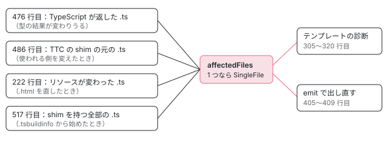

[目次](../README.md) › [@angular/build の compilation と utils の読み残し](README.md) › 第 1 回 / 全 10 回

# AotCompilation の残り：プログラムの作り直し・診断・出力の書き出し

> tools/angular/compilation/aot-compilation.ts の未読の行と、angular-compilation.ts（AngularCompilation の土台）・compiler-options.ts・diagnostics.ts：tsconfig の読み込みと上書き、差分の再コンパイル、診断の集め方と esbuild のメッセージへの変換、emitAffectedFiles。

angular/angular-cli · 読了 約 13 分 · 中核 · [サイトで読む（デモが動きます）](https://angular-deep-dive-cyan.vercel.app/chapter/bcu-aot)

---

ng build の TypeScript のコンパイルは、`AotCompilation` の `initialize`（プログラムを作り直す）・`diagnoseFiles`（診断を集める）・`emitAffectedFiles`（出力を書き出す）の 3 つで 1 回分です。この章では、これまでの章で読んでいない行を埋めます。tsconfig の読み込みに CLI が足す上書きと警告、2 回目のビルドで「影響を受けたファイル」がどこから増えるか、TypeScript の診断が esbuild のメッセージになる変換、emit の書き込みの受け口と `.tsbuildinfo`、ソースマップつきの印刷です。

読む対象は ../angular-cli（44129f66a3）の `packages/angular/build/src/tools/angular/compilation/` の `aot-compilation.ts`・`angular-compilation.ts`・`compiler-options.ts`・`diagnostics.ts` です。createAngularCompilation の選び方、initialize の頭、emit の速い道、diagnose を待たない仕組みは [AotCompilation と並列ワーカーの章](../cli/03-cli-angular-compilation.md)、`NgtscProgram` を作って `analyzeAsync` する所は [application builder の章](../boot/04-boot-application-build.md)、HMR の判定は [HMR の章](../cli/11-cli-hmr.md)、SourceFile のキャッシュは [再ビルドとキャッシュの章](../cli/10-cli-cache-watch.md)で読みました。ここではそれを繰り返さず、間の行を読みます。

1. **1. AotCompilation の残り**（この章）
2. [2. ParallelCompilation](02-bcu-parallel.md)
3. [3. hmr-candidates](03-bcu-hmr.md)
4. [4. AngularHost と遅延ルート](04-bcu-host.md)
5. [5. 予算と出力の表](05-bcu-budget.md)
6. [6. index.html の仕上げ](06-bcu-index.md)
7. [7. 自動 CSP](07-bcu-auto-csp.md)
8. [8. オプションの小道具](08-bcu-options.md)
9. [9. パス・URL・ソースマップ](09-bcu-paths.md)
10. [10. spec と issue](10-bcu-tests-issues.md)

## 1. 3 つのメソッドがやり取りする形

📄 `angular-cli/packages/angular/build/src/tools/angular/compilation/angular-compilation.ts` L9–41 （▶ の行: 13, 16, 19, 21, 24, 29–30, 33, 35, 37–39）

```ts
 9 │ import type { PartialMessage } from 'esbuild';
10 │ import type { AngularHostOptions } from '../angular-host';
11 │ import type { CompilerOptionOverrides } from './compiler-options';
12 │ 
13 ▶ export interface EmitFileResult {
14 │   filename: string;
15 │   contents: string;
16 ▶   dependencies?: readonly string[];
17 │ }
18 │ 
19 ▶ export interface FileTransformResult {
20 │   contents: string;
21 ▶   watchFiles?: readonly string[];
22 │ }
23 │ 
24 ▶ export interface AngularCompilationOptions {
25 │   allowJs?: boolean;
26 │   isolatedModules?: boolean;
27 │   sourceMap?: boolean;
28 │   inlineSourceMap?: boolean;
29 ▶   _useTypeScriptTranspilation?: boolean;
30 ▶   [key: string]: unknown;
31 │ }
32 │ 
33 ▶ export interface AngularCompilationResult {
34 │   compilerOptions: AngularCompilationOptions;
35 ▶   referencedFiles: readonly string[];
36 │   externalStylesheets?: ReadonlyMap<string, string>;
37 ▶   templateUpdates?: ReadonlyMap<string, string>;
38 ▶   componentResourcesDependencies?: ReadonlyMap<string, readonly string[]>;
39 ▶   warnings?: readonly PartialMessage[];
40 │ }
41 │ 
```

抽象クラス `AngularCompilation`（42 行目から、[前の章](../cli/03-cli-angular-compilation.md)の引用）がやり取りする型です。13〜17 行目の `EmitFileResult` が emit の 1 ファイル分で、16 行目の `dependencies` は AOT も JIT も入れません（この章の 8 節の書き込み口は `filename` と `contents` だけを入れます）。19〜22 行目の `FileTransformResult` は、ファイルごとにその場で変換する `transformFile`（61 行目）の戻り値です。AOT と JIT はこのメソッドを持たず、compiler-plugin の onLoad の別の道になります（[compiler-plugin の残りの章](../esb/06-esb-compiler-rest.md)の 4 節）。

24〜31 行目の `AngularCompilationOptions` は、プラグインが読むキーだけを型にし、30 行目の索引シグネチャで残りを `unknown` として通します。29 行目の `_useTypeScriptTranspilation` は、3 節で CLI が足す内部の印です。33〜40 行目の `AngularCompilationResult` が `initialize` の戻り値で、35 行目の `referencedFiles` は watch の一覧、37 行目の `templateUpdates` は HMR の更新モジュール、38 行目の `componentResourcesDependencies` は「.ts → そのテンプレートとスタイル」、39 行目の `warnings` は 3 節の警告です。

## 2. AotCompilation が覚えておくもの

📄 `angular-cli/packages/angular/build/src/tools/angular/compilation/aot-compilation.ts` L9–32 （▶ の行: 13, 17–18, 20–22, 29–31）

```ts
 9 │ import type * as ng from '@angular/compiler-cli';
10 │ import assert from 'node:assert';
11 │ import { relative } from 'node:path';
12 │ import ts from 'typescript';
13 ▶ import { useTypeChecking } from '../../../utils/environment-options';
14 │ import { profileAsync, profileSync } from '../../esbuild/profiling';
15 │ import {
16 │   AngularHostOptions,
17 ▶   createAngularCompilerHost,
18 ▶   ensureSourceFileVersions,
19 │ } from '../angular-host';
20 ▶ import { replaceBootstrap } from '../transformers/jit-bootstrap-transformer';
21 ▶ import { lazyRoutesTransformer } from '../transformers/lazy-routes-transformer';
22 ▶ import { createWorkerTransformer } from '../transformers/web-worker-transformer';
23 │ import {
24 │   type AngularCompilationResult,
25 │   DiagnosticModes,
26 │   type EmitFileResult,
27 │ } from './angular-compilation';
28 │ import type { CompilerOptionOverrides } from './compiler-options';
29 ▶ import { collectHmrCandidates } from './hmr-candidates';
30 ▶ import { TypeScriptCompilation } from './typescript-compilation';
31 ▶ import { printSourceFileWithMap } from './typescript-printer';
32 │ 
```

13 行目の `useTypeChecking` は環境変数 `NG_BUILD_TYPE_CHECK` の値で、5 節の「影響を受けたファイル」を探すかどうかに効きます。17〜18 行目はホスト（[4 回目](04-bcu-host.md)）、20〜22 行目は emit に差す 3 つの変換、29 行目は HMR の判定（[3 回目](03-bcu-hmr.md)）、31 行目は 8 節の印刷です。30 行目の `TypeScriptCompilation` が tsconfig を読み、SourceFile のキャッシュを持つ親クラスです。

📄 `angular-cli/packages/angular/build/src/tools/angular/compilation/aot-compilation.ts` L39–63 （▶ の行: 40, 42, 44–49, 52–53, 57–58, 60）

```ts
39 │ 
40 ▶ class AngularCompilationState {
41 │   constructor(
42 ▶     public readonly angularProgram: ng.NgtscProgram,
43 │     public readonly compilerHost: ng.CompilerHost,
44 ▶     public readonly typeScriptProgram: ts.EmitAndSemanticDiagnosticsBuilderProgram,
45 ▶     public readonly affectedFiles: ReadonlySet<ts.SourceFile>,
46 ▶     public readonly templateDiagnosticsOptimization: ng.OptimizeFor,
47 ▶     public readonly webWorkerTransform: ts.TransformerFactory<ts.SourceFile>,
48 ▶     public readonly useTypeScriptTranspilation: boolean,
49 ▶     public readonly diagnosticCache = new WeakMap<ts.SourceFile, ts.Diagnostic[]>(),
50 │   ) {}
51 │ 
52 ▶   get angularCompiler() {
53 ▶     return this.angularProgram.compiler;
54 │   }
55 │ }
56 │ 
57 ▶ export class AotCompilation extends TypeScriptCompilation {
58 ▶   #state?: AngularCompilationState;
59 │ 
60 ▶   constructor(private readonly browserOnlyBuild: boolean) {
61 │     super();
62 │   }
63 │ 
```

1 回の `initialize` の結果は、40〜55 行目の `AngularCompilationState` にまとめて `#state`（58 行目）に入ります。次の `initialize` はこの `#state` から、前回の `NgtscProgram`（42 行目）と BuilderProgram（44 行目、TypeScript の差分コンパイルの入れ物）を引き継ぎます。45 行目の `affectedFiles` と 46 行目の `templateDiagnosticsOptimization` は 5 節、49 行目の `diagnosticCache` はテンプレートの診断を SourceFile ごとに覚える `WeakMap` で、引数を省くと新しく作られます。52〜54 行目の `angularCompiler` は `NgtscProgram` の中のコンパイラ（`NgCompiler`）の近道です。60 行目の `browserOnlyBuild` は、サーバーの束が無いときに真で、8 節で遅延ルートの変換を外すのに使います。

## 3. tsconfig に CLI が足す上書きと警告

`initialize` の 78 行目（前の章の引用）の `loadConfiguration` は、`readConfiguration` で tsconfig を読んだあと（[前の章](../cli/03-cli-angular-compilation.md)の 2 節）、`transformCompilerOptions` を通します。

📄 `angular-cli/packages/angular/build/src/tools/angular/compilation/compiler-options.ts` L9–33 （▶ の行: 14–15, 17–22, 25, 31–32）

```ts
 9 │ import type * as ng from '@angular/compiler-cli';
10 │ import type { PartialMessage } from 'esbuild';
11 │ import * as path from 'node:path';
12 │ import type ts from 'typescript';
13 │ 
14 ▶ export interface CompilerOptionOverrides {
15 ▶   sourcemap?: boolean;
16 │   preserveSymlinks?: boolean;
17 ▶   cachePath?: string;
18 ▶   externalRuntimeStyles?: boolean;
19 ▶   enableHmr?: boolean;
20 ▶   instrumentForCoverage?: boolean;
21 ▶   includeTestMetadata?: boolean;
22 ▶   customConditions?: string[];
23 │ }
24 │ 
25 ▶ export function transformCompilerOptions(
26 │   typeScript: typeof ts,
27 │   baseCompilerOptions: ng.CompilerOptions,
28 │   overrides?: CompilerOptionOverrides,
29 │   tsconfig?: string,
30 │ ): { compilerOptions: ng.CompilerOptions; warnings: PartialMessage[] } {
31 ▶   const compilerOptions = { ...baseCompilerOptions };
32 ▶   const warnings: PartialMessage[] = [];
33 │ 
```

14〜23 行目の `CompilerOptionOverrides` が、builder の options から渡る上書きです。15 行目の `sourcemap`・17 行目の `cachePath`・18〜19 行目の外部のランタイムのスタイルと HMR・20 行目の Karma のカバレッジ・21 行目のテストのメタデータ・22 行目の解決の条件。31 行目、元の options を写してから書き換えるので、呼んだ側の物は変わりません（spec の 198 行目の it がこれを固めます）。

📄 `angular-cli/packages/angular/build/src/tools/angular/compilation/compiler-options.ts` L34–58 （▶ の行: 35–36, 41–42, 44, 48–49, 53）

```ts
34 │   if (
35 ▶     compilerOptions.target === undefined ||
36 ▶     compilerOptions.target < typeScript.ScriptTarget.ES2022
37 │   ) {
38 │     // If 'useDefineForClassFields' is already defined in the users project leave the value as is.
39 │     // Otherwise fallback to false due to https://github.com/microsoft/TypeScript/issues/45995
40 │     // which breaks the deprecated `@Effects` NGRX decorator and potentially other existing code as well.
41 ▶     compilerOptions.target = typeScript.ScriptTarget.ES2022;
42 ▶     compilerOptions.useDefineForClassFields ??= false;
43 │ 
44 ▶     warnings.push({
45 │       text:
46 │         `TypeScript compiler options 'target' and 'useDefineForClassFields' are set to 'ES2022' and ` +
47 │         `'false' respectively by the Angular CLI.`,
48 ▶       location: tsconfig ? { file: tsconfig } : null,
49 ▶       notes: [
50 │         {
51 │           text:
52 │             'To control ECMA version and features use the Browserslist configuration. ' +
53 ▶             'For more information, see https://angular.dev/tools/cli/build#configuring-browser-compatibility',
54 │         },
55 │       ],
56 │     });
57 │   }
58 │ 
```

35〜36 行目、`target` が無いか ES2022 より前なら、41 行目で ES2022 にし、42 行目で `useDefineForClassFields` を、書かれていなければ `false` にします（38〜40 行目のコメントのとおり、NgRx の古い `@Effects` などが壊れるのを避けるため）。44〜56 行目の警告は、48 行目で tsconfig のファイルを location に入れ、53 行目で「ブラウザの対応は Browserslist で決める」と案内します。59〜66 行目の partial のコンパイルの警告は [ローカルのコンパイルの章](../standalone/06-standalone-local-compilation.md)、68〜75 行目の incremental は [再ビルドとキャッシュの章](../cli/10-cli-cache-watch.md)の引用です。

📄 `angular-cli/packages/angular/build/src/tools/angular/compilation/compiler-options.ts` L76–111 （▶ の行: 78–79, 81, 83, 89, 91, 96–97, 106–107, 109）

```ts
 76 │ 
 77 │   if (
 78 ▶     compilerOptions.module === undefined ||
 79 ▶     compilerOptions.module < typeScript.ModuleKind.ES2015
 80 │   ) {
 81 ▶     compilerOptions.module = typeScript.ModuleKind.ES2022;
 82 │     warnings.push({
 83 ▶       text: `TypeScript compiler options 'module' values 'CommonJS', 'UMD', 'System' and 'AMD' are not supported.`,
 84 │       location: null,
 85 │       notes: [{ text: `The 'module' option will be set to 'ES2022' instead.` }],
 86 │     });
 87 │   }
 88 │ 
 89 ▶   if (compilerOptions.isolatedModules && compilerOptions.emitDecoratorMetadata) {
 90 │     warnings.push({
 91 ▶       text: `TypeScript compiler option 'isolatedModules' may prevent the 'emitDecoratorMetadata' option from emitting all metadata.`,
 92 │       location: null,
 93 │       notes: [
 94 │         {
 95 │           text:
 96 ▶             `The 'emitDecoratorMetadata' option is not required by Angular` +
 97 ▶             'and can be removed if not explictly required by the project.',
 98 │         },
 99 │       ],
100 │     });
101 │   }
102 │ 
103 │   // Synchronize custom resolve conditions.
104 │   // Set if using the supported bundler resolution mode (bundler is the default in new projects)
105 │   if (
106 ▶     compilerOptions.moduleResolution === typeScript.ModuleResolutionKind.Bundler ||
107 ▶     compilerOptions.module === typeScript.ModuleKind.Preserve
108 │   ) {
109 ▶     compilerOptions.customConditions = overrides?.customConditions;
110 │   }
111 │ 
```

📄 `angular-cli/packages/angular/build/src/tools/angular/compilation/compiler-options.ts` L126–137 （▶ の行: 129–132, 134）

```ts
126 │       // - isolatedModules is disabled (TS needs full module types to emit JS).
127 │       // - Karma code coverage is active (the coverage instrumentation transformer is Babel-based
128 │       //   and cannot parse raw TypeScript code; Vitest handles coverage instrumentation downstream).
129 ▶       _useTypeScriptTranspilation:
130 ▶         !compilerOptions.isolatedModules || !!overrides?.instrumentForCoverage,
131 ▶       supportTestBed: !!overrides?.includeTestMetadata,
132 ▶       supportJitMode: !!overrides?.includeTestMetadata,
133 │     },
134 ▶     warnings,
135 │   };
136 │ }
137 │ 
```

1. **module を ES2022 に**

   78〜87 行目。`module` が無いか ES2015 より前（CommonJS・UMD など）なら、81 行目で ES2022 にして 83 行目の警告を出します。
2. **isolatedModules と emitDecoratorMetadata**

   89〜101 行目。両方が真のときだけ警告です。値は変えません。
3. **customConditions を揃える**

   105〜110 行目。`moduleResolution: bundler` か `module: preserve` のときだけ、tsconfig の値を捨てて、esbuild の build の `conditions`（compiler-plugin.ts の 335 行目が渡す）で上書きします。
4. **最後に固定の上書き**

   112〜131 行目（[前の章](../cli/03-cli-angular-compilation.md)の引用）。129〜130 行目、`isolatedModules` が偽か Karma のカバレッジのときに `_useTypeScriptTranspilation` が真になります。132 行目の `supportJitMode` は、テストのメタデータを残すとき（ng test）だけ真です。134 行目で警告の配列をそのまま返します。

デモの「古い tsconfig」は、`target: ES2017`・`module: commonjs`・`emitDecoratorMetadata`・`compilationMode: partial` を書いた tsconfig を本物の `initialize` に渡したものです。警告が 4 つ返り、options は `ES2022`・`ES2022`・`full` に書き換わりました。

> [!WARNING]
> **ハマりどころ**
>
> 44129f66a3 の 96〜97 行目は、文字列を `+` でつなぐ所に空白が無く、注記が「is not required by Angular**and** can be removed if not **explictly** required」になります。記録のスクリプトで 44129f66a3 の `compiler-options.ts` をそのまま transpile して呼ぶと、この文字列が出ました。22.2.7 の dist は「Angular and」「explicitly」で、main の 13a7346493（22.2.x では 0dc103735e）が直しています。spec の 296 行目の it は警告の `text` しか見ないので、注記の文字列は固めていません。

## 4. ホストを作る

📄 `angular-cli/packages/angular/build/src/tools/angular/compilation/aot-compilation.ts` L122–131 （▶ の行: 124–129）

```ts
122 │ 
123 │     // Create Angular compiler host
124 ▶     const host = createAngularCompilerHost(
125 ▶       ts,
126 ▶       compilerOptions,
127 ▶       hostOptions,
128 ▶       packageJsonCache,
129 ▶       this.sourceFiles,
130 │     );
131 │ 
```

3 節の options と、compiler-plugin が渡す `hostOptions`（変わったファイル・スタイルの変換・Web Worker の束ね）から TypeScript のホストを作ります。128 行目は前回のホストの package.json のキャッシュ（89〜91 行目、前の章の引用）、129 行目の `this.sourceFiles` は親クラスの SourceFile のキャッシュで、101 行目の `invalidateFiles`（[HMR の章](../cli/11-cli-hmr.md)の引用）が変わったファイルだけを消しています。ホストの中身（リソースの読み込み・スタイルの変換・fileReplacements）は [4 回目](04-bcu-host.md)で読みます。

## 5. 「影響を受けたファイル」はどこから増えるか

200〜205 行目（[前の章](../cli/03-cli-angular-compilation.md)の引用）で、`useTypeChecking` か TypeScript で変換する道なら `findAffectedFiles` を呼びます。この集合は、テンプレートの診断をどのファイルに頼むか（305〜320 行目、同じ章の引用）と、emit で出し直すファイル（405〜409 行目、同じ章の引用）を決めます。

📄 `angular-cli/packages/angular/build/src/tools/angular/compilation/aot-compilation.ts` L467–500 （▶ の行: 470, 476, 483, 486–487, 489, 492, 495, 498）

```ts
467 │ function findAffectedFiles(
468 │   builder: ts.EmitAndSemanticDiagnosticsBuilderProgram,
469 │   { ignoreForDiagnostics }: ng.NgtscProgram['compiler'],
470 ▶   includeTTC: boolean,
471 │ ): Set<ts.SourceFile> {
472 │   const affectedFiles = new Set<ts.SourceFile>();
473 │ 
474 │   // eslint-disable-next-line no-constant-condition
475 │   while (true) {
476 ▶     const result = builder.getSemanticDiagnosticsOfNextAffectedFile(undefined, (sourceFile) => {
477 │       // If the affected file is a TTC shim, add the shim's original source file.
478 │       // This ensures that changes that affect TTC are typechecked even when the changes
479 │       // are otherwise unrelated from a TS perspective and do not result in Ivy codegen changes.
480 │       // For example, changing @Input property types of a directive used in another component's
481 │       // template.
482 │       // A TTC shim is a file that has been ignored for diagnostics and has a filename ending in `.ngtypecheck.ts`.
483 ▶       if (ignoreForDiagnostics.has(sourceFile) && sourceFile.fileName.endsWith('.ngtypecheck.ts')) {
484 │         // This file name conversion relies on internal compiler logic and should be converted
485 │         // to an official method when available. 15 is length of `.ngtypecheck.ts`
486 ▶         const originalFilename = sourceFile.fileName.slice(0, -15) + '.ts';
487 ▶         const originalSourceFile = builder.getSourceFile(originalFilename);
488 │         if (originalSourceFile) {
489 ▶           affectedFiles.add(originalSourceFile);
490 │         }
491 │ 
492 ▶         return true;
493 │       }
494 │ 
495 ▶       return false;
496 │     });
497 │ 
498 ▶     if (!result) {
499 │       break;
500 │     }
```

📄 `angular-cli/packages/angular/build/src/tools/angular/compilation/aot-compilation.ts` L501–524 （▶ の行: 502, 509–511, 514, 517, 523）

```ts
501 │ 
502 ▶     affectedFiles.add(result.affected as ts.SourceFile);
503 │   }
504 │ 
505 │   // Add all files with associated template type checking files.
506 │   // Stored TS build info does not have knowledge of the AOT compiler or the typechecking state of the templates.
507 │   // To ensure that errors are reported correctly, all AOT component diagnostics need to be analyzed even if build
508 │   // info is present.
509 ▶   if (includeTTC) {
510 ▶     for (const sourceFile of builder.getSourceFiles()) {
511 ▶       if (ignoreForDiagnostics.has(sourceFile) && sourceFile.fileName.endsWith('.ngtypecheck.ts')) {
512 │         // This file name conversion relies on internal compiler logic and should be converted
513 │         // to an official method when available. 15 is length of `.ngtypecheck.ts`
514 ▶         const originalFilename = sourceFile.fileName.slice(0, -15) + '.ts';
515 │         const originalSourceFile = builder.getSourceFile(originalFilename);
516 │         if (originalSourceFile) {
517 ▶           affectedFiles.add(originalSourceFile);
518 │         }
519 │       }
520 │     }
521 │   }
522 │ 
523 ▶   return affectedFiles;
524 │ }
```

1. **TypeScript に次の 1 つを聞く**

   476 行目の `getSemanticDiagnosticsOfNextAffectedFile` は、BuilderProgram が「前回から型の結果が変わりうる」と判断したファイルを 1 つずつ返し、その意味の診断を計算します（前の章の 193〜194 行目のコメントの「副作用の型チェック」）。返す物が無くなると 498 行目で抜けます。
2. **TTC の shim は元の .ts に付け替える**

   483〜492 行目。`.ngtypecheck.ts` はテンプレートの型チェックのためにコンパイラが作る隠しファイル（TTC = Type-Check Code の shim）で、診断の対象外（`ignoreForDiagnostics`）です。それが影響を受けたら、486 行目で名前の末尾 15 文字を `.ts` に替えて元のファイルを足し、492 行目の `true` で shim 自身は飛ばさせます。
3. **ふつうのファイルはそのまま足す**

   502 行目。
4. **.tsbuildinfo から始めたときは全部の TTC**

   509〜521 行目。`includeTTC` は 145 行目（[application builder の章](../boot/04-boot-application-build.md)の引用）の `usingBuildInfo`、つまり前回のプログラムが無く、ディスクの `.tsbuildinfo` から BuilderProgram を作ったときです。506〜508 行目のコメントのとおり、そのファイルはテンプレートの型チェックの状態を知らないので、shim を持つ全部の .ts を足します。



*affectedFiles（45 行目）に入る 4 つの入口と、その集合を読む 2 か所。*

📄 `angular-cli/packages/angular/build/src/tools/angular/compilation/aot-compilation.ts` L207–228 （▶ の行: 210, 212, 214–215, 217–220, 222, 227）

```ts
207 │     const componentResourcesDependencies = new Map<string, string[]>();
208 │ 
209 │     // Get all files referenced in the TypeScript/Angular program including component resources
210 ▶     const referencedFiles = typeScriptProgram
211 │       .getSourceFiles()
212 ▶       .filter((sourceFile) => !angularCompiler.ignoreForEmit.has(sourceFile))
213 │       .flatMap((sourceFile) => {
214 ▶         const resourceDependencies = angularCompiler.getResourceDependencies(sourceFile);
215 ▶         componentResourcesDependencies.set(sourceFile.fileName, resourceDependencies);
216 │         // Also invalidate Angular diagnostics for a source file if component resources are modified
217 ▶         if (this.#state && hostOptions.modifiedFiles?.size) {
218 ▶           for (const resourceDependency of resourceDependencies) {
219 ▶             if (hostOptions.modifiedFiles.has(resourceDependency)) {
220 ▶               this.#state.diagnosticCache.delete(sourceFile);
221 │               // Also mark as affected in case changed template affects diagnostics
222 ▶               affectedFiles.add(sourceFile);
223 │             }
224 │           }
225 │         }
226 │ 
227 ▶         return [sourceFile.fileName, ...resourceDependencies];
228 │       });
```

もう 1 つの入口が 217〜224 行目です。2 回目以降（217 行目の `this.#state`）、そのファイルのテンプレートやスタイル（214 行目の `getResourceDependencies`）が変わったファイルに入っていれば、220 行目で前回のテンプレートの診断を捨て、222 行目で影響を受けたファイルに足します。TypeScript は .html を知らないので、ここで足さないと、テンプレートを直しても前回の診断が残ります（06dacb015e、2023-10）。227 行目で、.ts とそのリソースを並べた物が 1 節の `referencedFiles` になります。

| 変えたファイル（デモ） | 476 行目が返した .ts | TTC の shim（483 行目） | テンプレートの診断を頼んだファイル（OptimizeFor） |
| --- | --- | --- | --- |
| counter.ts の `signal(0)` → `signal(10)` | counter.ts | 3 つ | counter.ts・app.ts・home.ts（WholeProgram） |
| app.html に class を足す | （無し） | 0 | app.ts（SingleFile）。222 行目で足された |
| app.css の色 | （無し） | 1 つ | app.ts（SingleFile）。shim の道で足された |
| 新しいインスタンスで .tsbuildinfo を読む | （無し） | 0 | 6 つ全部（WholeProgram）。509〜521 行目 |

counter.ts を変えると、TypeScript が返した .ts は counter.ts 1 つでも、Counter を使う App と、同じプログラムの Home の shim も影響を受け、集合は 3 つになりました。235 行目（前の章の引用）は 3 つなので `WholeProgram` を選びます。app.html のときは TypeScript の側は何も返さず、222 行目だけで app.ts が入り、1 つなので `SingleFile` でした。

> [!NOTE]
> **ポイント**
>
> 22.2.7 では 219 行目の条件に「`.css`・`.scss`・`.sass`・`.less` でない」が足されています（main の 0a077eeed9、22.2.x の a428021b77。スタイルを変えただけでテンプレートの診断を捨てない）。それでもデモの app.css の回で app.ts の診断がやり直されたのは、スタイルを変えると AOT のコンパイラが App の shim を作り直し、483〜489 行目の道で app.ts が入ったからです。

## 6. initialize の戻り値と、診断の集め方

📄 `angular-cli/packages/angular/build/src/tools/angular/compilation/aot-compilation.ts` L240–270 （▶ の行: 241, 243–247, 251–252, 261–262, 265–268, 270）

```ts
240 │ 
241 ▶     return {
242 │       compilerOptions,
243 ▶       referencedFiles,
244 ▶       externalStylesheets: hostOptions.externalStylesheets,
245 ▶       templateUpdates,
246 ▶       componentResourcesDependencies,
247 ▶       warnings,
248 │     };
249 │   }
250 │ 
251 ▶   protected override *collectDiagnostics(modes: DiagnosticModes): Iterable<ts.Diagnostic> {
252 ▶     assert(this.#state, 'Angular compilation must be initialized prior to collecting diagnostics.');
253 │     const {
254 │       affectedFiles,
255 │       angularCompiler,
256 │       diagnosticCache,
257 │       templateDiagnosticsOptimization,
258 │       typeScriptProgram,
259 │     } = this.#state;
260 │ 
261 ▶     const syntactic = modes & DiagnosticModes.Syntactic;
262 ▶     const semantic = modes & DiagnosticModes.Semantic;
263 │ 
264 │     // Collect program level diagnostics
265 ▶     if (modes & DiagnosticModes.Option) {
266 ▶       yield* typeScriptProgram.getConfigFileParsingDiagnostics();
267 ▶       yield* angularCompiler.getOptionDiagnostics();
268 ▶       yield* typeScriptProgram.getOptionsDiagnostics();
269 │     }
270 ▶     if (syntactic) {
```

241〜248 行目、`initialize` は 1 節の形で返します。244 行目の `externalStylesheets` は、外部のランタイムのスタイルのとき 84〜86 行目（前の章の引用）で作った Map です。251 行目の `collectDiagnostics` はジェネレータで、親クラスの `diagnoseFiles`（[前の章](../cli/03-cli-angular-compilation.md)の 6 節）が 1 つずつ取り出して esbuild の形に直します。265〜269 行目、`Option` のビットなら tsconfig の読み込みの診断・Angular の options の診断・TypeScript の options の診断の順、270〜272 行目、`Syntactic` ならプログラム全体の診断を先に出します。

📄 `angular-cli/packages/angular/build/src/tools/angular/compilation/aot-compilation.ts` L271–300 （▶ の行: 275–276, 280, 283, 285–286, 290, 294, 296）

```ts
271 │       yield* typeScriptProgram.getGlobalDiagnostics();
272 │     }
273 │ 
274 │     // Collect source file specific diagnostics
275 ▶     for (const sourceFile of typeScriptProgram.getSourceFiles()) {
276 ▶       if (angularCompiler.ignoreForDiagnostics.has(sourceFile)) {
277 │         continue;
278 │       }
279 │ 
280 ▶       if (syntactic) {
281 │         // TypeScript will use cached diagnostics for files that have not been
282 │         // changed or affected for this build when using incremental building.
283 ▶         yield* profileSync(
284 │           'NG_DIAGNOSTICS_SYNTACTIC',
285 ▶           () => typeScriptProgram.getSyntacticDiagnostics(sourceFile),
286 ▶           true,
287 │         );
288 │       }
289 │ 
290 ▶       if (!semantic) {
291 │         continue;
292 │       }
293 │ 
294 ▶       yield* profileSync(
295 │         'NG_DIAGNOSTICS_SEMANTIC',
296 ▶         () => typeScriptProgram.getSemanticDiagnostics(sourceFile),
297 │         true,
298 │       );
299 │ 
300 │       // Declaration files cannot have template diagnostics
```

275 行目からファイルごとです。276 行目、shim や生成されたファイル（`ignoreForDiagnostics`）は飛ばします。283〜287 行目の構文の診断、294〜298 行目の意味の診断は、どちらも BuilderProgram が変わっていないファイルの前回の結果を返すので（281〜282 行目のコメント）、毎回全部を聞いても速いままです。286 行目の 3 つめの引数 `true` は、`NG_BUILD_DEBUG_PERF` のときに時間を足し合わせる印です。テンプレートの診断（305〜320 行目、前の章の引用）は 5 節の集合に入ったファイルだけ `getDiagnosticsForFile` に聞き、それ以外は `diagnosticCache` の前回の物を返します。

## 7. TypeScript の診断を esbuild のメッセージにする

📄 `angular-cli/packages/angular/build/src/tools/angular/compilation/diagnostics.ts` L9–38 （▶ の行: 20, 25–28, 31, 33–36）

```ts
 9 │ import type { PartialMessage, PartialNote } from 'esbuild';
10 │ import { platform } from 'node:os';
11 │ import type ts from 'typescript';
12 │ 
13 │ /**
14 │  * Converts TypeScript Diagnostic related information into an esbuild compatible note object.
15 │  * Related information is a subset of a full TypeScript Diagnostic and also used for diagnostic
16 │  * notes associated with the main Diagnostic.
17 │  * @param info The TypeScript diagnostic relative information to convert.
18 │  * @returns An esbuild diagnostic message as a PartialMessage object
19 │  */
20 ▶ function convertTypeScriptDiagnosticInfo(
21 │   typescript: typeof ts,
22 │   info: ts.DiagnosticRelatedInformation,
23 │   textPrefix?: string,
24 │ ): PartialNote {
25 ▶   const newLine = platform() === 'win32' ? '\r\n' : '\n';
26 ▶   let text = typescript.flattenDiagnosticMessageText(info.messageText, newLine);
27 ▶   if (textPrefix) {
28 ▶     text = textPrefix + text;
29 │   }
30 │ 
31 ▶   const note: PartialNote = { text };
32 │ 
33 ▶   if (info.file) {
34 ▶     note.location = {
35 ▶       file: info.file.fileName,
36 ▶       length: info.length,
37 │     };
38 │ 
```

📄 `angular-cli/packages/angular/build/src/tools/angular/compilation/diagnostics.ts` L39–71 （▶ の行: 40–43, 46, 51, 53, 55–58, 60, 64）

```ts
39 │     // Calculate the line/column location and extract the full line text that has the diagnostic
40 ▶     if (info.start) {
41 ▶       const { line, character } = typescript.getLineAndCharacterOfPosition(info.file, info.start);
42 ▶       note.location.line = line + 1;
43 ▶       note.location.column = character;
44 │ 
45 │       // The start position for the slice is the first character of the error line
46 ▶       const lineStartPosition = typescript.getPositionOfLineAndCharacter(info.file, line, 0);
47 │ 
48 │       // The end position for the slice is the first character of the next line or the length of
49 │       // the entire file if the line is the last line of the file (getPositionOfLineAndCharacter
50 │       // will error if a nonexistent line is passed).
51 ▶       const { line: lastLineOfFile } = typescript.getLineAndCharacterOfPosition(
52 │         info.file,
53 ▶         info.file.text.length - 1,
54 │       );
55 ▶       const lineEndPosition =
56 ▶         line < lastLineOfFile
57 ▶           ? typescript.getPositionOfLineAndCharacter(info.file, line + 1, 0)
58 ▶           : info.file.text.length;
59 │ 
60 ▶       note.location.lineText = info.file.text.slice(lineStartPosition, lineEndPosition).trimEnd();
61 │     }
62 │   }
63 │ 
64 ▶   return note;
65 │ }
66 │ 
67 │ /**
68 │  * Converts a TypeScript Diagnostic message into an esbuild compatible message object.
69 │  * @param diagnostic The TypeScript diagnostic to convert.
70 │  * @returns An esbuild diagnostic message as a PartialMessage object
71 │  */
```

📄 `angular-cli/packages/angular/build/src/tools/angular/compilation/diagnostics.ts` L86–102 （▶ の行: 88–91, 94–96, 100）

```ts
 86 │   }
 87 │ 
 88 ▶   const message: PartialMessage = convertTypeScriptDiagnosticInfo(
 89 ▶     typescript,
 90 ▶     diagnostic,
 91 ▶     `${codePrefix}${code}: `,
 92 │   );
 93 │ 
 94 ▶   if (diagnostic.relatedInformation?.length) {
 95 ▶     message.notes = diagnostic.relatedInformation.map((info) =>
 96 ▶       convertTypeScriptDiagnosticInfo(typescript, info),
 97 │     );
 98 │   }
 99 │ 
100 ▶   return message;
101 │ }
102 │ 
```

1. **文を平らにする**

   26 行目の `flattenDiagnosticMessageText` で、入れ子の説明（「〜の中で」など）を改行でつなぎます。25 行目、Windows なら `\r\n`。
2. **接頭辞**

   27〜29 行目。本体は 88〜92 行目で `TS2345: ` や `NG8001: ` を付けます（Angular の診断のコードは `-99` で始まり、83〜86 行目でそれを外して `NG` にする。前の章の引用）。
3. **場所**

   33〜37 行目でファイル名と長さ、40〜61 行目で 1 始まりの行（42 行目）と 0 始まりの列（43 行目）、その行の全文（60 行目、末尾の空白を落とす）。
4. **関連の情報は notes に**

   94〜98 行目。テンプレートの診断の「Error occurs in the template of component App.」は、ここで notes の 1 つになります。notes には接頭辞を付けません（96 行目は 3 つめの引数なし）。

デモの「型エラーを入れた版」は、counter.ts の `signal<number>('zero')`（TS2345）、app.html の `title.size`（TS2339、場所は .html の 1 行目 13 列）と `<app-unknown />`（NG8001）、先頭が `missingName();` の zero.ts（TS2304）の 4 つです。テンプレートの 2 つは、notes に app.ts の 8 行目（`templateUrl` の行）が入りました。

| 版 | text | location |
| --- | --- | --- |
| 44129f66a3 の diagnostics.ts | TS2304: Cannot find name 'missingName'. | src/app/zero.ts（line なし）・lineText なし |
| 22.2.7 の dist | TS2304: Cannot find name 'missingName'. | src/app/zero.ts:1:0・lineText missingName(); |

> [!WARNING]
> **ハマりどころ**
>
> 40 行目は `if (info.start)` なので、ファイルの先頭（`start` が 0）から始まる診断は偽になり、行・列・行の全文が付きません。上の表は、zero.ts の TS2304 を 2 つの版の `convertTypeScriptDiagnostic` に同じく渡した記録です。この 2 つをサイトの esbuild の `formatMessages` に通すと、44129f66a3 の形は `src/app/zero.ts:0:0:` と空の 0 行目、22.2.7 の形は `src/app/zero.ts:1:0:` と `missingName();` の行になりました。main の cd70beb20d（22.2.x の e78cf0ae96）が `!== undefined` に直し、空のファイルで 53 行目が `-1` を渡して TypeScript の Debug Failure になるのも防いでいます（新しい `diagnostics_spec.ts` の 2 つの it）。

## 8. emit：書き込み口・.tsbuildinfo・ソースマップつきの印刷

📄 `angular-cli/packages/angular/build/src/tools/angular/compilation/aot-compilation.ts` L322–348 （▶ の行: 334–335, 337–339, 341, 346–348）

```ts
322 │   }
323 │ 
324 │   override emitAffectedFiles(): Iterable<EmitFileResult> {
325 │     assert(this.#state, 'Angular compilation must be initialized prior to emitting files.');
326 │     const {
327 │       affectedFiles,
328 │       angularCompiler,
329 │       compilerHost,
330 │       typeScriptProgram,
331 │       webWorkerTransform,
332 │       useTypeScriptTranspilation,
333 │     } = this.#state;
334 ▶     const compilerOptions = typeScriptProgram.getCompilerOptions();
335 ▶     const buildInfoFilename = compilerOptions.tsBuildInfoFile ?? '.tsbuildinfo';
336 │ 
337 ▶     const emittedFiles = new Map<ts.SourceFile, EmitFileResult>();
338 ▶     const writeFileCallback: ts.WriteFileCallback = (filename, contents, _a, _b, sourceFiles) => {
339 ▶       if (!sourceFiles?.length && filename.endsWith(buildInfoFilename)) {
340 │         // Save builder info contents to specified location
341 ▶         compilerHost.writeFile(filename, contents, false);
342 │ 
343 │         return;
344 │       }
345 │ 
346 ▶       assert(sourceFiles?.length === 1, 'Invalid TypeScript program emit for ' + filename);
347 ▶       const sourceFile = ts.getOriginalNode(sourceFiles[0], ts.isSourceFile);
348 ▶       if (angularCompiler.ignoreForEmit.has(sourceFile)) {
```

1. **.tsbuildinfo は書き込み口でディスクへ**

   339〜344 行目。ソースファイルが無く、名前が 335 行目の `tsBuildInfoFile`（compiler-options.ts の 72 行目で `<cachePath>/.tsbuildinfo`。再ビルドとキャッシュの章の引用）で終われば、ホストの `writeFile` で書いて戻ります。
2. **1 つの出力は 1 つのソースから**

   346 行目。束ねる出力（`outFile`）を使っていない前提を確かめます。
3. **変換後のノードを元の SourceFile に戻す**

   347 行目の `getOriginalNode`。変換器が作った新しい SourceFile ではなく、プログラムの中の物を Map のキーにするためです。348 行目、Angular が生成したファイルは出しません。

📄 `angular-cli/packages/angular/build/src/tools/angular/compilation/aot-compilation.ts` L379–394 （▶ の行: 379, 383, 387–388, 392）

```ts
379 ▶     } else if (compilerOptions.tsBuildInfoFile) {
380 │       // Manually get the builder state for the persistent cache
381 │       // The TypeScript API currently embeds this behavior inside the program emit
382 │       // via emitNextAffectedFile but that also applies all internal transforms.
383 ▶       const programWithGetState = typeScriptProgram.getProgram() as ts.Program & {
384 │         emitBuildInfo(writeFileCallback?: ts.WriteFileCallback): void;
385 │       };
386 │ 
387 ▶       assert(
388 ▶         typeof programWithGetState.emitBuildInfo === 'function',
389 │         'TypeScript program emitBuildInfo is missing.',
390 │       );
391 │ 
392 ▶       programWithGetState.emitBuildInfo();
393 │     }
394 │ 
```

TypeScript で変換しない道（このサイトのように `isolatedModules: true`）では `emitNextAffectedFile` を回さないので、`.tsbuildinfo` も書かれません。379 行目、永続キャッシュがあるとき（`tsBuildInfoFile` がある）だけ、内部の `emitBuildInfo` を直接呼びます（380〜382 行目のコメント。3acb776831、2024-05）。387〜390 行目は、TypeScript の版でこの内部の関数が無くなったときに気づくための assert です。デモの「永続キャッシュと sourcemap」の 1 回目で、`.angular/cache/ts/.tsbuildinfo` が書かれました。2 回目は新しいインスタンスなので 141 行目の前回のプログラムが無く、144 行目でこのファイルを読み（どちらも [application builder の章](../boot/04-boot-application-build.md)の引用）、5 節の 509〜521 行目が働きました。

📄 `angular-cli/packages/angular/build/src/tools/angular/compilation/aot-compilation.ts` L432–464 （▶ の行: 433, 435, 438–439, 446, 448–449, 451–452, 454, 459–460, 463）

```ts
432 │       let contents: string;
433 ▶       if (sourceFile === transformResult.transformed[0]) {
434 │         // Use original content if no changes were made
435 ▶         contents = sourceFile.text;
436 │       } else {
437 │         // Otherwise, print the transformed source file with map if needed
438 ▶         const printer = ts.createPrinter(compilerOptions, transformResult);
439 ▶         const printResult = printSourceFileWithMap(
440 │           transformResult.transformed[0],
441 │           printer,
442 │           compilerHost,
443 │           compilerOptions,
444 │         );
445 │ 
446 ▶         contents = printResult.code;
447 │ 
448 ▶         if (printResult.map) {
449 ▶           if (compilerOptions.inlineSourceMap) {
450 │             const base64Map = Buffer.from(printResult.map).toString('base64');
451 ▶             contents += `\n//# sourceMappingURL=data:application/json;charset=utf-8;base64,${base64Map}`;
452 ▶           } else if (compilerOptions.sourceMap) {
453 │             const mapFilename = sourceFile.fileName + '.map';
454 ▶             emittedFiles.set(sourceFile, { filename: mapFilename, contents: printResult.map });
455 │           }
456 │         }
457 │       }
458 │ 
459 ▶       angularCompiler.incrementalCompilation.recordSuccessfulEmit(sourceFile);
460 ▶       emittedFiles.set(sourceFile, { filename: sourceFile.fileName, contents });
461 │     }
462 │ 
463 ▶     return emittedFiles.values();
464 │   }
```

Angular の変換だけを当てた結果（418〜425 行目、前の章の引用）が元と同じ物なら、435 行目で元の文字列をそのまま使います。違えば 438 行目で printer を作り、439 行目の `printSourceFileWithMap`（[3 回目](03-bcu-hmr.md)の後半）で文字列とソースマップにします（09d0a11a8b、2026-07）。449〜451 行目、`inlineSourceMap` なら base64 にして末尾に付けます。compiler-options.ts の 118 行目（前の章の引用）で、`sourcemap` の上書きはいつもこちらです。デモの sourcemap ありの回は、emit した 6 つ全部の末尾に `sourceMappingURL=data:` が付き、counter.ts は 1,184 文字から 2,373 文字になりました。459 行目で Angular の差分コンパイルに「出した」と知らせ、460 行目で Map に入れます。463 行目、Map の値を返すので、同じ SourceFile は 1 つだけです。

> [!NOTE]
> **さらに深く**
>
> 452〜455 行目の `sourceMap` の道は、今は通りません。compiler-options.ts の 119 行目（前の章の引用）が `sourceMap: undefined` にするからです。もし通っても、454 行目で `.map` を入れたキー（`sourceFile`）に、460 行目が JS を上書きするので、Map の値には JS しか残りません。

## 9. デモ：本物の AotCompilation を 2 回回す

> **🧪 DEMO — @angular/build 22.2.7 の AotCompilation の記録**
>
> ワークスペースは、App（templateUrl の app.html と styleUrl の app.css）・インラインのテンプレートの Counter・`loadComponent` の遅延ルート・Web Worker を作る spawn.ts の小さなアプリです。時間は Node v24.22.1 の 1 回の実測（ミリ秒）で、1 回目は @angular/compiler-cli と型の読み込みを含みます。
>
> modifiedFiles：（無し。1 回目）
>
> ▶ [このデモはサイトで動かせます](https://angular-deep-dive-cyan.vercel.app/chapter/bcu-aot)

| 版 | emitDecoratorMetadata の警告と注記（同じ入力を transformCompilerOptions に） |
| --- | --- |
| 44129f66a3 | TypeScript compiler option 'isolatedModules' may prevent the 'emitDecoratorMetadata' option from emitting all metadata. / The 'emitDecoratorMetadata' option is not required by Angularand can be removed if not explictly required by the project. |
| 22.2.7 | TypeScript compiler option 'isolatedModules' may prevent the 'emitDecoratorMetadata' option from emitting all metadata. / The 'emitDecoratorMetadata' option is not required by Angular and can be removed if not explicitly required by the project. |

「ふつうの再ビルド」の 2 回目（counter.ts）は initialize が 1 回目の 10 分の 1 ほどで、emit したのは counter.ts・app.ts・home.ts の 3 つでした。5 節の集合に入ったファイルは 405〜409 行目（前の章の引用）の「飛ばしてよい」に当たらないからです。3 回目（app.html）は app.ts だけを出しました。「型エラーを入れた版」の 2 回目は counter.ts の 1 件が消え、テンプレートの 2 件は app.ts が集合に入ったので計算し直され、zero.ts の 1 件は BuilderProgram の前回の結果のまま残りました。

## 10. どう録ったか

スクリプトは `<scratchpad>/bcu-demo/a/` に置き、サイトの node\_modules の @angular/build 22.2.7 の dist を require しました。`initializeHash()` を先に呼びます（ワーカーでは parallel-worker.ts の 49 行目が呼ぶ。前の章の引用。直接 `AotCompilation` を作るときは呼ぶ人がいないと 4 節のホストの `calculateHash` が assert で落ちる）。476 行目の結果は、`require.cache` の typescript を、`createEmitAndSemanticDiagnosticsBuilderProgram` だけを包んだ写しに差し替えて記録しました（typescript の export は書き換えられない getter のため）。テンプレートの診断は、`TypeScriptCompilation.loadCompilerCli` を `NgtscProgram` の子クラスを返す物に替え、作られたコンパイラの `getDiagnosticsForFile` を包みました。44129f66a3 との比べは、../angular-cli の `diagnostics.ts` と `compiler-options.ts` を読むだけで transpile し、同じ入力を渡しています。

📄 `記録のスクリプト（rec-aot.mjs）`

```
// 本物の AotCompilation（サイトの node_modules の @angular/build 22.2.7 の dist）を小さなワークスペースに当てる。
// initialize → diagnoseFiles → emitAffectedFiles を回し、1 ファイルだけ変えてもう一度回す。
// 影響を受けたファイル（BuilderProgram の getSemanticDiagnosticsOfNextAffectedFile の結果）、
// テンプレートの診断を頼んだファイル、esbuild の形に変換した診断、emit したファイル、時間を記録する。
// 使い方: node rec-aot.mjs <出力 JSON>
import { writeFileSync, existsSync, readFileSync } from 'node:fs';
import { createRequire } from 'node:module';
import path from 'node:path';
import { r, ts, makeWorkspace, abs, rel, hide, ms, writeFile, version, cleanup, here } from './harness.mjs';

const out = process.argv[2];

// ---- 横から見るための包み ----
let log = null; // いまの手順の記録
const inWork = (f) => !f.includes('/node_modules/') && f.includes('/src/');

// 1) BuilderProgram の「次の影響を受けたファイル」を記録する。typescript の export は書き換えられない getter なので、
//    require.cache の typescript を、1 つだけ包んだ写しに差し替えてから dist を読む。
const tsPath = createRequire(path.join(here, 'site/package.json')).resolve('typescript');
const tsWrapped = {};
for (const k of Object.keys(ts)) if (k !== 'createEmitAndSemanticDiagnosticsBuilderProgram') Object.defineProperty(tsWrapped, k, { get: () => ts[k], enumerable: true });
const origCreate = ts.createEmitAndSemanticDiagnosticsBuilderProgram;
Object.defineProperty(tsWrapped, 'createEmitAndSemanticDiagnosticsBuilderProgram', { enumerable: true, value: function (...args) {
  const builder = origCreate.apply(this, args);
  const next = builder.getSemanticDiagnosticsOfNextAffectedFile;
  builder.getSemanticDiagnosticsOfNextAffectedFile = function (token, ignore) {
    const res = next.call(this, token, (sf) => {
      const skip = ignore ? ignore(sf) : false;
      if (skip && log) log.ttcShims.push(rel(sf.fileName));
      return skip;
    });
    if (res && log && res.affected?.fileName) log.affected.push(rel(res.affected.fileName));
    return res;
  };
  return builder;
} });
createRequire(path.join(here, 'site/package.json')).cache[tsPath].exports = tsWrapped;
await r('utils/hash.js').initializeHash();
const { AotCompilation } = r('tools/angular/compilation/aot-compilation.js');
const { TypeScriptCompilation } = r('tools/angular/compilation/typescript-compilation.js');
// 2) NgtscProgram を作ったら、コンパイラの getDiagnosticsForFile を包む
const realCli = await TypeScriptCompilation.loadCompilerCli();
let ngProto = null;
class RecordingNgtscProgram extends realCli.NgtscProgram {
  constructor(...a) {
    super(...a);
    const proto = Object.getPrototypeOf(this.compiler);
    if (!ngProto) {
      ngProto = proto;
      const orig = proto.getDiagnosticsForFile;
      proto.getDiagnosticsForFile = function (sf, optimizeFor) {
        const d = orig.call(this, sf, optimizeFor);
        if (log) log.templateDiag.push({ file: rel(sf.fileName), optimizeFor: realCli.OptimizeFor[optimizeFor] ?? String(optimizeFor), count: d.length });
        return d;
      };
    }
  }
}
const wrappedCli = { ...realCli, NgtscProgram: RecordingNgtscProgram };
TypeScriptCompilation.loadCompilerCli = async () => wrappedCli;

// 44129f66a3 の diagnostics.ts と compiler-options.ts を、そのまま transpile して比べる（読むだけ）
// CLI_REPO に ../angular-cli（44129f66a3）の場所を渡す
function loadOld(file) {
  const src = readFileSync(path.join(process.env.CLI_REPO, 'packages/angular/build/src/tools/angular/compilation', file), 'utf8');
  const js = ts.transpileModule(src, { compilerOptions: { module: ts.ModuleKind.CommonJS, target: ts.ScriptTarget.ES2022 } }).outputText;
  const m = { exports: {} };
  new Function('require', 'module', 'exports', js)(createRequire(import.meta.url), m, m.exports);
  return m.exports;
}
const oldDiag = loadOld('diagnostics.ts');
const oldOpts = loadOld('compiler-options.ts');
const newDiag = r('tools/angular/compilation/diagnostics.js');
const newOpts = r('tools/angular/compilation/compiler-options.js');

function hostOptions(modified) {
  return {
    modifiedFiles: modified ? new Set(modified.map(abs)) : undefined,
    transformStylesheet: async (data, containing, file) => {
      log?.calls.push(`transformStylesheet(${rel(file ?? containing)})`);
      return data;
    },
    processWebWorker: (w, containing) => {
      log?.calls.push(`processWebWorker(${w}, ${rel(containing)})`);
      return 'worker-ABC123.js';
    },
  };
}
const pickMsg = (m) => ({
  text: hide(m.text),
  location: m.location ? { file: rel(m.location.file ?? ''), line: m.location.line ?? null, column: m.location.column ?? null, lineText: m.location.lineText ?? null } : null,
  notes: (m.notes ?? []).map((n) => ({ text: hide(n.text), file: n.location?.file ? rel(n.location.file) : null, line: n.location?.line ?? null })),
});

async function cycle(c, label, tsconfig, modified, overrides = {}) {
  const step = { label, modified: modified ?? [], affected: [], ttcShims: [], templateDiag: [], calls: [], times: {} };
  log = step;
  let t = performance.now();
  const res = await c.initialize(abs(tsconfig), hostOptions(modified), overrides);
  step.times.initialize = ms(t);
  step.referencedFiles = res.referencedFiles.filter(inWork).map(rel);
  step.resources = Object.fromEntries([...(res.componentResourcesDependencies ?? [])].filter(([k, v]) => inWork(k) && v.length).map(([k, v]) => [rel(k), v.map(rel)]));
  step.warnings = (res.warnings ?? []).map(pickMsg);
  const o = res.compilerOptions;
  step.options = { target: ts.ScriptTarget[o.target], module: ts.ModuleKind[o.module], incremental: o.incremental, tsBuildInfoFile: o.tsBuildInfoFile ? rel(o.tsBuildInfoFile) : null, inlineSourceMap: o.inlineSourceMap, isolatedModules: o.isolatedModules ?? null, _useTypeScriptTranspilation: o._useTypeScriptTranspilation, compilationMode: o.compilationMode ?? null };
  const callsAtInit = step.calls.length;
  t = performance.now();
  const d = await c.diagnoseFiles();
  step.times.diagnose = ms(t);
  step.errors = (d.errors ?? []).map(pickMsg);
  step.diagWarnings = (d.warnings ?? []).map(pickMsg);
  t = performance.now();
  const files = [...(await c.emitAffectedFiles())];
  step.times.emit = ms(t);
  step.emitted = files.map((f) => ({ file: rel(f.filename), bytes: f.contents.length, inlineMap: f.contents.includes('sourceMappingURL=data:'), head: hide(f.contents.split('\n').find((l) => l.includes('ɵcmp') || l.includes('ɵentryName') || l.includes('worker-ABC')) ?? '').trim().slice(0, 180) }));
  step.affectedTotal = step.affected.length;
  step.affected = step.affected.filter((f) => !f.startsWith('~'));
  step.ttcShims = step.ttcShims.filter((f) => !f.startsWith('~'));
  step.callsInInit = step.calls.slice(0, callsAtInit);
  step.callsInEmit = step.calls.slice(callsAtInit);
  delete step.calls;
  log = null;
  return step;
}

const runs = [];

// A. ふつうの 2 回: 1 回目 → counter.ts を変える → app.html を変える → app.css を変える
{
  makeWorkspace('aot-a');
  const c = new AotCompilation(false);
  const steps = [];
  steps.push(await cycle(c, '1 回目', 'tsconfig.json'));
  writeFile('src/app/counter.ts', readFileSync(abs('src/app/counter.ts'), 'utf8').replace('signal(0)', 'signal(10)'));
  steps.push(await cycle(c, 'counter.ts を変えた 2 回目', 'tsconfig.json', ['src/app/counter.ts']));
  writeFile('src/app/app.html', readFileSync(abs('src/app/app.html'), 'utf8').replace('<h1>', '<h1 class="t">'));
  steps.push(await cycle(c, 'app.html を変えた 3 回目', 'tsconfig.json', ['src/app/app.html']));
  writeFile('src/app/app.css', 'h1 { color: teal; }\n');
  steps.push(await cycle(c, 'app.css を変えた 4 回目', 'tsconfig.json', ['src/app/app.css']));
  runs.push({ id: 'basic', label: 'ふつうの再ビルド', steps });
}

// B. 型エラーを入れた版: TS の型エラー・テンプレートのエラー・ファイルの先頭（offset 0）のエラー
{
  makeWorkspace('aot-b', {
    'src/app/counter.ts': readFileSync(path.join(here, 'app/src/app/counter.ts'), 'utf8').replace('count = signal(0);', "count = signal<number>('zero');"),
    'src/app/app.html': '<h1>{{ title.size }}</h1>\n<app-counter />\n<app-unknown />\n<router-outlet />\n',
    'src/app/zero.ts': 'missingName();\nexport const zero = 0;\n',
    'src/main.ts': readFileSync(path.join(here, 'app/src/main.ts'), 'utf8') + "import './app/zero';\n",
  });
  const c = new AotCompilation(false);
  const steps = [];
  steps.push(await cycle(c, '型エラーあり 1 回目', 'tsconfig.json'));
  writeFile('src/app/counter.ts', readFileSync(path.join(here, 'app/src/app/counter.ts'), 'utf8'));
  steps.push(await cycle(c, 'counter.ts だけ直した 2 回目', 'tsconfig.json', ['src/app/counter.ts']));
  runs.push({ id: 'errors', label: '型エラーを入れた版', steps });

  // offset 0 の診断を、44129f66a3 の変換と 22.2.7 の変換に通して比べる
  const prog = ts.createProgram([abs('src/app/zero.ts')], { noEmit: true, types: [], lib: ['lib.es2022.d.ts'] });
  const diag = ts.getPreEmitDiagnostics(prog).find((x) => x.file?.fileName.endsWith('zero.ts'));
  runs.offset0 = {
    start: diag.start,
    code: diag.code,
    old: pickMsg(oldDiag.convertTypeScriptDiagnostic(ts, diag)),
    now: pickMsg(newDiag.convertTypeScriptDiagnostic(ts, diag)),
  };
}

// C. 古い tsconfig: target・module・compilationMode・emitDecoratorMetadata の上書きと警告
{
  makeWorkspace('aot-c', {
    'tsconfig.old.json': JSON.stringify({ compilerOptions: { strict: true, target: 'ES2017', module: 'commonjs', skipLibCheck: true, isolatedModules: true, emitDecoratorMetadata: true, experimentalDecorators: true, types: [] }, angularCompilerOptions: { compilationMode: 'partial' }, files: ['src/main.ts'] }, null, 2),
  });
  const c = new AotCompilation(false);
  const steps = [await cycle(c, '古い tsconfig', 'tsconfig.old.json')];
  runs.push({ id: 'oldconfig', label: '古い tsconfig', steps });
  // 同じ入力を 44129f66a3 の transformCompilerOptions にも通し、警告の文言を比べる
  const base = { target: ts.ScriptTarget.ES2017, module: ts.ModuleKind.CommonJS, isolatedModules: true, emitDecoratorMetadata: true, compilationMode: 'partial' };
  runs.warningText = {
    old: oldOpts.transformCompilerOptions(ts, base, {}, 'tsconfig.old.json').warnings.map((w) => [w.text, ...(w.notes ?? []).map((n) => n.text)].join(' / ')),
    now: newOpts.transformCompilerOptions(ts, base, {}, 'tsconfig.old.json').warnings.map((w) => [w.text, ...(w.notes ?? []).map((n) => n.text)].join(' / ')),
  };
}

// D. 永続キャッシュ（cachePath）: 1 つめのインスタンスで .tsbuildinfo を書き、新しいインスタンス（別のプロセスの代わり）で読む
{
  makeWorkspace('aot-d');
  const cachePath = abs('.angular/cache/ts');
  const steps = [];
  const c1 = new AotCompilation(false);
  steps.push(await cycle(c1, 'cachePath あり 1 回目', 'tsconfig.json', undefined, { cachePath, sourcemap: true }));
  steps[0].buildInfoWritten = existsSync(path.join(cachePath, '.tsbuildinfo'));
  const c2 = new AotCompilation(false);
  steps.push(await cycle(c2, '新しいインスタンスで .tsbuildinfo を読む', 'tsconfig.json', undefined, { cachePath, sourcemap: true }));
  runs.push({ id: 'cache', label: '永続キャッシュと sourcemap', steps });
}

const rec = { version, node: process.version, runs: runs.filter((x) => x.id), offset0: runs.offset0, warningText: runs.warningText };
const text = JSON.stringify(rec, null, 1);
writeFileSync(out, text);
cleanup();
console.log(text.slice(0, 6000));

```

📄 `共有の小道具（harness.mjs）`

```
// 記録のスクリプトが共有する小道具。サイトの node_modules の @angular/build（22.2.7）の dist を require する。
import { createRequire } from 'node:module';
import { cpSync, mkdirSync, rmSync, writeFileSync, readFileSync, symlinkSync, realpathSync } from 'node:fs';
import path from 'node:path';

export const here = path.dirname(new URL(import.meta.url).pathname);
export const site = process.env.SITE ?? path.resolve(here, 'site');
export const require = createRequire(path.join(site, 'package.json'));
export const B = path.join(site, 'node_modules/@angular/build/src');
export const r = (p) => require(path.join(B, p));
export const ts = require('typescript');
export const version = require('@angular/build/package.json').version;

let work = '';
// app/ を作業用の場所に写す（node_modules は symlink のまま）。files で中身を上書きできる。
export function makeWorkspace(name, files = {}) {
  work = path.join(here, 'work', name);
  rmSync(work, { recursive: true, force: true });
  mkdirSync(work, { recursive: true });
  cpSync(path.join(here, 'app'), work, { recursive: true, verbatimSymlinks: true, filter: (s) => !s.endsWith('/node_modules') });
  symlinkSync(path.join(site, 'node_modules'), path.join(work, 'node_modules'));
  work = realpathSync(work);
  for (const [f, text] of Object.entries(files)) writeFile(f, text);
  return work;
}
export const abs = (f) => path.join(work, f);
export function writeFile(f, text) {
  mkdirSync(path.dirname(abs(f)), { recursive: true });
  writeFileSync(abs(f), text);
}
export const readFile = (f) => readFileSync(abs(f), 'utf8');
export function hide(s) {
  return String(s)
    .replaceAll(work, '<app>')
    .replaceAll(realpathSync(site), '~/angular-research/angular-deep-dive')
    .replaceAll(site, '~/angular-research/angular-deep-dive')
    .replaceAll(here, '<demo>');
}
export const rel = (f) => (f.startsWith(work) ? path.relative(work, f) : hide(f));
export const ms = (t0) => +(performance.now() - t0).toFixed(1);
export function cleanup() {
  rmSync(path.join(here, 'work'), { recursive: true, force: true });
}

```

## ここまでの呼び出し

- `compilation.initialize(tsconfig, hostOptions, overrides)` — aot-compilation.ts 64
  - `loadConfiguration` → `transformCompilerOptions` — typescript-compilation.ts 63 → compiler-options.ts 25 — *警告は 134 行目で返る*
  - `invalidateFiles(modifiedFiles)`・`createAngularCompilerHost(…)` — 101・124
  - `new NgtscProgram` → `createEmitAndSemanticDiagnosticsBuilderProgram` → `analyzeAsync` — 135・148・155
  - `findAffectedFiles(builder, compiler, usingBuildInfo)` — 203 → 467 — *shim を元の .ts に（486）、.tsbuildinfo なら全部の TTC（509）*
  - `getResourceDependencies` → `affectedFiles.add` — 214・222
  - `new AngularCompilationState(…)` — 230
- `diagnoseFiles(modes)` → `collectDiagnostics` — typescript-compilation.ts 94 → 251
  - `convertTypeScriptDiagnostic` → `convertTypeScriptDiagnosticInfo` — diagnostics.ts 72 → 20
- `emitAffectedFiles()` — 324
  - `emitBuildInfo()` — 392 — *isolatedModules で永続キャッシュのとき*
  - `ts.transform` → `printSourceFileWithMap` — 418 → 439

## テストと直し方

| spec | describe / it と行 | この章のどこ |
| --- | --- | --- |
| tools/angular/compilation/angular-compilation\_spec.ts | describe TypeScriptCompilation（61 行目）：診断の分け方（99 行目）、DiagnosticModes で絞る（109 行目）、None（118 行目）、update で SourceFile のキャッシュを消す（125 行目）、loadConfiguration（142 行目） | 4・6・7 節 |
| 同じ | describe transformCompilerOptions（197 行目、it 10 件）：写してから変える（198 行目）、target（210・227 行目）、partial（244 行目）、incremental（256・267 行目）、module（283 行目）、emitDecoratorMetadata（296 行目）、customConditions（310 行目）、上書き（326 行目） | 3 節 |
| （無い） | AotCompilation の initialize・collectDiagnostics・emitAffectedFiles と findAffectedFiles の単体の spec。diagnostics.ts の spec（44129f66a3 には無い。main で入った） | 2・5・6・8 節 |

../angular-cli で `pnpm bazel test //packages/angular/build:test --nocache_test_results --test_output=all "--test_arg=--filter=(AngularCompilation|lazyRoutesTransformer|bundle-calculator)"` を走らせ、4 つの shard で 11・10・9・11 件、合わせて 41 specs、0 failures、PASSED でした。この章の分は describe AngularCompilation の 22 件です（ほかは 4 回目と 5 回目）。

直すとしたら、ファイルと関数は次のとおりです。

- 先頭の診断の場所：`diagnostics.ts` の `convertTypeScriptDiagnosticInfo` の 40 行目を `info.start !== undefined` にし、53 行目の `info.file.text.length - 1` を 0 より小さくしない形です（main の cd70beb20d がそうしている）。固める it は、新しい `diagnostics_spec.ts` に、`start: 0` の診断を渡して `location.line` が 1 になるのを見る形です。
- 注記の文字列：`compiler-options.ts` の 96〜97 行目に空白を足し、綴りを直す形です。固めるなら、spec の 296 行目の it に `warnings[0].notes[0].text` の検査を足します。
- `.map` の上書き：`aot-compilation.ts` の 452〜455 行目を残すなら、ファイル名をキーにする別の Map にするか、使わないなら消す形です。今は compiler-options.ts の 119 行目で通らないので、出力は変わりません。

## 聞かれそうな質問

**Q. .html を直しただけなのに、なぜ型チェックがやり直されるのですか？**

217〜224 行目です。2 回目以降、.ts のリソース（214 行目の `getResourceDependencies`）が変わったファイルに入っていれば、220 行目で前回のテンプレートの診断を捨て、222 行目で影響を受けたファイルに足します。そのファイルだけ `getDiagnosticsForFile` に聞き直し、1 つなら `SingleFile` です（デモの app.html の回）。

**Q. 1 つの .ts を変えたのに、ほかのコンポーネントも出し直されるのはなぜですか？**

TTC の shim の付け替え（483〜492 行目）です。Counter を変えると、Counter を使う App のテンプレートの型チェックのコードも影響を受け、486 行目で app.ts が集合に入ります。集合に入ったファイルは emit の 405〜409 行目（前の章の引用）で飛ばされないので、デモでは counter.ts・app.ts・home.ts の 3 つを出しました。

**Q. 永続キャッシュがあると、2 回目の ng build でテンプレートの型チェックは省かれますか？**

省かれません。新しいプロセスでは 141 行目の前回のプログラムが無く、144 行目（application builder の章の引用）で `.tsbuildinfo` を読むと `usingBuildInfo` が真になり、509〜521 行目で shim を持つ全部の .ts を足します。506〜508 行目のコメントのとおり、`.tsbuildinfo` はテンプレートの型チェックの状態を知らないからです。デモでは 6 つ全部に `WholeProgram` で聞き直しました。

**Q. isolatedModules のとき、.tsbuildinfo は誰が書きますか？**

379〜393 行目の `emitBuildInfo()` で、書き込み口（338 行目）の 339〜344 行目がホストの `writeFile` でディスクに置きます。`tsBuildInfoFile` は、compiler-options.ts の 68〜75 行目（再ビルドとキャッシュの章の引用）で `cachePath` があるときだけ付きます。

**Q. エラーの場所が `:0:0` で、行の中身が出ないのはどんなときですか？**

44129f66a3 では、診断がファイルの先頭（`start` が 0）から始まるときです。diagnostics.ts の 40 行目の `if (info.start)` が偽になり、42〜43・60 行目を通りません。22.2.7 は `!== undefined` に直っています（7 節の表）。

## 読み終えて

- transformCompilerOptions は options を写してから、target・module・customConditions を書き換え、変えた物ごとに location と注記つきの警告を返す。
- 影響を受けたファイルは、TypeScript が返す .ts、TTC の shim の元の .ts、リソースが変わった .ts、.tsbuildinfo から始めたときの全部の TTC、の 4 つの入口から増え、テンプレートの診断と emit の範囲を決める。
- 診断はファイルごとに構文・意味・テンプレートの順で集め、TS / NG の接頭辞・1 始まりの行・行の全文・notes の形で esbuild に渡る。先頭の診断の場所は 44129f66a3 で落ちる。
- isolatedModules の道では、.tsbuildinfo を emitBuildInfo で直接書き、Angular の変換を当てた結果は printSourceFileWithMap でインラインのソースマップつきにする。

---

← 前: [spec と issue を読む：tools/esbuild の読み残しを固めているテスト](../esb/07-esb-tests-issues.md)  
次: [ParallelCompilation：コンパイルをワーカーに逃がす](02-bcu-parallel.md) →
