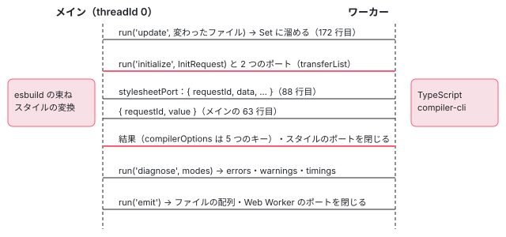

[目次](../README.md) › [@angular/build の compilation と utils の読み残し](README.md) › 第 2 回 / 全 10 回

# ParallelCompilation：コンパイルをワーカーに逃がす

> tools/angular/compilation/parallel-compilation.ts と parallel-worker.ts、jit-compilation.ts・typescript-compilation.ts の未読の行：ワーカーに渡す InitRequest と MessagePort、スタイルの変換をメインに頼み返す番号つきの依頼、成功と失敗で閉じるポート、update で溜める変わったファイル、JitCompilation と AOT・JIT の共通の親 TypeScriptCompilation。

angular/angular-cli · 読了 約 12 分 · 発展 · [サイトで読む（デモが動きます）](https://angular-deep-dive-cyan.vercel.app/chapter/bcu-parallel)

---

`createAngularCompilation` は既定で `ParallelCompilation` を返し、コンパイラはワーカースレッド（Node.js の別のスレッド）の中で動きます。この章では、メインのスレッドとワーカーの間を行き来する物を 1 つずつ数えます。`initialize` に渡す値、スタイルの変換をメインに頼み返す MessagePort、成功と失敗で閉じる物、`update` で溜める変わったファイル、そして並列でないときに直接作られる `JitCompilation` と、AOT・JIT の共通の親の残りです。

読む対象は ../angular-cli（44129f66a3）の `packages/angular/build/src/tools/angular/compilation/` の `parallel-compilation.ts`・`parallel-worker.ts`・`jit-compilation.ts`・`typescript-compilation.ts` です。ワーカーを 1 本にする設定・`initialize` を `run` で頼む所・Web Worker の Atomics の待ち合わせ・diagnose / emit / update の呼び方は [AotCompilation と並列ワーカーの章](../cli/03-cli-angular-compilation.md)の 3・4 節、JIT のリソースの変換は [TypeScript の変換の章](../oxc/04-oxc-ts-transformers.md)で読みました。AotCompilation の中身は [前回](01-bcu-aot.md)です。

1. [1. AotCompilation の残り](01-bcu-aot.md)
2. **2. ParallelCompilation**（この章）
3. [3. hmr-candidates](03-bcu-hmr.md)
4. [4. AngularHost と遅延ルート](04-bcu-host.md)
5. [5. 予算と出力の表](05-bcu-budget.md)
6. [6. index.html の仕上げ](06-bcu-index.md)
7. [7. 自動 CSP](07-bcu-auto-csp.md)
8. [8. オプションの小道具](08-bcu-options.md)
9. [9. パス・URL・ソースマップ](09-bcu-paths.md)
10. [10. spec と issue](10-bcu-tests-issues.md)

## 1. メイン側：ParallelCompilation の材料

📄 `angular-cli/packages/angular/build/src/tools/angular/compilation/parallel-compilation.ts` L9–30 （▶ の行: 10–14, 21, 24, 26, 28）

```ts
 9 │ import type { PartialMessage } from 'esbuild';
10 ▶ import { createRequire } from 'node:module';
11 ▶ import { MessageChannel } from 'node:worker_threads';
12 ▶ import { WorkerPool } from '../../../utils/worker-pool';
13 ▶ import { mergeCumulativeDurations } from '../../esbuild/profiling';
14 ▶ import type { AngularHostOptions } from '../angular-host';
15 │ import {
16 │   AngularCompilation,
17 │   AngularCompilationResult,
18 │   DiagnosticModes,
19 │   EmitFileResult,
20 │ } from './angular-compilation';
21 ▶ import type { CompilerOptionOverrides } from './compiler-options';
22 │ 
23 │ /**
24 ▶  * An Angular compilation which uses a Node.js Worker thread to load and execute
25 │  * the TypeScript and Angular compilers. This allows for longer synchronous actions
26 ▶  * such as semantic and template diagnostics to be calculated in parallel to the
27 │  * other aspects of the application bundling process. The worker thread also has
28 ▶  * a separate memory pool which significantly reduces the need for adjusting the
29 │  * main Node.js CLI process memory settings with large application code sizes.
30 │  */
```

メイン側のファイルは、TypeScript も @angular/compiler-cli も import しません。14 行目と 21 行目は `import type` で、型だけです。コンパイラを読むのはワーカーの中だけなので、メインのスレッドのメモリはコンパイラの分だけ軽くなります（24〜29 行目のコメントの「別のメモリ領域」）。10 行目の `createRequire` はワーカーのファイルの場所を探すため、11 行目の `MessageChannel` はメインに頼み返す道、12 行目の `WorkerPool` は Piscina（ワーカーのプール）を CLI 向けにした子クラス、13 行目は 4 節の時間の足し合わせです。

📄 `angular-cli/packages/angular/build/src/tools/angular/compilation/parallel-compilation.ts` L44–55 （▶ の行: 44, 47, 51, 53–54）

```ts
44 ▶     this.#worker = new WorkerPool({
45 │       maxThreads: 1,
46 │       idleTimeout: Infinity,
47 ▶       filename: localRequire.resolve('./parallel-worker'),
48 │     });
49 │   }
50 │ 
51 ▶   override async initialize(
52 │     tsconfig: string,
53 ▶     hostOptions: AngularHostOptions,
54 ▶     compilerOptionOverrides?: CompilerOptionOverrides,
55 │   ): Promise<AngularCompilationResult> {
```

47 行目、ワーカーは同じフォルダの `parallel-worker`（dist では `parallel-worker.js`）を読みます。51〜55 行目の `initialize` の引数は `AotCompilation` と同じ形ですが、`hostOptions` の関数はワーカーに渡せません（関数は構造化複製できない）。そこで 56〜85 行目（[前の章](../cli/03-cli-angular-compilation.md)の引用）で、スタイルの変換と Web Worker の束ねを MessagePort の向こうに置き、90〜105 行目でポートだけを `transferList` で渡します。92 行目の `fileReplacements` はただのオブジェクトなので複製で渡ります。`hostOptions.modifiedFiles` は渡しません。変わったファイルは 4 節の `update` で先に送ります。



*1 回のビルドで、メインとワーカーの間を行き来する物（デモの AOT・並列ありの 2 回目）。*

## 2. ワーカー側：モジュールに残る 3 つの状態

📄 `angular-cli/packages/angular/build/src/tools/angular/compilation/parallel-worker.ts` L9–39 （▶ の行: 11–14, 20, 22, 24, 28–32, 35–36, 38）

```ts
 9 │ import type { PartialMessage } from 'esbuild';
10 │ import assert from 'node:assert';
11 ▶ import { randomUUID } from 'node:crypto';
12 ▶ import { type MessagePort, receiveMessageOnPort } from 'node:worker_threads';
13 ▶ import { initializeHash } from '../../../utils/hash';
14 ▶ import { getAndClearCumulativeDurations } from '../../esbuild/profiling';
15 │ import type {
16 │   AngularCompilation,
17 │   AngularCompilationResult,
18 │   DiagnosticModes,
19 │ } from './angular-compilation';
20 ▶ import { AotCompilation } from './aot-compilation';
21 │ import type { CompilerOptionOverrides } from './compiler-options';
22 ▶ import { JitCompilation } from './jit-compilation';
23 │ 
24 ▶ export interface InitRequest {
25 │   jit: boolean;
26 │   browserOnlyBuild: boolean;
27 │   tsconfig: string;
28 ▶   fileReplacements?: Record<string, string>;
29 ▶   compilerOptionOverrides?: CompilerOptionOverrides;
30 ▶   stylesheetPort: MessagePort;
31 ▶   webWorkerPort: MessagePort;
32 ▶   webWorkerSignal: Int32Array;
33 │ }
34 │ 
35 ▶ let compilation: AngularCompilation | undefined;
36 ▶ let activeWebWorkerPort: MessagePort | undefined;
37 │ 
38 ▶ const modifiedFiles = new Set<string>();
39 │ 
```

24〜33 行目の `InitRequest` が、メインの 91〜100 行目（前の章の引用）が渡すオブジェクトの形です。30〜32 行目の 2 つのポートと 4 バイトの `Int32Array` が、メインに頼み返すための道具です。35〜38 行目はモジュールの変数で、ワーカーが止まらない限り（`idleTimeout: Infinity`）残ります。35 行目の `compilation` は最初の `initialize` で 1 回だけ作られ（50〜52 行目、前の章の引用）、2 回目以降は同じインスタンスが前回のプログラムを持ったまま使われます。36 行目は使っている Web Worker のポート、38 行目は 4 節の `update` で溜める変わったファイルです。20 行目と 22 行目で AOT と JIT の両方を静的に import するので、ワーカーはどちらの場合も両方のファイルを読みます。

## 3. スタイルの変換をメインに頼み返す

📄 `angular-cli/packages/angular/build/src/tools/angular/compilation/parallel-worker.ts` L54–75 （▶ の行: 54–56, 58–63, 65, 70）

```ts
54 ▶     const stylesheetRequests = new Map<
55 ▶       string,
56 ▶       [(value: string) => void, (reason: Error) => void]
57 │     >();
58 ▶     request.stylesheetPort.on('message', ({ requestId, value, error }) => {
59 ▶       const handlers = stylesheetRequests.get(requestId);
60 ▶       if (handlers) {
61 ▶         stylesheetRequests.delete(requestId);
62 ▶         if (error) {
63 ▶           handlers[1](error);
64 │         } else {
65 ▶           handlers[0](value);
66 │         }
67 │       }
68 │     });
69 │ 
70 ▶     const {
71 │       compilerOptions,
72 │       referencedFiles,
73 │       externalStylesheets,
74 │       templateUpdates,
75 │       componentResourcesDependencies,
```

📄 `angular-cli/packages/angular/build/src/tools/angular/compilation/parallel-worker.ts` L76–98 （▶ の行: 77–79, 81–85, 88–90, 97）

```ts
76 │       warnings,
77 ▶     } = await compilation.initialize(
78 ▶       request.tsconfig,
79 ▶       {
80 │         fileReplacements: request.fileReplacements,
81 ▶         modifiedFiles: currentModifiedFiles,
82 ▶         transformStylesheet(data, containingFile, stylesheetFile, order, className) {
83 ▶           const requestId = randomUUID();
84 ▶           const resultPromise = new Promise<string>((resolve, reject) =>
85 ▶             stylesheetRequests.set(requestId, [resolve, reject]),
86 │           );
87 │ 
88 ▶           request.stylesheetPort.postMessage({
89 ▶             requestId,
90 ▶             data,
91 │             containingFile,
92 │             stylesheetFile,
93 │             order,
94 │             className,
95 │           });
96 │ 
97 ▶           return resultPromise;
98 │         },
```

1. **ワーカーの中のホストは偽物**

   79〜112 行目で、`AotCompilation` に渡す `hostOptions` をワーカーの中で作ります。81 行目の `modifiedFiles` は 44 行目で写した「`update` で溜まった物」です。
2. **頼むたびに番号を振る**

   83 行目の `randomUUID()` が依頼の番号で、84〜86 行目で resolve と reject の組を 54〜57 行目の Map に入れ、88〜95 行目でメインに投げます。AOT のコンパイラはスタイルを並べて同時に頼むので、番号で返事を取り違えないようにします（メインの 57 行目のコメント）。
3. **メインが変換して同じ番号で返す**

   メインの 58〜66 行目（前の章の引用）が `hostOptions.transformStylesheet` を呼び、`{ requestId, value }` か `{ requestId, error }` を返します。
4. **ワーカーで待っている Promise を決める**

   58〜68 行目。番号で組を取り出し、61 行目で Map から消してから、62〜66 行目で reject か resolve。知らない番号は無視します。

Web Worker の束ねだけは、コンパイラの変換の中から同期で呼ばれるので、Promise ではなく Atomics で止めて待ちます（99〜111 行目、[前の章](../cli/03-cli-angular-compilation.md)の 3・4 節）。デモでは、スタイルの変換は `initialize` の中で 1 回（app.css）、Web Worker は `emit` の中で 1 回（spawn.ts の `./app.worker`）、どちらもメインのスレッド（threadId 0）で呼ばれました。

> [!NOTE]
> **ポイント**
>
> main の 7f4de14688 は、83 行目の `randomUUID()` を数を 1 ずつ増やす番号に替え、ライブラリのビルドでは Web Worker のポートを作らないようにしました（新しい `parallel-compilation_spec.ts` の it 1 件）。22.2.x にも一度入りましたが ed30336f6a で戻されたので、22.2.7 は 44129f66a3 と同じ `randomUUID()` です。

## 4. 返す物を絞る・閉じる・update で溜める

📄 `angular-cli/packages/angular/build/src/tools/angular/compilation/parallel-worker.ts` L112–142 （▶ の行: 113, 116, 118–120, 123–129, 132, 135–138）

```ts
112 │       },
113 ▶       request.compilerOptionOverrides,
114 │     );
115 │ 
116 ▶     success = true;
117 │ 
118 ▶     return {
119 ▶       externalStylesheets,
120 ▶       templateUpdates,
121 │       referencedFiles,
122 │       warnings,
123 ▶       // TODO: Expand? `allowJs`, `isolatedModules`, `sourceMap`, `inlineSourceMap` are the only fields needed currently.
124 ▶       compilerOptions: {
125 ▶         allowJs: compilerOptions.allowJs,
126 ▶         isolatedModules: compilerOptions.isolatedModules,
127 ▶         sourceMap: compilerOptions.sourceMap,
128 ▶         inlineSourceMap: compilerOptions.inlineSourceMap,
129 ▶         _useTypeScriptTranspilation: compilerOptions['_useTypeScriptTranspilation'] as
130 │           boolean | undefined,
131 │       },
132 ▶       componentResourcesDependencies,
133 │     };
134 │   } finally {
135 ▶     request.stylesheetPort.close();
136 ▶     if (!success) {
137 ▶       activeWebWorkerPort?.close();
138 ▶       activeWebWorkerPort = undefined;
139 │     }
140 │   }
141 │ }
142 │ 
```

118〜133 行目、メインに返す結果は複製されるので、`compilerOptions` は 125〜130 行目の 5 つのキーだけにします（123 行目の TODO のとおり、プラグインが読むのはこれだけ）。デモの記録でも、ワーカーから返ってきた `compilerOptions` のキーは `allowJs, isolatedModules, sourceMap, inlineSourceMap, _useTypeScriptTranspilation` の 5 つでした。並列でない `AotCompilation` は、tsconfig の options を丸ごと返します。134〜140 行目、成功しても失敗してもスタイルのポートは閉じ、失敗したときだけ Web Worker のポートも閉じます。成功したときは、`emit` が終わるまで Web Worker のポートを開けておきます（160〜169 行目、前の章の引用）。Web Worker を束ねるのは emit の変換の中だからです。

📄 `angular-cli/packages/angular/build/src/tools/angular/compilation/parallel-compilation.ts` L106–117 （▶ の行: 106, 110–113）

```ts
106 ▶       success = true;
107 │ 
108 │       return result;
109 │     } finally {
110 ▶       stylesheetChannel.port1.close();
111 ▶       if (!success) {
112 ▶         this.#webWorkerChannel?.port1.close();
113 ▶         this.#webWorkerChannel = undefined;
114 │       }
115 │     }
116 │   }
117 │ 
```

メイン側も同じ形です。110 行目でスタイルのポートを必ず閉じ、111〜114 行目で失敗のときだけ Web Worker の道を捨てます。この 2 か所の閉じ方は e4111ae818（2026-08、並列のコンパイルとキャッシュのメモリの漏れを防ぐ）で入りました。そのときはもう 1 本、compilerOptions を問い合わせるポート（`optionsChannel`）もありましたが、0e632f101d（同じ月）が options の変換をワーカーの中の `transformCompilerOptions` に移して、この道を消しました。

📄 `angular-cli/packages/angular/build/src/tools/angular/compilation/parallel-worker.ts` L171–178 （▶ の行: 172–174, 176）

```ts
171 │ 
172 ▶ export async function update(files: Set<string>): Promise<void> {
173 ▶   for (const file of files) {
174 ▶     modifiedFiles.add(file);
175 │   }
176 ▶   await compilation?.update?.(files);
177 │ }
178 │ 
```

172〜177 行目の `update` は、変わったファイルを 38 行目の Set に足し、ワーカーの中のコンパイルの `update`（親クラスの `invalidateFiles`、SourceFile のキャッシュから消す）を呼びます。次の `initialize` は 44〜45 行目でこの Set を写して空にし、81 行目で `modifiedFiles` として渡します。compiler-plugin は onStart の 200〜202 行目（[再ビルドとキャッシュの章](../cli/10-cli-cache-watch.md)の引用）で、変わったファイルがあれば `initialize` の前に必ず `update` を呼びます。

> [!WARNING]
> **ハマりどころ**
>
> 順番の約束です。デモの「update を呼ばない」は、counter.ts を `signal(10)` に書き換え、`update` を呼ばずに `initialize` だけを頼んだ記録です。ワーカーの SourceFile のキャッシュが消えないので、emit した counter.ts は `signal(0)` のままでした。並列でない `AotCompilation` は `hostOptions.modifiedFiles` を読んで自分で消しますが（前回の 4 節）、並列のときはメインの `modifiedFiles` がワーカーに届かないので、`update` だけが頼りです。

📄 `angular-cli/packages/angular/build/src/tools/angular/compilation/parallel-compilation.ts` L141–149 （▶ の行: 142–144, 146）

```ts
141 │ 
142 ▶   override close() {
143 ▶     this.#webWorkerChannel?.port1.close();
144 ▶     this.#webWorkerChannel = undefined;
145 │ 
146 ▶     return this.#worker.destroy();
147 │   }
148 │ }
149 │ 
```

`close` は Web Worker の道を閉じ、146 行目でプールを壊します（ワーカーのスレッドが終わる）。デモでは 2 ms 前後でした。compiler-plugin の onDispose から、compilation-state の `dispose` を通って呼ばれます（[compiler-plugin の残りの章](../esb/06-esb-compiler-rest.md)の 1 節）。

## 5. 並列でないとき：JitCompilation

📄 `angular-cli/packages/angular/build/src/tools/angular/compilation/jit-compilation.ts` L9–41 （▶ の行: 14–16, 25, 27–31, 35–36, 38）

```ts
 9 │ import type * as ng from '@angular/compiler-cli';
10 │ import assert from 'node:assert';
11 │ import ts from 'typescript';
12 │ import { profileSync } from '../../esbuild/profiling';
13 │ import { AngularHostOptions, createAngularCompilerHost } from '../angular-host';
14 ▶ import { createJitResourceTransformer } from '../transformers/jit-resource-transformer';
15 ▶ import { lazyRoutesTransformer } from '../transformers/lazy-routes-transformer';
16 ▶ import { createWorkerTransformer } from '../transformers/web-worker-transformer';
17 │ import {
18 │   type AngularCompilationResult,
19 │   DiagnosticModes,
20 │   type EmitFileResult,
21 │ } from './angular-compilation';
22 │ import type { CompilerOptionOverrides } from './compiler-options';
23 │ import { TypeScriptCompilation } from './typescript-compilation';
24 │ 
25 ▶ class JitCompilationState {
26 │   constructor(
27 ▶     public readonly compilerHost: ng.CompilerHost,
28 ▶     public readonly typeScriptProgram: ts.EmitAndSemanticDiagnosticsBuilderProgram,
29 ▶     public readonly constructorParametersDownlevelTransform: ts.TransformerFactory<ts.SourceFile>,
30 ▶     public readonly replaceResourcesTransform: ts.TransformerFactory<ts.SourceFile>,
31 ▶     public readonly webWorkerTransform: ts.TransformerFactory<ts.SourceFile>,
32 │   ) {}
33 │ }
34 │ 
35 ▶ export class JitCompilation extends TypeScriptCompilation {
36 ▶   #state?: JitCompilationState;
37 │ 
38 ▶   constructor(private readonly browserOnlyBuild: boolean) {
39 │     super();
40 │   }
41 │ 
```

JIT（`aot: false`）では Angular のコンパイラを使わず、TypeScript のプログラムに 3 つの変換を当てるだけです。25〜33 行目の `JitCompilationState` には、AOT の `NgtscProgram` や診断のキャッシュがありません。29 行目はコンストラクタの引数の型を実行時に残す変換、30 行目は `templateUrl` や `styleUrl` を import に替える変換（[TypeScript の変換の章](../oxc/04-oxc-ts-transformers.md)の 1 節）、31 行目は Web Worker の変換です。

📄 `angular-cli/packages/angular/build/src/tools/angular/compilation/jit-compilation.ts` L42–71 （▶ の行: 48–49, 57, 59–60, 64, 67–69）

```ts
42 │   async initialize(
43 │     tsconfig: string,
44 │     hostOptions: AngularHostOptions,
45 │     compilerOptionOverrides?: CompilerOptionOverrides,
46 │   ): Promise<AngularCompilationResult> {
47 │     // Dynamically load the Angular compiler CLI package
48 ▶     const { constructorParametersDownlevelTransform } =
49 ▶       await import('@angular/compiler-cli/private/tooling');
50 │ 
51 │     // Load the compiler configuration and transform as needed
52 │     const {
53 │       compilerOptions,
54 │       rootNames,
55 │       errors: configurationDiagnostics,
56 │       warnings,
57 ▶     } = await this.loadConfiguration(tsconfig, compilerOptionOverrides);
58 │ 
59 ▶     if (hostOptions.modifiedFiles) {
60 ▶       this.invalidateFiles(hostOptions.modifiedFiles);
61 │     }
62 │ 
63 │     // Create Angular compiler host
64 ▶     const host = createAngularCompilerHost(
65 │       ts,
66 │       compilerOptions,
67 ▶       hostOptions,
68 ▶       undefined,
69 ▶       this.sourceFiles,
70 │     );
71 │ 
```

1. **compiler-cli の tooling だけを読む**

   48〜49 行目。`@angular/compiler-cli/private/tooling` から変換を 1 つ取り出します。`NgtscProgram` は読みません。
2. **tsconfig は AOT と同じ道**

   57 行目の `loadConfiguration`（6 節）。
3. **変わったファイルを消す**

   59〜61 行目。
4. **package.json のキャッシュは渡さない**

   68 行目が `undefined` です。AOT は前回のホストの package.json のキャッシュを渡すので（前回の 4 節の 128 行目）、ここが 2 つの違いの 1 つです。

この先の 72〜96 行目（プログラムを作り、3 つの変換を作る。[TypeScript の変換の章](../oxc/04-oxc-ts-transformers.md)の引用）で、`referencedFiles` は TypeScript のファイルだけです（91〜93 行目）。デモでも、JIT の `referencedFiles`（ワークスペースの中）は 6 つで、AOT の 8 つから `app.html` と `app.css` が抜けました。JIT ではテンプレートとスタイルは esbuild が直接読むからです。

📄 `angular-cli/packages/angular/build/src/tools/angular/compilation/jit-compilation.ts` L119–139 （▶ の行: 121, 129–130, 132–134, 136, 138）

```ts
119 │ 
120 │   override emitAffectedFiles(): Iterable<EmitFileResult> {
121 ▶     assert(this.#state, 'Compilation must be initialized prior to emitting files.');
122 │     const {
123 │       compilerHost,
124 │       typeScriptProgram,
125 │       constructorParametersDownlevelTransform,
126 │       replaceResourcesTransform,
127 │       webWorkerTransform,
128 │     } = this.#state;
129 ▶     const compilerOptions = typeScriptProgram.getCompilerOptions();
130 ▶     const buildInfoFilename = compilerOptions.tsBuildInfoFile ?? '.tsbuildinfo';
131 │ 
132 ▶     const emittedFiles: EmitFileResult[] = [];
133 ▶     const writeFileCallback: ts.WriteFileCallback = (filename, contents, _a, _b, sourceFiles) => {
134 ▶       if (!sourceFiles?.length && filename.endsWith(buildInfoFilename)) {
135 │         // Save builder info contents to specified location
136 ▶         compilerHost.writeFile(filename, contents, false);
137 │ 
138 ▶         return;
139 │       }
```

書き込み口の形は AOT（[前回](01-bcu-aot.md)の 8 節）と同じで、`.tsbuildinfo` は 134〜139 行目でディスクに書きます。違いは 141〜143 行目（[TypeScript の変換の章](../oxc/04-oxc-ts-transformers.md)の引用）で、`getOriginalNode` も「Angular が生成したファイルを出さない」もなく、配列に入れるだけです。JIT には生成されたファイルが無いからです。デモの 2 回目（counter.ts を変えた）は、AOT が 3 ファイル、JIT が 1 ファイルを出しました。JIT には TTC の shim が無いので、Counter を使う App が影響を受けないからです。

## 6. AOT と JIT の共通の親：TypeScriptCompilation

📄 `angular-cli/packages/angular/build/src/tools/angular/compilation/typescript-compilation.ts` L9–24 （▶ の行: 12–13, 15–16, 18–22）

```ts
 9 │ import type * as ng from '@angular/compiler-cli';
10 │ import type { PartialMessage } from 'esbuild';
11 │ import ts from 'typescript';
12 ▶ import { toPosixPath } from '../../../utils/path';
13 ▶ import { profileAsync, profileSync } from '../../esbuild/profiling';
14 │ import { AngularCompilation, DiagnosticModes } from './angular-compilation';
15 ▶ import { type CompilerOptionOverrides, transformCompilerOptions } from './compiler-options';
16 ▶ import { convertTypeScriptDiagnostic } from './diagnostics';
17 │ 
18 ▶ export interface TransformedConfiguration {
19 ▶   compilerOptions: ng.CompilerOptions;
20 ▶   rootNames: string[];
21 ▶   errors: ts.Diagnostic[];
22 ▶   warnings: PartialMessage[];
23 │ }
24 │ 
```

📄 `angular-cli/packages/angular/build/src/tools/angular/compilation/typescript-compilation.ts` L62–77 （▶ の行: 63–67, 70–74）

```ts
62 │ 
63 ▶     const { compilerOptions, warnings } = transformCompilerOptions(
64 ▶       ts,
65 ▶       originalCompilerOptions,
66 ▶       compilerOptionOverrides,
67 ▶       tsconfig,
68 │     );
69 │ 
70 ▶     return {
71 ▶       compilerOptions,
72 ▶       rootNames,
73 ▶       errors,
74 ▶       warnings,
75 │     };
76 │   }
77 │ 
```

18〜23 行目の `TransformedConfiguration` が `loadConfiguration` の戻り値で、21 行目の `errors` は TypeScript の診断（tsconfig の読み込みの誤り）、22 行目の `warnings` は CLI が足した esbuild の形の警告です。63〜68 行目で `readConfiguration` の結果を `transformCompilerOptions`（[前回](01-bcu-aot.md)の 3 節）に通し、4 つを並べて返します。`errors` は BuilderProgram を作るときの 4 つめの引数（JIT の 79 行目は TypeScript の変換の章、AOT の 152 行目は application builder の章の引用）に入り、`getConfigFileParsingDiagnostics`（前回の 6 節の 266 行目）から出てきます。12 行目の `toPosixPath` は、`invalidateFiles` が Windows のパスを SourceFile のキャッシュのキーに揃えるためです。

## 7. デモ：4 つの作り方と、update を呼ばない場合

> **🧪 DEMO — @angular/build 22.2.7 の createAngularCompilation の記録**
>
> [前回](01-bcu-aot.md)と同じワークスペースに、作り方を変えて initialize → diagnoseFiles → emitAffectedFiles を 2 回（2 回目は counter.ts を `signal(10)` に変え、compiler-plugin と同じく先に `update`）頼みました。時刻はその作り方の頭からのミリ秒、Node v24.22.1 の 1 回の実測です。
>
> ▶ [このデモはサイトで動かせます](https://angular-deep-dive-cyan.vercel.app/chapter/bcu-parallel)

並列ありの 1 回目の `initialize` は、並列なしより AOT で 120 ms、JIT で 240 ms ほど長くかかりました。ワーカーのスレッドを立て、その中で TypeScript と @angular/compiler-cli を読み直すからです。2 回目からはワーカーが前回のプログラムを持っているので、差はほとんどありません。ワーカーへの `run` は 1 回のビルドで initialize・diagnose・emit の 3 回、2 回目はその前に update が 1 回です。`diagnose` の返事の `timings` は「なし」でした。`NG_BUILD_DEBUG_PERF` を付けないと、151 行目（前の章の引用）の `getAndClearCumulativeDurations` が `undefined` を返すからです。

## 8. どう録ったか

スクリプトは `<work>/bcu-demo/a/` に置き、サイトの node\_modules の @angular/build 22.2.7 の `tools/angular/compilation/factory.js` を require しました。メインからワーカーへの頼みは `WorkerPool.prototype.run`（Piscina の `run`）を包んで記録し、ホストの関数の呼び返しはデモが渡す `hostOptions` の中で `threadId` と一緒に記録しました。ワークスペースと共有の小道具（`harness.mjs`）は [前回](01-bcu-aot.md)と同じです。

📄 `記録のスクリプト（rec-parallel.mjs）`

```
// 本物の createAngularCompilation（サイトの node_modules の @angular/build 22.2.7）で、
// AOT / JIT × 並列あり / なしのコンパイルを作り、同じワークスペースに 2 回（2 回目は counter.ts を変える）当てる。
// どのクラスが選ばれたか、WorkerPool.run の呼び出し（名前・時間）、メインのスレッドに戻ってきたホストの関数の呼び出し、
// emit の中身の特徴を時刻つきで記録する。
// 使い方: node rec-parallel.mjs <出力 JSON>
import { writeFileSync, readFileSync } from 'node:fs';
import { threadId } from 'node:worker_threads';
import { r, makeWorkspace, abs, rel, hide, ms, writeFile, version, cleanup } from './harness.mjs';

const out = process.argv[2];
await r('utils/hash.js').initializeHash();
const { createAngularCompilation } = r('tools/angular/compilation/factory.js');
const { WorkerPool } = r('utils/worker-pool.js');

let log = null;
let t0 = 0;
const ev = (who, what, detail) => log?.push({ t: ms(t0), who, what, detail: detail == null ? null : hide(detail) });

// WorkerPool.run（Piscina の run）を包んで、メインからワーカーへの頼みごとを記録する
const origRun = WorkerPool.prototype.run;
WorkerPool.prototype.run = function (task, options) {
  const name = options?.name;
  const detail =
    name === 'initialize'
      ? `jit=${task.jit}・browserOnlyBuild=${task.browserOnlyBuild}・transferList ${options.transferList?.length ?? 0} 個`
      : name === 'update'
        ? [...task].map(rel).join(', ')
        : name === 'diagnose'
          ? `modes=${task}`
          : null;
  ev('メイン → ワーカー', `run('${name}')`, detail);
  const p = origRun.call(this, task, options);
  p.then(
    (res) => {
      let d = null;
      if (name === 'initialize') d = `referencedFiles ${res.referencedFiles.length} 個・compilerOptions のキー ${Object.keys(res.compilerOptions).join(', ')}`;
      if (name === 'emit') d = `${res.length} ファイル`;
      if (name === 'diagnose') d = `errors ${res.errors?.length ?? 0}・warnings ${res.warnings?.length ?? 0}・timings ${res.timings ? 'あり' : 'なし'}`;
      ev('ワーカー → メイン', `run('${name}') が決まる`, d);
    },
    (e) => ev('ワーカー → メイン', `run('${name}') が失敗`, e.message),
  );
  return p;
};

function hostOptions(modified) {
  return {
    modifiedFiles: modified ? new Set(modified.map(abs)) : undefined,
    transformStylesheet: async (data, containing, file) => {
      ev(`ホスト（threadId ${threadId}）`, 'transformStylesheet', rel(file ?? containing));
      return data;
    },
    processWebWorker: (w, containing) => {
      ev(`ホスト（threadId ${threadId}）`, 'processWebWorker', `${w}（${rel(containing)} から）`);
      return 'worker-ABC123.js';
    },
  };
}

const features = (files) => {
  const counter = files.find((f) => f.filename.endsWith('counter.ts'));
  const app = files.find((f) => f.filename.endsWith('/app.ts'));
  return {
    count: files.length,
    files: files.map((f) => rel(f.filename)),
    aotDef: !!app?.contents.includes('ɵɵdefineComponent'),
    jitImport: (app?.contents.match(/angular:jit:[a-z]+:file;[^'"]+/g) ?? []).join(', ') || null,
    workerUrl: files.some((f) => f.contents.includes('worker-ABC123.js')),
    counterInitial: counter ? (counter.contents.match(/signal\((\d+)/)?.[1] ?? null) : null,
    entryName: files.find((f) => f.filename.endsWith('routes.ts'))?.contents.match(/ɵentryName: "([^"]+)"/)?.[1] ?? null,
  };
};

const variants = [
  { id: 'aot-par', label: 'AOT・並列あり（既定）', mode: false, parallel: true },
  { id: 'aot-main', label: 'AOT・並列なし（NG_BUILD_PARALLEL_TS=0）', mode: false, parallel: false },
  { id: 'jit-par', label: 'JIT・並列あり', mode: 'jit', parallel: true },
  { id: 'jit-main', label: 'JIT・並列なし', mode: 'jit', parallel: false },
  { id: 'aot-par-noupdate', label: 'AOT・並列あり・update を呼ばない', mode: false, parallel: true, skipUpdate: true },
];

const runs = [];
for (const v of variants) {
  makeWorkspace('par-' + v.id);
  log = [];
  t0 = performance.now();
  const c = await createAngularCompilation(v.mode, false, v.parallel);
  ev('createAngularCompilation', `${c.constructor.name} を返す`, `mode=${JSON.stringify(v.mode)}・parallel=${v.parallel}`);
  const steps = [];
  for (const pass of [1, 2]) {
    let modified;
    if (pass === 2) {
      writeFile('src/app/counter.ts', readFileSync(abs('src/app/counter.ts'), 'utf8').replace('signal(0)', 'signal(10)'));
      modified = ['src/app/counter.ts'];
      if (!v.skipUpdate) {
        ev('compiler-plugin の役', 'compilation.update(modifiedFiles)', 'src/app/counter.ts');
        await c.update?.(new Set(modified.map(abs)));
      }
    }
    const s0 = performance.now();
    const init = await c.initialize(abs('tsconfig.json'), hostOptions(modified), {});
    const tInit = ms(s0);
    const s1 = performance.now();
    const diag = await c.diagnoseFiles();
    const tDiag = ms(s1);
    const s2 = performance.now();
    const files = [...(await c.emitAffectedFiles())];
    const tEmit = ms(s2);
    steps.push({
      label: pass === 1 ? '1 回目' : '2 回目（counter.ts を変えた）',
      times: { initialize: tInit, diagnose: tDiag, emit: tEmit },
      referencedFiles: init.referencedFiles.filter((f) => f.includes('/src/')).map(rel),
      compilerOptionKeys: Object.keys(init.compilerOptions).length,
      errors: diag.errors?.length ?? 0,
      emit: features(files),
    });
  }
  const s3 = performance.now();
  await c.close?.();
  ev('メイン', 'close()', `${ms(s3)} ms`);
  runs.push({ id: v.id, label: v.label, className: c.constructor.name, steps, log });
  log = null;
}

// 'transform' と、真偽値の互換
const factory = [];
for (const [mode, parallel] of [[false, true], [true, true], ['aot', false], ['jit', false], [true, false], ['transform', false]]) {
  try {
    const c = await createAngularCompilation(mode, true, parallel);
    factory.push({ call: `createAngularCompilation(${JSON.stringify(mode)}, true, ${parallel})`, result: c.constructor.name });
    await c.close?.();
  } catch (e) {
    factory.push({ call: `createAngularCompilation(${JSON.stringify(mode)}, true, ${parallel})`, result: `throw: ${e.message}` });
  }
}

const rec = { version, node: process.version, runs, factory };
writeFileSync(out, JSON.stringify(rec, null, 1));
cleanup();
for (const run of runs) {
  console.log('==', run.label, run.className);
  for (const s of run.steps) console.log('  ', s.label, JSON.stringify(s.times), JSON.stringify(s.emit), 'refs', s.referencedFiles.length, 'err', s.errors);
  for (const l of run.log) console.log('     ', l.t, l.who, l.what, l.detail ?? '');
}
console.log(factory);
process.exit(0);

```

## ここまでの呼び出し

- `createAngularCompilation(jit, browserOnlyBuild)` — factory.ts 23 — *既定は ParallelCompilation*
  - `new WorkerPool({ filename: parallel-worker })` — parallel-compilation.ts 44〜48
- `compilation.update(modifiedFiles)` — compiler-plugin.ts 201 → parallel-compilation.ts 139
  - `update(files)`：`modifiedFiles.add`・`compilation.update` — parallel-worker.ts 172〜177
- `compilation.initialize(…)` — parallel-compilation.ts 51
  - `worker.run(request, { name: 'initialize', transferList })` — 90〜105
    - `initialize(request)`：`new Set(modifiedFiles)`・`compilation ??= …` — parallel-worker.ts 40〜52
      - `transformStylesheet` → `postMessage({ requestId, … })` — 82〜97
        - 👤 `hostOptions.transformStylesheet(…)` — parallel-compilation.ts 61〜64（メイン）
    - `compilerOptions` を 5 つのキーに・`stylesheetPort.close()` — 124〜135
  - `stylesheetChannel.port1.close()` — parallel-compilation.ts 110
- `compilation.close()` — 142〜147

## テストと直し方

| spec | describe / it と行 | この章のどこ |
| --- | --- | --- |
| tools/angular/compilation/angular-compilation\_spec.ts | describe createAngularCompilation（169 行目）：jit（170 行目）、aot（175 行目）、true / false の互換（180・185 行目）、transform で投げる（190 行目）。どれも第 3 引数に `false` を渡し、ParallelCompilation は作らない | 7 節の表 |
| 同じ | describe TypeScriptCompilation の loadConfiguration（142 行目）、update で消す（125 行目） | 4・6 節 |
| （無い） | parallel-compilation.ts・parallel-worker.ts・jit-compilation.ts の単体の spec。main には `parallel-compilation_spec.ts`（describe parallel-worker、it 1 件）が 7f4de14688 で入った | 1〜5 節 |

[前回](01-bcu-aot.md)のテストの節と同じ bazel の 1 回（41 specs、0 failures）の中で、describe createAngularCompilation の 5 件が通りました。builder を丸ごと動かす `:application_integration_tests` は、既定の並列の道を毎回通ります。

直すとしたら、ファイルと関数は次のとおりです。

- update の順番の約束：今は呼ぶ側（compiler-plugin.ts の 200〜202 行目）だけが守っています。ワーカーの側で守るなら、`parallel-compilation.ts` の `initialize` で `hostOptions.modifiedFiles` を `InitRequest` に入れ、`parallel-worker.ts` の 44 行目で Set に足す形です。固めるなら、`parallel-compilation_spec.ts` に、本物のワーカーで 2 回 initialize し、2 回目の emit の中身が変わることを見る it を足します（デモの「update を呼ばない」の形）。
- JIT の package.json のキャッシュ：`jit-compilation.ts` の 68 行目に、AOT の 89〜91 行目と同じく前回のホストのキャッシュを渡す形です。

## 聞かれそうな質問

**Q. 「並列」とは、型チェックを何本ものスレッドに分けることですか？**

違います。ワーカーは 1 本で（前の章の 45 行目）、コンパイラの仕事をメインのスレッドから外すだけです。メインは esbuild の束ねとスタイルの変換を受け持ち、ワーカーは 3 節の MessagePort でスタイルの変換をメインに頼み返します。デモでも transformStylesheet は threadId 0 で呼ばれました。

**Q. ワーカーの中のコンパイラは、変わったファイルをどうやって知りますか？**

`update` だけです。メインの `initialize`（91〜100 行目、前の章の引用）は `modifiedFiles` を渡さず、ワーカーは 172〜177 行目で溜めた Set を 44〜45 行目で写して使います。update を飛ばすと、デモのとおり古い SourceFile のまま emit します。

**Q. 並列のとき、initialize の戻り値の compilerOptions が少ないのはなぜですか？**

123〜131 行目で 5 つのキーだけを返すからです。結果はスレッドの間で複製されるので、プラグインが読む物（allowJs・isolatedModules・sourceMap・inlineSourceMap・\_useTypeScriptTranspilation）に絞っています。並列でない AotCompilation は options を丸ごと返します。

**Q. JIT の出力にテンプレートが入っていないのはなぜですか？**

30 行目の変換が `templateUrl: './app.html'` を `angular:jit:template:file;./app.html` の import に替え、中身は esbuild の onLoad が読むからです。デモの JIT の app.ts にも、この import と `angular:jit:style:file;./app.css` が入りました。だから JIT の `referencedFiles`（91〜93 行目）に .html と .css がありません。

**Q. ng build を NG\_BUILD\_PARALLEL\_TS=0 で走らせると、何が変わりますか？**

`createAngularCompilation` が `AotCompilation`（JIT なら `JitCompilation`）をメインのスレッドで直接作ります。ワーカーを立てないので、デモでは 1 回目の initialize が AOT で 120 ms ほど短くなりました。代わりにコンパイラのメモリもメインのプロセスに乗り、型チェックは esbuild の束ねと同じスレッドで動きます。

## 読み終えて

- ParallelCompilation のメイン側は TypeScript も compiler-cli も読まない。コンパイラはワーカーの中だけで、最初の initialize で 1 回だけ作られる。
- ワーカーの中のホストは偽物で、スタイルの変換は randomUUID の番号つきで MessagePort からメインに頼み返す。Web Worker の束ねだけは Atomics で同期に待つ。
- 変わったファイルは update で先にワーカーへ送って溜める。initialize は modifiedFiles を渡さないので、update を飛ばすと古い SourceFile で emit する。
- ワーカーが返す compilerOptions は 5 つのキーだけ。成功してもスタイルのポートは閉じ、Web Worker のポートは emit が終わるまで開けておく。
- JitCompilation は NgtscProgram を使わず 3 つの変換を当てるだけで、referencedFiles に .html と .css が入らず、package.json のキャッシュも引き継がない。

---

← 前: [AotCompilation の残り：プログラムの作り直し・診断・出力の書き出し](01-bcu-aot.md)  
次: [hmr-candidates と typescript-printer：差し替えてよいコンポーネントを見分ける](03-bcu-hmr.md) →
