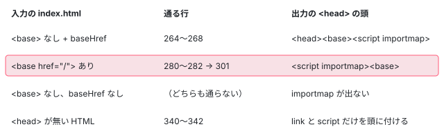

[目次](../README.md) › [@angular/build の compilation と utils の読み残し](README.md) › 第 6 回 / 全 10 回

# index.html の仕上げ：augment-index-html・IndexHtmlGenerator・inline-fonts の残り

> utils/index-file の augment-index-html.ts・index-html-generator.ts・inline-fonts.ts の未読の行：crossorigin と SRI の既定、遅延チャンクの integrity を載せる importmap（と &lt;base&gt; との並び）、ヒントの属性、lang と dir、image の preconnect、生成器の型と読み込みのエラー、Google Fonts と Adobe Fonts の取りに行き方。

angular/angular-cli · 読了 約 13 分 · 中核 · [サイトで読む（デモが動きます）](https://angular-deep-dive-cyan.vercel.app/chapter/bcu-index)

---

ng build の最後に出る `index.html` は、あなたが書いた `src/index.html` を `IndexHtmlGenerator` のプラグインの列に通して作られます。その列の先頭の `augmentIndexHtml` が script と link を差し込み、`InlineFontsProcessor` が Google Fonts の CSS を埋め込みます。この章では、ほかの章で読まなかった残り、つまり **crossorigin と SRI の決め方、遅延チャンクの integrity を載せる importmap、ヒントの属性、lang と dir、image の preconnect、生成器の型と読み込みのエラー、フォントの取りに行き方**を読みます。デモでは、本物の 3 つのクラスと関数に 29 の入力を当てた出力の HTML を切り替えて見ます。

読む対象は ../angular-cli（44129f66a3）の `packages/angular/build/src/utils/index-file/` の `augment-index-html.ts`・`index-html-generator.ts`・`inline-fonts.ts` です。この 3 つは 44129f66a3 とサイトの依存の 22.2.7 で同じ中身です。タグを並べる順番と差し込む位置（109〜160・185〜198・233〜347 行目）は [index.html の章](../boot/05-boot-index-html.md)、プラグインの列・nonce・フォントの埋め込みの後半（106〜167 行目）は [index.html のプラグインの章](../bmap/03-bmap-index-html.md)、フォントのディスクのキャッシュ（170〜194・256〜300 行目）は [スタイルの束ね方の章](../bmap/02-bmap-styles-bundle.md)で読みました。

1. [1. AotCompilation の残り](01-bcu-aot.md)
2. [2. ParallelCompilation](02-bcu-parallel.md)
3. [3. hmr-candidates](03-bcu-hmr.md)
4. [4. AngularHost と遅延ルート](04-bcu-host.md)
5. [5. 予算と出力の表](05-bcu-budget.md)
6. **6. index.html の仕上げ**（この章）
7. [7. 自動 CSP](07-bcu-auto-csp.md)
8. [8. オプションの小道具](08-bcu-options.md)
9. [9. パス・URL・ソースマップ](09-bcu-paths.md)
10. [10. spec と issue](10-bcu-tests-issues.md)

## 1. augmentIndexHtml が受け取るもの

📄 `angular-cli/packages/angular/build/src/utils/index-file/augment-index-html.ts` L9–24 （▶ の行: 18, 20, 22, 24）

```ts
 9 │ import { createHash } from 'node:crypto';
10 │ import { extname } from 'node:path';
11 │ import { htmlRewritingStream } from './html-rewriting-stream';
12 │ import { VALID_SELF_CLOSING_TAGS } from './valid-self-closing-tags';
13 │ 
14 │ /**
15 │  * RegExp to check if a URL is resolvable.
16 │  * A URL is resolvable if it is absolute (starting with http/https) or relative (starting with `./`, `../`, or `/`).
17 │  */
18 ▶ const RESOLVABLE_URL_REGEXP = /^(?:\.{0,2}\/|https?:\/\/)/i;
19 │ 
20 ▶ export type LoadOutputFileFunctionType = (file: string) => Promise<string>;
21 │ 
22 ▶ export type CrossOriginValue = 'none' | 'anonymous' | 'use-credentials';
23 │ 
24 ▶ export type Entrypoint = [name: string, isModule: boolean];
```

18 行目の `RESOLVABLE_URL_REGEXP` は「そのまま URL として解決できる形か」の検査で、`/`・`./`・`../` か `http(s)://` で始まれば真です。3 節の importmap の鍵にだけ使います。20 行目の `LoadOutputFileFunctionType` は、出力のファイルの中身を文字列で返す関数の型です。SRI のハッシュを作るときに呼びます。22 行目の `CrossOriginValue` は angular.json の `crossOrigin` の 3 つの値、24 行目の `Entrypoint` は「入口の名前と、module として読むか」の組です。

📄 `angular-cli/packages/angular/build/src/utils/index-file/augment-index-html.ts` L26–53 （▶ の行: 28–31, 34, 39, 46, 49, 52–53）

```ts
26 │ export interface AugmentIndexHtmlOptions {
27 │   /* Input contents */
28 ▶   html: string;
29 ▶   baseHref?: string;
30 ▶   deployUrl?: string;
31 ▶   sri: boolean;
32 │ 
33 │   /** crossorigin attribute setting of elements that provide CORS support */
34 ▶   crossOrigin?: CrossOriginValue;
35 │ 
36 │   /*
37 │    * Files emitted by the build.
38 │    */
39 ▶   files: FileInfo[];
40 │ 
41 │   /*
42 │    * Function that loads a file used.
43 │    * This allows us to use different routines within the IndexHtmlWebpackPlugin and
44 │    * when used without this plugin.
45 │    */
46 ▶   loadOutputFile: LoadOutputFileFunctionType;
47 │ 
48 │   /** Used to sort the inseration of files in the HTML file */
49 ▶   entrypoints: Entrypoint[];
50 │ 
51 │   /** Used to set the document default locale */
52 ▶   lang?: string;
53 ▶   hints?: { url: string; mode: string; as?: string }[];
```

📄 `angular-cli/packages/angular/build/src/utils/index-file/augment-index-html.ts` L54–76 （▶ の行: 54, 64–65, 69, 72–75）

```ts
54 ▶   imageDomains?: string[];
55 │ 
56 │   /**
57 │    * Integrity metadata for module script URLs that are not directly referenced
58 │    * from `index.html` (e.g. lazy-loaded chunks resolved via `import()`).
59 │    *
60 │    * Keys are URLs relative to the deployment base (matching how the browser
61 │    * will request the module) and values are the corresponding
62 │    * Subresource Integrity values (e.g. 'sha384-...').
63 │    *
64 ▶    * Emitted as a `<script type="importmap">` block whose `integrity` map the
65 ▶    * browser consults when fetching modules without an inline `integrity`
66 │    * attribute. See:
67 │    * https://developer.mozilla.org/en-US/docs/Web/HTML/Reference/Elements/script/type/importmap#integrity_metadata_map
68 │    */
69 ▶   chunksIntegrity?: ReadonlyMap<string, string>;
70 │ }
71 │ 
72 ▶ export interface FileInfo {
73 ▶   file: string;
74 ▶   name?: string;
75 ▶   extension: string;
76 │ }
```

28 行目の `html` は、前のプラグインがあればその出力、なければ `src/index.html` の中身です。29〜31 行目の 3 つ、34 行目、52 行目の `lang` は angular.json のオプションがほぼそのまま来ます。39 行目の `files` は最初に読むファイル（initial）の一覧で、72〜76 行目の `FileInfo` の `name` が 49 行目の `entrypoints` の名前と突き合わされます。53 行目の `hints` は preload などのヒント、54 行目の `imageDomains` は `NgOptimizedImage` が使う画像のドメインです。69 行目の `chunksIntegrity` は 22.x で足されたもので（58c7c7a9d8）、`index.html` から直接は参照しない遅延チャンクの URL と SRI（Subresource Integrity、ファイルのハッシュを書いておき、取ってきた中身と違えばブラウザが実行しない仕組み）の値の表です。64〜65 行目のとおり、`<script type="importmap">` の `integrity` に書き、`import()` で読むモジュールにもブラウザに検査させます。

## 2. crossorigin の既定と、SRI のハッシュ・URL の作り方

📄 `angular-cli/packages/angular/build/src/utils/index-file/augment-index-html.ts` L78–108 （▶ の行: 85, 87, 98, 101–102, 104–106）

```ts
 78 │ /*
 79 │  * Helper function used by the IndexHtmlWebpackPlugin.
 80 │  * Can also be directly used by builder, e. g. in order to generate an index.html
 81 │  * after processing several configurations in order to build different sets of
 82 │  * bundles for differential serving.
 83 │  */
 84 │ // eslint-disable-next-line max-lines-per-function
 85 ▶ export async function augmentIndexHtml(
 86 │   params: AugmentIndexHtmlOptions,
 87 ▶ ): Promise<{ content: string; warnings: string[]; errors: string[] }> {
 88 │   const {
 89 │     loadOutputFile,
 90 │     files,
 91 │     entrypoints,
 92 │     sri,
 93 │     deployUrl,
 94 │     lang,
 95 │     baseHref,
 96 │     html,
 97 │     imageDomains,
 98 ▶     chunksIntegrity,
 99 │   } = params;
100 │ 
101 ▶   const warnings: string[] = [];
102 ▶   const errors: string[] = [];
103 │ 
104 ▶   let { crossOrigin = 'none' } = params;
105 ▶   if (sri && crossOrigin === 'none') {
106 ▶     crossOrigin = 'anonymous';
107 │   }
108 │ 
```

87 行目、戻り値は HTML と、警告とエラーの配列です。投げるのは `.mjs` を module でない入口に置いたとき（128 行目、[index.html の章](../boot/05-boot-index-html.md)の引用）だけで、それ以外の問題は 101〜102 行目の配列に積んで返します。104〜107 行目、`crossOrigin` を指定せず（`'none'`）に `sri` を真にすると、`'anonymous'` に変えます（0d10de5cbb より前から）。別のオリジンから取ってきたファイルの integrity をブラウザが検査するには、CORS（別のオリジンの読み込みを許す取り決め）のモードで取りに行く必要があるからです。デモの「sri: true（crossOrigin は指定なし）」では、script と stylesheet に `crossorigin="anonymous"` が付きました。

📄 `angular-cli/packages/angular/build/src/utils/index-file/augment-index-html.ts` L348–367 （▶ の行: 350–351, 353, 357–358, 362–363, 366）

```ts
348 │ 
349 │ function generateSriAttributes(content: string): string {
350 ▶   const algo = 'sha384';
351 ▶   const hash = createHash(algo).update(content, 'utf8').digest('base64');
352 │ 
353 ▶   return `integrity="${algo}-${hash}"`;
354 │ }
355 │ 
356 │ function generateUrl(value: string, deployUrl: string | undefined): string {
357 ▶   if (!deployUrl) {
358 ▶     return value;
359 │   }
360 │ 
361 │   // Skip if root-relative, absolute or protocol relative url
362 ▶   if (/^((?:\w+:)?\/\/|data:|chrome:|\/)/.test(value)) {
363 ▶     return value;
364 │   }
365 │ 
366 ▶   return `${deployUrl}${value}`;
367 │ }
```

1. **SRI の値**

   350〜353 行目。中身の文字列を UTF-8 として SHA-384 にかけ、base64 にして `integrity="sha384-…"` を返します。中身は 1 節の `loadOutputFile` で読みます。
2. **deployUrl が無ければそのまま**

   357〜359 行目。
3. **足さない形**

   362 行目。`//` か `https://` などの「スキーム://」、`data:`、`chrome:`、`/` で始まる URL は 363 行目でそのまま返します（a8ea9cf6ad で preload のヒントにも効くようになりました）。
4. **それ以外は前に付ける**

   366 行目。区切りの `/` は足さないので、`deployUrl` は末尾が `/` の形で来る前提です。

## 3. 遅延チャンクの importmap

📄 `angular-cli/packages/angular/build/src/utils/index-file/augment-index-html.ts` L161–184 （▶ の行: 162, 170, 173–174, 177–179, 181–182）

```ts
161 │ 
162 ▶   let subResourceIntegrityTag: string | undefined;
163 │   let headerLinkTags: string[] = [];
164 │   let bodyLinkTags: string[] = [];
165 │ 
166 │   // Emit an integrity-only import map so the browser can validate lazy chunks
167 │   // resolved via dynamic `import()` (which otherwise carry no SRI metadata).
168 │   // The block is placed first inside `<head>` so it precedes any module
169 │   // script, as required by the import-map spec.
170 ▶   if (sri && chunksIntegrity?.size) {
171 │     const integrity: Record<string, string> = {};
172 │     // Stable iteration order for reproducible builds.
173 ▶     const sortedEntries = [...chunksIntegrity.entries()].sort(([keyA], [keyB]) =>
174 ▶       keyA.localeCompare(keyB),
175 │     );
176 │     for (const [url, integrityHash] of sortedEntries) {
177 ▶       const resolvedUrl = generateUrl(url, deployUrl);
178 ▶       const key = RESOLVABLE_URL_REGEXP.test(resolvedUrl) ? resolvedUrl : `./${resolvedUrl}`;
179 ▶       integrity[key] = integrityHash;
180 │     }
181 ▶     const importMapJson = JSON.stringify({ integrity }).replace(/</g, '\\u003c');
182 ▶     subResourceIntegrityTag = `<script type="importmap">${importMapJson}</script>`;
183 │   }
184 │ 
```

1. **条件**

   170 行目。`sri` が真で、遅延チャンクが 1 つ以上あるときだけ作ります。表は tools/esbuild/index-html-generator.ts が、出力の `.js` のうち initial でないものから作ります。
2. **並べ替え**

   173〜175 行目、鍵の文字列で並べ、ビルドのたびに同じ順で書きます。
3. **鍵を URL の形にする**

   177 行目で deployUrl を付け、178 行目で 18 行目の正規表現に当たらなければ `./` を前に付けます（21b8fc0f12）。`chunk-A.js` のような裸の名前は、importmap の integrity の鍵としてブラウザに無視されるからです（#33617）。
4. **&lt; を逃がす**

   181 行目、JSON の中の `<` を `\u003c` にします。ファイル名に `</script>` の並びがあっても、script の中身がそこで終わらないようにするためです。

この文字列を HTML のどこに出すかは、開始タグを読む所で決まります。

📄 `angular-cli/packages/angular/build/src/utils/index-file/augment-index-html.ts` L262–268 （▶ の行: 264–268）

```ts
262 │         case 'head':
263 │           // Base href should be added before any link, meta tags
264 ▶           if (!baseTagExists && isString(baseHref)) {
265 ▶             rewriter.emitStartTag(tag);
266 ▶             rewriter.emitRaw(`<base href="${baseHref}">`);
267 ▶             if (subResourceIntegrityTag) {
268 ▶               rewriter.emitRaw(subResourceIntegrityTag);
```

📄 `angular-cli/packages/angular/build/src/utils/index-file/augment-index-html.ts` L278–284 （▶ の行: 280–282, 284）

```ts
278 │           }
279 │ 
280 ▶           if (subResourceIntegrityTag) {
281 ▶             rewriter.emitRaw(subResourceIntegrityTag);
282 ▶           }
283 │ 
284 ▶           break;
```

📄 `angular-cli/packages/angular/build/src/utils/index-file/augment-index-html.ts` L295–301 （▶ の行: 301）

```ts
295 │             errors.push(`Invalid self-closing element in index HTML file: '${rawTagHtml}'.`);
296 │ 
297 │             return;
298 │           }
299 │       }
300 │ 
301 ▶       rewriter.emitStartTag(tag);
```

`<base>` が無く baseHref があるときは、264〜268 行目で `<head>` → `<base>` → importmap の順に出します。`<base>` が書いてあるときは、280〜282 行目で importmap を `emitRaw` し、284 行目の `break` のあと 301 行目で `<base>` の開始タグを出します。つまり **importmap が `<base>` の前**に出ます。デモの「sri + chunksIntegrity（base あり）」の出力がその並びです。58c7c7a9d8 の説明には「refactor: Inject importmap after base tag」とあり、ほかの 2 つの道とも並びが違います。



*importmap を出す 3 つの道。base が書いてあるときだけ、importmap が base の前に出る。*

> [!WARNING]
> **ハマりどころ**
>
> importmap の鍵の `./chunk-A.js` は、importmap を読んだ時点の文書の基準の URL で解決されます。`<base>` がまだ無ければ、基準はページの URL です。手元の 127.0.0.1 で、integrity をわざと違う値にした importmap と `import('./chunk.js')` を配り、headless Chrome（Chrome/157.0.8103.79）で開いた記録が次の表です。
>
> | importmap の位置 | 開いたパス | 結果（document.title） |
> | --- | --- | --- |
> | &lt;base&gt; の前（今の出力） | `/` | blocked: Failed to fetch dynamically imported module: http://127.0.0.1:&lt;port&gt;/chunk.js |
> | &lt;base&gt; の前（今の出力） | `/deep/route` | loaded |
> | &lt;base&gt; の後 | `/` | blocked: Failed to fetch dynamically imported module: http://127.0.0.1:&lt;port&gt;/chunk.js |
> | &lt;base&gt; の後 | `/deep/route` | blocked: Failed to fetch dynamically imported module: http://127.0.0.1:&lt;port&gt;/chunk.js |
>
> `/` で開けば、どちらの並びでも鍵が `/chunk.js` になり、違う integrity で読み込みが止まります。`/deep/route` のように深いパスで開くと、前に置いた importmap の鍵は `/deep/chunk.js` に解決され、実際に読む `/chunk.js` と合わず、検査されずに読み込まれました。Angular のアプリは `/products/1` のような深い URL で直接開かれることが多く、`ng new` の `index.html` には `<base href="/">` が書いてあるので、今の出力はこの「前」の並びになります。
>
> もう 1 つ、`<base>` も baseHref も無いときは、264 行目の条件が偽で、`<base>` の case（280〜282 行目）にも来ないので、importmap はどこにも出ません（デモの「base も baseHref も無い」）。`<head>` が無い HTML の道（340〜342 行目、[index.html の章](../boot/05-boot-index-html.md)の引用）も importmap を付けません。

## 4. ヒントの属性：crossorigin・as・integrity

📄 `angular-cli/packages/angular/build/src/utils/index-file/augment-index-html.ts` L199–232 （▶ の行: 200, 202, 204, 206, 209–211, 214, 217–219, 225–227, 229–230）

```ts
199 │ 
200 ▶   if (params.hints?.length) {
201 │     for (const hint of params.hints) {
202 ▶       const attrs = [`rel="${hint.mode}"`, `href="${generateUrl(hint.url, deployUrl)}"`];
203 │ 
204 ▶       if (hint.mode !== 'modulepreload' && crossOrigin !== 'none') {
205 │         // Value is considered anonymous by the browser when not present or empty
206 ▶         attrs.push(crossOrigin === 'anonymous' ? 'crossorigin' : `crossorigin="${crossOrigin}"`);
207 │       }
208 │ 
209 ▶       if (hint.mode === 'preload' || hint.mode === 'prefetch') {
210 ▶         switch (extname(hint.url)) {
211 ▶           case '.js':
212 │             attrs.push('as="script"');
213 │             break;
214 ▶           case '.css':
215 │             attrs.push('as="style"');
216 │             break;
217 ▶           default:
218 ▶             if (hint.as) {
219 ▶               attrs.push(`as="${hint.as}"`);
220 │             }
221 │             break;
222 │         }
223 │       }
224 │ 
225 ▶       if (
226 ▶         sri &&
227 ▶         (hint.mode === 'preload' || hint.mode === 'prefetch' || hint.mode === 'modulepreload')
228 │       ) {
229 ▶         const content = await loadOutputFile(hint.url);
230 ▶         attrs.push(generateSriAttributes(content));
231 │       }
232 │ 
```

1. **href**

   202 行目、`rel` はヒントの種類、`href` は 2 節の `generateUrl` を通します。
2. **crossorigin**

   204〜207 行目。`modulepreload` 以外で、`crossOrigin` が `'none'` でなければ付けます。`'anonymous'` は値の無い `crossorigin` だけにします（205 行目のコメントのとおり、空の値は anonymous と同じ）。`preconnect` と `dns-prefetch` にも付きます。
3. **as**

   209〜223 行目。`preload` と `prefetch` だけ、拡張子が `.js` なら `script`、`.css` なら `style`、それ以外はヒントの `as` があればその値（f42f10135c）。
4. **integrity**

   225〜231 行目。`sri` のときは `preload`・`prefetch`・`modulepreload` の中身を読んでハッシュを付けます。`preconnect` と `dns-prefetch` はファイルを指さないので付けません。

デモの「deployUrl + hints（6 種）」では、`chunk-A.js` の preload に `https://cdn.example.com/` が付き、`/global.css` と `https://fonts.example.com/f.woff2` には付きません（362 行目）。`modulepreload` だけ crossorigin が無く、`</body>` の前の script の隣に出ています（その位置の理由は [index.html の章](../boot/05-boot-index-html.md)）。

## 5. lang と dir、base の有無

📄 `angular-cli/packages/angular/build/src/utils/index-file/augment-index-html.ts` L241–250 （▶ の行: 244–247）

```ts
241 │     }
242 │   }
243 │ 
244 ▶   const dir = lang ? await getLanguageDirection(lang, warnings) : undefined;
245 ▶   const { rewriter, transformedContent } = await htmlRewritingStream(html);
246 ▶   const baseTagExists = html.includes('<base');
247 ▶   const foundPreconnects = new Set<string>();
248 │ 
249 │   rewriter
250 │     .on('startTag', (tag, rawTagHtml) => {
```

📄 `angular-cli/packages/angular/build/src/utils/index-file/augment-index-html.ts` L396–428 （▶ の行: 401, 403–405, 414–415, 417, 421–423）

```ts
396 │ 
397 │ async function getLanguageDirection(
398 │   locale: string,
399 │   warnings: string[],
400 │ ): Promise<string | undefined> {
401 ▶   const dir = await getLanguageDirectionFromLocales(locale);
402 │ 
403 ▶   if (!dir) {
404 ▶     warnings.push(
405 ▶       `Locale data for '${locale}' cannot be found. 'dir' attribute will not be set for this locale.`,
406 │     );
407 │   }
408 │ 
409 │   return dir;
410 │ }
411 │ 
412 │ async function getLanguageDirectionFromLocales(locale: string): Promise<string | undefined> {
413 │   try {
414 ▶     const localeData = (await import(`@angular/common/locales/${locale}`)).default;
415 ▶     const dir = localeData[localeData.length - 2];
416 │ 
417 ▶     return isString(dir) ? dir : undefined;
418 │   } catch {
419 │     // In some cases certain locales might map to files which are named only with language id.
420 │     // Example: `en-US` -> `en`.
421 ▶     const [languageId] = locale.split('-', 1);
422 ▶     if (languageId !== locale) {
423 ▶       return getLanguageDirectionFromLocales(languageId);
424 │     }
425 │   }
426 │ 
427 │   return undefined;
428 │ }
```

1. **ロケールのデータを読む**

   414 行目、`@angular/common/locales/<lang>` を動的 import します（3c681b68d7）。415 行目、ロケールのデータは配列で、後ろから 2 つめが書字の向き（`'ltr'` か `'rtl'`）です。
2. **無ければ言語だけで**

   418〜424 行目。読めなければ `-` の前だけ（`en-US` → `en`）でもう 1 回探します（d55fc62ef2）。
3. **それでも無ければ警告**

   403〜407 行目。`dir` は付けず、ビルドは止めません。

244 行目、`lang` があるときだけ HTML を読む前に向きを決め、開始タグの `<html>` で `lang` と `dir` を書きます（その行は [index.html の章](../boot/05-boot-index-html.md)の引用）。デモでは `'ar'` が `dir="rtl"`、`'en-US'` が `dir="ltr"`、`'xx-YY'` が警告 1 つでした。

246 行目の `baseTagExists` は、HTML を解析する前の文字列に `<base` の 5 文字があるかだけを見ます。デモの「コメントの中に &lt;base」は、`<!-- <base href="/old/"> は使わない -->` と書いた HTML に baseHref `/app/` を渡したものです。コメントの中は解析で開始タグにならないので `<base>` の case（280 行目）にも来ず、264 行目の条件も偽になり、出力に `<base>` がありません。

## 6. preconnect と imageDomains、属性の小道具

📄 `angular-cli/packages/angular/build/src/utils/index-file/augment-index-html.ts` L283–294 （▶ の行: 285–289）

```ts
283 │ 
284 │           break;
285 ▶         case 'link':
286 ▶           if (readAttribute(tag, 'rel') === 'preconnect') {
287 ▶             const href = readAttribute(tag, 'href');
288 ▶             if (href) {
289 ▶               foundPreconnects.add(href);
290 │             }
291 │           }
292 │           break;
293 │         default:
294 │           if (tag.selfClosing && !VALID_SELF_CLOSING_TAGS.has(tag.tagName)) {
```

📄 `angular-cli/packages/angular/build/src/utils/index-file/augment-index-html.ts` L309–315 （▶ の行: 309–312）

```ts
309 ▶           if (imageDomains) {
310 ▶             for (const imageDomain of imageDomains) {
311 ▶               if (!foundPreconnects.has(imageDomain)) {
312 ▶                 rewriter.emitRaw(`<link rel="preconnect" href="${imageDomain}" data-ngimg>`);
313 │               }
314 │             }
315 │           }
```

286〜290 行目、HTML に書いてある `<link rel="preconnect">` の `href` を集め、`</head>` で 311 行目、まだ無い画像のドメインにだけ `data-ngimg` 付きの preconnect を出します（f437545705）。比べるのは文字列そのままで、末尾の `/` も区別します（7 節のフォントの道は 90 行目で末尾の `/` を落とします）。

📄 `angular-cli/packages/angular/build/src/utils/index-file/augment-index-html.ts` L368–395 （▶ の行: 374, 377–378, 380, 388, 390, 393–394）

```ts
368 │ 
369 │ function updateAttribute(
370 │   tag: { attrs: { name: string; value: string }[] },
371 │   name: string,
372 │   value: string,
373 │ ): void {
374 ▶   const index = tag.attrs.findIndex((a) => a.name === name);
375 │   const newValue = { name, value };
376 │ 
377 ▶   if (index === -1) {
378 ▶     tag.attrs.push(newValue);
379 │   } else {
380 ▶     tag.attrs[index] = newValue;
381 │   }
382 │ }
383 │ 
384 │ function readAttribute(
385 │   tag: { attrs: { name: string; value: string }[] },
386 │   name: string,
387 │ ): string | undefined {
388 ▶   const targetAttr = tag.attrs.find((attr) => attr.name === name);
389 │ 
390 ▶   return targetAttr ? targetAttr.value : undefined;
391 │ }
392 │ 
393 ▶ function isString(value: unknown): value is string {
394 ▶   return typeof value === 'string';
395 │ }
```

`updateAttribute` は、同じ名前の属性があれば 380 行目で置き換え、無ければ 378 行目で足します。`readAttribute` は最初に見つかった値を返します。393〜395 行目の `isString` は、`lang: ''` や `baseHref: ''` の空文字も真にするので、空文字を渡すと `lang=""` や `href=""` が書かれます。

## 7. IndexHtmlGenerator の型と、読み込みのエラー

📄 `angular-cli/packages/angular/build/src/utils/index-file/index-html-generator.ts` L9–37 （▶ の行: 21–24, 26, 28–32, 35–36）

```ts
 9 │ import { readFile } from 'node:fs/promises';
10 │ import { join } from 'node:path';
11 │ import { NormalizedCachedOptions } from '../normalize-cache';
12 │ import { NormalizedOptimizationOptions } from '../normalize-optimization';
13 │ import { addEventDispatchContract } from './add-event-dispatch-contract';
14 │ import { CrossOriginValue, Entrypoint, FileInfo, augmentIndexHtml } from './augment-index-html';
15 │ import { autoCsp } from './auto-csp';
16 │ import { inlineCriticalCss } from './inline-critical-css';
17 │ import { InlineFontsProcessor } from './inline-fonts';
18 │ import { addNgcmAttribute } from './ngcm-attribute';
19 │ import { addNonce } from './nonce';
20 │ 
21 ▶ type IndexHtmlGeneratorPlugin = (
22 ▶   html: string,
23 ▶   options: IndexHtmlGeneratorProcessOptions,
24 ▶ ) => Promise<string | IndexHtmlPluginTransformResult> | string;
25 │ 
26 ▶ export type HintMode = 'prefetch' | 'preload' | 'modulepreload' | 'preconnect' | 'dns-prefetch';
27 │ 
28 ▶ export interface IndexHtmlGeneratorProcessOptions {
29 ▶   lang: string | undefined;
30 ▶   baseHref: string | undefined;
31 ▶   files: FileInfo[];
32 ▶   hints?: { url: string; mode: HintMode; as?: string }[];
33 │ }
34 │ 
35 ▶ export interface AutoCspOptions {
36 ▶   unsafeEval: boolean;
37 │ }
```

📄 `angular-cli/packages/angular/build/src/utils/index-file/index-html-generator.ts` L39–59 （▶ の行: 40, 44, 47, 49–51, 58）

```ts
39 │ export interface IndexHtmlGeneratorOptions {
40 ▶   indexPath: string;
41 │   deployUrl?: string;
42 │   sri?: boolean;
43 │   entrypoints: Entrypoint[];
44 ▶   postTransform?: IndexHtmlTransform;
45 │   crossOrigin?: CrossOriginValue;
46 │   optimization?: NormalizedOptimizationOptions;
47 ▶   cache?: NormalizedCachedOptions;
48 │   imageDomains?: string[];
49 ▶   generateDedicatedSSRContent?: boolean;
50 ▶   autoCsp?: AutoCspOptions;
51 ▶   outputPath: string;
52 │ 
53 │   /**
54 │    * Integrity metadata for module URLs not directly referenced in the index
55 │    * (typically lazy-loaded chunks). Forwarded to {@link augmentIndexHtml} so
56 │    * a `<script type="importmap">` integrity block can be emitted.
57 │    */
58 ▶   chunksIntegrity?: ReadonlyMap<string, string>;
59 │ }
```

📄 `angular-cli/packages/angular/build/src/utils/index-file/index-html-generator.ts` L61–80 （▶ の行: 61, 63, 69–71, 77–79）

```ts
61 ▶ export type IndexHtmlTransform = (content: string) => Promise<string>;
62 │ 
63 ▶ export interface IndexHtmlPluginTransformResult {
64 │   content: string;
65 │   warnings: string[];
66 │   errors: string[];
67 │ }
68 │ 
69 ▶ export interface IndexHtmlProcessResult {
70 ▶   csrContent: string;
71 ▶   ssrContent?: string;
72 │   warnings: string[];
73 │   errors: string[];
74 │ }
75 │ 
76 │ export class IndexHtmlGenerator {
77 ▶   private readonly plugins: IndexHtmlGeneratorPlugin[];
78 ▶   private readonly csrPlugins: IndexHtmlGeneratorPlugin[] = [];
79 ▶   private readonly ssrPlugins: IndexHtmlGeneratorPlugin[] = [];
80 │ 
```

21〜24 行目、プラグインは「HTML と処理のオプションを受け取り、文字列か `{ content, warnings, errors }` を返す関数」です。28〜33 行目の 4 つは `process` のたびに変わるもの（ロケールごとの lang と baseHref など）で、39〜59 行目はコンストラクタで 1 回決まるものです。77〜79 行目の 3 つの列の組み立て（81〜110 行目）は [index.html のプラグインの章](../bmap/03-bmap-index-html.md)で読みました。69〜74 行目、結果は CSR（ブラウザで描く）用と SSR 用の 2 つの HTML です。47 行目の `cache` は型にあるだけで、このファイルのどこも読みません。フォントのプラグイン（209〜211 行目）にも渡らないので、`index.html` のフォントはディスクのキャッシュを使いません。

📄 `angular-cli/packages/angular/build/src/utils/index-file/index-html-generator.ts` L159–176 （▶ の行: 160, 162, 164, 168, 170, 172）

```ts
159 │ 
160 ▶   async readAsset(path: string): Promise<string> {
161 │     try {
162 ▶       return await readFile(path, 'utf-8');
163 │     } catch {
164 ▶       throw new Error(`Failed to read asset "${path}".`);
165 │     }
166 │   }
167 │ 
168 ▶   protected async readIndex(path: string): Promise<string> {
169 │     try {
170 ▶       return new TextDecoder('utf-8').decode(await readFile(path));
171 │     } catch (cause) {
172 ▶       throw new Error(`Failed to read index HTML file "${path}".`, { cause });
173 │     }
174 │   }
175 │ }
176 │ 
```

172 行目の `readIndex` は、読めなかった元のエラーを `cause` に付けて投げ直します（ceffafe1a3）。164 行目の `readAsset` は付けません。デモの「index.html が無い」は cause に `ENOENT` が残り、「出力に無いファイルを指す」は文言だけでした。170 行目は `readFile` の Buffer を `TextDecoder` で直します。`TextDecoder` は既定で先頭の BOM（UTF-8 の印の 3 バイト）を落とします。アプリケーションのビルダーでは、`readAsset` をメモリの出力から読む関数に差し替えます（tools/esbuild/index-html-generator.ts の 119 行目、[index.html の章](../boot/05-boot-index-html.md)の 4 節）。

📄 `angular-cli/packages/angular/build/src/utils/index-file/index-html-generator.ts` L228–242 （▶ の行: 228–229, 232–233, 236–237, 240–241）

```ts
228 ▶ function autoCspPlugin(unsafeEval: boolean): IndexHtmlGeneratorPlugin {
229 ▶   return (html) => autoCsp(html, unsafeEval);
230 │ }
231 │ 
232 ▶ function postTransformPlugin({ options }: IndexHtmlGenerator): IndexHtmlGeneratorPlugin {
233 ▶   return async (html) => (options.postTransform ? options.postTransform(html) : html);
234 │ }
235 │ 
236 ▶ function addEventDispatchContractPlugin(): IndexHtmlGeneratorPlugin {
237 ▶   return (html) => addEventDispatchContract(html);
238 │ }
239 │ 
240 ▶ function addNgcmAttributePlugin(): IndexHtmlGeneratorPlugin {
241 ▶   return (html) => addNgcmAttribute(html);
242 │ }
```

残りのプラグインは、どれも中身の関数に HTML を渡すだけの包みです。233 行目、`postTransform`（angular.json の `indexTransformer` の関数）は無ければ素通しです。自動 CSP の `autoCsp` は [次の章](07-bcu-auto-csp.md)で読みます。

## 8. フォントの埋め込み：何を、どう取りに行くか

📄 `angular-cli/packages/angular/build/src/utils/index-file/inline-fonts.ts` L9–32 （▶ の行: 11, 25–27, 29–30）

```ts
 9 │ import { createHash } from 'node:crypto';
10 │ import { readFile, rm, writeFile } from 'node:fs/promises';
11 ▶ import { type Agent, get as httpsGet } from 'node:https';
12 │ import { join } from 'node:path';
13 │ import { NormalizedCachedOptions } from '../normalize-cache';
14 │ import { htmlRewritingStream } from './html-rewriting-stream';
15 │ 
16 │ interface FontProviderDetails {
17 │   preconnectUrl: string;
18 │ }
19 │ 
20 │ export interface InlineFontsOptions {
21 │   minify?: boolean;
22 │   cache?: NormalizedCachedOptions;
23 │ }
24 │ 
25 ▶ const SUPPORTED_PROVIDERS: Record<string, FontProviderDetails> = {
26 ▶   'fonts.googleapis.com': {
27 ▶     preconnectUrl: 'https://fonts.gstatic.com',
28 │   },
29 ▶   'use.typekit.net': {
30 ▶     preconnectUrl: 'https://use.typekit.net',
31 │   },
32 │ };
```

📄 `angular-cli/packages/angular/build/src/utils/index-file/inline-fonts.ts` L33–51 （▶ の行: 37, 42, 47–49）

```ts
33 │ 
34 │ /**
35 │  * Hash algorithm used for cached files.
36 │  */
37 ▶ const CONTENT_HASH_ALGORITHM = 'sha256';
38 │ 
39 │ /**
40 │  * String length of the SHA-256 content hash stored in cached files.
41 │  */
42 ▶ const CONTENT_HASH_LENGTH = 64;
43 │ 
44 │ export class InlineFontsProcessor {
45 │   private readonly cachePath: string | undefined;
46 │   constructor(private options: InlineFontsOptions) {
47 ▶     const { path: cacheDirectory, enabled } = this.options.cache || {};
48 ▶     if (cacheDirectory && enabled) {
49 ▶       this.cachePath = join(cacheDirectory, 'angular-build-fonts');
50 │     }
51 │   }
```

25〜32 行目、埋め込む相手は Google Fonts（`fonts.googleapis.com`）と Adobe Fonts（Typekit、`use.typekit.net`）の 2 つだけで、値は 8 節の後半で足す preconnect の先です（18cfa04317）。47〜50 行目、キャッシュの置き場は `path` と `enabled` の両方があるときだけ決まります。37・42 行目の 2 つの定数は、そのキャッシュのファイルの先頭に書くハッシュのためのもので、[スタイルの束ね方の章](../bmap/02-bmap-styles-bundle.md)の 5 節で、読みと書きで形が違う不具合を読みました。

📄 `angular-cli/packages/angular/build/src/utils/index-file/inline-fonts.ts` L53–80 （▶ の行: 54–55, 58–59, 61, 64, 70, 72, 76）

```ts
53 │   async process(content: string): Promise<string> {
54 ▶     const hrefList: string[] = [];
55 ▶     const existingPreconnect = new Set<string>();
56 │ 
57 │     // Collector link tags with href
58 ▶     const { rewriter: collectorStream, transformedContent: initCollectorStream } =
59 ▶       await htmlRewritingStream(content);
60 │ 
61 ▶     collectorStream.on('startTag', (tag) => {
62 │       const { tagName, attrs } = tag;
63 │ 
64 ▶       if (tagName !== 'link') {
65 │         return;
66 │       }
67 │ 
68 │       let hrefValue: string | undefined;
69 │       let relValue: string | undefined;
70 ▶       for (const { name, value } of attrs) {
71 │         switch (name) {
72 ▶           case 'rel':
73 │             relValue = value;
74 │             break;
75 │ 
76 ▶           case 'href':
77 │             hrefValue = value;
78 │             break;
79 │         }
80 │ 
```

📄 `angular-cli/packages/angular/build/src/utils/index-file/inline-fonts.ts` L81–105 （▶ の行: 81, 83, 85, 88, 90, 94, 99, 104）

```ts
 81 ▶         if (hrefValue && relValue) {
 82 │           switch (relValue) {
 83 ▶             case 'stylesheet':
 84 │               // <link rel="stylesheet" href="https://example.com/main.css">
 85 ▶               hrefList.push(hrefValue);
 86 │               break;
 87 │ 
 88 ▶             case 'preconnect':
 89 │               // <link rel="preconnect" href="https://example.com">
 90 ▶               existingPreconnect.add(hrefValue.replace(/\/$/, ''));
 91 │               break;
 92 │           }
 93 │ 
 94 ▶           return;
 95 │         }
 96 │       }
 97 │     });
 98 │ 
 99 ▶     void initCollectorStream().catch(() => {
100 │       // We don't really care about any errors here because it just initializes
101 │       // the rewriting stream, as we are waiting for `finish` below.
102 │     });
103 │ 
104 ▶     await new Promise((resolve) => collectorStream.on('finish', resolve));
105 │ 
```

1. **1 回目の読み：集めるだけ**

   58〜59 行目、HTML を書き換えずに読む流れを作り、61 行目で開始タグを受けます。`<link>` 以外は 64 行目で捨てます。
2. **rel と href がそろったら**

   70〜95 行目、属性を順に見て、両方そろった時点で、`stylesheet` なら 85 行目で一覧へ、`preconnect` なら 90 行目で末尾の `/` を落として「もうある」へ入れ、94 行目で抜けます。
3. **終わるのを待つ**

   99〜104 行目。流れを始める Promise の失敗は捨て（100〜101 行目のコメント）、`finish` のイベントを待ちます。

そのあと一覧の 1 つずつを取りに行きます（106〜128 行目、[前の章](../bmap/03-bmap-index-html.md)）。取りに行く所が次です。

📄 `angular-cli/packages/angular/build/src/utils/index-file/inline-fonts.ts` L195–212 （▶ の行: 196, 198, 206, 210）

```ts
195 │ 
196 ▶     const httpsProxy = process.env.HTTPS_PROXY ?? process.env.https_proxy;
197 │     let agent: Agent | undefined;
198 ▶     if (httpsProxy) {
199 │       // TODO: Remove `https-proxy-agent` usage once the min supported version of Node.js is 24.5.0
200 │       // https.globalAgent = new https.Agent({
201 │       //   proxyEnv: { HTTPS_PROXY: 'http://proxy.company.com:8080' },
202 │       // });
203 │       // See: https://nodejs.org/en/learn/http/enterprise-network-configuration
204 │       // See: https://nodejs.org/docs/latest/api/https.html
205 │ 
206 ▶       const { HttpsProxyAgent } = (await import('https-proxy-agent' as string)) as typeof import(
207 │         'https-proxy-agent',
208 │         { with: { 'resolution-mode': 'import' } }
209 │       );
210 ▶       agent = new HttpsProxyAgent(httpsProxy) as unknown as Agent;
211 │     }
212 │ 
```

📄 `angular-cli/packages/angular/build/src/utils/index-file/inline-fonts.ts` L213–232 （▶ の行: 215–216, 218, 221, 229–230）

```ts
213 │     const data = await new Promise<string>((resolve, reject) => {
214 │       let rawResponse = '';
215 ▶       httpsGet(
216 ▶         url,
217 │         {
218 ▶           agent,
219 │           headers: {
220 │             /**
221 ▶              * Always use a Windows UA. This is because Google fonts will including hinting in fonts for Windows.
222 │              * Hinting is a technique used with Windows files to improve appearance however
223 │              * results in 20-50% larger file sizes.
224 │              *
225 │              * @see http://google3/java/com/google/fonts/css/OpenSansWebFontsCssBuilder.java?l=22
226 │              * @see https://fonts.google.com/knowledge/glossary/hinting (short)
227 │              * @see https://glyphsapp.com/learn/hinting-manual-truetype-hinting (deep dive)
228 │              */
229 ▶             'user-agent':
230 ▶               'Mozilla/5.0 (Windows NT 10.0; Win64; x64) AppleWebKit/537.36 (KHTML, like Gecko) Chrome/120.0.0.0 Safari/537.36',
231 │           },
232 │         },
```

📄 `angular-cli/packages/angular/build/src/utils/index-file/inline-fonts.ts` L233–255 （▶ の行: 234, 237, 244, 246, 249）

```ts
233 │         (res) => {
234 ▶           if (res.statusCode !== 200) {
235 │             reject(
236 │               new Error(
237 ▶                 `Inlining of fonts failed. ${url} returned status code: ${res.statusCode}.`,
238 │               ),
239 │             );
240 │ 
241 │             return;
242 │           }
243 │ 
244 ▶           res.on('data', (chunk) => (rawResponse += chunk)).on('end', () => resolve(rawResponse));
245 │         },
246 ▶       ).on('error', (e) =>
247 │         reject(
248 │           new Error(
249 ▶             `Inlining of fonts failed. An error has occurred while retrieving ${url} over the internet.\n` +
250 │               e.message,
251 │           ),
252 │         ),
253 │       );
254 │     });
255 │ 
```

1. **プロキシ**

   196 行目、`HTTPS_PROXY` か `https_proxy` があれば、206〜210 行目で `https-proxy-agent` を読み込んで agent にします（9af0942e69）。199〜204 行目のコメントは、Node 24.5 からは標準の機能で置き換えられる、という予定です。
2. **Windows の UA で取りに行く**

   215〜232 行目、Node の `https.get` です。229〜230 行目の user-agent は Windows の Chrome 120 に固定しています（bf5fbddd45）。221〜223 行目のコメントのとおり、Google Fonts は Windows 向けにだけ hinting（小さな文字を画面の画素に合わせる情報）入りのフォントを返し、Windows の利用者で文字がギザギザになるのを防ぐためです。
3. **200 以外は失敗**

   234〜241 行目、状態の番号を入れた文言で reject します。
4. **中身を貯める**

   244 行目、届いた断片を文字列につなげ、`end` で返します。
5. **つながらなければ失敗**

   246〜253 行目、「over the internet」と元のエラーの文言を 2 行で返します。オフラインのビルドで `fonts.inline` が真だと、ここで止まります。

📄 `angular-cli/packages/angular/build/src/utils/index-file/inline-fonts.ts` L301–316 （▶ の行: 304, 306–309, 313）

```ts
301 │ 
302 │   private createNormalizedUrl(value: string): URL | undefined {
303 │     // Need to convert '//' to 'https://' because the URL parser will fail with '//'.
304 ▶     const url = new URL(value.startsWith('//') ? `https:${value}` : value, 'resolve://');
305 │ 
306 ▶     switch (url.protocol) {
307 ▶       case 'http:':
308 ▶       case 'https:':
309 ▶         url.protocol = 'https:';
310 │ 
311 │         return url;
312 │       default:
313 ▶         return undefined;
314 │     }
315 │   }
316 │ }
```

304 行目、`//fonts.googleapis.com/…` の形には `https:` を補い、相対のパスは基準の `resolve://` の上で解決させます。306〜313 行目、`http:` も `https:` に直し、それ以外（`resolve:` になった相対のパスなど）は `undefined` で、取りに行きません。デモの「対応していないホストと相対パス」は、`https://example.com/a.css` が 25 行目の表に無く、`styles.css` が 312 行目に落ちて、どちらも取りに行かずに入力の HTML をそのまま返しました。

## 9. デモ：本物の 3 つに入力を当てる

> **🧪 DEMO — @angular/build 22.2.7 の index.html の仕上げ（記録）**
>
> ▶ [このデモはサイトで動かせます](https://angular-deep-dive-cyan.vercel.app/chapter/bcu-index)

「IndexHtmlGenerator」の「CSR だけ」は、全部に通す列が 2 つ（augment と postTransform）、CSR の列が 1 つ（nonce）でした。`generateDedicatedSSRContent` を真にすると CSR の `<body>` に `ngcm=""` が付き、SSR の側にイベントを溜めておく小さな script（`ng-event-dispatch-contract`）が入ります。2 つの列は属性を書き直すので、`defer` が `defer=""` になっています。

## 10. どう録ったか

スクリプトは `<work>/bcu-demo/b/` に置き、Node v24.22.1 で、サイトの node\_modules の @angular/build 22.2.7 の `src/utils/index-file/` の 3 つの .js を require しました。フォントは外に取りに行かず、`node:https` の `get` を、呼ばれた URL・UA・agent を記録して決めた CSS を返す偽物に差し替えています（inline-fonts.js は呼ぶたびに `node_https_1.get` を引くので差し替えが効きます）。importmap の並びの確かめは、別のスクリプトで 127.0.0.1 に小さなサーバーを立て、headless Chrome を CDP（Chrome を外から操る仕組み）で動かしました。

📄 `記録のスクリプト（rec-index.mjs）`

```
// 本物の augmentIndexHtml・IndexHtmlGenerator・InlineFontsProcessor（サイトの node_modules の @angular/build 22.2.7）に
// いくつかの入力を当てて、出力の HTML・警告・エラーを記録する。この 3 つのファイルは 44129f66a3 と 22.2.7 で同じ。
// フォントは外に取りに行かない: node:https の get を偽物に差し替え、手元の CSS を返す。
// 使い方: node rec-index.mjs <サイトのディレクトリ> <出力 JSON>
import { createRequire } from 'node:module';
import { mkdirSync, rmSync, writeFileSync } from 'node:fs';
import { EventEmitter } from 'node:events';
import path from 'node:path';

const [site, out] = process.argv.slice(2);
const here = path.dirname(new URL(import.meta.url).pathname);
const app = path.join(here, 'app-index');
const require = createRequire(path.join(site, 'package.json'));
const B = path.join(site, 'node_modules/@angular/build/src/utils/index-file');
const hide = (s) => String(s).replaceAll(app, '<app>').replaceAll(site, '~/angular-research/angular-deep-dive');

// 偽の https.get: 呼ばれた URL・UA・agent を記録して、決めた中身を返す
const https = require('node:https');
const fetched = [];
let fakeStatus = 200;
https.get = (url, opts, cb) => {
  fetched.push({ url: String(url), ua: opts.headers['user-agent'], agent: opts.agent ? opts.agent.constructor.name : null });
  const req = new EventEmitter();
  setImmediate(() => {
    const res = new EventEmitter();
    res.statusCode = fakeStatus;
    cb(res);
    if (fakeStatus === 200) {
      res.emit('data', `/* latin */\n@font-face {\n  font-family: 'Roboto';\n  src: url(https://fonts.gstatic.com/s/roboto/v1/a.woff2) format('woff2');\n}\n`);
      res.emit('end');
    }
  });
  return req;
};

const { augmentIndexHtml } = require(path.join(B, 'augment-index-html.js'));
const { IndexHtmlGenerator } = require(path.join(B, 'index-html-generator.js'));
const { InlineFontsProcessor } = require(path.join(B, 'inline-fonts.js'));

const page = (head, body = '<app-root></app-root>') =>
  `<!doctype html>\n<html>\n<head>\n<title>Demo</title>\n${head}</head>\n<body>\n${body}\n</body>\n</html>\n`;
const files = [
  { file: 'polyfills.js', name: 'polyfills', extension: '.js' },
  { file: 'styles.css', name: 'styles', extension: '.css' },
  { file: 'scripts.js', name: 'scripts', extension: '.js' },
  { file: 'main.js', name: 'main', extension: '.js' },
];
const entrypoints = [['polyfills', true], ['styles', false], ['scripts', false], ['main', true]];
const contents = { 'polyfills.js': 'p();', 'styles.css': 'b{}', 'scripts.js': 's();', 'main.js': 'm();', 'chunk-A.js': 'a();' };
const loadOutputFile = async (f) => {
  if (!(f in contents)) throw new Error(`偽の loadOutputFile: ${f} はない`);
  return contents[f];
};

const augment = [];
async function a(id, label, note, params) {
  const p = { html: page('<base href="/">\n'), files, entrypoints, sri: false, loadOutputFile, ...params };
  const shown = { ...p };
  delete shown.loadOutputFile;
  if (p.chunksIntegrity) shown.chunksIntegrity = Object.fromEntries(p.chunksIntegrity);
  delete shown.html;
  delete shown.files;
  delete shown.entrypoints;
  let r;
  try {
    r = await augmentIndexHtml(p);
  } catch (e) {
    r = { thrown: e.message };
  }
  augment.push({ id, label, note, input: p.html, params: shown, ...r });
}

await a('basic', '基本（4 つの入口、sri: false）', 'entrypoints の順に script を並べる', {});
await a('insertBase', 'base が無い + baseHref', '<head> の直後に <base> を足す', { html: page(''), baseHref: '/app/' });
await a('langAr', "lang: 'ar'", 'ロケールのデータから dir="rtl"', { lang: 'ar' });
await a('langEnUs', "lang: 'en-US'", 'en-US のファイルが無ければ en を探す', { lang: 'en-US' });
await a('langUnknown', "lang: 'xx-YY'", '見つからないと警告', { lang: 'xx-YY' });
await a('deploy', "deployUrl + hints（6 種）", '絶対・ルート相対の URL には deployUrl を足さない', {
  deployUrl: 'https://cdn.example.com/',
  crossOrigin: 'use-credentials',
  hints: [
    { url: 'chunk-A.js', mode: 'preload' },
    { url: '/global.css', mode: 'prefetch' },
    { url: 'https://fonts.example.com/f.woff2', mode: 'preload', as: 'font' },
    { url: 'chunk-A.js', mode: 'modulepreload' },
    { url: 'https://api.example.com', mode: 'preconnect' },
    { url: 'https://api.example.com', mode: 'dns-prefetch' },
  ],
});
await a('sriAnon', "sri: true（crossOrigin は指定なし）", "'none' が 'anonymous' に変わる", {
  sri: true,
  hints: [{ url: 'chunk-A.js', mode: 'modulepreload' }, { url: 'chunk-A.js', mode: 'prefetch' }],
});
const integ = new Map([
  ['chunk-B.js', 'sha384-BBB'],
  ['chunk-A.js', 'sha384-AAA'],
  ['/root/chunk-C.js', 'sha384-CCC'],
  ['lazy<x.js', 'sha384-XXX'],
]);
await a('importmap', 'sri + chunksIntegrity（base あり）', 'base の直後に integrity だけの importmap', { sri: true, chunksIntegrity: integ });
await a('importmapDeploy', 'sri + chunksIntegrity + deployUrl', 'deployUrl が付くと ./ は足さない', { sri: true, chunksIntegrity: integ, deployUrl: 'https://cdn.example.com/' });
await a('importmapNoBase', 'sri + chunksIntegrity、base も baseHref も無い', 'importmap を出す場所に来ない', { html: page(''), sri: true, chunksIntegrity: integ });
await a('commentBase', 'コメントの中に <base + baseHref', "246 行目の includes('<base') は文字の並びだけを見る", {
  html: page('<!-- <base href="/old/"> は使わない -->\n'),
  baseHref: '/app/',
});
await a('imageDomains', 'imageDomains（1 つは書いてある）', '書いてある preconnect は足さない', {
  html: page('<base href="/">\n<link rel="preconnect" href="https://img-a.example.com">\n'),
  imageDomains: ['https://img-a.example.com', 'https://img-b.example.com'],
});
await a('mjs', '.mjs を isModule: false で', '投げる', { files: [{ file: 'old.mjs', name: 'scripts', extension: '.mjs' }] });
await a('partial', '<head> も <body> も無い HTML', '頭に link と script を付ける', { html: '<div>partial</div>\n' });
await a('selfClosing', '<div/> を書いた HTML', 'エラーを 1 つ返す', { html: page('<base href="/">\n', '<div/><app-root></app-root>') });

// IndexHtmlGenerator
rmSync(app, { recursive: true, force: true });
mkdirSync(path.join(app, 'dist'), { recursive: true });
writeFileSync(path.join(app, 'index.html'), page('<base href="/">\n'));
for (const [f, c] of Object.entries(contents)) writeFileSync(path.join(app, 'dist', f), c);
const generator = [];
async function g(id, label, note, ctor, proc = {}) {
  const shown = { ...ctor, indexPath: hide(ctor.indexPath), outputPath: hide(ctor.outputPath) };
  if (ctor.postTransform) shown.postTransform = '(html) => html.replace(...)';
  let r;
  try {
    const gen = new IndexHtmlGenerator(ctor);
    const plugins = { common: gen.plugins.length, csr: gen.csrPlugins.length, ssr: gen.ssrPlugins.length };
    const res = await gen.process({ lang: undefined, baseHref: undefined, files, ...proc });
    r = { plugins, csrContent: res.csrContent, ssrContent: res.ssrContent ?? null, warnings: res.warnings, errors: res.errors };
  } catch (e) {
    r = { thrown: hide(e.message), cause: e.cause ? hide(e.cause.code ?? e.cause.message) : null };
  }
  generator.push({ id, label, note, params: shown, ...r });
}
const base = { indexPath: path.join(app, 'index.html'), outputPath: path.join(app, 'dist'), entrypoints };
await g('csr', 'CSR だけ（既定）', '共通の列 2 つ + CSR の列 1 つ（nonce）', base);
await g('ssr', 'generateDedicatedSSRContent: true', 'CSR に ngcm、SSR に event dispatch と nonce', { ...base, generateDedicatedSSRContent: true });
await g('post', 'postTransform', '共通の列の最後で呼ばれる', { ...base, postTransform: async (h) => h.replace('<title>Demo</title>', '<title>postTransform</title>') });
await g('both', 'SSR と autoCsp を同時に', 'コンストラクタで投げる', { ...base, generateDedicatedSSRContent: true, autoCsp: { unsafeEval: false } });
await g('noIndex', 'index.html が無い', 'readIndex の文言、cause に元のエラー', { ...base, indexPath: path.join(app, 'missing.html') });
await g('noAsset', 'sri: true で、出力に無いファイルを指す', 'readAsset の文言（元のエラーは付かない）', { ...base, sri: true }, { files: [...files, { file: 'gone.js', name: 'main', extension: '.js' }] });

// InlineFontsProcessor
const fonts = [];
async function f(id, label, note, html, opts = { minify: true }, env = {}) {
  fetched.length = 0;
  const saved = { ...process.env };
  Object.assign(process.env, env);
  let r;
  try {
    r = { output: await new InlineFontsProcessor(opts).process(html) };
  } catch (e) {
    r = { thrown: e.message };
  }
  process.env = saved;
  fonts.push({ id, label, note, input: html, options: opts, env, fetched: fetched.map((x) => ({ ...x })), ...r });
}
const g1 = '<link rel="stylesheet" href="https://fonts.googleapis.com/css2?family=Roboto">\n';
await f('google', 'Google Fonts（minify: true）', '1 回取りに行き、style に置き換え、preconnect を足す', page(g1));
await f('noMinify', '同じ、minify: false', 'コメントも改行も残る', page(g1), { minify: false });
await f('protoRel', '// で始まる href', 'https: を補う', page('<link rel="stylesheet" href="//fonts.googleapis.com/css?family=Lato">\n'));
await f('http', 'http:// の href', 'https: に直して取りに行く', page('<link rel="stylesheet" href="http://fonts.googleapis.com/css?family=Lato">\n'));
await f('other', '対応していないホストと相対パス', '取りに行かず、HTML をそのまま返す', page('<link rel="stylesheet" href="https://example.com/a.css">\n<link rel="stylesheet" href="styles.css">\n'));
await f('typekit', 'Typekit（preconnect は書いてある、末尾の /）', '末尾の / を落として比べる', page('<link rel="preconnect" href="https://use.typekit.net/">\n<link rel="stylesheet" href="https://use.typekit.net/abc.css">\n'));
await f('proxy', 'HTTPS_PROXY を設定', 'https-proxy-agent の agent を渡す', page(g1), { minify: true }, { HTTPS_PROXY: 'http://127.0.0.1:9' });
fakeStatus = 404;
await f('status', '404 が返る', '投げる文言', page(g1));
fakeStatus = 200;

writeFileSync(out, JSON.stringify({ version: require(path.join(site, 'node_modules/@angular/build/package.json')).version, node: process.version, augment, generator, fonts }, null, 1));
rmSync(app, { recursive: true, force: true });
console.log('augment', augment.length, 'generator', generator.length, 'fonts', fonts.length);

```

📄 `並びの確かめ（rec-importmap-order.mjs）`

```
// importmap の integrity の鍵（./chunk.js）が、<base> の前と後でどの URL に解決されるかを headless Chrome で確かめる。
// 手元の 127.0.0.1 だけで配る。chunk.js の integrity は、わざと違う値にしてある（効けば読み込みが止まる）。
// 使い方: node rec-importmap-order.mjs <プロファイルのディレクトリ> <出力 JSON>
import { createServer } from 'node:http';
import { spawn } from 'node:child_process';
import { writeFileSync } from 'node:fs';

const [profile, out] = process.argv.slice(2);
const WRONG = 'sha384-' + 'A'.repeat(64);
const map = `<script type="importmap">{"integrity":{"./chunk.js":"${WRONG}"}}</script>`;
const html = (order) => `<!doctype html><html><head><title>wait</title>${order === 'before' ? map + '<base href="/">' : '<base href="/">' + map}</head><body><script src="main.js" type="module"></script></body></html>`;
const server = createServer((req, res) => {
  const u = new URL(req.url, 'http://x');
  if (u.pathname.endsWith('/main.js')) {
    res.writeHead(200, { 'content-type': 'text/javascript' });
    res.end(`import('./chunk.js').then(() => { document.title = 'loaded'; }, (e) => { document.title = 'blocked: ' + e.message; });`);
  } else if (u.pathname.endsWith('/chunk.js')) {
    res.writeHead(200, { 'content-type': 'text/javascript' });
    res.end('export const x = 1;');
  } else {
    res.writeHead(200, { 'content-type': 'text/html' });
    res.end(html(u.searchParams.get('order')));
  }
});
await new Promise((r) => server.listen(0, '127.0.0.1', r));
const port = server.address().port;
const chrome = spawn('/Applications/Google Chrome.app/Contents/MacOS/Google Chrome', ['--headless=new', '--remote-debugging-port=9351', '--user-data-dir=' + profile, '--no-first-run', 'about:blank'], { stdio: 'ignore' });
await new Promise((r) => setTimeout(r, 3000));
const version = await (await fetch('http://127.0.0.1:9351/json/version')).json();
const ws = new WebSocket(version.webSocketDebuggerUrl);
await new Promise((r) => ws.addEventListener('open', r, { once: true }));
let id = 0;
const pending = new Map();
ws.addEventListener('message', (e) => {
  const m = JSON.parse(e.data);
  if (m.id && pending.has(m.id)) { pending.get(m.id)(m); pending.delete(m.id); }
});
const send = (method, params = {}, sessionId) => new Promise((r) => { const i = ++id; pending.set(i, r); ws.send(JSON.stringify({ id: i, method, params, sessionId })); });
const rows = [];
for (const order of ['before', 'after']) {
  for (const p of ['/', '/deep/route']) {
    const { result } = await send('Target.createTarget', { url: 'about:blank' });
    const { result: att } = await send('Target.attachToTarget', { targetId: result.targetId, flatten: true });
    await send('Page.enable', {}, att.sessionId);
    await send('Page.navigate', { url: `http://127.0.0.1:${port}${p}?order=${order}` }, att.sessionId);
    await new Promise((r) => setTimeout(r, 1500));
    const v = await send('Runtime.evaluate', { expression: 'document.title', returnByValue: true }, att.sessionId);
    rows.push({ order, path: p, title: v.result.result.value.replace(/127\.0\.0\.1:\d+/g, '127.0.0.1:<port>') });
    await send('Target.closeTarget', { targetId: result.targetId });
  }
}
ws.close();
chrome.kill();
server.close();
const chromeVersion = version.Browser;
writeFileSync(out, JSON.stringify({ chrome: chromeVersion, rows }, null, 1));
console.log(chromeVersion, rows);

```

## ここまでの呼び出し

- `generateIndexHtml(…)` — tools/esbuild/index-html-generator.ts — *chunksIntegrity を作り、readAsset を差し替える*
  - `new IndexHtmlGenerator(options)` — index-html-generator.ts 81
  - `process({ lang, baseHref, files, hints })` — 112
    - `readIndex(indexPath)` — 168
    - `augmentIndexHtml(params)` — augment-index-html.ts 85 — *crossOrigin の既定 104*
      - `generateSriAttributes`・`generateUrl` — 349・356
      - `importmap` の文字列 — 170〜183
      - `getLanguageDirection(lang)` — 397 → 412
      - `rewriter.on('startTag' / 'endTag')` — 249〜334 — *base・importmap・preconnect*
    - `InlineFontsProcessor.process(html)` — inline-fonts.ts 53 — *fonts.inline のとき*
      - `getResponse(url)` → `https.get` — 170 → 215
    - `postTransform` → CSR / SSR の列 → `autoCsp` — 232・228

## テストと直し方

| spec | describe / it と行 | この章のどこ |
| --- | --- | --- |
| utils/index-file/augment-index-html\_spec.ts | describe augment-index-html（11 行目）。dir の 4 件（72・89・106・124 行目）、ヒントの crossorigin（166〜261 行目の 5 件）、modulepreload（284・307 行目）、as（331・354・377 行目）、deployUrl を足さない（400・420 行目）、importmap の `<`（462 行目）、image の preconnect（478〜537 行目の 4 件） | 2〜6 節。共通の HTML（13 行目）に `<base>` が無いので、importmap の it は 264 行目の道だけを通ります |
| builders/application/tests/options/subresource-integrity\_spec.ts | it emits an importmap with integrity for lazy chunks when 'true'（163 行目）、it places the importmap before any module script tag（218 行目） | 3 節。鍵とハッシュと「最初の module の script より前」を確かめます。題材のアプリの index.html には `<base href="/">` があるので 280〜282 行目の道を通りますが、`<base>` との並びは確かめません |
| utils/index-file/inline-fonts\_spec.ts | describe InlineFontsProcessor（11 行目、it 7 件） | 8 節。本物の Google Fonts と Typekit に取りに行くので、手元では走らせていません |
| （無い） | IndexHtmlGenerator の spec、`<base` の文字の判定、プロキシと UA | 5・7・8 節 |

../angular-cli で `pnpm bazel test //packages/angular/build:test --nocache_test_results --test_output=all "--test_arg=--filter=(augment-index-html|auto-csp|…)"`（target は packages/angular/build/BUILD.bazel の 159 行目の `jasmine_test(name = "test")`、shard 4）で、このシリーズの utils の spec をまとめて走らせました。4 つの shard の「Ran N」は 23・26・26・26 の 101 件で、0 failures、PASSED でした。そのうち augment-index-html は 28 件です（数は spec の `it(` を数えて突き合わせました）。

3 節の並びを固めるなら、augment-index-html\_spec.ts の 462 行目の it の隣に、`html` を `<html><head><base href="/"></head>…` にして、出力の中で `<base` の位置が `<script type="importmap">` より前であることを期待する it を足します。直すのは augment-index-html.ts の `case 'base'` の中で、280〜282 行目の前に `rewriter.emitStartTag(tag)` を呼び、`break` の代わりに `return` する形です。練習用の作業木（44129f66a3）で、まずこの it だけを足して走らせると「importmap must follow &lt;base&gt; so relative keys resolve against it: Expected 12 to be greater than 89.」で落ちました（importmap が 12 文字目、`<base>` が 89 文字目）。上の直しを当てると、augment-index-html と auto-csp の 40 件（4 shard × 10）が通り、`//packages/angular/build:application_integration_tests` を `--test_arg=--filter=Option: "subresourceIntegrity"` で絞った 9 件（218 行目の「module の script より前」を含む）も通りました。

## 聞かれそうな質問

**Q. subresourceIntegrity を真にしたら、script に crossorigin="anonymous" が勝手に付きました。**

104〜107 行目です。`crossOrigin` が `'none'`（既定）のまま `sri` が真なら `'anonymous'` にします。integrity の検査を CORS のモードで行わせるためです。`use-credentials` を指定すればそちらが使われます。

**Q. 遅延チャンクも SRI で守られますか？**

170〜183 行目で、遅延チャンクの integrity を `<script type="importmap">` に書きます。ただし `<base>` を書いた index.html では、280〜282 行目と 301 行目の順で importmap が `<base>` の前に出るので、深いパスで直接開いたページでは鍵がずれて検査されませんでした（3 節の記録）。`<base>` も baseHref も無いと importmap 自体が出ません。

**Q. deployUrl を設定したのに、一部の URL に付きません。**

362 行目の正規表現で、`/` で始まるもの、`//` や `https://` などの「スキーム://」、`data:`・`chrome:` は付けずに返すからです。区切りの `/` も足さないので、`deployUrl` は末尾に `/` を付けて書きます。

**Q. localize で lang を変えると dir="rtl" まで付くのはなぜですか？**

414〜415 行目で `@angular/common/locales/<lang>` を読み、ロケールのデータの後ろから 2 つめの値を `dir` にするからです。無いロケールなら 421〜423 行目で言語だけを試し、それも無ければ 404〜406 行目の警告で、`dir` は付けません。

**Q. 社内のプロキシの中で fonts.inline が失敗します。**

196 行目は `HTTPS_PROXY` か `https_proxy` しか見ません。設定されていれば 206〜210 行目で `https-proxy-agent` を使います。つながらなければ 249 行目の「over the internet」の文言、200 以外が返れば 237 行目の状態の番号の文言で止まります。

## 読み終えて

- `augmentIndexHtml` は投げずに警告とエラーを返す。SRI なら crossorigin は `anonymous` が既定になり、ハッシュは SHA-384 の base64。
- 遅延チャンクの integrity は importmap に書き、鍵は `./` を付けた URL の形にする。`<base>` があると importmap がその前に出て、深いパスでは鍵がずれる。
- ヒントの crossorigin は modulepreload にだけ付けず、as は preload と prefetch にだけ付ける。
- `dir` はロケールのデータから決め、`<base` の有無は解析の前の文字列で決める。
- フォントは Google Fonts と Typekit だけを、Windows の UA で、必要ならプロキシを通して取りに行く。

---

← 前: [予算と出力の表：bundle-calculator と stats-table の残り](05-bcu-budget.md)  
次: [自動 CSP：auto-csp.ts がインラインの script をハッシュとローダーに変える](07-bcu-auto-csp.md) →
