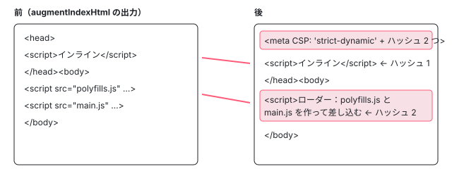

[目次](../README.md) › [@angular/build の compilation と utils の読み残し](README.md) › 第 7 回 / 全 10 回

# 自動 CSP：auto-csp.ts がインラインの script をハッシュとローダーに変える

> utils/index-file/auto-csp.ts の全部：index.html の script を集め、インラインのものに sha256 のハッシュを付け、外部の script を読み込むローダーに置き換え、meta の Content-Security-Policy を足すまで。

angular/angular-cli · 読了 約 11 分 · 発展 · [サイトで読む（デモが動きます）](https://angular-deep-dive-cyan.vercel.app/chapter/bcu-auto-csp)

---

angular.json の `"security": { "autoCsp": true }` は、ビルドした `index.html` に、ハッシュで許可する厳しい CSP（Content-Security-Policy、どの script を実行してよいかをブラウザに伝える決まり）を `<meta>` で書き込みます。この章では、それをする `autoCsp` の全部を読み、**どの script にハッシュを付け、どの script をローダー（script を作って差し込む小さな script）に置き換え、CSP の各指定がどんな防御になるか**を、行で追います。デモでは、本物の `autoCsp` に 10 の `index.html` を当てた出力と CSP を切り替えて見て、その出力を headless Chrome で開いたときに何が動き、何が止められたかの記録も見ます。

読む対象は ../angular-cli（44129f66a3）の `packages/angular/build/src/utils/index-file/auto-csp.ts`（323 行）です。サイトの依存の 22.2.7 では、2 か所（2 節と 7 節）が変わっています。この関数がプラグインの列の最後に入ること、SSR とは一緒に使えないことは [index.html の章](../boot/05-boot-index-html.md)、仕組みの 1 段落の要約は [index.html のプラグインの章](../bmap/03-bmap-index-html.md)の 8 節、`autoCsp: true` が `{ unsafeEval: false }` になる所は [オプションの正規化の章](../abl/01-abl-options.md)にあります。

1. [1. AotCompilation の残り](01-bcu-aot.md)
2. [2. ParallelCompilation](02-bcu-parallel.md)
3. [3. hmr-candidates](03-bcu-hmr.md)
4. [4. AngularHost と遅延ルート](04-bcu-host.md)
5. [5. 予算と出力の表](05-bcu-budget.md)
6. [6. index.html の仕上げ](06-bcu-index.md)
7. **7. 自動 CSP**（この章）
8. [8. オプションの小道具](08-bcu-options.md)
9. [9. パス・URL・ソースマップ](09-bcu-paths.md)
10. [10. spec と issue](10-bcu-tests-issues.md)

## 0. 前と後



*autoCsp の前と後。インラインの script はそのまま残してハッシュを取り、続いて並ぶ外部の script はローダー 1 つにまとめてそのハッシュを取る。*

ハッシュで許可する CSP では、`<meta>` に書いたハッシュと中身が一致するインラインの script だけが実行されます。`src` で読む script は、中身が HTML に無いのでハッシュを書けません。そこで、外部の script を「作って差し込む」インラインのローダーに置き換え、ローダーのハッシュを書き、`'strict-dynamic'` で「許可した script が作った script も許す」とします。

## 1. 先頭：ハッシュの関数と、覚えておく属性

📄 `angular-cli/packages/angular/build/src/utils/index-file/auto-csp.ts` L9–37 （▶ の行: 9–10, 15, 20–26, 35–36）

```ts
 9 ▶ import * as crypto from 'node:crypto';
10 ▶ import { StartTag, htmlRewritingStream } from './html-rewriting-stream';
11 │ 
12 │ /**
13 │  * The hash function to use for hash directives to use in the CSP.
14 │  */
15 ▶ const HASH_FUNCTION = 'sha256';
16 │ 
17 │ /**
18 │  * Store the appropriate attributes of a sourced script tag to generate the loader script.
19 │  */
20 ▶ interface SrcScriptTag {
21 ▶   src: string;
22 ▶   type?: string;
23 ▶   async: boolean;
24 ▶   defer: boolean;
25 ▶   integrity?: string;
26 ▶   crossOrigin?: string;
27 │ }
28 │ 
29 │ /**
30 │  * Get the specified attribute or return undefined if the tag doesn't have that attribute.
31 │  *
32 │  * @param tag StartTag of the <script>
33 │  * @returns
34 │  */
35 ▶ function getScriptAttributeValue(tag: StartTag, attrName: string): string | undefined {
36 ▶   return tag.attrs.find((attr) => attr.name === attrName)?.value;
37 │ }
```

15 行目、ハッシュは SHA-256 です。20〜27 行目の `SrcScriptTag` は、ローダーに置き換える外部の script の 6 つの属性で、8 節でローダーの配列の 1 行になります。35〜37 行目は、最初に見つかった属性の値を返します。`async` のような値の無い属性の値は空文字なので、「あるか」は 115〜116 行目のように `!== undefined` で見ます。

## 2. どの script をローダーに回すか

📄 `angular-cli/packages/angular/build/src/utils/index-file/auto-csp.ts` L39–58 （▶ の行: 46–47, 56–57）

```ts
39 │ /**
40 │  * Checks whether a particular string is a MIME type associated with JavaScript, according to
41 │  * https://developer.mozilla.org/en-US/docs/Web/HTTP/MIME_types#textjavascript
42 │  *
43 │  * @param mimeType a string that may be a MIME type
44 │  * @returns whether the string is a MIME type that is associated with JavaScript
45 │  */
46 ▶ function isJavascriptMimeType(mimeType: string): boolean {
47 ▶   return mimeType.split(';')[0] === 'text/javascript';
48 │ }
49 │ 
50 │ /**
51 │  * Which of the type attributes on the script tag we should try passing along
52 │  * based on https://developer.mozilla.org/en-US/docs/Web/HTML/Element/script/type
53 │  * @param scriptType the `type` attribute on the `<script>` tag under question
54 │  * @returns whether to add the script tag to the dynamically loaded script tag
55 │  */
56 ▶ function shouldDynamicallyLoadScriptTagBasedOnType(scriptType: string | undefined): boolean {
57 ▶   return !scriptType || scriptType === 'module' || isJavascriptMimeType(scriptType);
58 │ }
```

57 行目、`type` が無いか、`module` か、47 行目の JavaScript の MIME 型なら、ローダーに回します。JSON や `text/x-template` のような、ブラウザが実行しない型は回しません（デモの「JSON と ld+json と、JS でない src」）。44129f66a3 の 47 行目は `;` の前が `text/javascript` と完全に同じときだけで、57 行目の `'module'` も大文字と小文字を区別します。22.2.7 では、HTML の仕様の JavaScript の MIME 型 16 個の表と、前後の空白を落として小文字にした比較になりました（22.2.x の e31bd66f67、main では 8e1b20253a）。

> [!WARNING]
> **ハマりどころ**
>
> デモの「type の大文字と application/javascript」は、`type="Module"` と `type="application/javascript"` の 2 つの外部の script です。44129f66a3 では 2 つともローダーに回らずに元のタグのまま残り、CSP にはハッシュが 1 つもありません。headless Chrome で開くと、44129f66a3 の出力では 2 つとも `script-src-elem` の違反で止められ、どちらも実行されませんでした。`'strict-dynamic'` があると、HTML に直接書いた `src` の script は、ハッシュも nonce も無ければ許されないからです。22.2.7 の出力では 2 つともローダーから読まれて動き、違反は 0 件でした。

## 3. ハッシュの作り方

📄 `angular-cli/packages/angular/build/src/utils/index-file/auto-csp.ts` L60–74 （▶ の行: 66, 70–71, 73）

```ts
60 │ /**
61 │  * Calculates a CSP compatible hash of an inline script.
62 │  * @param scriptText Text between opening and closing script tag. Has to
63 │  *     include whitespaces and newlines!
64 │  * @returns The hash of the text formatted appropriately for CSP.
65 │  */
66 ▶ export function hashTextContent(scriptText: string): string {
67 │   // Normalize CRLF to LF to ensure consistent since the rewriter might normalize the line endings.
68 │   const hash = crypto
69 │     .createHash(HASH_FUNCTION)
70 ▶     .update(scriptText.replace(/\r\n?/g, '\n'), 'utf-8')
71 ▶     .digest('base64');
72 │ 
73 ▶   return `'${HASH_FUNCTION}-${hash}'`;
74 │ }
```

70 行目、`\r\n` と単独の `\r` を `\n` にそろえてから、UTF-8 で SHA-256 にかけます（6324133c28）。HTML を書き直す流れ（parse5）が改行を `\n` にそろえて出力するので、ブラウザが見る中身と同じ文字列でハッシュを作るためです。デモの「CRLF の改行のインライン」の出力は `\n` だけになっていて、meta のハッシュと、出力から計算し直したハッシュが一致しました。73 行目、CSP に書くときの形 `'sha256-…'` を、引用符ごと返します。

## 4. 1 回目の読み：script を集め、ローダーを差し込む

📄 `angular-cli/packages/angular/build/src/utils/index-file/auto-csp.ts` L76–100 （▶ の行: 84–85, 87–89, 95–99）

```ts
 76 │ /**
 77 │  * Finds all `<script>` tags and creates a dynamic script loading block for consecutive `<script>` with `src` attributes.
 78 │  * Hashes all scripts, both inline and generated dynamic script loading blocks.
 79 │  * Inserts a `<meta>` tag at the end of the `<head>` of the document with the generated hash-based CSP.
 80 │  *
 81 │  * @param html Markup that should be processed.
 82 │  * @returns The transformed HTML that contains the `<meta>` tag CSP and dynamic loader scripts.
 83 │  */
 84 ▶ export async function autoCsp(html: string, unsafeEval = false): Promise<string> {
 85 ▶   const { rewriter, transformedContent } = await htmlRewritingStream(html);
 86 │ 
 87 ▶   let openedScriptTag: StartTag | undefined = undefined;
 88 ▶   let scriptContent: SrcScriptTag[] = [];
 89 ▶   const hashes: string[] = [];
 90 │ 
 91 │   /**
 92 │    * Generates the dynamic loading script and puts it in the rewriter and adds the hash of the dynamic
 93 │    * loader script to the collection of hashes to add to the <meta> tag CSP.
 94 │    */
 95 ▶   function emitLoaderScript() {
 96 ▶     const loaderScript = createLoaderScript(scriptContent, /* enableTrustedTypes = */ false);
 97 ▶     hashes.push(hashTextContent(loaderScript));
 98 ▶     rewriter.emitRaw(`<script>${loaderScript}</script>`);
 99 ▶     scriptContent = [];
100 │   }
```

87〜89 行目の 3 つが、1 回目の読みの状態です。87 行目は今開いている script のタグ、88 行目はまだ書き出していない外部の script の列、89 行目は CSP に書くハッシュの列です。95〜100 行目の `emitLoaderScript` は、溜めた列から 8 節のローダーを作り、そのハッシュを 97 行目で積み、98 行目でインラインの script として書き出して、99 行目で列を空にします。96 行目、Trusted Types の版のローダーは使いません。

📄 `angular-cli/packages/angular/build/src/utils/index-file/auto-csp.ts` L102–138 （▶ の行: 103–104, 107, 109–112, 115–118, 121, 134–135, 137）

```ts
102 │   rewriter.on('startTag', (tag) => {
103 ▶     if (tag.tagName === 'script') {
104 ▶       openedScriptTag = tag;
105 │       const src = getScriptAttributeValue(tag, 'src');
106 │ 
107 ▶       if (src) {
108 │         // If there are any interesting attributes, note them down.
109 ▶         const scriptType = getScriptAttributeValue(tag, 'type');
110 ▶         if (shouldDynamicallyLoadScriptTagBasedOnType(scriptType)) {
111 ▶           const crossOrigin = getScriptAttributeValue(tag, 'crossorigin');
112 ▶           scriptContent.push({
113 │             src: src,
114 │             type: scriptType,
115 ▶             async: getScriptAttributeValue(tag, 'async') !== undefined,
116 ▶             defer: getScriptAttributeValue(tag, 'defer') !== undefined,
117 ▶             integrity: getScriptAttributeValue(tag, 'integrity'),
118 ▶             crossOrigin: crossOrigin === '' ? 'anonymous' : crossOrigin,
119 │           });
120 │ 
121 ▶           return; // Skip writing my script tag until we've read it all.
122 │         }
123 │       }
124 │     }
125 │     // We are encountering the first start tag that's not <script src="..."> after a string of
126 │     // consecutive <script src="...">. <script> tags without a src attribute will also end a chain
127 │     // of src attributes that can be loaded in a single loader script, so those will end up here.
128 │     //
129 │     // The first place when we can determine this to be the case is
130 │     // during the first opening tag that's not <script src="...">, where we need to insert the
131 │     // dynamic loader script before continuing on with writing the rest of the tags.
132 │     // (One edge case is where there are no more opening tags after the last <script src="..."> is
133 │     // closed, but this case is handled below with the final </body> tag.)
134 ▶     if (scriptContent.length > 0) {
135 ▶       emitLoaderScript();
136 │     }
137 ▶     rewriter.emitStartTag(tag);
138 │   });
```

1. **外部の script なら溜める**

   107〜122 行目。`src` があり、2 節で回すと決まった型なら、6 つの属性を列に積み、121 行目の `return` で開始タグを書きません。117〜118 行目の `integrity` と `crossorigin` は 50994d76e5 で足されたもので、それまでは SRI の値がローダーで落ちていました。`crossorigin=""` は 118 行目で `'anonymous'` にします（空の値は anonymous と同じ）。
2. **ほかの開始タグが来たら、溜めた分を出す**

   134〜136 行目。外部の script の並びが途切れた最初の開始タグの**前**に、ローダーを出します。インラインの script もここで並びを切るので、デモの「外部・インライン・外部」はローダーが 2 つになり、実行の順が元の HTML と同じに保たれます。
3. **タグを書く**

   137 行目。インラインの script も、ほかのタグも、ここでそのまま書きます。

📄 `angular-cli/packages/angular/build/src/utils/index-file/auto-csp.ts` L140–166 （▶ の行: 141–142, 144, 148, 151, 154–155, 159, 161–162, 165）

```ts
140 │   rewriter.on('text', (tag, html) => {
141 ▶     if (openedScriptTag && !getScriptAttributeValue(openedScriptTag, 'src')) {
142 ▶       hashes.push(hashTextContent(html));
143 │     }
144 ▶     rewriter.emitText(tag);
145 │   });
146 │ 
147 │   rewriter.on('endTag', (tag, html) => {
148 ▶     if (openedScriptTag && tag.tagName === 'script') {
149 │       const src = getScriptAttributeValue(openedScriptTag, 'src');
150 │       const scriptType = getScriptAttributeValue(openedScriptTag, 'type');
151 ▶       openedScriptTag = undefined;
152 │       // Return early to avoid writing the closing </script> tag if it's a part of the
153 │       // dynamic loader script.
154 ▶       if (src && shouldDynamicallyLoadScriptTagBasedOnType(scriptType)) {
155 ▶         return;
156 │       }
157 │     }
158 │ 
159 ▶     if (tag.tagName === 'head' || tag.tagName === 'body' || tag.tagName === 'html') {
160 │       // Write the loader script if a string of <script>s were the last opening tag of the document.
161 ▶       if (scriptContent.length > 0) {
162 ▶         emitLoaderScript();
163 │       }
164 │     }
165 ▶     rewriter.emitEndTag(tag);
166 │   });
```

1. **インラインの中身のハッシュ**

   141〜143 行目。開いている script に `src` が無ければ、その中身の文字列のハッシュを積みます。型は見ないので、`application/json` や `importmap` のインラインもハッシュされます（デモの JSON と、10 節の importmap）。
2. **中身はいつも書く**

   144 行目。`src` のある script の中身も、そのまま書き出します。
3. **閉じタグを書かない**

   148〜157 行目。ローダーに回した script は、開始タグと同じく閉じタグも書きません。
4. **最後の並びを出す**

   159〜164 行目。外部の script が `</head>`・`</body>`・`</html>` の直前で終わったときは、閉じタグの前でローダーを出します（210bf4e2b4）。デモの「head の最後に外部の script」は `</head>` の前にローダーが出ています。

> [!NOTE]
> **ポイント**
>
> 144 行目のため、`<script src="a.js">fallback <b>text</b></script>` のように外部の script の中に文字を書くと、ローダーに回った script のタグだけが消え、中の文字は `<body>` の HTML として残りました（22.2.7 の autoCsp に、この 1 行の HTML を当てて確かめました）。ブラウザは `src` のある script の中身を実行も表示もしないので、元の HTML とは見え方が変わります。

## 5. 2 回目の読み：&lt;head&gt; の直後に meta

📄 `angular-cli/packages/angular/build/src/utils/index-file/auto-csp.ts` L168–187 （▶ の行: 168, 171, 173–174, 176–180, 186）

```ts
168 ▶   const rewritten = await transformedContent();
169 │ 
170 │   // Second pass to add the header
171 ▶   const secondPass = await htmlRewritingStream(rewritten);
172 │   secondPass.rewriter.on('startTag', (tag, _) => {
173 ▶     secondPass.rewriter.emitStartTag(tag);
174 ▶     if (tag.tagName === 'head') {
175 │       // See what hashes we came up with!
176 ▶       secondPass.rewriter.emitRaw(
177 ▶         `<meta http-equiv="Content-Security-Policy" content="${getStrictCsp(hashes, {
178 ▶           enableBrowserFallbacks: true,
179 ▶           enableTrustedTypes: false,
180 ▶           enableUnsafeEval: unsafeEval,
181 │         })}">`,
182 │       );
183 │     }
184 │   });
185 │ 
186 ▶   return secondPass.transformedContent();
187 │ }
```

ハッシュは 1 回目を最後まで読まないとそろわないので、171 行目で出力をもう 1 回読みます。174〜183 行目、`<head>` の開始タグの**直後**に meta を出します。meta の CSP は、それより後に出てくる要素にだけ効くので、どの script よりも前に置きます。178〜180 行目の 3 つが 6 節の `getStrictCsp` の設定で、変えられるのは `unsafeEval` だけです。

> [!WARNING]
> **ハマりどころ**
>
> `<head>` の開始タグが HTML に無いと、174 行目に来ないので meta はどこにも出ず、エラーも警告もありません。デモの「&lt;head&gt; が無い HTML」は、インラインの script がそのまま残り、CSP が null でした。

## 6. getStrictCsp：各指定がする防御

📄 `angular-cli/packages/angular/build/src/utils/index-file/auto-csp.ts` L189–227 （▶ の行: 191–193, 217, 220, 222, 226）

```ts
189 │ /**
190 │  * Returns a strict Content Security Policy for mitigating XSS.
191 ▶  * For more details read csp.withgoogle.com.
192 ▶  * If you modify this CSP, make sure it has not become trivially bypassable by
193 ▶  * checking the policy using csp-evaluator.withgoogle.com.
194 │  *
195 │  * @param hashes A list of sha-256 hashes of trusted inline scripts.
196 │  * @param enableTrustedTypes If Trusted Types should be enabled for scripts.
197 │  * @param enableBrowserFallbacks If fallbacks for older browsers should be
198 │  *   added. This is will not weaken the policy as modern browsers will ignore
199 │  *   the fallbacks.
200 │  * @param enableUnsafeEval If you cannot remove all uses of eval(), you can
201 │  *   still set a strict CSP, but you will have to use the 'unsafe-eval'
202 │  *   keyword which will make your policy slightly less secure.
203 │  */
204 │ function getStrictCsp(
205 │   hashes?: string[],
206 │   // default CSP options
207 │   cspOptions: {
208 │     enableBrowserFallbacks?: boolean;
209 │     enableTrustedTypes?: boolean;
210 │     enableUnsafeEval?: boolean;
211 │   } = {
212 │     enableBrowserFallbacks: true,
213 │     enableTrustedTypes: false,
214 │     enableUnsafeEval: false,
215 │   },
216 │ ): string {
217 ▶   hashes = hashes || [];
218 │   const strictCspTemplate: Record<string, string[]> = {
219 │     // 'strict-dynamic' allows hashed scripts to create new scripts.
220 ▶     'script-src': [`'strict-dynamic'`, ...hashes],
221 │     // Restricts `object-src` to disable dangerous plugins like Flash.
222 ▶     'object-src': [`'none'`],
223 │     // Restricts `base-uri` to block the injection of `<base>` tags. This
224 │     // prevents attackers from changing the locations of scripts loaded from
225 │     // relative URLs.
226 ▶     'base-uri': [`'self'`],
227 │   };
```

📄 `angular-cli/packages/angular/build/src/utils/index-file/auto-csp.ts` L228–259 （▶ の行: 232, 235, 237–238, 244–245, 250–251, 254, 256, 258）

```ts
228 │ 
229 │   // Adds fallbacks for browsers not compatible to CSP3 and CSP2.
230 │   // These fallbacks are ignored by modern browsers in presence of hashes,
231 │   // and 'strict-dynamic'.
232 ▶   if (cspOptions.enableBrowserFallbacks) {
233 │     // Fallback for Safari. All modern browsers supporting strict-dynamic will
234 │     // ignore the 'https:' fallback.
235 ▶     strictCspTemplate['script-src'].push('https:');
236 │     // 'unsafe-inline' is only ignored in presence of a hash or nonce.
237 ▶     if (hashes.length > 0) {
238 ▶       strictCspTemplate['script-src'].push(`'unsafe-inline'`);
239 │     }
240 │   }
241 │ 
242 │   // If enabled, dangerous DOM sinks will only accept typed objects instead of
243 │   // strings.
244 ▶   if (cspOptions.enableTrustedTypes) {
245 ▶     strictCspTemplate['require-trusted-types-for'] = ['script'];
246 │   }
247 │ 
248 │   // If enabled, `eval()`-calls will be allowed, making the policy slightly
249 │   // less secure.
250 ▶   if (cspOptions.enableUnsafeEval) {
251 ▶     strictCspTemplate['script-src'].push(`'unsafe-eval'`);
252 │   }
253 │ 
254 ▶   return Object.entries(strictCspTemplate)
255 │     .map(([directive, values]) => {
256 ▶       return `${directive} ${values.join(' ')};`;
257 │     })
258 ▶     .join('');
259 │ }
```

| 指定 | 行 | 何を防ぐか |
| --- | --- | --- |
| `script-src 'strict-dynamic' 'sha256-…'` | 220 | ハッシュが一致するインラインの script だけを実行し、その script が作った script にだけ信頼を渡す。HTML に紛れ込んだ `<script>` や `<script src>` は実行されない |
| `object-src 'none'` | 222 | `<object>` や `<embed>` のプラグインを読まない（221 行目のコメント） |
| `base-uri 'self'` | 226 | 別のオリジンを指す `<base>` を差し込まれて、相対の URL の script の読み先を変えられるのを防ぐ（223〜225 行目のコメント） |
| `https:`・`'unsafe-inline'` | 235・238 | 古いブラウザ向けの逃げ道。229〜231 行目のコメントのとおり、`'strict-dynamic'` とハッシュを知っているブラウザは無視する。`'unsafe-inline'` はハッシュが 1 つ以上あるときだけ足す（237 行目） |
| `'unsafe-eval'` | 251 | `unsafeEval: true` のときだけ。`eval()` を許すので、防御は弱くなる（248〜249 行目のコメント） |

254〜258 行目、各指定を `指定 値 値;` の形にして、間に空白を入れずにつなげます。244〜246 行目の Trusted Types の指定は、5 節の 179 行目でいつも偽なので、出ません。191〜193 行目のコメントのとおり、この形は csp.withgoogle.com の「厳しい CSP」に合わせてあり、変えるときは csp-evaluator で弱くなっていないかを確かめる、と書いてあります。

headless Chrome の記録では、`onclick` 属性のボタンを押すと `script-src-attr inline` の違反が 1 件報告され、ハンドラーは動きませんでした。`script-src-attr`（属性に書いたイベントハンドラーの許可）には別の指定が無いので `script-src` が使われ、ハッシュがあるときの `'unsafe-inline'` は無視されるからです。Angular のテンプレートの `(click)` は `addEventListener` で付くので、この指定に当たりません。

## 7. ローダーの配列：値を文字列の外に出さない

📄 `angular-cli/packages/angular/build/src/utils/index-file/auto-csp.ts` L261–283 （▶ の行: 266–267, 272, 274–278, 280, 282）

```ts
261 │ /**
262 │  * Returns JS code for dynamically loading sourced (external) scripts.
263 │  * @param srcList A list of paths for scripts that should be loaded.
264 │  */
265 │ function createLoaderScript(srcList: SrcScriptTag[], enableTrustedTypes = false): string {
266 ▶   if (!srcList.length) {
267 ▶     throw new Error('Cannot create a loader script with no scripts to load.');
268 │   }
269 │   const srcListFormatted = srcList
270 │     .map((s) => {
271 │       // URI encoding means value can't escape string, JS, or HTML context.
272 ▶       const srcAttr = encodeURI(s.src).replaceAll("'", "\\'");
273 │       // Can only be 'module' or a JS MIME type or an empty string.
274 ▶       const typeAttr = s.type ? "'" + s.type + "'" : "''";
275 ▶       const asyncAttr = !!s.async;
276 ▶       const deferAttr = !!s.defer;
277 ▶       const integrityAttr = JSON.stringify(s.integrity ?? null).replaceAll('<', '\\u003c');
278 ▶       const crossOriginAttr = JSON.stringify(s.crossOrigin ?? null).replaceAll('<', '\\u003c');
279 │ 
280 ▶       return `['${srcAttr}', ${typeAttr}, ${asyncAttr}, ${deferAttr}, ${integrityAttr}, ${crossOriginAttr}]`;
281 │     })
282 ▶     .join();
283 │ 
```

ローダーは JavaScript のコードを文字列で組み立てるので、HTML から取った属性の値が、引用符の外（コードの側）に出ないようにする必要があります。272 行目、`src` は `encodeURI` で URL の符号にしてから `'` を逃がします（271 行目のコメント）。277〜278 行目、`integrity` と `crossOrigin` は `JSON.stringify` で JavaScript の文字列にし、`<` を `\u003c` にして `</script>` の並びを作らせません。44129f66a3 の 274 行目だけは、`type` の値を `'` で囲むだけです。273 行目のコメントは「module か JS の MIME 型か空文字」としていますが、47 行目は `;` の後ろを見ません。22.2.7 では、この行も `JSON.stringify` と `\u003c` に揃えられました（22.2.x の c1b5154180、main では 07e608dd27）。デモの「外部の script 4 つ」で 22.2.7 と 44129f66a3 のハッシュが違うのは、この行で引用符が `"` になったためです。

## 8. ローダーの本体

📄 `angular-cli/packages/angular/build/src/utils/index-file/auto-csp.ts` L306–323 （▶ の行: 307, 309–315, 317–318, 320）

```ts
306 │     : `(() => {
307 ▶   const scripts = [${srcListFormatted}];
308 │   scripts.forEach(function(scriptUrl) {
309 ▶     const s = document.createElement('script');
310 ▶     s.src = scriptUrl[0];
311 ▶     s.type = scriptUrl[1];
312 ▶     s.async = scriptUrl[2];
313 ▶     s.defer = scriptUrl[3];
314 ▶     if (scriptUrl[4]) {
315 ▶       s.integrity = scriptUrl[4];
316 │     }
317 ▶     if (scriptUrl[5]) {
318 ▶       s.crossOrigin = scriptUrl[5];
319 │     }
320 ▶     document.lastElementChild.appendChild(s);
321 │   });
322 │ })();\n`;
323 │ }
```

1. **script を作る**

   309〜313 行目。`createElement` で作った script は、既定では `async` が真で、読み終わった順に実行されます。312 行目で元の HTML の `async` の有無を入れ直すので、`async` の無いものは差し込んだ順に実行されます。
2. **SRI を引き継ぐ**

   314〜319 行目、値があるときだけ `integrity` と `crossOrigin` を付けます（デモの「integrity と crossorigin=""」）。
3. **差し込む先**

   320 行目の `document.lastElementChild` は文書のいちばん外の要素、つまり `<html>` です。`<head>` の中で動くときは `document.body` がまだ無いので、こちらにしてあります（210bf4e2b4）。Chrome の記録でも、4 つの script は `<body>` の後ろの `<html>` の子になっていました。

📄 `angular-cli/packages/angular/build/src/utils/index-file/auto-csp.ts` L284–305 （▶ の行: 284, 287–289, 293）

```ts
284 ▶   return enableTrustedTypes
285 │     ? `(() => {
286 │   const scripts = [${srcListFormatted}];
287 ▶   const policy = self.trustedTypes && self.trustedTypes.createPolicy ?
288 ▶     self.trustedTypes.createPolicy('angular#auto-csp', {createScriptURL: function(u) {
289 ▶       return scripts.some(function(s) { return s[0] === u; }) ? u : null;
290 │     }}) : { createScriptURL: function(u) { return u; } };
291 │   scripts.forEach(function(scriptUrl) {
292 │     const s = document.createElement('script');
293 ▶     s.src = policy.createScriptURL(scriptUrl[0]);
294 │     s.type = scriptUrl[1];
295 │     s.async = scriptUrl[2];
296 │     s.defer = scriptUrl[3];
297 │     if (scriptUrl[4]) {
298 │       s.integrity = scriptUrl[4];
299 │     }
300 │     if (scriptUrl[5]) {
301 │       s.crossOrigin = scriptUrl[5];
302 │     }
303 │     document.lastElementChild.appendChild(s);
304 │   });
305 │ })();\n`
```

284〜305 行目は Trusted Types（危険な DOM の書き込み口に、決めた関数を通した値しか渡せなくする仕組み）の版です。288〜289 行目の方針は、配列にある URL だけを通します。96 行目がいつも `false` を渡すので、今のビルドではこちらは出ません。

## 9. デモ：本物の autoCsp に index.html を当てる

> **🧪 DEMO — autoCsp の入力と出力（記録、@angular/build 22.2.7 と 44129f66a3）**
>
> ▶ [このデモはサイトで動かせます](https://angular-deep-dive-cyan.vercel.app/chapter/bcu-auto-csp)

「インラインの script 1 つ」には `unsafeEval` の版もあり、`script-src` の最後に `'unsafe-eval'` が付きます。「onclick と javascript: の href」はインラインの script が無いのでハッシュが 0 個で、237 行目により `'unsafe-inline'` も付きません。

## 10. IndexHtmlGenerator を通したときと、ブラウザでの記録

`IndexHtmlGenerator` に `sri: true`・遅延チャンク 1 つ・`autoCsp` を渡すと、augment の出力に autoCsp が最後にかかり、CSP のハッシュは 2 つでした。1 つは [前の章](06-bcu-index.md)の importmap、1 つは `main.js` のローダーです。ローダーの配列に `sha384-…` と `"anonymous"` が引き継がれています。

| CSP の指定 | `script-src 'strict-dynamic' 'sha256-K5BfzenUiGmH6di8RLxJu0q0eO8o1xdp7HkJNpafz3I=' 'sha256-pUF69Er03t1OSxhnhctKWDlQWmWlmN3Nb4vgRnGrix0=' https: 'unsafe-inline';`<br>`object-src 'none';`<br>`base-uri 'self';` |
| --- | --- |

📄 `IndexHtmlGenerator の csrContent（記録）`

```
<!doctype html>
<html>
<head><meta http-equiv="Content-Security-Policy" content="script-src 'strict-dynamic' 'sha256-K5BfzenUiGmH6di8RLxJu0q0eO8o1xdp7HkJNpafz3I=' 'sha256-pUF69Er03t1OSxhnhctKWDlQWmWlmN3Nb4vgRnGrix0=' https: 'unsafe-inline';object-src 'none';base-uri 'self';">
<title>CSP</title>
<script type="importmap">{"integrity":{"./chunk-L.js":"sha384-LLL"}}</script><base href="/">
</head>
<body>
<app-root></app-root>
<script>(() => {
  const scripts = [['main.js', "module", false, false, "sha384-JawyHuhqEMFMvdtX+VHylbI0hfJp2F7nvwFVRqqfuOoK5oW7TG/7V11Zs7zeFWIE", "anonymous"]];
  scripts.forEach(function(scriptUrl) {
    const s = document.createElement('script');
    s.src = scriptUrl[0];
    s.type = scriptUrl[1];
    s.async = scriptUrl[2];
    s.defer = scriptUrl[3];
    if (scriptUrl[4]) {
      s.integrity = scriptUrl[4];
    }
    if (scriptUrl[5]) {
      s.crossOrigin = scriptUrl[5];
    }
    document.lastElementChild.appendChild(s);
  });
})();
</script></body>
</html>

```

次は、22.2.7 の autoCsp の出力を 127.0.0.1 で配り、headless Chrome（Chrome/157.0.8103.79）で開いて、各 script が `window.log` に書いた順と、`securitypolicyviolation` のイベントを集めた記録です。違反を集めるコードは、ページの中ではなく CDP から差し込みました（ページの中に足すと、そのコード自体が CSP で止まるためです）。

| 実行の順 | `inline`<br>`one parent=HTML`<br>`two parent=HTML`<br>`three parent=undefined`<br>`four parent=HTML`<br>`lazy parent=undefined`<br>`import() done` |
| --- | --- |
| 違反（ボタンを押したあと） | `script-src-attr inline` |
| &lt;html&gt; の子 | `HEAD`<br>`BODY`<br>`SCRIPT /one.js`<br>`SCRIPT /two.js`<br>`SCRIPT /three.js`<br>`SCRIPT /four.js` |

📄 `開いたページの元の HTML`

```
<!doctype html>
<html>
<head>
<title>CSP</title>
</head>
<body>
<button id="b" onclick="window.log.push('onclick')">x</button>
<script>window.log = ['inline'];</script>
<script src="one.js"></script>
<script src="two.js" async></script>
<script src="three.js" type="module"></script>
<script src="four.js"></script>
</body>
</html>

```

インラインの script が最初に動き、4 つの外部の script はローダーから差し込まれて動きました。module の three.js が `import()` で読んだ lazy.js も、違反なく動いています（遅延チャンクと同じ読み方です）。`parent=undefined` は module の script で、module では `document.currentScript` が `null` だからです。

## 11. どう録ったか

スクリプトは `<scratchpad>/bcu-demo/b/` に置き、Node v24.22.1 で、サイトの node\_modules の @angular/build 22.2.7 の `auto-csp.js` を require しました。44129f66a3 は、../angular-cli の `auto-csp.ts` を読み、esbuild の `transformSync` で .js にして、`html-rewriting-stream` だけ 22.2.7 の物を指すように書き換えて使いました（このファイルは 2 つの版で同じです）。ブラウザの記録は、手元の 127.0.0.1 のサーバーと headless Chrome の CDP です。外部には取りに行きません。

📄 `記録のスクリプト（rec-csp.mjs）`

```
// 本物の autoCsp（サイトの node_modules の @angular/build 22.2.7）と、比べるために 44129f66a3 の auto-csp.ts を
// esbuild で .js にした物に、いくつかの index.html を当てて、出力の HTML・meta の CSP・ハッシュを記録する。
// 最後に、22.2.7 の出力を手元の 127.0.0.1 で配り、headless Chrome で script が動いた順と CSP の違反の報告を記録する。
// 使い方: node rec-csp.mjs <サイトのディレクトリ> <angular-cli のディレクトリ（読むだけ）> <出力 JSON>
import { createRequire } from 'node:module';
import { createServer } from 'node:http';
import { spawn } from 'node:child_process';
import { mkdirSync, readFileSync, rmSync, writeFileSync } from 'node:fs';
import { createHash } from 'node:crypto';
import path from 'node:path';

const [site, cli, out] = process.argv.slice(2);
const here = path.dirname(new URL(import.meta.url).pathname);
const tmp = path.join(here, '.csp-tmp');
const require = createRequire(path.join(site, 'package.json'));
const B = path.join(site, 'node_modules/@angular/build/src/utils/index-file');
const esbuild = require('esbuild');

// 44129f66a3 の auto-csp.ts を .js にする（html-rewriting-stream は 22.2.7 の物を使う。2 つの版でこのファイルは同じ）
rmSync(tmp, { recursive: true, force: true });
mkdirSync(tmp, { recursive: true });
const src44 = readFileSync(path.join(cli, 'packages/angular/build/src/utils/index-file/auto-csp.ts'), 'utf8');
const js44 = esbuild.transformSync(src44, { loader: 'ts', format: 'cjs', platform: 'node' }).code
  .replace("require(\"./html-rewriting-stream\")", JSON.stringify(path.join(B, 'html-rewriting-stream.js')).replace(/^/, 'require(') + ')');
writeFileSync(path.join(tmp, 'auto-csp-44129f66a3.js'), js44);
const V = {
  '22.2.7': require(path.join(B, 'auto-csp.js')),
  '44129f66a3': require(path.join(tmp, 'auto-csp-44129f66a3.js')),
};

const page = (head, body) => `<!doctype html>\n<html>\n<head>\n<title>CSP</title>\n${head}</head>\n<body>\n${body}\n</body>\n</html>\n`;
const inputs = [
  { id: 'inline', label: 'インラインの script 1 つ', html: page('', '<script>console.log("inline");</script>') },
  { id: 'chain', label: '外部の script 4 つ（続けて）', html: page('', '<script src="a.js"></script>\n<script src="b.js" type="module"></script>\n<script src="c.js" async></script>\n<script src="d.js" defer></script>') },
  { id: 'split', label: '外部・インライン・外部', html: page('', '<script src="a.js"></script>\n<script>window.mid = 1;</script>\n<script src="b.js"></script>') },
  { id: 'head', label: 'head の最後に外部の script', html: page('<script src="early.js"></script>\n', '<app-root></app-root>') },
  { id: 'data', label: 'JSON と ld+json と、JS でない src', html: page('<script type="application/json" id="cfg">{"a":1}</script>\n<script type="application/ld+json">{"@type":"Thing"}</script>\n', '<script type="text/x-template" src="tpl.html"></script>') },
  { id: 'attrs', label: 'onclick と javascript: の href', html: page('', '<button onclick="alert(1)">x</button>\n<a href="javascript:void(0)">y</a>') },
  { id: 'sri', label: 'integrity と crossorigin=""', html: page('', '<script src="main.js" type="module" integrity="sha384-abc" crossorigin=""></script>') },
  { id: 'types', label: "type の大文字と application/javascript", html: page('', '<script src="m.js" type="Module"></script>\n<script src="l.js" type="application/javascript"></script>') },
  { id: 'crlf', label: 'CRLF の改行のインライン', html: page('', '<script>\r\nwindow.x = 1;\r\n</script>') },
  { id: 'nohead', label: '<head> が無い HTML', html: '<div>partial</div>\n<script>window.p = 1;</script>\n' },
];
const pickMeta = (h) => (h.match(/<meta http-equiv="Content-Security-Policy" content="([^"]*)">/) ?? [])[1] ?? null;
const rows = [];
for (const inp of inputs) {
  const byVer = {};
  for (const [ver, mod] of Object.entries(V)) {
    for (const unsafeEval of inp.id === 'inline' ? [false, true] : [false]) {
      const html = await mod.autoCsp(inp.html, unsafeEval);
      byVer[ver + (unsafeEval ? ' unsafeEval' : '')] = { html, csp: pickMeta(html) };
    }
  }
  rows.push({ ...inp, out: byVer });
}

// hashTextContent が meta のハッシュと同じになるかを、出力の中のインライン script から計算し直して確かめる
for (const r of rows) {
  const o = r.out['22.2.7'];
  const inl = [...o.html.matchAll(/<script(?![^>]*\bsrc=)[^>]*>([\s\S]*?)<\/script>/g)].map((m) => m[1]);
  o.recomputed = inl.map((t) => `'sha256-${createHash('sha256').update(t.replace(/\r\n?/g, '\n')).digest('base64')}'`);
}

// IndexHtmlGenerator で、sri + 遅延チャンク + autoCsp を通したとき（importmap もハッシュされるか）
const { IndexHtmlGenerator } = require(path.join(B, 'index-html-generator.js'));
mkdirSync(path.join(tmp, 'dist'), { recursive: true });
writeFileSync(path.join(tmp, 'index.html'), page('<base href="/">\n', '<app-root></app-root>'));
writeFileSync(path.join(tmp, 'dist/main.js'), 'console.log(1);');
const gen = new IndexHtmlGenerator({
  indexPath: path.join(tmp, 'index.html'), outputPath: path.join(tmp, 'dist'), entrypoints: [['main', true]], sri: true,
  autoCsp: { unsafeEval: false }, chunksIntegrity: new Map([['chunk-L.js', 'sha384-LLL']]),
});
const g = await gen.process({ lang: undefined, baseHref: undefined, files: [{ file: 'main.js', name: 'main', extension: '.js' }] });
const generator = { html: g.csrContent, csp: pickMeta(g.csrContent) };

// headless Chrome で動かす: 22.2.7 の出力を配り、実行の順と CSP の違反を記録する
const browserInput = page('', '<button id="b" onclick="window.log.push(\'onclick\')">x</button>\n<script>window.log = [\'inline\'];</script>\n<script src="one.js"></script>\n<script src="two.js" async></script>\n<script src="three.js" type="module"></script>\n<script src="four.js"></script>');
const browserHtml = await V['22.2.7'].autoCsp(browserInput, false);
const server = createServer((req, res) => {
  const name = req.url.replace(/^\//, '').replace(/\.js$/, '');
  if (req.url.endsWith('.js')) {
    res.writeHead(200, { 'content-type': 'text/javascript' });
    // three.js（module）は、遅延チャンクのように import() で lazy.js を読む
    const extra = name === 'three' ? ` import('./lazy.js').then(() => window.log.push('import() done'), (e) => window.log.push('import() failed ' + e.message));` : '';
    res.end(`window.log.push(${JSON.stringify(name)} + ' parent=' + document.currentScript?.parentElement?.tagName);${extra}`);
  } else {
    res.writeHead(200, { 'content-type': 'text/html' });
    // /types は「type の大文字と application/javascript」の 2 つの版の出力
    const t = rows.find((r) => r.id === 'types').out;
    res.end(req.url === '/types-22' ? t['22.2.7'].html : req.url === '/types-44' ? t['44129f66a3'].html : browserHtml);
  }
});
await new Promise((r) => server.listen(0, '127.0.0.1', r));
const profile = path.join(tmp, 'chrome');
const chrome = spawn('/Applications/Google Chrome.app/Contents/MacOS/Google Chrome', ['--headless=new', '--remote-debugging-port=9352', '--user-data-dir=' + profile, '--no-first-run', 'about:blank'], { stdio: 'ignore' });
await new Promise((r) => setTimeout(r, 3000));
const version = await (await fetch('http://127.0.0.1:9352/json/version')).json();
const ws = new WebSocket(version.webSocketDebuggerUrl);
await new Promise((r) => ws.addEventListener('open', r, { once: true }));
let id = 0;
const pending = new Map();
ws.addEventListener('message', (e) => { const m = JSON.parse(e.data); if (m.id && pending.has(m.id)) { pending.get(m.id)(m); pending.delete(m.id); } });
const send = (method, params = {}, sessionId) => new Promise((r) => { const i = ++id; pending.set(i, r); ws.send(JSON.stringify({ id: i, method, params, sessionId })); });
const { result } = await send('Target.createTarget', { url: 'about:blank' });
const { result: att } = await send('Target.attachToTarget', { targetId: result.targetId, flatten: true });
const s = att.sessionId;
await send('Page.enable', {}, s);
// 違反の報告を集める listener は、CSP の外の CDP から差し込む（ページの中に script を足すと、それ自体が止められるため）
await send('Page.addScriptToEvaluateOnNewDocument', { source: 'window.log = []; window.violations = []; document.addEventListener("securitypolicyviolation", (e) => window.violations.push(e.violatedDirective + " " + e.blockedURI));' }, s);
await send('Page.navigate', { url: `http://127.0.0.1:${server.address().port}/` }, s);
await new Promise((r) => setTimeout(r, 1500));
const ev = async (expression) => (await send('Runtime.evaluate', { expression, returnByValue: true }, s)).result.result.value;
await ev('document.getElementById("b").click()');
await new Promise((r) => setTimeout(r, 300));
const browser = {
  chrome: version.Browser,
  input: browserInput,
  log: await ev('window.log'),
  violations: await ev('window.violations'),
  lastChildren: await ev('[...document.documentElement.children].map((e) => e.tagName + (e.src ? " " + new URL(e.src).pathname : ""))'),
};
browser.types = {};
for (const ver of ['22', '44']) {
  await send('Page.navigate', { url: `http://127.0.0.1:${server.address().port}/types-${ver}` }, s);
  await new Promise((r) => setTimeout(r, 1500));
  browser.types[ver === '22' ? '22.2.7' : '44129f66a3'] = { log: await ev('window.log'), violations: await ev('window.violations') };
}
await send('Target.closeTarget', { targetId: result.targetId });
ws.close();
chrome.kill();
server.close();
await new Promise((r) => setTimeout(r, 500));
rmSync(tmp, { recursive: true, force: true });

writeFileSync(out, JSON.stringify({ version: require(path.join(site, 'node_modules/@angular/build/package.json')).version, node: process.version, rows, generator, browser }, null, 1).replace(/127\.0\.0\.1:\d+/g, '127.0.0.1:<port>'));
console.log(rows.length, browser);

```

## ここまでの呼び出し

- `IndexHtmlGenerator.process()` — index-html-generator.ts 112 — *CSR の列の最後*
  - `autoCspPlugin(unsafeEval)` → `autoCsp(html, unsafeEval)` — 228 → auto-csp.ts 84
    - `htmlRewritingStream(html)` — 85 — *1 回目*
      - `on('startTag')` — 102 — *外部の script を溜める / 並びが切れたら emitLoaderScript*
        - `createLoaderScript(scriptContent, false)` → `hashTextContent` — 265 → 66
      - `on('text')` — 140 — *インラインの中身をハッシュ*
      - `on('endTag')` — 147 — *&lt;/head&gt;・&lt;/body&gt;・&lt;/html&gt; で残りを出す*
    - `htmlRewritingStream(rewritten)` — 171 — *2 回目*
      - `getStrictCsp(hashes, …)` — 204 — *&lt;head&gt; の直後に meta*

## テストと直し方

| spec | it と行 | この章のどこ |
| --- | --- | --- |
| utils/index-file/auto-csp\_spec.ts（describe auto-csp、27 行目） | インライン 1 つ（28 行目）、外部 1 つ（46 行目）、その場で置き換え（64 行目）、属性つきの複数（85 行目）、変わった URL（114 行目） | 4・7 節 |
| 全部の script（143 行目）、head に足すローダー（180 行目） | 4 節の 159〜164 行目 |   |
| CRLF（206 行目） | 3 節 |   |
| integrity と crossorigin（225・245 行目）、空の crossorigin（265 行目） | 4 節の 117〜118 行目、8 節 |   |
| （無い）`<head>` が無い HTML、`unsafeEval`、外部の script の中の文字、type の大文字 | 5・6・4・2 節（type の it は v22.2.7 の spec の 285〜374 行目に足されています） |   |
| builders/application/tests/options/subresource-integrity\_spec.ts | it preserves integrity and crossorigin in autoCsp loader when autoCsp is also enabled（242 行目、50994d76e5） | 10 節 |

auto-csp\_spec.ts の 11 件は、[前の章](06-bcu-index.md)の bazel の 1 回（`//packages/angular/build:test`、filter に `auto-csp` を含む 101 件、0 failures）の中で通りました。5 節の `<head>` が無いときを固めるなら、auto-csp\_spec.ts に `<div></div><script>x</script>` だけの HTML を渡して、結果に何を期待するか（meta を足すか、エラーにするか）を決める it が要ります。直すなら auto-csp.ts の 2 回目の読み（172〜184 行目）で、`<head>` を見なかったときの扱いを足します。

## 聞かれそうな質問

**Q. autoCsp を有効にしたら、index.html の script が全部インラインの script に変わりました。**

外部の script にはハッシュを書けないので、107〜121 行目で外部の script を溜め、134〜136 行目か 159〜164 行目で、それらを作って差し込むローダーに置き換えるからです。ローダーのハッシュを CSP に書き、`'strict-dynamic'`（220 行目）で、ローダーが作った script も許されます。

**Q. 遅延ルートのチャンクは CSP で止まりませんか？**

止まりません。遅延チャンクは、ローダーが差し込んだ main.js などが `import()` で読むので、`'strict-dynamic'` により、信頼された script が読んだものとして許されます。10 節の Chrome の記録でも、ローダーが差し込んだ module の script（three.js）が `import('./lazy.js')` で読んだ lazy.js が、違反なく動きました。

**Q. テンプレートに書いた (click) は止まらず、index.html の onclick だけが止まるのはなぜですか？**

`onclick` の属性は `script-src-attr` の対象で、ハッシュがあると `'unsafe-inline'` は無視されるからです（Chrome の記録で `script-src-attr inline` の違反）。Angular の `(click)` は `addEventListener` で付くので、CSP の対象外です。

**Q. 'unsafe-inline' や https: が入っていて、弱くないですか？**

229〜231 行目のコメントのとおり、`'strict-dynamic'` とハッシュを知っているブラウザでは、どちらも無視されます。古いブラウザで何も動かなくなるのを避けるための逃げ道で、`'unsafe-inline'` はハッシュがあるときだけ足します（237 行目）。

**Q. SSR と一緒に使えないのはなぜですか？**

このハッシュは、ビルドのときの `index.html` の中身から作るからです。SSR はリクエストのたびに HTML を作るので、IndexHtmlGenerator のコンストラクタで、2 つを同時に指定するとエラーにしています（[index.html の章](../boot/05-boot-index-html.md)、105〜107 行目）。

## 読み終えて

- インラインの script は中身を SHA-256 にして CSP に書く。改行は `\n` にそろえてからハッシュする。
- 外部の script は、続いて並ぶものを 1 つのローダーにまとめ、ローダーのハッシュと `'strict-dynamic'` で許可する。async の有無と integrity・crossorigin を引き継ぐ。
- meta は `<head>` の開始タグの直後。`<head>` が無いと出ない。
- CSP は `script-src`・`object-src 'none'`・`base-uri 'self'` の 3 つ。`https:` と `'unsafe-inline'` は古いブラウザ向けの逃げ道。
- 44129f66a3 から 22.2.7 で、JS の MIME 型の判定が広がり、ローダーの `type` も符号化されるようになった。

---

← 前: [index.html の仕上げ：augment-index-html・IndexHtmlGenerator・inline-fonts の残り](06-bcu-index.md)  
次: [オプションの小道具：environment-options・i18n-options・normalize-\*・postcss・proxy](08-bcu-options.md) →
