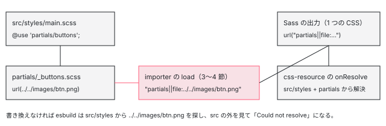

[目次](../README.md) › [@angular/build の読み残し（sass・i18n・dev-server・unit-test）](README.md) › 第 1 回 / 全 9 回

# sass の url を書き換える：lexer と rebasing-importer

> packages/angular/build/src/tools/sass/lexer.ts・rebasing-importer.ts：url( を探す小さな lexer（@import / @use は拾わない。前の 1 文字が空白・, ・: のときだけ）、部分ファイルの相対 url を「フォルダ||file:値」に書き換える load、部分ファイルの名前の補い方とフォルダの表、パッケージとロードパスの importer、書き換えが壊れる 4 つの書き方。

angular/angular-cli · 読了 約 13 分 · 発展 · [サイトで読む（デモが動きます）](https://angular-deep-dive-cyan.vercel.app/chapter/bld-sass-rebase)

---

この章で分かること：Sass の部分ファイル（`_buttons.scss` のような、ほかのファイルから `@use` される側）に書いた相対の `url()` が、なぜそのまま出力に残ると壊れるのか。angular の Sass の importer が部分ファイルを読むたびに、小さな lexer（字句を切り出す読み手）で `url()` を探し、どの値を「部分ファイルのフォルダ`||file:`元の値」に書き換えるか。そして、部分ファイルのファイル名（`_`・拡張子・`index`・`.import`）を、どの順で、どんな表を使って探すか。

読む対象は angular-cli（44129f66a3）の `packages/angular/build/src/tools/sass/lexer.ts` と `rebasing-importer.ts` の全部です。書き換えた値を esbuild の側で割って正しいフォルダから解決する `css-resource-plugin.ts` の 43 行目は [cli-component-styles の章](../cli/04-cli-component-styles.md)の 7 節で、Sass のコンパイラを用意して importer を渡す `sass-language.ts` は [esb-styles の章](../esb/05-esb-styles.md)の 5 節で読んだので繰り返しません。importer を組み立てる `SassCompiler` は次の回です。

1. **1. sass の url を書き換える**（この章）
2. [2. sass を常駐のコンパイラで動かす](02-bld-sass-service.md)
3. [3. メッセージを取り出す](03-bld-extract-i18n.md)
4. [4. 翻訳を差し込む](04-bld-i18n-inline.md)
5. [5. チャンクを束ね直す](05-bld-chunk-optimizer.md)
6. [6. ng serve の入口の残り](06-bld-dev-server-rest.md)
7. [7. Vite の middleware の残り](07-bld-vite-middlewares.md)
8. [8. unit-test と ng-packagr](08-bld-unit-test-packagr.md)
9. [9. spec と issue](09-bld-tests-issues.md)

> [!NOTE]
> **ポイント**
>
> 記録はサイトの `@angular/build` 22.2.7 の dist で録りました。v22.2.7 のタグと 44129f66a3 の `tools/sass/` の違いは、`rebasing-importer.ts` の `AsyncModuleUrlRebasingImporter.canonicalize`（347〜355 行目）だけです。22.2.7 は `async` をやめて `Promise.resolve(...).then(...)` で返す形（6 節）で、探し方と書き換えの規則は同じです。

## 0. 全体の流れ



*部分ファイルの url() は、部分ファイルからの相対。Sass は中身を入口に混ぜるだけなので、書き換えずに esbuild に渡すと入口からの相対として解決されてしまう。*

1. **importer が部分ファイルを探す**

   Sass が `@use`・`@forward`・`@import` の先を聞くと、`canonicalize` が `_` や拡張子を補ってファイルを決める（5 節）。パッケージとロードパスは別の 2 つのクラスが前に立つ（6 節）。
2. **load で url() を探す**

   決まったファイルを読み、`findUrls`（1〜2 節）で `url(` の値を 1 つずつ取り出す。
3. **書き換えるかを決める**

   外部の URL・`data:`・`#`・`~`・`^`・関数の呼び出しの入った補間は飛ばし、それ以外を「入口からみた部分ファイルのフォルダ`||file:`値」の引用符つきの文字列にする（3 節）。
4. **esbuild が割る**

   Sass の出力の `url()` を css-resource-plugin が `||file:` で割り、前半のフォルダから後半を解決する（cli-component-styles の章）。

## 1. lexer の入口：url( を探して、前の 1 文字を見る

📄 `angular-cli/packages/angular/build/src/tools/sass/lexer.ts` L9–35 （▶ の行: 9, 16, 18, 24, 31–32）

```ts
 9 ▶ // TODO: Combine everything into a single pass lexer
10 │ 
11 │ /**
12 │  * Determines if a unicode code point is a CSS whitespace character.
13 │  * @param code The unicode code point to test.
14 │  * @returns true, if the code point is CSS whitespace; false, otherwise.
15 │  */
16 ▶ function isWhitespace(code: number): boolean {
17 │   // Based on https://www.w3.org/TR/css-syntax-3/#whitespace
18 ▶   switch (code) {
19 │     case 0x0009: // tab
20 │     case 0x0020: // space
21 │     case 0x000a: // line feed
22 │     case 0x000c: // form feed
23 │     case 0x000d: // carriage return
24 ▶       return true;
25 │     default:
26 │       return false;
27 │   }
28 │ }
29 │ 
30 │ /**
31 ▶  * Scans a CSS or Sass file and locates all valid url function values as defined by the
32 ▶  * syntax specification.
33 │  * @param contents A string containing a CSS or Sass file to scan.
34 │  * @returns An iterable that yields each CSS url function value found.
35 │  */
```

📄 `angular-cli/packages/angular/build/src/tools/sass/lexer.ts` L36–73 （▶ の行: 36, 42, 44–45, 51, 54–58, 60, 63, 67, 70）

```ts
36 ▶ export function* findUrls(
37 │   contents: string,
38 │ ): Iterable<{ start: number; end: number; value: string }> {
39 │   let pos = 0;
40 │   let width = 1;
41 │   let current = -1;
42 ▶   const next = () => {
43 │     pos += width;
44 ▶     current = contents.codePointAt(pos) ?? -1;
45 ▶     width = current > 0xffff ? 2 : 1;
46 │ 
47 │     return current;
48 │   };
49 │ 
50 │   // Based on https://www.w3.org/TR/css-syntax-3/#consume-ident-like-token
51 ▶   while ((pos = contents.indexOf('url(', pos)) !== -1) {
52 │     width = 1;
53 │ 
54 ▶     // Ensure whitespace, comma, or colon before `url(`
55 ▶     if (pos > 0) {
56 ▶       pos -= 2;
57 ▶       next();
58 ▶       if (!isWhitespace(current) && current !== 0x002c && current !== 0x003a) {
59 │         // Skip - not a url token
60 ▶         pos += 3;
61 │         continue;
62 │       }
63 ▶       pos += 1;
64 │     }
65 │ 
66 │     // Set to position of the (
67 ▶     pos += 3;
68 │ 
69 │     // Consume all leading whitespace
70 ▶     while (isWhitespace(next())) {
71 │       /* empty */
72 │     }
73 │ 
```

1. **42〜48 行目：1 文字進める関数**

   `codePointAt` で 1 文字（コードポイント）を読み、45 行目で U+FFFF より大きい文字（絵文字など、UTF-16 で 2 つ分）なら幅を 2 にする。`pos` は UTF-16 の位置のまま。
2. **51 行目：文字列 `url(` を探す**

   構文は見ず、`indexOf` で次の `url(` に飛ぶ。大文字の `URL(` は当たらない（7 節）。
3. **55〜64 行目：前の 1 文字**

   56 行目で 2 つ戻して 57 行目で 1 つ進め、`url` の直前の文字を読む。空白・`,`（0x2c）・`:`（0x3a）でなければ、60 行目で `url(` の後ろに飛んで次を探す。`my-function-url(` のような関数の名前の終わりを外すための検査（f17b78de7e）。
4. **67〜72 行目：`(` の後ろの空白を読み飛ばす**

   ここから先は CSS の仕様（css-syntax-3）の「url トークン」の読み方をなぞる。

31〜32 行目のコメントは「仕様どおりの url 関数の値を全部見つける」と言います。ただし 58 行目の 3 つに `(` は入っていません。CSS では `image-set(url(a.png) 1x)` や `cross-fade(url(a), url(b))` のように `(` の直後に `url(` が来ますが、ここでは最初の 1 つが落ちます（デモの「image-set の中」。7 節）。9 行目の TODO は「全部を 1 回で読む lexer にまとめる」で、コメントも文字列も区別しない今の形を自分で認めています。

## 2. 引用符の文字列と、引用符なしの url トークン

📄 `angular-cli/packages/angular/build/src/tools/sass/lexer.ts` L74–113 （▶ の行: 75, 79–80, 84–86, 90, 92, 94, 104, 108, 110, 112）

```ts
 74 │     // Initialize URL state
 75 ▶     const url = { start: pos, end: -1, value: '' };
 76 │     let complete = false;
 77 │ 
 78 │     // If " or ', then consume the value as a string
 79 ▶     if (current === 0x0022 || current === 0x0027) {
 80 ▶       const ending = current;
 81 │       // Based on https://www.w3.org/TR/css-syntax-3/#consume-string-token
 82 │       while (!complete) {
 83 │         switch (next()) {
 84 ▶           case -1: // EOF
 85 ▶             return;
 86 ▶           case 0x000a: // line feed
 87 │           case 0x000c: // form feed
 88 │           case 0x000d: // carriage return
 89 │             // Invalid
 90 ▶             complete = true;
 91 │             break;
 92 ▶           case 0x005c: // \ -- character escape
 93 │             // If not EOF or newline, add the character after the escape
 94 ▶             switch (next()) {
 95 │               case -1:
 96 │                 return;
 97 │               case 0x000a: // line feed
 98 │               case 0x000c: // form feed
 99 │               case 0x000d: // carriage return
100 │                 // Skip when inside a string
101 │                 break;
102 │               default:
103 │                 // TODO: Handle hex escape codes
104 ▶                 url.value += String.fromCodePoint(current);
105 │                 break;
106 │             }
107 │             break;
108 ▶           case ending:
109 │             // Full string position should include the quotes for replacement
110 ▶             url.end = pos + 1;
111 │             complete = true;
112 ▶             yield url;
113 │             break;
```

📄 `angular-cli/packages/angular/build/src/tools/sass/lexer.ts` L114–150 （▶ の行: 115, 120–121, 125, 129, 131, 133, 135, 137, 140, 142）

```ts
114 │           default:
115 ▶             url.value += String.fromCodePoint(current);
116 │             break;
117 │         }
118 │       }
119 │ 
120 ▶       next();
121 ▶       continue;
122 │     }
123 │ 
124 │     // Based on https://www.w3.org/TR/css-syntax-3/#consume-url-token
125 ▶     while (!complete) {
126 │       switch (current) {
127 │         case -1: // EOF
128 │           return;
129 ▶         case 0x0022: // "
130 │         case 0x0027: // '
131 ▶         case 0x0028: // (
132 │           // Invalid
133 ▶           complete = true;
134 │           break;
135 ▶         case 0x0029: // )
136 │           // URL is valid and complete
137 ▶           url.end = pos;
138 │           complete = true;
139 │           break;
140 ▶         case 0x005c: // \ -- character escape
141 │           // If not EOF or newline, add the character after the escape
142 ▶           switch (next()) {
143 │             case -1: // EOF
144 │               return;
145 │             case 0x000a: // line feed
146 │             case 0x000c: // form feed
147 │             case 0x000d: // carriage return
148 │               // Invalid
149 │               complete = true;
150 │               break;
```

📄 `angular-cli/packages/angular/build/src/tools/sass/lexer.ts` L151–182 （▶ の行: 153, 158–159, 163, 165, 167, 170, 174, 178–179）

```ts
151 │             default:
152 │               // TODO: Handle hex escape codes
153 ▶               url.value += String.fromCodePoint(current);
154 │               break;
155 │           }
156 │           break;
157 │         default:
158 ▶           if (isWhitespace(current)) {
159 ▶             while (isWhitespace(next())) {
160 │               /* empty */
161 │             }
162 │             // Unescaped whitespace is only valid before the closing )
163 ▶             if (current === 0x0029) {
164 │               // URL is valid
165 ▶               url.end = pos;
166 │             }
167 ▶             complete = true;
168 │           } else {
169 │             // Add the character to the url value
170 ▶             url.value += String.fromCodePoint(current);
171 │           }
172 │           break;
173 │       }
174 ▶       next();
175 │     }
176 │ 
177 │     // An end position indicates a URL was found
178 ▶     if (url.end !== -1) {
179 ▶       yield url;
180 │     }
181 │   }
182 │ }
```

75 行目で「始まり・終わり・値」の 3 つを用意します。`start` は空白を飛ばした後の位置、`end` は書き換える範囲の終わりです。

1. **79〜122 行目：`"` か `'` で始まる**

   同じ引用符まで読む。110 行目、`end` は閉じの引用符の次なので、書き換えの範囲は**引用符ごと**。86〜91 行目、途中で改行が来たら壊れた文字列として何も返さない。84 行目、ファイルの終わりなら関数ごと終わる（そのファイルの残りの `url(` も探さない）。
2. **92〜106 行目：文字列の中の `\`**

   次の 1 文字を**そのまま値に足す**（104 行目）。`\"` は値の中では `"` になる。16 進のエスケープ（`\41`）は 103 行目の TODO のまま、`4` と `1` の 2 文字になる。
3. **125〜175 行目：引用符なし**

   `)` までを値にする。129〜134 行目、途中の `"`・`'`・`(` は壊れた url。158〜167 行目、空白が来たら残りの空白を飛ばし、すぐ `)` なら正しい、違えば（`$dir + "/a.png"` のように）何も返さない。
4. **178 行目：`end` が決まったものだけを返す**

   引用符の側は 112 行目で、ここより先に返している。

> [!TIP]
> **新卒エンジニアへ**
>
> lexer は `/* */` や `//` のコメントも、`"…"` の CSS の文字列も区別しません。コメントの中の `url(` も書き換わりますが、Sass が `//` を捨て、esbuild が `/* */` を出力から落とすので、出力には残りませんでした（デモの「/\* url(…) \*/」）。

## 3. load：どの url を、何に書き換えるか

📄 `angular-cli/packages/angular/build/src/tools/sass/rebasing-importer.ts` L9–38 （▶ の行: 10, 14, 17, 23–25, 30–31, 34–35）

```ts
 9 │ import type { DecodedSourceMap } from '@ampproject/remapping';
10 ▶ import { MagicString } from 'magic-string';
11 │ import { readFileSync, readdirSync, statSync } from 'node:fs';
12 │ import { basename, dirname, extname, join, relative } from 'node:path';
13 │ import { fileURLToPath, pathToFileURL } from 'node:url';
14 ▶ import type { CanonicalizeContext, Importer, ImporterResult, Syntax } from 'sass-embedded';
15 │ import { assertIsError } from '../../utils/error';
16 │ import { toPosixPath } from '../../utils/path';
17 ▶ import { findUrls } from './lexer';
18 │ 
19 │ /**
20 │  * A preprocessed cache entry for the files and directories within a previously searched
21 │  * directory when performing Sass import resolution.
22 │  */
23 ▶ export interface DirectoryEntry {
24 ▶   files: Set<string>;
25 ▶   directories: Set<string>;
26 │ }
27 │ 
28 │ /**
29 │  * A Sass Importer base class that provides the load logic to rebase all `url()` functions
30 ▶  * within a stylesheet. The rebasing will ensure that the URLs in the output of the Sass compiler
31 ▶  * reflect the final filesystem location of the output CSS file.
32 │  *
33 │  * This class provides the core of the rebasing functionality. To ensure that each file is processed
34 ▶  * by this importer's load implementation, the Sass compiler requires the importer's canonicalize
35 ▶  * function to return a non-null value with the resolved location of the requested stylesheet.
36 │  * Concrete implementations of this class must provide this canonicalize functionality for rebasing
37 │  * to be effective.
38 │  */
```

📄 `angular-cli/packages/angular/build/src/tools/sass/rebasing-importer.ts` L39–75 （▶ の行: 39, 46–47, 49, 52, 54–57, 61, 63, 68, 73）

```ts
39 ▶ abstract class UrlRebasingImporter implements Importer<'sync'> {
40 │   /**
41 │    * @param entryDirectory The directory of the entry stylesheet that was passed to the Sass compiler.
42 │    * @param rebaseSourceMaps When provided, rebased files will have an intermediate sourcemap added to the Map
43 │    * which can be used to generate a final sourcemap that contains original sources.
44 │    */
45 │   constructor(
46 ▶     private entryDirectory: string,
47 ▶     private rebaseSourceMaps?: Map<string, DecodedSourceMap>,
48 │   ) {
49 ▶     this.load = this.load.bind(this);
50 │   }
51 │ 
52 ▶   abstract canonicalize(url: string, options: { fromImport: boolean }): URL | null;
53 │ 
54 ▶   load(canonicalUrl: URL): ImporterResult | null {
55 ▶     const stylesheetPath = fileURLToPath(canonicalUrl);
56 ▶     const stylesheetDirectory = dirname(stylesheetPath);
57 ▶     let contents = readFileSync(stylesheetPath, 'utf-8');
58 │ 
59 │     // Rebase any URLs that are found
60 │     let updatedContents;
61 ▶     for (const { start, end, value } of findUrls(contents)) {
62 │       // Skip if value is empty or Webpack-specific prefix
63 ▶       if (value.length === 0 || value[0] === '~' || value[0] === '^') {
64 │         continue;
65 │       }
66 │ 
67 │       // Skip if root-relative, absolute or protocol relative url
68 ▶       if (/^((?:\w+:)?\/\/|data:|chrome:|\/)/.test(value)) {
69 │         continue;
70 │       }
71 │ 
72 │       // Skip if a fragment identifier but not a Sass interpolation
73 ▶       if (value[0] === '#' && value[1] !== '{') {
74 │         continue;
75 │       }
```

📄 `angular-cli/packages/angular/build/src/tools/sass/rebasing-importer.ts` L76–110 （▶ の行: 78, 83–85, 89, 91, 93, 96, 98, 100, 105）

```ts
 76 │ 
 77 │       // Skip if value is value contains a function call
 78 ▶       if (/#\{.+\(.+\)\}/.test(value)) {
 79 │         continue;
 80 │       }
 81 │ 
 82 │       // Sass variable usage either starts with a `$` or contains a namespace and a `.$`
 83 ▶       const valueNormalized =
 84 ▶         value[0] === '$' || /^\w[\w_-]*\.\$/.test(value) ? `#{${value}}` : value;
 85 ▶       const rebasedPath = relative(this.entryDirectory, stylesheetDirectory);
 86 │ 
 87 │       // Normalize path separators and escape characters
 88 │       // https://developer.mozilla.org/en-US/docs/Web/CSS/url#syntax
 89 ▶       const rebasedUrl = toPosixPath(rebasedPath).replace(/[()\s'"]/g, '\\$&');
 90 │ 
 91 ▶       updatedContents ??= new MagicString(contents);
 92 │       // Always quote the URL to avoid potential downstream parsing problems
 93 ▶       updatedContents.update(start, end, `"${rebasedUrl}||file:${valueNormalized}"`);
 94 │     }
 95 │ 
 96 ▶     if (updatedContents) {
 97 │       contents = updatedContents.toString();
 98 ▶       if (this.rebaseSourceMaps) {
 99 │         // Generate an intermediate source map for the rebasing changes
100 ▶         const map = updatedContents.generateDecodedMap({
101 │           hires: 'boundary',
102 │           includeContent: true,
103 │           source: canonicalUrl.href,
104 │         });
105 ▶         this.rebaseSourceMaps.set(canonicalUrl.href, {
106 │           ...map,
107 │           version: 3,
108 │         } satisfies DecodedSourceMap);
109 │       }
110 │     }
```

30〜31 行目のコメントが目的です。「Sass の出力の URL が、出力の CSS の最後の場所を表すように」。34〜36 行目、そのためには Sass が部分ファイルを読むときに、必ずこのクラスの `load` を通らなければなりません。だから `canonicalize`（どのファイルかを決める）も自分で持ちます（5 節）。39 行目は `Importer<'sync'>`、つまり同期の importer です。

1. **55〜57 行目：ファイルを読む**

   Sass に渡された正規の URL（`file:`）をパスに戻し、そのフォルダを覚える。
2. **63〜80 行目：飛ばすもの**

   空・webpack の頃の `~` と `^`（63 行目）、`http:` などの外部・`//`・`data:`・`chrome:`・`/` で始まるもの（68 行目）、`#` で始まるが `#{` でないもの（73 行目）、`#{…(…)}` のように補間の中で関数を呼ぶもの（78 行目、a82a7414bc）。
3. **83〜84 行目：変数は補間に包む**

   `$img` や `theme.$img` は `#{$img}` にする。引用符の中でも Sass が値を入れるようにするため（f96bb86c4e で `-`・`_` 入りの名前空間も）。
4. **85〜89 行目：入口からの相対のフォルダ**

   入口のフォルダ（46 行目）から部分ファイルのフォルダへの相対のパスを作り、`/` に揃え、89 行目で `(`・`)`・空白・引用符の前に `\` を足す。
5. **93 行目：引用符つきで置き換える**

   `"partials||file:../../images/btn.png"` のような形。元の値の側（`valueNormalized`）はエスケープしない（721d50bae9。補間の中の `"` を壊さないため）。
6. **96〜110 行目：ソースマップ**

   書き換えたファイルだけ、`MagicString` の中間のソースマップを 47 行目の表に入れる。最後にコンパイラの側でつなぐ（次の回）。

📄 `angular-cli/packages/angular/build/src/tools/sass/rebasing-importer.ts` L111–131 （▶ の行: 113, 115, 118, 121, 126–128）

```ts
111 │ 
112 │     let syntax: Syntax | undefined;
113 ▶     switch (extname(stylesheetPath).toLowerCase()) {
114 │       case '.css':
115 ▶         syntax = 'css';
116 │         break;
117 │       case '.sass':
118 ▶         syntax = 'indented';
119 │         break;
120 │       default:
121 ▶         syntax = 'scss';
122 │         break;
123 │     }
124 │ 
125 │     return {
126 ▶       contents,
127 ▶       syntax,
128 ▶       sourceMapUrl: canonicalUrl,
129 │     };
130 │   }
131 │ }
```

113〜123 行目、拡張子で Sass の構文を決めます。`.css` は CSS、`.sass` はインデントの構文、それ以外（`.scss` や拡張子なし）は SCSS です。128 行目の `sourceMapUrl` は、ソースマップに出るファイルの名前です。

## 4. デモ：lexer と load、本物の束ね方

> **🧪 DEMO — 22.2.7 の findUrls・RelativeUrlRebasingImporter.load・SassCompiler と esbuild 0.28.2 の記録**
>
> 「lexer と load」は 1 行のスタイルを `sub/_ケース.scss` に書き、入口のフォルダを 1 つ上にして `load` を呼んだ結果です。「プロジェクトを束ねる」は、部分ファイルを別のフォルダに置いた小さなプロジェクトを、`createStylesheetBundleOptions`（Sass と css-resource のプラグイン）と esbuild で束ねた出力とエラーです。
>
> ▶ [このデモはサイトで動かせます](https://angular-deep-dive-cyan.vercel.app/chapter/bld-sass-rebase)

## 5. canonicalize：部分ファイルの名前を補って探す

📄 `angular-cli/packages/angular/build/src/tools/sass/rebasing-importer.ts` L133–170 （▶ の行: 138, 141, 145, 148–149, 154, 160, 163, 166, 169–170）

```ts
133 │ /**
134 │  * Provides the Sass importer logic to resolve relative stylesheet imports via both import and use rules
135 │  * and also rebase any `url()` function usage within those stylesheets. The rebasing will ensure that
136 │  * the URLs in the output of the Sass compiler reflect the final filesystem location of the output CSS file.
137 │  */
138 ▶ export class RelativeUrlRebasingImporter extends UrlRebasingImporter {
139 │   constructor(
140 │     entryDirectory: string,
141 ▶     private directoryCache = new Map<string, DirectoryEntry>(),
142 │     rebaseSourceMaps?: Map<string, DecodedSourceMap>,
143 │   ) {
144 │     super(entryDirectory, rebaseSourceMaps);
145 ▶     this.canonicalize = this.canonicalize.bind(this);
146 │   }
147 │ 
148 ▶   canonicalize(url: string, options: { fromImport: boolean }): URL | null {
149 ▶     return this.resolveImport(url, options.fromImport, true);
150 │   }
151 │ 
152 │   /**
153 │    * Attempts to resolve a provided URL to a stylesheet file using the Sass compiler's resolution algorithm.
154 ▶    * Based on https://github.com/sass/dart-sass/blob/44d6bb6ac72fe6b93f5bfec371a1fffb18e6b76d/lib/src/importer/utils.dart
155 │    * @param url The file protocol URL to resolve.
156 │    * @param fromImport If true, URL was from an import rule; otherwise from a use rule.
157 │    * @param checkDirectory If true, try checking for a directory with the base name containing an index file.
158 │    * @returns A full resolved URL of the stylesheet file or `null` if not found.
159 │    */
160 ▶   private resolveImport(url: string, fromImport: boolean, checkDirectory: boolean): URL | null {
161 │     let stylesheetPath;
162 │     try {
163 ▶       stylesheetPath = fileURLToPath(url);
164 │     } catch {
165 │       // Only file protocol URLs are supported by this importer
166 ▶       return null;
167 │     }
168 │ 
169 ▶     const directory = dirname(stylesheetPath);
170 ▶     const extension = extname(stylesheetPath);
```

📄 `angular-cli/packages/angular/build/src/tools/sass/rebasing-importer.ts` L171–207 （▶ の行: 171–172, 174, 179–182, 184–185, 187, 195, 200, 207）

```ts
171 ▶     const hasStyleExtension =
172 ▶       extension === '.scss' || extension === '.sass' || extension === '.css';
173 │     // Remove the style extension if present to allow adding the `.import` suffix
174 ▶     const filename = basename(stylesheetPath, hasStyleExtension ? extension : undefined);
175 │ 
176 │     const importPotentials = new Set<string>();
177 │     const defaultPotentials = new Set<string>();
178 │ 
179 ▶     if (hasStyleExtension) {
180 ▶       if (fromImport) {
181 ▶         importPotentials.add(filename + '.import' + extension);
182 ▶         importPotentials.add('_' + filename + '.import' + extension);
183 │       }
184 ▶       defaultPotentials.add(filename + extension);
185 ▶       defaultPotentials.add('_' + filename + extension);
186 │     } else {
187 ▶       if (fromImport) {
188 │         importPotentials.add(filename + '.import.scss');
189 │         importPotentials.add(filename + '.import.sass');
190 │         importPotentials.add(filename + '.import.css');
191 │         importPotentials.add('_' + filename + '.import.scss');
192 │         importPotentials.add('_' + filename + '.import.sass');
193 │         importPotentials.add('_' + filename + '.import.css');
194 │       }
195 ▶       defaultPotentials.add(filename + '.scss');
196 │       defaultPotentials.add(filename + '.sass');
197 │       defaultPotentials.add(filename + '.css');
198 │       defaultPotentials.add('_' + filename + '.scss');
199 │       defaultPotentials.add('_' + filename + '.sass');
200 ▶       defaultPotentials.add('_' + filename + '.css');
201 │     }
202 │ 
203 │     let foundDefaults;
204 │     let foundImports;
205 │     let hasPotentialIndex = false;
206 │ 
207 ▶     let cachedEntries = this.directoryCache.get(directory);
```

1. **148〜150 行目：入口**

   Sass の `fromImport`（`@import` からか、`@use`・`@forward` からか）を受け取り、フォルダの index も探す印を付けて `resolveImport` を呼ぶ。154 行目のとおり、dart-sass の `importer/utils.dart` の探し方を写したもの。
2. **162〜167 行目：`file:` だけ**

   パスに戻せない URL（`pkg:` やパッケージ名）は null。パッケージは 6 節の別のクラスが先に `file:` にしてから来る。
3. **171〜185 行目：拡張子が書いてあるとき**

   `a.scss` なら `a.scss` と `_a.scss`。`@import` からなら、その前に `a.import.scss` と `_a.import.scss`（`@import` のときだけ使う別の版）も候補にする。
4. **186〜201 行目：拡張子が無いとき**

   `.scss`・`.sass`・`.css` の 3 つ × `_` のあり・なしの 6 つ（`@import` ならさらに `.import` の 6 つ）。

📄 `angular-cli/packages/angular/build/src/tools/sass/rebasing-importer.ts` L208–245 （▶ の行: 208, 212–214, 220, 224–225, 228, 235, 240–241）

```ts
208 ▶     if (cachedEntries) {
209 │       // If there is a preprocessed cache of the directory, perform an intersection of the potentials
210 │       // and the directory files.
211 │       const { files, directories } = cachedEntries;
212 ▶       foundDefaults = [...defaultPotentials].filter((potential) => files.has(potential));
213 ▶       foundImports = [...importPotentials].filter((potential) => files.has(potential));
214 ▶       hasPotentialIndex = checkDirectory && !hasStyleExtension && directories.has(filename);
215 │     } else {
216 │       // If no preprocessed cache exists, get the entries from the file system and, while searching,
217 │       // generate the cache for later requests.
218 │       let entries;
219 │       try {
220 ▶         entries = readdirSync(directory, { withFileTypes: true });
221 │       } catch (error) {
222 │         assertIsError(error);
223 │         // If the containing directory does not exist return null to indicate it cannot be resolved
224 ▶         if (error.code === 'ENOENT') {
225 ▶           return null;
226 │         }
227 │ 
228 ▶         throw new Error(`Error reading directory ["${directory}"] while resolving Sass import`, {
229 │           cause: error,
230 │         });
231 │       }
232 │ 
233 │       foundDefaults = [];
234 │       foundImports = [];
235 ▶       cachedEntries = { files: new Set<string>(), directories: new Set<string>() };
236 │       for (const entry of entries) {
237 │         let isDirectory: boolean;
238 │         let isFile: boolean;
239 │ 
240 ▶         if (entry.isSymbolicLink()) {
241 ▶           const stats = statSync(join(directory, entry.name));
242 │           isDirectory = stats.isDirectory();
243 │           isFile = stats.isFile();
244 │         } else {
245 │           isDirectory = entry.isDirectory();
```

📄 `angular-cli/packages/angular/build/src/tools/sass/rebasing-importer.ts` L246–285 （▶ の行: 249, 253–254, 262, 264, 268, 273, 277, 279, 282, 284）

```ts
246 │           isFile = entry.isFile();
247 │         }
248 │ 
249 ▶         if (isDirectory) {
250 │           cachedEntries.directories.add(entry.name);
251 │ 
252 │           // Record if the name should be checked as a directory with an index file
253 ▶           if (checkDirectory && !hasStyleExtension && entry.name === filename) {
254 ▶             hasPotentialIndex = true;
255 │           }
256 │         }
257 │ 
258 │         if (!isFile) {
259 │           continue;
260 │         }
261 │ 
262 ▶         cachedEntries.files.add(entry.name);
263 │ 
264 ▶         if (importPotentials.has(entry.name)) {
265 │           foundImports.push(entry.name);
266 │         }
267 │ 
268 ▶         if (defaultPotentials.has(entry.name)) {
269 │           foundDefaults.push(entry.name);
270 │         }
271 │       }
272 │ 
273 ▶       this.directoryCache.set(directory, cachedEntries);
274 │     }
275 │ 
276 │     // `foundImports` will only contain elements if `options.fromImport` is true
277 ▶     const result = this.checkFound(foundImports) ?? this.checkFound(foundDefaults);
278 │     if (result !== null) {
279 ▶       return pathToFileURL(join(directory, result));
280 │     }
281 │ 
282 ▶     if (hasPotentialIndex) {
283 │       // Check for index files using filename as a directory
284 ▶       return this.resolveImport(url + '/index', fromImport, false);
285 │     }
```

📄 `angular-cli/packages/angular/build/src/tools/sass/rebasing-importer.ts` L286–320 （▶ の行: 298, 304, 306, 309–310, 315, 318）

```ts
286 │ 
287 │     return null;
288 │   }
289 │ 
290 │   /**
291 │    * Checks an array of potential stylesheet files to determine if there is a valid
292 │    * stylesheet file. More than one discovered file may indicate an error.
293 │    * @param found An array of discovered stylesheet files.
294 │    * @returns A fully resolved path for a stylesheet file or `null` if not found.
295 │    * @throws If there are ambiguous files discovered.
296 │    */
297 │   private checkFound(found: string[]): string | null {
298 ▶     if (found.length === 0) {
299 │       // Not found
300 │       return null;
301 │     }
302 │ 
303 │     // More than one found file may be an error
304 ▶     if (found.length > 1) {
305 │       // Presence of CSS files alongside a Sass file does not cause an error
306 ▶       const foundWithoutCss = found.filter((element) => extname(element) !== '.css');
307 │       // If the length is zero then there are two or more css files
308 │       // If the length is more than one than there are two or more sass/scss files
309 ▶       if (foundWithoutCss.length !== 1) {
310 ▶         throw new Error('Ambiguous import detected.');
311 │       }
312 │ 
313 │       // Return the non-CSS file (sass/scss files have priority)
314 │       // https://github.com/sass/dart-sass/blob/44d6bb6ac72fe6b93f5bfec371a1fffb18e6b76d/lib/src/importer/utils.dart#L44-L47
315 ▶       return foundWithoutCss[0];
316 │     }
317 │ 
318 ▶     return found[0];
319 │   }
320 │ }
```

1. **207〜214 行目：フォルダの表があれば、表と候補の重なり**

   ファイルの有無を 1 つずつ `stat` せず、フォルダの一覧を 1 回だけ読んで表（`DirectoryEntry`：ファイル名とフォルダ名の 2 つの集合）にしておく。
2. **218〜274 行目：無ければ読む**

   `readdirSync` で一覧を読み、候補に当たったものを集めながら表を作る。224 行目、フォルダが無ければ null。240〜243 行目、シンボリックリンクだけは `stat` で先を確かめる。
3. **277 行目：`.import` の版が先**

   `foundImports` は `@import` のときだけ中身がある（276 行目のコメント）。
4. **282〜284 行目：`名前/index`**

   同じ名前のフォルダがあれば、`/index` を足して 1 回だけ（3 番目の引数を偽にして）探し直す。
5. **297〜319 行目：2 つ以上見つかったら**

   Sass の版と CSS が並んでいれば Sass の版。`a.scss` と `_a.scss`、または CSS が 2 つなら 310 行目の「Ambiguous import detected.」を投げる。

表は 141 行目のとおり呼ぶ側から渡され、コンパイラの間で使い回されます（次の回の 123 行目）。デモの最後の 2 行のとおり、表を作った後にできたファイルは、表を捨てるまで見えません。ng serve では再ビルドのたびに表を捨てるので（esb-styles の章の `resetSassWorkerPoolCaches`）、1 回のビルドの中だけの話です。

## 6. パッケージとロードパス：前に立つ 2 つのクラス

📄 `angular-cli/packages/angular/build/src/tools/sass/rebasing-importer.ts` L322–360 （▶ の行: 326, 333, 336, 338, 347–349, 352, 354, 357–358）

```ts
322 │ /**
323 │  * Provides the Sass importer logic to resolve module (npm package) stylesheet imports asynchronously
324 │  * and also rebase any `url()` function usage within those stylesheets.
325 │  */
326 ▶ export class AsyncModuleUrlRebasingImporter implements Importer<'async'> {
327 │   private relativeImporter: RelativeUrlRebasingImporter;
328 │ 
329 │   constructor(
330 │     entryDirectory: string,
331 │     directoryCache: Map<string, DirectoryEntry>,
332 │     rebaseSourceMaps: Map<string, DecodedSourceMap> | undefined,
333 ▶     private finder: (
334 │       specifier: string,
335 │       options: CanonicalizeContext,
336 ▶     ) => Promise<URL | null> | URL | null,
337 │   ) {
338 ▶     this.relativeImporter = new RelativeUrlRebasingImporter(
339 │       entryDirectory,
340 │       directoryCache,
341 │       rebaseSourceMaps,
342 │     );
343 │     this.canonicalize = this.canonicalize.bind(this);
344 │     this.load = this.load.bind(this);
345 │   }
346 │ 
347 ▶   async canonicalize(url: string, options: CanonicalizeContext): Promise<URL | null> {
348 ▶     if (url.startsWith('file://')) {
349 ▶       return this.relativeImporter.canonicalize(url, options);
350 │     }
351 │ 
352 ▶     const result = await this.finder(url, options);
353 │ 
354 ▶     return result ? this.relativeImporter.canonicalize(result.href, options) : null;
355 │   }
356 │ 
357 ▶   load(canonicalUrl: URL): ImporterResult | null {
358 ▶     return this.relativeImporter.load(canonicalUrl);
359 │   }
360 │ }
```

📄 `angular-cli/packages/angular/build/src/tools/sass/rebasing-importer.ts` L362–392 （▶ の行: 367, 372, 377–379, 383–385, 390）

```ts
362 │ /**
363 │  * Provides the Sass importer logic to resolve load paths located stylesheet imports via both import and
364 │  * use rules and also rebase any `url()` function usage within those stylesheets. The rebasing will ensure that
365 │  * the URLs in the output of the Sass compiler reflect the final filesystem location of the output CSS file.
366 │  */
367 ▶ export class LoadPathsUrlRebasingImporter extends RelativeUrlRebasingImporter {
368 │   constructor(
369 │     entryDirectory: string,
370 │     directoryCache: Map<string, DirectoryEntry>,
371 │     rebaseSourceMaps: Map<string, DecodedSourceMap> | undefined,
372 ▶     private loadPaths: Iterable<string>,
373 │   ) {
374 │     super(entryDirectory, directoryCache, rebaseSourceMaps);
375 │   }
376 │ 
377 ▶   override canonicalize(url: string, options: { fromImport: boolean }): URL | null {
378 ▶     if (url.startsWith('file://')) {
379 ▶       return super.canonicalize(url, options);
380 │     }
381 │ 
382 │     let result = null;
383 ▶     for (const loadPath of this.loadPaths) {
384 ▶       result = super.canonicalize(pathToFileURL(join(loadPath, url)).href, options);
385 ▶       if (result !== null) {
386 │         break;
387 │       }
388 │     }
389 │ 
390 ▶     return result;
391 │   }
392 │ }
```

`AsyncModuleUrlRebasingImporter` は、`demo-pkg/theme` のようなパッケージの名前を、渡された `finder`（333〜336 行目。実体は esbuild の解決。次の回）で `file:` の URL にし、354 行目で 5 節の `canonicalize` にかけ直します。読むのは 358 行目のとおり 3〜4 節の `load` なので、パッケージの中の `url()` も書き換わります（デモの main.scss の `.pkg` が `../../node_modules/demo-pkg||file:./img/pkg.png`）。`LoadPathsUrlRebasingImporter` は angular.json の `stylePreprocessorOptions.includePaths` の分で、383〜388 行目、ロードパスを順に頭に付けて試し、最初に見つかったものを返します（デモの `.lib`）。

> [!NOTE]
> **さらに深く**
>
> 347 行目の `async` は、44129f66a3 の後に直されました（47c328d3ef、22.2.x では 82439399cb）。ng serve の中で Zone.js を読んだ SSR が動くと `globalThis.Promise` が `ZoneAwarePromise` に変わり、`async` の関数が返す本物の Promise が `instanceof Promise` に当たらなくなります。sass-embedded はそれを Promise と思わず、`"[object Promise]"` という URL として扱っていました。直した形は `Promise.resolve(this.finder(...)).then(...)` で、そのときの `globalThis.Promise` の値を返します。サイトの 22.2.7 の dist もこの形です。

## 7. 書き換えが壊れる書き方

デモの「プロジェクトを束ねる」で、部分ファイル（`partials/`）の中に 1 つずつ書いて束ねた結果です。どれも新しい本家（1e4b0960d8）で同じ行です。

| 部分ファイルの書き方 | 起きること | 行 |
| --- | --- | --- |
| `image-set(url(…) 1x, url(…) 2x)` | 1 つ目だけ書き換わらず「Could not resolve "../../images/set.png"」。2 つ目は書き換わる | lexer.ts 58 行目（`(` が無い） |
| `URL(…)`（大文字） | 拾われず、Sass が `url(` にして出すので、入口からの相対として「Could not resolve」 | lexer.ts 51 行目 |
| `url("q\"b.png")` | lexer が `\"` を `"` に戻し（104 行目）、93 行目がそのまま `"…"` に入れるので、Sass の構文エラー「expected "("」 | lexer.ts 104 行目、rebasing-importer.ts 93 行目 |
| `@import url(../vendor/plain.css)` | 書き換わるが、esbuild ではこれは `url-token` でなく `import-rule`。css-resource-plugin は url-token だけを受けるので、「Could not resolve "partials\|\|file:../vendor/plain.css"」 | rebasing-importer.ts 61〜93 行目、css-resource-plugin.ts 39 行目（cli-component-styles の章） |

同じ部分ファイルでも、`@import '../vendor/plain.css'`（文字列の形）なら 5 節の `canonicalize` が `.css` を見つけて中身を混ぜるので、正しく束なりました（デモの最後の入口）。`(` の直後を外したのは f17b78de7e（2024-05-29）で、それより前の 51 行目は前の文字を見ていなかったので、`image-set` の中も拾っていました。gh で angular/angular-cli の issue を「image-set」「rebasing」で探しましたが、この 4 つに当たるものは見つかりませんでした。

## 呼び出しの連なり

- `SassCompiler.compileStringAsync(css, { importers, loadPaths })` — sass-service.ts L102（次の回）
  - `Sass：@use 'partials/buttons'` — sass-embedded の子プロセス
    - `AsyncModuleUrlRebasingImporter.canonicalize → finder` — rebasing-importer.ts L347 — *パッケージの名前のとき*
    - `LoadPathsUrlRebasingImporter.canonicalize` — L377 — *ロードパスのとき*
    - `RelativeUrlRebasingImporter.canonicalize → resolveImport → checkFound` — L148、L160、L297
    - `UrlRebasingImporter.load → findUrls → MagicString.update` — L54、lexer.ts L36、L93
  - `css-resource の onResolve：split('||file:')` — css-resource-plugin.ts L43

## テストと直し方

| spec | describe / it と行 | この章のどこ |
| --- | --- | --- |
| tools/sass/lexer\_spec.ts | describe Sass URL lexer（11 行目）。it「コロン・コンマ・空白の直後」（12 行目）、「url 関数の入った文字列」（24 行目）の 2 件 | 1〜2 節 |
| builders/application/tests/behavior/stylesheet-url-resolution\_spec.ts | describe Behavior: "Stylesheet url() Resolution"（14 行目、it 16 件）。変数（168〜300 行目）、補間（326・352・382 行目）、名前が url で終わる関数（408 行目）、外部（435 行目） | 3 節の 63〜84 行目 |

unit は ../angular-cli で `pnpm bazel test //packages/angular/build:test --nocache_test_results --test_output=all '--test_arg=--filter=^Sass URL lexer '` で走らせ、4 つの shard の「Ran N」が 0・0・1・1、計 2 件で PASSED でした（613〜614 件中）。builder の 16 件は `:application_integration_tests` に `Behavior: .Stylesheet url\(\) Resolution.` の filter を付け、次の回以降の 3 つの describe と一緒に走らせて計 33 件、0 failures、PASSED（12.7 秒）でした。`rebasing-importer.ts` には unit の spec がありません。5 節の探し方（`_`・`.import`・index・Ambiguous）は builder の spec でも直接は見ていません。

直すなら：

- `image-set`：lexer.ts の 58 行目に `current !== 0x0028`（`(`）を足す。`my-function-url(` は前が `-` なので外れたまま。lexer\_spec.ts に `.c{b:image-set(url("a") 1x)}` で値 `a` が返る it、stylesheet-url-resolution\_spec.ts に部分ファイルの `image-set` が `./media/…` になる it を足す。

  練習用の作業木（44129f66a3）で試しました。lexer\_spec.ts に it を 2 件（`image-set(url("first") 1x, url(second) 2x)` から 2 つの値が返る、`my-url("first")` からは何も返らない）足すと、1 件目が「Expected $.length = 1 to equal 2.」で落ちました。58 行目に `current !== 0x0028` を足すと 2 件とも通り、unit の全部（4 shard）と、`:application_integration_tests` の url・inlineStyleLanguage・Sass・Component Stylesheets の 32 件も 0 failures でした。作業木は試したあとに消しました。
- `URL(`：51 行目の `indexOf` を大文字小文字を区別しない探し方にする（`toLowerCase()` した写しで探して位置を使う）。
- `\"`：lexer の値に元の書き方（エスケープ込み）を持たせるか、93 行目で `valueNormalized` の `"` と `\` だけを補間の外で戻す。721d50bae9 が守った「補間の中の `"`」を壊さないことを it で一緒に見る。
- `@import url()`：load の側で、`@import` の直後の `url(` を飛ばすか、css-resource-plugin の 39 行目で `import-rule` の `||file:` も割る。どちらも stylesheet-url-resolution\_spec.ts に部分ファイルの `@import url()` の it を足して確かめる。

## 聞かれそうな質問

**Q. 部分ファイルの url() は、どのファイルからの相対で書けばいいですか？**

その部分ファイル自身からの相対です。3 節の 85 行目が「入口のフォルダから部分ファイルのフォルダへ」の道を前に付け、css-resource-plugin がそこから解決します。入口に直接書いた url() は書き換えず（入口は `load` を通らない）、入口からの相対として解決されます（デモの `.entry`）。

**Q. `url($img)` のように変数を渡すと、どこからの相対になりますか？**

`url()` を書いた部分ファイルからです。83〜84 行目で `#{$img}` に包み、前にそのファイルのフォルダを付けるので、変数を定義した場所ではなく使った場所が基準です。変数の中身が `/` や `https:` なら、css-resource-plugin の側で外部として残ります（spec の 168・194 行目）。

**Q. 同じフォルダに `_a.scss` と `a.scss` があるとどうなりますか？**

309〜310 行目の「Ambiguous import detected.」です。`a.scss` と `a.css` なら Sass の版が勝ちます（306・315 行目）。`@import` からなら、`a.import.scss` があればそれが先です（277 行目）。

**Q. 新しい部分ファイルを作ったのに「Can't find stylesheet」と出ます。**

207 行目のフォルダの表は、そのビルドの中ではフォルダを読み直しません（デモの `late`）。ng serve は再ビルドのたびに表を捨てるので、もう一度保存すれば見えます。

**Q. `image-set()` の中の画像が「Could not resolve」になります。**

部分ファイルの中なら、58 行目が `(` の直後の `url(` を拾わないためです（7 節）。入口のファイルに書くか、`image-set( url(…) 1x)` のように `(` の後に空白を入れると、拾われて書き換わります（58 行目の空白の条件）。

## 読み終えて

- Sass は部分ファイルの中身を入口に混ぜるだけなので、相対の url() は importer の `load` で「部分ファイルのフォルダ`||file:`値」に書き換え、esbuild の側で割って解決する。
- lexer は `url(` の文字列を探し、前の 1 文字が空白・`,`・`:` のときだけ url として読む。コメントも区別しない。
- 外部・`data:`・`#`・`~`・`^`・補間の中の関数は飛ばし、変数は補間に包む。
- 部分ファイルは dart-sass の規則（`_`・3 つの拡張子・`.import`・index）で探し、フォルダの一覧を表にして使い回す。
- `image-set`・大文字の `URL(`・`\"`・`@import url()` の 4 つで、部分ファイルの書き換えが壊れる。

---

← 前: [spec と issue を読む：@schematics/angular の道具を固めているもの](../sca/11-sca-tests-issues.md)  
次: [sass を常駐のコンパイラで動かす：sass-service](02-bld-sass-service.md) →
