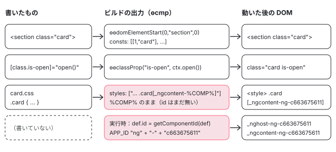

[目次](../README.md) › [ビルドの前と後：書いた HTML・CSS・class が何に変わるか](README.md) › 第 1 回 / 全 3 回

# コンポーネントの前と後：テンプレートと class は JS に、CSS は styles の文字列に

> \[class.x\]・@if・ng-content を使う小さなコンポーネントを ng build（development と production）にかけ、出力の JS の ɵcmp（template 関数の命令・consts・decls と vars・inputs のフラグ・styles の \[\_ngcontent-%COMP%\]）と、ブラウザで動いたあとの DOM（\_nghost-ng-c… と \_ngcontent-ng-c… の属性、付いた class、@if の目印のコメント）を並べる。production で消えるものと残るもの、styles が \_cN の変数になる条件（定数プール）、%COMP% が APP\_ID と定義の形のハッシュ（c663675611）に置き換わることを本物の値で確かめる。

angular/angular · 読了 約 12 分 · 基礎 · [サイトで読む（デモが動きます）](https://angular-deep-dive-cyan.vercel.app/chapter/bmap-component)

---

`[class.is-open]`・`@if`・`<ng-content select>` を使う小さなコンポーネント `Card` を、本物の `ng build`（@angular/build 22.2.7、@angular/core 22.2.6）にかけました。この章では、**書いた card.ts と card.css**、**development と production の出力の JS**、**ブラウザで動いた後の DOM** を並べ、変わったところ 1 つずつに「どのファイルの何行目がそうしたか」を付けます。テンプレートが命令になる仕組みと、CSS に属性が付く仕組みはそれぞれ[コンパイラのシリーズ](../compiler/01-compiler.md)と[スタイルのカプセル化の章](../compiler/18-compiler-shadow-css.md)が詳しく読んでいるので、ここでは見取り図を作り、各段はその章へ渡します。

読む対象は、題材の `src/app/card.ts`・`card.css`、出力の `dist/demo/browser/main.js`（development）と `main-*.js`（production）、ソースは `compiler/src/constant_pool.ts`・`compiler/src/render3/view/compiler.ts`・`core/src/render3/interfaces/input_flags.ts`・`core/src/render3/instructions/template.ts`・`core/src/render3/component_ref.ts`、テストは `compiler-cli/test/ngtsc/ngtsc_spec.ts` とコンプライアンステストの `component_styles` です。

1. **1. コンポーネントの前と後**（この章）
2. [2. スタイルの前と後](02-bmap-styles-bundle.md)
3. [3. index.html の前と後](03-bmap-index-html.md)

## 1. 題材と、記録の取り方

題材は 2 つのファイルです。`Card` は imports を持たない standalone のコンポーネントで、スタイルは `styleUrl` で別のファイルにあります。

📄 `src/app/card.ts（書いたもの）`

```
import { Component, input } from '@angular/core';

@Component({
  selector: 'app-card',
  template: `
    <section class="card" [class.is-open]="open()">
      <h2><ng-content select="[card-title]" /></h2>
      @if (open()) {
        <p class="body"><ng-content /></p>
      }
    </section>
  `,
  styleUrl: './card.css',
})
export class Card {
  readonly open = input(false);
}

```

📄 `src/app/card.css（書いたもの）`

```
:host {
  display: block;
}

.card {
  border: 1px solid #ccc;
  padding: 8px 12px;
}

.card.is-open {
  border-color: #c3002f;
}

.body {
  margin: 4px 0 0;
}

```

これを使う側の `App`（`src/app/app.ts`）は、ボタンで `open` の signal を切り替え、`<app-card [open]="open()">` の中に `<span card-title>見出し</span>` と「本文です。」を入れます。`App` 自身はスタイルを持ちません（7 節でこれが効いてきます）。

1. **2 通りにビルドする**

   `npx ng build -c development` は angular.json で `optimization: false`・`outputHashing: none`・`sourceMap: false` にしてあり、出力は `main.js`（1.10 MB）です。`npx ng build` は production（最適化あり、`outputHashing: all`）で、出力は `dist/demo/browser/main-66TXY5QV.js`（111.22 kB）です。
2. **出力の JS から Card の所を切り出す**

   development の main.js では、esbuild がファイルごとに `// src/app/card.ts` という印を入れるので、そこから次の `// src/app/app.ts` の手前までを取りました（30206 行目から）。production は全体が 1 行（111218 文字）なので、`"app-card"` の前後の Card の定義の部分（109906 文字目から）を取りました。
3. **出力を headless Chrome で開いて DOM を読む**

   出力のフォルダを `python3 -m http.server` で配り、Chrome を `--headless=new --remote-debugging-port` で起動して、DevTools Protocol（Chrome をプログラムから操作する仕組み）で `app-root` の `outerHTML`、`head` の `<style>`、ボタンを 1 回押した後の `outerHTML` を読みました（記録のスクリプトは 8 節の下）。

📄 `ターミナル（2026-11-18）`

```
cd <scratchpad>/bmap-demo/a/app      # 題材の複製（src は共有の題材と同じ。node_modules は ~/angular-research/angular-deep-dive のもの）
npx ng build -c development             # optimization: false, outputHashing: none, sourceMap: false
npx ng build                            # production（angular.json の既定。optimization は既定の true、outputHashing: all）
cd dist/demo/browser && python3 -m http.server 8731 &
node <scratchpad>/bmap-demo/a/tools/cdp.mjs http://127.0.0.1:8731/ <scratchpad>/bmap-demo/a/tools/dom.json
```



*この章の見取り図。左の書いたものが、ビルドで ɵcmp の中身（中）になり、実行時に DOM（右）になる。%COMP% だけはビルドの出力の中では決まらず、実行時に APP\_ID とコンポーネントの id で置き換わる*

## 2. DEMO：前と後を切り替えて見る

> **🧪 DEMO — 書いたもの / development / production / 動いた後の DOM（記録の再生）**
>
> 上の段で版を、下の段で項目を選ぶと、いま表示している版の中で、その項目に当たる行に印が付きます（行の中の文字列で探しています）。production は 1 行なので、文の区切りで改行だけ足して表示しています（文字は変えていません）。ブラウザでは何もビルドしません。
>
> 印の付いた行： 行
>
> ▶ [このデモはサイトで動かせます](https://angular-deep-dive-cyan.vercel.app/chapter/bmap-component)

## 3. テンプレートの行は、どの命令になったか

development の出力で、`Card` は `static ɵcmp = ɵɵdefineComponent({ … })` と `static ɵfac` を持つクラスになりました。テンプレートの文字列は `ɵcmp` のどこにも残らず、`template: function Card_Template(rf, ctx)` という関数になっています。`rf & 1` の中が作るとき（作成モード）、`rf & 2` の中が値を更新するとき（更新モード）に走る命令です（形の読み方は[reify と出力の章](../compiler/16-compiler-reify-emit.md)）。

| 書いたもの | development の出力 | 何をしたか・詳しくは |
| --- | --- | --- |
| `selector: 'app-card'` | `selectors: [["app-card"]]` | セレクタを配列の形に解析したもの（[コンパイラの入口](../compiler/02-compiler-entry.md)） |
| `<section class="card" …>` | 作成：`ɵɵdomElementStart(0, "section", 0)`<br>`consts: [[1, "card"], [1, "body"]]` の 0 番 | 静的な class は要素の命令に書かず、consts の 0 番を指す。先頭の `1` は `AttributeMarker.Classes`（[定数配列の章](../compiler/14-compiler-consts-pure.md)） |
| `[class.is-open]="open()"` | 更新：`ɵɵclassProp("is-open", ctx.open())` | `open()` の呼び出しは `ctx.open()` に。更新モードは slot 0 が選ばれた状態で始まるので、先頭に `ɵɵadvance` が無い（[クラスとスタイルのバインディング](../domr/09-domr-styling-overview.md)・[decls・vars・advance](../compiler/12-compiler-slots-vars.md)） |
| `<h2>` | `ɵɵdomElementStart(…)(1, "h2")` | 続けて呼ぶ同じ命令は、戻り値をそのまま呼ぶ形につながる（chaining、[定数配列の章](../compiler/14-compiler-consts-pure.md)） |
| `<ng-content select="[card-title]" />` | 作成：`ɵɵprojectionDef(_c0)` と `ɵɵprojection(2)`<br>`_c0 = [[["", "card-title", ""]], "*"]`<br>`ngContentSelectors: _c1`、`_c1 = ["[card-title]", "*"]` | `_c0` は実行時の照合に使う解析済みのセレクタ、`_c1` は元の文字列（[投影のコンパイラの側](../proj/02-proj-compile.md)・[描画と再投影](../proj/04-proj-render.md)） |
| `@if (open()) {` | 作成：`ɵɵconditionalCreate(3, Card_Conditional_3_Template, 2, 0, "p", 1)`<br>更新：`ɵɵadvance(3); ɵɵconditional(ctx.open() ? 3 : -1)` | 中身は別の関数 `Card_Conditional_3_Template` に。`-1` は「どの枝も出さない」（[制御フローのフェーズ](../compiler/15-compiler-control-flow-phases.md)・[LContainer](../ivy/11-ivy-lcontainer.md)） |
| `<p class="body"><ng-content /></p>` | `Card_Conditional_3_Template` の中：`ɵɵdomElementStart(0, "p", 1); ɵɵprojection(1, 1)` | 2 つ目の `1` は `_c1` の 1 番（`"*"`）。`ɵɵconditionalCreate` にも `"p", 1` が渡るのは、ルートが 1 つの要素だけの枝はそのタグ名と属性を投影の照合に使うため（[投影の振り分け](../proj/03-proj-distribute.md)） |
| `readonly open = input(false)` | `inputs: { open: [1, "open"] }`<br>`open = input(false, ...ngDevMode ? [{ debugName: "open" }] : [])` | 先頭の `1` は下の `InputFlags.SignalBased`（[input() の章](../signals/12-signals-input-compile.md)）。`debugName` は 4 節 |
| （テンプレート全体） | `decls: 4, vars: 3` | slot は section・h2・投影・@if の 4 つ。vars は `ɵɵclassProp` が 2、`ɵɵconditional` が 1（[decls・vars・advance](../compiler/12-compiler-slots-vars.md)） |

📄 `angular/packages/core/src/render3/interfaces/input_flags.ts` L9–14 （▶ の行: 10, 12）

```ts
 9 │ /** Flags describing an input for a directive. */
10 ▶ export enum InputFlags {
11 │   None = 0,
12 ▶   SignalBased = 1 << 0,
13 │   HasDecoratorInputTransform = 1 << 1,
14 │ }
```
*ɵcmp の inputs の \[1, 'open'\] の 1 はこの enum の値*

12 行目の `SignalBased = 1 << 0`、つまり 1 です。`input()` で作った入力なので、実行時の `ɵɵdefineComponent` は値を直接書かずに signal に入れます。実行時に `ɵcmp.inputs` を読むと `{"open":["open",1,null]}`（公開名・フラグ・transform）の形に組み直されていました（7 節の記録）。

📄 `angular/packages/compiler/src/render3/view/compiler.ts` L201–204 （▶ の行: 202–204）

```ts
201 │   const compilationMode =
202 ▶     meta.isStandalone && !meta.hasDirectiveDependencies
203 ▶       ? TemplateCompilationMode.DomOnly
204 ▶       : TemplateCompilationMode.Full;
```
*compileComponentFromMetadata の中。Card は ɵɵdomElementStart、App は ɵɵelementStart になった分かれ目*

`Card` の要素の命令は `ɵɵdomElementStart` で、`App` の方は `ɵɵelementStart` でした。202〜203 行目、standalone でテンプレートにディレクティブの依存が無ければ `DomOnly` を選び、要素にディレクティブを照合する処理を省いた DOM 専用の命令を出します。`App` は imports に `Card` があるので 204 行目の `Full` です。分かれ目の後ろは[使った依存だけが残る章](../standalone/04-standalone-used-only.md)が読んでいます。

## 4. ɵfac と、development だけにあるもの

`static ɵfac = function Card_Factory(__ngFactoryType__) { return new (__ngFactoryType__ || _Card)(); }` は、Angular が `Card` のインスタンスを作るときに呼ぶ関数です。コンストラクタの引数が無いので `new` だけです（引数があると `ɵɵdirectiveInject` の呼び出しが並ぶ。[ɵfac の生成](../di/04-di-factory.md)）。

development の出力には、ほかに次の 3 つがありました。どれも `ngDevMode` で守られていて、production の Card の所には 1 つも残っていません。

| development の出力 | 中身 | production | 詳しくは |
| --- | --- | --- | --- |
| `setClassMetadata(Card, [{ type: Component, args: [{ selector, template, styles }] }], null, { open: … })` | デコレーターの引数そのもの。**書いたテンプレートの文字列と、shim 前の CSS が残っているのはここだけ**（TestBed がコンパイルし直すときに使う） | 無い | [JavaScriptTransformer](../cli/05-cli-javascript-transformer.md)（メタデータの削除と `ngDevMode` の畳み込み） |
| `ɵsetClassDebugInfo(Card, { className: "Card", filePath: "src/app/card.ts", lineNumber: 15 })` | エラーメッセージにクラス名と場所を出すため | 無い | [AOT の出力](../ngmodule/03-ngmodule-aot-output.md)（`devOnlyGuardedExpression`） |
| `...ngDevMode ? [{ debugName: "open" }] : []` | signal に名前を付けて DevTools に見せるため | `open=wl(!1)` | [DevTools が signal のグラフを描ける理由](../signals/18-signals-debug.md) |

> [!TIP]
> **新卒エンジニアへ**
>
> 「ビルドした JS の中にテンプレートが入っている」と聞いたら、それは development の `setClassMetadata` の中の話です。production の JS に入っているのは命令の列と、命令に渡す文字列（`"section"`・`"is-open"` など）だけで、HTML の文字列はありません。

## 5. production で何が変わり、何が残ったか

同じ `Card` を production の出力で見ると次のとおりです（2 節の DEMO で「production」を選ぶと全体が見えます）。

| development | production | 変わり方 |
| --- | --- | --- |
| `var Card = class _Card` | `var Tr=class e` | 名前の短縮（mangle） |
| `ɵɵdefineComponent`・`ɵɵdomElementStart`・`ɵɵprojection`・`ɵɵdomElementEnd` | `Qt`・`Yt`・`hr`・`vt` | 同上。`Yt` の定義を出力で探すと `function Yt(e,t,n,r){…firstCreatePass?…}`、`gr` は `function gr(e,t){return Gp(e,t,null,!0),gr}` で、関数の中身から対応を確かめた |
| `ɵɵprojectionDef`・`ɵɵconditionalCreate`・`ɵɵclassProp`・`ɵɵadvance`・`ɵɵconditional` | `ki`・`Ai`・`gr`・`qt`・`Oi` | 同上 |
| `_c0`・`_c1`・`Card_Conditional_3_Template` | `jh`・`Vh`・`Hh` | 同上 |
| `function Card_Template(rf, ctx) { if (rf & 1) { … } if (rf & 2) { … } }` | `function(n,r){n&1&&(…),n&2&&(…)}` | 関数名を消し、`if` を `&&` とカンマの式に |
| `input(false, ...ngDevMode ? …)`・`setClassMetadata`・`ɵsetClassDebugInfo` | 無い | `ngDevMode` が `false` になり、使われない枝が消えた（4 節） |
| `/* @__PURE__ */ ɵɵdefineComponent(…)` | `Qt(…)` | 注釈は木の揺さぶり（使われないコードを落とす処理）への伝言で、出力には残らない |
| `styles: ["\n[_nghost-%COMP%] {\n display: block;\n}…"]` | `styles:["[_nghost-%COMP%]{display:block}…"]` | CSS の minify（[第 2 回](02-bmap-styles-bundle.md)） |

残ったものは、`selectors`・`inputs`・`decls`・`consts`・`template`・`styles` といった **オブジェクトのキー**、`"app-card"`・`"is-open"`・`"[card-title]"` といった **文字列**、`4`・`3`・`[1,"card"]` といった **数**、そして `%COMP%` です。実行時の `ɵɵdefineComponent`（出力の `Qt`）がキーの名前で読むので（出力の `Qt` の中は `decls:e.decls,vars:e.vars,template:e.template,consts:e.consts||null,…`）、minify はキーを変えません。名前の短縮がどの段で行われるかは[JavaScriptTransformer の章](../cli/05-cli-javascript-transformer.md)の 9 節にあります。

## 6. CSS：card.css は styles の文字列になった

card.css の規則が、`ɵcmp` の `styles` でどうなったかを 1 つずつ並べます（書き換えの仕組みは[スタイルのカプセル化の章](../compiler/18-compiler-shadow-css.md)）。

| card.css | development の styles | production の styles | 何をしたか |
| --- | --- | --- | --- |
| （無い） | 先頭の `\n` | （無い） | esbuild がスタイルを束ねるときに `/* src/app/card.css */` を付け（`setClassMetadata` の styles に残っている）、shim がコメントを改行だけ残して消した |
| `:host { display: block; }` | `[_nghost-%COMP%] { display: block; }` | `[_nghost-%COMP%]{display:block}` | `:host` がホストの属性に置き換わった |
| `.card { … }` | `.card[_ngcontent-%COMP%] { … }` | `.card[_ngcontent-%COMP%]{border:1px solid #ccc;padding:8px 12px}` | セレクタの後ろに内側の属性 |
| `.card.is-open { … }` | `.card.is-open[_ngcontent-%COMP%]` | 同じ | 複合セレクタ（空白で区切らない塊）の最後に 1 つだけ付く。`[class.is-open]` が足す class でも、規則の側はふつうの class として書き換わる |
| `.body { … }` | `.body[_ngcontent-%COMP%]` | 同じ | 同上 |

production の CSS が詰まっているのは、Angular のコンパイラではなく、その前にスタイルを束ねる段（esbuild）で minify されたからです。CSS の minify は[第 2 回](02-bmap-styles-bundle.md)が読みます。コンパイラが受け取ったのが詰まった CSS でも、`[_ngcontent-%COMP%]` の付け方は同じでした。

### styles: \["…"\] と styles: \[\_c2\] の違い

この記録では `styles` は文字列がそのまま `styles: ["…"]` に入っていました。コンパイラは styles の文字列を定数プール（ファイルごとに 1 つ、同じ値を変数 `_c0`・`_c1`… にまとめる入れ物）に渡しますが、変数になるのは条件を満たすときだけです。

📄 `angular/packages/compiler/src/constant_pool.ts` L21–26 （▶ の行: 26）

```ts
21 │ /**
22 │  * Generally all primitive values are excluded from the `ConstantPool`, but there is an exclusion
23 │  * for strings that reach a certain length threshold. This constant defines the length threshold for
24 │  * strings.
25 │  */
26 ▶ const POOL_INCLUSION_LENGTH_THRESHOLD_FOR_STRINGS = 50;
```

📄 `angular/packages/compiler/src/constant_pool.ts` L277–283 （▶ の行: 277, 280–281）

```ts
277 ▶ function isLongStringLiteral(expr: o.Expression): boolean {
278 │   return (
279 │     expr instanceof o.LiteralExpr &&
280 ▶     typeof expr.value === 'string' &&
281 ▶     expr.value.length >= POOL_INCLUSION_LENGTH_THRESHOLD_FOR_STRINGS
282 │   );
283 │ }
```

📄 `angular/packages/compiler/src/constant_pool.ts` L36–44 （▶ の行: 36, 39, 41）

```ts
36 ▶ class FixupExpression extends o.Expression {
37 │   private original: o.Expression;
38 │ 
39 ▶   shared = false;
40 │ 
41 ▶   constructor(public resolved: o.Expression) {
42 │     super(resolved.type);
43 │     this.original = resolved;
44 │   }
```

📄 `angular/packages/compiler/src/constant_pool.ts` L64–72 （▶ の行: 68–70）

```ts
64 │   override clone(): FixupExpression {
65 │     throw new Error(`Not supported.`);
66 │   }
67 │ 
68 ▶   fixup(expression: o.Expression) {
69 ▶     this.resolved = expression;
70 ▶     this.shared = true;
71 │   }
72 │ }
```

📄 `angular/packages/compiler/src/constant_pool.ts` L106–112 （▶ の行: 106–107, 109, 112）

```ts
106 ▶     if (!fixup) {
107 ▶       fixup = new FixupExpression(literal);
108 │       this.literals.set(key, fixup);
109 ▶       newValue = true;
110 │     }
111 │ 
112 ▶     if ((!newValue && !fixup.shared) || (newValue && forceShared)) {
```
*getConstLiteral の中ほど。前半と後半は ngtsc-trait-resolve-compile の章が引いている*

1. **50 文字未満の文字列はプールに入らない**

   26 行目のしきい値と 277〜283 行目の `isLongStringLiteral` で、50 文字以上の文字列だけが「長い文字列」です。短い文字列は `getConstLiteral` の先頭でそのまま返ります。
2. **1 回目は、包むだけで中身はそのまま**

   初めて見た値は 107 行目で `FixupExpression` に包み、109 行目で `newValue = true`。styles は `forceShared` を付けずに渡すので、112 行目の条件は偽です。41 行目のとおり `resolved` は元の文字列のままなので、出力には文字列がそのまま書かれます。
3. **同じファイルの中で 2 回目が来たら変数にする**

   同じ値が来ると 106 行目の `fixup` が見つかり、`newValue` が偽で `shared` がまだ偽（39 行目）なので、112 行目の条件が真になります。このあと変数 `_cN` を宣言し、68〜70 行目の `fixup()` で 1 回目の分も含めて `resolved` を変数への参照に差し替えます。

確かめるために、題材の複製の card.ts に、同じ `styleUrl: './card.css'` を持つ 2 つ目のコンポーネント `Card2` を足して development でビルドしました。今度は両方が `styles: [_c2]` になりました。

📄 `複製に Card2 を足した後の main.js（関係する 3 行だけ）`

```
var _c2 = "\n[_nghost-%COMP%] {\n  display: block;\n}\n.card[_ngcontent-%COMP%] {\n  border: 1px solid #ccc;\n  padding: 8px 12px;\n}\n.card.is-open[_ngcontent-%COMP%] {\n  border-color: #c3002f;\n}\n.body[_ngcontent-%COMP%] {\n  margin: 4px 0 0;\n}";
  }, styles: [_c2] });
  }, styles: [_c2] });
```

同じファイルにある 2 つのコンポーネントが同じ CSS を持つとき、文字列は 1 回だけ出力されます。ファイルが別なら、定数プールも別なので 2 回出力されます。

## 7. 動いた後の DOM：%COMP% は何に変わったか

production の出力を Chrome で開いた直後の `app-root` と、`head` に足された `<style>` です。

📄 `production の出力を開いた直後の app-root.outerHTML（タグの間に改行だけ足した）`

```
<app-root ng-version="22.2.6">
<h1 class="page-title">カード</h1>
<button type="button">開く・閉じる</button>
<app-card _nghost-ng-c663675611="">
<section _ngcontent-ng-c663675611="" class="card is-open">
<h2 _ngcontent-ng-c663675611="">
<span card-title="">見出し</span>
</h2>
<p _ngcontent-ng-c663675611="" class="body"> 本文です。 </p>
<!---->
</section>
</app-card>
</app-root>
```

📄 `production の出力の head の <style>（1 つ目は index.html に埋め込まれたグローバルの CSS）`

```
<style>body{margin:0;font-family:system-ui,sans-serif}</style>
<style>[_nghost-ng-c663675611]{display:block}.card[_ngcontent-ng-c663675611]{border:1px solid #ccc;padding:8px 12px}.card.is-open[_ngcontent-ng-c663675611]{border-color:#c3002f}.body[_ngcontent-ng-c663675611]{margin:4px 0 0}</style>
```

| DOM で見えたもの | 何がそうしたか |
| --- | --- |
| `<app-root ng-version="22.2.6">`、`_nghost-…` が無い | `ng-version` は下の `component_ref.ts` 450 行目。`App` はスタイルが無いので `encapsulation: 2`（None）で出力され、属性を付けない（[カプセル化の章](../compiler/18-compiler-shadow-css.md)の 1 節） |
| `<app-card _nghost-ng-c663675611="">` | Emulated のレンダラの `applyToHost` が、ホスト要素に付ける（[renderer ごとのカプセル化](../domr/06-domr-encapsulation.md)） |
| `<section _ngcontent-ng-c663675611="" class="card is-open">`、`<h2 _ngcontent-…>`、`<p _ngcontent-… class="body">` | 同じレンダラの `createElement` が、作るすべての要素に付ける。`card` は consts の静的な class、`is-open` は `ɵɵclassProp`（[値を決めて DOM に書く](../domr/11-domr-styling-apply.md)） |
| `<span card-title="">` に `_ngcontent-…` が無い | この span は `App` のテンプレートの `ɵɵelementStart(5, "span", 3)` が `App` のレンダラ（None）で作った。投影は作った後の要素を移すだけで、属性は付け直さない |
| `<!---->`（development では `<!--container-->`） | `@if` の目印のコメント。下の `template.ts` 351 行目 |
| `head` の `[_nghost-ng-c663675611]{display:block}…` | styles の `%COMP%` を置き換えて `<style>` を足す（[SharedStylesHost](../domr/07-domr-shared-styles.md)） |

ボタンを 1 回押すと、`is-open` が外れ、`<p>` が消え、目印のコメントだけが残りました。

📄 `「開く・閉じる」を 1 回押した後（production）`

```
<app-root ng-version="22.2.6">
<h1 class="page-title">カード</h1>
<button type="button">開く・閉じる</button>
<app-card _nghost-ng-c663675611="">
<section _ngcontent-ng-c663675611="" class="card">
<h2 _ngcontent-ng-c663675611="">
<span card-title="">見出し</span>
</h2>
<!---->
</section>
</app-card>
</app-root>
```

### ng-c663675611 はどこから来たか

`%COMP%` は `APP_ID` と `-` とコンポーネントの id をつないだものに置き換わります。`APP_ID` の既定値は `ng` です。id は実行時の `ɵɵdefineComponent` の中の `getComponentId` が、定義の形（セレクタ・ngContentSelectors・consts・decls・vars・inputs など）をつないだ文字列から計算します。この 2 つの行は[スタイルのカプセル化の章](../compiler/18-compiler-shadow-css.md)の 5 節が引いているので、ここでは**本物の値**で確かめます。

~/angular-research の @angular/core 22.2.6 を Node で読み込み、出力の `ɵɵdefineComponent` に渡っていたのと同じ引数で呼び、`getComponentId` と同じ材料をつないで同じ計算をし直しました。

📄 `記録のスクリプト（hash.mjs）`

```
// ~/angular-research の @angular/core 22.2.6 で、Card と同じ引数の ɵɵdefineComponent を呼び、id とハッシュの材料を出す
import * as core from '@angular/core';
class Card {}
const def = core.ɵɵdefineComponent({
  type: Card, selectors: [['app-card']], inputs: { open: [1, 'open'] },
  ngContentSelectors: ['[card-title]', '*'], decls: 4, vars: 3,
  consts: [[1, 'card'], [1, 'body']], template: () => {}, styles: ['x'],
});
const parts = [def.selectors, def.ngContentSelectors, def.hostVars, def.hostAttrs, def.consts, def.vars, def.decls,
  def.encapsulation, def.standalone, def.signals, def.exportAs, JSON.stringify(def.inputs), JSON.stringify(def.outputs),
  Object.getOwnPropertyNames(def.type.prototype), !!def.contentQueries, !!def.viewQuery];
let hash = 0;
const joined = parts.join('|');
for (const ch of joined) hash = (Math.imul(31, hash) + ch.charCodeAt(0)) << 0;
hash += 2147483647 + 1;
console.log(JSON.stringify({ id: def.id, joined, recomputed: 'c' + hash }, null, 2));

```

📄 `つないだ文字列（hashSelectors.join('|')）`

```
app-card|[card-title],*|0||1,card,1,body|3|4|0|true|false||{"open":["open",1,null]}|{}|constructor|false|false
```

1. **材料の 16 個を | でつなぐ**

   `app-card`（selectors）、`[card-title],*`（ngContentSelectors）、`0`（hostVars）、空（hostAttrs）、`1,card,1,body`（consts）、`3`（vars）、`4`（decls）、`0`（encapsulation。Emulated）、`true`（standalone）、`false`（signals）、空（exportAs）、inputs と outputs の JSON、`constructor`（prototype の名前）、`false` が 2 つ（クエリの有無）。配列は `join` でカンマ区切りの文字列になります。**styles とクラス名は入っていません。**
2. **31 倍して足すハッシュを 32 ビットで回し、正の数にずらす**

   結果は `c663675611`。`def.id` も `c663675611`、計算し直した値も `c663675611` で、DOM の属性の数字と一致しました。
3. **development と production で同じ**

   development の出力を開いた DOM も `_nghost-ng-c663675611` でした。材料に minify で変わるもの（クラス名・関数の中身）を入れていないからです。クラス名が `Card` から `Tr` に変わっても id は変わりません。

> [!NOTE]
> **さらに深く**
>
> 新しい本家（origin/main と v22.3.0-rc.0）では、98b0f3b7207「refactor(core): remove signal components prototype」で `ComponentDef.signals` が無くなり、材料から `componentDef.signals` の 1 行が消えました。つないだ文字列から `false|` が 1 つ減るので、同じ `Card` の id は `c3857098018` になります（10 節で、その 1 行だけを消した作業木で確かめた値）。22.2 から 22.3 に上げると、すべてのコンポーネントの `_ngcontent-ng-c…` の数字が変わります。

📄 `angular/packages/core/src/render3/instructions/template.ts` L345–351 （▶ の行: 351）

```ts
345 │   tView: TView,
346 │   lView: LView,
347 │   tNode: TNode,
348 │   index: number,
349 │ ): RComment {
350 │   lastNodeWasCreated(true);
351 ▶   return lView[RENDERER].createComment(ngDevMode ? 'container' : '');
```
*createContainerAnchorImpl の後半。@if の LContainer の目印を作る*

351 行目、目印のコメントの中身は `ngDevMode` のときだけ `'container'` です。production では空なので `<!---->` になります。コメントそのものは、`@if` の枝をどこに差し込むかの目印なので、production でも消えません。

📄 `angular/packages/core/src/render3/component_ref.ts` L446–452 （▶ の行: 449–450）

```ts
446 │   directives: (Type<unknown> | DirectiveWithBindings<unknown>)[] | undefined,
447 │   allowNonStandaloneDirectives?: boolean,
448 │ ): TView {
449 ▶   const tAttributes = rootSelectorOrNode
450 ▶     ? ['ng-version', '0.0.0-PLACEHOLDER']
451 │     : // Extract attributes and classes from the first selector only to match VE behavior.
452 │       extractAttrsAndClassesFromSelector(componentDef.selectors[0]);
```
*createRootTView。ルートのコンポーネントを既存の要素に刺すとき*

449〜450 行目、`bootstrapApplication` のように既存の要素（`<app-root>`）にルートのコンポーネントを刺すときは、その要素に `ng-version` を付けます。ソースでは `0.0.0-PLACEHOLDER` ですが、配布された @angular/core 22.2.6 の fesm2022 では同じ所が `['ng-version', '22.2.6']` に置き換わっていました。版の文字列を入れるのは Angular 自身のリリースのビルドで、私たちの `ng build` ではありません。

## 8. DEMO：このページの上の本物

> **🧪 DEMO — 題材と同じ形のコンポーネントの属性と class を読む**
>
> この章の中に、題材と同じ形の `BmapcDemoCard`（`[class.is-open]`・`<ng-content select="[card-title]">`・`@if`・`:host` を含む styles）を置きました。このサイト自身の本番ビルドの中なので、`APP_ID` とコンポーネントの id はこのサイトの値です。ボタンを押したときだけ DOM と `ɵcmp` を読みます。
>
> ▶ [このデモはサイトで動かせます](https://angular-deep-dive-cyan.vercel.app/chapter/bmap-component)

2026-11-18 の本番ビルドで読むと、`APP_ID` は `ng`、`BmapcDemoCard.ɵcmp.id` は `c679275583` で、計算し直した値と一致しました。題材の `Card` と形は同じでも、セレクタが `app-bmapc-card` なので別の id です。ホストの `<app-bmapc-card>` には自分の `_nghost-ng-c679275583` と、この章のコンポーネントの `_ngcontent-ng-c…`（数字は章のテンプレートの形で決まる）の 2 つが付いていました。ホスト要素を作ったのは章のテンプレート（章のレンダラ）だからです。投影した `<span card-title>` も同じ理由で章の `_ngcontent-ng-c…` だけが付き、BmapcDemoCard の属性は付きません。7 節の題材では `App` が None だったので、どちらにも何も付きませんでした。閉じると `is-open` と `<p>` が消え、`<!---->` が残るのも題材と同じでした。

📄 `記録のスクリプト（cdp.mjs。headless Chrome を DevTools Protocol で操作する）`

```
// 使い方: node cdp.mjs <url> <script.json>
// script.json: [{"eval": "js"}, {"click": "css selector"}, {"wait": ms}]
import { spawn } from 'node:child_process';
import { mkdtempSync, readFileSync, rmSync } from 'node:fs';
import { tmpdir } from 'node:os';
import { join } from 'node:path';

const [url, scriptPath] = process.argv.slice(2);
const steps = JSON.parse(readFileSync(scriptPath, 'utf8'));
const profile = mkdtempSync(join(process.env.TMPDIR ?? tmpdir(), 'bmapa-chrome-'));
const port = 9300 + Math.floor(Math.random() * 500);
const chrome = spawn('/Applications/Google Chrome.app/Contents/MacOS/Google Chrome', [
  '--headless=new', `--remote-debugging-port=${port}`, `--user-data-dir=${profile}`,
  '--no-first-run', '--no-default-browser-check', '--window-size=1200,900', 'about:blank',
], { stdio: 'ignore' });
const sleep = (ms) => new Promise((r) => setTimeout(r, ms));
let target;
for (let i = 0; i < 50 && !target; i++) {
  await sleep(200);
  try {
    const list = await (await fetch(`http://127.0.0.1:${port}/json`)).json();
    target = list.find((t) => t.type === 'page');
  } catch {}
}
const ws = new WebSocket(target.webSocketDebuggerUrl);
await new Promise((r) => ws.addEventListener('open', r));
let id = 0;
const pending = new Map();
const logs = [];
ws.addEventListener('message', (ev) => {
  const msg = JSON.parse(ev.data);
  if (msg.id && pending.has(msg.id)) { pending.get(msg.id)(msg); pending.delete(msg.id); }
  if (msg.method === 'Runtime.consoleAPICalled') logs.push(`[console.${msg.params.type}] ` + msg.params.args.map((a) => a.value ?? a.description).join(' '));
  if (msg.method === 'Runtime.exceptionThrown') logs.push('[exception] ' + msg.params.exceptionDetails.exception?.description);
  if (msg.method === 'Log.entryAdded') logs.push(`[log.${msg.params.entry.level}] ${msg.params.entry.text}`);
});
const send = (method, params = {}) => new Promise((r) => { const i = ++id; pending.set(i, r); ws.send(JSON.stringify({ id: i, method, params })); });
const evaluate = async (expr) => (await send('Runtime.evaluate', { expression: expr, returnByValue: true, awaitPromise: true })).result?.result?.value;
await send('Runtime.enable'); await send('Log.enable'); await send('Page.enable');
await send('Page.navigate', { url });
await sleep(2500);
const out = [];
for (const s of steps) {
  if (s.eval) out.push({ eval: s.eval, value: await evaluate(s.eval) });
  if (s.click) { const ok = await evaluate(`(() => { const el = document.querySelector(${JSON.stringify(s.click)}); if (!el) return false; el.click(); return true; })()`); out.push({ click: s.click, ok }); await sleep(400); }
  if (s.clickAll) { const n = await evaluate(`(async () => { const els = [...document.querySelectorAll(${JSON.stringify(s.clickAll)})]; for (const el of els) { el.click(); await new Promise(r => setTimeout(r, 300)); } return els.length; })()`); out.push({ clickAll: s.clickAll, count: n }); await sleep(400); }
  if (s.wait) await sleep(s.wait);
}
console.log(JSON.stringify({ out, logs }, null, 2));
ws.close(); chrome.kill(); await sleep(300); rmSync(profile, { recursive: true, force: true });

```

📄 `cdp.mjs に渡した手順（dom.json）`

```
[{"eval": "document.querySelector('app-root').outerHTML"},
 {"eval": "[...document.head.querySelectorAll('style')].map(s => s.outerHTML).join('\\n')"},
 {"click": "app-root > button"},
 {"eval": "document.querySelector('app-root').outerHTML"},
 {"click": "app-root > button"},
 {"eval": "document.querySelector('app-root').outerHTML"}]

```

## 9. ここまでの流れ

- 👤 `card.ts`（template・styleUrl）と `card.css` — 書いたもの
  - `compileComponentFromMetadata()` — compiler/src/render3/view/compiler.ts L178 — *DomOnly を選ぶ（L202）*
    - `emitTemplateFn()` — テンプレート → Card\_Template の命令の列 — *ɵɵdomElementStart・ɵɵclassProp・ɵɵconditional…*
    - `compileStyles()` → `constantPool.getConstLiteral()` — compiler/src/constant\_pool.ts L94 — *\[\_ngcontent-%COMP%\]、1 回目は文字列のまま*
  - `esbuild`（production） — @angular/build — *名前の短縮・ngDevMode の枝の削除・CSS の minify*
- 👤 `main-*.js` をブラウザが読む — 実行時
  - `ɵɵdefineComponent()` → `getComponentId()` — core/src/render3/definition.ts L685 — *c663675611*
  - `createRootTView()` — core/src/render3/component\_ref.ts L449 — *ng-version="22.2.6"*
  - `new EmulatedEncapsulationDomRenderer2()` — platform-browser/src/dom/dom\_renderer.ts L704 — *appId + '-' + id = ng-c663675611*
    - `applyToHost()` / `createElement()` — dom\_renderer.ts L720 / L725 — *\_nghost- / \_ngcontent-*
  - `ɵɵconditionalCreate()` → `createContainerAnchorImpl()` — core/src/render3/instructions/template.ts L351 — *&lt;!----&gt;*

## 10. テストと直し方

### spec と it

| ファイル | describe / it | 行 | この章のどこ |
| --- | --- | --- | --- |
| compiler-cli/test/ngtsc/ngtsc\_spec.ts | `ngtsc behavioral tests` › `inline resources` › `should share same styles declared in different components in the same file` | 64・9546・9589 | 6 節（定数プール） |
| compiler-cli/test/compliance/test\_cases/r3\_view\_compiler\_styling/component\_styles/TEST\_CASES.json | `compliance tests (full compile)` › `[r3_view_compiler_styling/component_styles]/N` › `should pass in the component metadata styles into the component definition and shim them using style encapsulation` | 5 | 6 節（styles の %COMP%） |
| （無い） | `getComponentId` の計算や、衝突したときの警告（NG0912）を確かめる spec は、packages/core/test にも platform-browser/test にもありません（`getComponentId` の名前が出るのは bundle.golden\_symbols.json だけ） | — | 7 節（id） |

📄 `angular/packages/compiler-cli/test/ngtsc/ngtsc_spec.ts` L9589–9617 （▶ の行: 9589, 9599–9601, 9610–9612）

```ts
9589 ▶       it('should share same styles declared in different components in the same file', () => {
9590 │         env.write(
9591 │           'test.ts',
9592 │           `
9593 │           import {Component} from '@angular/core';
9594 │ 
9595 │           @Component({
9596 │             selector: 'comp-a',
9597 │             template: 'Comp A',
9598 │             styles: [
9599 ▶               'span { font-size: larger; }',
9600 ▶               'div { background: url(/some-very-very-long-path.png); }',
9601 ▶               'img { background: url(/a/some-very-very-long-path.png); }'
9602 │             ]
9603 │           })
9604 │           export class CompA {}
9605 │ 
9606 │           @Component({
9607 │             selector: 'comp-b',
9608 │             template: 'Comp B',
9609 │             styles: [
9610 ▶               'span { font-size: larger; }',
9611 ▶               'div { background: url(/some-very-very-long-path.png); }',
9612 ▶               'img { background: url(/b/some-very-very-long-path.png); }'
9613 │             ]
9614 │           })
9615 │           export class CompB {}
9616 │         `,
9617 │         );
```

📄 `angular/packages/compiler-cli/test/ngtsc/ngtsc_spec.ts` L9619–9640 （▶ の行: 9625, 9633, 9636, 9639）

```ts
9619 │         env.driveMain();
9620 │         const jsContents = env.getContents('test.js');
9621 │ 
9622 │         // Verify that long styles present in both components are extracted to a
9623 │         // separate var.
9624 │         expect(jsContents).toContain(
9625 ▶           '_c0 = "div[_ngcontent-%COMP%] { background: url(/some-very-very-long-path.png); }";',
9626 │         );
9627 │ 
9628 │         expect(jsContents).toContain(
9629 │           'styles: [' +
9630 │             // This style is present in both components, but was not extracted into
9631 │             // a separate var since it doesn't reach length threshold (50 chars) in
9632 │             // `ConstantPool`.
9633 ▶             '"span[_ngcontent-%COMP%] { font-size: larger; }", ' +
9634 │             // Style that is present in both components, but reaches length
9635 │             // threshold - extracted to a separate var.
9636 ▶             '_c0, ' +
9637 │             // Style that is unique to this component, but that reaches length
9638 │             // threshold - remains a string in the `styles` array.
9639 ▶             '"img[_ngcontent-%COMP%] { background: url(/a/some-very-very-long-path.png); }"]',
9640 │         );
```

2 つのコンポーネントに 3 つずつ styles を書き、9599・9610 行目は短い同じ文字列、9600・9611 行目は長い同じ文字列、9601・9612 行目は長い違う文字列です。9625 行目、長くて同じものだけが `_c0` になり、9633 行目、短いものは同じでも文字列のまま、9639 行目、長くても 1 回しか出ないものは文字列のままです。6 節の 3 つの手順がそのまま 3 つの期待になっています。

📄 `angular/packages/compiler-cli/test/compliance/test_cases/r3_view_compiler_styling/component_styles/TEST_CASES.json` L4–17 （▶ の行: 5, 7, 13）

```json
 4 │     {
 5 ▶       "description": "should pass in the component metadata styles into the component definition and shim them using style encapsulation",
 6 │       "inputFiles": [
 7 ▶         "encapsulation_default.ts"
 8 │       ],
 9 │       "expectations": [
10 │         {
11 │           "failureMessage": "Incorrect template",
12 │           "files": [
13 ▶             "encapsulation_default.js"
14 │           ]
15 │         }
16 │       ]
17 │     },
```

📄 `angular/packages/compiler-cli/test/compliance/test_cases/r3_view_compiler_styling/component_styles/encapsulation_default.ts` L1–16 （▶ の行: 5–6）

```ts
 1 │ import {Component, NgModule} from '@angular/core';
 2 │ 
 3 │ @Component({
 4 │     selector: 'my-component',
 5 ▶     styles: [
 6 ▶         'div.foo { color: red; }', ':host p:nth-child(even) { --webkit-transition: 1s linear all; }'
 7 │     ],
 8 │     template: '...',
 9 │     standalone: false
10 │ })
11 │ export class MyComponent {
12 │ }
13 │ 
14 │ @NgModule({declarations: [MyComponent]})
15 │ export class MyModule {
16 │ }
```

📄 `angular/packages/compiler-cli/test/compliance/test_cases/r3_view_compiler_styling/component_styles/encapsulation_default.js` L1–1 （▶ の行: 1）

```js
1 ▶ styles: ["div.foo[_ngcontent-%COMP%] { color: red; }", "[_nghost-%COMP%]   p[_ngcontent-%COMP%]:nth-child(even) { --%NS%webkit-transition: 1s linear all; }"]
```

コンプライアンステストは、TEST\_CASES.json の 7 行目の入力をコンパイルし、出力が 13 行目のファイルの断片を含むかを比べます。encapsulation\_default.js の 1 行目、`div.foo` の後ろに `[_ngcontent-%COMP%]`、`:host` が `[_nghost-%COMP%]` になり、CSS 変数の `--webkit-transition` が `--%NS%webkit-transition` になっています。

### 手元で走らせた結果

📄 `ターミナル（../angular、8576f161ae4）`

```
cd ~/angular-research/angular
pnpm bazel test //packages/compiler-cli/test/ngtsc:ngtsc --nocache_test_results --test_output=all \
  "--test_arg=--filter=should share same styles declared in different components in the same file"
pnpm bazel test //packages/compiler-cli/test/compliance/full:full --nocache_test_results --test_output=all \
  "--test_arg=--filter=component metadata styles"
```

📄 `出力（2026-11-18、抜粋）`

```
//packages/compiler-cli/test/ngtsc:ngtsc   shard 1: 2 specs / shard 2: 1 spec / shard 3: 1 spec / shard 4: 0 specs, 0 failures   PASSED in 2.4s
//packages/compiler-cli/test/compliance/full:full   shard 1: 1 spec / shard 2: 2 specs, 0 failures   PASSED in 1.2s
```

ngtsc\_spec.ts は全体が `runInEachFileSystem` の中にあり、同じ it が OS/X・Windows・Unix・Native の 4 つのファイルシステムで走るので、1 つの it に絞っても 4 specs になります。コンプライアンスの方は、絞り込みの文字列を含む説明が TEST\_CASES.json に 3 つ（Default・Emulated・ShadowDom）あるので 3 specs です。

id の spec が無いことを確かめるために、作業木（~/angular-research/angular-fix から 8576f161ae4 で作った別の作業場所）に spec を 1 つ足して走らせました。1 回目は 3 specs が通り、次に `definition.ts` の材料から `componentDef.signals` の 1 行だけを消す（新しい本家の 98b0f3b7207 と同じ）と、1 つ目の it が `c3857098018` で落ちました。作業木は消しました。

📄 `作業木に足した spec（本家には無い）`

```
// packages/core/test/render3/component_id_spec.ts（作業木に足したもの。本家には無い）
import {ɵɵdefineComponent} from '../../src/render3';

function defineCard(type: Function, extra: {selector?: string; styles?: string[]} = {}) {
  return ɵɵdefineComponent({
    type: type as any,
    selectors: [[extra.selector ?? 'app-card']],
    inputs: {open: [1, 'open']},
    ngContentSelectors: ['[card-title]', '*'],
    decls: 4,
    vars: 3,
    consts: [
      [1, 'card'],
      [1, 'body'],
    ],
    template: () => {},
    styles: extra.styles ?? ['x'],
  });
}

describe('component id (getComponentId)', () => {
  it('should compute the id from the shape of the definition', () => {
    class Card {}
    expect(defineCard(Card).id).toBe('c663675611');
  });

  it('should not use the styles or the class name', () => {
    class A {}
    class B {}
    const warn = spyOn(console, 'warn');
    const a = defineCard(A, {selector: 'app-collide', styles: ['p {}']});
    const b = defineCard(B, {selector: 'app-collide', styles: ['div {}']});
    expect(a.id).toBe(b.id);
    expect(warn).toHaveBeenCalledTimes(1);
    expect(warn.calls.argsFor(0)[0]).toContain('NG0912');
  });

  it('should produce a different id for a different selector', () => {
    class C {}
    class D {}
    expect(defineCard(C, {selector: 'app-c'}).id).not.toBe(defineCard(D, {selector: 'app-d'}).id);
  });
});
```

📄 `出力（2026-11-18、抜粋）`

```
$ git -C ~/angular-research/angular-fix worktree add --detach <scratchpad>/bmap-wt-a 8576f161ae4
$ cd <scratchpad>/bmap-wt-a && bazelisk test //packages/core/test/render3:render3 --nocache_test_results --test_output=all "--test_arg=--filter=component id"
3 specs, 0 failures
//packages/core/test/render3:render3   PASSED in 1.2s      （初回。ビルド込みで 48 秒）

# definition.ts の hashSelectors から componentDef.signals の 1 行だけを消して（origin/main の 98b0f3b7207 と同じ）もう一度
    Expected 'c3857098018' to be 'c663675611'.
3 specs, 1 failure
//packages/core/test/render3:render3   FAILED in 1.0s

$ git -C ~/angular-research/angular-fix worktree remove --force <scratchpad>/bmap-wt-a
```

### 直すとしたら

- id の計算は core/src/render3/definition.ts の `getComponentId` です。材料を変えると、すべてのアプリの `_nghost-ng-c…` の数字が変わります。それを固める spec を置くなら、上のように packages/core/test/render3 に `ɵɵdefineComponent` を直接呼ぶ spec を足す形で、//packages/core/test/render3:render3 で走ります（ビルド込みで 1 分かからない）。
- styles の定数プールの振る舞いは compiler/src/constant\_pool.ts の `getConstLiteral` で、固めているのは ngtsc\_spec.ts の 9589 行目の it です。styles を変数にする条件を変えるなら、この it の 3 つの期待が変わります。
- styles の書き換え（%COMP% の付け方）を変えるなら、shadow\_css の spec（[スタイルのカプセル化の章](../compiler/18-compiler-shadow-css.md)）と、上の component\_styles のコンプライアンステストの両方が対象です。

**本番ビルドでデモを動かした結果（2026-11-18）。**このサイトを本番ビルドして headless Chrome でこの章を開き、2 つの DEMO のボタンを全部押しました。コンソールの警告とエラーは 0 件でした。

## 聞かれそうな質問

**Q. \_nghost-ng-c663675611 の数字は、ビルドするたびに変わりますか？**

変わりません。数字はコンポーネントの定義の形（セレクタ・ngContentSelectors・consts・decls・vars・inputs など）のハッシュで、styles とクラス名は材料に入っていないので、development と production でも同じ `c663675611` でした（7 節）。テンプレートを変えて decls・vars・consts が変わる、セレクタや input を変える、といったときに変わります。Angular の版でも材料が変わることがあり、22.3 では `signals` が抜けて `c3857098018` になります。

**Q. card.css に .card span { … } と書いても、投影した &lt;span card-title&gt; に効かないのはなぜ？**

書き換え後の規則は `.card[_ngcontent-%COMP%] span[_ngcontent-%COMP%]` の形で、span にも Card の属性を求めます。ところが投影された span は `App` のテンプレートが `App` のレンダラで作った要素で、7 節の DOM のとおり Card の `_ngcontent-ng-c663675611` は付いていません（8 節の DEMO では、代わりにこの章の属性が付いています）。投影した内容のスタイルは、それを書いた側のコンポーネントの CSS に書くのが基本です。

**Q. production で ɵɵclassProp が gr になったのに、"is-open" や selectors はなぜそのまま？**

短くなるのは、変数や関数の名前（バンドルの中で閉じている名前）だけです。`selectors`・`decls` などはオブジェクトのキーで、実行時の `ɵɵdefineComponent`（出力の `Qt`）がその名前で読みます（5 節）。`"is-open"` や `"app-card"` は DOM に書く値そのものなので、変えるとアプリが変わってしまいます。

**Q. styles が styles: \[\_c0\] のような変数になるときと、ならないときがあるのはなぜ？**

定数プールが変数にするのは、50 文字以上（constant\_pool.ts 26 行目）の同じ文字列が同じファイルの中で 2 回目に来たときだけです（112 行目、68〜70 行目）。1 回しか出ない styles は文字列のままです。ngtsc\_spec.ts の 9589 行目の it がこの 3 通りを固めています（10 節）。

**Q. Card は ɵɵdomElementStart、App は ɵɵelementStart なのはなぜ？**

compiler.ts 202〜203 行目、standalone でテンプレートにディレクティブの依存が無いと `DomOnly` になり、要素のディレクティブの照合を省いた命令を出します。`App` は `Card` を imports に持つので `Full` です（3 節）。

**Q. &lt;!--container--&gt; のコメントは production では消えますか？**

中身が空になるだけで、コメントは残ります（template.ts 351 行目）。`@if` が枝を差し込む位置の目印なので、無くすことはできません（7 節）。

## 読み終えて

- テンプレートは `ɵcmp.template` の命令の列になり、HTML の文字列は production の JS に残らない。残るのは development の `setClassMetadata` の中だけ。
- card.css は `ɵcmp.styles` の文字列になり、`:host` は `[_nghost-%COMP%]`、各セレクタの後ろに `[_ngcontent-%COMP%]` が付く。同じファイルで 2 回出る長い文字列だけが `_cN` の変数になる。
- production で変わるのは名前・空白・`ngDevMode` の枝で、キー・文字列・数・`%COMP%` はそのまま残る。
- `%COMP%` は実行時に `APP_ID`（既定 `ng`）と定義の形のハッシュ `c663675611` に置き換わり、ホストに `_nghost-`、そのレンダラが作った要素に `_ngcontent-` が付く。投影した要素には付かない。
- id を固める spec は本家に無く、材料は版で変わる（22.3 で `signals` が抜ける）。

---

← 前: [spec と issue を読む：フィールドの木を固めているテスト](../sft/05-sft-tests-issues.md)  
次: [スタイルの前と後：コンポーネントの CSS とグローバルの CSS、minify・target・ファイル名](02-bmap-styles-bundle.md) →
