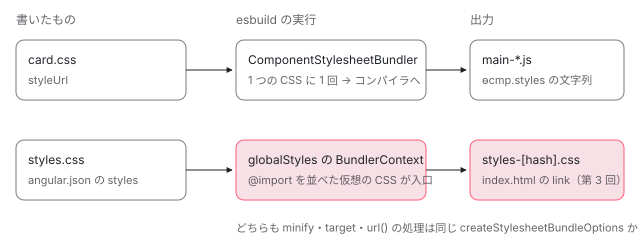

[目次](../README.md) › [ビルドの前と後：書いた HTML・CSS・class が何に変わるか](README.md) › 第 2 回 / 全 3 回

# スタイルの前と後：コンポーネントの CSS とグローバルの CSS、minify・target・ファイル名

> styleUrl の CSS が JS の中の文字列になり、angular.json の styles に書いた CSS が @import を並べた仮想の CSS を入口にする別の esbuild の実行で styles-&lt;hash&gt;.css になるまでの分かれ道。normalizeOptimization が配る styles.minify と removeSpecialComments、browserslist から作る esbuild の target で、空白・コメント・色・-webkit-・入れ子がどう変わり、使われない規則が残るか。outputHashing の 4 通りと inject: false の例外、url() の画像（css-resource-plugin）と Google Fonts の @import（css-inline-fonts-plugin）、22.2.7 で効いていないフォントのディスクのキャッシュ（4673cecf00 で修正）。

angular/angular-cli · 読了 約 12 分 · 中核 · [サイトで読む（デモが動きます）](https://angular-deep-dive-cyan.vercel.app/chapter/bmap-styles-bundle)

---

同じ CSS でも、`styleUrl` に書いたものは JS の中の文字列になり、`angular.json` の `styles` に書いたものは `styles-<ハッシュ>.css` という 1 つのファイルになります。この章では、題材の `card.css` と `styles.css` を development と production でビルドした出力を並べ、空白・コメント・色の書き方・使われないルール・ファイル名が変わったところ（変わらなかったところ）の 1 つずつに、そうした行を付けます。ブラウザの対象（browserslist）で出力が変わること、Google Fonts の `@import` がビルドで中身に置き換わることと、そのキャッシュが 22.2.7 で効いていないことも、記録で確かめます。

読む対象は angular-cli の `packages/angular/build/src/` の `builders/application/setup-bundling.ts`・`options.ts`、`tools/esbuild/global-styles.ts`・`target.ts`・`stylesheets/css-inline-fonts-plugin.ts`、`utils/normalize-optimization.ts`・`supported-browsers.ts`・`index-file/inline-fonts.ts` です。コンポーネントのスタイルが 1 つずつ esbuild にかかって文字列になる道筋は[コンポーネントのスタイルの章](../cli/04-cli-component-styles.md)、その文字列が `_ngcontent-%COMP%` 付きに書き換わる規則は[ShadowCss の章](../compiler/18-compiler-shadow-css.md)が読んだので、ここでは引きません。

1. [1. コンポーネントの前と後](01-bmap-component.md)
2. **2. スタイルの前と後**（この章）
3. [3. index.html の前と後](03-bmap-index-html.md)

## 0. 前と後の一覧

題材は小さなアプリ 1 つです（第 1 回と同じもの）。`card.ts` が `styleUrl: './card.css'` を持ち、`angular.json` の `styles` に `src/styles.css` が 1 つあります。`styles.css` には、どの要素にも当たらない `.unused-rule` と、色の名前 `rebeccapurple` をわざと入れてあります。これを `ng build`（production、`outputHashing: "all"`）と `ng build -c development`（`optimization: false`、`outputHashing: "none"`）にかけました（@angular/build 22.2.7 / esbuild 0.28.2 / beasties 0.5.4）。

| 書いたもの | development の出力 | production の出力 | そうした行 |
| --- | --- | --- | --- |
| `card.css`（`styleUrl`） | `main.js` の中の文字列（2 か所） | `main-*.js` の `ɵcmp` の `styles`（1 か所） | 1 節（分かれ道）・[コンポーネントのスタイルの章](../cli/04-cli-component-styles.md) |
| `styles.css`（`angular.json` の `styles`） | `styles.css` | `styles-JQLOIGW2.css` | 1 節 setup-bundling.ts 97〜113 行目・global-styles.ts 84〜101 行目 |
| 空白・改行・最後の `;` | esbuild の整形で残る | 消える | 2 節 normalize-optimization.ts 51 行目（minify） |
| `/* グローバルのスタイル */` | 消える | 消える | 2 節（esbuild が CSS を束ねるときに普通のコメントを落とす） |
| `/*! … */`（特別なコメント） | 残る | 消える | 2 節 global-styles.ts 80〜82 行目 |
| `rebeccapurple` | そのまま | `#639` | 2 節（esbuild の minify） |
| `.unused-rule` | 残る | 残る | 2 節（消す処理がどこにも無い） |
| ファイル名 `styles` | `styles.css` | `styles-JQLOIGW2.css` | 4 節（`outputHashing`） |
| `user-select`・入れ子の `&` | 対象のブラウザに合わせて `-webkit-` を足し、入れ子を平らにする | 3 節 target.ts 53〜92 行目 |   |
| `@import` した Google Fonts | `@import` のまま | `@font-face` の中身に置き換わる | 5 節 css-inline-fonts-plugin.ts 39〜60 行目 |

## 1. 分かれ道：styleUrl の CSS と angular.json の styles

2 つの CSS は、ビルドの一番最初で別の道に入ります。`styleUrl` の CSS はアプリの TypeScript を束ねる esbuild の中で、コンパイラに頼まれたときに 1 つずつ処理されます（[コンポーネントのスタイルの章](../cli/04-cli-component-styles.md)の 2〜3 節）。`angular.json` の `styles` は、コンパイラと関係のない別の esbuild の実行（`BundlerContext`。esbuild の 1 回分の設定と結果を持つ入れ物）になります。それを作るのが `setupBundlerContexts` の次の行です。

📄 `angular-cli/packages/angular/build/src/builders/application/setup-bundling.ts` L96–114 （▶ の行: 97, 99–100, 102, 108–109）

```ts
 96 │   // Global Stylesheets
 97 ▶   if (options.globalStyles.length > 0) {
 98 │     const globalStylesCache = new MemoryLoadResultCache();
 99 ▶     for (const initial of [true, false]) {
100 ▶       const bundleOptions = createGlobalStylesBundleOptions(options, target, initial);
101 │       if (bundleOptions) {
102 ▶         otherContexts.push(
103 │           new BundlerContext(
104 │             workspaceRoot,
105 │             watch,
106 │             bundleOptions,
107 │             true,
108 ▶             () => initial,
109 ▶             globalStylesCache,
110 │           ),
111 │         );
112 │       }
113 │     }
114 │   }
```

97 行目、`styles` が 1 つでもあれば、99 行目で「最初に読むもの（`initial: true`）」と「読まないもの（`false`）」の 2 回、100 行目の `createGlobalStylesBundleOptions` を呼びます。102 行目、できた設定はアプリの JS の `typescriptContexts` ではなく `otherContexts` に入ります。108 行目の `() => initial` は、この束の出力を `index.html` に差し込む「最初のファイル」として数えるかどうかです。109 行目の `globalStylesCache` は、2 つの束で読み込みの結果を共有する表です。



*2 つの CSS は別の esbuild の実行に入る。コンポーネントの CSS はコンパイラに文字列で返って JS の中に入り、グローバルの CSS は 1 つのファイルになって index.html の link になる。*

`options.globalStyles` は、`angular.json` の `styles` の配列を次の関数で直したものです。

📄 `angular-cli/packages/angular/build/src/builders/application/options.ts` L656–688 （▶ の行: 660, 662, 667, 670, 673–674, 678, 685）

```ts
656 │   const bundles = new Map<string, { name: string; files: string[]; initial: boolean }>();
657 │ 
658 │   for (const rawEntry of rawEntries) {
659 │     let entry;
660 ▶     if (typeof rawEntry === 'string') {
661 │       // string entries use default bundle name and inject values
662 ▶       entry = { input: rawEntry };
663 │     } else {
664 │       entry = rawEntry;
665 │     }
666 │ 
667 ▶     const { bundleName, input, inject = true } = entry;
668 │ 
669 │     // Non-injected entries default to the file name
670 ▶     const name = bundleName || (inject ? defaultName : path.basename(input, path.extname(input)));
671 │ 
672 │     const existing = bundles.get(name);
673 ▶     if (!existing) {
674 ▶       bundles.set(name, { name, files: [input], initial: inject });
675 │       continue;
676 │     }
677 │ 
678 ▶     if (existing.initial !== inject) {
679 │       throw new Error(
680 │         `The "${name}" bundle is mixing injected and non-injected entries. ` +
681 │           'Verify that the project options are correct.',
682 │       );
683 │     }
684 │ 
685 ▶     existing.files.push(input);
686 │   }
687 │ 
688 │   return [...bundles.values()];
```

1. **660〜662 行目：文字列は { input } に直す**

   題材の `"styles": ["src/styles.css"]` は `{ input: 'src/styles.css' }` になります。
2. **667・670 行目：名前は既定で styles**

   `inject` の既定は `true` で、名前は第 2 引数の `'styles'`。だから出力は `styles.css`（ハッシュ付きなら `styles-…css`）です。`inject: false` のときは、ファイル名（`path.basename`）が名前になります。
3. **673〜674・685 行目：同じ名前は 1 つの束に**

   名前が同じ項目は `files` に足されるだけなので、`styles` に 3 つ書いても出力は `styles.css` 1 つです。678 行目、同じ名前で `inject` が混ざるとエラーです。

📄 `angular-cli/packages/angular/build/src/tools/esbuild/global-styles.ts` L78–104 （▶ の行: 80–82, 84, 89, 91, 95–97）

```ts
 78 │     // Keep special CSS comments `/*! comment */` in place when `removeSpecialComments` is disabled.
 79 │     // These comments are special for a number of CSS tools such as Beasties and PurgeCSS.
 80 ▶     buildOptions.legalComments = optimizationOptions.styles?.removeSpecialComments
 81 ▶       ? 'none'
 82 ▶       : 'inline';
 83 │ 
 84 ▶     buildOptions.entryPoints = entryPoints;
 85 │ 
 86 │     buildOptions.plugins.unshift(
 87 │       createVirtualModulePlugin({
 88 │         namespace,
 89 ▶         transformPath: (path) => path.split(';', 2)[1],
 90 │         loadContent: (args) => {
 91 ▶           const files = globalStyles.find(({ name }) => name === args.path)?.files;
 92 │           assert(files, `global style name should always be found [${args.path}]`);
 93 │ 
 94 │           return {
 95 ▶             contents: files.map((file) => `@import '${toPosixPath(file)}';`).join('\n'),
 96 ▶             loader: 'css',
 97 ▶             resolveDir: workspaceRoot,
 98 │           };
 99 │         },
100 │       }),
101 │     );
102 │ 
103 │     return buildOptions;
104 │   };
```

84 行目、esbuild の入口は 1 つの束につき 1 つで、名前空間付きの文字列 `angular:styles/global;styles` です（名前を作る行は[コンポーネントのスタイルの章](../cli/04-cli-component-styles.md)の「聞かれそうな質問」に引用があります）。その中身は、86〜101 行目の仮想のモジュール（ディスクに無いファイルを esbuild に見せるプラグイン）が作ります。95 行目、`files` の 1 つずつを `@import 'src/styles.css';` という 1 行にし、96 行目で CSS として読ませます。つまりグローバルの束は「`@import` を並べただけの CSS」を入口にして、esbuild が `@import` の先を 1 つに束ねたものです。development の出力の最後にある空の `/* angular:styles/global:styles */` は、この仮想のファイルの名前です（`@import` の先を取り込んだあと、自分の中身は何も残らない）。

> [!NOTE]
> **さらに深く**
>
> 95 行目は、../angular-cli の 44129f66a3 では `'…'` で囲む形ですが、題材を動かした 22.2.7 の `global-styles.js` は `JSON.stringify` でパスを囲みます。e3787076eb（2026-10-19、「support quotes in `styles` and `polyfills` paths」）で、パスに `'` が入っていても壊れないように変わったものです。出力の CSS は同じです。

コンポーネントの側の出力も並べておきます。下のボタンで切り替えます。

> **🧪 DEMO — card.css が JS の中の文字列になる（記録の再生）**
>
> 題材の `card.css` と、出力の JS から `styles` の所だけを切り出したものです。ブラウザでは何もビルドしません。
>
> ▶ [このデモはサイトで動かせます](https://angular-deep-dive-cyan.vercel.app/chapter/bmap-styles-bundle)

コンポーネントの CSS も、esbuild で minify されてから `[_ngcontent-%COMP%]` を付けられます。`%COMP%` が実行時に何に置き換わるかは[第 1 回](01-bmap-component.md)、`<style>` として `<head>` に入る所は[コンポーネントのスタイルの章](../cli/04-cli-component-styles.md)の 8 節です。ここからは、グローバルの `styles.css` の側を追います。

## 2. development と production：minify を決める行

題材の `angular.json` の `production` の構成は空（`{}`）で、`development` だけが `"optimization": false` を持ちます。`optimization` の値は、オプションを正規化する `normalizeOptions` の中で 1 回だけ形を揃えられます。

📄 `angular-cli/packages/angular/build/src/builders/application/options.ts` L199–206 （▶ の行: 202）

```ts
199 │     options.entryPoints,
200 │   );
201 │   const tsconfig = path.join(workspaceRoot, options.tsConfig);
202 ▶   const optimizationOptions = normalizeOptimization(options.optimization);
203 │   const sourcemapOptions = normalizeSourceMaps(options.sourceMap ?? false);
204 │   const assets = options.assets?.length
205 │     ? normalizeAssetPatterns(options.assets, workspaceRoot, projectRoot, projectSourceRoot)
206 │     : undefined;
```

📄 `angular-cli/packages/angular/build/src/utils/normalize-optimization.ts` L23–59 （▶ の行: 24, 26–27, 31, 35–37, 48, 51–53, 56）

```ts
23 │ export function normalizeOptimization(
24 ▶   optimization: OptimizationUnion = true,
25 │ ): NormalizedOptimizationOptions {
26 ▶   if (typeof optimization === 'object') {
27 ▶     const styleOptimization = !!optimization.styles;
28 │ 
29 │     return {
30 │       scripts: !!optimization.scripts,
31 ▶       styles:
32 │         typeof optimization.styles === 'object'
33 │           ? optimization.styles
34 │           : {
35 ▶               minify: styleOptimization,
36 ▶               removeSpecialComments: styleOptimization,
37 ▶               inlineCritical: styleOptimization,
38 │             },
39 │       fonts:
40 │         typeof optimization.fonts === 'object'
41 │           ? optimization.fonts
42 │           : {
43 │               inline: !!optimization.fonts,
44 │             },
45 │     };
46 │   }
47 │ 
48 ▶   return {
49 │     scripts: optimization,
50 │     styles: {
51 ▶       minify: optimization,
52 ▶       inlineCritical: optimization,
53 ▶       removeSpecialComments: optimization,
54 │     },
55 │     fonts: {
56 ▶       inline: optimization,
57 │     },
58 │   };
59 │ }
```

1. **24 行目：書かなければ true**

   production の構成は何も書いていないので、`optimization` は `undefined` で来て、既定の `true` になります（`schema.json` の既定も `true`）。
2. **48〜58 行目：true / false は全部に配る**

   `true` なら 51 行目 `minify`・52 行目 `inlineCritical`・53 行目 `removeSpecialComments`・56 行目 `fonts.inline` が全部 `true`、development の `false` なら全部 `false` です。
3. **26〜38 行目：オブジェクトなら styles だけ細かく**

   `"optimization": { "styles": true }` のように真偽で書けば 35〜37 行目で 3 つに配り、`{ "styles": { "inlineCritical": false } }` のようにオブジェクトで書けば、31〜33 行目でそれをそのまま使います（書かなかった欄は `undefined`）。

`styles.minify` は、グローバルの束では `createGlobalStylesBundleOptions` の中で `optimization: !!optimizationOptions.styles.minify` として渡り、`createStylesheetBundleOptions` が esbuild の `minify` 欄に入れます（どちらの行も[コンポーネントのスタイルの章](../cli/04-cli-component-styles.md)の 4 節と「聞かれそうな質問」に引用があります）。CSS を縮めているのは esbuild 自身で、CLI は「縮めるか」と「どのブラウザ向けか（3 節）」を渡すだけです。

もう 1 つ、特別なコメントの扱いは 1 節の 80〜82 行目でした。`removeSpecialComments` が真（production）なら esbuild の `legalComments` を `'none'`、偽なら `'inline'` にします。

> **🧪 DEMO — styles.css の前と後（記録の再生）**
>
> 印の付いた行が、書いたものと出力で違う所です。production は 1 行なので、読むための表示（`}` のあとで改行しただけ）も付けました。
>
> ▶ [このデモはサイトで動かせます](https://angular-deep-dive-cyan.vercel.app/chapter/bmap-styles-bundle)

記録から読み取れることを 1 つずつ並べます。

1. **普通のコメントは development でも消える**

   `/* グローバルのスタイル */` は development の出力にもありません。esbuild は CSS を束ねるとき、`/*!` で始まる特別なコメント（`legalComments` の対象）以外を落とします。代わりに、development（minify なし）では束ねた元のファイルの名前が `/* src/styles.css */` のように入ります。
2. **minify が縮めるのは書き方だけ**

   production では改行と空白、規則の最後の `;` が消え、`rebeccapurple` は同じ色の短い書き方 `#639` になりました（`#663399` の 3 桁の書き方）。`font-family: system-ui, sans-serif` の `,` のあとの空白も消えています。
3. **.unused-rule は残る**

   どの要素にも当たらない規則も、production の `styles-*.css` に残っています。esbuild は HTML もテンプレートも見ないので、どの規則が使われるかを知りません。この CLI には、使われない規則を消す処理はありません。`index.html` に「最初に要る規則」だけを写す処理（[第 3 回](03-bmap-index-html.md)）も、元のファイルからは消さない設定（`pruneSource: false`）です。

## 3. ブラウザの対象：browserslist から esbuild の target へ

esbuild には minify のほかに `target`（出力を読むブラウザとその版）が渡ります。CLI はこれを browserslist（「どのブラウザの何版以上」という問い合わせを、ブラウザと版の一覧に直すライブラリ）から作ります。

📄 `angular-cli/packages/angular/build/src/utils/supported-browsers.ts` L11–44 （▶ の行: 12, 19, 22, 28, 31, 36, 38, 40, 42）

```ts
11 │ // The below is replaced by bazel `npm_package`.
12 ▶ const BASELINE_DATE = 'BASELINE-DATE-PLACEHOLDER';
13 │ 
14 │ export function getSupportedBrowsers(
15 │   projectRoot: string,
16 │   logger: { warn(message: string): void },
17 │ ): string[] {
18 │   // Read the browserslist configuration containing Angular's browser support policy.
19 ▶   const angularBrowserslist = browserslist(`baseline widely available on ${getBaselineDate()}`);
20 │ 
21 │   // Use Angular's configuration as the default.
22 ▶   browserslist.defaults = angularBrowserslist;
23 │ 
24 │   // Get the minimum set of browser versions supported by Angular.
25 │   const minimumBrowsers = new Set(angularBrowserslist);
26 │ 
27 │   // Get browsers from config or default.
28 ▶   const browsersFromConfigOrDefault = new Set(browserslist(undefined, { path: projectRoot }));
29 │ 
30 │   // Get browsers that support ES6 modules.
31 ▶   const browsersThatSupportEs6 = new Set(browserslist('supports es6-module'));
32 │ 
33 │   const nonEs6Browsers: string[] = [];
34 │   const unsupportedBrowsers: string[] = [];
35 │   for (const browser of browsersFromConfigOrDefault) {
36 ▶     if (!browsersThatSupportEs6.has(browser)) {
37 │       // Any browser which does not support ES6 is explicitly ignored, as Angular will not build successfully.
38 ▶       browsersFromConfigOrDefault.delete(browser);
39 │       nonEs6Browsers.push(browser);
40 ▶     } else if (!minimumBrowsers.has(browser)) {
41 │       // Any other unsupported browser we will attempt to use, but provide no support for.
42 ▶       unsupportedBrowsers.push(browser);
43 │     }
44 │   }
```

19 行目、Angular の対象は「ある日付の時点で Baseline Widely available な（主要なブラウザで 30 か月以上使える）機能を持つブラウザ」です。日付は 12 行目の印を、配布物を作るときに置き換えます。題材の 22.2.7 の `supported-browsers.js` では `'2026-05-07'` でした。28 行目、プロジェクトに `.browserslistrc` があればそれを読み、無ければ 22 行目で既定にした Angular の一覧を使います。36〜39 行目、ES のモジュールを読めないブラウザは外し、40〜43 行目、Angular の対象より古いものは警告だけ出して残します。

📄 `angular-cli/packages/angular/build/src/tools/esbuild/target.ts` L53–92 （▶ の行: 57, 63–64, 67, 73, 79, 83, 86–88, 92）

```ts
53 │ export function transformSupportedBrowsersToTargets(supportedBrowsers: string[]): string[] {
54 │   const browsers = new Map<string, string>();
55 │ 
56 │   for (const browser of supportedBrowsers) {
57 ▶     let [browserName, version] = browser.toLowerCase().split(' ');
58 │     if (!browserName || !version) {
59 │       continue;
60 │     }
61 │ 
62 │     // browserslist uses the name `ios_saf` for iOS Safari whereas esbuild uses `ios`
63 ▶     if (browserName === 'ios_saf') {
64 ▶       browserName = 'ios';
65 │     }
66 │ 
67 ▶     if (!ESBUILD_SUPPORTED_BROWSERS.has(browserName)) {
68 │       continue;
69 │     }
70 │ 
71 │     // browserslist uses ranges `15.2-15.3` versions but only the lowest is required
72 │     // to perform minimum supported feature checks. esbuild also expects a single version.
73 ▶     [version] = version.split('-');
74 │ 
75 │     if (browserName === 'safari' && version === 'tp') {
76 │       // esbuild only supports numeric versions so `TP` is converted to a high number (999) since
77 │       // a Technology Preview (TP) of Safari is assumed to support all currently known features.
78 │       version = '999';
79 ▶     } else if (!version.includes('.')) {
80 │       // A lone major version is considered by esbuild to include all minor versions. However,
81 │       // browserslist does not and is also inconsistent in its `.0` version naming. For example,
82 │       // Safari 15.0 is named `safari 15` but Safari 16.0 is named `safari 16.0`.
83 ▶       version += '.0';
84 │     }
85 │ 
86 ▶     const current = browsers.get(browserName);
87 ▶     if (!current || compareTargetVersions(version, current) < 0) {
88 ▶       browsers.set(browserName, version);
89 │     }
90 │   }
91 │ 
92 ▶   return Array.from(browsers, ([browserName, version]) => browserName + version);
```

題材では browserslist の一覧は 144 個（`chrome 151`・`ios_saf 18.5-18.7` など）でした。57 行目で名前と版に割り、63〜64 行目で `ios_saf` を esbuild の名前 `ios` にし、67 行目で esbuild の知らない名前（`and_chr`・`and_ff`）を捨てます。73 行目で `18.5-18.7` のような幅は下の端だけにし、83 行目で `17` のような版に `.0` を足し、86〜88 行目でブラウザごとに一番古い版だけを残します。92 行目の結果は `chrome119.0, edge119.0, firefox119.0, ios17.0, safari17.0` の 5 つでした。この値を計算して esbuild の各束に配る所は、[ng build の段取りの章](../cli/02-build.md)と[application builder の章](../boot/04-boot-application-build.md)で引いた `execute-build.ts` の中です。

この 5 つの中で一番古い `safari17.0` と `chrome119.0` に合わせて、esbuild は CSS を書き換えます。複製に `user-select` と入れ子（`&.on`）の規則を足し、`.browserslistrc` を変えて比べたのが、下の DEMO の「ブラウザの対象」です。既定の対象では `-webkit-user-select` が足され、入れ子は `.chip.on` に平らになりました。対象を新しい Chrome だけにすると、どちらも書いたままです。

## 4. ファイル名のハッシュ：outputHashing

`styles-JQLOIGW2.css` の `JQLOIGW2` は、esbuild が出力の中身から作る 8 文字です。CLI は esbuild に「名前の形」を渡すだけで、`outputHashing` が `all` か `bundles` なら束の名前を `[name]-[hash]`、`all` か `media` なら `url()` で参照した画像やフォントを `media/[name]-[hash]` にします（その行は[遅延チャンクの章](../cli/07-cli-code-splitting.md)で引いた `options.ts` の `outputNames` です）。global-styles.ts の次の行に、その例外があります。

📄 `angular-cli/packages/angular/build/src/tools/esbuild/global-styles.ts` L57–77 （▶ の行: 61–65）

```ts
57 │         sourcesContent: sourcemapOptions.sourcesContent,
58 │         preserveSymlinks,
59 │         target,
60 │         externalDependencies,
61 ▶         outputNames: initial
62 ▶           ? outputNames
63 ▶           : {
64 ▶               ...outputNames,
65 ▶               bundles: '[name]',
66 │             },
67 │         includePaths: stylePreprocessorOptions?.includePaths,
68 │         // string[] | undefined' is not assignable to type '(Version | DeprecationOrId)[] | undefined'.
69 │         // eslint-disable-next-line @typescript-eslint/no-explicit-any
70 │         sass: stylePreprocessorOptions?.sass as any,
71 │         tailwindConfiguration,
72 │         postcssConfiguration,
73 │         cacheOptions,
74 │       },
75 │       loadCache,
76 │     );
77 │ 
```

61〜66 行目、`inject: false`（`initial` が偽）の束だけは、`outputHashing` にかかわらず名前を `[name]` にします。`index.html` に差し込まれないファイルは、利用者が自分でその名前を書いて読み込むので、ビルドのたびに名前が変わっては困るからです。

複製の `styles.css` に `.logo { background: url(./logo.svg) no-repeat; }` を足し、`--output-hashing` を 4 通りに変えてビルドしました。

> **🧪 DEMO — outputHashing の 4 通りの出力（記録の再生）**
>
> ボタンで切り替えると、出力のファイルの一覧と、CSS の中の `url()` を表示します。ハッシュの 8 文字に色を付けています。
>
> ▶ [このデモはサイトで動かせます](https://angular-deep-dive-cyan.vercel.app/chapter/bmap-styles-bundle)

| outputHashing | main | styles | media/logo |
| --- | --- | --- | --- |
| `all` | `main-66TXY5QV.js` | `styles-LSLIZCPD.css` | `logo-DMAS7WE5.svg` |
| `media` | `main.js` | `styles.css` | `logo-DMAS7WE5.svg` |
| `bundles` | `main-66TXY5QV.js` | `styles-EFOFWL4D.css` | `logo.svg` |
| `none` | `main.js` | `styles.css` | `logo.svg` |

`all` と `bundles` で `main` のハッシュは同じなのに、`styles` のハッシュは違います（`LSLIZCPD` と `EFOFWL4D`）。CSS の中の `url("./media/logo-DMAS7WE5.svg")` と `url("./media/logo.svg")` が違うので、中身から作るハッシュも変わるからです。画像の名前が変われば、それを参照する CSS の名前も変わり、ブラウザのキャッシュが古い CSS を使い続けることがありません。`schema.json` の `outputHashing` の既定は `none` で、`ng new` が作る `angular.json` が production に `all` を書いています（題材も `all`）。

## 5. url() とフォント：css-resource-plugin と css-inline-fonts-plugin

4 節の `logo.svg` を `media/` にコピーし、CSS の中の `url()` を書き換えたのは `css-resource-plugin` です。コンポーネントの CSS でもグローバルの CSS でも同じプラグインが働きます（行は[コンポーネントのスタイルの章](../cli/04-cli-component-styles.md)の 7 節）。`https://` で始まる `url()` はそのまま残すので、Google Fonts のような外の CSS を `@import` しても、普通はブラウザが読みに行きます。production ではそこに、もう 1 つプラグインが入ります。`fonts.inline` が真のとき、`createStylesheetBundleOptions` がプラグインの列の先頭に足すもの（同じ章の 4 節）です。

📄 `angular-cli/packages/angular/build/src/tools/esbuild/stylesheets/css-inline-fonts-plugin.ts` L34–53 （▶ の行: 37, 39, 41, 45, 49–51）

```ts
34 │   return {
35 │     name: 'angular-css-inline-fonts-plugin',
36 │     setup(build: PluginBuild): void {
37 ▶       const inlineFontsProcessor = new InlineFontsProcessor({ cache: cacheOptions, minify: false });
38 │ 
39 ▶       build.onResolve({ filter: /fonts\.googleapis\.com|use\.typekit\.net/ }, (args) => {
40 │         // Only attempt to resolve import-rule tokens which only exist inside CSS.
41 ▶         if (args.kind !== 'import-rule') {
42 │           return null;
43 │         }
44 │ 
45 ▶         if (!inlineFontsProcessor.canInlineRequest(args.path)) {
46 │           return null;
47 │         }
48 │ 
49 ▶         return {
50 ▶           path: args.path,
51 ▶           namespace: 'css-inline-fonts',
52 │         };
53 │       });
```

📄 `angular-cli/packages/angular/build/src/tools/esbuild/stylesheets/css-inline-fonts-plugin.ts` L55–75 （▶ の行: 56–57, 60–61, 64, 68）

```ts
55 │       build.onLoad(
56 ▶         { filter: /./, namespace: 'css-inline-fonts' },
57 ▶         createCachedLoad(cache, async (args) => {
58 │           try {
59 │             return {
60 ▶               contents: await inlineFontsProcessor.processURL(args.path),
61 ▶               loader: 'css',
62 │             };
63 │           } catch (error) {
64 ▶             return {
65 │               loader: 'css',
66 │               errors: [
67 │                 {
68 ▶                   text: `Failed to inline external stylesheet '${args.path}'.`,
69 │                   notes: error instanceof Error ? [{ text: error.toString() }] : undefined,
70 │                 },
71 │               ],
72 │             };
73 │           }
74 │         }),
75 │       );
```

1. **39・41 行目：Google Fonts と Typekit の @import だけ**

   esbuild が import を解決しに来たとき、パスに `fonts.googleapis.com` か `use.typekit.net` が含まれ、しかも 41 行目で CSS の `@import`（`kind: 'import-rule'`）のときだけ引き受けます。`url()` の中の同じ URL は引き受けません。
2. **49〜52 行目：自分の名前空間に移す**

   解決の結果を名前空間 `css-inline-fonts` に入れると、56 行目の `onLoad` だけがそれを読みます。
3. **57・60 行目：ダウンロードして、CSS として返す**

   60 行目の `processURL` が URL の CSS を取りに行き、61 行目で esbuild に CSS として渡します。esbuild はそれを `@import` の場所に取り込みます。37 行目で `minify: false` にしているのは、取り込んだあとの CSS を esbuild がまとめて minify するからです。取れなかったら 64〜72 行目でビルドのエラーにします（`Failed to inline external stylesheet`）。

複製の `styles.css` の先頭に `@import url('https://fonts.googleapis.com/css2?family=Roboto:wght@400&display=swap');` を足すと、development の出力には `@import` がそのまま残り、production の出力は Roboto の `@font-face` が 9 個並んだ 5123 バイトの CSS になりました（DEMO の「Google Fonts の @import」）。ブラウザは CSS を読んだ時点でフォントのファイル（`fonts.gstatic.com` の `.woff2`）の場所が分かるので、`fonts.googleapis.com` への 1 往復が減ります。

📄 `angular-cli/packages/angular/build/src/utils/index-file/inline-fonts.ts` L266–300 （▶ の行: 267, 272–273, 277, 279, 282, 284, 286）

```ts
266 │   async processURL(url: string | URL): Promise<string | undefined> {
267 ▶     const normalizedURL = url instanceof URL ? url : this.createNormalizedUrl(url);
268 │     if (!normalizedURL) {
269 │       return;
270 │     }
271 │ 
272 ▶     const provider = this.getFontProviderDetails(normalizedURL);
273 ▶     if (!provider) {
274 │       return undefined;
275 │     }
276 │ 
277 ▶     let cssContent = await this.getResponse(normalizedURL);
278 │ 
279 ▶     if (this.options.minify) {
280 │       cssContent = cssContent
281 │         // Comments.
282 ▶         .replace(/\/\*([\s\S]*?)\*\//g, '')
283 │         // New lines.
284 ▶         .replace(/\n/g, '')
285 │         // Safe spaces.
286 ▶         .replace(/\s?[{:;]\s+/g, (s) => s.trim());
287 │     }
288 │ 
289 │     return cssContent;
290 │   }
291 │ 
292 │   canInlineRequest(url: string): boolean {
293 │     const normalizedUrl = this.createNormalizedUrl(url);
294 │ 
295 │     return normalizedUrl ? !!this.getFontProviderDetails(normalizedUrl) : false;
296 │   }
297 │ 
298 │   private getFontProviderDetails(url: URL): FontProviderDetails | undefined {
299 │     return SUPPORTED_PROVIDERS[url.hostname];
300 │   }
```

267 行目で `//` や `http:` の URL を `https:` に揃え、272〜275 行目で対応する 2 つの提供元（`fonts.googleapis.com` と `use.typekit.net`）でなければ何もしません。277 行目の `getResponse` がダウンロードとキャッシュを受け持ちます。279〜287 行目の正規表現の minify は、`index.html` の `<link>` を埋め込む道（[第 3 回](03-bmap-index-html.md)）で使われるものです。

ダウンロードした CSS は、ディスクのキャッシュ（`.angular/cache/…/angular-build-fonts/`）に入れて、次のビルドで使い回す作りです。

📄 `angular-cli/packages/angular/build/src/utils/index-file/inline-fonts.ts` L170–194 （▶ の行: 173–174, 179, 181–185, 190, 193）

```ts
170 │   private async getResponse(url: URL): Promise<string> {
171 │     let cacheFile;
172 │     if (this.cachePath) {
173 ▶       const key = createHash(CONTENT_HASH_ALGORITHM).update(`${url}`).digest('hex');
174 ▶       cacheFile = join(this.cachePath, key);
175 │     }
176 │ 
177 │     if (cacheFile) {
178 │       try {
179 ▶         const data = await readFile(cacheFile, 'utf8');
180 │         // Check for valid content via stored hash
181 ▶         if (data.length > CONTENT_HASH_LENGTH) {
182 ▶           const storedHash = data.slice(0, CONTENT_HASH_LENGTH);
183 ▶           const content = data.slice(CONTENT_HASH_LENGTH);
184 ▶           const contentHash = createHash(CONTENT_HASH_ALGORITHM).update(content).digest('base64');
185 ▶           if (storedHash === contentHash) {
186 │             // Return valid content
187 │             return content;
188 │           } else {
189 │             // Delete corrupted cache content
190 ▶             await rm(cacheFile);
191 │           }
192 │         }
193 ▶       } catch {}
194 │     }
```

📄 `angular-cli/packages/angular/build/src/utils/index-file/inline-fonts.ts` L256–264 （▶ の行: 256, 258–260）

```ts
256 ▶     if (cacheFile) {
257 │       try {
258 ▶         const dataHash = createHash(CONTENT_HASH_ALGORITHM).update(data).digest('hex');
259 ▶         await writeFile(cacheFile, dataHash + data);
260 ▶       } catch {}
261 │     }
262 │ 
263 │     return data;
264 │   }
```

書くときは 258 行目で中身の SHA-256 を `hex`（16 進の 64 文字）にして、259 行目で「ハッシュ ＋ 中身」を 1 つのファイルにします。読むときは 182 行目で先頭の 64 文字を取り出しますが、184 行目は同じ中身のハッシュを `base64`（44 文字）で作っています。185 行目の比較は 16 進の 64 文字と base64 の 44 文字なので、必ず偽になり、190 行目で正しいキャッシュのファイルを消します。もう 1 つ、259 行目の前に `angular-build-fonts` のフォルダを作る行がありません。フォルダが無ければ `writeFile` は失敗し、260 行目の空の `catch` が黙って捨てます。

題材の複製で production のビルドをしたあと、`.angular/cache/22.2.7/demo/` の中に `angular-build-fonts` はありませんでした。22.2.7 の `inline-fonts.js` を Node で読み、`https.get` を「呼ばれた回数を数えて、決まった CSS を返す偽物」に差し替えて、同じ URL で `processURL` を 2 回呼んだのが DEMO の「フォントのキャッシュ」です。フォルダが無いときも、先に作っておいたときも、ダウンロードは 2 回でした。同じ `.js` の写しに `mkdir` と `hex` の 2 か所を当てると、どちらも 1 回になりました。

> [!NOTE]
> **ポイント**
>
> この 2 か所は、../angular-cli の origin/main の 4673cecf00（2026-11-16、「fix(@angular/build): restore font stylesheet caching」、PR #34720）で直りました。本文は「キャッシュのフォルダが自動で作られないので保存が黙って失敗する。フォルダがあっても、読むときに Base64 のハッシュを、書くときの 16 進のハッシュと比べるので、正しいファイルが消されてダウンロードし直す」と書き、#34719 を閉じます。22.2.x の枝には 67595ebff8、22.3.x の枝には 820ca173fe として入っていますが、v22.2.7 のタグ（2026-11-12）より後なので、題材の 22.2.7 には入っていません。`index.html` の `<link>` を埋め込む道は、そもそもキャッシュを渡さずに `InlineFontsProcessor` を作ります（[第 3 回](03-bmap-index-html.md)）。キャッシュが関わるのは、この節の CSS の `@import` の道だけです。

> **🧪 DEMO — 設定と入力を変えた複製の出力（記録の再生）**
>
> 共有の題材を自分の場所に複製し、1 か所だけ変えてビルドした記録です。左から「書いたもの」「出力」と並べ、変わった行に印を付けます。
>
> ▶ [このデモはサイトで動かせます](https://angular-deep-dive-cyan.vercel.app/chapter/bmap-styles-bundle)

## 呼び出しの連なり

- `normalizeOptions()` — application/options.ts L166 — *202 行目で normalizeOptimization、ここで globalStyles も作る*
  - `normalizeOptimization(options.optimization)` — utils/normalize-optimization.ts L23 — *minify・inlineCritical・removeSpecialComments・fonts.inline*
  - `normalizeGlobalEntries(options.styles, 'styles')` — application/options.ts L648
- `getSupportedBrowsers() → transformSupportedBrowsersToTargets()` — utils/supported-browsers.ts L14 / tools/esbuild/target.ts L53 — *chrome119.0 など 5 つ*
- `setupBundlerContexts()` — application/setup-bundling.ts L34
  - `createGlobalStylesBundleOptions(options, target, initial)` — tools/esbuild/global-styles.ts L16 — *initial の true / false で 2 回*
    - `createStylesheetBundleOptions()` — stylesheets/bundle-options.ts L39 — *minify・target・プラグインの列*
    - `legalComments / entryPoints / 仮想のモジュール` — global-styles.ts L80〜101
  - `esbuild build()` — BundlerContext — *@import を束ねる・minify・target に合わせて書き換え*
    - `css-inline-fonts-plugin onResolve / onLoad → processURL()` — stylesheets/css-inline-fonts-plugin.ts L39 / L55 — *fonts.inline のとき*
    - `css-resource-plugin → loader: 'file'` — stylesheets/css-resource-plugin.ts — *url() の画像やフォントを media/ に*
  - `styles-[hash].css` — outputNames.bundles — *このあと index.html に差し込まれる（第 3 回）*

## テストと直し方

### spec と it

| ファイル | describe / it | 行 | この章のどこ |
| --- | --- | --- | --- |
| builders/application/tests/options/output-hashing\_spec.ts | `Option: "outputHashing"` › `hashes all filenames when set to "all"`・`doesn't hash any filenames when not set`・`… set to "none"`・`hashes CSS resources filenames only when set to "media"`・`hashes bundles filenames only when set to "bundles"`・`does not hash non injected styles` | 14・21・40・58・77・96・115 | 4 節 |
| 同上 | `xit('does not override different files which has the same filenames when hashing is "none"')`（止めてある） | 138 | 4 節 |
| builders/application/tests/options/optimization-remove-special-comments\_spec.ts | `Behavior: "removeSpecialComments"` › `should retain special comments when … 'false'`・`should not retain … 'true'`・`should not retain … is not set` | 13・25・45・63 | 1・2 節（80〜82 行目） |
| builders/application/tests/options/optimization-fonts-inline\_spec.ts | `Option: "fonts.inline"` › `should not inline fonts when fonts optimization is set to false`・`… is unset`・`… is true` | 13・33・54・78 | 5 節 |
| utils/index-file/inline-fonts\_spec.ts | `InlineFontsProcessor` › `Google fonts` › `works with // protocol` ほか 6 つ（`Adobe Typekit fonts` を含む） | 11・12・21〜114 | 5 節（キャッシュの it は無い） |

📄 `angular-cli/packages/angular/build/src/builders/application/tests/options/output-hashing_spec.ts` L96–135 （▶ の行: 103, 109, 111–112, 118, 123, 131, 133）

```ts
 96 │     it(`hashes bundles filenames only when set to "bundles"`, async () => {
 97 │       await harness.writeFile('src/styles.css', `h1 { background: url('./spectrum.png')}`);
 98 │ 
 99 │       harness.useTarget('build', {
100 │         ...BASE_OPTIONS,
101 │         styles: ['src/styles.css'],
102 │         polyfills: ['src/polyfills.ts'],
103 ▶         outputHashing: OutputHashing.Bundles,
104 │       });
105 │ 
106 │       const { result } = await harness.executeOnce();
107 │       expect(result?.success).toBe(true);
108 │ 
109 ▶       expect(harness.hasFileMatch('dist/browser', /main-[0-9A-Z]{8}\.js$/)).toBeTrue();
110 │       expect(harness.hasFileMatch('dist/browser', /polyfills-[0-9A-Z]{8}\.js$/)).toBeTrue();
111 ▶       expect(harness.hasFileMatch('dist/browser', /styles-[0-9A-Z]{8}\.css$/)).toBeTrue();
112 ▶       expect(harness.hasFileMatch('dist/browser/media', /spectrum-[0-9A-Z]{8}\.png$/)).toBeFalse();
113 │     });
114 │ 
115 │     it('does not hash non injected styles', async () => {
116 │       harness.useTarget('build', {
117 │         ...BASE_OPTIONS,
118 ▶         outputHashing: OutputHashing.All,
119 │         sourceMap: true,
120 │         styles: [
121 │           {
122 │             input: 'src/styles.css',
123 ▶             inject: false,
124 │           },
125 │         ],
126 │       });
127 │ 
128 │       const { result } = await harness.executeOnce();
129 │       expect(result?.success).toBe(true);
130 │ 
131 ▶       expect(harness.hasFileMatch('dist/browser', /styles-[0-9A-Z]{8}\.css$/)).toBeFalse();
132 │       expect(harness.hasFileMatch('dist/browser', /styles-[0-9A-Z]{8}\.css.map$/)).toBeFalse();
133 ▶       harness.expectFile('dist/browser/styles.css').toExist();
134 │       harness.expectFile('dist/browser/styles.css.map').toExist();
135 │     });
```

103 行目の `bundles` では 109〜111 行目で `main`・`polyfills`・`styles` にハッシュが付き、112 行目で `media/` の画像には付かないことを確かめます（DEMO の `bundles` と同じ結果）。115〜135 行目は 4 節の 61〜66 行目の例外で、118 行目で `all` を指定しても、123 行目の `inject: false` の束は 133 行目で `styles.css` のままです。

📄 `angular-cli/packages/angular/build/src/builders/application/tests/options/optimization-remove-special-comments_spec.ts` L13–43 （▶ の行: 18–19, 32, 42）

```ts
13 │   describe('Behavior: "removeSpecialComments"', () => {
14 │     beforeEach(async () => {
15 │       await harness.writeFile(
16 │         'src/styles.css',
17 │         `
18 ▶           /* normal-comment */
19 ▶           /*! important-comment */
20 │           div { flex: 1 }
21 │         `,
22 │       );
23 │     });
24 │ 
25 │     it(`should retain special comments when 'removeSpecialComments' is set to 'false'`, async () => {
26 │       harness.useTarget('build', {
27 │         ...BASE_OPTIONS,
28 │         extractLicenses: true,
29 │         styles: ['src/styles.css'],
30 │         optimization: {
31 │           styles: {
32 ▶             removeSpecialComments: false,
33 │           },
34 │         },
35 │       });
36 │ 
37 │       const { result } = await harness.executeOnce();
38 │       expect(result?.success).toBeTrue();
39 │ 
40 │       harness
41 │         .expectFile('dist/browser/styles.css')
42 ▶         .content.toMatch(/\/\*! important-comment \*\/[\s\S]*div{flex:1}/);
43 │     });
```

18 行目の普通のコメントと 19 行目の特別なコメントを書いた CSS で、32 行目 `removeSpecialComments: false` なら 42 行目で `/*! important-comment */` が残ることを確かめます。普通のコメントが消えることは、この it は確かめていません（2 節で見たとおり、esbuild の働きです）。

`inline-fonts_spec.ts` は、44129f66a3 では本物の `fonts.googleapis.com` に取りに行く it だけで、キャッシュの it はありません。4673cecf00 は、`https.get` を `spyOn` で差し替える `describe('disk cache')` と 5 つの it（フォルダを作って保存する・別の `InlineFontsProcessor` でも通信せずに使い回す・壊れた中身を取り替える・キャッシュが無効なら書かない・書けなくても CSS は返す）を足しています。

### 手元で走らせた結果

📄 `走らせたコマンド`

```
cd ~/angular-research/angular-cli
pnpm bazel test //packages/angular/build:application_integration_tests --nocache_test_results --test_output=all \
  "--test_arg=--filter=inlineCritical|outputHashing|fonts.inline|removeSpecialComments"
pnpm bazel test //packages/angular/build:test --nocache_test_results --test_output=all \
  "--test_arg=--filter=inlineCriticalCss|InlineFontsProcessor|addNonce|augment-index-html"
```

../angular-cli（44129f66a3）で、上のコマンドを 2026-11-18 に走らせました。application の behavior テスト（`application_integration_tests`、25 の shard）は、絞り込みに合った 19 specs が走って 0 failures、1 pending（output-hashing\_spec.ts の `xit`）で PASSED（21.7 秒）。単体の `//packages/angular/build:test`（4 つの shard）は 50 specs が走って 0 failures で PASSED（42.1 秒）。内訳は index-file の 4 つの spec の 48 と、名前に `inlineCriticalCss` を含む `manifest_spec.ts` の 2 つです。shard ごとに絞り込むので、「Ran 0 of 361 specs」の shard もありました。

### 直すとしたら

- フォントのキャッシュは `utils/index-file/inline-fonts.ts` の `getResponse` で、184 行目の `digest('base64')` を 258 行目と同じ `hex` にし、259 行目の前で `this.cachePath` を `mkdir(…, { recursive: true })` する 2 か所です。spec は `inline-fonts_spec.ts` に、`https.get` を差し替えて呼ばれた回数を数える it を足します。4673cecf00 がこの形そのものです。
- `outputHashing` の振る舞いを変えるなら、名前の形を作る `options.ts` の `outputNames` と、例外の `global-styles.ts` 61〜66 行目（と同じ形の `global-scripts.ts`）を一緒に見ます。spec は `output-hashing_spec.ts` の describe に足します。
- CSS の出力の形（コメント・色・接頭辞）は esbuild が決めるので、CLI の側で変えられるのは esbuild に渡す `minify`・`legalComments`・`target` だけです。

## 聞かれそうな質問

**Q. styles.css に書いた、使っていないルールは本番で消えますか？**

消えません。記録の production の `styles-JQLOIGW2.css` にも `.unused-rule{color:#639}` が残っています。esbuild の minify は書き方を縮めるだけで、どの規則が使われるかを知りません。`index.html` に要る規則を写す処理（第 3 回）も、元のファイルからは消しません。

**Q. development のビルドでも、CSS のコメントが消えるのはなぜですか？**

esbuild は CSS を束ねるとき、`/*!` で始まる特別なコメント以外を落とします。特別なコメントの扱いだけを CLI が決めていて、global-styles.ts 80〜82 行目で `removeSpecialComments` が偽（development）なら `'inline'` で残し、真（production）なら `'none'` で消します。記録でも `/*! (c) bmap demo */` は development にだけ残りました。

**Q. 画像だけ差し替えたのに、styles-\*.css の名前まで変わりました。**

`outputHashing` が `all` なら画像は `media/[name]-[hash]` になり、CSS の中の `url()` がその名前に書き換わります。CSS の中身が変わるので、中身から作る CSS のハッシュも変わります。記録で、`bundles`（画像にハッシュなし）と `all` の `styles` のハッシュが違ったのはこのためです。

**Q. inject: false にした styles のファイル名にハッシュが付きません。**

global-styles.ts 61〜66 行目が、`initial` でない束だけ名前を `[name]` にしているからです。`index.html` に差し込まれないファイルは、利用者が名前を書いて読み込むので、名前を固定しています。spec は output-hashing\_spec.ts 115 行目の `does not hash non injected styles` です。

**Q. Safari 向けの -webkit- は、誰が足していますか？**

esbuild です。CLI は supported-browsers.ts 19・28 行目で browserslist の一覧を作り、target.ts 53〜92 行目で `safari17.0` のような esbuild の `target` に直して渡すだけです。記録で、`.browserslistrc` を新しい Chrome だけにすると `-webkit-user-select` は足されませんでした。

**Q. Google Fonts の CSS は、ビルドのたびにダウンロードされますか？**

22.2.7 では、そうなります。inline-fonts.ts 184 行目と 258 行目のハッシュの形が違い、259 行目の前にフォルダを作る行も無いので、キャッシュは書けず、書けても読むときに消されます。4673cecf00 で直り、22.2.x・22.3.x の枝にも入っています。

## 読み終えて

- `styleUrl` の CSS はコンパイラの道、`angular.json` の `styles` は `setupBundlerContexts` 97〜113 行目が作る別の esbuild の実行で、`@import` を並べた仮想の CSS を入口にする。
- `optimization` は `normalizeOptimization` が `minify`・`inlineCritical`・`removeSpecialComments`・`fonts.inline` に配る。CSS を縮めて書き換えるのは esbuild で、CLI は `minify`・`legalComments`・`target` を渡す。
- production で変わるのは書き方（空白・色・接頭辞・入れ子）で、使われない規則は残る。
- ファイル名のハッシュは出力の中身から作られ、`inject: false` の束だけは付かない。
- Google Fonts の `@import` は production で中身に置き換わる。そのディスクのキャッシュは 22.2.7 では効いておらず、4673cecf00 で直った。

---

← 前: [コンポーネントの前と後：テンプレートと class は JS に、CSS は styles の文字列に](01-bmap-component.md)  
次: [index.html の前と後：script と link、重要な CSS とフォントの埋め込み、プリレンダーとの違い](03-bmap-index-html.md) →
