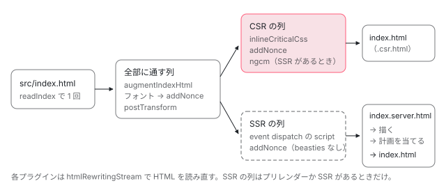

[目次](../README.md) › [ビルドの前と後：書いた HTML・CSS・class が何に変わるか](README.md) › 第 3 回 / 全 3 回

# index.html の前と後：script と link、重要な CSS とフォントの埋め込み、プリレンダーとの違い

> 書いた index.html と、development・production（CSR）・開いたあとの DOM・プリレンダーの index.html を並べ、足されたものを 1 つずつたどる。プラグインの列と htmlRewritingStream、inline-critical-css.ts の beasties の設定が &lt;style&gt;・media="print"・noscript・media を戻す script になる行、CSR では .page-title が埋め込まれずプリレンダーでは埋め込まれる理由、inline-fonts.ts が Google Fonts の link を style にする行、nonce の写し方と fonts.inline による違い、valid-self-closing-tags が &lt;style/&gt; を通してしまうこと、auto-csp の仕組み。このシリーズで見つけたもの。

angular/angular-cli · 読了 約 13 分 · 中核 · [サイトで読む（デモが動きます）](https://angular-deep-dive-cyan.vercel.app/chapter/bmap-index-html)

---

題材の `src/index.html` は 13 行で、`<script>` も `<link rel="stylesheet">` もありません。production でビルドすると、`<html>` に属性が付き、`<style>`・`media="print"` の `<link>`・`<noscript>`・最後の inline の `<script>` が足されます。この章では、足されたものを 1 つずつ、そうした行と結び付けます。中心は、重要な CSS（最初の描画に要る規則）を埋め込む `inline-critical-css.ts` です。プリレンダーを足すと `.page-title` の規則が埋め込まれるか、`inlineCritical: false`・Google Fonts・`ngCspNonce` で何が変わるかを、題材の複製で確かめます。

読む対象は angular-cli の `packages/angular/build/src/utils/index-file/` の `index-html-generator.ts`・`html-rewriting-stream.ts`・`inline-critical-css.ts`・`inline-fonts.ts`・`nonce.ts`・`valid-self-closing-tags.ts` です。`<script>` と `<link>` を差し込む `augmentIndexHtml` と、プラグインの列を作るコンストラクタは[index.html の生成の章](../boot/05-boot-index-html.md)が読んだので、ここでは引きません。プリレンダーが HTML を書き出す流れは[プリレンダーの章](../platform/06-ssr-prerender.md)にあります。

1. [1. コンポーネントの前と後](01-bmap-component.md)
2. [2. スタイルの前と後](02-bmap-styles-bundle.md)
3. **3. index.html の前と後**（この章）

## 0. 書いた index.html と出力の index.html

題材を `ng build`（production）と `ng build -c development` にかけ、production の出力を headless Chrome（画面を出さない Chrome）で開いて `--dump-dom` で DOM を書き出しました（@angular/build 22.2.7 / beasties 0.5.4 / @angular/ssr 22.2.7）。下のボタンで切り替えます。

> **🧪 DEMO — index.html の前と後（記録の再生）**
>
> ブラウザの上では何もビルドしません。印は、ひとつ前の段に無い行です。
>
> ▶ [このデモはサイトで動かせます](https://angular-deep-dive-cyan.vercel.app/chapter/bmap-index-html)

production の出力で足されたものを、1 つずつ表にします。

| 足されたもの | development | そうした行 |
| --- | --- | --- |
| `<link rel="stylesheet" href="styles-JQLOIGW2.css">`（`</head>` の前） | あり | `augmentIndexHtml`（[index.html の生成の章](../boot/05-boot-index-html.md)の 6 節） |
| `<script src="main-66TXY5QV.js" type="module">`（`</body>` の前） | あり | 同上 |
| `<html … data-beasties-container>` | なし | 2 節。beasties が文書の一番外の要素に付ける印 |
| `<style>body{margin:0;…}</style>` | なし | 2 節 inline-critical-css.ts 45・63 行目 |
| `media="print" data-beasties-media="all"` | なし | 2 節 49 行目 `preload: 'media-script'` |
| `<noscript><link rel="stylesheet" …></noscript>` | なし | 2 節 57 行目 `noscriptFallback: true` |
| 最後の inline の `<script>`（`media` を戻す） | なし | 2 節 49 行目（beasties が `<body>` の最後に足す） |
| `.page-title` の規則 | 埋め込まれない。`<app-root>` の中が空だから（2 節・3 節） |   |

development に足されたのは `<link>` と `<script>` の 2 つだけで、`</head>` と `</body>` の直前に改行なしで入っています。あなたの書いた行は、改行も字下げもそのまま残ります。「開いたあとの DOM」では、`link` の `media` が `all` に戻って `data-beasties-media` が消え、`<head>` の最後にコンポーネントの `<style>`（`_nghost-ng-c663675611` 付き。[第 1 回](01-bmap-component.md)）が足され、`<app-root>` の中が描かれています。

## 1. プラグインの列：1 つずつ HTML を読み直す

`index.html` を作る `IndexHtmlGenerator` は、コンストラクタでプラグイン（「HTML の文字列を受けて、新しい文字列を返す関数」）の列を 3 つ作ります。全部に通す列、CSR（ブラウザで描く）用の列、SSR 用の列です。どの条件で何が入るかは[index.html の生成の章](../boot/05-boot-index-html.md)の 5 節にあります。題材の production の CSR では、次の順でした。

1. **全部に通す列**

   `augmentIndexHtml`（`<script>` と `<link>`）→ フォントの埋め込み → `addNonce` → `postTransform`（開発サーバーなどが HTML を後から変える口。`ng build` では何もしない）。フォントの 2 つは `fonts.inline` が真のときだけです。
2. **CSR の列**

   重要な CSS の埋め込み（`inlineCritical` が真のときだけ）→ `addNonce`。SSR かプリレンダーがあるときは、続けて `ngcm` の属性（4 節）。



*src/index.html は 1 回だけ読まれ、全部に通す列のあとで CSR の列と SSR の列に分かれる。プリレンダーの index.html は、SSR の列を通ったものに描いた中身と重要な CSS を入れたもの。*

📄 `angular-cli/packages/angular/build/src/utils/index-file/index-html-generator.ts` L133–158 （▶ の行: 140–143, 145, 147, 151）

```ts
133 │   private async runPlugins(
134 │     content: string,
135 │     plugins: IndexHtmlGeneratorPlugin[],
136 │     options: IndexHtmlGeneratorProcessOptions,
137 │     warnings: string[],
138 │     errors: string[],
139 │   ): Promise<string> {
140 ▶     for (const plugin of plugins) {
141 ▶       const result = await plugin(content, options);
142 ▶       if (typeof result === 'string') {
143 ▶         content = result;
144 │       } else {
145 ▶         content = result.content;
146 │ 
147 ▶         if (result.warnings.length) {
148 │           warnings.push(...result.warnings);
149 │         }
150 │ 
151 ▶         if (result.errors.length) {
152 │           errors.push(...result.errors);
153 │         }
154 │       }
155 │     }
156 │ 
157 │     return content;
158 │   }
```

140〜141 行目、プラグインは前のプラグインが返した文字列を受けて、1 つずつ `await` されます。142〜143 行目、文字列を返せばそれが次の入力に、145 行目、`{ content, warnings, errors }` を返せば中身と一緒に警告とエラーを集めます。3 節で見る beasties の警告は、この 147〜149 行目を通ってビルドの `▲ [WARNING]` になります。

各プラグインは、HTML を自分で読み直します。そのための道具が次の関数です。

📄 `angular-cli/packages/angular/build/src/utils/index-file/html-rewriting-stream.ts` L18–37 （▶ の行: 22–23, 28, 30–31, 34）

```ts
18 │ export async function htmlRewritingStream(content: string): Promise<{
19 │   rewriter: RewritingStream;
20 │   transformedContent: () => Promise<string>;
21 │ }> {
22 ▶   const { RewritingStream } = await import('parse5-html-rewriting-stream');
23 ▶   const rewriter = new RewritingStream();
24 │ 
25 │   return {
26 │     rewriter,
27 │     transformedContent: () =>
28 ▶       pipeline(Readable.from(content), rewriter, async function (source) {
29 │         const chunks = [];
30 ▶         for await (const chunk of source) {
31 ▶           chunks.push(Buffer.from(chunk));
32 │         }
33 │ 
34 ▶         return Buffer.concat(chunks).toString('utf-8');
35 │       }),
36 │   };
37 │ }
```

22〜23 行目、parse5（HTML の仕様どおりに字句を切るライブラリ）の `RewritingStream` を作ります。これは開始タグ・終了タグ・文字を 1 つずつ出来事として流し、手を加えなかった所は元の文字列をそのまま出力に写す作りです。28 行目、HTML の文字列をストリームに流し込み、30〜34 行目で出力を 1 つの文字列に戻します。呼んだ側は `startTag` などの出来事を受けて `emitStartTag`（タグを書き直して出す）や `emitRaw`（文字列をそのまま出す）を呼びます。

> [!WARNING]
> **ハマりどころ**
>
> `emitStartTag` で出し直したタグは、parse5 が属性を並べ直した形になります。属性の名前は小文字（`ngCspNonce` → `ngcspnonce`）、値の無い属性は `=""` 付き（`data-beasties-container` → `data-beasties-container=""`）です。記録では、`ngCspNonce` を付けた複製と、プリレンダーの `index.csr.html` でこの形になりました。どちらも、beasties のあとにタグを出し直すプラグイン（`addNonce` と `ngcm`）が動いたからです。何も付けない production では `addNonce` が 5 節の 24〜26 行目で何もせずに返るので、`data-beasties-container` は値の無いままです。ブラウザにとってはどちらも同じ意味です。

## 2. inline-critical-css.ts：beasties の設定が、足されたもの 1 つずつになる

重要な CSS を埋め込むのは、外部のライブラリ beasties（critters から分かれたもの。題材では 0.5.4）です。CLI の側の行は、その設定と、出力ファイルの読み方を渡すだけです。

📄 `angular-cli/packages/angular/build/src/utils/index-file/inline-critical-css.ts` L36–72 （▶ の行: 43, 45–51, 55, 57–58, 61, 63, 69）

```ts
36 │   const beasties = new Beasties({
37 │     logger: {
38 │       warn: (s: string) => warnings.push(s),
39 │       error: (s: string) => errors.push(s),
40 │       info: () => {},
41 │     },
42 │     logLevel: 'warn',
43 ▶     path: outputPath,
44 │     publicPath: deployUrl,
45 ▶     compress: minify,
46 ▶     pruneSource: false,
47 ▶     reduceInlineStyles: false,
48 ▶     mergeStylesheets: false,
49 ▶     preload: 'media-script',
50 ▶     nonce: (document) => {
51 ▶       const nonceElement = document.querySelector('[ngCspNonce], [ngcspnonce]');
52 │       const cspNonce =
53 │         nonceElement?.getAttribute('ngCspNonce') || nonceElement?.getAttribute('ngcspnonce');
54 │ 
55 ▶       return cspNonce ?? undefined;
56 │     },
57 ▶     noscriptFallback: true,
58 ▶     inlineFonts: true,
59 │   });
60 │ 
61 ▶   beasties.readFile = (path) => readAsset(path);
62 │ 
63 ▶   const content = await beasties.process(html);
64 │ 
65 │   return {
66 │     // Clean up value from value less attributes.
67 │     // This is caused because parse5 always requires attributes to have a string value.
68 │     // nomodule="" defer="" -> nomodule defer.
69 ▶     content: content.replace(/(\s(?:defer|nomodule))=""/g, '$1'),
70 │     errors,
71 │     warnings,
72 │   };
```

1. **61・63 行目：出力の CSS をメモリから読んで、HTML に当てる**

   beasties は HTML の中の `<link rel="stylesheet">` を見つけ、61 行目の `readFile` でその CSS を読みます。差し替えた先は、ディスクではなく esbuild がメモリに返した出力です（[index.html の生成の章](../boot/05-boot-index-html.md)の 4 節の `readAsset`）。63 行目の `process` は、CSS の規則を 1 つずつ HTML のどれかの要素に当たるかで選び、当たる規則だけを `<style>` に写します。
2. **.page-title が入らない理由**

   ビルドの時点の HTML は、あなたの `src/index.html` にタグを足しただけのもので、`<app-root></app-root>` の中は空です。`body` は当たりますが、`<h1 class="page-title">` はブラウザで JS が描くまで存在しないので、`.page-title` も `.unused-rule` も当たりません。だから CSR では、重要な CSS は `body{margin:0;font-family:system-ui,sans-serif}` の 1 つだけでした。
3. **45 行目：写した CSS を縮めるか**

   `compress` は `styles.minify` です（[第 2 回](02-bmap-styles-bundle.md)の 2 節）。元の CSS がすでに minify 済みなので、写した規則も 1 行です。
4. **46〜48 行目：元のファイルは変えない**

   46 行目 `pruneSource: false` で、写した規則を `styles-*.css` から消しません（第 2 回で `.unused-rule` も `body` も残っていたのはこのため）。47 行目、もとから HTML にある `<style>` は削らず、48 行目、`<style>` を 1 つにまとめません。
5. **49 行目：残りを遅らせる方法は media-script**

   `<link>` に `media="print"` を付けると、ブラウザは画面の描画を待たずに（印刷用として）CSS を読みます。本当の値は `data-beasties-media="all"` に取っておき、`<body>` の最後に足した 1 つの inline の `<script>` が、全部の `link[data-beasties-media]` の `media` を戻します。beasties 0.5.4 の `dist/index.mjs` では、`embedFetchedStylesheet` の中の `preloadMode === "media-script"` の分岐が属性を付け、`injectDeferredMediaScript` が script を足します。script の中身は毎回同じなので、CSP のハッシュでも許可できる、とその関数のコメントが書いています。
6. **57 行目：JS が動かないときの受け皿**

   `noscriptFallback: true` で、`media` を付ける前の `<link>` の写しを `<noscript>` に入れます。JS が無ければ inline の script も動かず `media` が戻らないので、その代わりです。
7. **50〜56 行目：nonce**

   HTML のどこかに `ngCspNonce` の属性があれば、その値を beasties が作る `<style>` と `<script>` に付けます。題材には無いので `undefined` で、何も付きません（5 節）。
8. **69 行目：値の無い属性の後片付け**

   beasties が書き戻すと `defer=""`・`nomodule=""` になるので、`defer`・`nomodule` に戻します。`data-beasties-container` のように値の無いまま出てくる属性もあり、そちらは触りません。

`data-beasties-container` は、beasties が HTML を読み込むとき、その印の付いた要素が 1 つも無ければ `<html>` に付けるものです（0.5.4 の `createDocument`）。規則が当たるかを調べる範囲を表す印で、この CLI の設定では毎回 `<html>` に付いたまま出力に残ります。

> [!NOTE]
> **さらに深く**
>
> beasties 0.5.4 は、CSS の入れ子（`&.on` のような `&` で始まるセレクター）を読めません。[第 2 回](02-bmap-styles-bundle.md)の 3 節で、`.browserslistrc` を新しい Chrome だけにして入れ子を残した複製は、ビルドの最後に次の警告を出しました。
>
> 📄 `ng build の出力（警告の部分）`
>
> ```
> ▲ [WARNING] Could not parse 1 selector in styles-G7NGYIOZ.css; its rule was left out of the critical CSS but still applies once the full stylesheet loads:
>   &.on (Empty sub-selector)
> ```
>
> 警告の文のとおり、その規則は重要な CSS には入らず、`styles-*.css` が読まれたあとに効きます。既定のブラウザの対象では esbuild が入れ子を平らにするので、この警告は出ません。

## 3. inlineCritical: false と、そのほかの複製

`"optimization": { "styles": { "minify": true, "inlineCritical": false } }` にすると、CSR の列に重要な CSS の埋め込みが入らず（[index.html の生成の章](../boot/05-boot-index-html.md)の 5 節の、`inlineCritical` が真のときだけ `inlineCriticalCssPlugin` を足す行）、出力は development と同じ 2 つのタグだけになります。下の DEMO で、この複製と、4〜7 節で使う複製をまとめて切り替えられます。

> **🧪 DEMO — 設定と入力を変えた複製の index.html（記録の再生）**
>
> 共有の題材を自分の場所に複製し、1 か所だけ変えてビルドした記録です。印は、比べる相手（各ボタンの説明に書いたもの）に無い行です。
>
> ▶ [このデモはサイトで動かせます](https://angular-deep-dive-cyan.vercel.app/chapter/bmap-index-html)

## 4. プリレンダーを足すと .page-title は埋め込まれるか

複製に次の `src/main.server.ts` を足し、`angular.json` の `options` に `"server": "src/main.server.ts"` と `"outputMode": "static"` を書きました（`tsconfig.json` の `files` にも足す）。全部のルートを `RenderMode.Prerender` にしています。

📄 `複製の src/main.server.ts`

```ts
import { provideZonelessChangeDetection } from '@angular/core';
import { bootstrapApplication, type BootstrapContext } from '@angular/platform-browser';
import { provideServerRendering, RenderMode, withRoutes } from '@angular/ssr';
import { App } from './app/app';

const bootstrap = (context: BootstrapContext) =>
  bootstrapApplication(
    App,
    {
      providers: [
        provideZonelessChangeDetection(),
        provideServerRendering(withRoutes([{ path: '**', renderMode: RenderMode.Prerender }])),
      ],
    },
    context,
  );

export default bootstrap;

```

ビルドは「Prerendered 1 static route.」を出し、`dist/demo/` には `3rdpartylicenses.txt・browser/index.csr.html・browser/index.html・browser/main-66TXY5QV.js・browser/styles-JQLOIGW2.css・prerendered-routes.json` ができました。DEMO の「prerender の index.html」が答えです。**埋め込まれました。**`<style>body{…}.page-title{color:#c3002f}</style>` になり、`.unused-rule` は入っていません。

1. **CSR の index.html には、ビルドの時点で beasties がかかる**

   プリレンダーがあるときも CSR の列は同じです。その結果は `index.csr.html` になり、中身は CSR の production とほぼ同じで、`<body ngcm="">` が足されています（`ngcm` の意味は[provideClientHydration の章](../platform/07-hydration-provide.md)の 7 節）。
2. **サーバー用の index.server.html には beasties がかからない**

   SSR の列は、イベントのリプレイの契約の script と `addNonce` だけです（[index.html の生成の章](../boot/05-boot-index-html.md)の 5 節の、`generateDedicatedSSRContent` の分岐）。代わりにビルドは、`styles-*.css` を beasties の「計画」（どのセレクターの規則か、を JSON にできる形にしたもの）に変えて、サーバーのマニフェストに入れます（[サーバーのアセットと重要 CSS の章](../ssrx/09-ssrx-assets-css.md)の 3 節）。
3. **描いたあとの HTML に、計画を当てはめる**

   プリレンダーは本番のサーバーと同じ `AngularServerApp` で `/` を描き（[プリレンダーの章](../platform/06-ssr-prerender.md)）、描いた HTML に `inlineCriticalCss` で計画を当てはめます（[AngularAppEngine の章](../platform/04-ssr-app-engine.md)の 8 節）。このときの HTML には `<h1 class="page-title">` があるので、`.page-title` の規則が当たります。

プリレンダーの `index.html` は、サーバーで描いた文書を書き出したものなので、CSR の出力とは形が違います。`<!doctype html>` は `<!DOCTYPE html>` になり、`<html>` に `data-beasties-container` はなく、コンポーネントの CSS が `<style ng-app-id="ng">` として入り、`<app-root>` に `ng-version` と `ng-server-context="ssg"` が付いています。開いたあとの DOM では `ng-app-id` が外れ、同じ中身の `<style>` が使い回されています（[コンポーネントのスタイルの章](../cli/04-cli-component-styles.md)の 8 節）。

## 5. nonce：ngCspNonce の値を写す

CSP（Content Security Policy。ブラウザに「この印の付いた script と style だけを実行してよい」と伝える仕組み）で nonce（ページごとに変わる合言葉）を使うとき、Angular には `<app-root ngCspNonce="…">` の形で値を渡します。ビルドはその値を、自分が足した `<style>` と `<script>` に写します。

📄 `angular-cli/packages/angular/build/src/utils/index-file/nonce.ts` L44–65 （▶ の行: 47, 55–58）

```ts
44 │ /** Finds the Angular nonce in an HTML string. */
45 │ export async function findNonce(html: string): Promise<string | null> {
46 │   // Inexpensive check to avoid parsing the HTML when we're sure there's no nonce.
47 ▶   if (!NONCE_ATTR_PATTERN.test(html)) {
48 │     return null;
49 │   }
50 │ 
51 │   const { rewriter, transformedContent } = await htmlRewritingStream(html);
52 │   let nonce: string | null = null;
53 │ 
54 │   rewriter.on('startTag', (tag) => {
55 ▶     const nonceAttr = tag.attrs.find((attr) => NONCE_ATTR_PATTERN.test(attr.name));
56 ▶     if (nonceAttr?.value) {
57 ▶       nonce = nonceAttr.value;
58 ▶       rewriter.stop(); // Stop parsing since we've found the nonce.
59 │     }
60 │   });
61 │ 
62 │   await transformedContent();
63 │ 
64 │   return nonce;
65 │ }
```

📄 `angular-cli/packages/angular/build/src/utils/index-file/nonce.ts` L21–42 （▶ の行: 22, 24–25, 30, 32–33, 35, 38）

```ts
21 │ export async function addNonce(html: string): Promise<string> {
22 ▶   const nonce = await findNonce(html);
23 │ 
24 ▶   if (!nonce) {
25 ▶     return html;
26 │   }
27 │ 
28 │   const { rewriter, transformedContent } = await htmlRewritingStream(html);
29 │ 
30 ▶   rewriter.on('startTag', (tag) => {
31 │     if (
32 ▶       (tag.tagName === 'style' || tag.tagName === 'script') &&
33 ▶       !tag.attrs.some((attr) => attr.name === 'nonce')
34 │     ) {
35 ▶       tag.attrs.push({ name: 'nonce', value: nonce });
36 │     }
37 │ 
38 ▶     rewriter.emitStartTag(tag);
39 │   });
40 │ 
41 │   return transformedContent();
42 │ }
```

47 行目、まず文字列の中に `ngCspNonce`（大文字・小文字を区別しない）が無ければ HTML を読みません。55〜58 行目、最初に見つけた値で読むのを止めます。24〜26 行目、値が無ければ HTML をそのまま返します。32〜35 行目、`<style>` と `<script>` のうち、まだ `nonce` の無いものに付けます。

ところが記録では、`<link rel="stylesheet">` にも `nonce` が付いていました。../angular-cli の 44129f66a3 の 32 行目は `style` と `script` だけですが、題材の 22.2.7 の `nonce.js` には、b975da4b01（2026-10-08、PR #34256）で足された「`rel` が `stylesheet` か `modulepreload` の `<link>` にも付ける」行が入っています。b975da4b01 の本文は「`style-src` に `'self'` を入れない厳しい CSP では、外の CSS も nonce で許可する必要がある」と書いています。

もう 1 つ、記録で `<noscript>` の中の `<link>` の `nonce` は、`fonts.inline` によって付いたり付かなかったりしました（DEMO の「ngCspNonce」と「ngCspNonce・fonts: false」）。1 節の順のとおり、`fonts.inline` が真なら全部に通す列にも `addNonce` があり、beasties より前に `<link>` へ `nonce` が付きます。beasties はその `<link>` を写して `<noscript>` を作るので、写しにも付きます。`fonts.inline` が偽なら、`addNonce` は beasties のあとの 1 回だけで、parse5 は `<head>` の中の `<noscript>` の中身を文字として流すので、写しには付きません。

## 6. フォントの埋め込み：Google Fonts の link を style に

1 節の全部に通す列のフォントのプラグインは、HTML の `<link rel="stylesheet">` の中から Google Fonts と Typekit のものを探して、その中身を埋め込みます。まず `process` の前半で HTML を 1 回読んで、`rel="stylesheet"` の `href` と既にある `preconnect` を集め、次にダウンロードします。

📄 `angular-cli/packages/angular/build/src/utils/index-file/inline-fonts.ts` L106–132 （▶ の行: 110–111, 116–117, 121, 124–126, 130–131）

```ts
106 │     // Download stylesheets
107 │     const hrefsContent = new Map<string, string>();
108 │     const newPreconnectUrls = new Set<string>();
109 │ 
110 ▶     for (const hrefItem of hrefList) {
111 ▶       const url = this.createNormalizedUrl(hrefItem);
112 │       if (!url) {
113 │         continue;
114 │       }
115 │ 
116 ▶       const content = await this.processURL(url);
117 ▶       if (content === undefined) {
118 │         continue;
119 │       }
120 │ 
121 ▶       hrefsContent.set(hrefItem, content);
122 │ 
123 │       // Add preconnect
124 ▶       const preconnectUrl = this.getFontProviderDetails(url)?.preconnectUrl;
125 ▶       if (preconnectUrl && !existingPreconnect.has(preconnectUrl)) {
126 ▶         newPreconnectUrls.add(preconnectUrl);
127 │       }
128 │     }
129 │ 
130 ▶     if (hrefsContent.size === 0) {
131 ▶       return content;
132 │     }
```

📄 `angular-cli/packages/angular/build/src/utils/index-file/inline-fonts.ts` L134–167 （▶ の行: 135, 140–143, 147, 149–150, 154, 156）

```ts
134 │     // Replace link with style tag.
135 ▶     const { rewriter, transformedContent } = await htmlRewritingStream(content);
136 │     rewriter.on('startTag', (tag) => {
137 │       const { tagName, attrs } = tag;
138 │ 
139 │       switch (tagName) {
140 ▶         case 'head':
141 ▶           rewriter.emitStartTag(tag);
142 ▶           for (const url of newPreconnectUrls) {
143 ▶             rewriter.emitRaw(`<link rel="preconnect" href="${url}" crossorigin>`);
144 │           }
145 │           break;
146 │ 
147 ▶         case 'link': {
148 │           const hrefAttr =
149 ▶             attrs.some(({ name, value }) => name === 'rel' && value === 'stylesheet') &&
150 ▶             attrs.find(({ name, value }) => name === 'href' && hrefsContent.has(value));
151 │           if (hrefAttr) {
152 │             const href = hrefAttr.value;
153 │             const cssContent = hrefsContent.get(href);
154 ▶             rewriter.emitRaw(`<style>${cssContent}</style>`);
155 │           } else {
156 ▶             rewriter.emitStartTag(tag);
157 │           }
158 │           break;
159 │         }
160 │         default:
161 │           rewriter.emitStartTag(tag);
162 │ 
163 │           break;
164 │       }
165 │     });
166 │ 
167 │     return transformedContent();
```

116 行目の `processURL` は[第 2 回](02-bmap-styles-bundle.md)の 5 節で読んだもので、対応する提供元でなければ `undefined` を返し、117 行目で飛ばします。124〜127 行目、Google Fonts ならフォントのファイルの置き場 `https://fonts.gstatic.com` を、まだ無ければ `preconnect`（先に接続だけしておくヒント）の候補にします。130〜131 行目、埋め込むものが 1 つも無ければ HTML を読み直さずに返します。135 行目でもう 1 回 HTML を読み、140〜143 行目で `<head>` の開始タグの直後に `<link rel="preconnect" … crossorigin>` を出し、147〜154 行目でダウンロードできた `<link>` を `<style>…</style>` に置き換えます。

📄 `angular-cli/packages/angular/build/src/utils/index-file/index-html-generator.ts` L208–230 （▶ の行: 209–211, 218, 221）

```ts
208 │ function inlineFontsPlugin({ options }: IndexHtmlGenerator): IndexHtmlGeneratorPlugin {
209 ▶   const inlineFontsProcessor = new InlineFontsProcessor({
210 ▶     minify: options.optimization?.styles.minify,
211 ▶   });
212 │ 
213 │   return (html) => inlineFontsProcessor.process(html);
214 │ }
215 │ 
216 │ function inlineCriticalCssPlugin(generator: IndexHtmlGenerator): IndexHtmlGeneratorPlugin {
217 │   const { outputPath, deployUrl, optimization } = generator.options;
218 ▶   const { minify = false } = optimization?.styles ?? {};
219 │ 
220 │   return (html) =>
221 ▶     inlineCriticalCss(html, outputPath, deployUrl, minify, (path) => generator.readAsset(path));
222 │ }
223 │ 
224 │ function addNoncePlugin(): IndexHtmlGeneratorPlugin {
225 │   return (html) => addNonce(html);
226 │ }
227 │ 
228 │ function autoCspPlugin(unsafeEval: boolean): IndexHtmlGeneratorPlugin {
229 │   return (html) => autoCsp(html, unsafeEval);
230 │ }
```

209〜211 行目、`index.html` の道では `InlineFontsProcessor` に `minify` だけを渡し、`cache` を渡しません。第 2 回の CSS の `@import` の道と違って、ディスクのキャッシュを使わず、ビルドのたびにダウンロードします。210 行目の `minify` が第 2 回の 5 節で見た `processURL` の正規表現の minify を動かすので、埋め込んだ `<style>` は改行の無い 1 行です（DEMO の「Google Fonts の link」）。218・221 行目は 2 節の `inlineCriticalCss` に `minify` と `readAsset` を渡す所です。

## 7. 自分で閉じるタグの検査：valid-self-closing-tags.ts

`augmentIndexHtml` は、`<div />` のような HTML では許されない自分で閉じるタグを「Invalid self-closing element in index HTML file」のエラーにします（その分岐は[index.html の生成の章](../boot/05-boot-index-html.md)の 6 節）。許すタグの表が次のファイルです。

📄 `angular-cli/packages/angular/build/src/utils/index-file/valid-self-closing-tags.ts` L9–25 （▶ の行: 10–11, 19–20）

```ts
 9 │ /** A list of valid self closing HTML elements */
10 ▶ export const VALID_SELF_CLOSING_TAGS = new Set([
11 ▶   'area',
12 │   'base',
13 │   'br',
14 │   'col',
15 │   'embed',
16 │   'hr',
17 │   'img',
18 │   'input',
19 ▶   'link',
20 ▶   'meta',
21 │   'param',
22 │   'source',
23 │   'track',
24 │   'wbr',
25 │ 
```

📄 `angular-cli/packages/angular/build/src/utils/index-file/valid-self-closing-tags.ts` L64–77 （▶ の行: 64, 70, 73）

```ts
64 ▶   'linearGradient',
65 │   'radialGradient',
66 │   'stop',
67 │   'image',
68 │   'pattern',
69 │   'defs',
70 ▶   'g',
71 │   'marker',
72 │   'mask',
73 ▶   'style',
74 │   'symbol',
75 │   'use',
76 │   'view',
77 │ 
```

11〜24 行目は HTML の空要素（中身を持てない要素。`<br>`・`<link>`・`<meta>` など）です。そのあとに SVG と MathML のタグが続きます。SVG や MathML の中では `<circle />` のような書き方が正しいので足されました（#27702・#28502 の issue のあと）。表は 1 つの `Set` で、タグがどこにあるか（SVG の中か、HTML の中か）は見ません。`linearGradient` のような大文字の混じる名前は、parse5 が SVG の中で正しい大文字に直して渡すので、記録でも `<svg><linearGradient/></svg>` はエラーになりませんでした。

73 行目の `style` は SVG の `<style>` のための行ですが、HTML の `<head>` に `<style/>` と書いても同じ表に当たります。複製でこう書いて development でビルドすると、エラーも警告も出ずに通りました（DEMO の「&lt;style/&gt; と書いた」）。HTML では `<style>` の `/` は無視されて中身の始まりになり、その後ろは `</style>` まで全部 CSS の文字として読まれます。parse5 も同じに読むので、`augmentIndexHtml` には `</head>` も `</body>` も来ず、`<link>` と `<script>` は「head も body も無い HTML」の分岐で先頭に付きました（同じ章の 6 節の最後の引用）。同じ形の HTML を headless Chrome で開くと、`<app-root>` は `<style>` の中の文字になり、`<body>` は空でした。

📄 `同じ形の HTML を headless Chrome で開いたあとの DOM`

```
<html><head><link rel="stylesheet" href="styles.css"><script src="main.js" type="module"></script><style></head><body><app-root></app-root></body></html></style></head><body></body></html>
```

## 8. auto-csp について

`"security": { "autoCsp": true }` にすると、CSR の列の最後に `autoCsp` のプラグインが入ります（[index.html の生成の章](../boot/05-boot-index-html.md)の 5 節。SSR と一緒には使えない）。これは nonce の代わりにハッシュで許可する仕組みで、HTML の中の inline の `<script>` の中身から SHA-256 を計算し、`'strict-dynamic'`（許可した script が作る script も許す指定）と並べた CSP を `<meta http-equiv="Content-Security-Policy">` として `<head>` の開始タグの直後に入れます（HTML を 2 回読み、1 回目でハッシュを集め、2 回目で入れる）。`src` で読む `<script>` は中身からハッシュを作れないので、続いて並ぶものをまとめて、それらを読み込む小さな inline の script に置き換え、その script のハッシュを CSP に入れます。2 節の `media` を戻す script も inline の script なので、ここでハッシュが集められます。

## 呼び出しの連なり

- `generateIndexHtml()` — tools/esbuild/index-html-generator.ts — *esbuild のあと（index.html の生成の章）*
  - `IndexHtmlGenerator.process()` — utils/index-file/index-html-generator.ts L112
    - `runPlugins(content, this.plugins)` — L133 — *全部に通す列*
      - `augmentIndexHtml()` — augment-index-html.ts — *link と script。自分で閉じるタグの検査*
      - `InlineFontsProcessor.process() → processURL()` — inline-fonts.ts L53 / L266 — *fonts.inline のとき。cache なし*
      - `addNonce()` — nonce.ts L21 — *fonts.inline のときだけ、ここにも*
    - `runPlugins(content, this.csrPlugins)` — L133 — *CSR の列*
      - `inlineCriticalCss() → new Beasties(…).process(html)` — inline-critical-css.ts L20 / L63 — *style・media="print"・noscript・media を戻す script*
      - `addNonce()` — nonce.ts L21
      - `addNgcmAttribute()` — ngcm-attribute.ts — *SSR かプリレンダーのとき*
    - `runPlugins(content, this.ssrPlugins)` — L133 — *index.server.html。beasties はかからない*
- `prerenderPages() → AngularServerApp → inlineCriticalCss(html)` — @angular/ssr — *描いた HTML に計画を当てはめる（プリレンダーの章・AngularAppEngine の章）*

## テストと直し方

### spec と it

| ファイル | describe / it | 行 | この章のどこ |
| --- | --- | --- | --- |
| utils/index-file/inline-critical-css\_spec.ts | `inlineCriticalCss` › `should inline critical css`・`… when using deployUrl`・`should compress … when minify is enabled`・`should process the inline onload handlers and style tag when ngCspNonce is specified`・`… ngcspnonce is lowercase`・`should not modify the document for external stylesheets`・`should clean up empty values from valueless attributes like defer and nomodule`・`should capture warnings from beasties` | 12・44・69・93・113・140・159・191・216 | 2 節 |
| utils/index-file/nonce\_spec.ts | `addNonce` › `should add the nonce expression to all inline style tags` ほか 4 つ | 11・12・29・44・61・77 | 5 節 |
| utils/index-file/inline-fonts\_spec.ts | `InlineFontsProcessor` › `Google fonts` › `should inline supported fonts and icons in HTML`・`should add preconnect hint` ほか | 11・30・93・114 | 6 節 |
| utils/index-file/augment-index-html\_spec.ts | `augment-index-html` › `self-closing tags` › `should return an error when used on a not supported element`・`should not return an error when used on a supported element` | 11・559・560・576 | 7 節 |
| builders/application/tests/options/optimization-inline-critical\_spec.ts | `Option: "inlineCritical"` › 6 つ（`'inlineCritical' is true`・`'optimization' is unset`・`… is true`・`… is false`・`'inlineCritical' is false`・`'@media all {}' and 'minify'`） | 13・18・43・61・79・92・112 | 3 節 |
| builders/application/tests/behavior/csp-nonce\_spec.ts | `Behavior: "CSP Nonce"` › `should add CSP nonce to scripts when optimization is disabled` | 13・14 | 5 節 |

📄 `angular-cli/packages/angular/build/src/utils/index-file/inline-critical-css_spec.ts` L113–138 （▶ の行: 115, 124, 130–132, 134）

```ts
113 │   it('should process the inline onload handlers and style tag when ngCspNonce is specified', async () => {
114 │     const { content, errors, warnings } = await inlineCriticalCss(
115 ▶       getContent('', '<app ngCspNonce=""></app>'),
116 │       '/dist/',
117 │       undefined,
118 │       false,
119 │       readAsset,
120 │     );
121 │ 
122 │     expect(errors).toEqual([]);
123 │     expect(warnings).toEqual([]);
124 ▶     expect(content).toContain(
125 │       '<link href="styles.css" rel="stylesheet" media="print" data-beasties-media="all">',
126 │     );
127 │     expect(content).toContain(
128 │       '<link href="theme.css" rel="stylesheet" media="print" data-beasties-media="all">',
129 │     );
130 ▶     // Nonces shouldn't be added inside the `noscript` tags.
131 ▶     expect(content).toContain('<noscript><link href="theme.css" rel="stylesheet"></noscript>');
132 ▶     expect(content).toContain('<script nonce="">');
133 │     expect(tags.stripIndents`${content}`).toContain(tags.stripIndents`
134 ▶     <style nonce="">
135 │     body { margin: 0; }
136 │     html { color: white; }
137 │     </style>`);
138 │   });
```

115 行目で `<app ngCspNonce="">` を入れた HTML を `inlineCriticalCss` だけにかけ、132・134 行目で beasties が作った `<script>` と `<style>` に nonce が付くことを確かめます。130〜131 行目のコメントは「`noscript` の中には付けない」です。この it は beasties だけを見ていて、1 節の列の中で `addNonce` が beasties の前にも動くとき（`fonts.inline` が真）に `noscript` の写しへ付くことは確かめていません。

📄 `angular-cli/packages/angular/build/src/builders/application/tests/behavior/csp-nonce_spec.ts` L13–34 （▶ の行: 16, 22, 30, 32）

```ts
13 │   describe('Behavior: "CSP Nonce"', () => {
14 │     it('should add CSP nonce to scripts when optimization is disabled', async () => {
15 │       await harness.modifyFile('src/index.html', (content) =>
16 ▶         content.replace(/<app-root/g, '<app-root ngCspNonce="" '),
17 │       );
18 │ 
19 │       harness.useTarget('build', {
20 │         ...BASE_OPTIONS,
21 │         polyfills: [],
22 ▶         optimization: false,
23 │       });
24 │ 
25 │       const { result } = await harness.executeOnce();
26 │       expect(result?.success).toBeTrue();
27 │ 
28 │       const indexFileContent = harness.expectFile('dist/browser/index.html').content;
29 │       indexFileContent.toContain(
30 ▶         '<script src="main.js" type="module" nonce=""></script>',
31 │       );
32 ▶       indexFileContent.toContain('<app-root ngcspnonce=""');
33 │     });
34 │   });
```

application の behavior テストで nonce を見るのはこの 1 つだけで、22 行目 `optimization: false`、つまり beasties もフォントも通らない形です。32 行目は 1 節の注意のとおり、出し直した属性の名前が `ngcspnonce` になることを、そのまま期待しています。

📄 `angular-cli/packages/angular/build/src/builders/application/tests/options/optimization-inline-critical_spec.ts` L92–110 （▶ の行: 100, 109）

```ts
 92 │     it(`should not extract critical css when 'inlineCritical' is false`, async () => {
 93 │       harness.useTarget('build', {
 94 │         ...BASE_OPTIONS,
 95 │         styles: ['src/styles.css'],
 96 │         optimization: {
 97 │           scripts: false,
 98 │           styles: {
 99 │             minify: false,
100 ▶             inlineCritical: false,
101 │           },
102 │           fonts: false,
103 │         },
104 │       });
105 │ 
106 │       const { result } = await harness.executeOnce();
107 │ 
108 │       expect(result?.success).toBe(true);
109 ▶       harness.expectFile('dist/browser/index.html').content.not.toContain(`<style`);
110 │     });
```

100 行目 `inlineCritical: false` で、109 行目、出力に `<style` が無いことを確かめます。DEMO の「inlineCritical: false」と同じ形です。

📄 `angular-cli/packages/angular/build/src/utils/index-file/augment-index-html_spec.ts` L559–590 （▶ の行: 566, 573, 582, 589）

```ts
559 │   describe('self-closing tags', () => {
560 │     it('should return an error when used on a not supported element', async () => {
561 │       const { errors } = await augmentIndexHtml({
562 │         ...indexGeneratorOptions,
563 │         html: `
564 │           <html>
565 │             <body>
566 ▶               <app-root />
567 │             </body>
568 │           </html>'
569 │         `,
570 │       });
571 │ 
572 │       expect(errors.length).toEqual(1);
573 ▶       expect(errors).toEqual([`Invalid self-closing element in index HTML file: '<app-root />'.`]);
574 │     });
575 │ 
576 │     it('should not return an error when used on a supported element', async () => {
577 │       const { errors } = await augmentIndexHtml({
578 │         ...indexGeneratorOptions,
579 │         html: `
580 │           <html>
581 │             <body>
582 ▶               <br />
583 │               <app-root><app-root>
584 │             </body>
585 │           </html>'
586 │         `,
587 │       });
588 │ 
589 ▶       expect(errors.length).toEqual(0);
590 │     });
```

自分で閉じるタグの it は、566 行目の `<app-root />` がエラーになることと、582 行目の `<br />` がならないことの 2 つです。SVG の中のタグや、表にある `style` を HTML の中で書いた場合の it はありません。

### 手元で走らせた結果

📄 `走らせたコマンド`

```
cd ~/angular-research/angular-cli
pnpm bazel test //packages/angular/build:test --nocache_test_results --test_output=all \
  "--test_arg=--filter=inlineCriticalCss|InlineFontsProcessor|addNonce|augment-index-html"
pnpm bazel test //packages/angular/build:application_integration_tests --nocache_test_results --test_output=all \
  "--test_arg=--filter=inlineCritical|outputHashing|fonts.inline|removeSpecialComments"
```

../angular-cli（44129f66a3）で 2026-11-18 に走らせました。単体の `//packages/angular/build:test` は、4 つの shard で合わせて 50 specs（index-file の 4 つの spec の 48 と `manifest_spec.ts` の 2）が走って 0 failures、PASSED（42.1 秒）でした。application の behavior テストは 19 specs が走って 0 failures、1 pending で PASSED（21.7 秒）。絞り込みは shard ごとにかかるので、「Ran 0 of 361 specs」の shard もありました。`inline-fonts_spec.ts` の it は本物の `fonts.googleapis.com` に取りに行くので、通信できない所では落ちます。

### 直すとしたら

- `<style/>` を通してしまうのは、`valid-self-closing-tags.ts` の表がタグの場所を見ないからです。`augmentIndexHtml` の default の分岐で、SVG と MathML の表は `<svg>`・`<math>` の中にいるときだけ使う（中にいるかを開始タグと終了タグで数える）形にすれば、HTML の中の `<style/>` はエラーになります。spec は `augment-index-html_spec.ts` の `self-closing tags`（559 行目）に、HTML の中の `<style />` と SVG の中の `<style />` の 2 つの it を足します。
- `noscript` の写しの nonce が `fonts.inline` で変わるのは、`index-html-generator.ts` のコンストラクタで `addNonce` が全部に通す列に入る条件が、フォントの埋め込みと同じだからです。CSR の列で `inlineCriticalCssPlugin` の前にも `addNonce` を置けば、`fonts.inline` にかかわらず同じ出力になります。spec は application の `csp-nonce_spec.ts` に、`optimization: true` と `fonts: false` の 2 つの形で `<noscript>` の中を確かめる it を足します。
- beasties の設定を変えるなら `inline-critical-css.ts` 36〜59 行目の 1 か所です。出力の形を変える設定（`preload` など）は auto-csp の前提（中身の決まった script）にも関わるので、`inline-critical-css_spec.ts` と `auto-csp_spec.ts` を一緒に走らせます。

## このシリーズで見つけたもの

各章で、ソースの行と、自分で動かした記録で確かめたものです。「既存」は `gh` で探して見つかった issue・PR です（2026-11-18）。

| 章 | 何が起きるか | ソースの行 | 再現 | 既存の issue / PR |
| --- | --- | --- | --- | --- |
| [第 1 回](01-bmap-component.md) | （不具合ではない・spec の穴）`_nghost-ng-c…` の数字を決める `getComponentId` の材料を固める spec が無く、新しい本家では材料が 1 つ減って、同じコンポーネントの数字が変わる | core/src/render3/definition.ts の `getComponentId`。98b0f3b7207（origin/main と v22.3.0-rc.0）で `componentDef.signals` の 1 行が消えた | 題材の `Card` は 22.2.6 で `c663675611`、その 1 行だけを消した作業木で `c3857098018`（第 1 回の 7 節・10 節） | — |
| [第 2 回](02-bmap-styles-bundle.md) | （不具合・22.2.7 まで）Google Fonts の CSS のディスクのキャッシュが効かず、ビルドのたびにダウンロードする | inline-fonts.ts 184 行目が `base64`、258 行目が `hex`。259 行目の前にフォルダを作る行が無く、260 行目の `catch` が失敗を捨てる | 22.2.7 の `inline-fonts.js` の `https.get` を数える偽物に差し替え、同じ URL で 2 回 `processURL`。フォルダの有無にかかわらず 2 回。修正を当てた写しは 1 回 | #34719（閉）、PR #34720（4673cecf00、main。22.2.x に 67595ebff8、22.3.x に 820ca173fe。v22.2.7 より後） |
| [第 3 回](03-bmap-index-html.md) | （不具合らしきもの）`index.html` の `<head>` に `<style/>` と書くと、エラーにならずにビルドが通り、ページの中身が全部 `<style>` の文字になる | valid-self-closing-tags.ts 73 行目の SVG の `style` が、HTML の中の `<style/>` にも当たる（表がタグの場所を見ない） | 複製の `src/index.html` に `<style/>` を 1 行足して `ng build -c development`。`<link>` と `<script>` が `<!doctype html>` の前に付く。headless Chrome で `<body>` が空 | 見つからなかった（SVG のタグを許す #27702・#28502 は閉） |
| [第 3 回](03-bmap-index-html.md) | （不具合らしきもの）`ngCspNonce` を使うと、`<noscript>` の中の `<link>` の nonce が `fonts.inline` によって付いたり付かなかったりする | index-html-generator.ts のコンストラクタで、全部に通す列の `addNonce` が `fonts.inline` のときだけ入る。CSR の列の `addNonce` は beasties のあと | 複製の `<app-root ngCspNonce="r4nd0m">` を production でビルドすると付き、`fonts: false` にすると付かない | 見つからなかった（link に nonce を付ける #34255・PR #34256 は閉） |
| [第 3 回](03-bmap-index-html.md) | （警告どおりの限界）CSS の入れ子が出力に残ると、beasties 0.5.4 がそのセレクターを読めず、重要な CSS から外す | inline-critical-css.ts 38 行目の `warn` が警告を集める。入れ子が残るのは target が新しいときだけ（第 2 回の 3 節） | `.browserslistrc` を「last 2 Chrome versions」にし、`&.on` の規則を足して production。`Could not parse 1 selector … &.on (Empty sub-selector)` | 見つからなかった |

## 聞かれそうな質問

**Q. styles.css に書いた .page-title が、index.html の &lt;style&gt; に入りません。**

CSR では、ビルドの時点の `<app-root>` の中が空だからです。inline-critical-css.ts 63 行目の beasties は、HTML の要素に当たる規則だけを写します。`<h1 class="page-title">` はブラウザで JS が描くまで無いので当たりません。プリレンダーを足すと、描いたあとの HTML に当てはめるので入ります（4 節の記録）。

**Q. media="print" の link は、印刷のときしか効かないのでは？**

最初だけです。49 行目 `preload: 'media-script'` で beasties は本当の値を `data-beasties-media="all"` に取っておき、`<body>` の最後の inline の script が `media` を `all` に戻します。記録の「開いたあとの DOM」で `media="all"` になっていました。`print` にしておくのは、ブラウザに描画を待たせずに CSS を読ませるためです。

**Q. &lt;noscript&gt; の link は何のためですか？**

JS が動かないときの受け皿です。57 行目 `noscriptFallback: true` で、`media` を付ける前の `<link>` の写しを入れます。JS が無いと `media` を戻す script も動かないので、そのときはこちらが読まれます。

**Q. index.html に書いた ngCspNonce が、出力では ngcspnonce になっています。**

nonce.ts 38 行目などの `emitStartTag` がタグを parse5 の形で出し直すとき、属性の名前が小文字になるからです。HTML の属性の名前は大文字・小文字を区別しないので、意味は同じです。application の `csp-nonce_spec.ts` 32 行目もこの形を期待しています。

**Q. Google Fonts の link は、どの設定で style になりますか？**

`optimization.fonts.inline` が真のときです（`optimization: true` なら真）。全部に通す列に入るフォントのプラグインが、inline-fonts.ts 147〜154 行目で `<link>` を `<style>` に置き換え、140〜143 行目で `preconnect` を足します。index-html-generator.ts 209〜211 行目のとおりキャッシュは使わず、ビルドのたびにダウンロードします。

## 読み終えて

- `index.html` はプラグインの列を順に通り、各プラグインが `htmlRewritingStream` で HTML を読み直す。タグを出し直すと、属性の名前が小文字になり、値の無い属性に `=""` が付く。
- `<style>`・`media="print"`・`<noscript>`・`media` を戻す script・`data-beasties-container` は、inline-critical-css.ts 36〜59 行目の beasties の設定から出てくる。
- CSR では `<app-root>` が空なので、`body` のような要素に当たる規則しか埋め込まれない。プリレンダーでは描いたあとの HTML に当てはめるので `.page-title` も入る。
- Google Fonts の `<link>` は `<style>` と `preconnect` に、`ngCspNonce` の値は足した `<style>`・`<script>`・`<link>` に写る。
- 自分で閉じるタグの表は場所を見ないので、HTML の中の `<style/>` を通してしまう。

---

← 前: [スタイルの前と後：コンポーネントの CSS とグローバルの CSS、minify・target・ファイル名](02-bmap-styles-bundle.md)
