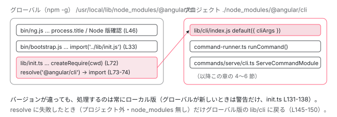

[目次](../README.md) › [起動の全手順](README.md) › 第 1 回 / 全 13 回

# 「ng serve」と打った直後に動くもの

> bin/ng.js → bootstrap.js → lib/init.ts → lib/cli → runCommand。グローバルにインストールした CLI が、プロジェクト内の CLI に処理を委ねる仕組みまで。

angular/angular-cli · 読了 約 11 分 · 基礎 · [サイトで読む（デモが動きます）](https://angular-deep-dive-cyan.vercel.app/chapter/boot-ng-command)

---

ターミナルで `ng serve` と打った瞬間から、`angular.json` を読んで 「serve というコマンドの `run()`」が呼ばれるまでを追います。この章で分かるのは 3 つです。最初に実行される JS ファイルはどれか、グローバルにインストールした CLI がどうやってプロジェクト内の CLI に処理を渡すか、そして文字列 `"serve"` がどうやって `ServeCommandModule` というクラスに変わるか。

読む対象は `packages/angular/cli/` の `bin/ng.js`、`bin/bootstrap.js`、`lib/init.ts`、`lib/cli/index.ts`、`src/command-builder/command-runner.ts`、`src/command-builder/utilities/command.ts`、`src/commands/serve/cli.ts` です。

1. **ng コマンド起動**（この章）
2. builder の解決
3. dev-server と Vite
4. application builder
5. index.html の生成
6. ブラウザが main.js を実行
7. bootstrapApplication
8. 2 段の DI 木
9. APP\_INITIALIZER
10. ApplicationRef.bootstrap
11. 最初の描画
12. クリック→再描画
13. SPA のページ遷移

## 1. 最初に実行されるのは bin/ng.js

`@angular/cli` の `package.json` には `"bin": { "ng": "bin/ng.js" }` と書かれています。`npm install -g @angular/cli` すると、この 1 ファイルへのシンボリックリンクが `ng` という名前で PATH 上に置かれます。つまり `ng` と打って最初に動く JS は `bin/ng.js` です。CommonJS（`require`）で書かれた 74 行のファイルです。

📄 `angular-cli/packages/angular/cli/bin/ng.js` L25–41 （▶ の行: 28, 34–35, 38）

```js
25 │ // Provide a title to the process in `ps`.
26 │ // Due to an obscure Mac bug, do not start this title with any symbol.
27 │ try {
28 ▶   process.title = 'ng ' + Array.from(process.argv).slice(2).join(' ');
29 │ } catch (_) {
30 │   // If an error happened above, use the most basic title.
31 │   process.title = 'ng';
32 │ }
33 │ 
34 ▶ const rawCommandName = process.argv[2];
35 ▶ if (rawCommandName === '--get-yargs-completions' || rawCommandName === 'completion') {
36 │   // Skip Node.js supported checks when running ng completion.
37 │   // A warning at this stage could cause a broken source action (`source <(ng completion script)`) when in the shell init script.
38 ▶   require('./bootstrap');
39 │ 
40 │   return;
41 │ }
```

28 行目で `process.title` を `ng serve` のように付け替えます。`ps` コマンドで見える名前です。34 行目で `process.argv[2]`、つまり `serve` を取り出し、35 行目で補完コマンドだけは Node のバージョン確認を飛ばして 38 行目の `require('./bootstrap')` に進みます。

📄 `angular-cli/packages/angular/cli/bin/ng.js` L43–74 （▶ の行: 46, 48, 58–59, 71, 73）

```js
43 │ // This node version check ensures that extremely old versions of node are not used.
44 │ // These may not support ES2015 features such as const/let/async/await/etc.
45 │ // These would then crash with a hard to diagnose error message.
46 ▶ const [major] = process.versions.node.split('.', 1).map((part) => Number(part));
47 │ 
48 ▶ if (major === 23 || major === 25) {
49 │   // Allow new odd numbered releases with a warning.
50 │   console.warn(
51 │     'Node.js version ' +
52 │       process.version +
53 │       ' detected.\n' +
54 │       'Prior to version 27, odd numbered Node.js versions will not enter LTS status and should not be used for production.' +
55 │       ' For more information, please see https://nodejs.org/en/about/previous-releases/.',
56 │   );
57 │ 
58 ▶   require('./bootstrap');
59 ▶ } else if (!nodeUtils.isNodeVersionSupported()) {
60 │   // Error and exit if less than the supported versions.
61 │   console.error(
62 │     'Node.js version ' +
63 │       process.version +
64 │       ' detected.\n' +
65 │       'The Angular CLI requires a minimum Node.js version of ' +
66 │       nodeUtils.supportedNodeVersions.map((v) => 'v' + v).join(' or ') +
67 │       '.\n\n' +
68 │       'Please update your Node.js version or visit https://nodejs.org/ for additional instructions.\n',
69 │   );
70 │ 
71 ▶   process.exitCode = 3;
72 │ } else {
73 ▶   require('./bootstrap');
74 │ }
```

46 行目で Node のメジャーバージョンを数値にします。48 行目、奇数バージョン（23・25）は警告だけ出して 58 行目で続行。59 行目、`isNodeVersionSupported()` が `false` なら 71 行目で終了コード 3 を設定し、**ここで止まります**。サポート範囲なら 73 行目の `require('./bootstrap')` です。つまり通常の `ng serve` では 38・58・73 行目のどれか 1 つが実行されます。

> [!TIP]
> **新卒エンジニアへ**
>
> なぜ最初のファイルが CommonJS で、`const`/`async` しか使っていないのか。古い Node で `import()` 式を含むファイルを読むと、実行前の構文解析で落ちてしまいます。だから「バージョン確認だけをする古い構文のファイル」を先頭に置き、確認が通ってから 新しい構文のファイルを読み込みます。次の `bootstrap.js` の先頭コメントにこの理由が書かれています。

## 2. bootstrap.js は 2 つのことしかしない

📄 `angular-cli/packages/angular/cli/bin/bootstrap.js` L21–33 （▶ の行: 24, 26, 28, 33）

```js
21 │ // Enable on-disk code caching if available (Node.js 22.8+)
22 │ // Skip if running inside Bazel via a JS_BINARY__RUNFILES environment variable check and no explicit cache
23 │ // location defined. The default cache location does not work well with Bazel's hermeticity requirements.
24 ▶ if (!process.env['JS_BINARY__RUNFILES'] || process.env['NODE_COMPILE_CACHE']) {
25 │   try {
26 ▶     const { enableCompileCache } = require('node:module');
27 │ 
28 ▶     enableCompileCache?.();
29 │   } catch {}
30 │ }
31 │ 
32 │ // Initialize the Angular CLI
33 ▶ void import('../lib/init.js');
```

24〜29 行目、Node 22.8 以降にある `module.enableCompileCache()` を呼びます。V8 のコンパイル結果をディスクに置いて、次回の起動を速くする仕組みです。無い環境では 29 行目の `catch` で握りつぶされます。そして 33 行目、`import('../lib/init.js')`。ここから先は ES module の動的 import です。`void` が付いているのは Promise を待たないという意味で、実際の処理は `init.js` の中で完結します。

## 3. init.ts：グローバル版がプロジェクト内の CLI に処理を渡す

ここがこの章の核心です。あなたが `ng` と打って動いたのはグローバルにインストールした CLI ですが、実際にコマンドを処理するのは**プロジェクトの `node_modules` にある CLI** です。

📄 `angular-cli/packages/angular/cli/lib/init.ts` L63–79 （▶ の行: 63–64, 72–74, 76）

```ts
63 ▶   if (disableVersionCheck || rawCommandName === 'new') {
64 ▶     return (await import('./cli')).default;
65 │   }
66 │ 
67 │   let cli;
68 │ 
69 │   try {
70 │     // No error implies a projectLocalCli, which will load whatever
71 │     // version of ng-cli you have installed in a local package.json
72 ▶     const cwdRequire = createRequire(process.cwd() + '/');
73 ▶     const projectLocalCli = cwdRequire.resolve('@angular/cli');
74 ▶     cli = await import(projectLocalCli);
75 │ 
76 ▶     const globalVersion = new SemVer(VERSION.full);
77 │ 
78 │     // Older versions might not have the VERSION export
79 │     let localVersion = cli.VERSION?.full;
```

1. **63〜64 行目：`ng new` だけはグローバル版をそのまま使う**

   `ng new` はまだプロジェクトが無いので、ローカル版を探しに行く意味がありません。環境変数で `disableVersionCheck` が立っているときも同じです。その場合は同じパッケージ内の `./cli`（`lib/cli/index.ts`）を import して終わりです。
2. **72 行目：`createRequire(process.cwd() + '/')`**

   `createRequire` は「このパスにあるファイルから `require` したら」という前提で モジュール解決をしてくれる Node の API です。引数が**現在のディレクトリ**なので、73 行目の `resolve('@angular/cli')` は `./node_modules/@angular/cli` を見つけます。グローバル版の自分自身ではありません。
3. **74 行目：見つけたローカル版を `import`**

   `cli` 変数に入るのは、プロジェクト内の `@angular/cli` の メインモジュール（`lib/cli/index.js`）です。以降、グローバル版の仕事は「バージョンを比べて警告する」ことだけになります。
4. **76 行目：グローバル版自身のバージョン**

   `VERSION.full` はグローバル版のものです。次の引用でローカル版と比べます。

📄 `angular-cli/packages/angular/cli/lib/init.ts` L112–144 （▶ の行: 114, 120, 125, 129, 131, 138）

```ts
112 │     // When using the completion command, don't show the warning as otherwise this will break completion.
113 │     if (
114 ▶       isGlobalGreater &&
115 │       rawCommandName !== '--get-yargs-completions' &&
116 │       rawCommandName !== 'completion'
117 │     ) {
118 │       // If using the update command and the global version is greater, use the newer update command
119 │       // This allows improvements in update to be used in older versions that do not have bootstrapping
120 ▶       if (
121 │         rawCommandName === 'update' &&
122 │         cli.VERSION &&
123 │         cli.VERSION.major - globalVersion.major <= 1
124 │       ) {
125 ▶         cli = await import('./cli');
126 │       } else {
127 │         try {
128 │           const { isWarningEnabled } = await import('../src/utilities/config');
129 ▶           if (await isWarningEnabled('versionMismatch')) {
130 │             // Otherwise, use local version and warn if global is newer than local
131 ▶             const warning =
132 │               `Your global Angular CLI version (${globalVersion}) is greater than your local ` +
133 │               `version (${localVersion}). The local Angular CLI version is used.\n\n` +
134 │               'To disable this warning use "ng config -g cli.warnings.versionMismatch false".';
135 │ 
136 │             const { colors } = await import('../src/utilities/color');
137 │             // eslint-disable-next-line  no-console
138 ▶             console.error(colors.yellow(warning));
139 │           }
140 │         } catch {
141 │           // Ignore errors during warning check to avoid falling back to global CLI
142 │         }
143 │       }
144 │     }
```

114 行目、グローバル版のほうが新しいときだけこのブロックに入ります。120 行目、`ng update` でメジャーが 1 つ違いまでなら、例外的に 125 行目で**グローバル版**の `./cli` に差し替えます（新しい update コマンドの改善を古いプロジェクトでも使うため）。それ以外は 129 行目で `cli.warnings.versionMismatch` 設定を確認し、131〜138 行目の黄色い警告「Your global Angular CLI version ... is greater than your local version」を出します。見慣れたこの警告は、ここから出ています。**警告のあとも使われるのはローカル版です。**

📄 `angular-cli/packages/angular/cli/lib/init.ts` L145–174 （▶ の行: 145, 150, 153, 160–161, 164, 168）

```ts
145 ▶   } catch {
146 │     // If there is an error, resolve could not find the ng-cli
147 │     // library from a package.json. Instead, include it from a relative
148 │     // path to this script file (which is likely a globally installed
149 │     // npm package). Most common cause for hitting this is `ng new`
150 ▶     cli = await import('./cli');
151 │   }
152 │ 
153 ▶   if ('default' in cli) {
154 │     cli = cli['default'];
155 │   }
156 │ 
157 │   return cli;
158 │ })()
159 │   .then((cli) =>
160 ▶     cli?.({
161 ▶       cliArgs: process.argv.slice(2),
162 │     }),
163 │   )
164 ▶   .then((exitCode = 0) => {
165 │     if (forceExit) {
166 │       process.exit(exitCode);
167 │     }
168 ▶     process.exitCode = exitCode;
169 │   })
170 │   .catch((err: Error) => {
171 │     // eslint-disable-next-line  no-console
172 │     console.error('Unknown error: ' + err.toString());
173 │     process.exit(127);
174 │   });
```

145 行目の `catch` は、73 行目の `resolve` が失敗したとき、つまりプロジェクトの外や `node_modules` 未インストールのときです。150 行目でグローバル版の `./cli` に戻ります。153 行目で `default` export を取り出し、160〜162 行目で `cli({ cliArgs: process.argv.slice(2) })` を呼びます。`cliArgs` は `['serve']` です。164〜168 行目、戻り値の数値が終了コードになります。



*グローバル版 ng.js は Node バージョン確認と「ローカル版探し」だけをして、本体の処理はプロジェクト内の @angular/cli に渡す。*

## 4. lib/cli/index.ts：ロガーを用意して console を乗っ取る

📄 `angular-cli/packages/angular/cli/lib/cli/index.ts` L21–32 （▶ の行: 21, 24, 31）

```ts
21 ▶ export default async function (options: { cliArgs: string[] }) {
22 │   // This node version check ensures that the requirements of the project instance of the CLI are met
23 │ 
24 ▶   if (!isNodeVersionMinSupported()) {
25 │     process.stderr.write(
26 │       `Node.js version ${process.version} detected.\n` +
27 │         `The Angular CLI requires a minimum of v${supportedNodeVersions[0]}.\n\n` +
28 │         'Please update your Node.js version or visit https://nodejs.org/ for additional instructions.\n',
29 │     );
30 │ 
31 ▶     return 3;
32 │   }
```

21 行目がローカル版 CLI の入口、`default` export された関数です。24 行目でもう一度 Node のバージョンを確認します。1 節の確認はグローバル版の要件、ここはローカル版（プロジェクトが要求するバージョン）の要件なので、別々に行う必要があります。満たさなければ 31 行目で `3` を返して終了です。

📄 `angular-cli/packages/angular/cli/lib/cli/index.ts` L41–65 （▶ の行: 41–42, 44, 47–48, 59, 62）

```ts
41 ▶   const logger = new logging.IndentLogger('cli-main-logger');
42 ▶   const logInfo = console.log;
43 │   const logWarn = console.warn;
44 ▶   const logError = console.error;
45 │   const useColor = supportColor();
46 │ 
47 ▶   const loggerFinished = logger.forEach((entry) => {
48 ▶     if (!ngDebug && entry.level === 'debug') {
49 │       return;
50 │     }
51 │ 
52 │     const color = useColor ? colorLevels[entry.level] : stripVTControlCharacters;
53 │     const message = color(entry.message);
54 │ 
55 │     switch (entry.level) {
56 │       case 'warn':
57 │       case 'fatal':
58 │       case 'error':
59 ▶         logError(message);
60 │         break;
61 │       default:
62 ▶         logInfo(message);
63 │         break;
64 │     }
65 │   });
```

41 行目で `@angular-devkit/core` の `IndentLogger` を作ります。42〜44 行目で**元の**`console.log` / `console.error` を退避し、47 行目から logger に流れてきたエントリを、レベルに応じて 59 行目（stderr）か 62 行目（stdout）へ書き出します。48 行目、`debug` レベルは `NG_DEBUG` が無ければ捨てられます。

📄 `angular-cli/packages/angular/cli/lib/cli/index.ts` L67–79 （▶ の行: 68, 71, 74, 79）

```ts
67 │   // Redirect console to logger
68 ▶   console.info = console.log = function (...args) {
69 │     logger.info(format(...args));
70 │   };
71 ▶   console.warn = function (...args) {
72 │     logger.warn(format(...args));
73 │   };
74 ▶   console.error = function (...args) {
75 │     logger.error(format(...args));
76 │   };
77 │ 
78 │   try {
79 ▶     return await runCommand(options.cliArgs, logger);
```

68〜76 行目、`console.log` / `console.warn` / `console.error` を**logger に書き込む関数に置き換えます**。だから CLI 内部やビルダーの中で `console.warn` と書いても、必ず黄色太字で stderr に出ます。79 行目、`runCommand(options.cliArgs, logger)`。ここで初めて「コマンド」の処理に入ります。

## 5. runCommand：angular.json を読み、yargs にコマンドを登録する

📄 `angular-cli/packages/angular/cli/src/command-builder/command-runner.ts` L36–67 （▶ の行: 45, 51, 56–58, 67）

```ts
36 │ export async function runCommand(args: string[], logger: logging.Logger): Promise<number> {
37 │   const {
38 │     $0,
39 │     _,
40 │     help = false,
41 │     dryRun = false,
42 │     jsonHelp = false,
43 │     getYargsCompletions = false,
44 │     ...rest
45 ▶   } = yargsParser(args, {
46 │     boolean: ['help', 'json-help', 'get-yargs-completions', 'dry-run'],
47 │     alias: { 'collection': 'c' },
48 │   });
49 │ 
50 │   // When `getYargsCompletions` is true the scriptName 'ng' at index 0 is not removed.
51 ▶   const positional = getYargsCompletions ? _.slice(1) : _;
52 │ 
53 │   let workspace: AngularWorkspace | undefined;
54 │   let globalConfiguration: AngularWorkspace;
55 │   try {
56 ▶     [workspace, globalConfiguration] = await Promise.all([
57 ▶       getWorkspace('local'),
58 ▶       getWorkspace('global'),
59 │     ]);
60 │   } catch (e) {
61 │     assertIsError(e);
62 │     logger.fatal(e.message);
63 │ 
64 │     return 1;
65 │   }
66 │ 
67 ▶   const root = workspace?.basePath ?? process.cwd();
```

45 行目、yargs の**パーサだけ**を使って引数を先に分解します。`_` は位置引数で、`['serve']` です（51 行目で `positional` に入ります）。56〜59 行目、`getWorkspace('local')` と `getWorkspace('global')` を並列に実行します。local は現在のディレクトリから上に向かって `angular.json` を探して読んだもの、global は `~/.angular-config.json` です。**`angular.json` が読まれるのはこの瞬間**です。67 行目、ワークスペースの場所（`angular.json` のあるディレクトリ）が `root` になります。

📄 `angular-cli/packages/angular/cli/src/command-builder/command-runner.ts` L81–103 （▶ の行: 81–82, 84, 87, 101–102）

```ts
 81 ▶   const localYargs = yargs(args);
 82 ▶   const context: CommandContext = {
 83 │     globalConfiguration,
 84 ▶     workspace,
 85 │     logger,
 86 │     currentDirectory: process.cwd(),
 87 ▶     yargsInstance: localYargs,
 88 │     root,
 89 │     packageManager,
 90 │     args: {
 91 │       positional: positional.map((v) => v.toString()),
 92 │       options: {
 93 │         help,
 94 │         jsonHelp,
 95 │         getYargsCompletions,
 96 │         ...rest,
 97 │       },
 98 │     },
 99 │   };
100 │ 
101 ▶   for (const CommandModule of await getCommandsToRegister(positional[0])) {
102 ▶     addCommandModuleToYargs(CommandModule, context);
103 │   }
```

81 行目で本物の yargs インスタンスを作り、82〜99 行目で `CommandContext` を組みます。`workspace`（読んだ `angular.json`）と `logger` と `yargsInstance` がここに入り、以降すべてのコマンドクラスがこの 1 つのオブジェクトを受け取ります。101 行目、`getCommandsToRegister(positional[0])`、つまり `'serve'` を渡します。

📄 `angular-cli/packages/angular/cli/src/command-builder/command-runner.ts` L168–182 （▶ の行: 172–174, 178, 181）

```ts
168 │ async function getCommandsToRegister(
169 │   commandName: string | number,
170 │ ): Promise<CommandModuleConstructor[]> {
171 │   const commands: CommandConfig[] = [];
172 ▶   if (commandName in RootCommands) {
173 ▶     commands.push(RootCommands[commandName as CommandNames]);
174 ▶   } else if (commandName in RootCommandsAliases) {
175 │     commands.push(RootCommandsAliases[commandName]);
176 │   } else {
177 │     // Unknown command, register every possible command.
178 ▶     Object.values(RootCommands).forEach((c) => commands.push(c));
179 │   }
180 │ 
181 ▶   return Promise.all(commands.map((command) => command.factory().then((m) => m.default)));
182 │ }
```

📄 `angular-cli/packages/angular/cli/src/commands/command-config.ts` L84–98 （▶ の行: 91–93）

```ts
84 │   'new': {
85 │     factory: () => import('./new/cli'),
86 │     aliases: ['n'],
87 │   },
88 │   'run': {
89 │     factory: () => import('./run/cli'),
90 │   },
91 ▶   'serve': {
92 ▶     factory: () => import('./serve/cli'),
93 ▶     aliases: ['dev', 's'],
94 │   },
95 │   'test': {
96 │     factory: () => import('./test/cli'),
97 │     aliases: ['t'],
98 │   },
```

172〜173 行目、`'serve'` は `RootCommands` のキーなので、91〜94 行目の設定 1 つだけが `commands` に入ります。174 行目は別名（`ng s`、`ng dev`）のときの経路で、93 行目の `aliases` から逆引きします。178 行目、知らないコマンド名のときだけ全コマンドを登録します（「Did you mean」を出すため）。181 行目で `factory()`、つまり 92 行目の `import('./serve/cli')` が実行され、その `default` export がクラスとして返ります。**使わないコマンドのファイルは読み込まれません。**起動が速い理由の 1 つです。

📄 `angular-cli/packages/angular/cli/src/command-builder/command-runner.ts` L145–162 （▶ の行: 145–146, 150–151, 154, 159, 161）

```ts
145 ▶     .demandCommand(1, demandCommandFailureMessage)
146 ▶     .recommendCommands()
147 │     .middleware(createNormalizeOptionsMiddleware(localYargs))
148 │     .version(false)
149 │     .showHelpOnFail(false)
150 ▶     .strict()
151 ▶     .fail((msg, err) => {
152 │       throw msg
153 │         ? // Validation failed example: `Unknown argument:`
154 ▶           new CommandModuleError(msg)
155 │         : // Unknown exception, re-throw.
156 │           err;
157 │     })
158 │     .wrap(localYargs.terminalWidth())
159 ▶     .parseAsync();
160 │ 
161 ▶   return +(process.exitCode ?? 0);
162 │ }
```

145 行目、コマンド無しなら「You need to specify a command」。146 行目、綴り間違いの提案。150 行目、`strict()` で未知のオプションはエラー。151〜157 行目、yargs の検証失敗は `CommandModuleError` に包んで投げ直されます （4 節の `lib/cli/index.ts` 81 行目がこれを受けて `logger.fatal` します）。159 行目の `parseAsync()` で、yargs が `serve` に一致するコマンドの `handler` を呼びます。161 行目、終了コードを返します。

## 6. 文字列 "serve" がクラスになる場所

📄 `angular-cli/packages/angular/cli/src/command-builder/utilities/command.ts` L23–63 （▶ の行: 27, 37–39, 45, 49, 60, 62）

```ts
23 │ export function addCommandModuleToYargs<U extends CommandModuleConstructor>(
24 │   commandModule: U,
25 │   context: CommandContext,
26 │ ): void {
27 ▶   const cmd = new commandModule(context);
28 │   const {
29 │     args: {
30 │       options: { jsonHelp },
31 │     },
32 │     workspace,
33 │   } = context;
34 │ 
35 │   const describe = jsonHelp ? cmd.fullDescribe : cmd.describe;
36 │ 
37 ▶   context.yargsInstance.command({
38 ▶     command: cmd.command,
39 ▶     aliases: cmd.aliases,
40 │     describe:
41 │       // We cannot add custom fields in help, such as long command description which is used in AIO.
42 │       // Therefore, we get around this by adding a complex object as a string which we later parse when generating the help files.
43 │       typeof describe === 'object' ? JSON.stringify(describe) : describe,
44 │     deprecated: cmd.deprecated,
45 ▶     builder: (argv) => {
46 │       // Skip scope validation when running with '--json-help' since it's easier to generate the output for all commands this way.
47 │       const isInvalidScope =
48 │         !jsonHelp &&
49 ▶         ((cmd.scope === CommandScope.In && !workspace) ||
50 │           (cmd.scope === CommandScope.Out && workspace));
51 │ 
52 │       if (isInvalidScope) {
53 │         throw new CommandModuleError(
54 │           `This command is not available when running the Angular CLI ${
55 │             workspace ? 'inside' : 'outside'
56 │           } a workspace.`,
57 │         );
58 │       }
59 │ 
60 ▶       return cmd.builder(argv) as Argv;
61 │     },
62 ▶     handler: (args) => cmd.handler(args),
63 │   });
```

27 行目、5 節で import したクラスを `new` します。コンストラクタ引数は `CommandContext` です。37〜39 行目で yargs に `command`（`'serve [project]'`）と `aliases` を登録します。45〜61 行目の `builder` はオプション定義で、49 行目で「ワークスペースの中でしか使えないコマンドを外で打った」を検出し、60 行目で各コマンドクラスの `builder(argv)` に委ねます。62 行目、`handler` は `cmd.handler(args)`。yargs がこれを呼びます。

📄 `angular-cli/packages/angular/cli/src/commands/serve/cli.ts` L13–22 （▶ の行: 13–14, 17–19）

```ts
13 ▶ export default class ServeCommandModule
14 ▶   extends ArchitectCommandModule
15 │   implements CommandModuleImplementation
16 │ {
17 ▶   multiTarget = false;
18 ▶   command = 'serve [project]';
19 ▶   aliases = RootCommands['serve'].aliases;
20 │   describe = 'Builds and serves your application, rebuilding on file changes.';
21 │   longDescriptionPath?: string | undefined;
22 │ }
```

`ServeCommandModule` の全文です（ファイルは 22 行しかありません）。14 行目、`ArchitectCommandModule` を継承しています。18 行目の `command` が yargs に登録される文字列で、17 行目の `multiTarget = false` は 「複数プロジェクトを一度に serve しない」という意味です。`run()` も `builder()` もここには書かれていません。すべて親クラスにあります。その親クラスが [次章](02-boot-architect.md)の主題です。

📄 `angular-cli/packages/angular/cli/src/command-builder/command-module.ts` L90–126 （▶ の行: 90–91, 97, 102, 104, 108, 126）

```ts
 90 ▶   protected get commandName(): string {
 91 ▶     return this.command.split(' ', 1)[0];
 92 │   }
 93 │ 
 94 │   abstract builder(argv: Argv): Promise<Argv<T>> | Argv<T>;
 95 │   abstract run(options: Options<T> & OtherOptions): Promise<number | void> | number | void;
 96 │ 
 97 ▶   async handler(args: ArgumentsCamelCase<T> & OtherOptions): Promise<void> {
 98 │     const { _, $0, ...options } = args;
 99 │     const { logger } = this.context;
100 │ 
101 │     // Camelize options as yargs will return the object in kebab-case when camel casing is disabled.
102 ▶     const camelCasedOptions: Record<string, unknown> = {};
103 │     for (const [key, value] of Object.entries(options)) {
104 ▶       camelCasedOptions[yargsParser.camelCase(key)] = value;
105 │     }
106 │ 
107 │     // Set up autocompletion if appropriate.
108 ▶     const autocompletionExitCode = await considerSettingUpAutocompletion(this.commandName, logger);
109 │     if (autocompletionExitCode !== undefined) {
110 │       process.exitCode = autocompletionExitCode;
111 │ 
112 │       return;
113 │     }
114 │ 
115 │     // Gather and report analytics.
116 │     const analytics = await this.getAnalytics();
117 │     const stopPeriodicFlushes = analytics && analytics.periodFlush();
118 │ 
119 │     let exitCode: number | void | undefined;
120 │     try {
121 │       if (analytics) {
122 │         this.reportCommandRunAnalytics(analytics);
123 │         this.reportWorkspaceInfoAnalytics(analytics);
124 │       }
125 │ 
126 ▶       exitCode = await this.run(camelCasedOptions as Options<T> & OtherOptions);
```

90〜92 行目、`commandName` は `command` の最初の単語、つまり `'serve'` です。次章で「`angular.json` のどのターゲットを見るか」を決めるのがこの値です。97 行目、yargs が呼ぶ `handler`。102〜104 行目で `--some-option` 形式のキーを camelCase に直し、108 行目で補完のセットアップを確認し、126 行目で `this.run(options)`。`ServeCommandModule` には `run` が無いので、親の `ArchitectCommandModule.run` が呼ばれます。

## ここまでの呼び出し

- 👤 `$ ng serve` — シェル → PATH 上の ng → @angular/cli/bin/ng.js
  - `require('./bootstrap')` — bin/ng.js L73 — *Node 版確認のあと*
    - `import('../lib/init.js')` — bin/bootstrap.js L33
      - `createRequire(cwd).resolve('@angular/cli')` — lib/init.ts L72-73 — *プロジェクト内の CLI を探す*
      - `cli = await import(projectLocalCli)` — lib/init.ts L74 — *以降はローカル版のコード*
      - `cli({ cliArgs: ['serve'] })` — lib/init.ts L160
        - `default(options)` — lib/cli/index.ts L21 — *IndentLogger、console の差し替え*
          - `runCommand(['serve'], logger)` — command-builder/command-runner.ts L36
            - `getWorkspace('local')` — command-runner.ts L57 — *angular.json を読む*
            - `getCommandsToRegister('serve')` — command-runner.ts L168 — *RootCommands\['serve'\].factory() = import('./serve/cli')*
            - `addCommandModuleToYargs(ServeCommandModule, context)` — utilities/command.ts L23 — *new → yargs.command({ command: 'serve \[project\]', handler })*
            - `localYargs.parseAsync()` — command-runner.ts L159
              - `cmd.handler(args)` — command-module.ts L97
                - `this.run(camelCasedOptions)` — command-module.ts L126 — *→ ArchitectCommandModule.run（次章）*

## 聞かれそうな質問

**Q. ng serve と打つと、最初に実行される JS ファイルは何ですか？**

`@angular/cli/bin/ng.js` です。`package.json` の `"bin"` がこのファイルを指しています。28 行目で `process.title` を設定し、46〜73 行目で Node のバージョンを確認してから `require('./bootstrap')`（73 行目）→ `import('../lib/init.js')`（bootstrap.js 33 行目）と進みます。

**Q. グローバルの CLI とプロジェクトの CLI、どちらが実際に動いていますか？**

プロジェクトのほうです。`lib/init.ts` 72〜74 行目で `createRequire(process.cwd() + '/')` を使って `./node_modules/@angular/cli` を解決し、それを `import` しています。グローバル版はバージョン比較（106 行目）と警告（131〜138 行目）をするだけで、160 行目で呼ぶ `cli()` はローカル版の関数です。例外は `ng new`（63 行目）、`ng update` でグローバルが新しいとき（120〜125 行目）、ローカル版が見つからないとき（145〜150 行目）の 3 つです。

**Q. 「Your global Angular CLI version is greater than your local version」はどこで出ていますか？**

`lib/init.ts` 131〜138 行目です。114 行目の `isGlobalGreater` が `true` で、129 行目の `isWarningEnabled('versionMismatch')` が `true` のときだけ出ます。`ng config -g cli.warnings.versionMismatch false` で消せるのは、129 行目がその設定を読んでいるからです。警告のあとも使われるのはローカル版です。

**Q. angular.json はいつ読まれますか？**

`command-runner.ts` 56〜59 行目、`runCommand` の冒頭で `getWorkspace('local')` が読みます。コマンドクラスを `new` する（`utilities/command.ts` 27 行目）より前です。読んだ結果は `CommandContext.workspace`（command-runner.ts 84 行目）に入り、すべてのコマンドクラスがコンストラクタでこれを受け取ります。

**Q. ng s や ng dev でも同じ処理になりますか？**

なります。`command-config.ts` 93 行目で `aliases: ['dev', 's']` と定義されていて、`getCommandsToRegister`（command-runner.ts 174 行目）が `RootCommandsAliases` から 同じ `serve` の設定を引きます。yargs にも `aliases`（utilities/command.ts 39 行目）として登録されます。

**Q. ビルダーの中で console.log すると、なぜ CLI の色付きログになりますか？**

`lib/cli/index.ts` 68〜76 行目で `console.log` / `warn` / `error` が `logger.info` / `warn` / `error` を呼ぶ関数に置き換えられているからです。logger の出力は 47〜65 行目の `forEach` で色を付けて、退避しておいた元の `console.log`（42 行目の `logInfo`）などに流れます。

## 読み終えて

- 最初の JS は `bin/ng.js`。CommonJS で Node バージョンだけ確認し、`bootstrap.js` → `lib/init.ts` と動的 import で進む
- `init.ts` 72〜74 行目で `createRequire(cwd)` によりプロジェクト内の `@angular/cli` を解決して import する。**動くのは常にローカル版**
- `lib/cli/index.ts` が logger を作り console を差し替えてから `runCommand` を呼ぶ。`angular.json` は `runCommand` 冒頭で読まれる
- `'serve'` → `RootCommands['serve'].factory()` → `import('./serve/cli')` で `ServeCommandModule` だけが読み込まれ、yargs に登録される
- yargs の `handler` → `CommandModule.handler` → `this.run()`。`ServeCommandModule` に `run` は無く、親 `ArchitectCommandModule` が受ける（次章）

---

次: [angular.json から builder を探し出す](02-boot-architect.md) →
