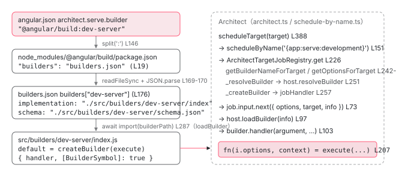

[目次](../README.md) › [起動の全手順](README.md) › 第 2 回 / 全 13 回

# angular.json から builder を探し出す

> ServeCommandModule → ArchitectCommandModule.run → runSingleTarget → Architect.scheduleTarget。「@angular/build:dev-server」という文字列が、どうやって 1 つの関数に変わるのか。

angular/angular-cli · 読了 約 12 分 · 中核 · [サイトで読む（デモが動きます）](https://angular-deep-dive-cyan.vercel.app/chapter/boot-architect)

---

`angular.json` には `"builder": "@angular/build:dev-server"` と書いてあります。ただの文字列です。この章では、その文字列が**どのファイルを開いて、どの関数になり、誰がそれを呼ぶのか**を、前章で止まった `ArchitectCommandModule.run()` から `execute()` が呼ばれる瞬間まで追います。CLI 自体はビルドの方法を一切知らないこと、それでも「serve」と打つだけでビルダーが動く仕組みが分かります。

読む対象は `packages/angular/cli/src/command-builder/architect-command-module.ts`、`architect-base-command-module.ts`、`packages/angular_devkit/architect/node/node-modules-architect-host.ts`、`packages/angular_devkit/architect/src/architect.ts`、`schedule-by-name.ts`、`create-builder.ts`、そして `packages/angular/build/builders.json` です。

1. ng コマンド起動
2. **builder の解決**（この章）
3. dev-server と Vite
4. application builder
5. index.html の生成
6. ブラウザが main.js を実行
7. bootstrapApplication
8. 2 段の DI 木
9. APP\_INITIALIZER
10. ApplicationRef.bootstrap
11. 最初の描画
12. クリック→再描画
13. SPA のページ遷移

## 1. コマンド名がそのままターゲット名になる

📄 `angular-cli/packages/angular/cli/src/commands/serve/cli.ts` L13–22 （▶ の行: 14, 18）

```ts
13 │ export default class ServeCommandModule
14 ▶   extends ArchitectCommandModule
15 │   implements CommandModuleImplementation
16 │ {
17 │   multiTarget = false;
18 ▶   command = 'serve [project]';
19 │   aliases = RootCommands['serve'].aliases;
20 │   describe = 'Builds and serves your application, rebuilding on file changes.';
21 │   longDescriptionPath?: string | undefined;
22 │ }
```

📄 `angular-cli/packages/angular/cli/src/command-builder/command-module.ts` L90–95 （▶ の行: 90–91）

```ts
90 ▶   protected get commandName(): string {
91 ▶     return this.command.split(' ', 1)[0];
92 │   }
93 │ 
94 │   abstract builder(argv: Argv): Promise<Argv<T>> | Argv<T>;
95 │   abstract run(options: Options<T> & OtherOptions): Promise<number | void> | number | void;
```

📄 `angular-cli/packages/angular/cli/src/command-builder/architect-base-command-module.ts` L225–227 （▶ の行: 226）

```ts
225 │   protected getArchitectTarget(): string {
226 ▶     return this.commandName;
227 │   }
```

18 行目の `'serve [project]'` を、91 行目で空白の前まで切ると `'serve'`。226 行目、`getArchitectTarget()` はそれをそのまま返します。つまり `ng serve` は `angular.json` の `architect.serve` を見に行きます。`ng build` なら `architect.build`、`ng test` なら `architect.test` です。「コマンド名 = ターゲット名」というこの約束は、既存章 [ng build の章](../cli/02-build.md)でも触れています。

## 2. ArchitectCommandModule.run：プロジェクトを決める

📄 `angular-cli/packages/angular/cli/src/command-builder/architect-command-module.ts` L106–135 （▶ の行: 109–110, 112, 115, 121, 128）

```ts
106 │   async run(options: Options<ArchitectCommandArgs> & OtherOptions): Promise<number | void> {
107 │     const originalProcessTitle = process.title;
108 │     try {
109 ▶       const target = this.getArchitectTarget();
110 ▶       const { configuration = '', project, ...architectOptions } = options;
111 │ 
112 ▶       if (project) {
113 │         process.title = `${originalProcessTitle} (${project})`;
114 │ 
115 ▶         return await this.runSingleTarget({ configuration, target, project }, architectOptions);
116 │       }
117 │ 
118 │       // This runs each target sequentially.
119 │       // Running them in parallel would jumble the log messages.
120 │       let result = 0;
121 ▶       const projectNames = this.getProjectNamesByTarget(target);
122 │       if (!projectNames) {
123 │         return this.onMissingTarget('Cannot determine project or target for command.');
124 │       }
125 │ 
126 │       for (const project of projectNames) {
127 │         process.title = `${originalProcessTitle} (${project})`;
128 ▶         result |= await this.runSingleTarget({ configuration, target, project }, architectOptions);
129 │       }
130 │ 
131 │       return result;
132 │     } finally {
133 │       process.title = originalProcessTitle;
134 │     }
135 │   }
```

109 行目でターゲット名 `'serve'`。110 行目で yargs が解析したオプションから `configuration` と `project` を抜き、残り（`--port` など）を `architectOptions` にまとめます。112 行目、プロジェクト名が指定されていれば 115 行目の `runSingleTarget` へ。指定が無ければ 121 行目で「serve ターゲットを持つプロジェクト」を列挙し、128 行目で順に実行します。`ServeCommandModule` は `multiTarget = false` なので、次の引用のとおり候補は 1 つに絞られます。

📄 `angular-cli/packages/angular/cli/src/command-builder/architect-command-module.ts` L137–154 （▶ の行: 139, 146, 150–151, 153）

```ts
137 │   private getArchitectProject(): string | undefined {
138 │     const { options, positional } = this.context.args;
139 ▶     const [, projectName] = positional;
140 │ 
141 │     if (projectName) {
142 │       return projectName;
143 │     }
144 │ 
145 │     // Yargs allows positional args to be used as flags.
146 ▶     if (typeof options['project'] === 'string') {
147 │       return options['project'];
148 │     }
149 │ 
150 ▶     const target = this.getArchitectTarget();
151 ▶     const projectFromTarget = this.getProjectNamesByTarget(target);
152 │ 
153 ▶     return projectFromTarget?.length ? projectFromTarget[0] : undefined;
154 │   }
```

139 行目、`ng serve my-app` のように位置引数があればそれ。146 行目、`--project` があればそれ。どちらも無ければ 150〜153 行目で「`serve` ターゲットを持つプロジェクト」の先頭を使います。1 プロジェクトのワークスペースなら、これで迷いなく決まります。

## 3. runSingleTarget：ホストを作り、builder 名を取り、スケジュールする

📄 `angular-cli/packages/angular/cli/src/command-builder/architect-base-command-module.ts` L42–63 （▶ の行: 43, 47, 54, 57–58）

```ts
42 │   protected async runSingleTarget(target: Target, options: OtherOptions): Promise<number> {
43 ▶     const architectHost = this.getArchitectHost();
44 │ 
45 │     let builderName: string;
46 │     try {
47 ▶       builderName = await architectHost.getBuilderNameForTarget(target);
48 │     } catch (e) {
49 │       assertIsError(e);
50 │ 
51 │       return this.onMissingTarget(e.message);
52 │     }
53 │ 
54 ▶     const isAngularBuild = builderName.startsWith('@angular/build:');
55 │ 
56 │     const { logger } = this.context;
57 ▶     const run = await this.getArchitect(isAngularBuild).scheduleTarget(
58 ▶       target,
59 │       options as json.JsonObject,
60 │       {
61 │         logger,
62 │       },
63 │     );
```

この関数が、CLI 側の最後の仕事です。43 行目でホスト、47 行目で builder 名 （`"@angular/build:dev-server"`）、57 行目で `Architect.scheduleTarget`。58 行目の `target` は `{ project, target: 'serve', configuration }` の 3 つ組です。54 行目、`@angular/build:` で始まるかどうかで、次に見るスキーマ検証の既定値の扱いが変わります。

📄 `angular-cli/packages/angular/cli/src/command-builder/architect-base-command-module.ts` L91–101 （▶ の行: 92, 97, 99）

```ts
 91 │     try {
 92 ▶       const { error, success } = await run.lastOutput;
 93 │       if (error) {
 94 │         logger.error(error);
 95 │       }
 96 │ 
 97 ▶       return success ? 0 : 1;
 98 │     } finally {
 99 ▶       await run.stop();
100 │       outputSubscription?.unsubscribe();
101 │     }
```

92 行目、`run.lastOutput` は「ビルダーが最後に出力した結果」の Promise です。dev-server は Ctrl+C されるまで結果を流し続けるので、ここで待ち続けます。97 行目で `success` を終了コード 0/1 に変換し、99 行目で `run.stop()` します。

📄 `angular-cli/packages/angular/cli/src/command-builder/architect-base-command-module.ts` L143–174 （▶ の行: 151–153, 163, 165, 167, 173）

```ts
143 │   private _architectHost: WorkspaceNodeModulesArchitectHost | undefined;
144 │   protected getArchitectHost(): WorkspaceNodeModulesArchitectHost {
145 │     if (this._architectHost) {
146 │       return this._architectHost;
147 │     }
148 │ 
149 │     const workspace = this.getWorkspaceOrThrow();
150 │ 
151 ▶     return (this._architectHost = new WorkspaceNodeModulesArchitectHost(
152 ▶       workspace,
153 ▶       workspace.basePath,
154 │     ));
155 │   }
156 │ 
157 │   private _architect: Architect | undefined;
158 │   protected getArchitect(skipUndefinedArrayTransform: boolean): Architect {
159 │     if (this._architect) {
160 │       return this._architect;
161 │     }
162 │ 
163 ▶     const registry = new json.schema.CoreSchemaRegistry();
164 │     if (skipUndefinedArrayTransform) {
165 ▶       registry.addPostTransform(json.schema.transforms.addUndefinedObjectDefaults);
166 │     } else {
167 ▶       registry.addPostTransform(json.schema.transforms.addUndefinedDefaults);
168 │     }
169 │     registry.useXDeprecatedProvider((msg) => this.context.logger.warn(msg));
170 │ 
171 │     const architectHost = this.getArchitectHost();
172 │ 
173 ▶     return (this._architect = new Architect(architectHost, registry));
174 │   }
```

1. **151〜154 行目：`WorkspaceNodeModulesArchitectHost`**

   引数は読み込み済みの `angular.json`（`workspace`）と、その置き場所（`basePath`）です。「ホスト」は Architect に対して *angular.json の読み方*と *node\_modules の探し方*を教える役です。Architect 本体はファイルシステムを直接触りません。
2. **163〜169 行目：オプションのスキーマ検証器**

   `CoreSchemaRegistry` は JSON Schema で `--port=abc` のような誤りを弾き、既定値を埋めます。165 行目と 167 行目の違いは「配列の既定値を `undefined` のままにするか空配列にするか」で、`@angular/build` のビルダーは `undefined` のままを望みます（3 節の `isAngularBuild`）。
3. **173 行目：`new Architect(architectHost, registry)`**

   Architect はここで初めて作られます。1 プロセスに 1 つで、`_architect` にキャッシュされます。

## 4. ホストが angular.json から builder 名を取り出す

📄 `angular-cli/packages/angular_devkit/architect/node/node-modules-architect-host.ts` L43–63 （▶ の行: 48, 53, 58, 62）

```ts
43 │ function findProjectTarget(
44 │   workspace: workspaces.WorkspaceDefinition,
45 │   project: string,
46 │   target: string,
47 │ ): workspaces.TargetDefinition {
48 ▶   const projectDefinition = workspace.projects.get(project);
49 │   if (!projectDefinition) {
50 │     throw new Error(`Project "${project}" does not exist.`);
51 │   }
52 │ 
53 ▶   const targetDefinition = projectDefinition.targets.get(target);
54 │   if (!targetDefinition) {
55 │     throw new Error('Project target does not exist.');
56 │   }
57 │ 
58 ▶   if (!targetDefinition.builder) {
59 │     throw new Error(`A builder is not set for target '${target}' in project '${project}'.`);
60 │   }
61 │ 
62 ▶   return targetDefinition;
63 │ }
```

📄 `angular-cli/packages/angular_devkit/architect/node/node-modules-architect-host.ts` L76–99 （▶ の行: 80–81, 83, 85, 88–89, 98）

```ts
76 │     if ('getBuilderName' in workspaceOrHost) {
77 │       this.workspaceHost = workspaceOrHost;
78 │     } else {
79 │       this.workspaceHost = {
80 ▶         async getBuilderName(project, target) {
81 ▶           const { builder } = findProjectTarget(workspaceOrHost, project, target);
82 │ 
83 ▶           return builder;
84 │         },
85 ▶         async getOptions(project, target, configuration) {
86 │           const targetDefinition = findProjectTarget(workspaceOrHost, project, target);
87 │ 
88 ▶           if (configuration === undefined) {
89 ▶             return (targetDefinition.options ?? {}) as json.JsonObject;
90 │           }
91 │ 
92 │           if (!targetDefinition.configurations?.[configuration]) {
93 │             throw new Error(
94 │               `Configuration '${configuration}' for target '${target}' in project '${project}' is not set in the workspace.`,
95 │             );
96 │           }
97 │ 
98 ▶           return (targetDefinition.configurations?.[configuration] ?? {}) as json.JsonObject;
99 │         },
```

📄 `angular-cli/packages/angular_devkit/architect/node/node-modules-architect-host.ts` L124–126 （▶ の行: 125）

```ts
124 │   async getBuilderNameForTarget(target: Target): Promise<string> {
125 ▶     return this.workspaceHost.getBuilderName(target.project, target.target);
126 │   }
```

125 行目 → 80 行目 → 48・53 行目。`workspace.projects.get('my-app').targets.get('serve')` と辿り、58 行目で `builder` が無ければ例外、62 行目でターゲット定義を返し、83 行目でその `builder` 文字列だけを返します。これが `"@angular/build:dev-server"` です。85〜98 行目の `getOptions` は 同じターゲットの `options`（88〜89 行目、configuration 無し）か `configurations[name]`（98 行目）を返します。

📄 `angular-cli/packages/angular_devkit/architect/node/node-modules-architect-host.ts` L239–260 （▶ の行: 244–245, 247, 250, 252, 254）

```ts
239 │   async getOptionsForTarget(target: Target): Promise<json.JsonObject | null> {
240 │     if (!(await this.workspaceHost.hasTarget(target.project, target.target))) {
241 │       return null;
242 │     }
243 │ 
244 ▶     let options = await this.workspaceHost.getOptions(target.project, target.target);
245 ▶     const targetConfiguration =
246 │       target.configuration ||
247 ▶       (await this.workspaceHost.getDefaultConfigurationName(target.project, target.target));
248 │ 
249 │     if (targetConfiguration) {
250 ▶       const configurations = targetConfiguration.split(',').map((c) => c.trim());
251 │       for (const configuration of configurations) {
252 ▶         options = {
253 │           ...options,
254 ▶           ...(await this.workspaceHost.getOptions(target.project, target.target, configuration)),
255 │         };
256 │       }
257 │     }
258 │ 
259 │     return clone(options) as json.JsonObject;
260 │   }
```

244 行目でまず `options`。245〜247 行目、`--configuration` が無ければ `defaultConfiguration`（新規プロジェクトの `serve` なら `"development"`）。250 行目でカンマ区切りを分け、252〜254 行目で**後ろの configuration が前を上書き**するように スプレッドで重ねます。`ng serve -c production,ja` なら `ja` が勝ちます。

## 5. resolveBuilder：文字列から実装ファイルのパスへ

ここがこの章の核心です。`"@angular/build:dev-server"` という文字列が、どのファイルを指すのかが決まります。

📄 `angular-cli/packages/angular_devkit/architect/node/node-modules-architect-host.ts` L146–160 （▶ の行: 146, 152–153, 156–157, 159）

```ts
146 ▶     const [packageName, builderName] = builderStr.split(':', 2);
147 │     if (!builderName) {
148 │       throw new Error('No builder name specified.');
149 │     }
150 │ 
151 │     // Resolve and load the builders manifest from the package's `builders` field, if present
152 ▶     const packageJsonPath = localRequire.resolve(packageName + '/package.json', {
153 ▶       paths: [basePath],
154 │     });
155 │ 
156 ▶     const packageJson = JSON.parse(readFileSync(packageJsonPath, 'utf-8')) as { builders?: string };
157 ▶     const buildersManifestRawPath = packageJson['builders'];
158 │     if (!buildersManifestRawPath) {
159 ▶       throw new Error(`Package ${JSON.stringify(packageName)} has no builders defined.`);
160 │     }
```

📄 `angular-cli/packages/angular/build/package.json` L1–19 （▶ の行: 2, 19）

```json
 1 │ {
 2 ▶   "name": "@angular/build",
 3 │   "version": "0.0.0-PLACEHOLDER",
 4 │   "description": "Official build system for Angular",
 5 │   "keywords": [
 6 │     "angular",
 7 │     "angular-cli"
 8 │   ],
 9 │   "exports": {
10 │     ".": {
11 │       "types": "./src/index.d.ts",
12 │       "default": "./src/index.js"
13 │     },
14 │     "./private": {
15 │       "default": "./src/private.js"
16 │     },
17 │     "./package.json": "./package.json"
18 │   },
19 ▶   "builders": "builders.json",
```

1. **146 行目：`':'` で 2 つに割る**

   `packageName = "@angular/build"`、`builderName = "dev-server"`。コロンの左は npm パッケージ名、右はそのパッケージ内でのビルダー名です。
2. **152〜154 行目：パッケージの package.json を解決する**

   `localRequire.resolve('@angular/build/package.json', { paths: [basePath] })`。`paths` がワークスペースのルートなので、**プロジェクトの `node_modules/@angular/build/package.json`** が見つかります。前章の `createRequire(cwd)` と同じ考え方です。
3. **156〜159 行目：`"builders"` フィールド**

   `@angular/build` の `package.json` 19 行目に `"builders": "builders.json"` とあります。このフィールドが無いパッケージは 159 行目で「has no builders defined」です。`"builders"` は npm の仕様ではなく、**Architect が決めた約束**です。

📄 `angular-cli/packages/angular_devkit/architect/node/node-modules-architect-host.ts` L169–188 （▶ の行: 169–170, 176, 178, 182–183）

```ts
169 ▶     buildersManifestPath = path.join(path.dirname(packageJsonPath), buildersManifestPath);
170 ▶     const buildersManifest = JSON.parse(
171 │       readFileSync(buildersManifestPath, 'utf-8'),
172 │     ) as BuilderSchema;
173 │     const buildersManifestDirectory = path.dirname(buildersManifestPath);
174 │ 
175 │     // Attempt to locate an entry for the specified builder by name
176 ▶     const builder = buildersManifest.builders?.[builderName];
177 │     if (!builder) {
178 ▶       throw new Error(`Cannot find builder ${JSON.stringify(builderStr)}.`);
179 │     }
180 │ 
181 │     // Resolve alias reference if entry is a string
182 ▶     if (typeof builder === 'string') {
183 ▶       return this.resolveBuilder(
184 │         builder,
185 │         path.dirname(packageJsonPath),
186 │         (seenBuilders ?? new Set()).add(builderStr),
187 │       );
188 │     }
```

📄 `angular-cli/packages/angular/build/builders.json` L1–12 （▶ の行: 8–10）

```json
 1 │ {
 2 │   "builders": {
 3 │     "application": {
 4 │       "implementation": "./src/builders/application/index",
 5 │       "schema": "./src/builders/application/schema.json",
 6 │       "description": "Build an application."
 7 │     },
 8 ▶     "dev-server": {
 9 ▶       "implementation": "./src/builders/dev-server/index",
10 ▶       "schema": "./src/builders/dev-server/schema.json",
11 │       "description": "Execute a development server for an application."
12 │     },
```

169〜170 行目で `node_modules/@angular/build/builders.json` を読んで JSON.parse。176 行目、`builders['dev-server']`、つまり `builders.json` の 8〜12 行目のオブジェクトです。9 行目の `implementation` が実装ファイル、10 行目の `schema` がオプションの JSON Schema です。182〜183 行目、エントリが文字列なら別名（別のビルダー名への参照）として再帰します。`@angular-devkit/build-angular:application` がこの仕組みで `@angular/build:application` を指しています。

📄 `angular-cli/packages/angular_devkit/architect/node/node-modules-architect-host.ts` L220–228 （▶ の行: 223–224, 226–227）

```ts
220 │     const schemaText = readFileSync(schemaPath, 'utf-8');
221 │ 
222 │     return Promise.resolve({
223 ▶       name: builderStr,
224 ▶       builderName,
225 │       description: builder['description'],
226 ▶       optionSchema: JSON.parse(schemaText) as json.schema.JsonSchema,
227 ▶       import: path.join(buildersManifestDirectory, implementationPath),
228 │     });
```

227 行目、`import` プロパティは `builders.json` のディレクトリ + `./src/builders/dev-server/index`。これが `NodeModulesBuilderInfo` として返ります。**この時点ではまだファイルを読み込んでいません。** パスが決まっただけです。226 行目の `optionSchema` は、3 節の `CoreSchemaRegistry` が `--port` などを検証するのに使います。

> **🧪 DEMO — builder 文字列が resolveBuilder でどう分解されるか**
>
> 左の行番号は `node-modules-architect-host.ts`。値は `builders.json` の実物です。
>
> ▶ [このデモはサイトで動かせます](https://angular-deep-dive-cyan.vercel.app/chapter/boot-architect)

## 6. loadBuilder：パスを import して「ビルダーであること」を確認する

📄 `angular-cli/packages/angular_devkit/architect/node/node-modules-architect-host.ts` L269–290 （▶ の行: 270, 272–273, 281, 287, 289）

```ts
269 │   async loadBuilder(info: NodeModulesBuilderInfo): Promise<Builder> {
270 ▶     const builder = await getBuilder(info.import);
271 │ 
272 ▶     if (builder[BuilderSymbol]) {
273 ▶       return builder;
274 │     }
275 │ 
276 │     // Default handling code is for old builders that incorrectly export `default` with non-ESM module
277 │     if (builder?.default[BuilderSymbol]) {
278 │       return builder.default;
279 │     }
280 │ 
281 ▶     throw new Error('Builder is not a builder');
282 │   }
283 │ }
284 │ 
285 │ // eslint-disable-next-line @typescript-eslint/no-explicit-any
286 │ async function getBuilder(builderPath: string): Promise<any> {
287 ▶   const builder = await import(builderPath);
288 │ 
289 ▶   return 'default' in builder ? builder.default : builder;
290 │ }
```

287 行目、`await import(builderPath)`。ここで初めて `node_modules/@angular/build/src/builders/dev-server/index.js` が読み込まれます。289 行目で `default` export を取り出し、272 行目で `BuilderSymbol` を持っているか確かめます。持っていなければ 281 行目「Builder is not a builder」です。`BuilderSymbol` は `Symbol.for('@angular-devkit/architect:builder')` で、次に見る `createBuilder()` だけがこれを付けます。

📄 `angular-cli/packages/angular/build/src/builders/dev-server/index.ts` L9–24 （▶ の行: 9–10, 19, 22, 24）

```ts
 9 ▶ import { Builder, createBuilder } from '@angular-devkit/architect';
10 ▶ import { execute } from './builder';
11 │ import type { DevServerBuilderOutput } from './output';
12 │ import type { Schema as DevServerBuilderOptions } from './schema';
13 │ 
14 │ export {
15 │   type DevServerBuilderOptions,
16 │   type DevServerBuilderOutput,
17 │   execute as executeDevServerBuilder,
18 │ };
19 ▶ const builder: Builder<DevServerBuilderOptions> = createBuilder<
20 │   DevServerBuilderOptions,
21 │   DevServerBuilderOutput
22 ▶ >(execute);
23 │ 
24 ▶ export default builder;
```

import されたファイルの中身です。10 行目で `./builder` から `execute` 関数を読み、19〜22 行目で `createBuilder(execute)` に包み、24 行目で `default` export しています。**`execute` が dev-server の本体**で、[次章](03-boot-dev-server.md)で読みます。

📄 `angular-cli/packages/angular_devkit/architect/src/create-builder.ts` L43–48 （▶ の行: 43–44, 48）

```ts
43 ▶ export function createBuilder<OptT = json.JsonObject, OutT extends BuilderOutput = BuilderOutput>(
44 ▶   fn: BuilderHandlerFn<OptT>,
45 │ ): Builder<OptT & json.JsonObject> {
46 │   const cjh = createJobHandler;
47 │   // eslint-disable-next-line max-lines-per-function
48 ▶   const handler = cjh<json.JsonObject, BuilderInput, OutT>((options, context) => {
```

📄 `angular-cli/packages/angular_devkit/architect/src/create-builder.ts` L251–259 （▶ の行: 252–253）

```ts
251 │   return {
252 ▶     handler,
253 ▶     [BuilderSymbol]: true,
254 │     [BuilderVersionSymbol]: require('../package.json').version,
255 │     // Only needed for type safety around `Builder` types.
256 │     // eslint-disable-next-line @typescript-eslint/no-non-null-assertion
257 │     __OptionT: null!,
258 │   };
259 │ }
```

43〜48 行目、`createBuilder(fn)` は `fn` を `createJobHandler` で包んだ `handler` を作り、251〜259 行目で `{ handler, [BuilderSymbol]: true, ... }` を返します。253 行目がさきほどの印です。`fn` はまだ呼ばれていません。

## 7. Architect.scheduleTarget：ジョブとして動かす

3 節の 57 行目で呼んだ `scheduleTarget` の中で、4〜6 節の関数が順に呼ばれます。その順番を確認します。

📄 `angular-cli/packages/angular_devkit/architect/src/architect.ts` L345–365 （▶ の行: 353, 358–359, 364）

```ts
345 │   constructor(
346 │     private _host: ArchitectHost,
347 │     registry: json.schema.SchemaRegistry = new json.schema.CoreSchemaRegistry(),
348 │     additionalJobRegistry?: Registry,
349 │   ) {
350 │     const privateArchitectJobRegistry = new SimpleJobRegistry();
351 │     // Create private jobs.
352 │     privateArchitectJobRegistry.register(_getTargetOptionsFactory(_host));
353 ▶     privateArchitectJobRegistry.register(_getBuilderNameForTargetFactory(_host));
354 │     privateArchitectJobRegistry.register(_validateOptionsFactory(_host, registry));
355 │     privateArchitectJobRegistry.register(_getProjectMetadataFactory(_host));
356 │ 
357 │     const jobRegistry = new FallbackRegistry([
358 ▶       new ArchitectTargetJobRegistry(_host, registry, this._jobCache, this._infoCache),
359 ▶       new ArchitectBuilderJobRegistry(_host, registry, this._jobCache, this._infoCache),
360 │       privateArchitectJobRegistry,
361 │       ...(additionalJobRegistry ? [additionalJobRegistry] : []),
362 │     ] as Registry[]);
363 │ 
364 ▶     this._scheduler = new SimpleScheduler(jobRegistry, registry);
365 │   }
```

📄 `angular-cli/packages/angular_devkit/architect/src/architect.ts` L388–399 （▶ の行: 388, 393）

```ts
388 ▶   scheduleTarget(
389 │     target: Target,
390 │     overrides: json.JsonObject = {},
391 │     scheduleOptions: ScheduleOptions = {},
392 │   ): Promise<BuilderRun> {
393 ▶     return scheduleByTarget(target, overrides, {
394 │       scheduler: this._scheduler,
395 │       logger: scheduleOptions.logger || new logging.NullLogger(),
396 │       currentDirectory: this._host.getCurrentDirectory(),
397 │       workspaceRoot: this._host.getWorkspaceRoot(),
398 │     });
399 │   }
```

📄 `angular-cli/packages/angular_devkit/architect/src/schedule-by-name.ts` L141–156 （▶ の行: 151）

```ts
141 │ export async function scheduleByTarget(
142 │   target: Target,
143 │   overrides: json.JsonObject,
144 │   options: {
145 │     scheduler: Scheduler;
146 │     logger: logging.LoggerApi;
147 │     workspaceRoot: string | Promise<string>;
148 │     currentDirectory: string | Promise<string>;
149 │   },
150 │ ): Promise<BuilderRun> {
151 ▶   return scheduleByName(`{${targetStringFromTarget(target)}}`, overrides, {
152 │     ...options,
153 │     target,
154 │     logger: options.logger,
155 │   });
156 │ }
```

393 行目 → 151 行目。ターゲットは `{my-app:serve:development}` という **波括弧付きの文字列**に変換されて `scheduleByName` に渡ります。この表記が「ターゲット指定」の印で、コロン 2 つの `pkg:builder`（ビルダー直接指定）と区別されます。

📄 `angular-cli/packages/angular_devkit/architect/src/schedule-by-name.ts` L46–57 （▶ の行: 49, 55–56）

```ts
46 │ ): Promise<BuilderRun> {
47 │   const childLoggerName = options.target ? `{${targetStringFromTarget(options.target)}}` : name;
48 │   const logger = options.logger.createChild(childLoggerName);
49 ▶   const job = options.scheduler.schedule<{}, BuilderInput, BuilderOutput>(name, {});
50 │   let stateSubscription: Subscription;
51 │ 
52 │   const workspaceRoot = await options.workspaceRoot;
53 │   const currentDirectory = await options.currentDirectory;
54 │ 
55 ▶   const description = await firstValueFrom(job.description);
56 ▶   const info = description.info as BuilderInfo;
57 │   const id = ++_uniqueId;
```

49 行目、`scheduler.schedule(name, {})`。`Architect` のコンストラクタ 364 行目で作った `SimpleScheduler` が、358〜360 行目に並んだレジストリに `'{my-app:serve:development}'` という名前のジョブを順に問い合わせます。先頭が `ArchitectTargetJobRegistry` です。

📄 `angular-cli/packages/angular_devkit/architect/src/architect.ts` L226–263 （▶ の行: 229, 234, 242–243, 251, 257）

```ts
226 │   override get<A extends json.JsonObject, I extends BuilderInput, O extends BuilderOutput>(
227 │     name: string,
228 │   ): Observable<JobHandler<A, I, O> | null> {
229 ▶     const m = name.match(/^{([^:]+):([^:]+)(?::([^:]*))?}$/i);
230 │     if (!m) {
231 │       return of(null);
232 │     }
233 │ 
234 ▶     const target = {
235 │       project: m[1],
236 │       target: m[2],
237 │       configuration: m[3],
238 │     };
239 │ 
240 │     return from(
241 │       Promise.all([
242 ▶         this._host.getBuilderNameForTarget(target),
243 ▶         this._host.getOptionsForTarget(target),
244 │       ]),
245 │     ).pipe(
246 │       concatMap(([builderStr, options]) => {
247 │         if (builderStr === null || options === null) {
248 │           return of(null);
249 │         }
250 │ 
251 ▶         return this._resolveBuilder(builderStr).pipe(
252 │           concatMap((builderInfo) => {
253 │             if (builderInfo === null) {
254 │               return of(null);
255 │             }
256 │ 
257 ▶             return this._createBuilder(builderInfo, target, options);
258 │           }),
259 │         );
260 │       }),
261 │       first(null, null),
262 │     ) as Observable<JobHandler<A, I, O> | null>;
263 │   }
```

1. **229〜238 行目：名前を正規表現で分解**

   `^{([^:]+):([^:]+)(?::([^:]*))?}$` に一致したら `project / target / configuration` に戻します。
2. **242〜243 行目：ホストに 2 つ聞く**

   `getBuilderNameForTarget`（4 節、125 行目）で `"@angular/build:dev-server"`、`getOptionsForTarget`（4 節、239〜260 行目）で `options` と `configurations.development` を合成したオプションを得ます。
3. **251 行目：`_resolveBuilder`**

   中で 5 節の `host.resolveBuilder` を呼び、`import` パス付きの `BuilderInfo` を得ます。結果は `_infoCache` に入り、同じ名前なら 2 回目以降は解決しません。
4. **257 行目：`_createBuilder`**

   `_createJobHandlerFromBuilderInfo` を呼び、ジョブハンドラを返します。次の引用です。

📄 `angular-cli/packages/angular_devkit/architect/src/architect.ts` L95–105 （▶ の行: 97, 103）

```ts
 95 │     const inboundBus = onErrorResumeNext(inboundBusWithInputValidation);
 96 │ 
 97 ▶     const output = from(host.loadBuilder(info)).pipe(
 98 │       concatMap((builder) => {
 99 │         if (builder === null) {
100 │           throw new Error(`Cannot load builder for builderInfo ${JSON.stringify(info, null, 2)}`);
101 │         }
102 │ 
103 ▶         return builder.handler(argument, { ...context, inboundBus }).pipe(
104 │           map((output) => {
105 │             if (output.kind === JobOutboundMessageKind.Output) {
```

97 行目、`host.loadBuilder(info)`。6 節の `import()` が**ここで**実行されます。103 行目、import したモジュールの `handler`（`createBuilder` が作ったもの）に 引数と `inboundBus` を渡して呼びます。

📄 `angular-cli/packages/angular_devkit/architect/src/schedule-by-name.ts` L59–80 （▶ の行: 59, 63–65, 73, 79）

```ts
59 ▶   const message = {
60 │     id,
61 │     currentDirectory,
62 │     workspaceRoot,
63 ▶     info: info,
64 ▶     options: buildOptions,
65 ▶     ...(options.target ? { target: options.target } : {}),
66 │   };
67 │ 
68 │   // Wait for the job to be ready.
69 │   if (job.state !== JobState.Started) {
70 │     stateSubscription = job.outboundBus.subscribe({
71 │       next: (event) => {
72 │         if (event.kind === JobOutboundMessageKind.Start) {
73 ▶           job.input.next(message);
74 │         }
75 │       },
76 │       error: () => {},
77 │     });
78 │   } else {
79 ▶     job.input.next(message);
80 │   }
```

`scheduleByName` に戻って 59〜66 行目。ビルダーへの入力メッセージを組みます。63 行目の `info`（import パスやスキーマ）、64 行目の `options` （3 節 58 行目で渡した `--port` などの上書き分）、65 行目の `target`。73 行目か 79 行目で `job.input.next(message)`。これが `inboundBus` に流れ、`createBuilder` の中の購読が受け取ります。

📄 `angular-cli/packages/angular_devkit/architect/src/create-builder.ts` L204–217 （▶ の行: 204, 207–208, 210–211）

```ts
204 ▶         context.reportRunning();
205 │         let result;
206 │         try {
207 ▶           result = fn(i.options as unknown as OptT, context);
208 ▶           if (isBuilderOutput(result)) {
209 │             result = of(result);
210 ▶           } else if (!isObservable(result) && isAsyncIterable(result)) {
211 ▶             result = fromAsyncIterable(result);
212 │           } else {
213 │             result = from(result);
214 │           }
215 │         } catch (e) {
216 │           result = throwError(e);
217 │         }
```

207 行目、`fn(i.options, context)`。**ここで `execute(options, context)` が呼ばれます。**`i.options` は `angular.json` の options + configuration + コマンドライン上書きを スキーマ検証した結果です。`context` は `BuilderContext` で、`logger`、`target`、`workspaceRoot`、そして `scheduleTarget` / `getTargetOptions`（dev-server が `build` ターゲットの設定を取るのに使う）が入っています。210〜211 行目、`execute` は `async function*` なので `fromAsyncIterable` で Observable に変換されます。



*文字列 '@angular/build:dev-server' が関数 execute になるまで。ファイルを読むのは 3 回（package.json、builders.json、import）。*

## ここまでの呼び出し

- 👤 `ng serve` → `ServeCommandModule.handler()` — 前章の終点
  - `ArchitectCommandModule.run(options)` — architect-command-module.ts L106 — *target = 'serve'、project を決める*
    - `runSingleTarget({ project, target, configuration }, options)` — architect-base-command-module.ts L42
      - `getArchitectHost()` — L144 — *new WorkspaceNodeModulesArchitectHost(workspace, basePath)*
      - `architectHost.getBuilderNameForTarget(target)` — node-modules-architect-host.ts L124 — *angular.json → "@angular/build:dev-server"*
      - `getArchitect(true).scheduleTarget(target, options)` — architect.ts L388
        - `scheduleByTarget → scheduleByName('{app:serve:development}')` — schedule-by-name.ts L151 → L36
          - `scheduler.schedule(name)` — schedule-by-name.ts L49
            - `ArchitectTargetJobRegistry.get(name)` — architect.ts L226
              - `host.getOptionsForTarget(target)` — node-modules-architect-host.ts L239 — *options + configurations.development*
              - `host.resolveBuilder('@angular/build:dev-server')` — L135 — *package.json "builders" → builders.json → import パス*
              - `_createJobHandlerFromBuilderInfo(info, target, ...)` — architect.ts L51
          - `job.input.next({ options, target, info, ... })` — schedule-by-name.ts L73
            - `host.loadBuilder(info)` → `import(builderPath)` — node-modules-architect-host.ts L269 / L287 — *ここで dev-server/index.js が読まれる*
            - `builder.handler(argument, { ...context, inboundBus })` — architect.ts L103
              - `onInput(i)` → `fn(i.options, context)` — create-builder.ts L93 / L207 — *fn = execute（次章）*

## 聞かれそうな質問

**Q. angular.json の "builder": "@angular/build:dev-server" という文字列は、どうやって関数になりますか？**

`WorkspaceNodeModulesArchitectHost.resolveBuilder`（node-modules-architect-host.ts 135〜229 行目）が 3 段階で解決します。146 行目で `':'` で割り、152 行目で `node_modules/@angular/build/package.json` を `require.resolve` し、157 行目でその `"builders"` フィールド（`"builders.json"`）を読み、176 行目で `builders['dev-server']` の `implementation` を取り、227 行目で絶対パスにします。そのパスを `loadBuilder` 287 行目が `import()` し、`default` export （`createBuilder(execute)` の戻り値、dev-server/index.ts 19〜24 行目）の `handler` を architect.ts 103 行目が呼び、create-builder.ts 207 行目で `execute(options, context)` になります。

**Q. CLI は "dev-server" が何をするビルダーか知っているのですか？**

知りません。CLI 側（`architect-base-command-module.ts`）がしているのは 47 行目で名前を取り、57 行目で `scheduleTarget` を呼ぶことだけです。54 行目で `@angular/build:` で始まるかを見ますが、それはスキーマ検証の既定値の扱い（163〜168 行目）を 変えるためで、中身には触れません。だから自作のビルダーでも、`package.json` に `"builders"` を書けば `ng run` や `ng build` から呼べます。

**Q. ng serve で --configuration を付けないと、どの設定が使われますか？**

`getOptionsForTarget`（node-modules-architect-host.ts 245〜247 行目）が `target.configuration` が空なら `getDefaultConfigurationName` を呼び、`angular.json` の `defaultConfiguration` を使います。新規プロジェクトでは `"development"` です。252〜254 行目で `options` の上にその configuration を重ねます。

**Q. ビルダーのファイルはいつ読み込まれますか？angular.json を読んだ直後？**

違います。`resolveBuilder` はパスを決めるだけで（227 行目の `import` は文字列）、実際の `import()` は `loadBuilder` 287 行目、それを呼ぶのは `_createJobHandlerFromBuilderInfo` の 97 行目、つまりジョブが実行されるときです。その前に `job.input.next`（schedule-by-name.ts 73 行目）で入力が流れています。

**Q. BuilderSymbol とは何ですか？なぜ必要ですか？**

`Symbol.for('@angular-devkit/architect:builder')` という印で、`createBuilder` （create-builder.ts 253 行目）だけがオブジェクトに付けます。`loadBuilder`（node-modules-architect-host.ts 272〜281 行目）はこれを確認して、`createBuilder` を通っていない export を「Builder is not a builder」として弾きます。`import()` したモジュールが本当にビルダーかを型でなく実行時に保証する仕組みです。

## 読み終えて

- コマンド名 `'serve'` がそのままターゲット名（`getArchitectTarget` 226 行目）。`angular.json` の `architect.serve` が読まれる
- `runSingleTarget`（42 行目）が CLI 側の終点。ホストを作り、builder 名を取り、`scheduleTarget` を呼ぶだけ
- `resolveBuilder` は `pkg:name` を `package.json` の `"builders"` → `builders.json` → `implementation` の 3 段で**パス**に変える。読み込みはしない
- `loadBuilder` 287 行目の `import()` で初めてファイルが読まれ、`BuilderSymbol` を確認する
- `createBuilder(execute)` が返す `handler` が、入力メッセージを受けて 207 行目で `execute(options, context)` を呼ぶ。次章はこの `execute` の中

---

← 前: [「ng serve」と打った直後に動くもの](01-boot-ng-command.md)  
次: [dev-server builder と Vite](03-boot-dev-server.md) →
