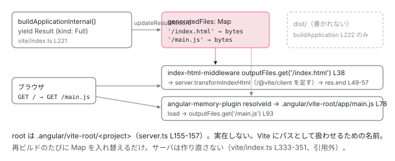

[目次](../README.md) › [起動の全手順](README.md) › 第 3 回 / 全 13 回

# dev-server builder と Vite

> execute → initialize → serveWithVite。ビルド結果をディスクに書かず、メモリから配信する仕組み。ポート確認やホスト警告もここで出ている。

angular/angular-cli · 読了 約 12 分 · 中核 · [サイトで読む（デモが動きます）](https://angular-deep-dive-cyan.vercel.app/chapter/boot-dev-server)

---

前章の終点、`execute(options, context)` の中に入ります。dev-server ビルダーがすることは 「`build` ターゲットの設定を借りてアプリをビルドし、その結果を**ディスクに書かずに** Vite の開発サーバから配信する」ことです。この章では、ポート確認やホストの警告がどこで出ているか、ビルド結果がどの `Map` に入り、ブラウザからの `GET /main.js` がどうやってその `Map` に届くかを追います。

読む対象は `packages/angular/build/src/builders/dev-server/` の `builder.ts`、`options.ts`、`vite/index.ts`、`vite/server.ts`、`vite/utils.ts`、`packages/angular/build/src/tools/vite/plugins/angular-memory-plugin.ts`、`setup-middlewares-plugin.ts`、`middlewares/index-html-middleware.ts` です。

1. ng コマンド起動
2. builder の解決
3. **dev-server と Vite**（この章）
4. application builder
5. index.html の生成
6. ブラウザが main.js を実行
7. bootstrapApplication
8. 2 段の DI 木
9. APP\_INITIALIZER
10. ApplicationRef.bootstrap
11. 最初の描画
12. クリック→再描画
13. SPA のページ遷移

## 1. execute：33 行の入口

📄 `angular-cli/packages/angular/build/src/builders/dev-server/index.ts` L9–24 （▶ の行: 10, 22）

```ts
 9 │ import { Builder, createBuilder } from '@angular-devkit/architect';
10 ▶ import { execute } from './builder';
11 │ import type { DevServerBuilderOutput } from './output';
12 │ import type { Schema as DevServerBuilderOptions } from './schema';
13 │ 
14 │ export {
15 │   type DevServerBuilderOptions,
16 │   type DevServerBuilderOutput,
17 │   execute as executeDevServerBuilder,
18 │ };
19 │ const builder: Builder<DevServerBuilderOptions> = createBuilder<
20 │   DevServerBuilderOptions,
21 │   DevServerBuilderOutput
22 ▶ >(execute);
23 │ 
24 │ export default builder;
```

📄 `angular-cli/packages/angular/build/src/builders/dev-server/builder.ts` L36–68 （▶ の行: 36, 50–51, 57, 59, 62–63）

```ts
36 ▶ export async function* execute(
37 │   options: DevServerBuilderOptions,
38 │   context: BuilderContext,
39 │   extensions?: {
40 │     buildPlugins?: Plugin[];
41 │     middleware?: ((
42 │       req: http.IncomingMessage,
43 │       res: http.ServerResponse,
44 │       next: (err?: unknown) => void,
45 │     ) => void)[];
46 │     indexHtmlTransformer?: IndexHtmlTransform;
47 │   },
48 │ ): AsyncIterable<DevServerBuilderOutput> {
49 │   // Determine project name from builder context target
50 ▶   const projectName = context.target?.project;
51 ▶   if (!projectName) {
52 │     context.logger.error(`The "dev-server" builder requires a target to be specified.`);
53 │ 
54 │     return;
55 │   }
56 │ 
57 ▶   const { builderName, normalizedOptions } = await initialize(options, projectName, context);
58 │ 
59 ▶   yield* serveWithVite(
60 │     normalizedOptions,
61 │     builderName,
62 ▶     (options, context, plugins) =>
63 ▶       buildApplicationInternal(options, context, { codePlugins: plugins }),
64 │     context,
65 │     { indexHtml: extensions?.indexHtmlTransformer },
66 │     extensions,
67 │   );
68 │ }
```

36 行目、`execute` は `async function*`（非同期ジェネレータ）です。`yield` するたびに Architect へ「1 回分の結果」が流れ、前章の `run.lastOutput` はこれが完了するまで待ちます。50〜51 行目、`context.target.project`（前章で決めたプロジェクト名）が無ければ終わり。57 行目で `initialize`、59 行目で `serveWithVite` に**すべてを委譲**します。62〜63 行目、第 3 引数は「ビルドの仕方」を表す関数で、中身は `buildApplicationInternal` です。[次章](04-boot-application-build.md)で読む `application` ビルダーの内部関数が、ここから直接呼ばれます。

📄 `angular-cli/packages/angular/build/src/builders/dev-server/internal.ts` L17–17 （▶ の行: 17）

```ts
17 ▶ export { buildApplicationInternal } from '../../builders/application';
```

17 行目、`dev-server/internal.ts` は `application` ビルダーの `buildApplicationInternal` をそのまま再 export しています。dev-server は Architect 経由で `build` ターゲットを*スケジュール*するのではなく、同じプロセス内で*関数として*呼びます。Vite の `Map` にビルド結果を直接受け取るためです。

## 2. initialize：buildTarget・ホスト警告・ポート確認

📄 `angular-cli/packages/angular/build/src/builders/dev-server/builder.ts` L70–102 （▶ の行: 76, 78–79, 81–84, 86, 96）

```ts
 70 │ async function initialize(
 71 │   initialOptions: DevServerBuilderOptions,
 72 │   projectName: string,
 73 │   context: BuilderContext,
 74 │ ) {
 75 │   // Purge old build disk cache.
 76 ▶   await purgeStaleBuildCache(context);
 77 │ 
 78 ▶   const normalizedOptions = await normalizeOptions(context, projectName, initialOptions);
 79 ▶   const builderName = await context.getBuilderNameForTarget(normalizedOptions.buildTarget);
 80 │ 
 81 ▶   if (
 82 ▶     !/^127\.\d+\.\d+\.\d+/g.test(normalizedOptions.host) &&
 83 ▶     normalizedOptions.host !== '::1' &&
 84 ▶     normalizedOptions.host !== 'localhost'
 85 │   ) {
 86 ▶     context.logger.warn(`
 87 │ Warning: This is a simple server for use in testing or debugging Angular applications
 88 │ locally. It hasn't been reviewed for security issues.
 89 │ 
 90 │ Binding this server to an open connection can result in compromising your application or
 91 │ computer. Using a different host than the one passed to the "--host" flag might result in
 92 │ websocket connection issues.
 93 │     `);
 94 │   }
 95 │ 
 96 ▶   normalizedOptions.port = await checkPort(normalizedOptions.port, normalizedOptions.host);
 97 │ 
 98 │   return {
 99 │     builderName,
100 │     normalizedOptions,
101 │   };
102 │ }
```

1. **76 行目：古いディスクキャッシュの削除**

   `.angular/cache/` の中で、現在の CLI バージョンと違う世代のディレクトリを消します。
2. **78 行目：オプションの正規化**

   `normalizeOptions` が `buildTarget` を決めます（次の引用）。79 行目で、その `build` ターゲットの builder 名（`@angular/build:application`）を `context.getBuilderNameForTarget` で取ります。前章で見た Architect の内部ジョブ `..getBuilderNameForTarget` がこれに答えます。
3. **81〜94 行目：「This is a simple server for use in testing」の警告**

   82〜84 行目、`host` が `127.x.x.x`、`::1`、`localhost` のどれでもないとき、86 行目で警告を出します。`ng serve --host 0.0.0.0` で見るあの長い文章はここです。
4. **96 行目：`checkPort`**

   ポートが使えるかを実際に `listen` して確かめます。使用中なら対話的に別ポートを提案します（後述）。

📄 `angular-cli/packages/angular/build/src/builders/dev-server/options.ts` L44–54 （▶ の行: 45–46, 49–51）

```ts
44 │   // Target specifier defaults to the current project's build target using a development configuration
45 ▶   const buildTargetSpecifier = options.buildTarget ?? `::development`;
46 ▶   const buildTarget = targetFromTargetString(buildTargetSpecifier, projectName, 'build');
47 │ 
48 │   // Get the application builder options.
49 ▶   const browserBuilderName = await context.getBuilderNameForTarget(buildTarget);
50 ▶   const rawBuildOptions = await context.getTargetOptions(buildTarget);
51 ▶   const buildOptions = (await context.validateOptions(
52 │     rawBuildOptions,
53 │     browserBuilderName,
54 │   )) as unknown as ApplicationBuilderOptions;
```

📄 `angular-cli/packages/angular_devkit/architect/src/api.ts` L336–351 （▶ の行: 341, 347–349）

```ts
336 │ export function targetFromTargetString(
337 │   specifier: string,
338 │   abbreviatedProjectName?: string,
339 │   abbreviatedTargetName?: string,
340 │ ): Target {
341 ▶   const tuple = specifier.split(':', 3);
342 │   if (tuple.length < 2) {
343 │     throw new Error('Invalid target string: ' + JSON.stringify(specifier));
344 │   }
345 │ 
346 │   return {
347 ▶     project: tuple[0] || abbreviatedProjectName || '',
348 ▶     target: tuple[1] || abbreviatedTargetName || '',
349 ▶     ...(tuple[2] !== undefined && { configuration: tuple[2] }),
350 │   };
351 │ }
```

45 行目、`angular.json` の `serve.options.buildTarget` が無ければ `'::development'`。341 行目で `':'` で割ると `['', '', 'development']` になり、347 行目でプロジェクト名は**自分のプロジェクト**、348 行目でターゲット名は `'build'`、349 行目で configuration は `'development'` に埋まります。新規プロジェクトの `angular.json` には `"development": { "buildTarget": "my-app:build:development" }` と明示されていますが、書かなくても同じ値になります。49〜51 行目、その `build` ターゲットの options を取り、`application` ビルダーのスキーマで検証します。**dev-server のビルド設定は `build` ターゲットから借りている**のです。

📄 `angular-cli/packages/angular/build/src/utils/check-port.ts` L24–39 （▶ の行: 25, 28–29, 35–36）

```ts
24 │   return new Promise<number>((resolve, reject) => {
25 ▶     const server = createServer();
26 │ 
27 │     server
28 ▶       .once('error', (err: NodeJS.ErrnoException) => {
29 ▶         if (err.code !== 'EADDRINUSE') {
30 │           reject(err);
31 │ 
32 │           return;
33 │         }
34 │ 
35 ▶         if (!isTTY()) {
36 ▶           reject(createInUseError(port));
37 │ 
38 │           return;
39 │         }
```

📄 `angular-cli/packages/angular/build/src/utils/check-port.ts` L54–66 （▶ の行: 54, 62–63, 65）

```ts
54 ▶       .once('listening', () => {
55 │         // Get the actual address from the listening server instance
56 │         const address = server.address();
57 │         assert(
58 │           address && typeof address !== 'string',
59 │           'Port check server address should always be an object.',
60 │         );
61 │ 
62 ▶         server.close();
63 ▶         resolve(address.port);
64 │       })
65 ▶       .listen(port, host);
66 │   });
```

25 行目、`node:net` の素の TCP サーバを作り、65 行目で指定ポートに `listen` します。成功したら 54 行目の `listening` で、62 行目ですぐ閉じ、63 行目で実際に取れたポート番号を返します。失敗して 29 行目の `EADDRINUSE`（使用中）なら、35〜36 行目、端末が対話的でなければ 「Port 4200 is already in use」で例外。対話的なら「Would you like to use a different port?」と聞いて、`checkPort(0, host)`（OS に空きポートを選ばせる）で再試行します。**Vite が listen する前に、Node 側で先に試している**のがポイントです。

## 3. serveWithVite：build ターゲットの設定を借り、ビルドを開始する

📄 `angular-cli/packages/angular/build/src/builders/dev-server/vite/index.ts` L66–93 （▶ の行: 66, 68, 71, 74, 90, 92）

```ts
66 ▶ ): AsyncIterableIterator<DevServerBuilderOutput> {
67 │   // Get the browser configuration from the target name.
68 ▶   const rawBrowserOptions = await context.getTargetOptions(serverOptions.buildTarget);
69 │ 
70 │   // Deploy url is not used in the dev-server.
71 ▶   delete rawBrowserOptions.deployUrl;
72 │ 
73 │   // Copy convenience options to build
74 ▶   for (const optionName of CONVENIENCE_BUILD_OPTIONS) {
75 │     const optionValue = serverOptions[optionName];
76 │     if (optionValue !== undefined) {
77 │       if (optionName === 'define' && rawBrowserOptions[optionName]) {
78 │         // Define has merging behavior within the application
79 │         for (const [key, value] of Object.entries(optionValue)) {
80 │           // eslint-disable-next-line @typescript-eslint/no-explicit-any
81 │           (rawBrowserOptions[optionName] as any)[key] = value;
82 │         }
83 │       } else {
84 │         rawBrowserOptions[optionName] = optionValue;
85 │       }
86 │     }
87 │   }
88 │ 
89 │   // TODO: Adjust architect to not force a JsonObject derived return type
90 ▶   const browserOptions = (await context.validateOptions(
91 │     rawBrowserOptions,
92 ▶     builderName,
93 │   )) as unknown as ApplicationBuilderInternalOptions;
```

68 行目、`context.getTargetOptions(buildTarget)` で `build` ターゲットの options （`browser: "src/main.ts"`、`index`、`polyfills`、`styles` など）を取り直します。71 行目で `deployUrl` を捨て、74〜87 行目で `--watch` / `--poll` / `--verbose` / `--define` を serve 側からコピーします。90〜93 行目、`application` ビルダーのスキーマで検証した結果が `browserOptions` です。この後 95〜182 行目（引用外）で、dev-server 向けに `prerender` を無効化・`statsJson` を `false`・`incrementalResults` を `true` など十数か所の上書きをします。

📄 `angular-cli/packages/angular/build/src/builders/dev-server/vite/index.ts` L219–237 （▶ の行: 221–222, 235–236）

```ts
219 │ 
220 │   // TODO: Switch this to an architect schedule call when infrastructure settings are supported
221 ▶   for await (const result of builderAction(browserOptions, context, extensions?.buildPlugins)) {
222 ▶     if (result.kind === ResultKind.Failure) {
223 │       if (result.errors.length && server) {
224 │         hadError = true;
225 │         server.ws.send({
226 │           type: 'error',
227 │           err: {
228 │             message: result.errors[0].text,
229 │             stack: '',
230 │             loc: result.errors[0].location ?? undefined,
231 │           },
232 │         });
233 │       }
234 │ 
235 ▶       yield { baseUrl: '', success: false };
236 ▶       continue;
237 │     }
```

221 行目。`builderAction(browserOptions, context, plugins)`、つまり 1 節 63 行目の `buildApplicationInternal` を呼び、`for await` で結果を 1 つずつ受け取ります。**初回ビルドも、ファイル変更後の再ビルドも、すべてこのループの 1 周**です。222 行目、失敗なら 235 行目で `success: false` を yield して 236 行目で次の結果を待ちます。

## 4. ビルド結果は Map に入る：ディスクには書かない

📄 `angular-cli/packages/angular/build/src/builders/dev-server/vite/index.ts` L250–276 （▶ の行: 250–252, 261–263, 265–266, 270–271）

```ts
250 ▶       case ResultKind.Full:
251 ▶         if (result.detail?.['htmlIndexPath']) {
252 ▶           htmlIndexPath = result.detail['htmlIndexPath'] as string;
253 │         }
254 │         if (serverOptions.servePath === undefined && result.detail?.['htmlBaseHref']) {
255 │           const baseHref = result.detail['htmlBaseHref'] as string;
256 │           // Remove trailing slash
257 │           serverOptions.servePath =
258 │             baseHref !== './' && baseHref.at(-1) === '/' ? baseHref.slice(0, -1) : baseHref;
259 │         }
260 │ 
261 ▶         assetFiles.clear();
262 ▶         componentStyles.clear();
263 ▶         generatedFiles.clear();
264 │ 
265 ▶         for (const file of result.files) {
266 ▶           updateResultRecord(
267 │             file,
268 │             normalizePath,
269 │             htmlIndexPath,
270 ▶             generatedFiles,
271 ▶             assetFiles,
272 │             componentStyles,
273 │             // The initial build will not yet have a server setup
274 │             !server,
275 │           );
276 │         }
```

📄 `angular-cli/packages/angular/build/src/builders/dev-server/vite/utils.ts` L32–57 （▶ の行: 41–42, 51, 54, 56）

```ts
32 │ export function updateResultRecord(
33 │   file: ResultFile,
34 │   normalizePath: (id: string) => string,
35 │   htmlIndexPath: string,
36 │   generatedFiles: Map<string, OutputFileRecord>,
37 │   assetFiles: Map<string, OutputAssetRecord>,
38 │   componentStyles: Map<string, ComponentStyleRecord>,
39 │   initial = false,
40 │ ): void {
41 ▶   if (file.origin === 'disk') {
42 ▶     assetFiles.set('/' + normalizePath(file.path), {
43 │       source: normalizePath(file.inputPath),
44 │       updated: !initial,
45 │     });
46 │ 
47 │     return;
48 │   }
49 │ 
50 │   let filePath;
51 ▶   if (file.path === htmlIndexPath) {
52 │     // Convert custom index output path to standard index path for dev-server usage.
53 │     // This mimics the Webpack dev-server behavior.
54 ▶     filePath = '/index.html';
55 │   } else {
56 ▶     filePath = '/' + normalizePath(file.path);
57 │   }
```

250 行目、初回ビルドの結果は `ResultKind.Full` です。252 行目で `index.html` の出力名を覚え、261〜263 行目で 3 つの `Map` を空にし、265〜275 行目で結果ファイルを 1 つずつ `updateResultRecord` に渡します。41〜42 行目、`origin === 'disk'`（`assets` でコピー指定したファイル）は元のパスだけを `assetFiles` に記録します。コピーすらしません。それ以外、つまり esbuild が生成した `main.js` や `styles.css` は 51〜56 行目で `/` 始まりのパスに直し、この引用の続き（同ファイル 83〜91 行目、引用外）で `generatedFiles.set(filePath, { contents, ... })` と**バイト列のまま `Map` に入れます**。54 行目、`index.html` の出力名が何であっても配信パスは `/index.html` に揃えます。

> [!NOTE]
> **ポイント**
>
> 比較のために、`ng build` のときディスクに書く場所を見ておきます。同じ `buildApplicationInternal` の結果を、`buildApplication` だけが `fs.writeFile` しています。

📄 `angular-cli/packages/angular/build/src/builders/application/index.ts` L199–222 （▶ の行: 202, 211, 216, 220, 222）

```ts
199 │     // Writes the output files to disk and ensures the containing directories are present
200 │     const directoryExists = new Set<string>();
201 │     try {
202 ▶       await emitFilesToDisk(result.files, async (file) => {
203 │         if (
204 │           outputOptions.ignoreServer &&
205 │           (file.type === BuildOutputFileType.ServerApplication ||
206 │             file.type === BuildOutputFileType.ServerRoot)
207 │         ) {
208 │           return;
209 │         }
210 │ 
211 ▶         const fullFilePath = generateFullPath(file.path, file.type, outputOptions);
212 │ 
213 │         // Ensure output subdirectories exist
214 │         const fileBasePath = path.dirname(fullFilePath);
215 │         if (fileBasePath && !directoryExists.has(fileBasePath)) {
216 ▶           await fs.mkdir(fileBasePath, { recursive: true });
217 │           directoryExists.add(fileBasePath);
218 │         }
219 │ 
220 ▶         if (file.origin === 'memory') {
221 │           // Write file contents
222 ▶           await fs.writeFile(fullFilePath, file.contents);
```

202 行目の `emitFilesToDisk`、216 行目の `mkdir`、222 行目の `writeFile`。これは `application/index.ts` の `buildApplication`（`ng build` の入口）の中です。dev-server は 1 節で見たとおり `buildApplicationInternal` を呼ぶので、**この関数を通りません**。`ng serve` 中に `dist/` が更新されないのはこのためです。

## 5. Vite サーバを立てる：仮想ルートとメモリプラグイン

📄 `angular-cli/packages/angular/build/src/builders/dev-server/vite/index.ts` L412–437 （▶ の行: 413, 415–416, 436–437）

```ts
412 │       // Setup server and start listening
413 ▶       const serverConfiguration = await setupServer(
414 │         serverOptions,
415 ▶         generatedFiles,
416 ▶         assetFiles,
417 │         browserOptions.preserveSymlinks,
418 │         externalMetadata,
419 │         ssrMode,
420 │         prebundleTransformer,
421 │         target,
422 │         componentStyles,
423 │         templateUpdates,
424 │         loader,
425 │         {
426 │           ...browserOptions.define,
427 │           'ngServerMode': 'false',
428 │           'ngJitMode': browserOptions.aot ? 'false' : 'true',
429 │           'ngHmrMode': browserOptions.templateUpdates ? 'true' : 'false',
430 │         },
431 │         extensions?.middleware,
432 │         transformers?.indexHtml,
433 │         thirdPartySourcemaps,
434 │       );
435 │ 
436 ▶       server = await createServer(serverConfiguration);
437 ▶       await server.listen();
```

📄 `angular-cli/packages/angular/build/src/builders/dev-server/vite/index.ts` L492–498 （▶ の行: 498）

```ts
492 │       const urls = server.resolvedUrls;
493 │       if (urls && (urls.local.length || urls.network.length)) {
494 │         serverUrl = new URL(urls.local[0] ?? urls.network[0]);
495 │       }
496 │ 
497 │       // log connection information
498 ▶       server.printUrls();
```

初回ビルドが終わり `server` がまだ無いとき（`else` 側）に入ります。413 行目の `setupServer` に、415〜416 行目で 4 節の `generatedFiles` と `assetFiles` を**参照渡し**します。以降の再ビルドで `Map` を更新すれば、サーバは自動的に新しい内容を配信します。436 行目で Vite の `createServer`、437 行目で `listen`、498 行目の `printUrls` が 「Local: http://localhost:4200/」を表示します。

📄 `angular-cli/packages/angular/build/src/builders/dev-server/vite/server.ts` L154–183 （▶ の行: 155–156, 175, 178, 183）

```ts
154 │   // Path will not exist on disk and only used to provide separate path for Vite requests
155 ▶   const virtualProjectRoot = normalizePath(
156 ▶     join(serverOptions.workspaceRoot, `.angular/vite-root`, serverOptions.buildTarget.project),
157 │   );
158 │ 
159 │   /**
160 │    * Required when using `externalDependencies` to prevent Vite load errors.
161 │    *
162 │    * @note Can be removed if Vite introduces native support for externals.
163 │    * @note Vite misresolves browser modules in SSR when accessing URLs with multiple segments
164 │    *       (e.g., 'foo/bar'), as they are not correctly re-based from the base href.
165 │    */
166 │   const preTransformRequests =
167 │     externalMetadata.explicitBrowser.length === 0 && ssrMode === ServerSsrMode.NoSsr;
168 │   const cacheDir = join(
169 │     serverOptions.cacheOptions.localPath ?? serverOptions.cacheOptions.path,
170 │     serverOptions.buildTarget.project,
171 │     'vite',
172 │   );
173 │ 
174 │   const configuration: Vite.InlineConfig = {
175 ▶     configFile: false,
176 │     envDir: false,
177 │     cacheDir,
178 ▶     root: virtualProjectRoot,
179 │     publicDir: false,
180 │     oxc: false,
181 │     mode: 'development',
182 │     // We use custom as we do not rely on Vite's htmlFallbackMiddleware and indexHtmlMiddleware.
183 ▶     appType: 'custom',
```

155〜157 行目、`<workspace>/.angular/vite-root/<project>` という **存在しないディレクトリ**を Vite の `root`（178 行目）にします。Vite は「root からの相対パス」でモジュールを識別するので、ビルド結果の `/main.js` を `.angular/vite-root/my-app/main.js` という*架空のファイルパス*として扱わせるためです。175 行目、`vite.config.ts` は読みません。183 行目、`appType: 'custom'` で Vite 標準の `index.html` 配信を切り、自前のミドルウェアで配信します。

📄 `angular-cli/packages/angular/build/src/builders/dev-server/vite/server.ts` L227–248 （▶ の行: 228–230, 241, 243）

```ts
227 │     plugins: [
228 ▶       createAngularSetupMiddlewaresPlugin({
229 ▶         outputFiles,
230 ▶         assets,
231 │         indexHtmlTransformer,
232 │         extensionMiddleware,
233 │         componentStyles,
234 │         templateUpdates,
235 │         ssrMode,
236 │         resetComponentUpdates: () => templateUpdates.clear(),
237 │         projectRoot: serverOptions.projectRoot,
238 │       }),
239 │       createRemoveIdPrefixPlugin(externalMetadata.explicitBrowser),
240 │       await createAngularSsrTransformPlugin(serverOptions.workspaceRoot),
241 ▶       await createAngularMemoryPlugin({
242 │         virtualProjectRoot,
243 ▶         outputFiles,
244 │         templateUpdates,
245 │         external: externalMetadata.explicitBrowser,
246 │         disableViteTransport: !serverOptions.liveReload,
247 │       }),
248 │     ],
```

プラグインは 2 つが中心です。228 行目の `createAngularSetupMiddlewaresPlugin`（HTTP リクエストの入口）と、241 行目の `createAngularMemoryPlugin`（Vite のモジュール解決を `Map` に向ける）。どちらも 229・243 行目で同じ `outputFiles`（= `generatedFiles`）を受け取っています。

📄 `angular-cli/packages/angular/build/src/tools/vite/plugins/angular-memory-plugin.ts` L67–80 （▶ の行: 67, 72, 76–78）

```ts
67 ▶       if (importer && source[0] === '.') {
68 │         const normalizedImporter = normalizePath(importer);
69 │         if (normalizedImporter.startsWith(virtualProjectRoot)) {
70 │           // Remove query if present
71 │           const [importerFile] = normalizedImporter.split('?', 1);
72 ▶           source = '/' + join(dirname(relative(virtualProjectRoot, importerFile)), source);
73 │         }
74 │       }
75 │ 
76 ▶       const [file] = source.split('?', 1);
77 ▶       if (outputFiles.has(normalizePath(file))) {
78 ▶         return join(virtualProjectRoot, source);
79 │       }
80 │     },
```

📄 `angular-cli/packages/angular/build/src/tools/vite/plugins/angular-memory-plugin.ts` L91–111 （▶ の行: 91–93, 102, 105, 108）

```ts
 91 ▶       const [file] = id.split('?', 1);
 92 ▶       const relativeFile = '/' + normalizePath(relative(virtualProjectRoot, file));
 93 ▶       const codeContents = outputFiles.get(relativeFile)?.contents;
 94 │       if (codeContents === undefined) {
 95 │         if (relativeFile.endsWith('/node_modules/vite/dist/client/client.mjs')) {
 96 │           return loadViteClientCode(file, options.disableViteTransport);
 97 │         }
 98 │ 
 99 │         return undefined;
100 │       }
101 │ 
102 ▶       const code = Buffer.from(codeContents).toString('utf-8');
103 │       const mapContents = outputFiles.get(relativeFile + '.map')?.contents;
104 │ 
105 ▶       return {
106 │         // Remove source map URL comments from the code if a sourcemap is present.
107 │         // Vite will inline and add an additional sourcemap URL for the sourcemap.
108 ▶         code: mapContents ? removeSourceMappingURL(code) : code,
109 │         map: mapContents && Buffer.from(mapContents).toString('utf-8'),
110 │       };
111 │     },
```

1. **`resolveId`（67〜80 行目）：import 文を架空パスに解決する**

   ブラウザが `GET /main.js` すると、Vite は `/main.js` という id を解決しようとします。77 行目、`outputFiles`（4 節の `Map`）に `/main.js` があれば、78 行目で `.angular/vite-root/my-app/main.js` を返します。67〜72 行目は、`main.js` の中の `import './chunk-XXXX.js'` のような相対 import を 同じ架空ルート基準に直す処理です。
2. **`load`（91〜111 行目）：架空パスの中身を Map から出す**

   92 行目で架空ルートからの相対パス `/main.js` に戻し、93 行目で `outputFiles.get()`。102 行目でバイト列を文字列にし、105〜110 行目でソースマップと一緒に返します。**ディスクの読み書きは一度も発生しません。**

## 6. ミドルウェアの順番と index.html

📄 `angular-cli/packages/angular/build/src/tools/vite/plugins/setup-middlewares-plugin.ts` L93–108 （▶ の行: 96–99）

```ts
 93 │       const middlewares = server.middlewares;
 94 │ 
 95 │       // Headers, assets and resources get handled first
 96 ▶       middlewares.use(createAngularHeadersMiddleware(server));
 97 ▶       middlewares.use(createAngularComponentMiddleware(server, templateUpdates));
 98 ▶       middlewares.use(
 99 ▶         createAngularAssetsMiddleware(
100 │           server,
101 │           assets,
102 │           outputFiles,
103 │           componentStyles,
104 │           await createEncapsulateStyle(),
105 │         ),
106 │       );
107 │ 
108 │       middlewares.use(createChromeDevtoolsMiddleware(server.config.cacheDir, options.projectRoot));
```

📄 `angular-cli/packages/angular/build/src/tools/vite/plugins/setup-middlewares-plugin.ts` L115–138 （▶ の行: 115, 129–131）

```ts
115 ▶       return async () => {
116 │         patchHostValidationMiddleware(server.middlewares);
117 │ 
118 │         if (ssrMode === ServerSsrMode.ExternalSsrMiddleware) {
119 │           patchBaseMiddleware(server.middlewares, server.config.base);
120 │           middlewares.use(await createAngularSsrExternalMiddleware(server, indexHtmlTransformer));
121 │ 
122 │           return;
123 │         }
124 │ 
125 │         if (ssrMode === ServerSsrMode.InternalSsrMiddleware) {
126 │           middlewares.use(createAngularSsrInternalMiddleware(server, indexHtmlTransformer));
127 │         }
128 │ 
129 ▶         middlewares.use(angularHtmlFallbackMiddleware);
130 ▶         middlewares.use(
131 ▶           createAngularIndexHtmlMiddleware(
132 │             server,
133 │             outputFiles,
134 │             resetComponentUpdates,
135 │             indexHtmlTransformer,
136 │           ),
137 │         );
138 │       };
```

96〜99 行目、ヘッダ → コンポーネント HMR → アセット（`assetFiles` と `outputFiles` の静的配信）の順。115 行目で関数を返すのは Vite の約束で、「Vite 本体の transform ミドルウェアの**後ろ**に追加する」という意味です。129 行目の `angularHtmlFallbackMiddleware` が `/about` のような拡張子無しの URL を `/index.html` に書き換え、130〜131 行目の `createAngularIndexHtmlMiddleware` が実際に返します。SPA でどの URL をリロードしても `index.html` が返るのは、この 2 つのミドルウェアの仕事です。

📄 `angular-cli/packages/angular/build/src/tools/vite/middlewares/index-html-middleware.ts` L21–60 （▶ の行: 30, 32, 38–39, 46, 49, 55–57）

```ts
21 │   return function angularIndexHtmlMiddleware(req, res, next) {
22 │     if (!req.url) {
23 │       next();
24 │ 
25 │       return;
26 │     }
27 │ 
28 │     // Parse the incoming request.
29 │     // The base of the URL is unused but required to parse the URL.
30 ▶     const pathname = pathnameWithoutBasePath(req.url, server.config.base);
31 │     const extension = extname(pathname);
32 ▶     if (extension !== '.html') {
33 │       next();
34 │ 
35 │       return;
36 │     }
37 │ 
38 ▶     const rawHtml = outputFiles.get(pathname)?.contents;
39 ▶     if (!rawHtml) {
40 │       next();
41 │ 
42 │       return;
43 │     }
44 │ 
45 │     // A request for the index indicates a full page reload request.
46 ▶     resetComponentUpdates();
47 │ 
48 │     server
49 ▶       .transformIndexHtml(req.url, Buffer.from(rawHtml).toString('utf-8'))
50 │       .then(async (processedHtml) => {
51 │         if (indexHtmlTransformer) {
52 │           processedHtml = await indexHtmlTransformer(processedHtml);
53 │         }
54 │ 
55 ▶         res.setHeader('Content-Type', 'text/html');
56 ▶         res.setHeader('Cache-Control', 'no-cache');
57 ▶         res.end(processedHtml);
58 │       })
59 │       .catch((error) => next(error));
60 │   };
```

30 行目で `base`（`--serve-path`）を除いたパス名、32 行目で `.html` 以外は次へ。38〜39 行目、`outputFiles.get('/index.html')`。これは[5 章](05-boot-index-html.md)で ビルドが生成した、`<script>` 挿入済みの HTML です。49 行目、Vite の `transformIndexHtml` が `/@vite/client`（HMR 用のクライアント）の `<script>` を足します。55〜57 行目、`text/html`、`no-cache` で返します。46 行目、index へのリクエストは「ページ全体のリロード」なので、溜めていたテンプレート更新を捨てます。



*ng serve の 1 往復。ビルド結果は generatedFiles（Map）に入り、ブラウザからの GET はミドルウェアかメモリプラグインが Map から答える。dist/ は登場しない。*

## ここまでの呼び出し

- 👤 `execute(options, context)` — dev-server/builder.ts L36 — *前章 create-builder.ts L207 から*
  - `initialize(options, projectName, context)` — builder.ts L70
    - `normalizeOptions(context, projectName, options)` — dev-server/options.ts L45-46 — *buildTarget = '::development' → {app, build, development}*
    - `context.logger.warn(...)` — builder.ts L86 — *host が localhost 系でないときだけ*
    - `checkPort(port, host)` — utils/check-port.ts L17 — *net.createServer().listen で試す*
  - `yield* serveWithVite(normalizedOptions, builderName, builderAction, context)` — vite/index.ts L54
    - `context.getTargetOptions(buildTarget)` / `validateOptions` — vite/index.ts L68 / L90 — *build ターゲットの設定を借りる*
    - `for await (const result of builderAction(browserOptions, ...))` — vite/index.ts L221 — *= buildApplicationInternal（次章）*
      - `updateResultRecord(file, ..., generatedFiles, assetFiles, ...)` — vite/index.ts L266 → vite/utils.ts L32 — *Map に入れる。ディスクには書かない*
      - `setupServer(serverOptions, generatedFiles, assetFiles, ...)` — vite/index.ts L413 → vite/server.ts L134 — *root = .angular/vite-root/&lt;project&gt;、plugins*
      - `server = await createServer(config)` → `server.listen()` — vite/index.ts L436-437
      - `server.printUrls()` — vite/index.ts L498 — *「Local: http://localhost:4200/」*
      - `yield { success: true, port, baseUrl }` — vite/index.ts L519 — *Architect の run.output に 1 件流れる*

## 聞かれそうな質問

**Q. ng serve は dist/ に書き込みますか？**

書きません。`serveWithVite` は `buildApplicationInternal`（dev-server/internal.ts 17 行目で再 export）を 直接呼び、結果を `updateResultRecord`（vite/index.ts 266 行目 → vite/utils.ts 32 行目）で `generatedFiles` という `Map` に入れます。`fs.writeFile` しているのは `application/index.ts` の `buildApplication` 222 行目だけで、これは `ng build` の入口であり dev-server は通りません。配信時は `angular-memory-plugin.ts` 93 行目の `outputFiles.get()` と `index-html-middleware.ts` 38 行目で `Map` から読みます。

**Q. ng serve のビルド設定（main.ts の場所など）はどこから来ていますか？**

`build` ターゲットからです。`dev-server/options.ts` 45〜46 行目で `buildTarget`（既定 `'::development'`）を `{ project, target: 'build', configuration: 'development' }` に解釈し、`vite/index.ts` 68 行目の `context.getTargetOptions(buildTarget)` でその options を取り、90 行目で `application` ビルダーのスキーマで検証しています。`serve` ターゲット自身の options は `port` / `host` / `open` などサーバの設定だけです。

**Q. 「Port 4200 is already in use」はどこで判定していますか？**

`utils/check-port.ts` です。25 行目で `node:net` のサーバを作り、65 行目で `listen(port, host)`。29 行目で `EADDRINUSE` を受けたら、端末が対話的でなければ 36 行目で例外、対話的なら `@inquirer/confirm` で別ポートを使うか聞きます。呼び出し元は `builder.ts` 96 行目で、Vite を起動する前です。

**Q. ブラウザから /main.js を要求すると、Vite はどこを読みますか？**

`angular-memory-plugin.ts` の `resolveId`（77〜78 行目）が、`outputFiles` に `/main.js` があれば `.angular/vite-root/<project>/main.js` という架空のパスに解決し、`load`（92〜93 行目）がそのパスを `/main.js` に戻して `outputFiles.get()` で中身を返します。`server.ts` 155〜157 行目のとおり、この root ディレクトリは存在しません。

**Q. /about を直接開いてもアプリが表示されるのはなぜですか？**

`setup-middlewares-plugin.ts` 129 行目の `angularHtmlFallbackMiddleware` が 拡張子の無い URL を `/index.html` に書き換え、130〜131 行目の `createAngularIndexHtmlMiddleware` （index-html-middleware.ts 38 行目）が `outputFiles.get('/index.html')` を返すからです。その後ブラウザで Router が `/about` を解釈します（[13 章](13-boot-spa-navigation.md)）。

**Q. Warning: This is a simple server for use in testing... はいつ出ますか？**

`dev-server/builder.ts` 81〜85 行目の条件、`host` が `127.*` でも `::1` でも `localhost` でもないときに、86 行目で出ます。`--host 0.0.0.0` や LAN の IP を指定したときです。

## 読み終えて

- `execute`（builder.ts 36 行目）は `initialize` → `serveWithVite` の 2 段。ビルドの仕方は `buildApplicationInternal` を関数として渡す（62〜63 行目）
- ビルド設定は `build` ターゲットから借りる。`buildTarget` の既定 `'::development'` が `{自プロジェクト, build, development}` になる（options.ts 45〜46 行目、api.ts 347〜349 行目）
- ホスト警告は builder.ts 86 行目、ポート確認は check-port.ts 65 行目の `listen`。どちらも Vite 起動前
- ビルド結果は `generatedFiles`（`Map`）へ。`fs.writeFile` は `ng build` 用の `buildApplication` にしか無い
- Vite の root は実在しない `.angular/vite-root/<project>`。メモリプラグインの `resolveId` / `load` と index.html ミドルウェアが、`Map` から直接配信する

保存してから再ビルドされるまでと、画面を保ったまま差し替える HMR は、[再ビルドとキャッシュ](../cli/10-cli-cache-watch.md)・[HMR](../cli/11-cli-hmr.md) の章で追います。

---

← 前: [angular.json から builder を探し出す](02-boot-architect.md)  
次: [application builder：esbuild と Angular コンパイラ](04-boot-application-build.md) →
