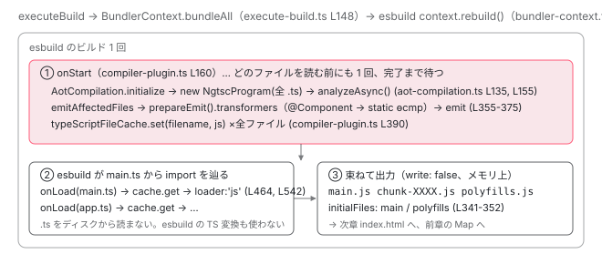

[目次](../README.md) › [起動の全手順](README.md) › 第 4 回 / 全 13 回

# application builder：esbuild と Angular コンパイラ

> buildApplicationInternal → executeBuild → createCompilerPlugin。AOT コンパイルで ɵcmp が作られ、esbuild がそれを束ねる。2 つのツールの分担。

angular/angular-cli · 読了 約 13 分 · 中核 · [サイトで読む（デモが動きます）](https://angular-deep-dive-cyan.vercel.app/chapter/boot-application-build)

---

前章の `for await (const result of builderAction(...))` の中、つまり `buildApplicationInternal` が 1 回分の結果を作るまでを追います。主役は 2 つのツールです。**Angular コンパイラ**（`@angular/compiler-cli`）が `@Component` を `ɵcmp` に変え、**esbuild** がそれを 1 つの `main.js` に束ねます。この章では「AOT コンパイルは esbuild の前か、後か、同時か」に行番号で答えます。

読む対象は `packages/angular/build/src/builders/application/` の `index.ts`、`build-action.ts`、`execute-build.ts`、`setup-bundling.ts`、`packages/angular/build/src/tools/esbuild/` の `application-code-bundle.ts`、`bundler-context.ts`、`angular/compiler-plugin.ts`、`packages/angular/build/src/tools/angular/compilation/aot-compilation.ts` です。`ng build` 側の観点（Babel・予算・ワーカー）は既存の [build の章](../cli/02-build.md)にあります。

1. ng コマンド起動
2. builder の解決
3. dev-server と Vite
4. **application builder**（この章）
5. index.html の生成
6. ブラウザが main.js を実行
7. bootstrapApplication
8. 2 段の DI 木
9. APP\_INITIALIZER
10. ApplicationRef.bootstrap
11. 最初の描画
12. クリック→再描画
13. SPA のページ遷移

## 1. buildApplicationInternal → runEsBuildBuildAction → executeBuild

📄 `angular-cli/packages/angular/build/src/builders/application/index.ts` L34–56 （▶ の行: 34, 43, 46, 49）

```ts
34 ▶ export async function* buildApplicationInternal(
35 │   options: ApplicationBuilderInternalOptions,
36 │   // TODO: Integrate abort signal support into builder system
37 │   context: BuilderContext & { signal?: AbortSignal },
38 │   extensions?: ApplicationBuilderExtensions,
39 │ ): AsyncIterable<Result> {
40 │   const { workspaceRoot, logger, target } = context;
41 │ 
42 │   // Check Angular version.
43 ▶   assertCompatibleAngularVersion(workspaceRoot);
44 │ 
45 │   // Purge old build disk cache.
46 ▶   await purgeStaleBuildCache(context);
47 │ 
48 │   // Determine project name from builder context target
49 ▶   const projectName = target?.project;
50 │   if (!projectName) {
51 │     context.logger.error(`The 'application' builder requires a target to be specified.`);
52 │     // Only the vite-based dev server current uses the errors value
53 │     yield { kind: ResultKind.Failure, errors: [] };
54 │ 
55 │     return;
56 │   }
```

34 行目、これも `async function*` です。43 行目、`node_modules/@angular/core` のバージョンが この CLI の対応範囲かを確認します（「This version of CLI is only compatible with Angular versions ...」はここ）。46 行目でキャッシュ掃除、49 行目でプロジェクト名。dev-server と同じ `context` を受け取っているので、`target` は `{ project, target: 'serve' }` のままです。

📄 `angular-cli/packages/angular/build/src/builders/application/index.ts` L97–125 （▶ の行: 97–98, 102, 118–119）

```ts
 97 ▶   yield* runEsBuildBuildAction(
 98 ▶     async (rebuildState) => {
 99 │       const { serverEntryPoint, jsonLogs, partialSSRBuild } = normalizedOptions;
100 │ 
101 │       const startTime = process.hrtime.bigint();
102 ▶       const result = await executeBuild(normalizedOptions, context, rebuildState);
103 │ 
104 │       if (jsonLogs) {
105 │         result.addLog(await createJsonBuildManifest(result, normalizedOptions));
106 │       } else {
107 │         if (serverEntryPoint && !partialSSRBuild) {
108 │           const prerenderedRoutesLength = Object.keys(result.prerenderedRoutes).length;
109 │           let prerenderMsg = `Prerendered ${prerenderedRoutesLength} static route`;
110 │           prerenderMsg += prerenderedRoutesLength !== 1 ? 's.' : '.';
111 │ 
112 │           result.addLog(ansiColors.magenta(prerenderMsg));
113 │         }
114 │ 
115 │         const buildTime = Number(process.hrtime.bigint() - startTime) / 10 ** 9;
116 │         const hasError = result.errors.length > 0;
117 │ 
118 ▶         result.addLog(
119 ▶           `Application bundle generation ${hasError ? 'failed' : 'complete'}.` +
120 │             ` [${buildTime.toFixed(3)} seconds] - ${new Date().toISOString()}\n`,
121 │         );
122 │       }
123 │ 
124 │       return result;
125 │     },
```

97 行目、`runEsBuildBuildAction` に**「1 回ビルドする関数」**（98〜125 行目）を渡します。その関数の中心は 102 行目の `executeBuild` で、118〜120 行目の 「Application bundle generation complete. \[1.234 seconds\]」というログもここで積まれます。`runEsBuildBuildAction` は、この関数を初回に 1 回、ファイル変更ごとに 1 回ずつ呼ぶループです。

📄 `angular-cli/packages/angular/build/src/builders/application/build-action.ts` L94–107 （▶ の行: 98, 101）

```ts
 94 │   // Initial build
 95 │   let result: ExecutionResult | undefined;
 96 │   try {
 97 │     // Perform the build action
 98 ▶     result = await withProgress('Building...', () => action());
 99 │ 
100 │     // Log all diagnostic (error/warning/logs) messages
101 ▶     await logMessages(logger, result, colors, jsonLogs);
102 │   } finally {
103 │     // Ensure Sass workers are shutdown if not watching or if the initial build failed
104 │     if (!watch || !result) {
105 │       shutdownSassWorkerPool();
106 │     }
107 │   }
```

📄 `angular-cli/packages/angular/build/src/builders/application/build-action.ts` L165–183 （▶ の行: 172, 178, 181–182）

```ts
165 │       // Watch locations provided by the initial build result
166 │       watcher.add(result.watchFiles);
167 │     }
168 │ 
169 │     // Output the first build results after setting up the watcher to ensure that any code executed
170 │     // higher in the iterator call stack will trigger the watcher. This is particularly relevant for
171 │     // unit tests which execute the builder and modify the file system programmatically.
172 ▶     const outputResults = [...emitOutputResults(result, outputOptions)];
173 │     if (!watch) {
174 │       await result.dispose();
175 │       // Set to true to prevent double-disposal of the result context in the finally block on generator exit
176 │       watchLoopStarted = true;
177 │     }
178 ▶     yield* outputResults;
179 │ 
180 │     // Finish if watch mode is not enabled
181 ▶     if (!watcher) {
182 ▶       return;
183 │     }
```

98 行目、`withProgress('Building...', () => action())`。端末に回るスピナーの正体です。101 行目で診断（エラー・警告）を出力し、172 行目で `ExecutionResult` を 前章の `Result`（`kind: Full`）に変換、178 行目で `yield`。**ここが前章 `for await` の 1 周目に届く瞬間**です。181〜183 行目、`watch` でなければここで終わり。dev-server は `watch: true` なので、この後の `for await (const changes of watcher)`（引用外）に入り、変更ごとに `action(rebuildState)` を呼びます。

## 2. executeBuild：コンパイルとバンドルの「文脈」を組む

📄 `angular-cli/packages/angular/build/src/builders/application/execute-build.ts` L120–152 （▶ の行: 121–122, 127–129, 131–132, 148–150）

```ts
120 │     } else {
121 ▶       const target = transformSupportedBrowsersToTargets(browsers);
122 ▶       codeBundleCache = new SourceFileCache(cacheOptions.enabled ? cacheOptions.path : undefined);
123 │       componentStyleBundler = createComponentStyleBundler(options, target);
124 │       if (options.templateUpdates) {
125 │         templateUpdates = new Map<string, string>();
126 │       }
127 ▶       const angularCompilation = await createAngularCompilation(
128 ▶         !!options.jit,
129 ▶         !options.serverEntryPoint,
130 │       );
131 ▶       angularCompilationContext = new PrimaryCompilationContext(angularCompilation);
132 ▶       bundlerContexts = setupBundlerContexts(
133 │         options,
134 │         target,
135 │         codeBundleCache,
136 │         componentStyleBundler,
137 │         angularCompilationContext,
138 │         templateUpdates,
139 │       );
140 │       executionResult = new ExecutionResult(
141 │         bundlerContexts,
142 │         componentStyleBundler,
143 │         codeBundleCache,
144 │         templateUpdates,
145 │       );
146 │ 
147 │       // Bundle everything on initial build
148 ▶       bundlingIndividualResults = await BundlerContext.bundleAll([
149 ▶         ...bundlerContexts.typescriptContexts,
150 ▶         ...bundlerContexts.otherContexts,
151 │       ]);
152 │     }
```

1. **121 行目：browserslist → esbuild の target**

   `.browserslistrc` と Angular の最低サポートから `['chrome120', 'safari17', ...]` のような配列を作ります。
2. **122 行目：`SourceFileCache`**

   TypeScript ソースと、コンパイル結果（JS）を保持するキャッシュです。再ビルドで変わらなかったファイルは再利用されます。
3. **127〜131 行目：Angular コンパイルの実体を 1 つ作る**

   `createAngularCompilation(jit, browserOnly)`。`aot: true`（既定）なら `AotCompilation` です。これを `PrimaryCompilationContext` に包みます。「Primary」が付くのは、polyfills やサーバ側バンドルなど*複数の esbuild ビルドが同じコンパイル結果を共有する*ためです。
4. **132〜139 行目：`setupBundlerContexts`**

   esbuild の実行単位（`BundlerContext`）を複数作ります。次の引用です。
5. **148〜151 行目：全部まとめて `bundleAll`**

   TypeScript を含むもの（`typescriptContexts`）と含まないもの（`otherContexts`、グローバル CSS など）を 一度に実行します。**ここで esbuild が走り、その中で AOT コンパイルも走ります**（4 節）。

📄 `angular-cli/packages/angular/build/src/builders/application/setup-bundling.ts` L57–94 （▶ の行: 58–59, 62, 67, 75, 80, 89–90, 92）

```ts
57 │   // Browser application code
58 ▶   typescriptContexts.push(
59 ▶     new BundlerContext(
60 │       workspaceRoot,
61 │       watch,
62 ▶       createBrowserCodeBundleOptions(
63 │         options,
64 │         target,
65 │         codeBundleCache,
66 │         stylesheetBundler,
67 ▶         angularCompilationContext,
68 │         templateUpdates,
69 │       ),
70 │       true,
71 │     ),
72 │   );
73 │ 
74 │   // Browser polyfills code
75 ▶   const browserPolyfillBundleOptions = createBrowserPolyfillBundleOptions(
76 │     options,
77 │     target,
78 │     codeBundleCache,
79 │     stylesheetBundler,
80 ▶     angularCompilationContext.createSecondaryContext(),
81 │   );
82 │   if (browserPolyfillBundleOptions) {
83 │     const browserPolyfillContext = new BundlerContext(
84 │       workspaceRoot,
85 │       watch,
86 │       browserPolyfillBundleOptions,
87 │       true,
88 │     );
89 ▶     if (typeof browserPolyfillBundleOptions === 'function') {
90 ▶       otherContexts.push(browserPolyfillContext);
91 │     } else {
92 ▶       typescriptContexts.push(browserPolyfillContext);
93 │     }
94 │   }
```

58〜71 行目、1 つ目は**アプリ本体**（`main.ts` 起点）。62 行目の `createBrowserCodeBundleOptions` が esbuild のオプションを作り、67 行目で Angular コンパイルの文脈を渡します。75〜81 行目、2 つ目は **polyfills**。80 行目、こちらには `createSecondaryContext()`、つまり「本体のコンパイル結果を待って使う側」を渡します。89〜93 行目、polyfills に `.ts` が含まれなければ `otherContexts`（TypeScript 無し）扱いです。`zone.js` だけの polyfills はこちらです。

## 3. esbuild に渡すオプションと angular-compiler プラグイン

📄 `angular-cli/packages/angular/build/src/tools/esbuild/application-code-bundle.ts` L48–71 （▶ の行: 49–50, 52, 59, 61, 67–70）

```ts
48 │   return (loadCache) => {
49 ▶     const { entryPoints, outputNames, polyfills } = options;
50 ▶     const zoneless = isZonelessApp(polyfills);
51 │ 
52 ▶     const pluginOptions = createCompilerPluginOptions(
53 │       options,
54 │       sourceFileCache,
55 │       loadCache,
56 │       templateUpdates,
57 │     );
58 │ 
59 ▶     const buildOptions: BuildOptions = {
60 │       ...getEsBuildCommonOptions(options),
61 ▶       platform: 'browser',
62 │       // Note: `es2015` is needed for RxJS v6. If not specified, `module` would
63 │       // match and the ES5 distribution would be bundled and ends up breaking at
64 │       // runtime with the RxJS testing library.
65 │       // More details: https://github.com/angular/angular-cli/issues/25405.
66 │       mainFields: ['es2020', 'es2015', 'browser', 'module', 'main'],
67 ▶       entryNames: outputNames.bundles,
68 ▶       entryPoints,
69 ▶       target,
70 ▶       supported: getFeatureSupport(zoneless),
71 │     };
```

49 行目、`entryPoints` は `angular.json` の `browser: "src/main.ts"` から作った `{ main: '<workspaceRoot>/src/main.ts' }` です（名前 `main` がそのまま出力名 `main.js` になります）。59〜71 行目が esbuild の `BuildOptions`。61 行目 `platform: 'browser'`、67 行目 `entryNames`（`[name]` か `[name]-[hash]`）、69 行目に 2 節の `target`。70 行目の `supported` は次の引用で見ます。

📄 `angular-cli/packages/angular/build/src/tools/esbuild/utils.ts` L305–308 （▶ の行: 305, 307）

```ts
305 ▶ export function isZonelessApp(polyfills: string[] | undefined): boolean {
306 │   // TODO: Instead, we should rely on the presence of zone.js in the polyfills build metadata.
307 ▶   return !polyfills?.some((p) => p === 'zone.js' || /\.[mc]?[jt]s$/.test(p));
308 │ }
```

📄 `angular-cli/packages/angular/build/src/tools/esbuild/utils.ts` L199–213 （▶ の行: 199, 203, 211）

```ts
199 ▶ export function getFeatureSupport(nativeAsyncAwait: boolean): BuildOptions['supported'] {
200 │   return {
201 │     // Native async/await is not supported with Zone.js. Disabling support here will cause
202 │     // esbuild to downlevel async/await, async generators, and for await...of to a Zone.js supported form.
203 ▶     'async-await': nativeAsyncAwait,
204 │     // Workaround for an esbuild minification bug when async-await is disabled and the target is es2019+.
205 │     // The catch binding for downleveled for-await will be incorrectly removed in this specific situation.
206 │     ...(!nativeAsyncAwait ? { 'optional-catch-binding': false } : {}),
207 │     // V8 currently has a performance defect involving object spread operations that can cause signficant
208 │     // degradation in runtime performance. By not supporting the language feature here, a downlevel form
209 │     // will be used instead which provides a workaround for the performance issue.
210 │     // For more details: https://bugs.chromium.org/p/v8/issues/detail?id=11536
211 ▶     'object-rest-spread': false,
212 │   };
213 │ }
```

307 行目、`polyfills` に `'zone.js'`（または任意の .ts/.js ファイル）が無ければ zoneless と判定します。203 行目、zoneless なら `async-await` をネイティブのまま残し、zone.js ありなら esbuild に **async/await を Promise チェーンに書き下ろさせます**。zone.js はネイティブの `await` を 追跡できないからです。v22 の新規プロジェクトは `polyfills: []` なので、`await` はそのまま出力されます。211 行目、オブジェクトスプレッドは V8 の性能問題のため常に書き下ろされます。

📄 `angular-cli/packages/angular/build/src/tools/esbuild/application-code-bundle.ts` L82–93 （▶ の行: 82–83, 86, 88–89, 91）

```ts
82 ▶     buildOptions.plugins ??= [];
83 ▶     buildOptions.plugins.push(
84 │       createWasmPlugin({ allowAsync: zoneless, cache: loadCache }),
85 │       createAngularLocalizeInitWarningPlugin(),
86 ▶       createCompilerPlugin(
87 │         // JS/TS options
88 ▶         pluginOptions,
89 ▶         angularCompilationContext,
90 │         // Component stylesheet bundler
91 ▶         stylesheetBundler,
92 │       ),
93 │     );
```

83〜93 行目、esbuild プラグインの登録です。86 行目の `createCompilerPlugin` がこの章の主役で、88 行目でオプション（tsconfig のパスなど）、89 行目で 2 節のコンパイル文脈、91 行目でコンポーネント CSS のバンドラを受け取ります。

📄 `angular-cli/packages/angular/build/src/tools/esbuild/angular/compiler-plugin.ts` L67–76 （▶ の行: 67, 74, 76）

```ts
67 ▶ export function createCompilerPlugin(
68 │   pluginOptions: CompilerPluginOptions,
69 │   compilationContextOrCompilation:
70 │     AngularCompilationContext | AngularCompilation | (() => Promise<AngularCompilation>),
71 │   stylesheetBundler: ComponentStylesheetBundler,
72 │ ): Plugin {
73 │   return {
74 ▶     name: 'angular-compiler',
75 │     // eslint-disable-next-line max-lines-per-function
76 ▶     async setup(build: PluginBuild): Promise<void> {
```

74 行目、プラグイン名は `angular-compiler`。76 行目の `setup(build)` は esbuild が ビルド開始前に 1 回呼び、その中でフック（`onStart` / `onLoad` / `onEnd`）を登録します。

## 4. onStart：esbuild が最初のファイルを読む前に、全部コンパイルする

ここが「AOT は esbuild の前か後か」の答えです。

📄 `angular-cli/packages/angular/build/src/tools/esbuild/angular/compiler-plugin.ts` L160–178 （▶ の行: 160, 168–169, 177–178）

```ts
160 ▶       build.onStart(async () => {
161 │         hasCompilationErrors = true;
162 │         await initializeHash();
163 │ 
164 │         const result: OnStartResult = {
165 │           warnings: setupWarnings,
166 │         };
167 │ 
168 ▶         if (!angularCompilationContext.isPrimary()) {
169 ▶           hasCompilationErrors = await angularCompilationContext.waitUntilReady;
170 │           const compilerOptions = await angularCompilationContext.getCompilerOptions();
171 │           shouldTsIgnoreJs = !compilerOptions.allowJs;
172 │           useTypeScriptTranspilation = !!compilerOptions['_useTypeScriptTranspilation'];
173 │ 
174 │           return result;
175 │         }
176 │ 
177 ▶         angularCompilationContext.markAsInProgress();
178 ▶         const compilation = angularCompilationContext.compilation;
```

160 行目、`build.onStart`。esbuild はビルドを始めるたび（初回も再ビルドも）、**どのファイルも解決・読み込みする前に**このフックを呼び、戻りの Promise を待ちます。168〜169 行目、Secondary（polyfills 側）はここで Primary の完了を待つだけ。177〜178 行目、Primary（アプリ本体）は `markAsInProgress()` して `compilation`（`AotCompilation`）を取り出します。

📄 `angular-cli/packages/angular/build/src/tools/esbuild/angular/compiler-plugin.ts` L319–345 （▶ の行: 324–326, 341）

```ts
319 │         // Initialize the Angular compilation for the current build.
320 │         // In watch mode, previous build state will be reused.
321 │         let referencedFiles;
322 │         let externalStylesheets;
323 │         try {
324 ▶           const initializationResult = await compilation.initialize(
325 ▶             pluginOptions.tsconfig,
326 ▶             hostOptions,
327 │             {
328 │               sourcemap: !!pluginOptions.sourcemap,
329 │               preserveSymlinks,
330 │               cachePath: pluginOptions.sourceFileCache?.persistentCachePath,
331 │               externalRuntimeStyles: pluginOptions.externalRuntimeStyles,
332 │               enableHmr: !!pluginOptions.templateUpdates,
333 │               instrumentForCoverage: !!pluginOptions.instrumentForCoverage,
334 │               includeTestMetadata: !!pluginOptions.includeTestMetadata,
335 │               customConditions: build.initialOptions.conditions,
336 │             },
337 │           );
338 │           if (initializationResult.warnings?.length) {
339 │             setupWarnings?.push(...initializationResult.warnings);
340 │           }
341 ▶           angularCompilationContext.setCompilerOptions(initializationResult.compilerOptions);
342 │           shouldTsIgnoreJs = !initializationResult.compilerOptions.allowJs;
343 │           useTypeScriptTranspilation =
344 │             !!initializationResult.compilerOptions['_useTypeScriptTranspilation'];
345 │           referencedFiles = initializationResult.referencedFiles;
```

324〜337 行目、`compilation.initialize(tsconfig, hostOptions, ...)`。`tsconfig.app.json` を読み、Angular コンパイラのプログラムを作って解析まで行います（次の引用）。341 行目で得た `compilerOptions` を 文脈に置き、Secondary 側の 170 行目がそれを受け取ります。

📄 `angular-cli/packages/angular/build/src/tools/angular/compilation/aot-compilation.ts` L64–70 （▶ の行: 64, 70）

```ts
64 ▶   async initialize(
65 │     tsconfig: string,
66 │     hostOptions: AngularHostOptions,
67 │     compilerOptionOverrides?: CompilerOptionOverrides,
68 │   ): Promise<AngularCompilationResult> {
69 │     // Dynamically load the Angular compiler CLI package
70 ▶     const { NgtscProgram, OptimizeFor } = await TypeScriptCompilation.loadCompilerCli();
```

📄 `angular-cli/packages/angular/build/src/tools/angular/compilation/aot-compilation.ts` L132–155 （▶ の行: 135, 137, 148, 155）

```ts
132 │     // Create the Angular specific program that contains the Angular compiler
133 │     const angularProgram = profileSync(
134 │       'NG_CREATE_PROGRAM',
135 ▶       () => new NgtscProgram(rootNames, compilerOptions, host, this.#state?.angularProgram),
136 │     );
137 ▶     const angularCompiler = angularProgram.compiler;
138 │     const angularTypeScriptProgram = angularProgram.getTsProgram();
139 │     ensureSourceFileVersions(angularTypeScriptProgram);
140 │ 
141 │     let oldProgram = this.#state?.typeScriptProgram;
142 │     let usingBuildInfo = false;
143 │     if (!oldProgram) {
144 │       oldProgram = ts.readBuilderProgram(compilerOptions, host);
145 │       usingBuildInfo = !!oldProgram;
146 │     }
147 │ 
148 ▶     const typeScriptProgram = ts.createEmitAndSemanticDiagnosticsBuilderProgram(
149 │       angularTypeScriptProgram,
150 │       host,
151 │       oldProgram,
152 │       configurationDiagnostics,
153 │     );
154 │ 
155 ▶     await profileAsync('NG_ANALYZE_PROGRAM', () => angularCompiler.analyzeAsync());
```

1. **70 行目：`@angular/compiler-cli` を動的 import**

   `NgtscProgram` は Angular コンパイラ本体のクラスです。プロジェクトの `node_modules` から読まれます。
2. **135 行目：`new NgtscProgram(rootNames, compilerOptions, host, oldProgram)`**

   `rootNames` は `tsconfig.app.json` の `files`/`include` から集めた 全 `.ts` ファイルです。`main.ts` も `app.ts` も、ここで**一度に**プログラムになります。137 行目の `compiler` が Angular 固有の解析器です。
3. **148 行目：TypeScript の BuilderProgram**

   「前回から変わったファイルだけ再 emit する」ための TypeScript の仕組みです。`oldProgram` を渡すと差分が効きます。
4. **155 行目：`analyzeAsync()`**

   全コンポーネント・ディレクティブ・パイプのデコレータを読み、テンプレートを構文解析し、どのセレクタがどのクラスに対応するかを解決します。**この時点で `@Component` の意味はすべて分かっています。** 型チェック（テンプレート内の変数が存在するかなど）もこの後で行われます。

📄 `angular-cli/packages/angular/build/src/tools/esbuild/angular/compiler-plugin.ts` L385–392 （▶ の行: 386, 389–390）

```ts
385 │         // Update TypeScript file output cache for all affected files if not using on-demand transforms
386 ▶         if (!compilation.transformFile) {
387 │           try {
388 │             await profileAsync('NG_EMIT_TS', async () => {
389 ▶               for (const { filename, contents } of await compilation.emitAffectedFiles()) {
390 ▶                 typeScriptFileCache.set(path.normalize(filename), contents);
391 │               }
392 │             });
```

📄 `angular-cli/packages/angular/build/src/tools/angular/compilation/aot-compilation.ts` L355–378 （▶ の行: 355–358, 370, 374）

```ts
355 ▶     const transformers = angularCompiler.prepareEmit().transformers;
356 ▶     transformers.before ??= [];
357 ▶     transformers.before.push(
358 ▶       replaceBootstrap(() => typeScriptProgram.getProgram().getTypeChecker()),
359 │       webWorkerTransform,
360 │     );
361 │ 
362 │     if (!this.browserOnlyBuild) {
363 │       transformers.before.push(lazyRoutesTransformer(compilerOptions, compilerHost));
364 │     }
365 │ 
366 │     // Emit is handled in write file callback when using TypeScript
367 │     if (useTypeScriptTranspilation) {
368 │       // TypeScript will loop until there are no more affected files in the program
369 │       while (
370 ▶         typeScriptProgram.emitNextAffectedFile(
371 │           writeFileCallback,
372 │           undefined,
373 │           undefined,
374 ▶           transformers,
375 │         )
376 │       ) {
377 │         /* empty */
378 │       }
```

`onStart` に戻って 389 行目、`compilation.emitAffectedFiles()`。その中身が 355〜378 行目です。355 行目、`angularCompiler.prepareEmit().transformers`。これが Angular コンパイラの変換器で、クラスの `@Component(...)` デコレータを消し、代わりに `static ɵcmp = ɵɵdefineComponent({ selectors, decls, vars, template: function(rf, ctx) {...} })` を書き足します（`ɵcmp` の中身は [Ivy の章](../ivy/02-ivy-overview.md)、テンプレートが関数になる過程は [compiler の章](../compiler/01-compiler.md)）。357〜358 行目で CLI 独自の変換（JIT 用 `bootstrapModule` の置き換えなど）を足し、370〜375 行目で TypeScript に「影響を受けた全ファイル」を 1 つずつ emit させます。結果は 390 行目で `typeScriptFileCache` に、**ファイル名 → コンパイル済み JS** として入ります。

> [!NOTE]
> **ポイント**
>
> つまり答えは「**esbuild の中、ただし一番最初**」です。esbuild がビルドを開始 → `onStart` で Angular コンパイラがプロジェクト全体を解析・emit してキャッシュに置く → それが終わってから esbuild が `main.ts` から import を辿り始める。esbuild はファイルを 1 つずつ要求するモデルですが、Angular の AOT は全ファイルが揃わないと解決できない（別ファイルのセレクタを知る必要がある）ので、この順序にする必要があります。

## 5. onLoad：esbuild が要求したファイルに、コンパイル済み JS を返す

📄 `angular-cli/packages/angular/build/src/tools/esbuild/angular/compiler-plugin.ts` L449–467 （▶ の行: 449–451, 464）

```ts
449 ▶       build.onLoad({ filter: /\.[cm]?[jt]sx?$/ }, async (args) => {
450 ▶         const request = rewriteForBazel(
451 ▶           path.normalize(pluginOptions.fileReplacements?.[path.normalize(args.path)] ?? args.path),
452 │         );
453 │         const isJS = /\.[cm]?js$/.test(request);
454 │ 
455 │         // Skip TS load attempt if JS TypeScript compilation not enabled and file is JS
456 │         if (shouldTsIgnoreJs && isJS) {
457 │           return undefined;
458 │         }
459 │ 
460 │         // The filename is currently used as a cache key. Since the cache is memory only,
461 │         // the options cannot change and do not need to be represented in the key. If the
462 │         // cache is later stored to disk, then the options that affect transform output
463 │         // would need to be added to the key as well as a check for any change of content.
464 ▶         let contents = typeScriptFileCache.get(request);
465 │         let directContents: string | undefined;
466 │ 
467 │         if (contents === undefined && compilation?.transformFile) {
```

449 行目、`.ts` / `.js`（と `tsx` / `jsx`、`m`/`c` 付き）を読むとき esbuild はこのフックを呼びます。`main.ts` が最初の 1 つで、その `import` を辿って `app.config.ts`、`app.ts`、`@angular/core` の `.mjs` と続きます。451 行目で `fileReplacements`（`environment.ts` の差し替え）を適用し、464 行目で**4 節のキャッシュから取り出します**。ディスクの `.ts` は読みません。

📄 `angular-cli/packages/angular/build/src/tools/esbuild/angular/compiler-plugin.ts` L526–545 （▶ の行: 526, 529, 536, 540–542）

```ts
526 ▶         } else if (typeof contents === 'string' && (useTypeScriptTranspilation || isJS)) {
527 │           // A string indicates untransformed output from the TS/NG compiler.
528 │           // This step is unneeded when using esbuild transpilation.
529 ▶           contents = await javascriptTransformer.transformData(request, contents, {
530 │             skipLinker: true,
531 │             sideEffects: () => hasSideEffects(request),
532 │             instrumentForCoverage: pluginOptions.instrumentForCoverage?.(request),
533 │           });
534 │ 
535 │           // Store as the returned Uint8Array to allow caching the fully transformed code
536 ▶           typeScriptFileCache.set(request, contents);
537 │         }
538 │ 
539 │         let loader: Loader;
540 ▶         if (useTypeScriptTranspilation || isJS) {
541 ▶           // TypeScript has transpiled to JS or is already JS
542 ▶           loader = 'js';
543 │         } else if (request.at(-1) === 'x') {
544 │           // TSX and TS have different syntax rules. Only set if input is a TSX file.
545 │           loader = 'tsx';
```

526 行目、キャッシュの中身がまだ文字列（TypeScript が emit した直後の JS）なら、529 行目で `javascriptTransformer`（ワーカースレッドで動く後処理。`sideEffects` の注釈付けなど）を通し、536 行目で変換後のバイト列をキャッシュに戻します。2 回目以降は `Uint8Array` なのでこの分岐を飛ばします。540〜542 行目、esbuild には `loader: 'js'` として渡します。**esbuild から見ると、`.ts` ファイルは最初から JS だった**ことになります。esbuild の TypeScript 変換は使われていません。

## 6. バンドルの実行と「初期ファイル」の決定

📄 `angular-cli/packages/angular/build/src/tools/esbuild/bundler-context.ts` L234–258 （▶ の行: 236, 238, 242, 248, 254）

```ts
234 │     let result: BuildResult<{ metafile: true; write: false }>;
235 │     try {
236 ▶       if (this.#esbuildContext) {
237 │         // Rebuild using the existing incremental build context
238 ▶         result = await this.#esbuildContext.rebuild();
239 │       } else if (this.useContext) {
240 │         // Create a build context and perform the build.
241 │         // Context creation does not perform a build.
242 ▶         const esbuildContext = await context(this.#esbuildOptions);
243 │         if (this.#disposed) {
244 │           await esbuildContext.dispose();
245 │           throw new Error('BundlerContext was disposed during build.');
246 │         }
247 │         this.#esbuildContext = esbuildContext;
248 ▶         result = await this.#esbuildContext.rebuild();
249 │       } else {
250 │         // For non-incremental builds, perform a single build
251 │         if (this.#disposed) {
252 │           throw new Error('BundlerContext was disposed during build.');
253 │         }
254 ▶         result = await build(this.#esbuildOptions);
255 │         if (this.#disposed) {
256 │           throw new Error('BundlerContext was disposed during build.');
257 │         }
258 │       }
```

2 節 148 行目の `bundleAll` が各 `BundlerContext` に対して呼ぶのがこの関数です。242 行目、初回は esbuild の `context()` を作り、248 行目で `rebuild()`。2 回目以降は 236〜238 行目、既存の context で `rebuild()`。esbuild はこの context 内で 前回の解析結果を保持し、変わらなかったモジュールの処理を省きます。254 行目は watch 無し（`ng build`）の経路です。`write: false`（引用外、共通オプション）なので esbuild は**結果をメモリに返すだけ**で、ここでもディスクには書きません。

📄 `angular-cli/packages/angular/build/src/tools/esbuild/bundler-context.ts` L324–356 （▶ の行: 326, 329, 335, 341, 343, 346, 352）

```ts
324 │     // Find all initial files
325 │     const initialFiles = new Map<string, InitialFileRecord>();
326 ▶     for (const outputFile of result.outputFiles) {
327 │       // Entries in the metafile are relative to the `absWorkingDir` option which is set to the workspaceRoot
328 │       const relativeFilePath = relative(this.workspaceRoot, outputFile.path);
329 ▶       const entryPoint = result.metafile.outputs[relativeFilePath]?.entryPoint;
330 │ 
331 │       outputFile.path = relativeFilePath;
332 │ 
333 │       if (entryPoint) {
334 │         // The first part of the filename is the name of file (e.g., "polyfills" for "polyfills-7S5G3MDY.js")
335 ▶         const name = basename(relativeFilePath).replace(/(?:-[\dA-Z]{8})?\.[a-z]{2,3}$/, '');
336 │         // Entry points are only styles or scripts
337 │         const type = extname(relativeFilePath) === '.css' ? 'style' : 'script';
338 │ 
339 │         // Only entrypoints with an entry in the options are initial files.
340 │         // Dynamic imports also have an entryPoint value in the meta file.
341 ▶         if ((this.#esbuildOptions.entryPoints as Record<string, string>)?.[name]) {
342 │           // An entryPoint value indicates an initial file
343 ▶           const record: InitialFileRecord = {
344 │             name,
345 │             type,
346 ▶             entrypoint: true,
347 │             serverFile: isPlatformServer,
348 │             depth: 0,
349 │           };
350 │ 
351 │           if (!this.initialFilter || this.initialFilter(record)) {
352 ▶             initialFiles.set(relativeFilePath, record);
353 │           }
354 │         }
355 │       }
356 │     }
```

326 行目、esbuild が返した出力ファイルを 1 つずつ見ます。329 行目、メタファイルの `entryPoint` が付いているもの （`main.js`、`polyfills.js`、遅延ロードのチャンク）のうち、341 行目で `entryPoints` オプションに名前があるもの、つまり `main` と `polyfills` だけが 343〜349 行目で `entrypoint: true` の記録になります。335 行目で `main-ABCD1234.js` から `main` という名前を取り戻しています。この `initialFiles` が[次章](05-boot-index-html.md)で `<script>` タグになります。



*1 回のビルド。esbuild の onStart で Angular コンパイラが全ファイルを emit してキャッシュに置き、onLoad はキャッシュから返す。*

## ここまでの呼び出し

- 👤 `buildApplicationInternal(browserOptions, context)` — application/index.ts L34 — *前章 vite/index.ts L221 から*
  - `runEsBuildBuildAction(action, options)` — build-action.ts L53
    - `withProgress('Building...', () => action())` — build-action.ts L98
      - `executeBuild(normalizedOptions, context)` — execute-build.ts L47
        - `createAngularCompilation(jit, browserOnly)` — execute-build.ts L127 — *AotCompilation を 1 つ*
        - `setupBundlerContexts(...)` — setup-bundling.ts L34 — *本体 / polyfills / styles の BundlerContext*
          - `createBrowserCodeBundleOptions(...)` — application-code-bundle.ts L40 — *entryPoints、supported、plugins: \[createCompilerPlugin\]*
        - `BundlerContext.bundleAll([...])` — execute-build.ts L148
          - `#performBundle()` → `context(options)` → `rebuild()` — bundler-context.ts L242-248 — *esbuild 開始*
            - `onStart` — compiler-plugin.ts L160 — *esbuild が最初に呼ぶ*
              - `compilation.initialize(tsconfig, ...)` — compiler-plugin.ts L324 → aot-compilation.ts L64 — *new NgtscProgram → analyzeAsync*
              - `compilation.emitAffectedFiles()` — compiler-plugin.ts L389 → aot-compilation.ts L355-375 — *@Component → ɵcmp、typeScriptFileCache.set*
            - `onLoad(main.ts)`, `onLoad(app.ts)`, … — compiler-plugin.ts L449 — *typeScriptFileCache.get → loader 'js'*
          - `initialFiles` を決める — bundler-context.ts L325-352 — *main / polyfills が entrypoint: true*
      - `executePostBundleSteps(...)` — execute-build.ts L366 — *index.html 生成（次章）*
    - `yield* emitOutputResults(result, outputOptions)` — build-action.ts L172-178 — *Result (kind: Full) が前章の for await に届く*

## 聞かれそうな質問

**Q. AOT コンパイルは esbuild の前ですか？後ですか？同時ですか？**

esbuild の**中**で、かつ**一番最初**です。`createCompilerPlugin` が登録する `build.onStart`（compiler-plugin.ts 160 行目）を esbuild はファイルを 1 つも読む前に呼び、完了を待ちます。その中で `compilation.initialize`（324 行目 → aot-compilation.ts 135 行目で `new NgtscProgram`、155 行目で `analyzeAsync`）と `emitAffectedFiles`（389 行目 → aot-compilation.ts 370 行目）が 全 `.ts` を JS にして `typeScriptFileCache`（390 行目）に置きます。その後 esbuild が `main.ts` から import を辿るとき、`onLoad`（449 行目）が 464 行目でそのキャッシュから返します。別ファイルのセレクタを知らないとテンプレートをコンパイルできないので、「全体を先に」の順序が必要です。

**Q. ɵcmp はどこで作られますか？**

`aot-compilation.ts` 355 行目、`angularCompiler.prepareEmit().transformers` が返す `@angular/compiler-cli` の変換器が、370〜375 行目の `emitNextAffectedFile` の中で 各クラスのデコレータを `static ɵcmp = ɵɵdefineComponent(...)` に書き換えます。CLI は変換器を*呼ぶ*だけで、`ɵcmp` の中身を決めるのは Angular コンパイラです （[ivy-overview](../ivy/02-ivy-overview.md)）。

**Q. esbuild は TypeScript を変換できるのに、なぜ使っていないのですか？**

`onLoad`（compiler-plugin.ts 540〜542 行目）が esbuild に渡すのは `loader: 'js'` で、中身は 464 行目でキャッシュから取った**すでに JS になったコード**です。Angular のデコレータ変換と型チェックは TypeScript の API（`ts.createEmitAndSemanticDiagnosticsBuilderProgram`、aot-compilation.ts 148 行目）が必要で、esbuild の変換器ではできません。

**Q. zone.js を polyfills に入れると、出力の JS は変わりますか？**

変わります。`isZonelessApp`（utils.ts 307 行目）が `false` になり、`getFeatureSupport`（203 行目）が `'async-await': false` を返すので、esbuild は `async`/`await` を Promise のチェーンに書き下ろします （application-code-bundle.ts 70 行目の `supported`）。zone.js はネイティブの `await` を追跡できないためです。既定の `polyfills: []` ではそのまま出力されます。

**Q. ファイルを 1 つ変えたとき、全部やり直しますか？**

やり直しません。esbuild 側は `bundler-context.ts` 236〜238 行目で前回の `context` の `rebuild()` を使い、Angular 側は `aot-compilation.ts` 135 行目で `this.#state?.angularProgram`（前回のプログラム）を `NgtscProgram` に渡し、148 行目の BuilderProgram と 370 行目の `emitNextAffectedFile` で影響を受けたファイルだけ emit します。`SourceFileCache`（execute-build.ts 122 行目）が変更ファイルを追跡しています。

## 読み終えて

- `buildApplicationInternal` → `runEsBuildBuildAction` → `executeBuild` の 3 段。`runEsBuildBuildAction` が「1 回ビルドする関数」を初回と変更ごとに呼び、`yield` する
- `executeBuild` は `AotCompilation` を 1 つ、`BundlerContext` を複数（本体・polyfills・styles）作り、`bundleAll` で esbuild を走らせる
- AOT は esbuild の `onStart` の中。`new NgtscProgram` → `analyzeAsync` → `prepareEmit().transformers` で `ɵcmp` を生成 → 全ファイルをキャッシュへ
- `onLoad` はキャッシュから JS を返す。esbuild から見ると `.ts` は最初から JS
- 出力はメモリ上（`write: false`）。`main` と `polyfills` が `entrypoint: true` の `initialFiles` になり、次章で `<script>` に変わる

ビルドの中で呼ばれるテンプレートコンパイラそのものは [テンプレートコンパイラの内側](../compiler/README.md)のシリーズで読みます。

executeBuild の残りの段（スタイル、oxc の変換、リンカー、遅延チャンク、budgets、i18n）は [CLI とビルド](../cli/README.md)のシリーズで 1 段ずつ読みます。

---

← 前: [dev-server builder と Vite](03-boot-dev-server.md)  
次: [index.html が完成するまで](05-boot-index-html.md) →
