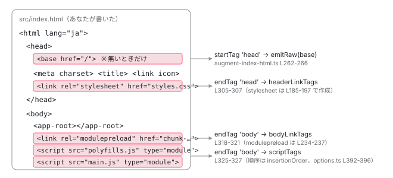

[目次](../README.md) › [起動の全手順](README.md) › 第 5 回 / 全 13 回

# index.html が完成するまで

> IndexHtmlGenerator.process → augmentIndexHtml。あなたが書いた index.html に、&lt;script type="module"&gt; と &lt;link&gt; がどこに差し込まれるのか。

angular/angular-cli · 読了 約 10 分 · 基礎 · [サイトで読む（デモが動きます）](https://angular-deep-dive-cyan.vercel.app/chapter/boot-index-html)

---

あなたが書いた `src/index.html` には `<script>` が 1 つもありません。それでもブラウザで開くと `main.js` が読み込まれます。この章では、前章の `initialFiles` （`main` と `polyfills`）が `<script type="module">` になり、`styles.css` が `<link rel="stylesheet">` になり、それぞれが HTML の**どの位置に** 差し込まれるかを、文字列処理の行まで追います。

読む対象は `packages/angular/build/src/builders/application/options.ts`（挿入順の定義）、`execute-post-bundle.ts`、`packages/angular/build/src/tools/esbuild/index-html-generator.ts`、`packages/angular/build/src/utils/index-file/index-html-generator.ts`、`augment-index-html.ts` です。

1. ng コマンド起動
2. builder の解決
3. dev-server と Vite
4. application builder
5. **index.html の生成**（この章）
6. ブラウザが main.js を実行
7. bootstrapApplication
8. 2 段の DI 木
9. APP\_INITIALIZER
10. ApplicationRef.bootstrap
11. 最初の描画
12. クリック→再描画
13. SPA のページ遷移

## 1. 入力と出力を先に見る

このサイト自身の `src/index.html` です。`<script>` も `<link rel="stylesheet">` もありません。

📄 `src/index.html（このサイト）`

```
<!doctype html>
<html lang="ja">
<head>
  <meta charset="utf-8">
  <title>Angular 深掘りガイド</title>
  <base href="/">
  <meta name="viewport" content="width=device-width, initial-scale=1">
  <link rel="icon" type="image/x-icon" href="favicon.ico">
</head>
<body>
  <app-root></app-root>
</body>
</html>
```

同じサイトを `ng build` した `dist/angular-deep-dive/browser/index.html` から、ビルドが足したタグだけを抜き出すとこうなります。

📄 `dist/angular-deep-dive/browser/index.html（抜粋）`

```
<!DOCTYPE html><html lang="ja"><head>
  <meta charset="utf-8">
  <title>Angular 深掘りガイド — ソースコードから読み解く内部構造</title>
  <base href="/">
  <meta name="viewport" content="width=device-width, initial-scale=1">
  <link rel="icon" type="image/x-icon" href="favicon.ico">
<link rel="stylesheet" href="styles.css"></head>
<body><app-root>…（prerender 済みの HTML）…</app-root>
<link rel="modulepreload" href="chunk-QBNBRMMZ.js"><link rel="modulepreload" href="chunk-BPET72SG.js"><script src="main.js" type="module"></script>
</body></html>
```

足されたのは 3 種類です。`</head>` の直前に `<link rel="stylesheet" href="styles.css">`、`</body>` の直前に `<link rel="modulepreload">` と `<script src="main.js" type="module">`。このサイトは `polyfills: []` なので `polyfills.js` はありません。では、誰が、どの順で、どこに足したのかを見ていきます。

## 2. 挿入する順番は options.ts で決まっている

📄 `angular-cli/packages/angular/build/src/builders/application/options.ts` L387–405 （▶ の行: 389–396, 399, 401）

```ts
387 │     const preloadInitialDefault = !options.serviceWorker;
388 │ 
389 ▶     indexHtmlOptions = {
390 ▶       input: indexInput,
391 ▶       output: indexOutput,
392 ▶       insertionOrder: [
393 ▶         ['polyfills', true],
394 ▶         ...globalStyles.filter((s) => s.initial).map((s) => [s.name, false]),
395 ▶         ...globalScripts.filter((s) => s.initial).map((s) => [s.name, false]),
396 ▶         ['main', true],
397 │         // [name, esm]
398 │       ] as [string, boolean][],
399 ▶       transformer: extensions?.indexHtmlTransformer,
400 │       // Preload initial defaults to false when using a service worker, true otherwise
401 ▶       preloadInitial:
402 │         typeof options.index === 'object'
403 │           ? (options.index?.preloadInitial ?? preloadInitialDefault)
404 │           : preloadInitialDefault,
405 │     };
```

390 行目 `input` はあなたの `src/index.html`、391 行目 `output` は出力名（通常 `index.html`）。392〜398 行目の `insertionOrder` が**この章の結論を先に言っています**。`[名前, module か]` の組で、393 行目 `polyfills`（module）、394 行目グローバル styles、395 行目グローバル scripts（`angular.json` の `scripts`、module ではない）、396 行目 `main`（module）。**`polyfills` が `main` より前**に並んでいます。399 行目の `transformer` は dev-server などが HTML を後加工するための差し込み口、401〜404 行目は `modulepreload` を出すかどうか（Service Worker 使用時は既定で出さない）です。

## 3. どこから呼ばれるか：バンドル後処理の最初

📄 `angular-cli/packages/angular/build/src/builders/application/execute-post-bundle.ts` L97–121 （▶ の行: 99–102, 110–112）

```ts
 97 │   // Generate index HTML file
 98 │   // If localization is enabled, index generation is handled in the inlining process.
 99 ▶   if (indexHtmlOptions) {
100 ▶     const { csrContent, ssrContent, errors, warnings } = await generateIndexHtml(
101 ▶       initialFiles,
102 ▶       outputFiles,
103 │       options,
104 │       locale,
105 │     );
106 │ 
107 │     allErrors.push(...errors);
108 │     allWarnings.push(...warnings);
109 │ 
110 ▶     additionalHtmlOutputFiles.set(
111 ▶       indexHtmlOptions.output,
112 ▶       createOutputFile(indexHtmlOptions.output, csrContent, BuildOutputFileType.Browser),
113 │     );
114 │ 
115 │     if (ssrContent) {
116 │       additionalHtmlOutputFiles.set(
117 │         INDEX_HTML_SERVER,
118 │         createOutputFile(INDEX_HTML_SERVER, ssrContent, BuildOutputFileType.ServerApplication),
119 │       );
120 │     }
121 │   }
```

前章の `executeBuild` が最後に呼ぶ `executePostBundleSteps` の中です。100〜105 行目、`generateIndexHtml(initialFiles, outputFiles, options, locale)`。引数は前章で決めた `initialFiles`（`main` / `polyfills` の記録）と、esbuild がメモリに返した全出力ファイルです。110〜112 行目、戻ってきた `csrContent` を `index.html` という名前の **Browser 種別の出力ファイル**として追加します。つまり `index.html` は、esbuild の出力と同じ列に並ぶ「ビルド成果物の 1 つ」です。3 章で dev-server が `outputFiles.get('/index.html')` できたのは、ここで追加されたからです。

## 4. generateIndexHtml：preload のヒントと「メモリから読む」仕掛け

📄 `angular-cli/packages/angular/build/src/tools/esbuild/index-html-generator.ts` L22–32 （▶ の行: 22–24, 28）

```ts
22 ▶ export async function generateIndexHtml(
23 ▶   initialFiles: Map<string, InitialFileRecord>,
24 ▶   outputFiles: BuildOutputFile[],
25 │   buildOptions: NormalizedApplicationBuildOptions,
26 │   lang?: string,
27 │ ): Promise<{
28 ▶   csrContent: string;
29 │   ssrContent?: string;
30 │   warnings: string[];
31 │   errors: string[];
32 │ }> {
```

📄 `angular-cli/packages/angular/build/src/tools/esbuild/index-html-generator.ts` L48–68 （▶ の行: 48, 50–52, 56–58, 61, 66–67）

```ts
48 ▶   if (!externalPackages && indexHtmlOptions.preloadInitial) {
49 │     const modulePreloads = [];
50 ▶     for (const [key, value] of initialFiles) {
51 ▶       if (value.entrypoint || value.serverFile) {
52 ▶         // Entry points are already referenced in the HTML
53 │         continue;
54 │       }
55 │ 
56 ▶       if (value.type === 'script') {
57 ▶         modulePreloads.push({ url: key, mode: 'modulepreload' as const, depth: value.depth });
58 ▶       } else if (value.type === 'style') {
59 │         // Provide an "as" value of "style" to ensure external URLs which may not have a
60 │         // file extension are treated as stylesheets.
61 ▶         hints.push({ url: key, mode: 'preload' as const, as: 'style' });
62 │       }
63 │     }
64 │ 
65 │     // Limit the number of module preloads with smallest depth given priority
66 ▶     modulePreloads.sort((a, b) => a.depth - b.depth);
67 ▶     hints.push(...modulePreloads.slice(0, MODULE_PRELOAD_MAX));
68 │   }
```

1. **48 行目：`externalPackages` のときはヒントを出さない**

   dev-server は 3 章で `externalPackages = prebundle` を設定しています。Vite が依存を別 URL で配るので、ビルド時に `modulepreload` を書いても当たらないからです。`ng serve` で見る HTML に `modulepreload` が無いのはこのためです。
2. **50〜52 行目：entrypoint は除外**

   `main.js` と `polyfills.js` は `<script>` として直接書くので、preload のヒントは要りません。残るのは `main.js` が `import` する共有チャンクです。
3. **56〜57 行目：script は `modulepreload`、58〜61 行目：style は `preload`**

   `depth`（前章 `initialFiles` で計算した、エントリからの import の深さ）も記録します。
4. **66〜67 行目：浅いものから最大 10 個**

   1 節の出力に `modulepreload` が 4 つしかなかったのは、この上限と「初期ロードに必要なチャンクだけ」という条件のためです。

📄 `angular-cli/packages/angular/build/src/tools/esbuild/index-html-generator.ts` L70–82 （▶ の行: 71–73, 76, 78, 81）

```ts
70 │   /** Virtual output path to support reading in-memory files. */
71 ▶   const browserOutputFiles = outputFiles.filter(({ type }) => type === BuildOutputFileType.Browser);
72 ▶   const virtualOutputPath = '/';
73 ▶   const readAsset = async function (filePath: string): Promise<string> {
74 │     // Remove leading directory separator
75 │     const relativefilePath = path.relative(virtualOutputPath, filePath);
76 ▶     const file = browserOutputFiles.find((file) => file.path === relativefilePath);
77 │     if (file) {
78 ▶       return file.text;
79 │     }
80 │ 
81 ▶     throw new Error(`Output file does not exist: ${relativefilePath}`);
82 │   };
```

📄 `angular-cli/packages/angular/build/src/tools/esbuild/index-html-generator.ts` L100–132 （▶ の行: 101–103, 109, 119, 121, 124–129, 131）

```ts
100 │   // Create an index HTML generator that reads from the in-memory output files
101 ▶   const indexHtmlGenerator = new IndexHtmlGenerator({
102 ▶     indexPath: indexHtmlOptions.input,
103 ▶     entrypoints: indexHtmlOptions.insertionOrder,
104 │     sri: subresourceIntegrity,
105 │     optimization: optimizationOptions,
106 │     crossOrigin: crossOrigin,
107 │     deployUrl: buildOptions.publicPath,
108 │     postTransform: indexHtmlOptions.transformer,
109 ▶     outputPath: virtualOutputPath,
110 │     generateDedicatedSSRContent: !!(
111 │       buildOptions.ssrOptions ||
112 │       buildOptions.prerenderOptions ||
113 │       buildOptions.appShellOptions
114 │     ),
115 │     autoCsp: buildOptions.security.autoCsp,
116 │     chunksIntegrity,
117 │   });
118 │ 
119 ▶   indexHtmlGenerator.readAsset = readAsset;
120 │ 
121 ▶   return indexHtmlGenerator.process({
122 │     baseHref,
123 │     lang,
124 ▶     files: [...initialFiles]
125 ▶       .filter(([, file]) => !file.serverFile)
126 ▶       .map(([file, record]) => ({
127 ▶         name: record.name ?? '',
128 ▶         file,
129 ▶         extension: path.extname(file),
130 │       })),
131 ▶     hints,
132 │   });
```

71〜82 行目、`readAsset` は「パスを受けて中身を返す関数」ですが、ディスクではなく 76 行目で `browserOutputFiles`（メモリ上の esbuild 出力）から探します。109 行目で出力先を架空の `'/'` にし、119 行目で `IndexHtmlGenerator` の `readAsset` を この関数で上書きします。SRI（`integrity` 属性）やクリティカル CSS のインライン化で 「出力ファイルの中身」が必要になったとき、ここから取ります。

101〜117 行目で `IndexHtmlGenerator` を作ります。102 行目が `src/index.html`、103 行目が 2 節の `insertionOrder`。121〜132 行目で `process` を呼び、124〜130 行目で `initialFiles` を `{ name: 'main', file: 'main.js', extension: '.js' }` の配列に変えて渡します。125 行目でサーバ用ファイルは除外です。

## 5. IndexHtmlGenerator：プラグインの列

📄 `angular-cli/packages/angular/build/src/utils/index-file/index-html-generator.ts` L81–110 （▶ の行: 88, 91–92, 95, 98–100, 104, 108）

```ts
 81 │   constructor(readonly options: IndexHtmlGeneratorOptions) {
 82 │     const extraCommonPlugins: IndexHtmlGeneratorPlugin[] = [];
 83 │     if (options?.optimization?.fonts.inline) {
 84 │       extraCommonPlugins.push(inlineFontsPlugin(this), addNonce);
 85 │     }
 86 │ 
 87 │     // Common plugins
 88 ▶     this.plugins = [augmentIndexHtmlPlugin(this), ...extraCommonPlugins, postTransformPlugin(this)];
 89 │ 
 90 │     // CSR plugins
 91 ▶     if (options?.optimization?.styles?.inlineCritical) {
 92 ▶       this.csrPlugins.push(inlineCriticalCssPlugin(this));
 93 │     }
 94 │ 
 95 ▶     this.csrPlugins.push(addNoncePlugin());
 96 │ 
 97 │     // SSR plugins
 98 ▶     if (options.generateDedicatedSSRContent) {
 99 ▶       this.csrPlugins.push(addNgcmAttributePlugin());
100 ▶       this.ssrPlugins.push(addEventDispatchContractPlugin(), addNoncePlugin());
101 │     }
102 │ 
103 │     // Auto-CSP (as the last step)
104 ▶     if (options.autoCsp) {
105 │       if (options.generateDedicatedSSRContent) {
106 │         throw new Error('Cannot set both SSR and auto-CSP at the same time.');
107 │       }
108 ▶       this.csrPlugins.push(autoCspPlugin(options.autoCsp.unsafeEval));
109 │     }
110 │   }
```

88 行目、共通プラグインは `augmentIndexHtmlPlugin`（タグの挿入、この章の本体）→ フォントのインライン化（`optimization.fonts.inline` のとき）→ `postTransformPlugin`（2 節 399 行目の `transformer`）。91〜92 行目、`inlineCritical` なら CSR 用にクリティカル CSS を `<style>` として埋め込むプラグイン。95 行目、CSP 用の `nonce` 属性を付けるプラグイン。98〜100 行目、SSR/prerender ありのとき、CSR 側には `ngcm` 属性、SSR 側にはイベントのリプレイ契約スクリプト （1 節の出力にあった `id="ng-event-dispatch-contract"`）。104〜108 行目、`autoCsp` は最後です。

📄 `angular-cli/packages/angular/build/src/utils/index-file/index-html-generator.ts` L112–131 （▶ の行: 112–113, 117–121）

```ts
112 ▶   async process(options: IndexHtmlGeneratorProcessOptions): Promise<IndexHtmlProcessResult> {
113 ▶     let content = await this.readIndex(this.options.indexPath);
114 │     const warnings: string[] = [];
115 │     const errors: string[] = [];
116 │ 
117 ▶     content = await this.runPlugins(content, this.plugins, options, warnings, errors);
118 ▶     const [csrContent, ssrContent] = await Promise.all([
119 ▶       this.runPlugins(content, this.csrPlugins, options, warnings, errors),
120 ▶       this.ssrPlugins.length
121 ▶         ? this.runPlugins(content, this.ssrPlugins, options, warnings, errors)
122 │         : undefined,
123 │     ]);
124 │ 
125 │     return {
126 │       ssrContent,
127 │       csrContent,
128 │       warnings,
129 │       errors,
130 │     };
131 │   }
```

113 行目で `src/index.html` を読みます（**ディスクから。あなたのファイルはここで 1 回だけ読まれます**）。117 行目で共通プラグインを順に適用し、118〜123 行目で CSR 用と SSR 用に枝分かれして、それぞれのプラグインを適用します。SSR 無しなら `ssrContent` は `undefined` です。

📄 `angular-cli/packages/angular/build/src/utils/index-file/index-html-generator.ts` L177–206 （▶ の行: 188–189, 191, 198–199, 201–202）

```ts
177 │ function augmentIndexHtmlPlugin(generator: IndexHtmlGenerator): IndexHtmlGeneratorPlugin {
178 │   const {
179 │     deployUrl,
180 │     crossOrigin,
181 │     sri = false,
182 │     entrypoints,
183 │     imageDomains,
184 │     chunksIntegrity,
185 │     outputPath,
186 │   } = generator.options;
187 │ 
188 ▶   return (html, options) => {
189 ▶     const { lang, baseHref, files, hints } = options;
190 │ 
191 ▶     return augmentIndexHtml({
192 │       html,
193 │       baseHref,
194 │       deployUrl,
195 │       crossOrigin,
196 │       sri,
197 │       lang,
198 ▶       entrypoints,
199 ▶       loadOutputFile: (filePath) => generator.readAsset(join(outputPath, filePath)),
200 │       imageDomains,
201 ▶       files,
202 ▶       hints,
203 │       chunksIntegrity,
204 │     });
205 │   };
206 │ }
```

188〜205 行目、プラグインは `augmentIndexHtml` を呼ぶだけです。198 行目に `entrypoints`（挿入順）、201 行目に `files`（`initialFiles` から作った配列）、202 行目に `hints`、199 行目に 4 節の `readAsset`。

## 6. augmentIndexHtml：タグを作り、位置を決めて差し込む

📄 `angular-cli/packages/angular/build/src/utils/index-file/augment-index-html.ts` L109–137 （▶ の行: 109–110, 113–115, 120–122, 132–133）

```ts
109 ▶   const stylesheets = new Set<string>();
110 ▶   const scripts = new Map</** file name */ string, /** isModule */ boolean>();
111 │ 
112 │   // Sort files in the order we want to insert them by entrypoint
113 ▶   for (const [entrypoint, isModule] of entrypoints) {
114 ▶     for (const { extension, file, name } of files) {
115 ▶       if (name !== entrypoint || scripts.has(file) || stylesheets.has(file)) {
116 │         continue;
117 │       }
118 │ 
119 │       switch (extension) {
120 ▶         case '.js':
121 ▶           // Also, non entrypoints need to be loaded as no module as they can contain problematic code.
122 ▶           scripts.set(file, isModule);
123 │           break;
124 │         case '.mjs':
125 │           if (!isModule) {
126 │             // It would be very confusing to link an `*.mjs` file in a non-module script context,
127 │             // so we disallow it entirely.
128 │             throw new Error('`.mjs` files *must* set `isModule` to `true`.');
129 │           }
130 │           scripts.set(file, true /* isModule */);
131 │           break;
132 ▶         case '.css':
133 ▶           stylesheets.add(file);
134 │           break;
135 │       }
136 │     }
137 │   }
```

1. **113 行目：外側のループは `entrypoints`（挿入順）**

   `polyfills` → styles → scripts → `main` の順に回ります。114〜115 行目、内側で `files` から同じ名前のものを探します。**この二重ループが、出力される `<script>` の順番を決めています。**`files` の並び順ではなく、`entrypoints` の並び順です。
2. **120〜122 行目：`.js` なら `scripts` に `Map` で追加**

   値は `isModule`。`polyfills` と `main` は `true`、`angular.json` の `scripts` は `false` です。`Map` なので挿入順が保たれます。
3. **132〜133 行目：`.css` なら `stylesheets`**

   `styles.css` がここに入ります。

📄 `angular-cli/packages/angular/build/src/utils/index-file/augment-index-html.ts` L139–160 （▶ の行: 140–141, 144–145, 147, 154–156, 159）

```ts
139 │   let scriptTags: string[] = [];
140 ▶   for (const [src, isModule] of scripts) {
141 ▶     const attrs = [`src="${generateUrl(src, deployUrl)}"`];
142 │ 
143 │     // This is also need for non entry-points as they may contain problematic code.
144 ▶     if (isModule) {
145 ▶       attrs.push('type="module"');
146 │     } else {
147 ▶       attrs.push('defer');
148 │     }
149 │ 
150 │     if (crossOrigin !== 'none') {
151 │       attrs.push(`crossorigin="${crossOrigin}"`);
152 │     }
153 │ 
154 ▶     if (sri) {
155 ▶       const content = await loadOutputFile(src);
156 ▶       attrs.push(generateSriAttributes(content));
157 │     }
158 │ 
159 ▶     scriptTags.push(`<script ${attrs.join(' ')}></script>`);
160 │   }
```

140 行目、`scripts` を挿入順に回します。141 行目 `src`。144〜148 行目、**`isModule` なら `type="module"`、でなければ `defer`**。どちらも「HTML の解析が終わってから実行」という性質を持ちますが、違いは次章で見ます。154〜156 行目、SRI が有効なら 4 節の `readAsset` で中身を読んでハッシュを付けます。159 行目、`<script src="main.js" type="module"></script>` という文字列ができました。

📄 `angular-cli/packages/angular/build/src/utils/index-file/augment-index-html.ts` L185–198 （▶ の行: 185–186, 197）

```ts
185 ▶   for (const src of stylesheets) {
186 ▶     const attrs = [`rel="stylesheet"`, `href="${generateUrl(src, deployUrl)}"`];
187 │ 
188 │     if (crossOrigin !== 'none') {
189 │       attrs.push(`crossorigin="${crossOrigin}"`);
190 │     }
191 │ 
192 │     if (sri) {
193 │       const content = await loadOutputFile(src);
194 │       attrs.push(generateSriAttributes(content));
195 │     }
196 │ 
197 ▶     headerLinkTags.push(`<link ${attrs.join(' ')}>`);
198 │   }
```

📄 `angular-cli/packages/angular/build/src/utils/index-file/augment-index-html.ts` L233–242 （▶ の行: 233–234, 237, 239）

```ts
233 ▶       const tag = `<link ${attrs.join(' ')}>`;
234 ▶       if (hint.mode === 'modulepreload') {
235 │         // Module preloads should be placed by the inserted script elements in the body since
236 │         // they are only useful in combination with the scripts.
237 ▶         bodyLinkTags.push(tag);
238 │       } else {
239 ▶         headerLinkTags.push(tag);
240 │       }
241 │     }
242 │   }
```

186〜197 行目、`<link rel="stylesheet" href="styles.css">` は `headerLinkTags` に。233〜240 行目、ヒントは `modulepreload` なら `bodyLinkTags`、それ以外は `headerLinkTags`。237 行目の上のコメントが理由を言っています。`modulepreload` は `<script>` と組になって初めて意味があるので、`<script>` の隣に置きます。ここまでで「何を」は決まりました。残るのは「どこに」です。

📄 `angular-cli/packages/angular/build/src/utils/index-file/augment-index-html.ts` L249–284 （▶ の行: 250, 262, 264–266, 274, 276–277）

```ts
249 │   rewriter
250 ▶     .on('startTag', (tag, rawTagHtml) => {
251 │       switch (tag.tagName) {
252 │         case 'html':
253 │           // Adjust document locale if specified
254 │           if (isString(lang)) {
255 │             updateAttribute(tag, 'lang', lang);
256 │           }
257 │ 
258 │           if (dir) {
259 │             updateAttribute(tag, 'dir', dir);
260 │           }
261 │           break;
262 ▶         case 'head':
263 │           // Base href should be added before any link, meta tags
264 ▶           if (!baseTagExists && isString(baseHref)) {
265 ▶             rewriter.emitStartTag(tag);
266 ▶             rewriter.emitRaw(`<base href="${baseHref}">`);
267 │             if (subResourceIntegrityTag) {
268 │               rewriter.emitRaw(subResourceIntegrityTag);
269 │             }
270 │ 
271 │             return;
272 │           }
273 │           break;
274 ▶         case 'base':
275 │           // Adjust base href if specified
276 ▶           if (isString(baseHref)) {
277 ▶             updateAttribute(tag, 'href', baseHref);
278 │           }
279 │ 
280 │           if (subResourceIntegrityTag) {
281 │             rewriter.emitRaw(subResourceIntegrityTag);
282 │           }
283 │ 
284 │           break;
```

HTML を正規表現で切り貼りするのではなく、`parse5` ベースの `htmlRewritingStream` で トークン（開始タグ・終了タグ）を 1 つずつ受け取り、必要な場所で `emitRaw` します。250 行目から開始タグの処理です。262〜272 行目、`<head>` の開始を見たとき、あなたの HTML に `<base>` が無くて `baseHref` が指定されていれば 266 行目で `<base href="...">` を `<head>` の**直後**に挿入します。274〜277 行目、`<base>` がすでにあれば `href` を上書きします。

📄 `angular-cli/packages/angular/build/src/utils/index-file/augment-index-html.ts` L293–302 （▶ の行: 294–295, 301）

```ts
293 │         default:
294 ▶           if (tag.selfClosing && !VALID_SELF_CLOSING_TAGS.has(tag.tagName)) {
295 ▶             errors.push(`Invalid self-closing element in index HTML file: '${rawTagHtml}'.`);
296 │ 
297 │             return;
298 │           }
299 │       }
300 │ 
301 ▶       rewriter.emitStartTag(tag);
302 │     })
```

294〜295 行目、`<div />` のような HTML では許されない自己閉じタグをエラーにします （「Invalid self-closing element in index HTML file」）。それ以外のタグは 301 行目でそのまま出力されます。あなたが `<head>` に書いた `<script>` や `<meta>` は、この行を通って無加工で残ります。

📄 `angular-cli/packages/angular/build/src/utils/index-file/augment-index-html.ts` L303–334 （▶ の行: 303, 305–307, 318–320, 325–326, 333）

```ts
303 ▶     .on('endTag', (tag) => {
304 │       switch (tag.tagName) {
305 ▶         case 'head':
306 ▶           for (const linkTag of headerLinkTags) {
307 ▶             rewriter.emitRaw(linkTag);
308 │           }
309 │           if (imageDomains) {
310 │             for (const imageDomain of imageDomains) {
311 │               if (!foundPreconnects.has(imageDomain)) {
312 │                 rewriter.emitRaw(`<link rel="preconnect" href="${imageDomain}" data-ngimg>`);
313 │               }
314 │             }
315 │           }
316 │           headerLinkTags = [];
317 │           break;
318 ▶         case 'body':
319 ▶           for (const linkTag of bodyLinkTags) {
320 ▶             rewriter.emitRaw(linkTag);
321 │           }
322 │           bodyLinkTags = [];
323 │ 
324 │           // Add script tags
325 ▶           for (const scriptTag of scriptTags) {
326 ▶             rewriter.emitRaw(scriptTag);
327 │           }
328 │ 
329 │           scriptTags = [];
330 │           break;
331 │       }
332 │ 
333 ▶       rewriter.emitEndTag(tag);
334 │     });
```

1. **305〜307 行目：`</head>` の直前に `headerLinkTags`**

   `<link rel="stylesheet" href="styles.css">` がここに入ります。1 節の出力で `styles.css` が `</head>` の直前にあったのは、この 3 行です。あなたが `<head>` に書いた `<meta>` や `<link rel="icon">` の**後**になります。
2. **318〜321 行目：`</body>` の直前に `bodyLinkTags`（`modulepreload`）**
3. **325〜327 行目：続けて `scriptTags`**

   `<script src="polyfills.js" type="module">`、`<script src="main.js" type="module">` の順。`<app-root></app-root>` の**後**、`</body>` の**前**です。333 行目で `</body>` 自体が出力されます。

📄 `angular-cli/packages/angular/build/src/utils/index-file/augment-index-html.ts` L336–347 （▶ の行: 336, 339–340, 342）

```ts
336 ▶   const content = await transformedContent();
337 │ 
338 │   return {
339 ▶     content:
340 ▶       headerLinkTags.length || scriptTags.length
341 │         ? // In case no body/head tags are not present (dotnet partial templates)
342 ▶           headerLinkTags.join('') + scriptTags.join('') + content
343 │         : content,
344 │     warnings,
345 │     errors,
346 │   };
347 │ }
```

336 行目でストリームの結果を文字列にします。339〜343 行目、もし `<head>` も `<body>` も無い HTML だったら（配列が空になっていない）、先頭に全部付けます。普通の `index.html` ではこの分岐は通りません。



*src/index.html の各位置に何が差し込まれるか。head の開始直後に base、head の終了直前に stylesheet、body の終了直前に modulepreload と script。*

## ここまでの呼び出し

- 👤 `executeBuild(...)` — application/execute-build.ts L47 — *前章。esbuild が終わった後*
  - `executePostBundleSteps(browserMetafile, options, outputFiles, assetFiles, initialFiles, lang)` — execute-build.ts L366 → execute-post-bundle.ts
    - `generateIndexHtml(initialFiles, outputFiles, options, locale)` — execute-post-bundle.ts L100 → tools/esbuild/index-html-generator.ts L22
      - `hints` を計算（modulepreload ×最大 10、style preload） — index-html-generator.ts L48-68
      - `new IndexHtmlGenerator({ indexPath, entrypoints: insertionOrder, ... })` — L101 — *readAsset をメモリ読みに差し替え（L119）*
      - `indexHtmlGenerator.process({ baseHref, lang, files, hints })` — L121 → utils/index-file/index-html-generator.ts L112
        - `readIndex(src/index.html)` — L113 — *あなたの HTML をディスクから読む*
        - `runPlugins(content, this.plugins, ...)` — L117 — *augment → fonts → postTransform*
          - `augmentIndexHtml({ html, entrypoints, files, hints, loadOutputFile, ... })` — L191 → augment-index-html.ts L85
            - entrypoints × files で `scripts` / `stylesheets` を並べる — augment-index-html.ts L113-137
            - `scriptTags`（type="module" / defer）、`headerLinkTags`、`bodyLinkTags` を作る — L139-242
            - `htmlRewritingStream(html)` で head/base/body の開始・終了に emitRaw — L245-334
        - `runPlugins(content, this.csrPlugins, ...)` — L119 — *nonce、inlineCritical、ngcm 属性*
    - `createOutputFile('index.html', csrContent, Browser)` — execute-post-bundle.ts L110-112 — *出力ファイルの列に加わる*

## 聞かれそうな質問

**Q. index.html の &lt;script&gt; タグは誰が足していますか？**

`augmentIndexHtml`（`utils/index-file/augment-index-html.ts`）です。139〜160 行目で `<script src="main.js" type="module"></script>` という文字列を作り、325〜327 行目、`</body>` 終了タグを見つけた瞬間にその直前へ `emitRaw` します。呼び出し元は `IndexHtmlGenerator.process`（index-html-generator.ts 112 行目）で、さらにその呼び出し元は `executePostBundleSteps`（execute-post-bundle.ts 100 行目）、つまり esbuild のバンドルが終わった直後のビルド内の 1 ステップです。

**Q. polyfills.js と main.js の &lt;script&gt; はなぜこの順ですか？**

`application/options.ts` 392〜398 行目の `insertionOrder` が `polyfills` → styles → scripts → `main` と並んでいて、`augmentIndexHtml` 113 行目の外側ループがこの順で回るからです。`scripts` は `Map`（110 行目）なので挿入順が保たれ、140 行目で同じ順に `<script>` になります。`polyfills: []`（zoneless の既定）なら `polyfills.js` 自体が存在しないので `main.js` だけです。ブラウザ側でこの順がどう効くかは[次章](06-boot-browser-load.md)です。

**Q. 自分の &lt;script&gt; を main.js より前に実行させたいときは？**

`src/index.html` の `<head>` に普通の `<script>`（`type="module"` 無し）で書けば、`augmentIndexHtml` 301 行目はそれをそのまま通し、HTML の解析中にその場で実行されます。`main.js` は `type="module"`（145 行目）なので解析完了後です。このサイトのテーマ切り替えスクリプトも `<head>` 内の素の `<script>` です。`angular.json` の `scripts` に書いた場合は 395 行目で `main` の前、147 行目で `defer` 付きになります。

**Q. &lt;base href="/"&gt; を書き忘れたらどうなりますか？**

`augmentIndexHtml` 264〜266 行目で、`<head>` の開始タグ直後に `<base href="...">` が挿入されます（`baseHref` オプションの既定は `'/'`）。すでに書いてあれば 276〜277 行目で `href` だけが上書きされます。`ng build --base-href /app/` が効くのはこの 2 か所です。

**Q. ng serve の HTML に modulepreload が無いのはなぜですか？**

`tools/esbuild/index-html-generator.ts` 48 行目、`externalPackages` が真のときヒントを作りません。dev-server は `vite/index.ts` 130 行目（3 章）で `externalPackages = prebundle` を設定し、依存を Vite の prebundle で別 URL から配るため、ビルド時のチャンク名を preload しても当たらないからです。

## 読み終えて

- 挿入順は `options.ts` 392〜398 行目の `insertionOrder`：`polyfills` → styles → scripts → `main`
- `index.html` はバンドル後処理（`executePostBundleSteps` 100〜112 行目）で作られる **出力ファイルの 1 つ**。esbuild の出力と同じ列に並ぶ
- `IndexHtmlGenerator` がプラグインの列を適用し、中心の `augmentIndexHtml` が `entrypoints × files` の二重ループで `<script>` の順を決める
- 位置は 3 つ。`<head>` 直後に `base`（無いとき）、`</head>` 直前に stylesheet、`</body>` 直前に `modulepreload` と `<script type="module">`
- あなたの `src/index.html` がディスクから読まれるのは `readIndex`（113 行目）の 1 回だけ。出力ファイルの中身はメモリから（`readAsset` 76 行目）

---

← 前: [application builder：esbuild と Angular コンパイラ](04-boot-application-build.md)  
次: [ブラウザが main.js を実行するまで](06-boot-browser-load.md) →
