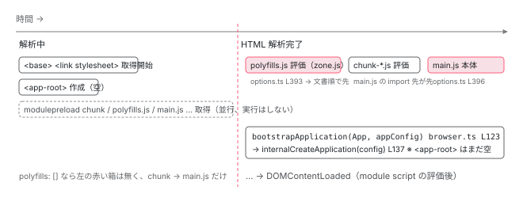

[目次](../README.md) › [起動の全手順](README.md) › 第 6 回 / 全 13 回

# ブラウザが main.js を実行するまで

> HTML の解析、module script の遅延実行、polyfills と main の順番、そして main.ts の最初の 1 行。&lt;app-root&gt; はこの時点では空のタグ。

angular/angular · 読了 約 9 分 · 基礎 · [サイトで読む（デモが動きます）](https://angular-deep-dive-cyan.vercel.app/chapter/boot-browser-load)

---

前章までで、サーバが返す `index.html` の中身が決まりました。ここからはブラウザの番です。この章では、ブラウザがその HTML を上から読み、`<script type="module">` をいつ実行し、`polyfills.js` と `main.js` のどちらが先に動き、`main.ts` の最初の 1 行 `bootstrapApplication(App, appConfig)` が呼ばれるまでを追います。この時点で `<app-root>` はまだ空のタグです。Angular の内部はまだ 1 行も動いていません。

読む対象は、タグの属性を決めた `augment-index-html.ts`（前章）、順番を決めた `options.ts`、zone.js と `async`/`await` の関係を決める `tools/esbuild/utils.ts`、ビルド時定数 `ngJitMode` を定義する `application-code-bundle.ts` と `vite/index.ts`、そして Angular 側の `packages/platform-browser/src/browser.ts` です。HTML の仕様（module script の実行タイミング）は、ソースではなく仕様として説明します。

1. ng コマンド起動
2. builder の解決
3. dev-server と Vite
4. application builder
5. index.html の生成
6. **ブラウザが main.js を実行**（この章）
7. bootstrapApplication
8. 2 段の DI 木
9. APP\_INITIALIZER
10. ApplicationRef.bootstrap
11. 最初の描画
12. クリック→再描画
13. SPA のページ遷移

## 1. ブラウザが受け取る HTML

📄 `GET / の応答（polyfills に zone.js がある場合の形）`

```
<!doctype html>
<html lang="ja">
<head>
  <meta charset="utf-8">
  <base href="/">
  <link rel="stylesheet" href="styles.css">
</head>
<body>
  <app-root></app-root>
  <link rel="modulepreload" href="chunk-ABCD1234.js">
  <script src="polyfills.js" type="module"></script>
  <script src="main.js" type="module"></script>
</body>
</html>
```

ブラウザは HTML を**上から順に**字句解析し、要素を 1 つずつ DOM に追加していきます。`<base href="/">` を読んだ時点で、以降の相対 URL（`styles.css`、`main.js`）の 解決基準が `/` に決まります。`<link rel="stylesheet">` を読むと CSS の取得を開始します。`<app-root></app-root>` は、ブラウザにとっては**名前にハイフンのある、定義されていない要素**です。エラーにはならず、中身の無い要素として DOM に置かれます。Angular がこれを見つけて中身を作るのは [10 章](10-boot-application-ref.md)です。

## 2. type="module" は「解析が終わってから、文書順に」

📄 `angular-cli/packages/angular/build/src/utils/index-file/augment-index-html.ts` L139–160 （▶ の行: 144–145, 147）

```ts
139 │   let scriptTags: string[] = [];
140 │   for (const [src, isModule] of scripts) {
141 │     const attrs = [`src="${generateUrl(src, deployUrl)}"`];
142 │ 
143 │     // This is also need for non entry-points as they may contain problematic code.
144 ▶     if (isModule) {
145 ▶       attrs.push('type="module"');
146 │     } else {
147 ▶       attrs.push('defer');
148 │     }
149 │ 
150 │     if (crossOrigin !== 'none') {
151 │       attrs.push(`crossorigin="${crossOrigin}"`);
152 │     }
153 │ 
154 │     if (sri) {
155 │       const content = await loadOutputFile(src);
156 │       attrs.push(generateSriAttributes(content));
157 │     }
158 │ 
159 │     scriptTags.push(`<script ${attrs.join(' ')}></script>`);
160 │   }
```

前章で見た行です。144〜145 行目、`polyfills` と `main` には `type="module"` が付きます。HTML の仕様では、`type="module"` の外部スクリプトは次のように扱われます。

1. **取得は、タグを見た瞬間に始まる**

   解析を止めずに並行してダウンロードします。`<link rel="modulepreload">` は、`main.js` が `import` する `chunk-*.js` を、`main.js` の中身を読む前に 先回りして取得させるための印です。
2. **実行は、HTML の解析が完了してから**

   module script は既定で `defer` と同じ扱いです。`</html>` まで解析が終わり、DOM が完成した*後*、`DOMContentLoaded` イベントの*前*に実行されます。147 行目、module でないスクリプト（`angular.json` の `scripts`）には 明示的に `defer` が付けられ、同じタイミングに揃えられています。
3. **複数あれば、文書に現れた順**

   `defer` と module script は、ダウンロードの完了順ではなく**HTML に書かれた順**に実行されます。`main.js` のほうが小さくて先に届いても、`polyfills.js` を待ちます。
4. **1 つの module の中では、import が先**

   `main.js` の先頭にある `import ... from './chunk-ABCD1234.js'` は、`main.js` 本体のコードが動く前にすべて取得・評価されます。`@angular/core` のコードはこれらのチャンクの中にあります。

> [!TIP]
> **新卒エンジニアへ**
>
> 「`</body>` の直前に置いてあるから最後に実行される」と説明されることがありますが、正確ではありません。`type="module"` なら `<head>` に置いても解析完了後に実行されます。位置が末尾なのは、前章 `augmentIndexHtml` 325〜327 行目の挿入位置がそうなっているからで、module script の性質によりどこに置いても結果は同じです。

## 3. polyfills.js が main.js より先に動く理由

📄 `angular-cli/packages/angular/build/src/builders/application/options.ts` L389–398 （▶ の行: 393, 396）

```ts
389 │     indexHtmlOptions = {
390 │       input: indexInput,
391 │       output: indexOutput,
392 │       insertionOrder: [
393 ▶         ['polyfills', true],
394 │         ...globalStyles.filter((s) => s.initial).map((s) => [s.name, false]),
395 │         ...globalScripts.filter((s) => s.initial).map((s) => [s.name, false]),
396 ▶         ['main', true],
397 │         // [name, esm]
398 │       ] as [string, boolean][],
```

393 行目が `polyfills`、396 行目が `main`。この配列の順に `<script>` が書かれ（前章 6 節）、2 節のとおり module script は文書順に実行されるので、**`polyfills.js` → `main.js`** です。では、なぜその順でなければいけないのでしょうか。

📄 `angular-cli/packages/angular/build/src/tools/esbuild/utils.ts` L305–308 （▶ の行: 305, 307）

```ts
305 ▶ export function isZonelessApp(polyfills: string[] | undefined): boolean {
306 │   // TODO: Instead, we should rely on the presence of zone.js in the polyfills build metadata.
307 ▶   return !polyfills?.some((p) => p === 'zone.js' || /\.[mc]?[jt]s$/.test(p));
308 │ }
```

📄 `angular-cli/packages/angular/build/src/tools/esbuild/utils.ts` L199–213 （▶ の行: 199, 201–203）

```ts
199 ▶ export function getFeatureSupport(nativeAsyncAwait: boolean): BuildOptions['supported'] {
200 │   return {
201 ▶     // Native async/await is not supported with Zone.js. Disabling support here will cause
202 ▶     // esbuild to downlevel async/await, async generators, and for await...of to a Zone.js supported form.
203 ▶     'async-await': nativeAsyncAwait,
204 │     // Workaround for an esbuild minification bug when async-await is disabled and the target is es2019+.
205 │     // The catch binding for downleveled for-await will be incorrectly removed in this specific situation.
206 │     ...(!nativeAsyncAwait ? { 'optional-catch-binding': false } : {}),
207 │     // V8 currently has a performance defect involving object spread operations that can cause signficant
208 │     // degradation in runtime performance. By not supporting the language feature here, a downlevel form
209 │     // will be used instead which provides a workaround for the performance issue.
210 │     // For more details: https://bugs.chromium.org/p/v8/issues/detail?id=11536
211 │     'object-rest-spread': false,
212 │   };
213 │ }
```

zone.js の仕事は、`setTimeout`・`Promise.then`・`addEventListener` などの ブラウザ API を**自分の関数で差し替える**ことです（[zone-patching](../zone/03-zone-patching.md)）。差し替えは「Angular のコードがそれらの API を呼ぶ前」に終わっている必要があります。もし `main.js` が先に動いて `@angular/core` が元の `Promise` を掴んでしまったら、その後で差し替えても追跡できません。だから `polyfills` が先です。

201〜203 行目のコメントは、同じ理由の別の側面です。ネイティブの `await` は zone.js が差し替えられないので、307 行目で `polyfills` に zone.js があると判定されたら、esbuild に `async`/`await` を `Promise.then` のチェーンに書き下ろさせます（4 章）。**polyfills の中身は、HTML の順番だけでなく、main.js のコードの形まで変えています。**

📄 `angular-cli/packages/angular/build/src/tools/esbuild/application-code-bundle.ts` L713–715 （▶ の行: 713–714）

```ts
713 ▶   if (polyfills.length === 0 && !i18nOptions.shouldInline && !i18nOptions.hasDefinedSourceLocale) {
714 ▶     return;
715 │   }
```

713〜714 行目。`polyfills` が空（v22 の新規プロジェクトの既定）で i18n 設定も無ければ、polyfills 用の esbuild オプションは `undefined` になり、**`polyfills.js` は生成されません**。4 章の `setupBundlerContexts` 82 行目の `if` で polyfills の `BundlerContext` も作られず、前章の `files` に `polyfills` という名前が無いので `<script>` も書かれません。このサイトの `index.html` に `main.js` しか無かったのはこのためです。

> **🧪 DEMO — polyfills に zone.js を入れると、ブラウザの実行順はどう変わるか**
>
> 左が「いつ」、中が「何が起きるか」、右が根拠。`type="module"` の 2 つは、どちらも解析完了後に文書順です。
>
> ▶ [このデモはサイトで動かせます](https://angular-deep-dive-cyan.vercel.app/chapter/boot-browser-load)

## 4. main.js の中：main.ts の最初の 1 行まで

📄 `src/main.ts（このサイト）`

```
import { bootstrapApplication } from '@angular/platform-browser';
import { appConfig } from './app/app.config';
import { App } from './app/app';

bootstrapApplication(App, appConfig)
  .catch((err) => console.error(err));
```

`main.js` は、4 章で esbuild が `main.ts` を起点に束ねたものです。`import` していた `@angular/platform-browser`、`app.config.ts`、`app.ts` （とそれらが import するすべて）は、`main.js` 本体か `chunk-*.js` に入っています。module の評価順は「import 先が先」なので、`bootstrapApplication` が呼ばれるときには、`App` クラスの `static ɵcmp`（4 章で AOT が作ったもの）も `appConfig` もすでに評価済みです。そして最上位の式 `bootstrapApplication(App, appConfig)` が実行されます。

📄 `angular/packages/platform-browser/src/browser.ts` L123–138 （▶ の行: 123, 128, 130, 133–134, 137）

```ts
123 ▶ export async function bootstrapApplication(
124 │   rootComponent: Type<unknown>,
125 │   options?: ApplicationConfig,
126 │   context?: BootstrapContext,
127 │ ): Promise<ApplicationRef> {
128 ▶   const config = {
129 │     rootComponent,
130 ▶     ...createProvidersConfig(options, context),
131 │   };
132 │ 
133 ▶   if ((typeof ngJitMode === 'undefined' || ngJitMode) && typeof fetch === 'function') {
134 ▶     await resolveJitResources();
135 │   }
136 │ 
137 ▶   return internalCreateApplication(config);
138 │ }
```

123 行目、`async` 関数なので `Promise<ApplicationRef>` を返します。`main.ts` の `.catch(...)` はこの Promise に付いています。128〜131 行目で設定オブジェクトを組み、137 行目で `internalCreateApplication` に渡します。その中身は[次章](07-boot-bootstrap-application.md)です。ここで見ておきたいのは 133〜134 行目です。

📄 `angular/packages/core/src/util/ng_jit_mode.ts` L9–14 （▶ の行: 10）

```ts
 9 │ declare global {
10 ▶   const ngJitMode: boolean;
11 │ }
12 │ 
13 │ // Make this an ES module to be able to augment the global scope
14 │ export {};
```

📄 `angular-cli/packages/angular/build/src/tools/esbuild/application-code-bundle.ts` L657–668 （▶ の行: 657, 659, 664–666）

```ts
657 ▶     write: false,
658 │     preserveSymlinks,
659 ▶     define: {
660 │       ...options.define,
661 │       // Only set to false when script optimizations are enabled. It should not be set to true because
662 │       // Angular turns `ngDevMode` into an object for development debugging purposes when not defined
663 │       // which a constant true value would break.
664 ▶       ...(optimizationOptions.scripts ? { 'ngDevMode': 'false' } : undefined),
665 ▶       'ngJitMode': jit ? 'true' : 'false',
666 ▶       'ngServerMode': 'false',
667 │       'ngHmrMode': options.templateUpdates ? 'true' : 'false',
668 │     },
```

📄 `angular-cli/packages/angular/build/src/builders/dev-server/vite/index.ts` L425–430 （▶ の行: 427–428）

```ts
425 │         {
426 │           ...browserOptions.define,
427 ▶           'ngServerMode': 'false',
428 ▶           'ngJitMode': browserOptions.aot ? 'false' : 'true',
429 │           'ngHmrMode': browserOptions.templateUpdates ? 'true' : 'false',
430 │         },
```

`ngJitMode` は Angular のソースでは 10 行目のとおり「グローバルにあるはずの定数」として宣言されているだけです。実際の値はビルド時に埋め込まれます。`ng build` では 659〜668 行目の esbuild `define`、665 行目で `jit` でなければ `'false'`。dev-server では Vite 側にも同じ定義が必要で、428 行目で `aot` なら `'false'` です。esbuild はこの `define` を使って、`typeof ngJitMode === 'undefined' || ngJitMode`（browser.ts 133 行目）を `typeof false === 'undefined' || false` と書き換え、さらに定数畳み込みで `false` にします。つまり**AOT ビルドの `main.js` には 134 行目の `resolveJitResources()` は残っていません**。テンプレートはすでに 4 章でコンパイル済みなので、実行時にコンパイラを待つ必要が無いのです。664 行目、本番ビルドなら `ngDevMode` も `'false'` になり、開発用の検査コードが消えます。657 行目の `write: false` は 4 章で触れた「esbuild はメモリに返すだけ」の設定です。

## 5. この瞬間の画面

📄 `angular-cli/packages/angular/build/src/tools/esbuild/index-html-generator.ts` L48–68 （▶ の行: 56–57, 66–67）

```ts
48 │   if (!externalPackages && indexHtmlOptions.preloadInitial) {
49 │     const modulePreloads = [];
50 │     for (const [key, value] of initialFiles) {
51 │       if (value.entrypoint || value.serverFile) {
52 │         // Entry points are already referenced in the HTML
53 │         continue;
54 │       }
55 │ 
56 ▶       if (value.type === 'script') {
57 ▶         modulePreloads.push({ url: key, mode: 'modulepreload' as const, depth: value.depth });
58 │       } else if (value.type === 'style') {
59 │         // Provide an "as" value of "style" to ensure external URLs which may not have a
60 │         // file extension are treated as stylesheets.
61 │         hints.push({ url: key, mode: 'preload' as const, as: 'style' });
62 │       }
63 │     }
64 │ 
65 │     // Limit the number of module preloads with smallest depth given priority
66 ▶     modulePreloads.sort((a, b) => a.depth - b.depth);
67 ▶     hints.push(...modulePreloads.slice(0, MODULE_PRELOAD_MAX));
68 │   }
```

📄 `angular-cli/packages/angular/build/src/tools/esbuild/bundler-context.ts` L358–392 （▶ の行: 361, 364, 368, 375, 381, 389）

```ts
358 │     // Analyze for transitive initial files
359 │     const entriesToAnalyze = [...initialFiles];
360 │     let currentEntry;
361 ▶     while ((currentEntry = entriesToAnalyze.pop())) {
362 │       const [entryPath, entryRecord] = currentEntry;
363 │ 
364 ▶       for (const initialImport of result.metafile.outputs[entryPath].imports) {
365 │         const existingRecord = initialFiles.get(initialImport.path);
366 │         if (existingRecord) {
367 │           // Store the smallest value depth
368 ▶           if (existingRecord.depth > entryRecord.depth + 1) {
369 │             existingRecord.depth = entryRecord.depth + 1;
370 │           }
371 │ 
372 │           continue;
373 │         }
374 │ 
375 ▶         if (initialImport.kind === 'import-statement' || initialImport.kind === 'import-rule') {
376 │           const record: InitialFileRecord = {
377 │             type: initialImport.kind === 'import-rule' ? 'style' : 'script',
378 │             entrypoint: false,
379 │             external: initialImport.external,
380 │             serverFile: isPlatformServer,
381 ▶             depth: entryRecord.depth + 1,
382 │           };
383 │ 
384 │           if (!this.initialFilter || this.initialFilter(record)) {
385 │             initialFiles.set(initialImport.path, record);
386 │           }
387 │ 
388 │           if (!initialImport.external) {
389 ▶             entriesToAnalyze.push([initialImport.path, record]);
390 │           }
391 │         }
392 │       }
```

`bootstrapApplication` が呼ばれた時点で、ブラウザは `index.html` の DOM を完成させ、`styles.css` を適用し、`main.js` とその import 先をすべて評価し終えています。`<app-root>` は空のままです。画面には `index.html` に書いた静的な内容だけが見えています （このサイトのように prerender している場合は、サーバで描いた HTML が先に見えています。その扱いは [hydration の章](../platform/09-hydration.md)）。

参考に、`modulepreload` の対象がどう決まっていたかを戻って見ておきます。361〜392 行目、`main` から `import-statement`（375 行目）で辿れるチャンクを幅優先で集め、381 行目で `depth` を付けます。56〜57 行目でそれが `modulepreload` のヒントになり、66〜67 行目で浅いものから 10 個までが `<link>` になります。ブラウザは `main.js` を解析する前にこれらを取り始めるので、import の連鎖で発生する 「取得 → 解析 → 次の import を発見 → 取得」の往復が減ります。



*ブラウザの時間軸。解析中に取得だけが始まり、解析完了後に polyfills.js → main.js の順で評価、main.ts の最上位で bootstrapApplication が呼ばれる。*

## ここまでの呼び出し

- 👤 `GET /` → index.html（前章の出力） — ブラウザ
  - HTML 解析：`<base>`、`<link rel="stylesheet">`、`<app-root>`（空） — 仕様 — *module script は取得のみ開始*
  - 解析完了 → module script を文書順に評価 — 仕様（defer 相当）
    - `polyfills.js`（あれば） — options.ts L393 で先頭 — *zone.js がブラウザ API を差し替える*
    - `main.js` の static import（`chunk-*.js`）を依存順に評価 — esbuild の出力 — *@angular/core、App の ɵcmp、appConfig*
    - `main.js` 本体 = `main.ts` の最上位 — options.ts L396
      - `bootstrapApplication(App, appConfig)` — platform-browser/src/browser.ts L123
        - `createProvidersConfig(options, context)` — browser.ts L130 — *次章*
        - `typeof ngJitMode === 'undefined' || ngJitMode` → `false` — browser.ts L133、define は application-code-bundle.ts L665 — *resolveJitResources は実行されない*
        - `internalCreateApplication(config)` — browser.ts L137 → core/src/application/create\_application.ts — *次章の入口*
  - `DOMContentLoaded` — 仕様 — *module script の評価が終わってから*

## 聞かれそうな質問

**Q. polyfills.js と main.js はどちらが先に動きますか？なぜ？**

`polyfills.js` が先です。根拠は 2 つ。1 つ目、`application/options.ts` 393 行目と 396 行目の `insertionOrder` で `polyfills` が `main` より前に並び、前章の `augmentIndexHtml` がその順に `<script>` を書く。2 つ目、両方とも `type="module"`（augment-index-html.ts 145 行目）で、HTML の仕様上 module script は 解析完了後に**文書順**で実行される。ダウンロードの完了順ではありません。先でなければならない理由は、zone.js が `Promise` や `setTimeout` を差し替える前に Angular のコードがそれらを掴んでしまうからです。

**Q. main.ts は誰が呼んでいますか？**

ブラウザです。`main.ts` は 4 章で esbuild のエントリポイント `main` になり、`main.js` として出力され、前章で `<script src="main.js" type="module">` が `index.html` に書かれました。ブラウザが HTML 解析後にその module を評価すると、`main.ts` の最上位にある `bootstrapApplication(App, appConfig)` が実行されます。Angular のコードが `main.ts` を呼ぶのではなく、`main.ts` が Angular を呼びます。

**Q. zoneless の新規プロジェクトでは polyfills.js はありますか？**

ありません。`polyfills: []` なので `getEsBuildCommonPolyfillsOptions` （application-code-bundle.ts 713〜715 行目）が `undefined` を返し、polyfills 用の esbuild は走らず、`<script>` も書かれません。`main.js`（と `chunk-*.js`）だけが読み込まれます。このサイトの `dist/.../index.html` がその例です。

**Q. bootstrapApplication が呼ばれた時点で、画面には何が見えていますか？**

`index.html` に書いた静的な内容と、空の `<app-root>` です。module script は解析完了後に実行されるので DOM は完成していますが、Angular はまだ `browser.ts` 137 行目の `internalCreateApplication` に入った直後で、コンポーネントは 1 つも作られていません。`<app-root>` に中身が入るのは [10 章](10-boot-application-ref.md)、画面に反映されるのは [11 章](11-boot-first-render.md)です。

**Q. AOT ビルドなのに、browser.ts に resolveJitResources の呼び出しがあるのはなぜですか？**

ソースには残っていますが、`main.js` には残りません。133 行目の条件は `typeof ngJitMode === 'undefined' || ngJitMode` で、`ngJitMode` は `ng_jit_mode.ts` 10 行目の宣言どおりビルド時定数です。esbuild の `define` （application-code-bundle.ts 665 行目、dev-server では vite/index.ts 428 行目）が `'false'` に置き換え、条件全体が `false` に畳み込まれて 134 行目は削除されます。

**Q. &lt;link rel="modulepreload"&gt; は何のためにありますか？**

`main.js` が `import` する `chunk-*.js` を、`main.js` の中身を読む前に 取得させるためです。対象は `bundler-context.ts` 361〜392 行目で `main` から `import-statement` で辿れるファイルを `depth` 付きで集めたもの、`index-html-generator.ts` 66〜67 行目で浅い順に最大 10 個です。無くても動きますが、import の連鎖を 1 段ずつ発見する往復が増えます。

## 読み終えて

- `type="module"`（augment-index-html.ts 145 行目）の script は、解析完了後・`DOMContentLoaded` 前・文書順に実行される。置き場所が末尾なのは挿入位置の都合で、性質上どこでも同じ
- `polyfills.js` → `main.js` の順は `insertionOrder`（options.ts 393・396 行目）と module script の文書順実行の組み合わせ。zone.js が API を差し替える前に Angular が動いてはいけない
- `polyfills: []`（既定）なら `polyfills.js` は生成されない（application-code-bundle.ts 713〜715 行目）。`async`/`await` もネイティブのまま（utils.ts 203 行目）
- `main.js` の最上位で `bootstrapApplication(App, appConfig)`（browser.ts 123 行目）。`ngJitMode` は `define` で `false` に畳み込まれ、JIT 用の経路は消えている
- この瞬間、`<app-root>` は空。137 行目の `internalCreateApplication` から Angular の内部に入る（次章）

---

← 前: [index.html が完成するまで](05-boot-index-html.md)  
次: [bootstrapApplication の中身](07-boot-bootstrap-application.md) →
