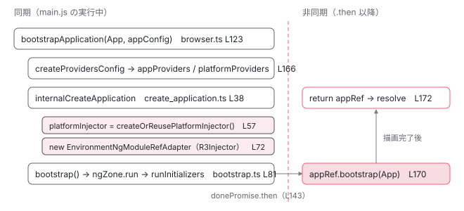

[目次](../README.md) › [起動の全手順](README.md) › 第 7 回 / 全 13 回

# bootstrapApplication の中身

> createProvidersConfig → internalCreateApplication → bootstrap()。「zoneless が既定」はここで決まっている。たった 3 つの関数で DI 木ができるまで。

angular/angular · 読了 約 13 分 · 中核 · [サイトで読む（デモが動きます）](https://angular-deep-dive-cyan.vercel.app/chapter/boot-bootstrap-application)

---

前章でブラウザは `main.js` を読み込み、あなたが書いた `bootstrapApplication(App, appConfig)` の 1 行が実行されました。この章では、その 1 行の内側で呼ばれる関数を **3 つ**（`createProvidersConfig` → `internalCreateApplication` → `bootstrap`）に分け、それぞれが何を受け取り何を返すかを、ソースの行を指して追います。読み終えると「`bootstrapApplication` は何を返し、いつ resolve するのか」に答えられます。

読む対象は `packages/platform-browser/src/browser.ts`、`packages/core/src/application/create_application.ts`、`packages/core/src/platform/bootstrap.ts` の 3 ファイルです。

1. ng コマンド起動
2. builder の解決
3. dev-server と Vite
4. application builder
5. index.html の生成
6. ブラウザが main.js を実行
7. **bootstrapApplication**（この章）
8. 2 段の DI 木
9. APP\_INITIALIZER
10. ApplicationRef.bootstrap
11. 最初の描画
12. クリック→再描画
13. SPA のページ遷移

## 1. bootstrapApplication は 16 行の async 関数

📄 `angular/packages/platform-browser/src/browser.ts` L123–138 （▶ の行: 123, 127–128, 130, 133, 137）

```ts
123 ▶ export async function bootstrapApplication(
124 │   rootComponent: Type<unknown>,
125 │   options?: ApplicationConfig,
126 │   context?: BootstrapContext,
127 ▶ ): Promise<ApplicationRef> {
128 ▶   const config = {
129 │     rootComponent,
130 ▶     ...createProvidersConfig(options, context),
131 │   };
132 │ 
133 ▶   if ((typeof ngJitMode === 'undefined' || ngJitMode) && typeof fetch === 'function') {
134 │     await resolveJitResources();
135 │   }
136 │ 
137 ▶   return internalCreateApplication(config);
138 │ }
```

123 行目、`async function` です。127 行目のとおり返り値は `Promise<ApplicationRef>` で、**ApplicationRef そのもの**ではありません。128〜131 行目で `rootComponent`（あなたの `App`）と `createProvidersConfig` の結果を 1 つのオブジェクトにまとめ、137 行目で `internalCreateApplication` に渡して、その Promise をそのまま返します。

133〜135 行目は JIT モードの処理です。`ng build` / `ng serve` は AOT コンパイルなので `ngJitMode` は `false` に置き換えられ、この `await` は実行されません。つまり本番の経路では `bootstrapApplication` の中に `await` は 1 つもなく、137 行目まで**同期的に**進みます。

> [!TIP]
> **新卒エンジニアへ**
>
> `createApplication`（155〜164 行目）は `rootComponent` を渡さない兄弟関数です。DI 木だけ作ってコンポーネントは後から `appRef.bootstrap()` で刺す用途で、中身はほぼ同じです。

📄 `angular/packages/platform-browser/src/browser.ts` L155–164 （▶ の行: 163）

```ts
155 │ export async function createApplication(
156 │   options?: ApplicationConfig,
157 │   context?: BootstrapContext,
158 │ ): Promise<ApplicationRef> {
159 │   if ((typeof ngJitMode === 'undefined' || ngJitMode) && typeof fetch === 'function') {
160 │     await resolveJitResources();
161 │   }
162 │ 
163 ▶   return internalCreateApplication(createProvidersConfig(options, context));
164 │ }
```

## 2. createProvidersConfig：プロバイダを 2 つの束に分ける

📄 `angular/packages/platform-browser/src/browser.ts` L166–172 （▶ の行: 168–170）

```ts
166 │ function createProvidersConfig(options?: ApplicationConfig, context?: BootstrapContext) {
167 │   return {
168 ▶     platformRef: context?.platformRef,
169 ▶     appProviders: [...BROWSER_MODULE_PROVIDERS, ...(options?.providers ?? [])],
170 ▶     platformProviders: INTERNAL_BROWSER_PLATFORM_PROVIDERS,
171 │   };
172 │ }
```

返すのは 3 つのキーだけです。168 行目の `platformRef` は通常 `undefined` （SSR で既存のプラットフォームを渡すときだけ使う）。169 行目の `appProviders` が**アプリ用**、170 行目の `platformProviders` が **プラットフォーム用**です。この 2 つの束が、次章で見る「2 段の DI 木」の上段と下段になります。

📄 `angular/packages/platform-browser/src/browser.ts` L224–228 （▶ の行: 225–227）

```ts
224 │ const INTERNAL_BROWSER_PLATFORM_PROVIDERS: StaticProvider[] = [
225 ▶   {provide: PLATFORM_ID, useValue: PLATFORM_BROWSER_ID},
226 ▶   {provide: PLATFORM_INITIALIZER, useValue: initDomAdapter, multi: true},
227 ▶   {provide: DOCUMENT, useFactory: _document},
228 │ ];
```

プラットフォーム用は 3 つだけ。225 行目で「ここはブラウザだ」という印（`PLATFORM_ID`）、226 行目で DOM アダプタを初期化する関数（`PLATFORM_INITIALIZER`）、227 行目で `document` を返すファクトリ（`DOCUMENT`）。どれも「どの Angular アプリでも共通で、ページに 1 つあればよいもの」です。

📄 `angular/packages/platform-browser/src/browser.ts` L266–284 （▶ の行: 267–268, 275, 279–280）

```ts
266 │ const BROWSER_MODULE_PROVIDERS: Provider[] = [
267 ▶   {provide: INJECTOR_SCOPE, useValue: 'root'},
268 ▶   {provide: ErrorHandler, useFactory: errorHandler},
269 │   {
270 │     provide: EVENT_MANAGER_PLUGINS,
271 │     useClass: DomEventsPlugin,
272 │     multi: true,
273 │   },
274 │   {provide: EVENT_MANAGER_PLUGINS, useClass: KeyEventsPlugin, multi: true},
275 ▶   DomRendererFactory2,
276 │   {provide: SHARED_STYLES_HOST, useClass: SharedStylesHost},
277 │   // Only remains for backwards compatibility, should be removed once g3 no longer needs it.
278 │   {provide: SharedStylesHost, useExisting: SHARED_STYLES_HOST},
279 ▶   EventManager,
280 ▶   {provide: RendererFactory2, useExisting: DomRendererFactory2},
281 │   typeof ngDevMode === 'undefined' || ngDevMode
282 │     ? {provide: BROWSER_MODULE_PROVIDERS_MARKER, useValue: true}
283 │     : [],
284 │ ];
```

アプリ用の先頭に並ぶ `BROWSER_MODULE_PROVIDERS` です。267 行目の `INJECTOR_SCOPE: 'root'` は次章の主役になります。268 行目で `ErrorHandler`、275 行目と 280 行目で `DomRendererFactory2` （DOM を触るレンダラの工場）、279 行目で `EventManager`（`addEventListener` を呼ぶ係）。**あなたの `appConfig.providers` はこの配列の後ろに連結されます**（169 行目）。

## 3. internalCreateApplication：2 つのインジェクタを作る

📄 `angular/packages/core/src/application/create_application.ts` L38–58 （▶ の行: 38, 43–45, 57–58）

```ts
38 ▶ export function internalCreateApplication(config: {
39 │   rootComponent?: Type<unknown>;
40 │   appProviders?: Array<Provider | EnvironmentProviders>;
41 │   platformProviders?: Provider[];
42 │   platformRef?: PlatformRef;
43 ▶ }): Promise<ApplicationRef> {
44 ▶   const {rootComponent, appProviders, platformProviders, platformRef} = config;
45 ▶   profiler(ProfilerEvent.BootstrapApplicationStart);
46 │ 
47 │   if (typeof ngServerMode !== 'undefined' && ngServerMode && !platformRef) {
48 │     throw new RuntimeError(
49 │       RuntimeErrorCode.PLATFORM_NOT_FOUND,
50 │       ngDevMode &&
51 │         'Missing Platform: This may be due to using `bootstrapApplication` on the server without passing a `BootstrapContext`. ' +
52 │           'Please make sure that `bootstrapApplication` is called with a `context` argument.',
53 │     );
54 │   }
55 │ 
56 │   try {
57 ▶     const platformInjector =
58 ▶       platformRef?.injector ?? createOrReusePlatformInjector(platformProviders as StaticProvider[]);
```

38 行目、こちらは `async` ではない普通の関数ですが、43 行目で `Promise<ApplicationRef>` を返します。44 行目で 4 つのキーに分解し、45 行目でプロファイラに「bootstrap 開始」を記録します。57〜58 行目、**1 つ目のインジェクタ**（プラットフォーム）です。`platformRef` が無いので `createOrReusePlatformInjector(platformProviders)` が呼ばれ、2 節の 3 つのプロバイダから作られます。中身は[次章](08-boot-injectors.md)で読みます。

📄 `angular/packages/core/src/application/create_application.ts` L64–85 （▶ の行: 66–67, 70, 72, 74, 78, 81–84）

```ts
64 │     // Create root application injector based on a set of providers configured at the platform
65 │     // bootstrap level as well as providers passed to the bootstrap call by a user.
66 ▶     const allAppProviders = [
67 ▶       provideZonelessChangeDetectionInternal(),
68 │       errorHandlerEnvironmentInitializer,
69 │       ...(ngDevMode ? [validAppIdInitializer] : []),
70 ▶       ...(appProviders || []),
71 │     ];
72 ▶     const adapter = new EnvironmentNgModuleRefAdapter({
73 │       providers: allAppProviders,
74 ▶       parent: platformInjector as EnvironmentInjector,
75 │       debugName: typeof ngDevMode === 'undefined' || ngDevMode ? 'Environment Injector' : '',
76 │       // We skip environment initializers because we need to run them inside the NgZone, which
77 │       // happens after we get the NgZone instance from the Injector.
78 ▶       runEnvironmentInitializers: false,
79 │     });
80 │ 
81 ▶     return bootstrap({
82 ▶       r3Injector: adapter.injector,
83 ▶       platformInjector,
84 ▶       rootComponent,
85 │     });
```

66〜71 行目でアプリ用プロバイダの最終リストを組みます。67 行目の先頭が `provideZonelessChangeDetectionInternal()`。ここで「既定は zoneless」が決まります。その 3 つのプロバイダの中身と、利用者が `provideZoneChangeDetection()` で上書きできる理由は [zoneless の章](../zoneless/01-zoneless-default.md)に書いたので繰り返しません。70 行目で 2 節の `appProviders`（`BROWSER_MODULE_PROVIDERS` + あなたの providers）が後ろに続きます。

72〜79 行目、**2 つ目のインジェクタ**（環境）です。74 行目で親に 1 つ目のインジェクタを指定しています。78 行目の `runEnvironmentInitializers: false` に注目してください。76〜77 行目のコメントどおり、`ENVIRONMENT_INITIALIZER` は `NgZone` の中で動かしたいので、インジェクタを作った直後には実行せず、`NgZone` を取り出せる `bootstrap()` の中まで遅らせています。

📄 `angular/packages/core/src/render3/ng_module_ref.ts` L119–140 （▶ の行: 130–132, 134, 137–138）

```ts
119 │ export class EnvironmentNgModuleRefAdapter extends viewEngine_NgModuleRef<null> {
120 │   override readonly injector: R3Injector;
121 │   override readonly instance = null;
122 │ 
123 │   constructor(config: {
124 │     providers: Array<Provider | EnvironmentProviders>;
125 │     parent: EnvironmentInjector | null;
126 │     debugName: string | null;
127 │     runEnvironmentInitializers: boolean;
128 │   }) {
129 │     super();
130 ▶     const injector = new R3Injector(
131 ▶       [...config.providers, {provide: viewEngine_NgModuleRef, useValue: this}],
132 ▶       config.parent || getNullInjector(),
133 │       config.debugName,
134 ▶       new Set(['environment']),
135 │     );
136 │     this.injector = injector;
137 ▶     if (config.runEnvironmentInitializers) {
138 ▶       injector.resolveInjectorInitializers();
139 │     }
140 │   }
```

`EnvironmentNgModuleRefAdapter` は `R3Injector` を new する薄い包みです。130〜135 行目、プロバイダ配列の末尾に `{provide: NgModuleRef, useValue: this}` を足し（131 行目）、親（132 行目）と `'environment'` スコープ（134 行目）を渡します。137〜139 行目が先ほどの `runEnvironmentInitializers` の分岐で、`false` なので何もしません。131 行目で自分自身を `NgModuleRef` として登録しているのは、[10 章](10-boot-application-ref.md)で `ApplicationRef.bootstrap` が `this._injector.get(NgModuleRef)` を呼ぶためです。

81〜85 行目、作った 2 つのインジェクタと `rootComponent` を `bootstrap()` に渡し、その返り値（Promise）をそのまま返します。

## 4. bootstrap()：NgZone の中で初期化を進める

📄 `angular/packages/core/src/platform/bootstrap.ts` L81–93 （▶ の行: 84–85, 87–88, 90）

```ts
81 │ export function bootstrap<M>(
82 │   config: ModuleBootstrapConfig<M> | ApplicationBootstrapConfig,
83 │ ): Promise<ApplicationRef> | Promise<NgModuleRef<M>> {
84 ▶   const envInjector = isApplicationBootstrapConfig(config)
85 ▶     ? config.r3Injector
86 │     : config.moduleRef.injector;
87 ▶   const ngZone = envInjector.get(NgZone);
88 ▶   return ngZone.run(() => {
89 │     if (isApplicationBootstrapConfig(config)) {
90 ▶       config.r3Injector.resolveInjectorInitializers();
91 │     } else {
92 │       config.moduleRef.resolveInjectorInitializers();
93 │     }
```

84〜86 行目、`bootstrapApplication` 経路では `config.r3Injector`（環境インジェクタ）が `envInjector` になります。`bootstrapModule` 経路と関数を共有しているので `isApplicationBootstrapConfig` の分岐が随所にあります。`bootstrapModule` 側がこの関数に入るまでの手順は [「platformBrowser().bootstrapModule(AppModule) の全手順」](../ngmodule/11-ngmodule-bootstrap-module.md)で追います。

87 行目、**ここが環境インジェクタから最初に値を取り出す瞬間**です。既定の zoneless では `NoopNgZone` が実体化されます。88 行目の `ngZone.run(...)` は `NoopNgZone` なら関数を呼ぶだけです。90 行目で、3 節で後回しにした `resolveInjectorInitializers()`（`ENVIRONMENT_INITIALIZER` の実行）が ようやく呼ばれます。

📄 `angular/packages/core/src/platform/bootstrap.ts` L94–124 （▶ の行: 94, 96, 108–109, 117–119, 121）

```ts
 94 ▶     const exceptionHandler = envInjector.get(INTERNAL_APPLICATION_ERROR_HANDLER);
 95 │     if (typeof ngDevMode === 'undefined' || ngDevMode) {
 96 ▶       if (envInjector.get(PROVIDED_ZONELESS) && envInjector.get(PROVIDED_NG_ZONE)) {
 97 │         console.warn(
 98 │           formatRuntimeError(
 99 │             RuntimeErrorCode.PROVIDED_BOTH_ZONE_AND_ZONELESS,
100 │             'Both provideZoneChangeDetection and provideZonelessChangeDetection are provided. ' +
101 │               'This is likely a mistake. Update the application providers to use only one of the two.',
102 │           ),
103 │         );
104 │       }
105 │     }
106 │ 
107 │     let onErrorSubscription: Subscription;
108 ▶     ngZone.runOutsideAngular(() => {
109 ▶       onErrorSubscription = ngZone.onError.subscribe({
110 │         next: exceptionHandler,
111 │       });
112 │     });
113 │ 
114 │     // If the whole platform is destroyed, invoke the `destroy` method
115 │     // for all bootstrapped applications as well.
116 │     if (isApplicationBootstrapConfig(config)) {
117 ▶       const destroyListener = () => envInjector.destroy();
118 ▶       const onPlatformDestroyListeners = config.platformInjector.get(PLATFORM_DESTROY_LISTENERS);
119 ▶       onPlatformDestroyListeners.add(destroyListener);
120 │ 
121 ▶       envInjector.onDestroy(() => {
122 │         onErrorSubscription.unsubscribe();
123 │         onPlatformDestroyListeners.delete(destroyListener);
124 │       });
```

94 行目でエラーハンドラを取り出し、108〜112 行目で `ngZone.onError` を購読して繋ぎます。96 行目の警告（zone と zoneless を両方 provide したとき）は [zoneless の章](../zoneless/01-zoneless-default.md)で見ました。117〜123 行目、プラットフォームが destroy されたらこのアプリの環境インジェクタも destroy する、という後片付けの登録です。ここまでは全部**同期**です。

📄 `angular/packages/core/src/platform/bootstrap.ts` L137–181 （▶ の行: 137–141, 143–144, 168–170, 172, 178）

```ts
137 ▶     return _callAndReportToErrorHandler(exceptionHandler, ngZone, () => {
138 ▶       const pendingTasks = envInjector.get(PendingTasksInternal);
139 ▶       const taskId = pendingTasks.add();
140 ▶       const initStatus = envInjector.get(ApplicationInitStatus);
141 ▶       initStatus.runInitializers();
142 │ 
143 ▶       return initStatus.donePromise
144 ▶         .then(() => {
145 │           // If the `LOCALE_ID` provider is defined at bootstrap then we set the value for ivy
146 │           const localeId = envInjector.get(LOCALE_ID, DEFAULT_LOCALE_ID);
147 │           setLocaleId(localeId || DEFAULT_LOCALE_ID);
148 │ 
149 │           const enableRootComponentbootstrap = envInjector.get(
150 │             ENABLE_ROOT_COMPONENT_BOOTSTRAP,
151 │             true,
152 │           );
153 │           if (!enableRootComponentbootstrap) {
154 │             if (isApplicationBootstrapConfig(config)) {
155 │               return envInjector.get(ApplicationRef);
156 │             }
157 │ 
158 │             config.allPlatformModules.push(config.moduleRef);
159 │             return config.moduleRef;
160 │           }
161 │ 
162 │           if (typeof ngDevMode === 'undefined' || ngDevMode) {
163 │             const imagePerformanceService = envInjector.get(ImagePerformanceWarning);
164 │             imagePerformanceService.start();
165 │           }
166 │ 
167 │           if (isApplicationBootstrapConfig(config)) {
168 ▶             const appRef = envInjector.get(ApplicationRef);
169 ▶             if (config.rootComponent !== undefined) {
170 ▶               appRef.bootstrap(config.rootComponent);
171 │             }
172 ▶             return appRef;
173 │           } else {
174 │             moduleBootstrapImpl?.(config.moduleRef, config.allPlatformModules);
175 │             return config.moduleRef;
176 │           }
177 │         })
178 ▶         .finally(() => void pendingTasks.remove(taskId));
179 │     });
180 │   });
181 │ }
```

この引用が「いつ resolve するか」の答えです。1 行ずつ追います。

1. **138〜139 行目：PendingTasks に 1 件積む**

   `PendingTasksInternal.add()` で「起動中」というタスクを登録します。これにより `ApplicationRef.isStable` は起動が終わるまで `false` です。178 行目の `finally` で必ず `remove` されます。
2. **140〜141 行目：APP\_INITIALIZER を全部呼ぶ**

   `ApplicationInitStatus.runInitializers()` が登録済みの初期化関数を順に実行します。中身は[9 章](09-boot-app-initializer.md)で読みます。呼び出し自体は同期ですが、初期化関数が Promise を返せば完了は後になります。
3. **143〜144 行目：donePromise.then で待つ**

   `initStatus.donePromise` は全初期化関数が終わると resolve する Promise です。`.then` のコールバックは**必ずマイクロタスク以降**に動きます。初期化関数が 1 つも無くても同じです。だから `bootstrapApplication` が返す Promise は、どんなアプリでも同期的には resolve しません。
4. **168〜170 行目：ApplicationRef を取り出し、ルートを刺す**

   `envInjector.get(ApplicationRef)` で `ApplicationRef` がここで初めて実体化されます。170 行目の `appRef.bootstrap(config.rootComponent)` が、`<app-root>` に `App` を結びつけて最初の描画まで行う関数です（[10 章](10-boot-application-ref.md)・[11 章](11-boot-first-render.md)）。この呼び出しは**同期**で、返ってきた時点で DOM は組み終わっています。
5. **172 行目：appRef を返す → これが resolve 値**

   `.then` のコールバックが `appRef` を返すので、外側の Promise はこの値で resolve します。`await bootstrapApplication(...)` が返ってくるのは、**最初の描画が完了した後**です。

📄 `angular/packages/core/src/platform/bootstrap.ts` L217–238 （▶ の行: 223–226, 228, 234）

```ts
217 │ function _callAndReportToErrorHandler(
218 │   errorHandler: (e: unknown) => void,
219 │   ngZone: NgZone,
220 │   callback: () => any,
221 │ ): any {
222 │   try {
223 ▶     const result = callback();
224 ▶     if (isPromise(result)) {
225 ▶       return result.catch((e: any) => {
226 ▶         ngZone.runOutsideAngular(() => errorHandler(e));
227 │         // rethrow as the exception handler might not do it
228 ▶         throw e;
229 │       });
230 │     }
231 │ 
232 │     return result;
233 │   } catch (e) {
234 ▶     ngZone.runOutsideAngular(() => errorHandler(e));
235 │     // rethrow as the exception handler might not do it
236 │     throw e;
237 │   }
238 │ }
```

137 行目で全体を包んでいた `_callAndReportToErrorHandler` です。223 行目でコールバック（138〜178 行目）を呼び、224〜230 行目、結果が Promise なら reject を捕まえて エラーハンドラに渡し（226 行目）、228 行目で**再 throw**します。つまり `APP_INITIALIZER` が reject すると、エラーは `ErrorHandler` に報告され、かつ `bootstrapApplication` の Promise も reject されます。`main.ts` の `.catch(err => console.error(err))` はこの 228 行目を受け取っています。



*bootstrapApplication から最初の描画まで。縦線より左は同期、右は donePromise.then 以降（最短でマイクロタスク 1 つ後）。*

## ここまでの呼び出し

- 👤 `bootstrapApplication(App, appConfig)` — src/main.ts — *Promise&lt;ApplicationRef&gt; を返す*
  - `createProvidersConfig(options)` — platform-browser/src/browser.ts L166 — *appProviders と platformProviders に分ける*
  - `internalCreateApplication(config)` — core/src/application/create\_application.ts L38
    - `createOrReusePlatformInjector(platformProviders)` — core/src/platform/platform.ts L172 — *1 つ目のインジェクタ*
    - `new EnvironmentNgModuleRefAdapter({ providers, parent, runEnvironmentInitializers: false })` — core/src/render3/ng\_module\_ref.ts L119 — *2 つ目のインジェクタ（R3Injector）*
    - `bootstrap({ r3Injector, platformInjector, rootComponent })` — core/src/platform/bootstrap.ts L81
      - `envInjector.get(NgZone)` → `ngZone.run(...)` — bootstrap.ts L87-88 — *最初の DI 解決。既定は NoopNgZone*
        - `r3Injector.resolveInjectorInitializers()` — bootstrap.ts L90 — *ENVIRONMENT\_INITIALIZER を実行*
        - `pendingTasks.add()` — bootstrap.ts L139
        - `initStatus.runInitializers()` — bootstrap.ts L141 — *APP\_INITIALIZER を実行*
        - `initStatus.donePromise.then(...)` — bootstrap.ts L143 — *── ここから非同期 ──*
          - `envInjector.get(ApplicationRef)` — bootstrap.ts L168
          - `appRef.bootstrap(rootComponent)` — bootstrap.ts L170 — *10 章・11 章*
          - `return appRef` — bootstrap.ts L172 — *bootstrapApplication の Promise が resolve*

## 聞かれそうな質問

**Q. bootstrapApplication は何を返しますか？いつ resolve しますか？**

`Promise<ApplicationRef>` です（browser.ts 127 行目）。resolve するのは bootstrap.ts 143 行目の `donePromise.then` のコールバックが 172 行目で `appRef` を返したときで、その直前の 170 行目で `appRef.bootstrap(rootComponent)` が同期的に最初の描画まで終えています。`APP_INITIALIZER` が 1 つも無くても `.then` は非同期なので、同期的に resolve することはありません。

**Q. bootstrapApplication の中で await しているところはありますか？**

browser.ts 133〜135 行目の JIT 用 `await resolveJitResources()` だけで、AOT ビルドでは `ngJitMode` が `false` なので実行されません。それ以外は 137 行目まで同期です。非同期になる最初の地点は bootstrap.ts 143 行目の `.then` です。

**Q. 「zoneless が既定」はどの行で決まっていますか？**

create\_application.ts 67 行目です。`allAppProviders` の先頭に `provideZonelessChangeDetectionInternal()` が置かれ、70 行目のあなたの providers はその後ろです。上書きの仕組みは[zoneless の章](../zoneless/01-zoneless-default.md)のとおりです。

**Q. runEnvironmentInitializers: false は何のためですか？**

create\_application.ts 76〜78 行目のコメントどおり、`ENVIRONMENT_INITIALIZER` を `NgZone` の中で動かすためです。`NgZone` はこの環境インジェクタから取り出すので、インジェクタ作成時点ではまだ手に入りません。bootstrap.ts 87 行目で `NgZone` を取り出し、88 行目の `ngZone.run` の中、90 行目で `resolveInjectorInitializers()` を呼んでいます。

**Q. APP\_INITIALIZER が失敗したら main.ts の catch に届きますか？**

届きます。bootstrap.ts 137 行目で全体が `_callAndReportToErrorHandler` に包まれており、224〜229 行目で Promise の reject を捕まえ、226 行目で `ErrorHandler` に渡したあと 228 行目で再 throw します。再 throw された reject が `bootstrapApplication` の Promise を reject します。

**Q. ApplicationRef はいつ作られますか？**

bootstrap.ts 168 行目の `envInjector.get(ApplicationRef)` が最初の取り出しで、`R3Injector` は取り出されるまでインスタンスを作らないので、ここで初めて new されます。`APP_INITIALIZER` の完了後です。

## 読み終えて

- `bootstrapApplication` → `createProvidersConfig` → `internalCreateApplication` → `bootstrap` の 4 関数で、途中に `await` は無い（AOT のとき）
- `createProvidersConfig` がプロバイダを `platformProviders`（3 つ）と `appProviders`（`BROWSER_MODULE_PROVIDERS` + あなたの providers）に分ける
- `internalCreateApplication` がプラットフォームと環境の 2 つのインジェクタを作る。環境側の先頭は常に zoneless 用の 3 プロバイダ
- `bootstrap()` は `ngZone.run` の中で `ENVIRONMENT_INITIALIZER` → `APP_INITIALIZER` を実行し、`donePromise.then` で `appRef.bootstrap` を呼んで `appRef` で resolve する
- 返り値の Promise が resolve した時点で、最初の描画は終わっている

---

← 前: [ブラウザが main.js を実行するまで](06-boot-browser-load.md)  
次: [2 段の DI 木：プラットフォームと環境](08-boot-injectors.md) →
