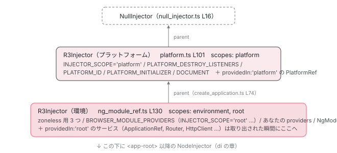

[目次](../README.md) › [起動の全手順](README.md) › 第 8 回 / 全 13 回

# 2 段の DI 木：プラットフォームと環境

> createOrReusePlatformInjector が作る土台と、R3Injector が作るアプリ用の層。PLATFORM\_INITIALIZER で DOM アダプタが差し込まれる瞬間。

angular/angular · 読了 約 12 分 · 中核 · [サイトで読む（デモが動きます）](https://angular-deep-dive-cyan.vercel.app/chapter/boot-injectors)

---

前章で `internalCreateApplication` が「2 つのインジェクタ」を作るところまで読みました。この章はその 2 つ、**プラットフォームインジェクタ**と**環境インジェクタ**が どの関数で作られ、どちらが親で、それぞれ何を持っているかを確定させます。合わせて、`providedIn: 'root'` のサービスがなぜ環境インジェクタで見つかるのか、`PLATFORM_INITIALIZER` がいつ何をするのかも行番号で押さえます。

読む対象は `packages/core/src/platform/platform.ts`、`packages/core/src/di/r3_injector.ts`、`packages/core/src/di/create_injector.ts` です。

1. ng コマンド起動
2. builder の解決
3. dev-server と Vite
4. application builder
5. index.html の生成
6. ブラウザが main.js を実行
7. bootstrapApplication
8. **2 段の DI 木**（この章）
9. APP\_INITIALIZER
10. ApplicationRef.bootstrap
11. 最初の描画
12. クリック→再描画
13. SPA のページ遷移

## 1. 下段：createOrReusePlatformInjector

📄 `angular/packages/core/src/platform/platform.ts` L172–194 （▶ の行: 172, 175, 183, 188, 192–193）

```ts
172 ▶ export function createOrReusePlatformInjector(providers: StaticProvider[] = []): Injector {
173 │   // If a platform injector already exists, it means that the platform
174 │   // is already bootstrapped and no additional actions are required.
175 ▶   if (_platformInjector) return _platformInjector;
176 │ 
177 │   publishDefaultGlobalUtils();
178 │   if (typeof ngDevMode !== 'undefined' && ngDevMode) {
179 │     _unregisterAiTools = registerAiTools();
180 │   }
181 │ 
182 │   // Otherwise, setup a new platform injector and run platform initializers.
183 ▶   const injector = createPlatformInjector(providers);
184 │ 
185 │   // During SSR, using this setting and using an injector from the global can cause the
186 │   // injector to be used for a different request due to concurrency.
187 │   if (typeof ngServerMode === 'undefined' || !ngServerMode) {
188 ▶     _platformInjector = injector;
189 │   }
190 │ 
191 │   publishSignalConfiguration();
192 ▶   runPlatformInitializers(injector);
193 ▶   return injector;
194 │ }
```

175 行目、モジュール変数 `_platformInjector` が既にあればそれを返します。同じページで `bootstrapApplication` を 2 回呼んでも、プラットフォームインジェクタは 1 つしか作られません。183 行目で `createPlatformInjector(providers)` を呼び、188 行目でモジュール変数に保存、192 行目で `runPlatformInitializers`（3 節）、193 行目で返します。

📄 `angular/packages/core/src/platform/platform.ts` L101–110 （▶ の行: 102, 105–107）

```ts
101 │ function createPlatformInjector(providers: StaticProvider[] = [], name?: string): Injector {
102 ▶   return Injector.create({
103 │     name,
104 │     providers: [
105 ▶       {provide: INJECTOR_SCOPE, useValue: 'platform'},
106 ▶       {provide: PLATFORM_DESTROY_LISTENERS, useValue: new Set([() => (_platformInjector = null)])},
107 ▶       ...providers,
108 │     ],
109 │   });
110 │ }
```

102 行目、公開 API の `Injector.create` を使っています。105 行目で `INJECTOR_SCOPE: 'platform'`、106 行目で破棄リスナーの `Set`、107 行目で前章の 3 つ（`PLATFORM_ID` / `PLATFORM_INITIALIZER` / `DOCUMENT`）を並べます。合計 5 つのプロバイダ。これがプラットフォームインジェクタの全財産です。

📄 `angular/packages/core/src/di/injector.ts` L107–119 （▶ の行: 116–117）

```ts
107 │   static create(
108 │     options:
109 │       | StaticProvider[]
110 │       | {providers: Array<Provider | StaticProvider>; parent?: Injector; name?: string},
111 │     parent?: Injector,
112 │   ): Injector {
113 │     if (Array.isArray(options)) {
114 │       return createInjector({name: ''}, parent, options, '');
115 │     } else {
116 ▶       const name = options.name ?? '';
117 ▶       return createInjector({name}, options.parent, options.providers, name);
118 │     }
119 │   }
```

📄 `angular/packages/core/src/di/create_injector.ts` L21–35 （▶ の行: 27, 33）

```ts
21 │ export function createInjector(
22 │   defType: /* InjectorType<any> */ any,
23 │   parent: Injector | null = null,
24 │   additionalProviders: Array<Provider | StaticProvider> | null = null,
25 │   name?: string,
26 │ ): Injector {
27 ▶   const injector = createInjectorWithoutInjectorInstances(
28 │     defType,
29 │     parent,
30 │     additionalProviders,
31 │     name,
32 │   );
33 ▶   injector.resolveInjectorInitializers();
34 │   return injector;
35 │ }
```

📄 `angular/packages/core/src/di/create_injector.ts` L42–56 （▶ の行: 49, 55）

```ts
42 │ export function createInjectorWithoutInjectorInstances(
43 │   defType: /* InjectorType<any> */ any,
44 │   parent: Injector | null = null,
45 │   additionalProviders: Array<Provider | EnvironmentProviders> | null = null,
46 │   name?: string,
47 │   scopes = new Set<InjectorScope>(),
48 │ ): R3Injector {
49 ▶   const providers = [additionalProviders || EMPTY_ARRAY, importProvidersFrom(defType)];
50 │   let source: string | undefined = undefined;
51 │   if (ngDevMode) {
52 │     source = name || (typeof defType === 'object' ? undefined : stringify(defType));
53 │   }
54 │ 
55 ▶   return new R3Injector(providers, parent || getNullInjector(), source || null, scopes);
56 │ }
```

`Injector.create`（117 行目）→ `createInjector`（27 行目）→ `createInjectorWithoutInjectorInstances`（55 行目）とたどると、最後は **`new R3Injector(...)`** です。つまりプラットフォームインジェクタも環境インジェクタも、同じ `R3Injector` クラスのインスタンスです。55 行目、親は `parent || getNullInjector()`。`options.parent` を渡していないので、プラットフォームインジェクタの親は `NullInjector` です。33 行目、こちらは `resolveInjectorInitializers()` をすぐ呼びます（前章で見た環境側の `runEnvironmentInitializers: false` と対照的です）。

📄 `angular/packages/core/src/di/null_injector.ts` L16–29 （▶ の行: 17–18, 25, 27）

```ts
16 │ export class NullInjector implements Injector {
17 ▶   get(token: any, notFoundValue: any = THROW_IF_NOT_FOUND): any {
18 ▶     if (notFoundValue === THROW_IF_NOT_FOUND) {
19 │       const message = ngDevMode ? `No provider found for \`${stringify(token)}\`.` : '';
20 │       const error = createRuntimeError(message, RuntimeErrorCode.PROVIDER_NOT_FOUND);
21 │ 
22 │       // Note: This is the name used by the primitives to identify a not found error.
23 │       error.name = 'ɵNotFound';
24 │ 
25 ▶       throw error;
26 │     }
27 ▶     return notFoundValue;
28 │   }
29 │ }
```

`NullInjector` は木の終点です。17〜18 行目、`notFoundValue` が既定の `THROW_IF_NOT_FOUND` なら 25 行目で `NullInjectorError: No provider found for ...` を投げ、`optional: true` などで既定値が渡されていれば 27 行目でそれを返します。あなたが見慣れたあのエラーは、ここで生まれています。

## 2. 上段：EnvironmentNgModuleRefAdapter

📄 `angular/packages/core/src/render3/ng_module_ref.ts` L119–140 （▶ の行: 130–132, 134）

```ts
119 │ export class EnvironmentNgModuleRefAdapter extends viewEngine_NgModuleRef<null> {
120 │   override readonly injector: R3Injector;
121 │   override readonly instance = null;
122 │ 
123 │   constructor(config: {
124 │     providers: Array<Provider | EnvironmentProviders>;
125 │     parent: EnvironmentInjector | null;
126 │     debugName: string | null;
127 │     runEnvironmentInitializers: boolean;
128 │   }) {
129 │     super();
130 ▶     const injector = new R3Injector(
131 ▶       [...config.providers, {provide: viewEngine_NgModuleRef, useValue: this}],
132 ▶       config.parent || getNullInjector(),
133 │       config.debugName,
134 ▶       new Set(['environment']),
135 │     );
136 │     this.injector = injector;
137 │     if (config.runEnvironmentInitializers) {
138 │       injector.resolveInjectorInitializers();
139 │     }
140 │   }
```

130〜135 行目、こちらは `Injector.create` を経由せず直接 `new R3Injector` です。132 行目の親は `config.parent`、つまり前章 create\_application.ts 74 行目で渡された **プラットフォームインジェクタ**です。134 行目でスコープに `'environment'` を指定しています。



*起動時に作られる 2 つの R3Injector と、その終点 NullInjector。get() で見つからなければ parent へ、最後は NullInjector が投げる。*

## 3. PLATFORM\_INITIALIZER：DOM アダプタが差し込まれる瞬間

📄 `angular/packages/core/src/platform/platform.ts` L222–227 （▶ の行: 223–225）

```ts
222 │ function runPlatformInitializers(injector: Injector): void {
223 ▶   const inits = injector.get(PLATFORM_INITIALIZER, null);
224 ▶   runInInjectionContext(injector, () => {
225 ▶     inits?.forEach((init) => init());
226 │   });
227 │ }
```

1 節 192 行目から呼ばれる関数です。223 行目で `PLATFORM_INITIALIZER`（multi プロバイダなので配列）を取り出し、225 行目で順に呼びます。224 行目の `runInInjectionContext` により、初期化関数の中で `inject()` が使えます。

📄 `angular/packages/platform-browser/src/browser.ts` L210–228 （▶ の行: 210–211, 218, 220, 226–227）

```ts
210 ▶ export function initDomAdapter() {
211 ▶   BrowserDomAdapter.makeCurrent();
212 │ }
213 │ 
214 │ export function errorHandler(): ErrorHandler {
215 │   return new ErrorHandler();
216 │ }
217 │ 
218 ▶ export function _document(): any {
219 │   // Tell ivy about the global document
220 ▶   ɵsetDocument(document);
221 │   return document;
222 │ }
223 │ 
224 │ const INTERNAL_BROWSER_PLATFORM_PROVIDERS: StaticProvider[] = [
225 │   {provide: PLATFORM_ID, useValue: PLATFORM_BROWSER_ID},
226 ▶   {provide: PLATFORM_INITIALIZER, useValue: initDomAdapter, multi: true},
227 ▶   {provide: DOCUMENT, useFactory: _document},
228 │ ];
```

📄 `angular/packages/platform-browser/src/browser/browser_adapter.ts` L21–26 （▶ の行: 24–25）

```ts
21 │ export class BrowserDomAdapter extends DomAdapter {
22 │   override readonly supportsDOMEvents: boolean = true;
23 │ 
24 ▶   static makeCurrent() {
25 ▶     setRootDomAdapter(new BrowserDomAdapter());
26 │   }
```

ブラウザで登録されている初期化関数は 226 行目の `initDomAdapter` 1 つだけです。210〜212 行目、中身は `BrowserDomAdapter.makeCurrent()`、さらに 24〜25 行目で `setRootDomAdapter(new BrowserDomAdapter())`。これで `getDOM()` がブラウザ用の実装を返すようになります。後の章で出てくる `getDOM().getGlobalEventTarget(doc, 'window')` のような呼び出しは、この瞬間以降に使えます。

227 行目の `DOCUMENT` は `useFactory` なので、誰かが取り出すまで実行されません。取り出されると 218〜222 行目の `_document()` が走り、220 行目の `ɵsetDocument(document)` で レンダリング側にも `document` を知らせてから返します。

## 4. R3Injector のコンストラクタ：スコープが決まる

📄 `angular/packages/core/src/di/r3_injector.ts` L216–244 （▶ の行: 218, 220, 224–225, 229, 232–233, 238–240）

```ts
216 │   constructor(
217 │     providers: Array<Provider | EnvironmentProviders>,
218 ▶     readonly parent: Injector,
219 │     readonly source: string | null,
220 ▶     readonly scopes: Set<InjectorScope>,
221 │   ) {
222 │     super();
223 │     // Start off by creating Records for every provider.
224 ▶     forEachSingleProvider(providers as Array<Provider | InternalEnvironmentProviders>, (provider) =>
225 ▶       this.processProvider(provider),
226 │     );
227 │ 
228 │     // Make sure the INJECTOR token provides this injector.
229 ▶     this.records.set(INJECTOR, makeRecord(undefined, this));
230 │ 
231 │     // And `EnvironmentInjector` if the current injector is supposed to be env-scoped.
232 ▶     if (scopes.has('environment')) {
233 ▶       this.records.set(EnvironmentInjector, makeRecord(undefined, this));
234 │     }
235 │ 
236 │     // Detect whether this injector has the APP_ROOT_SCOPE token and thus should provide
237 │     // any injectable scoped to APP_ROOT_SCOPE.
238 ▶     const record = this.records.get(INJECTOR_SCOPE) as Record<InjectorScope | null>;
239 ▶     if (record != null && typeof record.value === 'string') {
240 ▶       this.scopes.add(record.value as InjectorScope);
241 │     }
242 │ 
243 │     this.injectorDefTypes = new Set(this.get(INJECTOR_DEF_TYPES, EMPTY_ARRAY, {self: true}));
244 │   }
```

1. **224〜226 行目：全プロバイダを records に登録**

   `processProvider` が 1 件ずつ `Map` に入れます（同じトークンは後勝ち。[zoneless の章](../zoneless/01-zoneless-default.md)で読みました）。ここで作られるのは「どう作るか」の記録だけで、インスタンスはまだ 1 つも作られません。
2. **229 行目：INJECTOR トークン**

   `inject(Injector)` と書いたときに自分自身が返るよう、自分を登録します。
3. **232〜234 行目：'environment' なら EnvironmentInjector も自分**

   環境インジェクタは 2 節 134 行目で `'environment'` を渡されたので、`inject(EnvironmentInjector)` も自分を返します。プラットフォームインジェクタは渡されていないので返しません。
4. **238〜241 行目：INJECTOR\_SCOPE を読んで scopes に足す**

   プロバイダの中に `INJECTOR_SCOPE` があれば、その値を `scopes` に加えます。プラットフォーム側は 1 節 105 行目の `'platform'`、環境側は次の引用の `'root'` です。

📄 `angular/packages/platform-browser/src/browser.ts` L266–268 （▶ の行: 267）

```ts
266 │ const BROWSER_MODULE_PROVIDERS: Provider[] = [
267 ▶   {provide: INJECTOR_SCOPE, useValue: 'root'},
268 │   {provide: ErrorHandler, useFactory: errorHandler},
```

267 行目。`BROWSER_MODULE_PROVIDERS` の先頭が `INJECTOR_SCOPE: 'root'` です。これが環境インジェクタの `appProviders` に含まれているので、環境インジェクタの `scopes` は `{'environment', 'root'}` になります。「`providedIn: 'root'` は環境インジェクタに入る」の根拠は、この 1 行と次の節です。

## 5. get()：見つからなければ親へ、スコープが合えば自分で作る

📄 `angular/packages/core/src/di/r3_injector.ts` L343–383 （▶ の行: 347–348, 351–352, 362, 366, 369–370, 376, 383）

```ts
343 │     try {
344 │       // Check for the SkipSelf flag.
345 │       if (!(flags & InternalInjectFlags.SkipSelf)) {
346 │         // SkipSelf isn't set, check if the record belongs to this injector.
347 ▶         let record: Record<T> | undefined | null = this.records.get(token);
348 ▶         if (record === undefined) {
349 │           // No record, but maybe the token is scoped to this injector. Look for an injectable
350 │           // def with a scope matching this injector.
351 ▶           const def = couldBeInjectableType(token) && getInjectableDef(token);
352 ▶           if (def && this.injectableDefInScope(def)) {
353 │             // Found an injectable def and it's scoped to this injector. Pretend as if it was here
354 │             // all along.
355 │ 
356 │             if (ngDevMode) {
357 │               runInInjectorProfilerContext(this, token as Type<T>, () => {
358 │                 emitProviderConfiguredEvent(token as TypeProvider);
359 │               });
360 │             }
361 │ 
362 ▶             record = makeRecord(injectableDefOrInjectorDefFactory(token), NOT_YET);
363 │           } else {
364 │             record = null;
365 │           }
366 ▶           this.records.set(token, record);
367 │         }
368 │         // If a record was found, get the instance for it and return it.
369 ▶         if (record != null /* NOT null || undefined */) {
370 ▶           return this.hydrate(token, record, flags);
371 │         }
372 │       }
373 │ 
374 │       // Select the next injector based on the Self flag - if self is set, the next injector is
375 │       // the NullInjector, otherwise it's the parent.
376 ▶       const nextInjector = !(flags & InternalInjectFlags.Self) ? this.parent : getNullInjector();
377 │       // Set the notFoundValue based on the Optional flag - if optional is set and notFoundValue
378 │       // is undefined, the value is null, otherwise it's the notFoundValue.
379 │       notFoundValue =
380 │         flags & InternalInjectFlags.Optional && notFoundValue === THROW_IF_NOT_FOUND
381 │           ? null
382 │           : notFoundValue;
383 ▶       return nextInjector.get(token, notFoundValue);
```

1. **347 行目：records を見る**

   コンストラクタで登録したプロバイダなら、ここで見つかります。
2. **348〜367 行目：無ければ、トークン自身の providedIn を見る**

   351 行目でトークン（クラス）の `ɵprov` 定義を取り、352 行目の `injectableDefInScope` でスコープが合うか確かめます。合えば 362 行目で「まだ作っていない（`NOT_YET`）」record を作り、366 行目で records に**追加**します。以降はこのインジェクタの持ち物です。
3. **369〜371 行目：record があれば hydrate**

   370 行目の `hydrate` がインスタンスを作る（または既にあるものを返す）関数です。
4. **376〜383 行目：どちらも無ければ親に聞く**

   376 行目で `this.parent`（`self: true` なら `NullInjector`）を選び、383 行目で再帰します。環境 → プラットフォーム → `NullInjector` の順に進み、最後に 1 節の 25 行目でエラーになります。

📄 `angular/packages/core/src/di/r3_injector.ts` L551–561 （▶ の行: 552, 556–557）

```ts
551 │   private injectableDefInScope(def: ɵɵInjectableDeclaration<any>): boolean {
552 ▶     if (!def.providedIn) {
553 │       return false;
554 │     }
555 │     const providedIn = resolveForwardRef(def.providedIn);
556 ▶     if (typeof providedIn === 'string') {
557 ▶       return providedIn === 'any' || this.scopes.has(providedIn);
558 │     } else {
559 │       return this.injectorDefTypes.has(providedIn);
560 │     }
561 │   }
```

556〜557 行目、`providedIn` が文字列なら `'any'` か、`this.scopes` に含まれるかで判定します。環境インジェクタの `scopes` は `{'environment', 'root'}` なので、`providedIn: 'root'` のサービスはここで `true` になり、環境インジェクタの records に入ります。`providedIn: 'platform'` のサービス（`PlatformRef` など）は環境側では `false`、親のプラットフォーム側で `true` になります。

📄 `angular/packages/core/src/di/interface/service.ts` L25–36 （▶ の行: 32）

```ts
25 │ export function ɵɵdefineService<T>(opts: {
26 │   token: unknown;
27 │   autoProvided?: boolean;
28 │   factory: (parent?: Type<unknown>) => T;
29 │ }): ɵɵInjectableDeclaration<T> {
30 │   return {
31 │     token: opts.token,
32 ▶     providedIn: opts.autoProvided === false ? null : 'root',
33 │     factory: opts.factory,
34 │     value: undefined,
35 │   };
36 │ }
```

📄 `angular/packages/core/src/application/application_ref.ts` L253–254 （▶ の行: 253）

```ts
253 ▶ @Service()
254 │ export class ApplicationRef {
```

v22 のフレームワーク内部のサービスは `@Service()` で宣言されています（253 行目の `ApplicationRef` など）。32 行目のとおり `autoProvided: false` を指定しない限り `providedIn: 'root'` と同じ扱いです。したがって `ApplicationRef`、`ChangeDetectionSchedulerImpl`、`Router` は 全て環境インジェクタの住人です。

📄 `angular/packages/core/src/di/r3_injector.ts` L524–549 （▶ の行: 527, 529–530, 539, 542–543, 545）

```ts
524 │   private hydrate<T>(token: ProviderToken<T>, record: Record<T>, flags: InternalInjectFlags): T {
525 │     const prevConsumer = setActiveConsumer(null);
526 │     try {
527 ▶       if (record.value === CIRCULAR) {
528 │         throw cyclicDependencyError(ngDevMode ? stringify(token) : '');
529 ▶       } else if (record.value === NOT_YET) {
530 ▶         record.value = CIRCULAR;
531 │ 
532 │         if (ngDevMode) {
533 │           runInInjectorProfilerContext(this, token as Type<T>, () => {
534 │             emitInjectorToCreateInstanceEvent(token);
535 │             record.value = record.factory!(undefined, flags);
536 │             emitInstanceCreatedByInjectorEvent(record.value);
537 │           });
538 │         } else {
539 ▶           record.value = record.factory!(undefined, flags);
540 │         }
541 │       }
542 ▶       if (typeof record.value === 'object' && record.value && hasOnDestroy(record.value)) {
543 ▶         this._ngOnDestroyHooks.add(record.value);
544 │       }
545 ▶       return record.value as T;
546 │     } finally {
547 │       setActiveConsumer(prevConsumer);
548 │     }
549 │   }
```

529〜541 行目、`record.value` が `NOT_YET` のときだけ 539 行目の `factory` を呼びます。530 行目で一時的に `CIRCULAR` を入れておき、factory の実行中に同じトークンが要求されたら 527 行目で循環依存エラーになります。542〜544 行目、作ったものに `ngOnDestroy` があれば インジェクタ破棄時に呼ぶために覚えておきます。**インスタンスは最初の get() で 1 回だけ作られ、2 回目以降は 545 行目で同じものが返る**。これがシングルトンの正体です。

📄 `angular/packages/core/src/application/application_ref.ts` L353–361 （▶ の行: 353, 359–360）

```ts
353 ▶   private readonly _injector = inject(EnvironmentInjector);
354 │   private _rendererFactory: RendererFactory2 | null = null;
355 │ 
356 │   /**
357 │    * The `EnvironmentInjector` used to create this application.
358 │    */
359 ▶   get injector(): EnvironmentInjector {
360 ▶     return this._injector;
361 │   }
```

353 行目、`ApplicationRef` は `inject(EnvironmentInjector)` で自分を作ったインジェクタを覚えます。4 節 233 行目のとおり `EnvironmentInjector` は環境インジェクタ自身なので、`appRef.injector`（359〜361 行目）は環境インジェクタです。次章以降で `this._injector.get(...)` と書かれていたら、全部この環境インジェクタからの取り出しです。

> **🧪 DEMO — トークンを選ぶと、どのインジェクタで解決されるか**
>
> 環境インジェクタの `get()` から始めて、347 行目（records）→ 352 行目（providedIn とスコープ）→ 383 行目（親へ）の順にたどった結果です。
>
> ▶ [このデモはサイトで動かせます](https://angular-deep-dive-cyan.vercel.app/chapter/boot-injectors)

## ここまでの呼び出し

- `internalCreateApplication(config)` — core/src/application/create\_application.ts L38
  - `createOrReusePlatformInjector(platformProviders)` — core/src/platform/platform.ts L172 — *\_platformInjector が無いときだけ*
    - `createPlatformInjector(providers)` — platform.ts L101 — *INJECTOR\_SCOPE='platform' + 3 プロバイダ*
      - `Injector.create({ name, providers })` — core/src/di/injector.ts L117
        - `createInjector(...)` → `new R3Injector(providers, NullInjector, name, scopes)` — core/src/di/create\_injector.ts L27, L55
        - `injector.resolveInjectorInitializers()` — create\_injector.ts L33
    - `runPlatformInitializers(injector)` — platform.ts L222
      - `initDomAdapter()` → `BrowserDomAdapter.makeCurrent()` — platform-browser/src/browser.ts L210 → browser\_adapter.ts L24 — *getDOM() が使えるようになる*
  - `new EnvironmentNgModuleRefAdapter({ providers, parent: platformInjector, ... })` — core/src/render3/ng\_module\_ref.ts L130
    - `new R3Injector([...providers, NgModuleRef], platformInjector, name, {'environment'})` — core/src/di/r3\_injector.ts L216
      - `processProvider(p)` × 件数 — r3\_injector.ts L224 — *records に登録のみ*
      - `scopes.add('root')` — r3\_injector.ts L240 — *INJECTOR\_SCOPE='root' を読んで*

## 聞かれそうな質問

**Q. 起動時にインジェクタは何個できますか？親子関係は？**

`R3Injector` が 2 つです。プラットフォーム（platform.ts 101〜110 行目、親は create\_injector.ts 55 行目の `getNullInjector()`）と環境（ng\_module\_ref.ts 130〜135 行目、親は 132 行目の `config.parent` = プラットフォームインジェクタ）。終点の `NullInjector` は全体で 1 つ （r3\_injector.ts 105〜110 行目で遅延生成）。コンポーネントが作られると、その下に `NodeInjector` が続きます（[DI の章](../di/10-di.md)）。

**Q. providedIn: 'root' のサービスはどこに入りますか？**

環境インジェクタです。browser.ts 267 行目の `INJECTOR_SCOPE: 'root'` が環境側のプロバイダに含まれ、r3\_injector.ts 238〜241 行目で `scopes` に `'root'` が足されます。`get()` 時に 351〜352 行目で `injectableDefInScope`（557 行目で `scopes.has('root')`）が `true` になり、366 行目で環境インジェクタの records に追加されます。`@Service()` も service.ts 32 行目のとおり `providedIn: 'root'` です。

**Q. PLATFORM\_INITIALIZER はいつ、何をしますか？**

プラットフォームインジェクタが作られた直後、platform.ts 192 行目の `runPlatformInitializers` から 225 行目で呼ばれます。ブラウザで登録されているのは browser.ts 226 行目の `initDomAdapter` だけで、210〜212 行目 → browser\_adapter.ts 25 行目で `BrowserDomAdapter` をグローバルの DOM アダプタに設定します。環境インジェクタよりも前、`APP_INITIALIZER` よりもずっと前です。

**Q. PlatformRef はいつ作られますか？**

`bootstrapApplication` の経路では誰も取り出さないので作られません。`PlatformRef` は `providedIn: 'platform'` で、プラットフォームインジェクタの `scopes`（platform.ts 105 行目の `'platform'`）に合うため、誰かが `inject(PlatformRef)` した瞬間に r3\_injector.ts 362 行目と 539 行目で作られます。

**Q. bootstrapApplication を 2 回呼ぶとどうなりますか？**

platform.ts 175 行目で既存の `_platformInjector` が返るので、プラットフォームインジェクタは共有されます。環境インジェクタは呼び出しごとに新しく作られ（ng\_module\_ref.ts 130 行目）、親は同じプラットフォームインジェクタです。つまり `providedIn: 'root'` のサービスはアプリごとに別インスタンスです。

**Q. インスタンスはいつ作られますか？**

最初の `get()` のときです。コンストラクタ（r3\_injector.ts 224〜226 行目）は records を作るだけで、`hydrate`（529〜541 行目）が `NOT_YET` のときだけ 539 行目で factory を呼びます。前章で見たとおり、最初に実体化されるのは bootstrap.ts 87 行目の `NgZone` です。

## 読み終えて

- プラットフォームインジェクタは `Injector.create` 経由、環境インジェクタは直接 `new`。どちらも `R3Injector` で、終点は 1 つの `NullInjector`
- プラットフォームは 5 プロバイダだけ。`PLATFORM_INITIALIZER` でブラウザ用 DOM アダプタが入る
- 環境インジェクタの `scopes` は `{'environment', 'root'}`。`'root'` は `BROWSER_MODULE_PROVIDERS` の `INJECTOR_SCOPE` から来る
- `get()` は records → providedIn の照合 → 親、の順。インスタンスは `hydrate` で最初の 1 回だけ作られる
- `@Service()` は `providedIn: 'root'`。`ApplicationRef` も `Router` も環境インジェクタの住人

注入器そのものの仕組み（`inject()` の 2 つのスイッチ、`R3Injector.get` の全手順、循環依存の検出）は [DI の内側](../di/README.md)のシリーズで 1 章ずつ追います。

---

← 前: [bootstrapApplication の中身](07-boot-bootstrap-application.md)  
次: [APP\_INITIALIZER：描画の前に待つもの](09-boot-app-initializer.md) →
