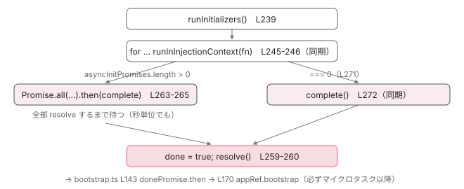

[目次](../README.md) › [起動の全手順](README.md) › 第 9 回 / 全 13 回

# APP\_INITIALIZER：描画の前に待つもの

> ApplicationInitStatus.runInitializers → donePromise。Promise を返す初期化処理が終わるまで、ルートコンポーネントは作られない。PendingTasks との関係も。

angular/angular · 読了 約 10 分 · 中核 · [サイトで読む（デモが動きます）](https://angular-deep-dive-cyan.vercel.app/chapter/boot-app-initializer)

---

「`APP_INITIALIZER` で Promise を返すと、それが終わるまでアプリは起動しない」と聞いたことがあるはずです。この章では「起動しない」が具体的に**どの関数のどの行で止まっているのか**を見ます。`ApplicationInitStatus.runInitializers()` が初期化関数をどう呼び、`donePromise` がいつ resolve し、その間 `<app-root>` と `isStable` がどうなっているかを追います。

読む対象は `packages/core/src/application/application_init.ts` と、前章で読んだ `packages/core/src/platform/bootstrap.ts` の 137〜181 行目です。

1. ng コマンド起動
2. builder の解決
3. dev-server と Vite
4. application builder
5. index.html の生成
6. ブラウザが main.js を実行
7. bootstrapApplication
8. 2 段の DI 木
9. **APP\_INITIALIZER**（この章）
10. ApplicationRef.bootstrap
11. 最初の描画
12. クリック→再描画
13. SPA のページ遷移

## 1. 呼び出し元：bootstrap() の 4 行

📄 `angular/packages/core/src/platform/bootstrap.ts` L137–144 （▶ の行: 139–141, 143–144）

```ts
137 │     return _callAndReportToErrorHandler(exceptionHandler, ngZone, () => {
138 │       const pendingTasks = envInjector.get(PendingTasksInternal);
139 ▶       const taskId = pendingTasks.add();
140 ▶       const initStatus = envInjector.get(ApplicationInitStatus);
141 ▶       initStatus.runInitializers();
142 │ 
143 ▶       return initStatus.donePromise
144 ▶         .then(() => {
```

前章で見た箇所です。139 行目で `PendingTasks` に 1 件積み、140 行目で `ApplicationInitStatus` を環境インジェクタから取り出し（ここで初めて new される）、141 行目で `runInitializers()`。143 行目の `donePromise.then` の中に、`appRef.bootstrap(rootComponent)`（170 行目）があります。つまり**ルートコンポーネントの生成は `donePromise` が resolve するまで 1 行も進みません**。

## 2. トークンと provideAppInitializer

📄 `angular/packages/core/src/application/application_init.ts` L150–152 （▶ の行: 150–151）

```ts
150 ▶ export const APP_INITIALIZER = new InjectionToken<
151 ▶   ReadonlyArray<() => Observable<unknown> | Promise<unknown> | void>
152 │ >(ngDevMode ? 'Application Initializer' : '');
```

📄 `angular/packages/core/src/application/application_init.ts` L192–202 （▶ の行: 193, 197–199）

```ts
192 │ export function provideAppInitializer(
193 ▶   initializerFn: () => Observable<unknown> | Promise<unknown> | void,
194 │ ): EnvironmentProviders {
195 │   return makeEnvironmentProviders([
196 │     {
197 ▶       provide: APP_INITIALIZER,
198 ▶       multi: true,
199 ▶       useValue: initializerFn,
200 │     },
201 │   ]);
202 │ }
```

150〜152 行目、トークンの型は「`Observable` か `Promise` か `void` を返す関数」の **配列**です。197〜199 行目、`provideAppInitializer` は `multi: true` でその配列に 1 つ足すだけの関数です。`multi: true` なので、ライブラリがいくつ足してもあなたのものと共存します。

📄 `angular/packages/router/src/provide_router.ts` L469–477 （▶ の行: 471–472）

```ts
469 │ export function withDisabledInitialNavigation(): DisabledInitialNavigationFeature {
470 │   const providers = [
471 ▶     provideAppInitializer(() => {
472 ▶       inject(Router).setUpLocationChangeListener();
473 │     }),
474 │     {provide: INITIAL_NAVIGATION, useValue: InitialNavigation.Disabled},
475 │   ];
476 │   return routerFeature(RouterFeatureKind.DisabledInitialNavigationFeature, providers);
477 │ }
```

フレームワーク自身も使っています。471〜473 行目、Router の `withDisabledInitialNavigation()` は `provideAppInitializer` で「ルートコンポーネントより前に `setUpLocationChangeListener` を呼ぶ」を登録します。472 行目で `inject(Router)` と書けるのは、次節 246 行目の `runInInjectionContext` のおかげです。

## 3. ApplicationInitStatus：donePromise は生まれた瞬間に作られる

📄 `angular/packages/core/src/application/application_init.ts` L209–224 （▶ の行: 209, 216–220, 223–224）

```ts
209 ▶ @Service()
210 │ export class ApplicationInitStatus {
211 │   // Using non null assertion, these fields are defined below
212 │   // within the `new Promise` callback (synchronously).
213 │   private resolve!: (...args: any[]) => void;
214 │   private reject!: (...args: any[]) => void;
215 │ 
216 ▶   private initialized = false;
217 ▶   public readonly done = false;
218 ▶   public readonly donePromise: Promise<any> = new Promise((res, rej) => {
219 ▶     this.resolve = res;
220 ▶     this.reject = rej;
221 │   });
222 │ 
223 ▶   private readonly appInits = inject(APP_INITIALIZER, {optional: true}) ?? [];
224 ▶   private readonly injector = inject(Injector);
```

209 行目の `@Service()` は前章のとおり `providedIn: 'root'` なので、環境インジェクタに入ります。218〜221 行目、`donePromise` はフィールド初期化子で `new Promise` され、`resolve` / `reject` 関数をフィールドに保存します（213〜214 行目）。**Promise は `runInitializers` より前、インスタンス生成時点で存在します**。223 行目で `APP_INITIALIZER` の配列を `optional: true` で取り出し、無ければ空配列。224 行目で `Injector` を覚えます。217 行目の `done` は `false` から始まります。

## 4. runInitializers：全部呼んで、Promise.all で待つ

📄 `angular/packages/core/src/application/application_init.ts` L239–275 （▶ の行: 240, 244–249, 251, 257, 259–260, 263–264, 271–272, 274）

```ts
239 │   runInitializers() {
240 ▶     if (this.initialized) {
241 │       return;
242 │     }
243 │ 
244 ▶     const asyncInitPromises = [];
245 ▶     for (const appInits of this.appInits) {
246 ▶       const initResult = runInInjectionContext(this.injector, appInits);
247 ▶       if (isPromise(initResult)) {
248 ▶         asyncInitPromises.push(initResult);
249 ▶       } else if (isSubscribable(initResult)) {
250 │         const observableAsPromise = new Promise<void>((resolve, reject) => {
251 ▶           initResult.subscribe({complete: resolve, error: reject});
252 │         });
253 │         asyncInitPromises.push(observableAsPromise);
254 │       }
255 │     }
256 │ 
257 ▶     const complete = () => {
258 │       // @ts-expect-error overwriting a readonly
259 ▶       this.done = true;
260 ▶       this.resolve();
261 │     };
262 │ 
263 ▶     Promise.all(asyncInitPromises)
264 ▶       .then(() => {
265 │         complete();
266 │       })
267 │       .catch((e) => {
268 │         this.reject(e);
269 │       });
270 │ 
271 ▶     if (asyncInitPromises.length === 0) {
272 ▶       complete();
273 │     }
274 ▶     this.initialized = true;
275 │   }
```

1. **240〜242 行目：2 回目は何もしない**

   `initialized` フラグで 1 回限りにしています。274 行目で立てます。
2. **245〜246 行目：初期化関数を順番に、同期的に呼ぶ**

   `for` ループで配列の順に呼びます。246 行目の `runInInjectionContext(this.injector, fn)` により、関数の中で `inject()` が使えます。**呼び出しは全部同期**で、1 つ目が Promise を返しても それを待たずに 2 つ目を呼びます。初期化関数は**並行**に走ります。
3. **247〜248 行目：Promise なら集める**

   `isPromise`（`then` を持つか）で判定し、`asyncInitPromises` に積みます。
4. **249〜254 行目：Observable なら complete を待つ Promise に包む**

   251 行目、`subscribe({complete: resolve, error: reject})`。`next` は見ていません。値が流れても **`complete` しない Observable を返すと永久に起動しません**。`HttpClient.get()` は 1 回 next して complete するので問題ありません。
5. **263〜269 行目：Promise.all → complete() または reject**

   全部 resolve すれば 264〜265 行目で `complete()`、どれか 1 つが reject すれば 268 行目で `this.reject(e)`。`complete()`（257〜261 行目）は `done = true` にして 3 節の `resolve` を呼びます。
6. **271〜273 行目：非同期が 1 つも無ければ即 complete()**

   `asyncInitPromises` が空なら、`Promise.all` を待たずにその場で `complete()`。`done` は `runInitializers()` から戻る前に `true` になります。ただし bootstrap.ts 143 行目の `.then` はそれでもマイクロタスク後なので、`appRef.bootstrap` が同期的に呼ばれることはありません。



*runInitializers の 2 つの出口。左は Promise/Observable が 1 つ以上あるとき、右は無いとき。どちらも appRef.bootstrap は donePromise.then の後。*

## 5. 待っている間に起きていること

📄 `angular/packages/core/src/platform/bootstrap.ts` L162–181 （▶ の行: 168, 170, 178）

```ts
162 │           if (typeof ngDevMode === 'undefined' || ngDevMode) {
163 │             const imagePerformanceService = envInjector.get(ImagePerformanceWarning);
164 │             imagePerformanceService.start();
165 │           }
166 │ 
167 │           if (isApplicationBootstrapConfig(config)) {
168 ▶             const appRef = envInjector.get(ApplicationRef);
169 │             if (config.rootComponent !== undefined) {
170 ▶               appRef.bootstrap(config.rootComponent);
171 │             }
172 │             return appRef;
173 │           } else {
174 │             moduleBootstrapImpl?.(config.moduleRef, config.allPlatformModules);
175 │             return config.moduleRef;
176 │           }
177 │         })
178 ▶         .finally(() => void pendingTasks.remove(taskId));
179 │     });
180 │   });
181 │ }
```

168〜170 行目が `donePromise` の後です。それまで `ApplicationRef` も作られていません。`<app-root>` の中身は、[index.html の章](05-boot-index-html.md)で見た HTML に書いてあるもの（通常は空、SSR なら事前描画の HTML）のままです。画面に「Loading...」を出したいなら `index.html` の `<app-root>` の中に書く、という定番の手法はここから来ています。

📄 `angular/packages/core/src/pending_tasks_internal.ts` L48–69 （▶ の行: 48, 50–51, 53–54, 63–64, 66–67）

```ts
48 ▶   add(): number {
49 │     // Emitting a value to a closed subject throws an error.
50 ▶     if (!this.hasPendingTasks && !this.destroyed) {
51 ▶       this.pendingTask.next(true);
52 │     }
53 ▶     const taskId = this.taskId++;
54 ▶     this.pendingTasks.add(taskId);
55 │     this.debugTaskTracker?.add(taskId);
56 │     return taskId;
57 │   }
58 │ 
59 │   has(taskId: number): boolean {
60 │     return this.pendingTasks.has(taskId);
61 │   }
62 │ 
63 ▶   remove(taskId: number): void {
64 ▶     this.pendingTasks.delete(taskId);
65 │     this.debugTaskTracker?.remove(taskId);
66 ▶     if (this.pendingTasks.size === 0 && this.hasPendingTasks) {
67 ▶       this.pendingTask.next(false);
68 │     }
69 │   }
```

📄 `angular/packages/core/src/application/application_ref.ts` L320–328 （▶ の行: 320, 325, 327）

```ts
320 ▶   private internalPendingTask = inject(PendingTasksInternal);
321 │ 
322 │   /**
323 │    * Returns an Observable that indicates when the application is stable or unstable.
324 │    */
325 ▶   public get isStable(): Observable<boolean> {
326 │     // This is a getter because it might be invoked after the application has been destroyed.
327 ▶     return this.internalPendingTask.hasPendingTasksObservable.pipe(map((pending) => !pending));
328 │   }
```

1 節 139 行目の `pendingTasks.add()` は 48〜57 行目です。50〜51 行目、タスクが 0 件から 1 件になる瞬間に `pendingTask`（`BehaviorSubject`）へ `true` を流します。327 行目のとおり `ApplicationRef.isStable` はこれを反転したものなので、**初期化を待っている間 `isStable` は `false`** です。178 行目の `finally` で `remove(taskId)`（63〜69 行目）が呼ばれ、66〜67 行目で 0 件になれば `false` を流して安定に戻ります。テストの `fixture.whenStable()` や SSR の描画完了判定は、この仕組みの上に乗っています （[PendingTasks の章](../zoneless/09-zoneless-pending-tasks.md)）。

## 6. 保険：ApplicationRef.bootstrap 側のガード

📄 `angular/packages/core/src/application/application_ref.ts` L464–483 （▶ の行: 470, 472, 477, 482）

```ts
464 │   ): ComponentRef<C> {
465 │     const ngZone = this._injector.get(NgZone);
466 │     return ngZone.run(() => {
467 │       profiler(ProfilerEvent.BootstrapComponentStart);
468 │ 
469 │       (typeof ngDevMode === 'undefined' || ngDevMode) && warnIfDestroyed(this._destroyed);
470 ▶       const initStatus = this._injector.get(ApplicationInitStatus);
471 │ 
472 ▶       if (!initStatus.done) {
473 │         let errorMessage = '';
474 │         if (typeof ngDevMode === 'undefined' || ngDevMode) {
475 │           const standalone = isStandalone(component);
476 │           errorMessage =
477 ▶             'Cannot bootstrap as there are still asynchronous initializers running.' +
478 │             (standalone
479 │               ? ''
480 │               : ' Bootstrap components in the `ngDoBootstrap` method of the root module.');
481 │         }
482 ▶         throw new RuntimeError(RuntimeErrorCode.ASYNC_INITIALIZERS_STILL_RUNNING, errorMessage);
483 │       }
```

次章で読む `ApplicationRef.bootstrapImpl` の冒頭です。470 行目で同じ `ApplicationInitStatus` を取り出し、472 行目で `done` が `false` なら 482 行目で `NG0405: Cannot bootstrap as there are still asynchronous initializers running` を投げます。`bootstrap()` 経由なら `donePromise.then` の後なので通りますが、`createApplication()` で得た `appRef` に対して自分で早すぎる `bootstrap()` を呼ぶと、ここで止まります。

## 7. 失敗したとき

📄 `angular/packages/core/src/platform/bootstrap.ts` L217–238 （▶ の行: 224–226, 228）

```ts
217 │ function _callAndReportToErrorHandler(
218 │   errorHandler: (e: unknown) => void,
219 │   ngZone: NgZone,
220 │   callback: () => any,
221 │ ): any {
222 │   try {
223 │     const result = callback();
224 ▶     if (isPromise(result)) {
225 ▶       return result.catch((e: any) => {
226 ▶         ngZone.runOutsideAngular(() => errorHandler(e));
227 │         // rethrow as the exception handler might not do it
228 ▶         throw e;
229 │       });
230 │     }
231 │ 
232 │     return result;
233 │   } catch (e) {
234 │     ngZone.runOutsideAngular(() => errorHandler(e));
235 │     // rethrow as the exception handler might not do it
236 │     throw e;
237 │   }
238 │ }
```

4 節 268 行目の `this.reject(e)` で `donePromise` が reject されると、bootstrap.ts 143 行目の `.then` はスキップされ、`appRef.bootstrap` は呼ばれません。reject はそのまま 224〜229 行目に届き、226 行目で `ErrorHandler` へ、228 行目で再 throw。結果として `bootstrapApplication(...).catch(...)` に届きます。画面は空のまま、コンソールにエラーが 1 回出ます。

## 8. ENVIRONMENT\_INITIALIZER との違い

📄 `angular/packages/core/src/di/r3_injector.ts` L426–455 （▶ の行: 426, 436, 446–447）

```ts
426 ▶   resolveInjectorInitializers() {
427 │     const prevConsumer = setActiveConsumer(null);
428 │     const previousInjector = setCurrentInjector(this);
429 │     const previousInjectImplementation = setInjectImplementation(undefined);
430 │     let prevInjectContext: InjectorProfilerContext | undefined;
431 │     if (ngDevMode) {
432 │       prevInjectContext = setInjectorProfilerContext({injector: this, token: null});
433 │     }
434 │ 
435 │     try {
436 ▶       const initializers = this.get(ENVIRONMENT_INITIALIZER, EMPTY_ARRAY, {self: true});
437 │       if (ngDevMode && !Array.isArray(initializers)) {
438 │         throw new RuntimeError(
439 │           RuntimeErrorCode.INVALID_MULTI_PROVIDER,
440 │           'Unexpected type of the `ENVIRONMENT_INITIALIZER` token value ' +
441 │             `(expected an array, but got ${typeof initializers}). ` +
442 │             'Please check that the `ENVIRONMENT_INITIALIZER` token is configured as a ' +
443 │             '`multi: true` provider.',
444 │         );
445 │       }
446 ▶       for (const initializer of initializers) {
447 ▶         initializer();
448 │       }
449 │     } finally {
450 │       setCurrentInjector(previousInjector);
451 │       setInjectImplementation(previousInjectImplementation);
452 │       ngDevMode && setInjectorProfilerContext(prevInjectContext!);
453 │       setActiveConsumer(prevConsumer);
454 │     }
455 │   }
```

似た名前の `ENVIRONMENT_INITIALIZER` は `R3Injector.resolveInjectorInitializers`（426 行目）が実行します。436 行目で `self: true`（親を見ない）で配列を取り出し、446〜447 行目で**同期的に呼ぶだけ**。返り値は見ません。Promise を返しても誰も待ちません。呼ばれるタイミングは [7 章](07-boot-bootstrap-application.md)で見た bootstrap.ts 90 行目、`runInitializers`（141 行目）より前です。「待たせたい」なら `APP_INITIALIZER`、「インジェクタができたら即、同期で何かしたい」なら `ENVIRONMENT_INITIALIZER`、という使い分けです。

> **🧪 DEMO — 初期化関数の返り値で、起動の順番がどう変わるか**
>
> `runInitializers`（application\_init.ts L239-275）と `bootstrap()`（bootstrap.ts L137-181）を上から順にたどった結果です。
>
> ▶ [このデモはサイトで動かせます](https://angular-deep-dive-cyan.vercel.app/chapter/boot-app-initializer)

## ここまでの呼び出し

- `bootstrap(config)` — core/src/platform/bootstrap.ts L81
  - `pendingTasks.add()` — bootstrap.ts L139 → pending\_tasks\_internal.ts L48 — *isStable が false に*
  - `envInjector.get(ApplicationInitStatus)` — bootstrap.ts L140 — *ここで new。donePromise も同時に生成（L218）*
  - `initStatus.runInitializers()` — application\_init.ts L239
    - 👤 `runInInjectionContext(injector, yourInitializer)` × 件数 — application\_init.ts L246 — *同期。Promise/Observable なら集める*
    - `Promise.all(asyncInitPromises).then(complete)` — application\_init.ts L263 — *0 件なら L272 で即 complete()*
      - `complete()` → `done = true; resolve()` — application\_init.ts L257-261
  - `initStatus.donePromise.then(...)` — bootstrap.ts L143 — *── 非同期 ──*
    - `envInjector.get(ApplicationRef)` → `appRef.bootstrap(rootComponent)` — bootstrap.ts L168-170 — *次章*
  - `.finally(() => pendingTasks.remove(taskId))` — bootstrap.ts L178 — *isStable が true に戻る*

## 聞かれそうな質問

**Q. APP\_INITIALIZER が Promise を返したら、画面はいつ出ますか？**

その Promise（複数なら全部）が resolve した後です。application\_init.ts 263〜265 行目の `Promise.all(...).then(complete)` で `donePromise` が resolve し、bootstrap.ts 143 行目の `.then` が動いて 170 行目で `appRef.bootstrap` が呼ばれます。それまで `<app-root>` は index.html に書いたままです。

**Q. 初期化関数が 2 つあると、順番に待ちますか？**

いいえ、並行です。245〜246 行目の `for` は返り値を `await` せずに次を呼び、集めた Promise を 263 行目で `Promise.all` にまとめます。待ち時間は「最も遅い 1 つ」の分だけです。順番に依存させたいなら 1 つの関数の中で `await` してください。

**Q. 初期化関数の中で inject() は使えますか？**

使えます。246 行目で `runInInjectionContext(this.injector, fn)` として呼ばれるからです。`this.injector` は 224 行目の `inject(Injector)`、つまり環境インジェクタです。Router 自身も provide\_router.ts 472 行目で `inject(Router)` と書いています。

**Q. Observable を返したときは何を待ちますか？**

`complete` です。251 行目で `subscribe({complete: resolve, error: reject})` と書かれており、`next` は無視されます。`interval()` や `Subject` のように complete しないものを返すと 永久に起動しません。`HttpClient` の Observable は 1 回 next して complete するので大丈夫です。

**Q. 初期化関数が reject / throw したら？**

reject は 267〜268 行目で `this.reject(e)` → `donePromise` が reject → bootstrap.ts 224〜229 行目で `ErrorHandler` に報告されて再 throw → `bootstrapApplication` の Promise が reject。`appRef.bootstrap` は呼ばれず、画面は空のままです。同期的な throw は 246 行目で `runInitializers` 自体から投げられ、bootstrap.ts 233〜236 行目の `catch` で同様に処理されます。

**Q. 待っている間、アプリは「安定（stable）」ですか？**

不安定です。bootstrap.ts 139 行目で `PendingTasksInternal.add()` が呼ばれ、pending\_tasks\_internal.ts 50〜51 行目で `true`（タスクあり）が流れます。application\_ref.ts 327 行目の `isStable` はその反転なので `false`。178 行目の `finally` で `remove` されるまで続きます。

## 読み終えて

- `APP_INITIALIZER` は `multi: true` の関数配列。`provideAppInitializer` はそれに 1 つ足すだけ
- `runInitializers` は全関数を同期で順に呼び、Promise/Observable（complete）を `Promise.all` で待って `done = true` + `resolve()`。非同期が無ければ即 complete
- `appRef.bootstrap` は `donePromise.then` の中。初期化が終わるまでルートコンポーネントは作られず、`<app-root>` は index.html のまま
- 待っている間は `PendingTasks` に 1 件あるので `isStable` は `false`
- `ENVIRONMENT_INITIALIZER` は同期で呼ばれるだけで、返り値は待たれない

---

← 前: [2 段の DI 木：プラットフォームと環境](08-boot-injectors.md)  
次: [ApplicationRef.bootstrap：&lt;app-root&gt; にルートが刺さるまで](10-boot-application-ref.md) →
