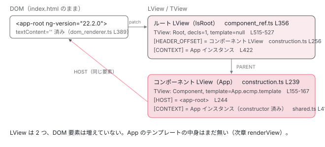

[目次](../README.md) › [起動の全手順](README.md) › 第 10 回 / 全 13 回

# ApplicationRef.bootstrap：&lt;app-root&gt; にルートが刺さるまで

> ComponentFactory.create → locateHostElement → createRootTView → createLView。空だった &lt;app-root&gt; が、コンポーネントのホスト要素になる手順。

angular/angular · 読了 約 14 分 · 中核 · [サイトで読む（デモが動きます）](https://angular-deep-dive-cyan.vercel.app/chapter/boot-application-ref)

---

`donePromise` が resolve し、`appRef.bootstrap(App)` が呼ばれました。この章では、index.html に書いてあった空の `<app-root></app-root>` が **どう見つけられ、どう `App` のホスト要素になるか**を追います。結論を先に言うと、`<app-root>` は置き換えられません。同じ要素がそのまま使われ、中身だけが入ります。その根拠となる行を 1 つずつ指します。

読む対象は `packages/core/src/application/application_ref.ts`（`bootstrapImpl`）と `packages/core/src/render3/component_ref.ts`（`ComponentFactory.create`）です。テンプレートの実行（`renderView`）は[次章](11-boot-first-render.md)に分けます。

1. ng コマンド起動
2. builder の解決
3. dev-server と Vite
4. application builder
5. index.html の生成
6. ブラウザが main.js を実行
7. bootstrapApplication
8. 2 段の DI 木
9. APP\_INITIALIZER
10. **ApplicationRef.bootstrap**（この章）
11. 最初の描画
12. クリック→再描画
13. SPA のページ遷移

## 1. bootstrap → bootstrapImpl：ComponentFactory を作って create を呼ぶ

📄 `angular/packages/core/src/application/application_ref.ts` L448–450 （▶ の行: 448–449）

```ts
448 ▶   bootstrap<C>(component: Type<C>, rootSelectorOrNode?: string | any): ComponentRef<C> {
449 ▶     return this.bootstrapImpl(component, rootSelectorOrNode);
450 │   }
```

📄 `angular/packages/core/src/application/application_ref.ts` L452–466 （▶ の行: 452, 463, 465–466）

```ts
452 ▶   private bootstrapImpl<C>(
453 │     component: Type<C>,
454 │     hostElementOrOptions?:
455 │       | Element
456 │       | string
457 │       | undefined
458 │       | {
459 │           hostElement?: Element | string | undefined;
460 │           directives?: (Type<unknown> | DirectiveWithBindings<unknown>)[];
461 │           bindings?: Binding[];
462 │         },
463 ▶     injector: Injector = Injector.NULL,
464 │   ): ComponentRef<C> {
465 ▶     const ngZone = this._injector.get(NgZone);
466 ▶     return ngZone.run(() => {
```

📄 `angular/packages/core/src/application/application_ref.ts` L484–521 （▶ の行: 485–487, 491–494, 496–497, 501, 511, 514, 519）

```ts
484 │ 
485 ▶       const componentDef = getComponentDef(component)!;
486 ▶       const ngModule = this._injector.get(NgModuleRef);
487 ▶       const componentFactory = new ComponentFactory<C>(componentDef, ngModule);
488 │       this.componentTypes.push(component);
489 │ 
490 │       // Create a factory associated with the current module if it's not bound to some other
491 ▶       const {hostElement, directives, bindings} = normalizeBootstrapOptions(hostElementOrOptions);
492 ▶       const selectorOrNode = hostElement || componentFactory.selector;
493 ▶       const compRef = componentFactory.create(
494 ▶         injector,
495 │         [],
496 ▶         selectorOrNode,
497 ▶         ngModule.injector,
498 │         directives,
499 │         bindings,
500 │       );
501 ▶       const nativeElement = compRef.location.nativeElement;
502 │       const testability = compRef.injector.get(TESTABILITY, null);
503 │       testability?.registerApplication(nativeElement);
504 │ 
505 │       compRef.onDestroy(() => {
506 │         this.detachView(compRef.hostView);
507 │         remove(this.components, compRef);
508 │         testability?.unregisterApplication(nativeElement);
509 │       });
510 │ 
511 ▶       this._loadComponent(compRef);
512 │       if (typeof ngDevMode === 'undefined' || ngDevMode) {
513 │         const _console = this._injector.get(Console);
514 ▶         _console.log(`Angular is running in development mode.`);
515 │       }
516 │ 
517 │       profiler(ProfilerEvent.BootstrapComponentEnd, compRef);
518 │ 
519 ▶       return compRef;
520 │     });
521 │   }
```

448〜449 行目、公開 API の `bootstrap` は `bootstrapImpl` に委譲するだけです。463 行目、第 3 引数 `injector` の既定値は `Injector.NULL`。465〜466 行目で `NgZone` を取り出して `ngZone.run` に入り、前章で読んだ `initStatus.done` のガードを通った続きが、2 つ目の引用です。

1. **485 行目：コンパイル済みの定義を取り出す**

   `getComponentDef(App)` は `App.ɵcmp` を返します。AOT コンパイラがクラスに静的プロパティとして埋め込んだ `ComponentDef` で、`selectors`、`template`（テンプレート関数）、`decls`、`vars` などを持ちます （[テンプレート関数の章](../ivy/03-ivy-template-function.md)）。
2. **486〜487 行目：NgModuleRef を取り出して ComponentFactory を作る**

   `this._injector.get(NgModuleRef)` は、[7 章](07-boot-bootstrap-application.md)で `EnvironmentNgModuleRefAdapter` が自分自身を登録したものです（ng\_module\_ref.ts 131 行目）。`new ComponentFactory(componentDef, ngModule)` で工場を作ります。
3. **491〜492 行目：セレクタを決める**

   `hostElementOrOptions` は渡されていないので `hostElement` は `undefined`。492 行目で `componentFactory.selector`、つまり `'app-root'` が使われます（次の引用）。
4. **493〜500 行目：create**

   第 1 引数は 463 行目の既定値 `Injector.NULL`、第 3 引数が `'app-root'`、第 4 引数が `ngModule.injector`（環境インジェクタ）です。この 1 呼び出しが本章の中心です（2〜6 節）。
5. **501〜511 行目：後処理**

   501 行目で `compRef.location.nativeElement`（= `<app-root>`）を取り、Testability があれば登録。511 行目の `_loadComponent` が `ApplicationRef` への登録と最初の `tick()` です（7 節）。514 行目の「Angular is running in development mode.」はここで出ています。

📄 `angular/packages/core/src/render3/component_ref.ts` L256–264 （▶ の行: 260–261）

```ts
256 │   constructor(
257 │     private componentDef: ComponentDef<any>,
258 │     private ngModule?: NgModuleRef<any>,
259 │   ) {
260 ▶     this.componentType = componentDef.type as Type<any>;
261 ▶     this.selector = stringifyCSSSelectorList(componentDef.selectors);
262 │     this.ngContentSelectors = componentDef.ngContentSelectors ?? [];
263 │     this.isBoundToModule = !!ngModule;
264 │   }
```

261 行目、`selector` は `componentDef.selectors` を CSS セレクタ文字列に戻したものです。`@Component({ selector: 'app-root' })` と書いたから `'app-root'` になります。書かなければ、後で見るように `document.querySelector` が失敗して起動できません。

## 2. ComponentFactory.create：ルートビュー用のインジェクタと環境

📄 `angular/packages/core/src/render3/component_ref.ts` L266–288 （▶ の行: 278, 282, 284–285, 287）

```ts
266 │   create(
267 │     injector: Injector,
268 │     projectableNodes?: any[][] | undefined,
269 │     rootSelectorOrNode?: any,
270 │     environmentInjector?: NgModuleRef<any> | EnvironmentInjector | undefined,
271 │     directives?: (Type<unknown> | DirectiveWithBindings<unknown>)[],
272 │     componentBindings?: Binding[],
273 │     hostElementNamespace?: string | null,
274 │     allowNonStandaloneDirectives?: boolean,
275 │   ): AbstractComponentRef<T> {
276 │     profiler(ProfilerEvent.DynamicComponentStart);
277 │ 
278 ▶     const prevConsumer = setActiveConsumer(null);
279 │     try {
280 │       const cmpDef = this.componentDef;
281 │       ngDevMode && verifyNotAnOrphanComponent(cmpDef);
282 ▶       const rootViewInjector = createRootViewInjector(
283 │         cmpDef,
284 ▶         environmentInjector || this.ngModule,
285 ▶         injector,
286 │       );
287 ▶       const environment = createRootLViewEnvironment(rootViewInjector);
288 │       const tracingService = environment.tracingService;
```

278 行目で `setActiveConsumer(null)`。コンポーネント生成中に signal を読んでも、外側の reactive context に 依存として記録されないようにしています。282〜286 行目で `createRootViewInjector`、287 行目で `createRootLViewEnvironment`。前者は `Injector.NULL` と環境インジェクタを連結した `ChainedInjector` を返す関数で、standalone コンポーネントの `imports` に NgModule があれば その providers を持つインジェクタも挟みます（[DI の章](../di/10-di.md)）。後者を読みます。

📄 `angular/packages/core/src/render3/component_ref.ts` L147–175 （▶ の行: 148–149, 159–160, 168–171）

```ts
147 │ function createRootLViewEnvironment(rootLViewInjector: Injector): LViewEnvironment {
148 ▶   const rendererFactory = rootLViewInjector.get(RendererFactory2, null);
149 ▶   if (rendererFactory === null) {
150 │     throw new RuntimeError(
151 │       RuntimeErrorCode.RENDERER_NOT_FOUND,
152 │       ngDevMode &&
153 │         'Angular was not able to inject a renderer (RendererFactory2). ' +
154 │           'Likely this is due to a broken DI hierarchy. ' +
155 │           'Make sure that any injector used to create this component has a correct parent.',
156 │     );
157 │   }
158 │ 
159 ▶   const sanitizer = rootLViewInjector.get(Sanitizer, null);
160 ▶   const changeDetectionScheduler = rootLViewInjector.get(ChangeDetectionScheduler, null);
161 │   const tracingService = rootLViewInjector.get(TracingService, null, {optional: true});
162 │ 
163 │   let ngReflect = false;
164 │   if (typeof ngDevMode === 'undefined' || ngDevMode) {
165 │     ngReflect = rootLViewInjector.get(NG_REFLECT_ATTRS_FLAG, NG_REFLECT_ATTRS_FLAG_DEFAULT);
166 │   }
167 │ 
168 ▶   return {
169 ▶     rendererFactory,
170 ▶     sanitizer,
171 ▶     changeDetectionScheduler,
172 │     ngReflect,
173 │     tracingService,
174 │   };
175 │ }
```

148 行目、`RendererFactory2` を取り出します。[7 章](07-boot-bootstrap-application.md)の `BROWSER_MODULE_PROVIDERS` 280 行目で `DomRendererFactory2` に結ばれていたものです。149〜157 行目、無ければ `NG0407` で止まります。159〜161 行目で `Sanitizer`、`ChangeDetectionScheduler`（zoneless の `ChangeDetectionSchedulerImpl`）、`TracingService` を取り出し、168〜174 行目で 1 つのオブジェクトにします。これが `LViewEnvironment` で、この後作る全ての LView が `lView[ENVIRONMENT]` として共有します。[12 章](12-boot-click-to-paint.md)で `lView[ENVIRONMENT].changeDetectionScheduler.notify(...)` と出てきたら、ここで入れた値です。

## 3. createRootTView：ホスト要素 1 つだけの TView

📄 `angular/packages/core/src/render3/component_ref.ts` L329–343 （▶ の行: 331–332, 339–341, 343）

```ts
329 │   ) {
330 │     const cmpDef = this.componentDef;
331 ▶     const rootTView = createRootTView(
332 ▶       rootSelectorOrNode,
333 │       cmpDef,
334 │       componentBindings,
335 │       directives,
336 │       allowNonStandaloneDirectives,
337 │     );
338 │ 
339 ▶     const hostRenderer = environment.rendererFactory.createRenderer(null, cmpDef);
340 ▶     const hostElement = rootSelectorOrNode
341 ▶       ? locateHostElement(hostRenderer, rootSelectorOrNode, cmpDef.encapsulation, rootViewInjector)
342 │       : createHostElement(cmpDef, hostRenderer, hostElementNamespace ?? null);
343 ▶     assertNotScriptHostElement(hostElement);
```

📄 `angular/packages/core/src/render3/component_ref.ts` L515–529 （▶ の行: 515–516, 518–519, 521, 525）

```ts
515 ▶   const rootTView = createTView(
516 ▶     TViewType.Root,
517 │     null,
518 ▶     getRootTViewTemplate(creationBindings, updateBindings),
519 ▶     1,
520 │     varsToAllocate,
521 ▶     directivesToApply,
522 │     null,
523 │     null,
524 │     null,
525 ▶     [tAttributes],
526 │     null,
527 │   );
528 │ 
529 │   return rootTView;
```

331〜337 行目で `createRootTView`。515〜527 行目がその中身で、`createTView` を `TViewType.Root`（516 行目）、宣言ノード数 `1`（519 行目）、ディレクティブ一覧は `[componentDef]`（521 行目の `directivesToApply`）で呼びます。518 行目の `getRootTViewTemplate` は、`bindings` や `directives` を渡していない今回は `null` を返します。**ルート TView にテンプレート関数は無く、ノードは `<app-root>` 1 つだけ**です。525 行目の `tAttributes` は 449〜450 行目の `['ng-version', '0.0.0-PLACEHOLDER']`。ビルド時に実際のバージョン番号に置き換えられ、`<app-root ng-version="22.2.0">` の正体になります。

## 4. locateHostElement：&lt;app-root&gt; を見つけて中身を空にする

339 行目で `rendererFactory.createRenderer(null, cmpDef)`、ホスト要素を扱うレンダラです。340〜342 行目、`rootSelectorOrNode`（`'app-root'`）があるので `locateHostElement`、無ければ `createHostElement` で新しい要素を作ります（動的生成の経路）。

📄 `angular/packages/core/src/render3/instructions/shared.ts` L162–185 （▶ の行: 174, 178–180, 182–184）

```ts
162 │ export function locateHostElement(
163 │   renderer: Renderer,
164 │   elementOrSelector: RElement | string,
165 │   encapsulation: ViewEncapsulation,
166 │   injector: Injector,
167 │ ): RElement {
168 │   // Note: we use default value for the `PRESERVE_HOST_CONTENT` here even though it's a
169 │   // tree-shakable one (providedIn:'root'). This code path can be triggered during dynamic
170 │   // component creation (after calling ViewContainerRef.createComponent) when an injector
171 │   // instance can be provided. The injector instance might be disconnected from the main DI
172 │   // tree, thus the `PRESERVE_HOST_CONTENT` would not be able to instantiate. In this case, the
173 │   // default value will be used.
174 ▶   const preserveHostContent = injector.get(PRESERVE_HOST_CONTENT, PRESERVE_HOST_CONTENT_DEFAULT);
175 │ 
176 │   // When using native Shadow DOM, do not clear host element to allow native slot
177 │   // projection.
178 ▶   const preserveContent =
179 ▶     preserveHostContent ||
180 ▶     encapsulation === ViewEncapsulation.ShadowDom ||
181 │     encapsulation === ViewEncapsulation.ExperimentalIsolatedShadowDom;
182 ▶   const rootElement = renderer.selectRootElement(elementOrSelector, preserveContent);
183 ▶   applyRootElementTransform(rootElement as HTMLElement);
184 ▶   return rootElement;
185 │ }
```

📄 `angular/packages/platform-browser/src/dom/dom_renderer.ts` L378–392 （▶ の行: 379–382, 388–389, 391）

```ts
378 │   selectRootElement(selectorOrNode: string | any, preserveContent?: boolean): any {
379 ▶     let el: any =
380 ▶       typeof selectorOrNode === 'string' ? this.doc.querySelector(selectorOrNode) : selectorOrNode;
381 ▶     if (!el) {
382 ▶       throw new RuntimeError(
383 │         RuntimeErrorCode.ROOT_NODE_NOT_FOUND,
384 │         (typeof ngDevMode === 'undefined' || ngDevMode) &&
385 │           `The selector "${selectorOrNode}" did not match any elements`,
386 │       );
387 │     }
388 ▶     if (!preserveContent) {
389 ▶       el.textContent = '';
390 │     }
391 ▶     return el;
392 │   }
```

182 行目で `renderer.selectRootElement('app-root', preserveContent)`。`DomRenderer` の実装が 378〜392 行目です。

1. **379〜380 行目：document.querySelector('app-root')**

   文字列なので `this.doc.querySelector`。`this.doc` は `DOCUMENT` トークン、[8 章](08-boot-injectors.md)で見たプラットフォームインジェクタの `_document()` が返した `document` です。index.html に `<app-root>` が無ければ 381〜387 行目で `NG0-ROOT_NODE_NOT_FOUND: The selector "app-root" did not match any elements` が投げられます。
2. **388〜390 行目：textContent = ''**

   `preserveContent` が `false` なら中身を空にします。174〜181 行目、`preserveContent` は `PRESERVE_HOST_CONTENT` トークン （hydration が有効なとき `true`）か ShadowDom のときだけ `true` です。通常の CSR では index.html に書いた「Loading...」はここで消えます。
3. **391 行目：同じ要素を返す**

   新しい要素は作っていません。**index.html にあった `<app-root>` そのものが `hostElement`** です。183 行目の `applyRootElementTransform` は hydration 用の処理で、無効なら何もしません。

## 5. createLView：ルート LView とホスト TNode

📄 `angular/packages/core/src/render3/component_ref.ts` L356–368 （▶ の行: 356, 358, 360, 363–365）

```ts
356 ▶     const rootLView = createLView<T>(
357 │       null,
358 ▶       rootTView,
359 │       null,
360 ▶       LViewFlags.IsRoot | getInitialLViewFlagsFromDef(cmpDef),
361 │       null,
362 │       null,
363 ▶       environment,
364 ▶       hostRenderer,
365 ▶       rootViewInjector,
366 │       null,
367 │       retrieveHydrationInfo(hostElement, rootViewInjector, true /* isRootView */),
368 │     );
```

📄 `angular/packages/core/src/render3/view/construction.ts` L185–194 （▶ の行: 186, 188, 190–191, 193–194）

```ts
185 │ ): LView<T> {
186 ▶   const lView = tView.blueprint.slice() as LView;
187 │   lView[HOST] = host;
188 ▶   lView[FLAGS] =
189 │     flags |
190 ▶     LViewFlags.CreationMode |
191 ▶     LViewFlags.Attached |
192 │     LViewFlags.FirstLViewPass |
193 ▶     LViewFlags.Dirty |
194 ▶     LViewFlags.RefreshView;
```

356〜368 行目で**ルート LView**を作ります。360 行目に `LViewFlags.IsRoot`、363〜365 行目に 2 節の環境、ホスト用レンダラ、ルートビューインジェクタ。186 行目、LView は TView の `blueprint` 配列のコピーから始まります （[blueprint の章](../ivy/07-ivy-blueprint.md)）。188〜194 行目のフラグに注目してください。`CreationMode`（まだ creation pass 前）、`Dirty`、`RefreshView` が最初から立っています。次章で「最初の `tick` がなぜこのビューを更新するか」の答えになります。

📄 `angular/packages/core/src/render3/component_ref.ts` L384–424 （▶ の行: 384, 391, 396–397, 401, 407–408, 411–413, 419, 422, 424）

```ts
384 ▶     rootLView[HEADER_OFFSET] = hostElement;
385 │ 
386 │     // rootView is the parent when bootstrapping
387 │     // TODO(misko): it looks like we are entering view here but we don't really need to as
388 │     // `renderView` does that. However as the code is written it is needed because
389 │     // `createRootComponentView` and `createRootComponent` both read global state. Fixing those
390 │     // issues would allow us to drop this.
391 ▶     enterView(rootLView);
392 │ 
393 │     let componentView: LView | null = null;
394 │ 
395 │     try {
396 ▶       const hostTNode = directiveHostFirstCreatePass(
397 ▶         HEADER_OFFSET,
398 │         rootLView,
399 │         TNodeType.Element,
400 │         TNodeName.DynamicHost,
401 ▶         () => rootTView.directiveRegistry,
402 │         true,
403 │         0,
404 │       );
405 │ 
406 │       // ---- element instruction
407 ▶       setupStaticAttributes(hostRenderer, hostElement, hostTNode);
408 ▶       attachPatchData(hostElement, rootLView);
409 │ 
410 │       // TODO(pk): this logic is similar to the instruction code where a node can have directives
411 ▶       createDirectivesInstances(rootTView, rootLView, hostTNode);
412 ▶       executeContentQueries(rootTView, hostTNode, rootLView);
413 ▶       directiveHostEndFirstCreatePass(rootTView, hostTNode);
414 │ 
415 │       if (projectableNodes !== undefined) {
416 │         projectNodes(hostTNode, this.ngContentSelectors, projectableNodes);
417 │       }
418 │ 
419 ▶       componentView = getComponentLViewByIndex(hostTNode.index, rootLView);
420 │ 
421 │       // TODO(pk): why do we need this logic?
422 ▶       rootLView[CONTEXT] = componentView[CONTEXT] as T;
423 │ 
424 ▶       renderView(rootTView, rootLView, null);
```

1. **384 行目：rootLView\[HEADER\_OFFSET\] = hostElement**

   LView のデータ領域の最初のスロットに `<app-root>` を置きます。ルート LView の唯一のノードです。
2. **391 行目：enterView(rootLView)**

   以降の命令が「今どの LView を処理中か」を知るためのグローバル状態（[LFrame の章](../ivy/15-ivy-lframe.md)）に入れます。この関数の末尾の `finally` で `leaveView()` します。
3. **396〜404 行目：ホスト TNode を作り、ディレクティブをマッチさせる**

   `directiveHostFirstCreatePass` が `TNodeType.Element` の TNode を作り、401 行目の `rootTView.directiveRegistry`（= `[App の componentDef]`）と照合します。3 節で `directivesToApply` に `componentDef` だけを入れたので、必ず `App` がマッチします。TNode の `flags` に「コンポーネントホスト」の印が付きます。
4. **407〜408 行目：静的属性を書き、DOM に LView を結びつける**

   `setupStaticAttributes` が 3 節の `ng-version` を `<app-root>` に書き込みます。`attachPatchData` は DOM 要素から LView を逆引きできるようにする処理で、DevTools や `ng.getComponent(el)` がこれを使います。
5. **411 行目：createDirectivesInstances ── App の constructor が走る**

   次の引用で中を見ます。ここが `new App()` に相当する場所です。
6. **419〜422 行目：コンポーネント LView を取り出し、CONTEXT を揃える**

   `getComponentLViewByIndex` でホスト TNode の位置にある子 LView（App のビュー）を取り、422 行目でルート LView の `CONTEXT` にも App のインスタンスを入れます。
7. **424 行目：renderView(rootTView, rootLView, null)**

   creation pass の開始。[次章](11-boot-first-render.md)の主題です。

## 6. createDirectivesInstances：コンポーネント LView を作ってから constructor

📄 `angular/packages/core/src/render3/instructions/shared.ts` L386–419 （▶ の行: 392, 394, 406–408, 415–417）

```ts
386 │ function instantiateAllDirectives(tView: TView, lView: LView, tNode: TDirectiveHostNode) {
387 │   const start = tNode.directiveStart;
388 │   const end = tNode.directiveEnd;
389 │ 
390 │   // The component view needs to be created before creating the node injector
391 │   // since it is used to inject some special symbols like `ChangeDetectorRef`.
392 ▶   if (isComponentHost(tNode)) {
393 │     ngDevMode && assertTNodeType(tNode, TNodeType.AnyRNode);
394 ▶     createComponentLView(
395 │       lView,
396 │       tNode as TElementNode,
397 │       tView.data[start + tNode.componentOffset] as ComponentDef<unknown>,
398 │     );
399 │   }
400 │ 
401 │   if (!tView.firstCreatePass) {
402 │     getOrCreateNodeInjectorForNode(tNode, lView);
403 │   }
404 │ 
405 │   const initialInputs = tNode.initialInputs;
406 ▶   for (let i = start; i < end; i++) {
407 ▶     const def = tView.data[i] as DirectiveDef<any>;
408 ▶     const directive = getNodeInjectable(lView, tView, i, tNode);
409 │     attachPatchData(directive, lView);
410 │ 
411 │     if (initialInputs !== null) {
412 │       setInputsFromAttrs(lView, i - start, directive, def, tNode, initialInputs!);
413 │     }
414 │ 
415 ▶     if (isComponentDef(def)) {
416 ▶       const componentView = getComponentLViewByIndex(tNode.index, lView);
417 ▶       componentView[CONTEXT] = getNodeInjectable(lView, tView, i, tNode);
418 │     }
419 │   }
```

411 行目から `instantiateAllDirectives` に入ります。392〜399 行目、TNode がコンポーネントホストなら **まず `createComponentLView`**。390〜391 行目のコメントどおり、コンストラクタで `inject(ChangeDetectorRef)` されたときに返すビューが先に必要だからです。

📄 `angular/packages/core/src/render3/view/construction.ts` L226–257 （▶ の行: 231–232, 237, 239, 244–245, 247, 256）

```ts
226 │ export function createComponentLView<T>(
227 │   lView: LView,
228 │   hostTNode: TElementNode,
229 │   def: ComponentDef<T>,
230 │ ): LView {
231 ▶   const native = getNativeByTNode(hostTNode, lView) as RElement;
232 ▶   const tView = getOrCreateComponentTView(def);
233 │ 
234 │   // Only component views should be added to the view tree directly. Embedded views are
235 │   // accessed through their containers because they may be removed / re-added later.
236 │   const rendererFactory = lView[ENVIRONMENT].rendererFactory;
237 ▶   const componentView = addToEndOfViewTree(
238 │     lView,
239 ▶     createLView(
240 │       lView,
241 │       tView,
242 │       null,
243 │       getInitialLViewFlagsFromDef(def),
244 ▶       native,
245 ▶       hostTNode as TElementNode,
246 │       null,
247 ▶       rendererFactory.createRenderer(native, def),
248 │       null,
249 │       null,
250 │       null,
251 │     ),
252 │   );
253 │ 
254 │   // Component view will always be created before any injected LContainers,
255 │   // so this is a regular element, wrap it with the component view
256 ▶   return (lView[hostTNode.index] = componentView);
257 │ }
```

📄 `angular/packages/core/src/render3/view/construction.ts` L146–171 （▶ の行: 147, 151, 155–156, 158–160）

```ts
146 │ export function getOrCreateComponentTView(def: ComponentDef<any>): TView {
147 ▶   const tView = def.tView;
148 │ 
149 │   // Create a TView if there isn't one, or recreate it if the first create pass didn't
150 │   // complete successfully since we can't know for sure whether it's in a usable shape.
151 ▶   if (tView === null || tView.incompleteFirstPass) {
152 │     // Declaration node here is null since this function is called when we dynamically create a
153 │     // component and hence there is no declaration.
154 │     const declTNode = null;
155 ▶     return (def.tView = createTView(
156 ▶       TViewType.Component,
157 │       declTNode,
158 ▶       def.template,
159 ▶       def.decls,
160 ▶       def.vars,
161 │       def.directiveDefs,
162 │       def.pipeDefs,
163 │       def.viewQuery,
164 │       def.schemas,
165 │       def.consts,
166 │       def.id,
167 │     ));
168 │   }
169 │ 
170 │   return tView;
171 │ }
```

231 行目、ホストの DOM 要素（`<app-root>`）を取り、232 行目で `getOrCreateComponentTView(def)`。147〜151 行目、`def.tView` がまだ無ければ 155〜167 行目で `createTView` します。今度は `TViewType.Component`（156 行目）で、158 行目の `def.template` が **あなたの App のテンプレート関数**です。`decls`・`vars` もコンパイラが数えた値が入ります。作った TView は `def.tView` にキャッシュされるので、同じコンポーネントを 100 回作っても TView は 1 つです （[TView の章](../ivy/05-ivy-tview.md)）。

239〜251 行目で**コンポーネント LView**を作ります。親は `lView`（ルート LView、239 行目の第 1 引数）、`host` は 244 行目の `native`（`<app-root>`）、247 行目で `<app-root>` 用の新しいレンダラ。237 行目の `addToEndOfViewTree` で ルート LView の子リストにつなぎ、256 行目で `lView[hostTNode.index] = componentView`。**ルート LView の HEADER\_OFFSET スロットは、384 行目で入れた DOM 要素から、コンポーネント LView に差し替わります** （DOM 要素は `componentView[HOST]` から取れます）。

戻って 406〜418 行目。408 行目の `getNodeInjectable` が `App` の factory（`App.ɵfac`）を呼び、**ここで `App` の constructor が実行されます**。`inject(...)` はこの瞬間に解決されます。415〜417 行目、作ったインスタンスをコンポーネント LView の `CONTEXT` に入れます。テンプレート関数の第 2 引数 `ctx` はこれです。



*appRef.bootstrap(App) 完了時点のデータ構造。index.html の &lt;app-root&gt; はそのまま、ルート LView とコンポーネント LView が 2 段で乗る。*

## 7. ComponentRef と \_loadComponent

📄 `angular/packages/core/src/render3/component_ref.ts` L591–605 （▶ の行: 597–601）

```ts
591 │   constructor(
592 │     componentType: Type<T>,
593 │     private readonly _rootLView: LView,
594 │     private readonly _hasInputBindings: boolean,
595 │   ) {
596 │     super();
597 ▶     this._tNode = getTNode(_rootLView[TVIEW], HEADER_OFFSET) as TElementNode;
598 ▶     this.location = createElementRef(this._tNode, _rootLView);
599 ▶     this.instance = getComponentLViewByIndex(this._tNode.index, _rootLView)[CONTEXT] as T;
600 ▶     this.hostView = this.changeDetectorRef = new ViewRef<T>(
601 ▶       _rootLView,
602 │       undefined /* _cdRefInjectingView */,
603 │     );
604 │     this.componentType = componentType;
605 │   }
```

`createComponentRef` の最後で `new ComponentRef(App, rootLView, ...)` が返されます。597 行目でルート TView の最初の TNode（ホスト TNode）、598 行目で `location`（`ElementRef`、`nativeElement` は `<app-root>`）、599 行目で `instance`（コンポーネント LView の CONTEXT）、600〜603 行目で `hostView` = `new ViewRef(rootLView)`。**`hostView` が包んでいるのはルート LView**で、コンポーネント LView ではありません。

📄 `angular/packages/core/src/application/application_ref.ts` L738–758 （▶ の行: 739, 741, 745, 747, 757）

```ts
738 │   private _loadComponent(componentRef: ComponentRef<any>): void {
739 ▶     this.attachView(componentRef.hostView);
740 │     try {
741 ▶       this.tick();
742 │     } catch (e) {
743 │       this.internalErrorHandler(e);
744 │     }
745 ▶     this.components.push(componentRef);
746 │     // Get the listeners lazily to prevent DI cycles.
747 ▶     const listeners = this._injector.get(APP_BOOTSTRAP_LISTENER, []);
748 │     if (ngDevMode && !Array.isArray(listeners)) {
749 │       throw new RuntimeError(
750 │         RuntimeErrorCode.INVALID_MULTI_PROVIDER,
751 │         'Unexpected type of the `APP_BOOTSTRAP_LISTENER` token value ' +
752 │           `(expected an array, but got ${typeof listeners}). ` +
753 │           'Please check that the `APP_BOOTSTRAP_LISTENER` token is configured as a ' +
754 │           '`multi: true` provider.',
755 │       );
756 │     }
757 ▶     listeners.forEach((listener) => listener(componentRef));
758 │   }
```

📄 `angular/packages/core/src/application/application_ref.ts` L721–726 （▶ の行: 724–725）

```ts
721 │   attachView(viewRef: ViewRef): void {
722 │     (typeof ngDevMode === 'undefined' || ngDevMode) && warnIfDestroyed(this._destroyed);
723 │     const view = viewRef as InternalViewRef<unknown>;
724 ▶     this._views.push(view);
725 ▶     view.attachToAppRef(this);
726 │   }
```

1 節 511 行目から呼ばれる `_loadComponent` です。739 行目の `attachView(hostView)` は 724 行目で `ApplicationRef._views` に積み、725 行目で `view.attachToAppRef(this)`。これで `ApplicationRef.tick()` が走査するビューの一覧にルート LView が入ります。741 行目の `this.tick()` が**最初の update pass**です（次章）。745 行目で `components` に積み、747〜757 行目で `APP_BOOTSTRAP_LISTENER` を順に呼びます。Router の `initialNavigation()` はこのリスナーから始まります（[13 章](13-boot-spa-navigation.md)）。

## ここまでの呼び出し

- `appRef.bootstrap(App)` → `bootstrapImpl(App)` — core/src/application/application\_ref.ts L448, L452
  - `getComponentDef(App)` → `new ComponentFactory(def, ngModule)` — application\_ref.ts L485-487 — *selector = 'app-root'*
  - `componentFactory.create(Injector.NULL, [], 'app-root', envInjector)` — core/src/render3/component\_ref.ts L266
    - `createRootViewInjector` / `createRootLViewEnvironment` — component\_ref.ts L282, L287 — *RendererFactory2 と ChangeDetectionScheduler を取り出す*
    - `createRootTView('app-root', def, ...)` — component\_ref.ts L331 → L515 — *Root, decls=1, template=null*
    - `locateHostElement(renderer, 'app-root', ...)` — core/src/render3/instructions/shared.ts L162
      - `renderer.selectRootElement('app-root', false)` — platform-browser/src/dom/dom\_renderer.ts L378 — *querySelector → textContent = ''*
    - `createLView(null, rootTView, ..., IsRoot, ...)` — component\_ref.ts L356 → construction.ts L173 — *Dirty | RefreshView が最初から立つ*
    - `directiveHostFirstCreatePass(HEADER_OFFSET, rootLView, Element, ...)` — component\_ref.ts L396 — *App の def にマッチ*
    - `setupStaticAttributes`（ng-version）/ `attachPatchData` — component\_ref.ts L407-408
    - `createDirectivesInstances(rootTView, rootLView, hostTNode)` — shared.ts L121 → L386
      - `createComponentLView(rootLView, hostTNode, App.ɵcmp)` — construction.ts L226 — *getOrCreateComponentTView → App のテンプレート関数を持つ TView*
      - 👤 `getNodeInjectable(...)` → `new App(...)` — shared.ts L408 — *あなたの constructor*
    - `renderView(rootTView, rootLView, null)` — component\_ref.ts L424 — *次章*
    - `new ComponentRef(App, rootLView, false)` — component\_ref.ts L438 → L591
  - `_loadComponent(compRef)` → `attachView` → `tick()` — application\_ref.ts L738-741 — *次章*
  - `APP_BOOTSTRAP_LISTENER` を順に呼ぶ — application\_ref.ts L757 — *Router の initialNavigation（13 章）*

## 聞かれそうな質問

**Q. &lt;app-root&gt; はどうやって見つけられ、どう置き換わりますか？**

置き換わりません。application\_ref.ts 492 行目で `componentFactory.selector`（`'app-root'`）が選ばれ、component\_ref.ts 341 行目の `locateHostElement` → shared.ts 182 行目 → dom\_renderer.ts 380 行目の `document.querySelector('app-root')` で index.html の要素を見つけ、389 行目で `textContent = ''` にしてから 391 行目でその要素を返します。component\_ref.ts 384 行目でルート LView に、construction.ts 244 行目で コンポーネント LView の `HOST` に、同じ要素が入ります。

**Q. App の constructor はどの時点で呼ばれますか？**

shared.ts 408 行目の `getNodeInjectable` です。component\_ref.ts 411 行目の `createDirectivesInstances` から呼ばれ、その直前 394 行目で先にコンポーネント LView が作られています。テンプレート関数（`renderView`、424 行目）より前、`ngOnInit` よりずっと前です。

**Q. ルートコンポーネント 1 つで LView はいくつできますか？**

2 つです。component\_ref.ts 356 行目のルート LView（`IsRoot`、TView は `Root` 型でテンプレート無し）と、construction.ts 239 行目のコンポーネント LView（TView は `Component` 型で `App.ɵcmp.template` を持つ）。`ComponentRef.hostView`（component\_ref.ts 600 行目）が包むのは前者です。

**Q. &lt;app-root ng-version="..."&gt; の属性はどこで付きますか？**

component\_ref.ts 449〜450 行目で `['ng-version', '0.0.0-PLACEHOLDER']` がルート TView の `consts` になり （525 行目）、407 行目の `setupStaticAttributes` がホスト要素に書き込みます。`0.0.0-PLACEHOLDER` は Angular のパッケージビルド時に実際のバージョンに置換されます。

**Q. index.html に &lt;app-root&gt; を書き忘れたら？**

dom\_renderer.ts 380 行目の `querySelector` が `null` を返し、381〜387 行目で `The selector "app-root" did not match any elements`（`ROOT_NODE_NOT_FOUND`）が投げられます。これは `bootstrap.ts` の `donePromise.then` の中なので、`bootstrapApplication(...)` の Promise が reject され、`main.ts` の `catch` に届きます。

**Q. Router はいつ動き始めますか？**

application\_ref.ts 757 行目です。`_loadComponent` が最初の `tick()`（741 行目）を終えた後、`APP_BOOTSTRAP_LISTENER` を呼び、`provideRouter` が登録したリスナーが `initialNavigation()` を 始めます。つまり**最初の描画は Router の初期ナビゲーションより前**です。

## 読み終えて

- `bootstrapImpl` は `getComponentDef` → `new ComponentFactory` → `create(Injector.NULL, [], 'app-root', envInjector)` の 3 手
- `locateHostElement` → `selectRootElement` は `querySelector` + `textContent = ''`。要素は作り直されない
- ルート TView はノード 1 つでテンプレート無し。その唯一のノードが `App` にマッチし、`createComponentLView` → constructor の順で App が生まれる
- LView は 2 段（ルート + コンポーネント）。`ComponentRef.hostView` はルート側
- `_loadComponent` が `attachView` → `tick()` → `APP_BOOTSTRAP_LISTENER`。最初の描画は Router より前

---

← 前: [APP\_INITIALIZER：描画の前に待つもの](09-boot-app-initializer.md)  
次: [最初の描画：creation pass と update pass](11-boot-first-render.md) →
