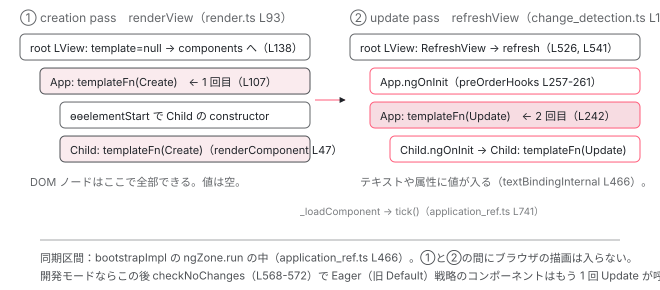

[目次](../README.md) › [起動の全手順](README.md) › 第 11 回 / 全 13 回

# 最初の描画：creation pass と update pass

> renderView がテンプレート関数を Create で呼び、DOM を組む。続く tick が Update で呼び、値を流し込む。同じ関数を 2 回呼ぶ理由。

angular/angular · 読了 約 13 分 · 中核 · [サイトで読む（デモが動きます）](https://angular-deep-dive-cyan.vercel.app/chapter/boot-first-render)

---

前章で `<app-root>` に App のインスタンスと LView が結びつきました。でも DOM の中身はまだ空です。この章では、App のテンプレート関数が**最初の描画で 2 回呼ばれる**ことを確認します。1 回目は `renderView` から `RenderFlags.Create` で（DOM を組む）、2 回目は `ApplicationRef.tick()` → `refreshView` から `RenderFlags.Update` で（値を流し込む）。なぜ 1 回で済ませないのか、2 回目の `tick` がなぜこのビューを選ぶのかを、行番号で追います。

読む対象は `packages/core/src/render3/instructions/render.ts`、`packages/core/src/render3/instructions/change_detection.ts`、`packages/core/src/application/application_ref.ts`（`tick` 周辺）です。

1. ng コマンド起動
2. builder の解決
3. dev-server と Vite
4. application builder
5. index.html の生成
6. ブラウザが main.js を実行
7. bootstrapApplication
8. 2 段の DI 木
9. APP\_INITIALIZER
10. ApplicationRef.bootstrap
11. **最初の描画**（この章）
12. クリック→再描画
13. SPA のページ遷移

## 1. テンプレート関数は rf で 2 つのブロックに分かれている

📄 `angular/packages/compiler-cli/test/compliance/test_cases/r3_view_compiler_template/implicit_receiver_template.js` L14–21 （▶ の行: 14–17, 19）

```js
14 ▶ function MyComponent_div_1_Template(rf, ctx) {
15 ▶   if (rf & 1) {
16 ▶     $r3$.ɵɵelement(0, "div", 3);
17 ▶   } if (rf & 2) {
18 │     const $ctx_0$ = i0.ɵɵnextContext();
19 ▶     $r3$.ɵɵproperty("id", $ctx_0$);
20 │   }
21 │ }
```
*コンパイラのテストに含まれる、コンパイル済みテンプレート関数の例。*

📄 `angular/packages/core/src/render3/interfaces/definition.ts` L60–73 （▶ の行: 63–64, 69, 72）

```ts
60 │  * Flags passed into template functions to determine which blocks (i.e. creation, update)
61 │  * should be executed.
62 │  *
63 ▶  * Typically, a template runs both the creation block and the update block on initialization and
64 ▶  * subsequent runs only execute the update block. However, dynamically created views require that
65 │  * the creation block be executed separately from the update block (for backwards compat).
66 │  */
67 │ export const enum RenderFlags {
68 │   /* Whether to run the creation block (e.g. create elements and directives) */
69 ▶   Create = 0b01,
70 │ 
71 │   /* Whether to run the update block (e.g. refresh bindings) */
72 ▶   Update = 0b10,
73 │ }
```

14 行目、テンプレート関数は `(rf, ctx)` の 2 引数です。15 行目 `if (rf & 1)` が creation ブロック（要素を作る `ɵɵelement`）、17 行目 `if (rf & 2)` が update ブロック（値を流す `ɵɵproperty`）。69 行目と 72 行目のとおり、`Create = 0b01`、`Update = 0b10` です。63〜64 行目のコメントが本章の結論を先に言っています。「初期化時は creation と update の両方を、以降は update だけを実行する」。ただし両方を 1 回の呼び出しで（`rf = 3` で）実行するのではなく、**別々の関数から別々に 2 回**呼びます。

📄 `angular/packages/core/src/render3/instructions/shared.ts` L86–116 （▶ の行: 86, 90, 94, 97, 100, 107）

```ts
 86 ▶ export function executeTemplate<T>(
 87 │   tView: TView,
 88 │   lView: LView<T>,
 89 │   templateFn: ComponentTemplate<T>,
 90 ▶   rf: RenderFlags,
 91 │   context: T,
 92 │ ) {
 93 │   const prevSelectedIndex = getSelectedIndex();
 94 ▶   const isUpdatePhase = rf & RenderFlags.Update;
 95 │   try {
 96 │     setSelectedIndex(-1);
 97 ▶     if (isUpdatePhase && lView.length > HEADER_OFFSET) {
 98 │       // When we're updating, inherently select 0 so we don't
 99 │       // have to generate that instruction for most update blocks.
100 ▶       selectIndexInternal(tView, lView, HEADER_OFFSET, !!ngDevMode && isInCheckNoChangesMode());
101 │     }
102 │ 
103 │     const preHookType = isUpdatePhase
104 │       ? ProfilerEvent.TemplateUpdateStart
105 │       : ProfilerEvent.TemplateCreateStart;
106 │     profiler(preHookType, context as unknown as {}, templateFn);
107 ▶     templateFn(rf, context);
108 │   } finally {
109 │     setSelectedIndex(prevSelectedIndex);
110 │ 
111 │     const postHookType = isUpdatePhase
112 │       ? ProfilerEvent.TemplateUpdateEnd
113 │       : ProfilerEvent.TemplateCreateEnd;
114 │     profiler(postHookType, context as unknown as {}, templateFn);
115 │   }
116 │ }
```

テンプレート関数を呼ぶ唯一の場所が 107 行目です。94 行目で update かどうかを見て、97〜101 行目、update のときだけ 先頭ノードを選択状態にします（update ブロックは「今どのノードか」を `ɵɵadvance` で進めるため）。この関数を誰がどの `rf` で呼ぶかが、以下の 2 節と 3 節です。

## 2. 1 回目：renderView が Create で呼ぶ（creation pass）

📄 `angular/packages/core/src/render3/instructions/render.ts` L93–141 （▶ の行: 93, 96, 105–107, 115–116, 138–140）

```ts
 93 ▶ export function renderView<T>(tView: TView, lView: LView<T>, context: T): void {
 94 │   ngDevMode && assertEqual(isCreationMode(lView), true, 'Should be run in creation mode');
 95 │   ngDevMode && assertNotReactive(renderView.name);
 96 ▶   enterView(lView);
 97 │   try {
 98 │     const viewQuery = tView.viewQuery;
 99 │     if (viewQuery !== null) {
100 │       executeViewQueryFn<T>(RenderFlags.Create, viewQuery, context);
101 │     }
102 │ 
103 │     // Execute a template associated with this view, if it exists. A template function might not be
104 │     // defined for the root component views.
105 ▶     const templateFn = tView.template;
106 ▶     if (templateFn !== null) {
107 ▶       executeTemplate<T>(tView, lView, templateFn, RenderFlags.Create, context);
108 │     }
109 │ 
110 │     // This needs to be set before children are processed to support recursive components.
111 │     // This must be set to false immediately after the first creation run because in an
112 │     // ngFor loop, all the views will be created together before update mode runs and turns
113 │     // off firstCreatePass. If we don't set it here, instances will perform directive
114 │     // matching, etc again and again.
115 ▶     if (tView.firstCreatePass) {
116 ▶       tView.firstCreatePass = false;
117 │     }
118 │ 
119 │     // Mark all queries active in this view as dirty. This is necessary for signal-based queries to
120 │     // have a clear marking point where we can read query results atomically (for a given view).
121 │     lView[QUERIES]?.finishViewCreation(tView);
122 │ 
123 │     // We resolve content queries specifically marked as `static` in creation mode. Dynamic
124 │     // content queries are resolved during change detection (i.e. update mode), after embedded
125 │     // views are refreshed (see block above).
126 │     if (tView.staticContentQueries) {
127 │       refreshContentQueries(tView, lView);
128 │     }
129 │ 
130 │     // We must materialize query results before child components are processed
131 │     // in case a child component has projected a container. The LContainer needs
132 │     // to exist so the embedded views are properly attached by the container.
133 │     if (tView.staticViewQueries) {
134 │       executeViewQueryFn<T>(RenderFlags.Update, tView.viewQuery!, context);
135 │     }
136 │ 
137 │     // Render child component views.
138 ▶     const components = tView.components;
139 ▶     if (components !== null) {
140 ▶       renderChildComponents(lView, components);
141 │     }
```

📄 `angular/packages/core/src/render3/instructions/render.ts` L151–162 （▶ の行: 152, 158, 160）

```ts
151 │   } finally {
152 ▶     lView[FLAGS] &= ~LViewFlags.CreationMode;
153 │     leaveView();
154 │   }
155 │ }
156 │ 
157 │ /** Renders child components in the current view (creation mode). */
158 ▶ function renderChildComponents(hostLView: LView, components: number[]): void {
159 │   for (let i = 0; i < components.length; i++) {
160 ▶     renderComponent(hostLView, components[i]);
161 │   }
162 │ }
```

前章 component\_ref.ts 424 行目の `renderView(rootTView, rootLView, null)` から始まります。

1. **105〜108 行目：ルート TView のテンプレートは null**

   前章で見たとおり、ルート TView の `template` は `null` なので、ルート LView では `executeTemplate` は呼ばれません。103〜104 行目のコメントが「ルートコンポーネントビューにはテンプレート関数が無いことがある」と 言っているのはこのことです。
2. **115〜117 行目：firstCreatePass を false に**

   この TView での最初の creation pass が終わった印です。2 つ目のインスタンスを作るときは TNode を作り直しません （[first create pass の章](../ivy/08-ivy-first-create-pass.md)）。
3. **138〜141 行目：子コンポーネントを render する**

   `tView.components` はコンポーネントホストの TNode インデックスの配列です。前章の `directiveHostFirstCreatePass` で App がマッチしたときに、次の引用の 132 行目で `HEADER_OFFSET` が積まれています。ルート TView の `components` は `[HEADER_OFFSET]` です。
4. **152 行目：CreationMode フラグを落とす**

   `finally` で `LViewFlags.CreationMode` を外します。前章 createLView 190 行目で立てたフラグです。以降このビューは「update モード」です。

📄 `angular/packages/core/src/render3/view/directives.ts` L128–133 （▶ の行: 132）

```ts
128 │ function markAsComponentHost(tView: TView, hostTNode: TNode, componentOffset: number): void {
129 │   ngDevMode && assertFirstCreatePass(tView);
130 │   ngDevMode && assertGreaterThan(componentOffset, -1, 'componentOffset must be great than -1');
131 │   hostTNode.componentOffset = componentOffset;
132 ▶   (tView.components ??= []).push(hostTNode.index);
133 │ }
```

📄 `angular/packages/core/src/render3/instructions/render.ts` L32–51 （▶ の行: 32, 34, 36, 47）

```ts
32 ▶ export function renderComponent(hostLView: LView, componentHostIdx: number) {
33 │   ngDevMode && assertEqual(isCreationMode(hostLView), true, 'Should be run in creation mode');
34 ▶   const componentView = getComponentLViewByIndex(componentHostIdx, hostLView);
35 │   const componentTView = componentView[TVIEW];
36 ▶   syncViewWithBlueprint(componentTView, componentView);
37 │ 
38 │   const hostRNode = componentView[HOST];
39 │   // Populate an LView with hydration info retrieved from the DOM via TransferState.
40 │   if (hostRNode !== null && componentView[HYDRATION] === null) {
41 │     componentView[HYDRATION] = retrieveHydrationInfo(hostRNode, componentView[INJECTOR]);
42 │   }
43 │ 
44 │   profiler(ProfilerEvent.ComponentStart);
45 │ 
46 │   try {
47 ▶     renderView(componentTView, componentView, componentView[CONTEXT]);
48 │   } finally {
49 │     profiler(ProfilerEvent.ComponentEnd, componentView[CONTEXT] as any as {});
50 │   }
51 │ }
```

158〜162 行目 → 32 行目。34 行目でホスト TNode の位置からコンポーネント LView（App のビュー）を取り、36 行目で blueprint と長さを揃え、**47 行目で `renderView(componentTView, componentView, componentView[CONTEXT])`**。今度は `componentTView.template` が App のテンプレート関数なので、107 行目で `templateFn(RenderFlags.Create, appInstance)` が呼ばれます。**これが 1 回目**です。

📄 `angular/packages/core/src/render3/instructions/element.ts` L90–113 （▶ の行: 90, 102–103, 113）

```ts
 90 ▶ export function ɵɵelementStart(
 91 │   index: number,
 92 │   name: string,
 93 │   attrsIndex?: number | null,
 94 │   localRefsIndex?: number,
 95 │ ): typeof ɵɵelementStart {
 96 │   const lView = getLView();
 97 │ 
 98 │   ngDevMode && assertTNodeCreationIndex(lView, index);
 99 │ 
100 │   const tView = lView[TVIEW];
101 │   const adjustedIndex = index + HEADER_OFFSET;
102 ▶   const tNode = tView.firstCreatePass
103 ▶     ? directiveHostFirstCreatePass(
104 │         adjustedIndex,
105 │         lView,
106 │         TNodeType.Element,
107 │         name,
108 │         findDirectiveDefMatches,
109 │         getBindingsEnabled(),
110 │         attrsIndex,
111 │         localRefsIndex,
112 │       )
113 ▶     : (tView.data[adjustedIndex] as TElementNode);
```

📄 `angular/packages/core/src/render3/instructions/text.ts` L34–54 （▶ の行: 41–42, 45–46, 49）

```ts
34 │ export function ɵɵtext(index: number, value = ''): void {
35 │   const lView = getLView();
36 │   const tView = getTView();
37 │   const adjustedIndex = index + HEADER_OFFSET;
38 │ 
39 │   ngDevMode && assertTNodeCreationIndex(lView, index);
40 │ 
41 ▶   const tNode = tView.firstCreatePass
42 ▶     ? getOrCreateTNode(tView, adjustedIndex, TNodeType.Text, value, null)
43 │     : (tView.data[adjustedIndex] as TElementNode);
44 │ 
45 ▶   const textNative = _locateOrCreateTextNode(tView, lView, tNode, value);
46 ▶   lView[adjustedIndex] = textNative;
47 │ 
48 │   if (wasLastNodeCreated()) {
49 ▶     appendChild(tView, lView, textNative, tNode);
50 │   }
51 │ 
52 │   // Text nodes are self closing.
53 │   setCurrentTNode(tNode, false);
54 │ }
```

creation ブロックの命令はこういう形です。102〜113 行目、`firstCreatePass` なら TNode を作り、2 回目以降は `tView.data` から取り出すだけ。`ɵɵtext` も同じで（41〜43 行目）、45 行目でテキストノードを作り、46 行目で LView に保存、49 行目で親に `appendChild`。**DOM ノードが生まれるのは creation pass**です。中身の命令は [creation 命令の章](../ivy/09-ivy-create-instructions.md)に委ねます。App のテンプレートの中に子コンポーネントがあれば、その `ɵɵelementStart` の中で前章と同じ `createDirectivesInstances` が走り（子の constructor）、App の creation pass の最後に 138〜141 行目 → `renderComponent` で子の creation pass に入ります。**木全体の creation pass が先に終わります**。

## 3. 2 回目：tick → refreshView が Update で呼ぶ（update pass）

📄 `angular/packages/core/src/application/application_ref.ts` L738–745 （▶ の行: 739, 741）

```ts
738 │   private _loadComponent(componentRef: ComponentRef<any>): void {
739 ▶     this.attachView(componentRef.hostView);
740 │     try {
741 ▶       this.tick();
742 │     } catch (e) {
743 │       this.internalErrorHandler(e);
744 │     }
745 │     this.components.push(componentRef);
```

`renderView` が戻り、`ComponentRef` が作られ、前章 7 節の `_loadComponent` に来ました。739 行目の `attachView`、741 行目の `tick()`。この `tick()` がなぜルート LView を更新するのか、zoneless の既定で確かめます。

📄 `angular/packages/core/src/render3/util/view_utils.ts` L247–255 （▶ の行: 248–250, 252–253）

```ts
247 │ export function updateAncestorTraversalFlagsOnAttach(lView: LView) {
248 ▶   lView[ENVIRONMENT].changeDetectionScheduler?.notify(NotificationSource.ViewAttached);
249 ▶   if (lView[FLAGS] & LViewFlags.Dirty) {
250 ▶     lView[FLAGS] |= LViewFlags.RefreshView;
251 │   }
252 ▶   if (requiresRefreshOrTraversal(lView)) {
253 ▶     markAncestorsForTraversal(lView);
254 │   }
255 │ }
```

`attachView` → `ViewRef.attachToAppRef` → 247 行目。248 行目でスケジューラに `ViewAttached` を通知（`dirtyFlags` に `AfterRender` が立つ）。249〜251 行目、ルート LView には前章 createLView 193 行目の `Dirty` が立っているので `RefreshView` も立てます （既に 194 行目で立っていますが）。252〜253 行目、`RefreshView` があるので `markAncestorsForTraversal` → その中でスケジューラに `MarkAncestorsForTraversal` を通知し、`dirtyFlags` に `ViewTreeTraversal` が立ちます。

📄 `angular/packages/core/src/application/application_ref.ts` L533–538 （▶ の行: 534–535, 537）

```ts
533 │   tick(): void {
534 ▶     if (!this.zonelessEnabled) {
535 ▶       this.dirtyFlags |= ApplicationRefDirtyFlags.ViewTreeGlobal;
536 │     }
537 ▶     this._tick();
538 │   }
```

📄 `angular/packages/core/src/application/application_ref.ts` L564–572 （▶ の行: 567–570）

```ts
564 │     const prevConsumer = setActiveConsumer(null);
565 │     try {
566 │       this._runningTick = true;
567 ▶       this.synchronize();
568 ▶       if (typeof ngDevMode === 'undefined' || ngDevMode) {
569 ▶         for (let view of this.allViews) {
570 ▶           view.checkNoChanges();
571 │         }
572 │       }
```

534〜536 行目、zoneless では `ViewTreeGlobal` を立てません（[zoneless の章](../zoneless/01-zoneless-default.md)）。`dirtyFlags` は上で立った `ViewTreeTraversal | AfterRender` のままです。567 行目の `synchronize()` が `dirtyFlags` が `None` になるまで `synchronizeOnce` を回します。568〜572 行目は開発モード限定の `checkNoChanges` で、5 節で触れます。

📄 `angular/packages/core/src/application/application_ref.ts` L624–655 （▶ の行: 626, 630, 633, 636, 639, 641, 645–646, 652–653）

```ts
624 │     // First check dirty views, if there are any.
625 │     let ranDetectChanges = false;
626 ▶     if (this.dirtyFlags & ApplicationRefDirtyFlags.ViewTreeAny) {
627 │       // Change detection on views starts in targeted mode (only check components if they're
628 │       // marked as dirty) unless global checking is specifically requested via APIs like
629 │       // `ApplicationRef.tick()` and the `NgZone` integration.
630 ▶       const useGlobalCheck = Boolean(this.dirtyFlags & ApplicationRefDirtyFlags.ViewTreeGlobal);
631 │ 
632 │       // Clear the view-related dirty flags.
633 ▶       this.dirtyFlags &= ~ApplicationRefDirtyFlags.ViewTreeAny;
634 │ 
635 │       // Set the AfterRender bit, as we're checking views and will need to run afterRender hooks.
636 ▶       this.dirtyFlags |= ApplicationRefDirtyFlags.AfterRender;
637 │ 
638 │       // Check all potentially dirty views.
639 ▶       for (let {_lView} of this.allViews) {
640 │         // When re-checking, only check views which actually need it.
641 ▶         if (!useGlobalCheck && !requiresRefreshOrTraversal(_lView)) {
642 │           continue;
643 │         }
644 │ 
645 ▶         const mode =
646 ▶           useGlobalCheck && !this.zonelessEnabled
647 │             ? // Global mode includes `CheckAlways` views.
648 │               // When using zoneless, all root views must be explicitly marked for refresh, even if they are
649 │               // `CheckAlways`.
650 │               ChangeDetectionMode.Global
651 │             : // Only refresh views with the `RefreshView` flag or views is a changed signal
652 ▶               ChangeDetectionMode.Targeted;
653 ▶         detectChangesInternal(_lView, mode);
654 │         ranDetectChanges = true;
655 │       }
```

1. **626 行目：ViewTreeAny が立っているか**

   `ViewTreeTraversal` が立っているので入ります。630 行目、`ViewTreeGlobal` は無いので `useGlobalCheck = false`。
2. **633・636 行目：ビュー系フラグを消し、AfterRender を立てる**

   走査を始める前にフラグを消すので、走査中に新しく立ったフラグは次の `synchronizeOnce` で拾えます。
3. **639〜643 行目：allViews（= \_views、ルート LView 1 つ）を見る**

   641 行目、`useGlobalCheck` が `false` なので `requiresRefreshOrTraversal(_lView)` で絞ります。ルート LView には `RefreshView` が立っているので `true`。
4. **645〜653 行目：Targeted モードで detectChangesInternal**

   646 行目、`useGlobalCheck && !zonelessEnabled` は `false` なので `ChangeDetectionMode.Targeted`。653 行目でルート LView から走査を始めます。

📄 `angular/packages/core/src/render3/instructions/change_detection.ts` L90–110 （▶ の行: 90, 100, 104, 107）

```ts
 90 ▶ export function detectChangesInternal(lView: LView, mode = ChangeDetectionMode.Global) {
 91 │   const environment = lView[ENVIRONMENT];
 92 │   const rendererFactory = environment.rendererFactory;
 93 │ 
 94 │   // Check no changes mode is a dev only mode used to verify that bindings have not changed
 95 │   // since they were assigned. We do not want to invoke renderer factory functions in that mode
 96 │   // to avoid any possible side-effects.
 97 │   const checkNoChangesMode = !!ngDevMode && isInCheckNoChangesMode();
 98 │ 
 99 │   if (!checkNoChangesMode) {
100 ▶     rendererFactory.begin?.();
101 │   }
102 │ 
103 │   try {
104 ▶     detectChangesInViewWhileDirty(lView, mode);
105 │   } finally {
106 │     if (!checkNoChangesMode) {
107 ▶       rendererFactory.end?.();
108 │     }
109 │   }
110 │ }
```

📄 `angular/packages/core/src/render3/instructions/change_detection.ts` L502–541 （▶ の行: 509–510, 519, 526, 538, 540–541）

```ts
502 │ function detectChangesInView(lView: LView, mode: ChangeDetectionMode) {
503 │   const isInCheckNoChangesPass = ngDevMode && isInCheckNoChangesMode();
504 │   const tView = lView[TVIEW];
505 │   const flags = lView[FLAGS];
506 │   const consumer = lView[REACTIVE_TEMPLATE_CONSUMER];
507 │ 
508 │   // Refresh CheckAlways views in Global mode.
509 ▶   let shouldRefreshView: boolean = !!(
510 ▶     mode === ChangeDetectionMode.Global && flags & LViewFlags.CheckAlways
511 │   );
512 │ 
513 │   // Refresh Dirty views in Global mode, as long as we're not in checkNoChanges.
514 │   // CheckNoChanges never worked with `OnPush` components because the `Dirty` flag was
515 │   // cleared before checkNoChanges ran. Because there is now a loop for to check for
516 │   // backwards views, it gives an opportunity for `OnPush` components to be marked `Dirty`
517 │   // before the CheckNoChanges pass. We don't want existing errors that are hidden by the
518 │   // current CheckNoChanges bug to surface when making unrelated changes.
519 ▶   shouldRefreshView ||= !!(
520 │     flags & LViewFlags.Dirty &&
521 │     mode === ChangeDetectionMode.Global &&
522 │     !isInCheckNoChangesPass
523 │   );
524 │ 
525 │   // Always refresh views marked for refresh, regardless of mode.
526 ▶   shouldRefreshView ||= !!(flags & LViewFlags.RefreshView);
527 │ 
528 │   // Refresh views when they have a dirty reactive consumer, regardless of mode.
529 │   shouldRefreshView ||= !!(consumer?.dirty && consumerPollProducersForChange(consumer));
530 │ 
531 │   shouldRefreshView ||= !!(ngDevMode && isExhaustiveCheckNoChanges());
532 │ 
533 │   // Mark the Flags and `ReactiveNode` as not dirty before refreshing the component, so that they
534 │   // can be re-dirtied during the refresh process.
535 │   if (consumer) {
536 │     consumer.dirty = false;
537 │   }
538 ▶   lView[FLAGS] &= ~(LViewFlags.HasChildViewsToRefresh | LViewFlags.RefreshView);
539 │ 
540 ▶   if (shouldRefreshView) {
541 ▶     refreshView(tView, lView, tView.template, lView[CONTEXT]);
```

100 行目で `rendererFactory.begin()`（DOM 書き込みのまとめ開始）、104 行目から `detectChangesInView` に入ります。509〜511 行目、Targeted なので `CheckAlways` では refresh しません。519〜523 行目の `Dirty` も Global 限定。**526 行目、`RefreshView` フラグは「モードを問わず refresh」**。ルート LView はこれで `true` になります。538 行目でフラグを消し、541 行目で `refreshView(rootTView, rootLView, null, ctx)`。

📄 `angular/packages/core/src/render3/instructions/change_detection.ts` L190–199 （▶ の行: 190, 193, 196）

```ts
190 ▶ export function refreshView<T>(
191 │   tView: TView,
192 │   lView: LView,
193 ▶   templateFn: ComponentTemplate<{}> | null,
194 │   context: T,
195 │ ) {
196 ▶   ngDevMode && assertEqual(isCreationMode(lView), false, 'Should be run in update mode');
197 │ 
198 │   if (isDestroyed(lView)) return;
199 │ 
```

📄 `angular/packages/core/src/render3/instructions/change_detection.ts` L237–263 （▶ の行: 240–242, 251, 257–259, 261）

```ts
237 │   try {
238 │     resetPreOrderHookFlags(lView);
239 │ 
240 ▶     setBindingIndex(tView.bindingStartIndex);
241 ▶     if (templateFn !== null) {
242 ▶       executeTemplate(tView, lView, templateFn, RenderFlags.Update, context);
243 │     }
244 │ 
245 │     const hooksInitPhaseCompleted =
246 │       (flags & LViewFlags.InitPhaseStateMask) === InitPhaseState.InitPhaseCompleted;
247 │ 
248 │     // execute pre-order hooks (OnInit, OnChanges, DoCheck)
249 │     // PERF WARNING: do NOT extract this to a separate function without running benchmarks
250 │     if (!isInCheckNoChangesPass) {
251 ▶       if (hooksInitPhaseCompleted) {
252 │         const preOrderCheckHooks = tView.preOrderCheckHooks;
253 │         if (preOrderCheckHooks !== null) {
254 │           executeCheckHooks(lView, preOrderCheckHooks, null);
255 │         }
256 │       } else {
257 ▶         const preOrderHooks = tView.preOrderHooks;
258 ▶         if (preOrderHooks !== null) {
259 ▶           executeInitAndCheckHooks(lView, preOrderHooks, InitPhaseState.OnInitHooksToBeRun, null);
260 │         }
261 ▶         incrementInitPhaseFlags(lView, InitPhaseState.OnInitHooksToBeRun);
262 │       }
263 │     }
```

196 行目、`refreshView` は creation モードでないことを前提にしています（2 節 152 行目で落としたので OK）。241〜243 行目、ルート LView では `templateFn` が `null` なのでまた呼ばれません。**257〜261 行目が `ngOnInit` です**。App の `ngOnInit` はルート TView の `preOrderHooks` に登録されているので （App はルート TView 上のディレクティブだから）、**ルート LView の refreshView の中、App のテンプレートの update pass より前**に呼ばれます。「constructor は creation pass、ngOnInit は update pass」です。

📄 `angular/packages/core/src/render3/instructions/change_detection.ts` L302–316 （▶ の行: 305–307）

```ts
302 │     processHostBindingOpCodes(tView, lView);
303 │ 
304 │     // Refresh child component views.
305 ▶     const components = tView.components;
306 ▶     if (components !== null) {
307 ▶       detectChangesInChildComponents(lView, components, ChangeDetectionMode.Global);
308 │     }
309 │ 
310 │     // View queries must execute after refreshing child components because a template in this view
311 │     // could be inserted in a child component. If the view query executes before child component
312 │     // refresh, the template might not yet be inserted.
313 │     const viewQuery = tView.viewQuery;
314 │     if (viewQuery !== null) {
315 │       executeViewQueryFn<T>(RenderFlags.Update, viewQuery, context);
316 │     }
```

305〜308 行目、子コンポーネント（`components = [HEADER_OFFSET]`）を **Global モード**で見に行きます。`detectChangesInChildComponents` → `detectChangesInComponent` → `detectChangesInView(appLView, Global)`。App の LView には createLView 193〜194 行目の `Dirty` と `RefreshView`、加えて `ChangeDetectionStrategy.Eager`（旧 `Default`）を明示していれば `CheckAlways` も立っています（この v22 スナップショットでは未指定は OnPush。[Ivy の章](../ivy/02-ivy-overview.md)）。509〜526 行目のどれかで `true` になり、541 行目で `refreshView(appTView, appLView, appTemplate, appInstance)`。今度は 242 行目で **`executeTemplate(..., RenderFlags.Update, ...)`。これが 2 回目**です。

📄 `angular/packages/core/src/render3/instructions/text_interpolation.ts` L72–83 （▶ の行: 78–80）

```ts
72 │ export function ɵɵtextInterpolate1(
73 │   prefix: string,
74 │   v0: any,
75 │   suffix?: string,
76 │ ): typeof ɵɵtextInterpolate1 {
77 │   const lView = getLView();
78 ▶   const interpolated = interpolation1(lView, prefix, v0, suffix);
79 ▶   if (interpolated !== NO_CHANGE) {
80 ▶     textBindingInternal(lView, getSelectedIndex(), interpolated as string);
81 │   }
82 │   return ɵɵtextInterpolate1;
83 │ }
```

📄 `angular/packages/core/src/render3/instructions/text_interpolation.ts` L460–467 （▶ の行: 464, 466）

```ts
460 │ function textBindingInternal(lView: LView, index: number, value: string): void {
461 │   ngDevMode && assertString(value, 'Value should be a string');
462 │   ngDevMode && assertNotSame(value, NO_CHANGE as any, 'value should not be NO_CHANGE');
463 │   ngDevMode && assertIndexInRange(lView, index);
464 ▶   const element = getNativeByIndex(index, lView) as any as RText;
465 │   ngDevMode && assertDefined(element, 'native element should exist');
466 ▶   updateTextNode(lView[RENDERER], element, value);
467 │ }
```

update ブロックの命令の例です。78 行目で前回の値と比較し（初回は必ず変化あり）、80 行目 → 464 行目で creation pass で作っておいたテキストノードを LView から取り出し、466 行目で `renderer.setValue`。**ここで初めて画面に値が入ります**。中身は[update 命令の章](../ivy/10-ivy-update-instructions.md)へ。

📄 `angular/packages/core/src/render3/instructions/change_detection.ts` L334–342 （▶ の行: 334, 341）

```ts
334 ▶     if (tView.firstUpdatePass === true) {
335 │       // We need to make sure that we only flip the flag on successful `refreshView` only
336 │       // Don't do this in `finally` block.
337 │       // If we did this in `finally` block then an exception could block the execution of styling
338 │       // instructions which in turn would be unable to insert themselves into the styling linked
339 │       // list. The result of this would be that if the exception would not be throw on subsequent CD
340 │       // the styling would be unable to process it data and reflect to the DOM.
341 ▶       tView.firstUpdatePass = false;
342 │     }
```

334〜342 行目、この TView での最初の update pass が終わった印 `firstUpdatePass = false`。これで App の TView は「creation も update も 1 回ずつ済んだ」状態になり、以降の `refreshView` は バインディングの差分だけを DOM に書きます。

## 4. なぜ同じ関数を 2 回呼ぶのか

ここまでの事実を並べると答えが出ます。

- creation ブロックは **構造**を作る。TNode（初回のみ）と DOM ノード。値は見ない。木全体の creation pass は `renderView` の再帰（2 節 138〜141 行目）で**先に全部終わる**。
- update ブロックは **値**を書く。`ctx.title` などを読み、変わっていれば DOM に反映する。`refreshView` の再帰（3 節 305〜308 行目）で木全体を回る。
- 2 回目以降の描画（[次章](12-boot-click-to-paint.md)）は update ブロックだけが必要。1 つの関数に両方のブロックを置いて `rf` で選ぶことで、コンパイラは「初回用」「更新用」の 2 関数を出力せずに済む。
- creation と update を分けることで、`ngOnInit` のような「全ての子の constructor が終わった後、値を書く前」というタイミングが `refreshView` 257〜261 行目として自然に置ける。



*App とその子 Child の最初の描画。creation pass（左）が木全体で先に終わり、tick の update pass（右）が同じ順で値を書く。両方とも bootstrapImpl の ngZone.run の中で同期に進む。*

## 5. 細かい補足：先に予約されていた tick と、開発モードの 3 回目

📄 `angular/packages/core/src/change_detection/scheduling/zoneless_scheduling_impl.ts` L83–93 （▶ の行: 85, 92–93）

```ts
83 │   constructor() {
84 │     this.subscriptions.add(
85 ▶       this.appRef.afterTick.subscribe(() => {
86 │         // Prevent stabilization if cleanup causes the last task to be removed
87 │         // before we can switch to the microtask scheduler.
88 │         const task = this.taskService.add();
89 │         // If the scheduler isn't running a tick but the application ticked, that means
90 │         // someone called ApplicationRef.tick manually. In this case, we should cancel
91 │         // any change detections that had been scheduled so we don't run an extra one.
92 ▶         if (!this.runningTick) {
93 ▶           this.cleanup();
```

3 節 248 行目と 253 行目の `notify` は、`ChangeDetectionSchedulerImpl` に 「`setTimeout`/`rAF` で tick を予約させる」副作用も持ちます（[次章](12-boot-click-to-paint.md)で読む `shouldScheduleTick`）。しかし 741 行目の `tick()` が同期的に先に走り、終わると `afterTick`（85 行目）が流れます。92〜93 行目、スケジューラ自身が走らせた tick ではないので `cleanup()`、予約はキャンセルされます。結果として最初の描画で `tick` は 1 回だけです。

開発モードでは 3 節 568〜572 行目の `view.checkNoChanges()` が続きます。`checkNoChangesInternal` → `detectChangesInternal(lView)`（Global モード）で、`Default` 戦略のコンポーネントは `CheckAlways` により 509〜511 行目で再度 refresh され、テンプレート関数が **3 回目**（Update、ただし checkNoChanges モード）呼ばれます。値が 2 回目と違えば `NG0100: ExpressionChangedAfterItHasBeenCheckedError` です （[checkNoChanges の章](../cd/07-cd-check-no-changes.md)）。本番ビルドでは `ngDevMode` が `false` なので 2 回です。

> **🧪 DEMO — 子コンポーネントの数を変えると、テンプレート関数が呼ばれる順はどうなるか**
>
> App のテンプレートに `<app-child>` を N 個並べたときの、最初の描画での呼び出し順です（renderView L93-141 / refreshView L190-342 を上から読んだ結果）。
>
> テンプレート関数の呼び出し回数：6 回
>
> ▶ [このデモはサイトで動かせます](https://angular-deep-dive-cyan.vercel.app/chapter/boot-first-render)

## ここまでの呼び出し

- `componentFactory.create(...)` — core/src/render3/component\_ref.ts L266 — *前章*
  - `renderView(rootTView, rootLView, null)` — component\_ref.ts L424 → instructions/render.ts L93 — *template=null、components=\[HEADER\_OFFSET\]*
    - `renderChildComponents` → `renderComponent(rootLView, HEADER_OFFSET)` — render.ts L158 → L32
      - `renderView(appTView, appLView, appInstance)` — render.ts L47 → L93
        - 👤 `executeTemplate(..., RenderFlags.Create, ...)` → `App_Template(1, ctx)` — render.ts L107 → shared.ts L107 — *1 回目。DOM を組む*
        - `lView[FLAGS] &= ~CreationMode` — render.ts L152
- `_loadComponent(compRef)` — core/src/application/application\_ref.ts L738
  - `attachView` → `attachToAppRef` → `updateAncestorTraversalFlagsOnAttach` — application\_ref.ts L739 → view\_utils.ts L247 — *dirtyFlags に ViewTreeTraversal | AfterRender*
  - `tick()` → `_tick()` → `tickImpl()` → `synchronize()` — application\_ref.ts L741 → L533 → L567
    - `synchronizeOnce()` — application\_ref.ts L617 — *Targeted モード*
      - `detectChangesInternal(rootLView, Targeted)` — change\_detection.ts L90 — *rendererFactory.begin()*
        - `detectChangesInView(rootLView, Targeted)` — change\_detection.ts L502 — *RefreshView フラグで refresh*
          - `refreshView(rootTView, rootLView, null, ctx)` — change\_detection.ts L190 — *App.ngOnInit（L257-261）*
            - `detectChangesInChildComponents(rootLView, [HEADER_OFFSET], Global)` — change\_detection.ts L307
              - `detectChangesInView(appLView, Global)` → `refreshView(appTView, appLView, App_Template, app)` — change\_detection.ts L502 → L190
                - 👤 `executeTemplate(..., RenderFlags.Update, ...)` → `App_Template(2, ctx)` — change\_detection.ts L242 — *2 回目。値を書く*
                - `tView.firstUpdatePass = false` — change\_detection.ts L341
    - `afterRenderManager.execute()` — application\_ref.ts L683 — *afterRender フック*
  - `view.checkNoChanges()`（開発モードのみ） — application\_ref.ts L570 — *3 回目（Eager 戦略のとき。既定の OnPush では呼ばれない）*

## 聞かれそうな質問

**Q. 最初の描画で、テンプレート関数は何回呼ばれますか？**

本番では 2 回です。1 回目は render.ts 107 行目から `RenderFlags.Create`（`rf = 1`）で、2 回目は change\_detection.ts 242 行目から `RenderFlags.Update`（`rf = 2`）で。開発モードでは application\_ref.ts 568〜572 行目の `checkNoChanges` が `Default` 戦略のコンポーネントを もう 1 回 Update で呼ぶので 3 回です。`rf = 3` で 1 回、という呼び方は起動時にはありません。

**Q. constructor と ngOnInit はそれぞれどの pass で呼ばれますか？**

constructor は creation pass（前章 shared.ts 408 行目、親の `ɵɵelementStart` の中）、`ngOnInit` は update pass（change\_detection.ts 257〜261 行目、**親の**`refreshView` の中、自分のテンプレートが Update で呼ばれる直前）です。だから `ngOnInit` の時点で `@Input()` は入っていますが、自分のビューの子はまだ update されていません。

**Q. creation pass と update pass の間に画面が一瞬空で描かれることはありますか？**

ありません。両方とも前章 application\_ref.ts 466 行目の `ngZone.run` の中で同期的に進み （`renderView` は component\_ref.ts 424 行目、`tick()` は 741 行目）、その間 JavaScript は一度もイベントループに戻りません。ブラウザが描画できるのは `bootstrapImpl` が戻った後です。

**Q. zoneless なのに、最初の tick はなぜルートビューを更新できるのですか？**

createLView（construction.ts 193〜194 行目）でルート LView に `Dirty | RefreshView` が最初から立っているからです。`attachView` → view\_utils.ts 252〜253 行目で `ViewTreeTraversal` が `dirtyFlags` に立ち、synchronizeOnce 641 行目の `requiresRefreshOrTraversal` を通り、detectChangesInView 526 行目の `RefreshView` 判定で refresh されます。`ViewTreeGlobal` は使いません。

**Q. 子コンポーネントの creation pass はいつですか？親の update pass の後ですか？**

親の creation pass の中です。render.ts 138〜141 行目で、親のテンプレートを Create で実行した直後に `renderChildComponents` が子の `renderView` を呼びます。木全体の creation pass が終わってから、application\_ref.ts 741 行目の `tick()` で木全体の update pass が始まります。

**Q. 最初の描画で tick は何回走りますか？**

1 回です。`attachView` 時の `notify` で `ChangeDetectionSchedulerImpl` が `setTimeout`/`rAF` の tick を予約しますが、741 行目の同期 `tick()` が先に終わり、zoneless\_scheduling\_impl.ts 85〜93 行目の `afterTick` 購読で `runningTick` が `false` のため `cleanup()` が予約を取り消します。

## 読み終えて

- テンプレート関数は `rf & 1`（creation）と `rf & 2`（update）の 2 ブロック。呼ぶのは `executeTemplate` 107 行目だけ
- 1 回目は `renderView`（Create）。TNode と DOM を作り、`renderChildComponents` で木全体を先に回る
- 2 回目は `_loadComponent` の `tick()` → `refreshView`（Update）。ルート LView は最初から `RefreshView` が立っているので Targeted モードでも選ばれる
- `ngOnInit` は親の `refreshView` の 257〜261 行目、自分の update pass の直前
- 開発モードは `checkNoChanges` で 3 回目。本番は 2 回

---

← 前: [ApplicationRef.bootstrap：&lt;app-root&gt; にルートが刺さるまで](10-boot-application-ref.md)  
次: [クリックから画面が変わるまで](12-boot-click-to-paint.md) →
