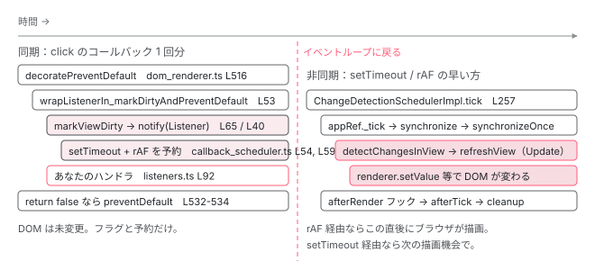

[目次](../README.md) › [起動の全手順](README.md) › 第 12 回 / 全 13 回

# クリックから画面が変わるまで

> ɵɵlistener → wrapListener → markViewDirty → scheduler.notify → setTimeout と rAF の競走 → tick → refreshView。既定の zoneless での 1 往復。

angular/angular · 読了 約 13 分 · 中核 · [サイトで読む（デモが動きます）](https://angular-deep-dive-cyan.vercel.app/chapter/boot-click-to-paint)

---

起動が終わりました。ここからは「動いているアプリ」の 1 往復です。ボタンを押してから DOM が書き換わるまでに、どの関数がどの順で呼ばれるかを、既定の zoneless で追います。特に**「同期で起きること」と「非同期で起きること」の境目**がどこかを確定させます。クリックの瞬間に同期で走るのは `wrapListener` → `markViewDirty` → `notify` → あなたのハンドラ、そこで一度ブラウザに戻り、`setTimeout` と `requestAnimationFrame` の早い方で `tick` が走って `refreshView` が DOM を書きます。

読む対象は `packages/core/src/render3/view/listeners.ts`、`packages/core/src/render3/instructions/mark_view_dirty.ts`、`packages/core/src/change_detection/scheduling/zoneless_scheduling_impl.ts`、`packages/core/src/util/callback_scheduler.ts` です。zone.js がある場合の経路は [zone.js シリーズ](../zone/13-zone-click-trace.md)で別に追います。

1. ng コマンド起動
2. builder の解決
3. dev-server と Vite
4. application builder
5. index.html の生成
6. ブラウザが main.js を実行
7. bootstrapApplication
8. 2 段の DI 木
9. APP\_INITIALIZER
10. ApplicationRef.bootstrap
11. 最初の描画
12. **クリック→再描画**（この章）
13. SPA のページ遷移

## 0. 準備：creation pass で addEventListener されるまで

📄 `angular/packages/compiler-cli/test/compliance/test_cases/r3_view_compiler_listener/element_listener_template.js` L3–12 （▶ の行: 4–8）

```js
 3 │ template: function MyComponent_Template(rf, ctx) {
 4 ▶   if (rf & 1) {
 5 ▶     $r3$.ɵɵelementStart(0, "div", 0);
 6 ▶     $r3$.ɵɵlistener("click", function MyComponent_Template_div_click_0_listener($event) {
 7 ▶       ctx.onClick($event);
 8 ▶       return 1 == 1;
 9 │     });
10 │     $r3$.ɵɵelementEnd();
11 │   }
12 │ }
```
*(click)="onClick($event); 1 == 1" のコンパイル結果。*

6〜9 行目、`(click)="..."` は creation ブロック（4 行目 `rf & 1`）の中で `ɵɵlistener("click", fn)` になります。`fn` はあなたの式を包んだ関数で、最後の式の値を返します（8 行目）。[前章](11-boot-first-render.md)の 1 回目のテンプレート実行で、この命令が走ります。

📄 `angular/packages/core/src/render3/instructions/listener.ts` L33–51 （▶ の行: 33, 38, 40–41, 44）

```ts
33 ▶ export function ɵɵlistener(
34 │   eventName: string,
35 │   listenerFn: EventCallback,
36 │   eventTargetResolver?: GlobalTargetResolver,
37 │ ): typeof ɵɵlistener {
38 ▶   const lView = getLView<{} | null>();
39 │   const tView = getTView();
40 ▶   const tNode = getCurrentTNode()!;
41 ▶   listenerInternal(
42 │     tView,
43 │     lView,
44 ▶     lView[RENDERER],
45 │     tNode,
46 │     eventName,
47 │     listenerFn,
48 │     eventTargetResolver,
49 │   );
50 │   return ɵɵlistener;
51 │ }
```

📄 `angular/packages/core/src/render3/instructions/listener.ts` L122–157 （▶ の行: 140–142, 154–155）

```ts
122 │ export function listenerInternal(
123 │   tView: TView,
124 │   lView: LView<{} | null>,
125 │   renderer: Renderer,
126 │   tNode: TNode,
127 │   eventName: string,
128 │   listenerFn: EventCallback,
129 │   eventTargetResolver?: GlobalTargetResolver,
130 │ ): void {
131 │   ngDevMode && assertTNodeType(tNode, TNodeType.AnyRNode | TNodeType.AnyContainer);
132 │ 
133 │   let processOutputs = true;
134 │   let wrappedListener: WrappedEventCallback | null = null;
135 │ 
136 │   // Adding a native event listener is applicable when:
137 │   // - The corresponding TNode represents a DOM element.
138 │   // - The event target has a resolver (usually resulting in a global object,
139 │   //   such as `window` or `document`).
140 ▶   if (tNode.type & TNodeType.AnyRNode || eventTargetResolver) {
141 ▶     wrappedListener ??= wrapListener(tNode, lView, listenerFn);
142 ▶     const hasCoalescedDomEvent = listenToDomEvent(
143 │       tNode,
144 │       tView,
145 │       lView,
146 │       eventTargetResolver,
147 │       renderer,
148 │       eventName,
149 │       listenerFn,
150 │       wrappedListener,
151 │     );
152 │ 
153 │     // Context: https://github.com/angular/angular/pull/30144
154 ▶     if (hasCoalescedDomEvent) {
155 ▶       processOutputs = false;
156 │     }
157 │   }
```

38〜40 行目で現在の LView / TView / TNode（直前の `ɵɵelementStart` が設定したもの）を取り、44 行目の `lView[RENDERER]`（`DomRenderer`）と一緒に `listenerInternal` へ。140 行目、TNode が DOM 要素なら、**141 行目で `wrapListener`**（2 節で読みます）、142 行目で `listenToDomEvent`。

📄 `angular/packages/core/src/render3/view/listeners.ts` L168–182 （▶ の行: 169–170, 181）

```ts
168 │   } else {
169 ▶     const native = getNativeByTNode(tNode, lView) as RElement;
170 ▶     const target = eventTargetResolver ? eventTargetResolver(native) : native;
171 │ 
172 │     stashEventListenerImpl(lView, target, eventName, wrappedListener);
173 │ 
174 │     // For element-local listeners (not global targets like document/window), store the
175 │     // native element on the wrapped listener so that when it fires it can mark the
176 │     // (event, element) pair as handled, preventing jsaction from replaying an event that
177 │     // was already dispatched by the real DOM listener post-hydration (see #67328).
178 │     if (!eventTargetResolver) {
179 │       (wrappedListener as any).__ngNativeEl__ = native as unknown as Element;
180 │     }
181 ▶     const cleanupFn = renderer.listen(target as RElement, eventName, wrappedListener);
182 │ 
```

📄 `angular/packages/platform-browser/src/dom/dom_renderer.ts` L477–509 （▶ の行: 477, 497, 503–506）

```ts
477 ▶   listen(
478 │     target: 'window' | 'document' | 'body' | any,
479 │     event: string,
480 │     callback: (event: any) => boolean,
481 │     options?: ListenerOptions,
482 │   ): () => void {
483 │     (typeof ngDevMode === 'undefined' || ngDevMode) &&
484 │       this.throwOnSyntheticProps &&
485 │       checkNoSyntheticProp(event, 'listener');
486 │     if (typeof target === 'string') {
487 │       target = getDOM().getGlobalEventTarget(this.doc, target);
488 │       if (!target) {
489 │         throw new RuntimeError(
490 │           RuntimeErrorCode.UNSUPPORTED_EVENT_TARGET,
491 │           (typeof ngDevMode === 'undefined' || ngDevMode) &&
492 │             `Unsupported event target ${target} for event ${event}`,
493 │         );
494 │       }
495 │     }
496 │ 
497 ▶     let wrappedCallback = this.decoratePreventDefault(callback);
498 │ 
499 │     if (this.tracingService?.wrapEventListener) {
500 │       wrappedCallback = this.tracingService.wrapEventListener(target, event, wrappedCallback);
501 │     }
502 │ 
503 ▶     return this.eventManager.addEventListener(
504 ▶       target,
505 ▶       event,
506 ▶       wrappedCallback,
507 │       options,
508 │     ) as VoidFunction;
509 │   }
```

📄 `angular/packages/platform-browser/src/dom/events/event_manager.ts` L77–85 （▶ の行: 83–84）

```ts
77 │   addEventListener(
78 │     element: HTMLElement,
79 │     eventName: string,
80 │     handler: Function,
81 │     options?: ListenerOptions,
82 │   ): Function {
83 ▶     const plugin = this._findPluginFor(eventName);
84 ▶     return plugin.addEventListener(element, eventName, handler, options);
85 │   }
```

📄 `angular/packages/platform-browser/src/dom/events/dom_events.ts` L25–33 （▶ の行: 31–32）

```ts
25 │   override addEventListener(
26 │     element: HTMLElement,
27 │     eventName: string,
28 │     handler: Function,
29 │     options?: ListenerOptions,
30 │   ): Function {
31 ▶     element.addEventListener(eventName, handler as EventListener, options);
32 ▶     return () => this.removeEventListener(element, eventName, handler as EventListener, options);
33 │   }
```

169 行目で DOM 要素を取り、181 行目で `renderer.listen(target, 'click', wrappedListener)`。`DomRenderer.listen`（477 行目）は 497 行目で `decoratePreventDefault` でもう 1 枚包み、503〜508 行目で `EventManager.addEventListener` → 83〜84 行目でイベント名に合うプラグインを選び → `DomEventsPlugin.addEventListener` → **31 行目、ついに `element.addEventListener('click', handler)`**。`EventManager` と `DomEventsPlugin` は [7 章](07-boot-bootstrap-application.md)の `BROWSER_MODULE_PROVIDERS` にいたものです。

まとめると、ブラウザに登録されている関数は `decoratePreventDefault の無名関数` → `wrapListenerIn_markDirtyAndPreventDefault` → `あなたの式` の 3 層です。クリックが来ると外側から順に呼ばれます。

## 1. クリック直後（同期）：decoratePreventDefault → wrapListener

📄 `angular/packages/platform-browser/src/dom/dom_renderer.ts` L511–535 （▶ の行: 516, 528, 531–533）

```ts
511 │   private decoratePreventDefault(eventHandler: Function): Function {
512 │     // `DebugNode.triggerEventHandler` needs to know if the listener was created with
513 │     // decoratePreventDefault or is a listener added outside the Angular context so it can handle
514 │     // the two differently. In the first case, the special '__ngUnwrap__' token is passed to the
515 │     // unwrap the listener (see below).
516 ▶     return (event: any) => {
517 │       // Ivy uses '__ngUnwrap__' as a special token that allows us to unwrap the function
518 │       // so that it can be invoked programmatically by `DebugNode.triggerEventHandler`. The
519 │       // debug_node can inspect the listener toString contents for the existence of this special
520 │       // token. Because the token is a string literal, it is ensured to not be modified by compiled
521 │       // code.
522 │       if (event === '__ngUnwrap__') {
523 │         return eventHandler;
524 │       }
525 │ 
526 │       // Run the event handler inside the ngZone because event handlers are not patched
527 │       // by Zone on the server. This is required only for tests.
528 ▶       const allowDefaultBehavior =
529 │         typeof ngServerMode !== 'undefined' && ngServerMode
530 │           ? this.ngZone.runGuarded(() => eventHandler(event))
531 ▶           : eventHandler(event);
532 ▶       if (allowDefaultBehavior === false) {
533 ▶         event.preventDefault();
534 │       }
535 │ 
```

ブラウザがまず呼ぶのは 516 行目の関数です。528〜531 行目、ブラウザでは `eventHandler(event)`（次の層）をそのまま呼び、532〜534 行目、**返り値が `false` なら `event.preventDefault()`**。「`(click)` の式が `false` を返すとデフォルト動作が止まる」の実装はここです。次章の `RouterLink` がこれを使います。

📄 `angular/packages/core/src/render3/view/listeners.ts` L46–80 （▶ の行: 53, 64–65, 67–68, 78）

```ts
46 │ export function wrapListener(
47 │   tNode: TNode,
48 │   lView: LView,
49 │   listenerFn: EventCallback,
50 │ ): WrappedEventCallback {
51 │   // Note: we are performing most of the work in the listener function itself
52 │   // to optimize listener registration.
53 ▶   return function wrapListenerIn_markDirtyAndPreventDefault(event: any) {
54 │     // When a native element is stored on this function (set by listenToDomEvent for
55 │     // non-global-target listeners), mark the (event, element) pair as handled so that
56 │     // jsaction does not replay an event already dispatched by the real DOM listener.
57 │     const nativeEl = (wrapListenerIn_markDirtyAndPreventDefault as any).__ngNativeEl__;
58 │     if (nativeEl !== undefined) {
59 │       markEventHandledForElement(event, nativeEl);
60 │     }
61 │ 
62 │     // In order to be backwards compatible with View Engine, events on component host nodes
63 │     // must also mark the component view itself dirty (i.e. the view that it owns).
64 ▶     const startView = isComponentHost(tNode) ? getComponentLViewByIndex(tNode.index, lView) : lView;
65 ▶     markViewDirty(startView, NotificationSource.Listener);
66 │ 
67 ▶     const context = lView[CONTEXT];
68 ▶     let result = executeListenerWithErrorHandling(lView, context, listenerFn, event);
69 │     // A just-invoked listener function might have coalesced listeners so we need to check for
70 │     // their presence and invoke as needed.
71 │     let nextListenerFn = (<any>wrapListenerIn_markDirtyAndPreventDefault).__ngNextListenerFn__;
72 │     while (nextListenerFn) {
73 │       // We should prevent default if any of the listeners explicitly return false
74 │       result = executeListenerWithErrorHandling(lView, context, nextListenerFn, event) && result;
75 │       nextListenerFn = (<any>nextListenerFn).__ngNextListenerFn__;
76 │     }
77 │ 
78 ▶     return result;
79 │   } as WrappedEventCallback;
80 │ }
```

📄 `angular/packages/core/src/render3/view/listeners.ts` L82–100 （▶ の行: 88, 92–94）

```ts
 82 │ function executeListenerWithErrorHandling(
 83 │   lView: LView,
 84 │   context: unknown,
 85 │   listenerFn: EventCallback,
 86 │   e: any,
 87 │ ): boolean {
 88 ▶   const prevConsumer = setActiveConsumer(null);
 89 │   try {
 90 │     profiler(ProfilerEvent.OutputStart, context as {} | null, listenerFn);
 91 │     // Only explicitly returning false from a listener should preventDefault
 92 ▶     return listenerFn(e) !== false;
 93 ▶   } catch (error) {
 94 ▶     handleUncaughtError(lView, error);
 95 │     return false;
 96 │   } finally {
 97 │     profiler(ProfilerEvent.OutputEnd, context, listenerFn);
 98 │     setActiveConsumer(prevConsumer);
 99 │   }
100 │ }
```

この 2 つの引用が、クリック直後の同期部分の**順番**を決めています。

1. **64〜65 行目：まず markViewDirty**

   **あなたのハンドラを呼ぶ前に**、このリスナーが属するビュー（64 行目、リスナーの付いた要素がコンポーネントのホストなら、そのコンポーネント自身のビュー）を `NotificationSource.Listener` で dirty にします。ハンドラが何も変えなくても dirty になります。
2. **67〜68 行目 → 88〜92 行目：あなたのハンドラ**

   `executeListenerWithErrorHandling` が 88 行目で `setActiveConsumer(null)`（ハンドラ内の signal 読み取りを テンプレートの依存にしない）、92 行目で `listenerFn(e)`。**ここであなたの `count.update(...)` や `this.items.push(...)` が走ります**。`false` を明示的に返したときだけ `false` を返します。93〜94 行目、例外は `handleUncaughtError` → `ErrorHandler` に行き、クリック処理は続きます。
3. **71〜76 行目：同じ要素・同じイベントの別ハンドラ**

   同じ要素に複数ディレクティブが同じイベントを listen している場合、1 つの DOM リスナーに連結されています。順に呼び、1 つでも `false` なら全体が `false`（78 行目）。

## 2. markViewDirty：notify してから、根までフラグを立てる

📄 `angular/packages/core/src/render3/instructions/mark_view_dirty.ts` L26–52 （▶ の行: 26–27, 33, 39–43, 45–46）

```ts
26 ▶ export function markViewDirty(lView: LView, source: NotificationSource): LView | null {
27 ▶   const dirtyBitsToUse = isRefreshingViews()
28 │     ? // When we are actively refreshing views, we only use the `Dirty` bit to mark a view
29 │       // for check. This bit is ignored in ChangeDetectionMode.Targeted, which is used to
30 │       // synchronously rerun change detection on a specific set of views (those which have
31 │       // the `RefreshView` flag and those with dirty signal consumers). `LViewFlags.Dirty`
32 │       // does not support re-entrant change detection on its own.
33 ▶       LViewFlags.Dirty
34 │     : // When we are not actively refreshing a view tree, it is absolutely
35 │       // valid to update state and mark views dirty. We use the `RefreshView` flag in this
36 │       // case to allow synchronously rerunning change detection. This applies today to
37 │       // afterRender hooks as well as animation listeners which execute after detecting
38 │       // changes in a view when the render factory flushes.
39 ▶       LViewFlags.RefreshView | LViewFlags.Dirty;
40 ▶   lView[ENVIRONMENT].changeDetectionScheduler?.notify(source);
41 ▶   while (lView) {
42 ▶     lView[FLAGS] |= dirtyBitsToUse;
43 ▶     const parent = getLViewParent(lView);
44 │     // Stop traversing up as soon as you find a root view that wasn't attached to any container
45 ▶     if (isRootView(lView) && !parent) {
46 ▶       return lView;
47 │     }
48 │     // continue otherwise
49 │     lView = parent!;
50 │   }
51 │   return null;
52 │ }
```

1. **27〜39 行目：立てるビットを決める**

   変更検知の最中でなければ（クリック時は通常そう）`RefreshView | Dirty`。`RefreshView` は[前章](11-boot-first-render.md) detectChangesInView 526 行目で見た 「モードを問わず refresh」のフラグです。
2. **40 行目：先に notify**

   `lView[ENVIRONMENT].changeDetectionScheduler` は [10 章](10-boot-application-ref.md)の `createRootLViewEnvironment` 160 行目で入れた `ChangeDetectionSchedulerImpl` です。フラグを立てる前に `notify(Listener)` を呼びます（3 節）。
3. **41〜50 行目：親へ親へとフラグを立てる**

   42 行目でフラグを立て、43 行目で親 LView へ。45〜46 行目、親の無いルートビューに着いたら終わり。クリックしたコンポーネントからルート LView まで、全ての LView に `RefreshView | Dirty` が立ちます。だから次の tick は Targeted モードでもルートから辿り着けます。

## 3. notify：dirtyFlags を立てて、tick を予約する

📄 `angular/packages/core/src/change_detection/scheduling/zoneless_scheduling_impl.ts` L138–163 （▶ の行: 138–139, 148, 159, 161）

```ts
138 ▶   notify(source: NotificationSource): void {
139 ▶     if (!this.zonelessEnabled && source === NotificationSource.Listener) {
140 │       // When the notification comes from a listener, we skip the notification unless the
141 │       // application has enabled zoneless. Ideally, listeners wouldn't notify the scheduler at all
142 │       // automatically. We do not know that a developer made a change in the listener callback that
143 │       // requires an `ApplicationRef.tick` (synchronize templates / run render hooks). We do this
144 │       // only for an easier migration from OnPush components to zoneless. Because listeners are
145 │       // usually executed inside the Angular zone and listeners automatically call `markViewDirty`,
146 │       // developers never needed to manually use `ChangeDetectorRef.markForCheck` or some other API
147 │       // to make listener callbacks work correctly with `OnPush` components.
148 ▶       return;
149 │     }
150 │ 
151 │     switch (source) {
152 │       case NotificationSource.MarkAncestorsForTraversal:
153 │       case NotificationSource.DeferBlockStateUpdate: {
154 │         this.appRef.dirtyFlags |= ApplicationRefDirtyFlags.ViewTreeTraversal;
155 │         break;
156 │       }
157 │       case NotificationSource.DebugApplyChanges:
158 │       case NotificationSource.MarkForCheck:
159 ▶       case NotificationSource.Listener:
160 │       case NotificationSource.SetInput: {
161 ▶         this.appRef.dirtyFlags |= ApplicationRefDirtyFlags.ViewTreeCheck;
162 │         break;
163 │       }
```

139〜149 行目、zone.js ありのときは `Listener` 通知を無視します（zone が面倒を見るから）。zoneless なので通過。159〜162 行目、`Listener` は `ApplicationRefDirtyFlags.ViewTreeCheck` を立てます。通知の種類ごとの違いは [notify の章](../zoneless/03-zoneless-notify.md)に書きました。

📄 `angular/packages/core/src/change_detection/scheduling/zoneless_scheduling_impl.ts` L201–225 （▶ の行: 201–202, 214–217, 221–222）

```ts
201 ▶     if (!this.shouldScheduleTick()) {
202 ▶       return;
203 │     }
204 │ 
205 │     if (typeof ngDevMode === 'undefined' || ngDevMode) {
206 │       if (this.useMicrotaskScheduler) {
207 │         trackMicrotaskNotificationForDebugging();
208 │       } else {
209 │         consecutiveMicrotaskNotifications = 0;
210 │         stackFromLastFewNotifications.length = 0;
211 │       }
212 │     }
213 │ 
214 ▶     const scheduleCallback = this.useMicrotaskScheduler
215 ▶       ? scheduleCallbackWithMicrotask
216 ▶       : scheduleCallbackWithRafRace;
217 ▶     this.pendingRenderTaskId = this.taskService.add();
218 │     if (this.scheduleInRootZone) {
219 │       this.cancelScheduledCallback = Zone.root.run(() => scheduleCallback(() => this.tick()));
220 │     } else {
221 ▶       this.cancelScheduledCallback = this.ngZone.runOutsideAngular(() =>
222 ▶         scheduleCallback(() => this.tick()),
223 │       );
224 │     }
225 │   }
```

📄 `angular/packages/core/src/change_detection/scheduling/zoneless_scheduling_impl.ts` L227–246 （▶ の行: 228, 232–233, 245）

```ts
227 │   private shouldScheduleTick(): boolean {
228 ▶     if (this.appRef.destroyed) {
229 │       return false;
230 │     }
231 │     // already scheduled or running
232 ▶     if (this.pendingRenderTaskId !== null || this.runningTick || this.appRef._runningTick) {
233 ▶       return false;
234 │     }
235 │     // If we're inside the zone don't bother with scheduler. Zone will stabilize
236 │     // eventually and run change detection.
237 │     if (
238 │       !this.zonelessEnabled &&
239 │       this.zoneIsDefined &&
240 │       Zone.current.get(angularZoneInstanceIdProperty + this.angularZoneId)
241 │     ) {
242 │       return false;
243 │     }
244 │ 
245 ▶     return true;
246 │   }
```

201〜203 行目で `shouldScheduleTick`。232〜233 行目、**既に予約済み（`pendingRenderTaskId !== null`）か tick 中なら予約しない**。1 回のクリックで 3 つのリスナーが `markViewDirty` しても、ハンドラの中で signal を 10 回書いても、予約は 1 つです。214〜216 行目、通常は `scheduleCallbackWithRafRace`（tick 直後の 1 マイクロタスク以内なら `scheduleCallbackWithMicrotask`。[microtask の章](../zoneless/06-zoneless-microtask.md)）。217 行目で `PendingTasks` に積み（tick まで `isStable` は `false`）、221〜223 行目で `runOutsideAngular`（`NoopNgZone` なら単に呼ぶ）の中で予約します。

📄 `angular/packages/core/src/util/callback_scheduler.ts` L11–36 （▶ の行: 15, 18, 21–22, 27, 32–33）

```ts
11 │ /**
12 │  * Gets a scheduling function that runs the callback after the first of setTimeout and
13 │  * requestAnimationFrame resolves.
14 │  *
15 ▶  * - `requestAnimationFrame` ensures that change detection runs ahead of a browser repaint.
16 │  * This ensures that the create and update passes of a change detection always happen
17 │  * in the same frame.
18 ▶  * - When the browser is resource-starved, `rAF` can execute _before_ a `setTimeout` because
19 │  * rendering is a very high priority process. This means that `setTimeout` cannot guarantee
20 │  * same-frame create and update pass, when `setTimeout` is used to schedule the update phase.
21 ▶  * - While `rAF` gives us the desirable same-frame updates, it has two limitations that
22 ▶  * prevent it from being used alone. First, it does not run in background tabs, which would
23 │  * prevent Angular from initializing an application when opened in a new tab (for example).
24 │  * Second, repeated calls to requestAnimationFrame will execute at the refresh rate of the
25 │  * hardware (~16ms for a 60Hz display). This would cause significant slowdown of tests that
26 │  * are written with several updates and asserts in the form of "update; await stable; assert;".
27 ▶  * - Both `setTimeout` and `rAF` are able to "coalesce" several events from a single user
28 │  * interaction into a single change detection. Importantly, this reduces view tree traversals when
29 │  * compared to an alternative timing mechanism like `queueMicrotask`, where change detection would
30 │  * then be interleaves between each event.
31 │  *
32 ▶  * By running change detection after the first of `setTimeout` and `rAF` to execute, we get the
33 ▶  * best of both worlds.
34 │  *
35 │  * @returns a function to cancel the scheduled callback
36 │  */
```

📄 `angular/packages/core/src/util/callback_scheduler.ts` L37–66 （▶ の行: 37, 40–41, 54–56, 58–61, 65）

```ts
37 ▶ export function scheduleCallbackWithRafRace(callback: Function): () => void {
38 │   let timeoutId: number;
39 │   let animationFrameId: number;
40 ▶   function cleanup() {
41 ▶     callback = noop;
42 │     try {
43 │       if (animationFrameId !== undefined && typeof cancelAnimationFrame === 'function') {
44 │         cancelAnimationFrame(animationFrameId);
45 │       }
46 │       if (timeoutId !== undefined) {
47 │         clearTimeout(timeoutId);
48 │       }
49 │     } catch {
50 │       // Clearing/canceling can fail in tests due to the timing of functions being patched and unpatched
51 │       // Just ignore the errors - we protect ourselves from this issue by also making the callback a no-op.
52 │     }
53 │   }
54 ▶   timeoutId = setTimeout(() => {
55 ▶     callback();
56 ▶     cleanup();
57 │   }) as unknown as number;
58 ▶   if (typeof requestAnimationFrame === 'function') {
59 ▶     animationFrameId = requestAnimationFrame(() => {
60 ▶       callback();
61 ▶       cleanup();
62 │     });
63 │   }
64 │ 
65 ▶   return () => cleanup();
66 │ }
```

54〜57 行目で `setTimeout`、58〜63 行目で `requestAnimationFrame` を**両方**仕掛けます。先に発火した方が `callback()`（= `this.tick()`）を呼び、`cleanup()` で 41 行目 `callback = noop` にして相手を無力化し、相手の予約も取り消します。なぜ 2 つ必要かは 15〜33 行目のコメントに書いてあります。15〜17 行目、rAF は再描画の直前に走るので creation と update を同じフレームに乗せられる。18〜20 行目、負荷が高いと rAF が `setTimeout` より先に走るので、`setTimeout` だけでは同一フレームを保証できない。21〜26 行目、しかし rAF はバックグラウンドタブで止まり、連打するとリフレッシュレートに縛られる。32〜33 行目、だから両方仕掛けて早い方を取ります （[rAF 競走の章](../zoneless/04-zoneless-raf-race.md)）。65 行目で返す関数が `cancelScheduledCallback` として保存され、手動 `tick` などで取り消すときに使われます。

## 4. ここが境目

`notify` が戻り、`markViewDirty` がフラグを立て終わり、あなたのハンドラが戻り、`decoratePreventDefault` が `preventDefault` の判断を終えると、`addEventListener` のコールバックは終了します。ブラウザはイベントのディスパッチを完了し、JavaScript はイベントループに戻ります。**この時点で DOM は 1 文字も変わっていません**。変わったのは、LView のフラグ、`ApplicationRef.dirtyFlags`、あなたのコンポーネントのフィールドや signal の値、そして「`setTimeout` と `rAF` の予約が 1 つずつ」だけです。



*1 クリックの時間軸。縦線より左は addEventListener のコールバック内（同期）、右は setTimeout / rAF のどちらか早い方（非同期）。*

## 5. 非同期側：tick → synchronize → refreshView

📄 `angular/packages/core/src/change_detection/scheduling/zoneless_scheduling_impl.ts` L257–271 （▶ の行: 257, 261, 268–269）

```ts
257 ▶   private tick(): void {
258 │     // When ngZone.run below exits, onMicrotaskEmpty may emit if the zone is
259 │     // stable. We want to prevent double ticking so we track whether the tick is
260 │     // already running and skip it if so.
261 ▶     if (this.runningTick || this.appRef.destroyed) {
262 │       return;
263 │     }
264 │ 
265 │     // If we reach the tick and there is no work to be done in ApplicationRef.tick,
266 │     // skip it altogether and clean up. There may be no work if, for example, the only
267 │     // event that notified the scheduler was the removal of a pending task.
268 ▶     if (this.appRef.dirtyFlags === ApplicationRefDirtyFlags.None) {
269 ▶       this.cleanup();
270 │       return;
271 │     }
```

📄 `angular/packages/core/src/change_detection/scheduling/zoneless_scheduling_impl.ts` L289–305 （▶ の行: 289, 291, 293–294, 302–303）

```ts
289 ▶     const task = this.taskService.add();
290 │     try {
291 ▶       this.ngZone.run(
292 │         () => {
293 ▶           this.runningTick = true;
294 ▶           this.appRef._tick();
295 │         },
296 │         undefined,
297 │         this.schedulerTickApplyArgs,
298 │       );
299 │     } catch (e: unknown) {
300 │       this.applicationErrorHandler(e);
301 │     } finally {
302 ▶       this.taskService.remove(task);
303 ▶       this.cleanup();
304 │     }
305 │   }
```

`setTimeout` か rAF が `this.tick()` を呼びます。261〜263 行目、既に tick 中なら何もしない。268〜271 行目、`dirtyFlags` が `None`（誰かが先に手動 `tick` した等）なら `cleanup` だけ。クリック後は `ViewTreeCheck` が立っているので進み、291〜298 行目、`ngZone.run`（Noop なら素通り）の中で 293 行目 `runningTick = true`、**294 行目 `appRef._tick()`**。`_tick` → `tickImpl` → `synchronize` は[前章](11-boot-first-render.md)と同じ道です。302〜303 行目の `finally` で `PendingTasks` から外し、`cleanup`（相手側の予約も確実に消す）。

📄 `angular/packages/core/src/application/application_ref.ts` L638–655 （▶ の行: 639, 641, 652–653）

```ts
638 │       // Check all potentially dirty views.
639 ▶       for (let {_lView} of this.allViews) {
640 │         // When re-checking, only check views which actually need it.
641 ▶         if (!useGlobalCheck && !requiresRefreshOrTraversal(_lView)) {
642 │           continue;
643 │         }
644 │ 
645 │         const mode =
646 │           useGlobalCheck && !this.zonelessEnabled
647 │             ? // Global mode includes `CheckAlways` views.
648 │               // When using zoneless, all root views must be explicitly marked for refresh, even if they are
649 │               // `CheckAlways`.
650 │               ChangeDetectionMode.Global
651 │             : // Only refresh views with the `RefreshView` flag or views is a changed signal
652 ▶               ChangeDetectionMode.Targeted;
653 ▶         detectChangesInternal(_lView, mode);
654 │         ranDetectChanges = true;
655 │       }
```

📄 `angular/packages/core/src/render3/instructions/change_detection.ts` L525–541 （▶ の行: 526, 538, 540–541）

```ts
525 │   // Always refresh views marked for refresh, regardless of mode.
526 ▶   shouldRefreshView ||= !!(flags & LViewFlags.RefreshView);
527 │ 
528 │   // Refresh views when they have a dirty reactive consumer, regardless of mode.
529 │   shouldRefreshView ||= !!(consumer?.dirty && consumerPollProducersForChange(consumer));
530 │ 
531 │   shouldRefreshView ||= !!(ngDevMode && isExhaustiveCheckNoChanges());
532 │ 
533 │   // Mark the Flags and `ReactiveNode` as not dirty before refreshing the component, so that they
534 │   // can be re-dirtied during the refresh process.
535 │   if (consumer) {
536 │     consumer.dirty = false;
537 │   }
538 ▶   lView[FLAGS] &= ~(LViewFlags.HasChildViewsToRefresh | LViewFlags.RefreshView);
539 │ 
540 ▶   if (shouldRefreshView) {
541 ▶     refreshView(tView, lView, tView.template, lView[CONTEXT]);
```

639〜641 行目、ルート LView には 2 節で `RefreshView` が立っているので `requiresRefreshOrTraversal` が `true`。652〜653 行目、Targeted で `detectChangesInternal`。526 行目、`RefreshView` でルートを refresh → 子へ（Global モード）→ クリックしたコンポーネントも 2 節で `RefreshView | Dirty` が立っているので refresh → `executeTemplate(Update)` → `ɵɵtextInterpolate` などが新しい値を DOM に書きます。538 行目でフラグは消えるので、次のクリックまで再び静かになります。クリックしたコンポーネントの**兄弟**は、`OnPush` なら `Dirty` も `RefreshView` も立っていないので Global モードでも refresh されません（`Default` 戦略なら `CheckAlways` で refresh されます）。

📄 `angular/packages/core/src/change_detection/scheduling/zoneless_scheduling_impl.ts` L83–109 （▶ の行: 85, 92–93, 106）

```ts
 83 │   constructor() {
 84 │     this.subscriptions.add(
 85 ▶       this.appRef.afterTick.subscribe(() => {
 86 │         // Prevent stabilization if cleanup causes the last task to be removed
 87 │         // before we can switch to the microtask scheduler.
 88 │         const task = this.taskService.add();
 89 │         // If the scheduler isn't running a tick but the application ticked, that means
 90 │         // someone called ApplicationRef.tick manually. In this case, we should cancel
 91 │         // any change detections that had been scheduled so we don't run an extra one.
 92 ▶         if (!this.runningTick) {
 93 ▶           this.cleanup();
 94 │           // Ticks that happen when ZoneJS is present do not get the microtask scheduling treatment.
 95 │           // ZoneJS is responsible for rerunning change detection on microtask queue empty.
 96 │           // Ticks initiated from tests also do not get microtask treatment so those ticks
 97 │           // do not affect stability timing, which tests are quite sensitive to.
 98 │           // TODO(atscott): we really should not use microtask scheduler
 99 │           // _ever_ when ZoneJS is enabled because ZoneJS is responsible for rerunning change
100 │           // detection on microtask queue empty. This change breaks some tests
101 │           if (!this.zonelessEnabled || this.appRef.includeAllTestViews) {
102 │             this.taskService.remove(task);
103 │             return;
104 │           }
105 │         }
106 ▶         this.switchToMicrotaskScheduler();
107 │         this.taskService.remove(task);
108 │       }),
109 │     );
```

tick が終わると `afterTick`（85 行目）。今回はスケジューラ自身の tick なので 92 行目は `false`、106 行目で `switchToMicrotaskScheduler`。tick 直後の 1 マイクロタスク以内に来た通知は `setTimeout`/rAF ではなく `queueMicrotask` で tick させ、同じフレームに収めます （[microtask の章](../zoneless/06-zoneless-microtask.md)）。

> **🧪 DEMO — このボタンが、本章の経路そのもの**
>
> このサイトは zoneless（`bootstrapApplication` に zone 関連の provide 無し）で、この章のコンポーネントは `OnPush` です。押した瞬間に同期で走るのは L53 → L65 markViewDirty → L40 notify → L92 で `count.update`。数字が変わるのは、その後 setTimeout か rAF で L294 の `appRef._tick()` が走ってから。
>
> 2 つ目のボタンでも L65 の `markViewDirty` と L40 の `notify` は呼ばれ、tick は走ります。refreshView は走りますが、バインディングの値が同じなので DOM は書き換えられません。
>
> ▶ [このデモはサイトで動かせます](https://angular-deep-dive-cyan.vercel.app/chapter/boot-click-to-paint)

## ここまでの呼び出し

- `click` イベントをディスパッチ — *（ブラウザ）* — element.addEventListener で登録済み（dom\_events.ts L31） — *── 同期区間の始まり ──*
  - `decoratePreventDefault の無名関数(event)` — platform-browser/src/dom/dom\_renderer.ts L516
    - `wrapListenerIn_markDirtyAndPreventDefault(event)` — core/src/render3/view/listeners.ts L53
      - `markViewDirty(startView, NotificationSource.Listener)` — listeners.ts L65 → mark\_view\_dirty.ts L26
        - `changeDetectionScheduler.notify(Listener)` — mark\_view\_dirty.ts L40 → zoneless\_scheduling\_impl.ts L138 — *dirtyFlags |= ViewTreeCheck*
          - `shouldScheduleTick()` → `taskService.add()` — zoneless\_scheduling\_impl.ts L201, L217
          - `scheduleCallbackWithRafRace(() => this.tick())` — callback\_scheduler.ts L37 — *setTimeout と rAF を両方予約*
        - `lView[FLAGS] |= RefreshView | Dirty` をルートまで — mark\_view\_dirty.ts L41-50
      - 👤 `executeListenerWithErrorHandling` → `listenerFn(event)` → あなたの式 — listeners.ts L68 → L92 — *signal.set() / フィールド更新*
  - `allowDefaultBehavior === false` なら `event.preventDefault()` — dom\_renderer.ts L532-534 — *── 同期区間の終わり。イベントループへ ──*
- `setTimeout` または `requestAnimationFrame` の早い方 — *（ブラウザ）* — callback\_scheduler.ts L54 / L59
  - `ChangeDetectionSchedulerImpl.tick()` — zoneless\_scheduling\_impl.ts L257
    - `ngZone.run(() => appRef._tick())` — zoneless\_scheduling\_impl.ts L291-294
      - `tickImpl` → `synchronize` → `synchronizeOnce` — core/src/application/application\_ref.ts L554 → L588 → L617
        - `detectChangesInternal(rootLView, Targeted)` — application\_ref.ts L653 → change\_detection.ts L90
          - `detectChangesInView` → `refreshView`（ルート → 子 → クリックしたコンポーネント） — change\_detection.ts L502 → L190
            - 👤 `executeTemplate(..., RenderFlags.Update, ...)` → あなたのテンプレート — change\_detection.ts L242 — *ɵɵtextInterpolate → renderer.setValue で DOM が変わる*
        - `afterRenderManager.execute()` — application\_ref.ts L683
      - `afterTick.next()` → `switchToMicrotaskScheduler()` — application\_ref.ts L578 → zoneless\_scheduling\_impl.ts L106
    - `taskService.remove(task)` / `cleanup()` — zoneless\_scheduling\_impl.ts L302-303 — *isStable が true に*
- 描画 — *（ブラウザ）* — *rAF 経由なら直後、setTimeout 経由なら次の描画機会*

## 聞かれそうな質問

**Q. ボタンを押してから DOM が変わるまでで、同期と非同期の境目はどこですか？**

`addEventListener` のコールバックが戻る瞬間です。同期で起きるのは dom\_renderer.ts 516 行目 → listeners.ts 53 行目 → 65 行目 `markViewDirty`（mark\_view\_dirty.ts 40 行目で `notify`、zoneless\_scheduling\_impl.ts 221〜223 行目で `setTimeout`/rAF を予約、41〜50 行目でフラグ）→ 92 行目であなたのハンドラ → 532〜534 行目で `preventDefault` 判断、まで。DOM が書き換わるのは callback\_scheduler.ts 55 行目または 60 行目から 呼ばれる `tick`（zoneless\_scheduling\_impl.ts 294 行目）の中、change\_detection.ts 242 行目の Update 実行時です。

**Q. ハンドラの中で signal を 10 回書いたら、tick は 10 回走りますか？**

1 回です。zoneless\_scheduling\_impl.ts 232〜233 行目、`pendingRenderTaskId` が既にあれば `shouldScheduleTick` は `false` を返し、予約は増えません。最初の予約は listeners.ts 65 行目の `markViewDirty`（あなたのハンドラより前）で既に入っています。

**Q. ハンドラが何も変更しなくても変更検知は走りますか？**

走ります。listeners.ts 64〜65 行目の `markViewDirty` はハンドラの返り値や中身を見ずに無条件で呼ばれ、mark\_view\_dirty.ts 40 行目の `notify(Listener)` で tick が予約されます。tick → `refreshView` → Update ブロックは走りますが、`ɵɵtextInterpolate` などは前回値と比較して 同じなら DOM に触りません。

**Q. なぜ setTimeout と requestAnimationFrame を両方使うのですか？**

callback\_scheduler.ts 15〜30 行目のコメントが理由です。rAF は再描画の直前に走るので「クリック → tick → 描画」を 同じフレームに収められますが、バックグラウンドタブでは発火しません。`setTimeout` はどこでも発火しますが 描画より後に回ることがあります。54〜63 行目で両方仕掛け、先に発火した方が 40〜53 行目の `cleanup` で もう一方を取り消します。

**Q. (click)="fn(); false" の false は何をしていますか？**

listeners.ts 92 行目で `listenerFn(e) !== false` が `false` になり、`wrapListener` が `false` を返し、dom\_renderer.ts 532〜534 行目で `event.preventDefault()` が呼ばれます。`<a>` の遷移や `<form>` の送信を止めるのに使います。`undefined`（何も返さない）では止まりません。

**Q. ハンドラが例外を投げたら？**

listeners.ts 93〜94 行目で捕まり、`handleUncaughtError` → `ErrorHandler` に渡されます。`markViewDirty` は 65 行目で既に済んでいるので tick は走り、画面は更新されます。95 行目で `false` を返すので `preventDefault` も呼ばれます。

## 読み終えて

- ブラウザに登録されている関数は 3 層：`decoratePreventDefault` → `wrapListener` → あなたの式
- クリック直後の同期処理の順は `markViewDirty`（notify → 予約 → フラグ）→ あなたのハンドラ → `preventDefault` 判断。ハンドラより**前**に dirty になる
- `notify(Listener)` は `dirtyFlags |= ViewTreeCheck` と `setTimeout`+rAF の予約。予約は `pendingRenderTaskId` で 1 つに絞られる
- 境目は `addEventListener` のコールバックが戻る瞬間。DOM が変わるのは早い方のタイマーで走る `tick` → `refreshView`（Update）の中
- フラグはクリックしたビューからルートまで立つので、Targeted モードでもルートから辿り着ける

---

← 前: [最初の描画：creation pass と update pass](11-boot-first-render.md)  
次: [SPA の「ページ遷移」で起きていること](13-boot-spa-navigation.md) →
